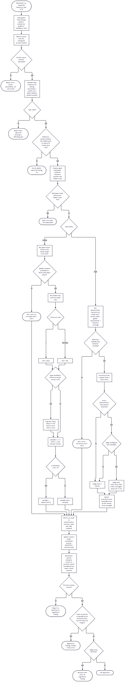
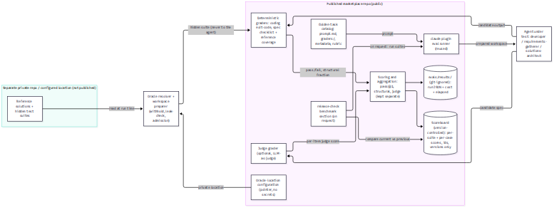

# spec-evaluation-harness

## Metadata

| Field | Value |
|---|---|
| **Feature** | Evaluation benchmark harness for the coding and spec-writing agents (Group A) |
| **Parent feature** | None |
| **Sub-features** | None |
| **Requirement refs** | BR-023; UR-077, UR-078, UR-079, UR-080; FR-254 to FR-287; NFR-037, NFR-038, NFR-039; SC-023, SC-024, SC-025 |
| **Feature type** | Architecture |
| **Status** | Draft |

Status values: Draft, Review, Approved, Implemented.

Citation note: paths that start with `plugins/assist-plugin/` are relative to that directory's position under the repository root; `docs/`, `specs/`, and `evals/results/` resolve against the repository root; `evals/` without the plugin prefix means `plugins/assist-plugin/evals/`. "Report:N" cites line N of `docs/research/research-eval-benchmarks-coding-spec-20261124.md`. Requirement IDs (`FR-254` and so on) cite `docs/requirements/FR-NFR-harness-governance.md`; `UR-` IDs cite `URD-harness-governance.md`; `BR-` and `SC-` IDs cite `BRD-harness-governance.md`. Group A is DRAFT in the requirements documents (`FR-NFR-harness-governance.md:1015`), so this spec is Draft.

## Description

This architecture measures the `developer` agent (code from specs) and the `requirements-gatherer` and `solutions-architect` agents (requirements and specs) on in-house golden tasks, release over release. It extends the `claude plugin eval` suites already under `evals/` and the `tests/` runner; it adds no second runner (FR-263; `evals/README.md:3`). Code is graded by execution (a hidden test suite's exit code), specs by a deterministic checklist plus an optional LLM-as-judge whose score stays separate from the structural score. Two properties shape the structure: the hidden oracle content is secret, so it lives in a separate private location the harness reads at run time and never ships in the published marketplace repo; and a full run is estimated at $25 to $75 (BRD A-12), so the benchmark runs on request only. The quality attributes it supports are reproducibility of the deterministic scores (NFR-037, SC-023), contamination resistance (FR-257, FR-258, SC-025), and a release-keyed trend (FR-276, SC-024).

## Components

| Component | Responsibility | Owns data | Technology |
|---|---|---|---|
| Golden-task catalog (public) | Hold each case as a `prompt.md`, a `graders/` folder, task metadata (provenance, creation date, valid-against cutoff), and, for a spec case, a rubric that separates deterministic from subjective items | Public task material under `evals/dev/<case>/` and `evals/spec/<case>/` | Markdown, JSON, `claude plugin eval` case layout |
| Oracle-location configuration (public) | Name the private location where reference solutions and hidden suites live; a pointer, never a secret and never oracle content | The pointer value only | JSON under `evals/` |
| Private oracle store | Hold each reference solution and hidden test suite out of the published repo | Reference solutions, hidden test suites | A separate private repository or configured private path |
| Oracle resolver and workspace preparer | Read the configured private location, admit a coding task only after its reference passes the hidden suite, prepare the agent workspace with the oracle withheld, and leak-check it | Transient run workspace | Node script invoked by the harness |
| Eval runner (reused) | Run each case (`prompt.md` plus `graders/`) with the agent under test, k times, in the existing layout | None (reused) | `claude plugin eval` (`evals/README.md:3`, `:21-28`) |
| Coding grader (deterministic) | Run the hidden suite and read its exit code as pass or fail, with no model call | Per-run pass/fail | Node `--test` programmatic `run()` or the `run-test` language command (`run-test/SKILL.md:60-67`) |
| Spec structural grader (deterministic) | Score the fraction of checklist items that pass, reusing `spec-from-requirements` review checks and `gather-requirements` criteria, with no model call | Structural score per case | Node script |
| Spec judge grader (optional) | Score each subjective rubric item with an LLM-as-judge, run only after the structural checklist clears | Judge score per case | LLM-as-judge grader |
| Scoring and aggregation | Compute pass@1 over k runs, keep structural and judge scores separate, flag flaky hidden-suite tests, and record cost and elapsed time | Run result JSON | Node script |
| Results sink | Hold each run's JSON result, cost, and elapsed time | Run results | `evals/results/` (git-ignored, `evals/.gitignore`) |
| Scoreboard | Hold, under version control, one aggregate row per release and suite (version, pass@1, structural score, judge score) and one per-case score record per release, suite, and case (version, suite, case id, per-case pass/fail or numeric score, run count), so the release comparison can run over the cases present in both releases; a per-case record holds scores only and no reference solution, hidden-test content, or agent output text (within NFR-039; FR-276's field list is a minimum) | Per-release suite scores and per-release per-case scores | Version-controlled file in the repository |
| Release-check benchmark section | On request, run the suites and compare each suite's score with the stored previous-release score; absent a request, report the last stored scoreboard without running the suites | None (reads the scoreboard) | A section of `release-check.js` defined by FR-250 in `FR-NFR-assist-plugin.md`: report the last stored scoreboard, no auto-run, suites on request only through the Group A harness (FR-273, FR-274), D-15 |

## Component boundaries

| Boundary | What crosses it | Protocol | Auth |
|---|---|---|---|
| Golden-task catalog to eval runner | The case `prompt.md` and `graders/` | File read in the case layout | Local filesystem |
| Oracle-location configuration to oracle resolver | The private location pointer | File read | Local filesystem |
| Private oracle store to oracle resolver | Reference solution and hidden test suite | Read at run time from the configured private location | The private location's own access control; never through the published repo |
| Oracle resolver to agent workspace | The prepared workspace, with the oracle withheld | Directory preparation plus a leak check | Local filesystem |
| Agent under test to graders | The candidate code or spec | File read of the agent's output | Local filesystem |
| Graders to scoring | Per-run pass/fail, structural fraction, per-item judge score | In-process return or JSON | Local |
| Scoring to results sink and scoreboard | Run result JSON; a scoreboard aggregate row and the per-case score records, both keyed to the plugin version | File write | Local; the scoreboard is version-controlled |
| Release-check benchmark section to scoreboard | The previous-release aggregate scores and per-case scores it compares against | File read | Local |

## Data flow

Required start-to-end data-flow flowchart. The agent renders it with mermaid-cli (`mmdc`), which is available on the maintainer's machine.

Render source: [spec-evaluation-harness-flow.mmd](spec-evaluation-harness-flow.mmd). To regenerate: `mmdc -i specs/spec-evaluation-harness-flow.mmd -o specs/spec-evaluation-harness-flow.png`.

Each flow below is a Requirement with Scenarios covering the primary path, an edge path, and a failure path.

### Requirement: Golden-task contents and case validation

The harness SHALL accept a coding golden task only when it holds a task prompt, a reference solution, and a hidden test suite, and a spec golden task only when it holds a task prompt, a reference requirements set or reference spec, and a rubric that lists its deterministic checklist items apart from its subjective items; the harness SHALL reject a task that is missing a part and name the missing part. Each test in a hidden suite SHALL carry its acceptance-criteria scenario identifier in the `[AC-n | spec | FR-n]` form the repository's own tests use (`tests/hooks/gate-evidence.test.js:161`), and each case SHALL run in the existing `claude plugin eval` layout (a `prompt.md` and a `graders/` folder under `evals/`).

#### Scenario: Complete coding task accepted

- **GIVEN** a coding golden task directory with a prompt, a reference solution, and a hidden test suite
- **WHEN** the harness loads it
- **THEN** the harness SHALL accept the task

#### Scenario: Missing hidden suite rejected

- **GIVEN** a coding task directory with a prompt and a reference solution and no hidden test suite
- **WHEN** the harness loads it
- **THEN** the harness SHALL reject the task
- **AND** the rejection SHALL name the missing hidden test suite

#### Scenario: Spec rubric separates its two item groups

- **GIVEN** a spec task whose rubric lists structural items and subjective items in separate groups
- **WHEN** the harness loads it
- **THEN** the harness SHALL accept the task

#### Scenario: Spec rubric mixes the two item groups

- **GIVEN** a spec task whose rubric mixes structural and subjective items in one list
- **WHEN** the harness loads it
- **THEN** the harness SHALL reject the task

#### Scenario: Hidden test carries its scenario identifier

- **GIVEN** a hidden test named `[AC-2 | spec-foo | FR-045] rejects an empty name`
- **WHEN** the harness loads the suite
- **THEN** the harness SHALL accept the test

#### Scenario: Hidden test without a scenario identifier

- **GIVEN** a hidden test whose name holds no scenario identifier
- **WHEN** the harness loads the suite
- **THEN** the harness SHALL reject the task
- **AND** the rejection SHALL name the test

#### Scenario: Task without a graders folder

- **GIVEN** a golden task directory with a `prompt.md` and no `graders/` folder
- **WHEN** the harness loads it
- **THEN** the harness SHALL reject the task

### Requirement: Contamination controls on golden tasks

The harness SHALL require each golden task to record its provenance (in-house or private repository), its creation date, and the model cutoff date it is valid against, and SHALL reject a task that is derived from a public benchmark dataset or that records no valid-against cutoff.

#### Scenario: Complete provenance accepted

- **GIVEN** a golden task whose metadata holds provenance, creation date, and valid-against cutoff
- **WHEN** the harness loads it
- **THEN** the harness SHALL accept the task

#### Scenario: Missing cutoff rejected

- **GIVEN** a golden task whose metadata holds no valid-against cutoff
- **WHEN** the harness loads it
- **THEN** the harness SHALL reject the task

#### Scenario: In-house task accepted

- **GIVEN** a golden task whose provenance reads in-house
- **WHEN** the harness loads it
- **THEN** the harness SHALL accept the task

#### Scenario: Public-dataset task rejected

- **GIVEN** a golden task whose provenance names a public benchmark dataset
- **WHEN** the harness loads it
- **THEN** the harness SHALL reject the task

### Requirement: Reference-solution admission

The harness SHALL admit a coding golden task only after its reference solution passes its hidden test suite in each of a configured number of consecutive runs, and SHALL report the failing run when the reference does not pass every run.

#### Scenario: Stable reference admitted

- **GIVEN** the configured count is 3 and the reference solution passes the hidden suite on 3 consecutive runs
- **WHEN** the harness validates the task
- **THEN** the harness SHALL admit the task

#### Scenario: Reference fails once

- **GIVEN** the configured count is 3 and the reference solution fails the hidden suite on run 2
- **WHEN** the harness validates the task
- **THEN** the harness SHALL NOT admit the task
- **AND** the report SHALL name the failing run

### Requirement: Private oracle resolution and withholding

The harness SHALL read each reference solution and hidden test suite from the configured private location at run time, SHALL keep every reference solution and hidden test suite out of the agent's workspace and out of every published artifact, and SHALL abort a run whose prepared workspace holds a file from the oracle. The published marketplace repo holds prompts, graders, metadata, rubrics, and the oracle-location pointer only; the private location holds the oracle content (settled design decision; resolves OQ-15 and D-16). The "Private oracle location unreachable" scenario below is a design-level elaboration of that private-location decision realizing FR-260 and FR-261; FR-260 governs withholding the oracle from the agent and FR-261 keeping it out of published artifacts, and neither specifies resolution-failure handling, so the spec adds it here to keep the decision implementable.

#### Scenario: Agent workspace holds no oracle

- **GIVEN** a coding run for a golden task
- **WHEN** the harness prepares the agent's workspace
- **THEN** the workspace SHALL hold no reference solution and no hidden test suite file

#### Scenario: Leak detected before the run

- **GIVEN** a prepared workspace that holds a file from the oracle
- **WHEN** the harness checks the workspace before the run
- **THEN** the harness SHALL abort the run
- **AND** the report SHALL name the leaked path

#### Scenario: Published package holds no oracle material

- **GIVEN** the list of files in a published plugin package
- **WHEN** the list is searched for reference-solution and hidden-suite paths
- **THEN** the search SHALL find none

#### Scenario: Oracle path in the published package

- **GIVEN** a published package list that holds a reference-solution or hidden-suite path
- **WHEN** the harness validates the package list
- **THEN** the validation SHALL fail
- **AND** the result SHALL name the path

#### Scenario: Private oracle location unreachable

- **GIVEN** the configured private location is absent or cannot be read
- **WHEN** the harness resolves the oracle for a run
- **THEN** the harness SHALL report an error and SHALL NOT score the run as pass or fail
- **AND** the error SHALL name the unreachable location and SHALL NOT read as a benchmark score

### Requirement: Coding run scoring by execution and pass@1

The harness SHALL score a coding run as pass when the hidden test suite exits 0 and as fail when it exits non-zero, with no model call in the scoring; SHALL report a run as not-run (never pass or fail) when the sandbox backend the run's Write, Edit, and Bash grant requires is unavailable; and SHALL report pass@1 for a coding case as c divided by k, where k is the number of completed runs and c is the number of those runs that pass, stating k, c, and the harness version beside each pass@1 value. A not-run or error run counts in neither c nor k.

#### Scenario: Suite passes

- **GIVEN** a coding run whose hidden suite exits 0
- **WHEN** the harness scores the run
- **THEN** the run SHALL score pass
- **AND** the scoring SHALL make no model call

#### Scenario: Suite fails

- **GIVEN** a coding run whose hidden suite exits non-zero
- **WHEN** the harness scores the run
- **THEN** the run SHALL score fail

#### Scenario: Sandbox backend absent

- **GIVEN** a coding case that needs a shell grant and a machine with no sandbox backend
- **WHEN** the harness runs the case
- **THEN** the run SHALL read not-run
- **AND** the run SHALL count in neither c nor k

#### Scenario: Three of five pass

- **GIVEN** a coding case run 5 times with 3 passes
- **WHEN** the harness reports pass@1
- **THEN** the value SHALL read 0.6
- **AND** the result SHALL state k = 5, c = 3, and the harness version beside it

#### Scenario: No completed run

- **GIVEN** a coding case whose every run read not-run
- **WHEN** the harness reports pass@1
- **THEN** the value SHALL read absent
- **AND** the value SHALL NOT read 0, so the c-divided-by-k computation never divides by zero

#### Scenario: Result without a harness version

- **GIVEN** a result that holds a pass@1 value and no harness version
- **WHEN** the result is validated
- **THEN** the validation SHALL fail

### Requirement: Flaky hidden-suite tests reported, not silenced

The harness SHALL report a hidden-suite test that gives different results on repeated runs of the same candidate as flaky, without skipping or retrying it, and SHALL keep the test in the suite result; the harness SHALL reject a configuration that retries a failing hidden test until it passes.

#### Scenario: Flaky test flagged

- **GIVEN** a hidden test that passes on run 1 and fails on run 2 for the same candidate
- **WHEN** the harness reports the suite
- **THEN** the report SHALL list the test as flaky
- **AND** the test SHALL still count in the suite result

#### Scenario: Retry-until-pass configuration rejected

- **GIVEN** a configuration that retries a failing hidden test until it passes
- **WHEN** the harness loads the configuration
- **THEN** the harness SHALL reject the configuration

### Requirement: Spec structural scoring

The harness SHALL score a spec run as the fraction of its deterministic checklist items that pass, with no model call in the scoring; the checklist SHALL be built from the checks that `spec-from-requirements` review mode (`spec-from-requirements/SKILL.md:140-149`) and the `gather-requirements` quality criteria (`gather-requirements/SKILL.md:99-101`) already define, and SHALL confirm that each requirement identifier, scenario, and error path of the reference appears in the output. The structural score SHALL be identical on every repetition over one spec output (NFR-037). When the reference is unreadable or the checklist cannot run, the run SHALL read error and the structural score SHALL NOT read 0.

#### Scenario: Partial score

- **GIVEN** a spec run that passes 8 of 10 deterministic checklist items
- **WHEN** the harness scores the run
- **THEN** the structural score SHALL read 0.8

#### Scenario: Checklist item has an existing source

- **GIVEN** a checklist item "every Requirement has a Scenario"
- **WHEN** the harness validates the checklist
- **THEN** the harness SHALL accept the item because `spec-from-requirements` review mode defines it

#### Scenario: Checklist item has no existing source

- **GIVEN** a checklist item that no existing check or quality criterion defines
- **WHEN** the harness validates the checklist
- **THEN** the harness SHALL reject the item

#### Scenario: Reference coverage full

- **GIVEN** a reference with FR-1 to FR-3 and one error path each, and an output that holds all of them
- **WHEN** the checklist runs
- **THEN** the reference-coverage items SHALL pass

#### Scenario: Missing error path

- **GIVEN** an output that omits the error path of FR-3
- **WHEN** the checklist runs
- **THEN** the item for that error path SHALL fail
- **AND** the result SHALL name FR-3

#### Scenario: Repeated scoring is identical

- **GIVEN** one spec output and the deterministic checklist
- **WHEN** the harness scores it 10 times
- **THEN** all 10 structural scores SHALL be equal

#### Scenario: Checklist cannot run

- **GIVEN** a spec run whose reference file is unreadable
- **WHEN** the harness scores the run
- **THEN** the run SHALL read error
- **AND** the structural score SHALL NOT read 0

### Requirement: Spec judge grading, separation, and bias mitigations

The harness MAY score the subjective rubric items of a spec case with an LLM-as-judge grader, and SHALL run the judge only on a case that cleared the structural checklist (every deterministic item passed, A-13). It SHALL report the structural score and the judge score as two separate values and SHALL NOT combine them into one number. The judge SHALL score each subjective rubric item separately against the text of that item; WHEN the judge compares two texts it SHALL run the comparison in both orders and report the mean; and each judge score SHALL be the mean of a configured number of judge runs with that number stated. WHERE a human-labeled sample of spec outputs exists, the harness SHOULD report the judge's agreement with the human scores as Spearman rho or Cohen kappa. The current judge runs in the same model family as the agent under test, with the bias mitigations above; a different-family judge is a future enhancement, not a requirement of this version (settled design decision consistent with the reconciled FR-282; see Design decisions and the FR-282 note in Error handling).

#### Scenario: Judge off

- **GIVEN** a spec case and no judge configured
- **WHEN** the harness scores the case
- **THEN** the result SHALL hold a structural score
- **AND** the judge score SHALL read absent

#### Scenario: Judge on

- **GIVEN** a spec case and a judge configured
- **WHEN** the harness scores the case
- **THEN** the result SHALL hold both a structural score and a judge score

#### Scenario: Cleared case judged

- **GIVEN** a spec case with every deterministic item passed and a judge configured
- **WHEN** the harness scores the case
- **THEN** the judge grader SHALL run

#### Scenario: Uncleared case not judged

- **GIVEN** a spec case with one deterministic item failed and a judge configured
- **WHEN** the harness scores the case
- **THEN** the judge grader SHALL NOT run
- **AND** the judge score SHALL read absent

#### Scenario: Two separate values

- **GIVEN** a spec case with a structural score 0.9 and a judge score 0.6
- **WHEN** the result is written
- **THEN** the result SHALL hold 0.9 and 0.6 as two values

#### Scenario: Combined field rejected

- **GIVEN** a result that holds a field averaging the two scores
- **WHEN** the result is validated
- **THEN** the validation SHALL fail and name the field

#### Scenario: Per-item scores

- **GIVEN** a rubric with 3 subjective items
- **WHEN** the judge scores a spec
- **THEN** the result SHALL hold 3 item scores

#### Scenario: One overall score rejected

- **GIVEN** a judge result that holds a single overall score and no item scores
- **WHEN** the result is validated
- **THEN** the validation SHALL fail

#### Scenario: Both comparison orders averaged

- **GIVEN** a judge comparison of an output against the reference
- **WHEN** the harness runs it
- **THEN** the harness SHALL run output-then-reference and reference-then-output
- **AND** the reported result SHALL be the mean of the two

#### Scenario: One order only rejected

- **GIVEN** a comparison result built from one order
- **WHEN** the result is validated
- **THEN** the validation SHALL fail

#### Scenario: Judge score is a mean over runs

- **GIVEN** a configured count of 3 and judge runs scoring 0.6, 0.7, and 0.8
- **WHEN** the result is written
- **THEN** the judge score SHALL read 0.7
- **AND** the result SHALL state 3 runs

#### Scenario: Judge run count not stated

- **GIVEN** a result that holds a judge score and no run count
- **WHEN** the result is validated
- **THEN** the validation SHALL fail

#### Scenario: Labeled sample reported

- **GIVEN** a labeled sample of 20 spec outputs with human scores
- **WHEN** the harness reports the judge
- **THEN** the report SHOULD hold a Spearman rho or a Cohen kappa for the sample

#### Scenario: No labeled sample

- **GIVEN** no labeled sample
- **WHEN** the harness reports the judge
- **THEN** the report SHOULD state that no agreement figure exists

#### Scenario: Judge unavailable

- **GIVEN** a cleared spec case with a judge configured and the judge model unavailable at run time
- **WHEN** the harness scores the case
- **THEN** the judge score SHALL read absent
- **AND** the structural score SHALL still be reported

### Requirement: Benchmark section and release-over-release comparison

The release-check runner SHALL provide a benchmark section that, when the user requests it, runs the coding and spec suites and compares each suite's score (the mean pass@1 of a coding suite, the mean structural score of a spec suite) with the previous release's score computed over the cases present in both releases; absent a request the section SHALL NOT run the suites. Each stored result SHALL be keyed to the plugin version the run records, and the repository SHALL hold a version-controlled scoreboard that holds one aggregate row per release and suite (version, pass@1, structural score, judge score) and one per-case score record per release, suite, and case (version, suite, case id, per-case pass/fail or numeric score, run count). The section SHALL compute each release's comparison score from the per-case records of the two releases, restricted to the case ids present in both, so a case absent from either release enters neither score; a per-case record SHALL hold scores only and no reference solution, hidden-test content, or agent output text (within NFR-039; the FR-276 field list is a minimum, not a cap). The section SHALL report a regression finding (yielding release-check exit 1) when a suite's structural or pass@1 score is below the previous release's by more than a configured margin, SHALL report a judge-score decline as advisory only, and SHALL run its held-out cases only in this section. The harness SHOULD add at least one new golden task to each suite in each release that runs the section.

#### Scenario: Comparison reported

- **GIVEN** stored scores for the previous release and a benchmark request
- **WHEN** the benchmark section runs
- **THEN** the section SHALL report, for each suite, the current score and the previous score

#### Scenario: No previous release

- **GIVEN** no stored scores for a previous release
- **WHEN** the benchmark section runs
- **THEN** the section SHALL report no baseline
- **AND** the section SHALL NOT report a regression finding

#### Scenario: Plain release check does not run the suites

- **GIVEN** a release check started with no benchmark request
- **WHEN** the runner runs its sections
- **THEN** the benchmark section SHALL NOT run the suites
- **AND** every other section SHALL behave as before

#### Scenario: Requested run

- **GIVEN** a release check started with the benchmark request
- **WHEN** the runner runs its sections
- **THEN** the benchmark section SHALL run the suites

#### Scenario: Result keyed to the plugin version

- **GIVEN** a run result that records plugin version 1.14.7
- **WHEN** the harness stores the result
- **THEN** the stored result SHALL be keyed to 1.14.7

#### Scenario: Result without a plugin version refused

- **GIVEN** a run result that records no plugin version
- **WHEN** the harness stores the result
- **THEN** the harness SHALL refuse to store it

#### Scenario: Scoreboard row added for a release

- **GIVEN** a completed benchmark section for version 1.14.7
- **WHEN** the scoreboard is read
- **THEN** it SHALL hold a row for 1.14.7 for each suite run

#### Scenario: Scoreboard row missing

- **GIVEN** a completed benchmark section and a scoreboard with no row for that version
- **WHEN** the benchmark section ends
- **THEN** the section SHALL report a finding that names the version

#### Scenario: Drop beyond the margin

- **GIVEN** a margin of 0.05, a previous suite score of 0.80, and a current score of 0.70
- **WHEN** the benchmark section compares them
- **THEN** the section SHALL report a regression finding for that suite

#### Scenario: Drop within the margin

- **GIVEN** a margin of 0.05, a previous suite score of 0.80, and a current score of 0.78
- **WHEN** the benchmark section compares them
- **THEN** the section SHALL report no regression finding

#### Scenario: Judge decline alone is advisory

- **GIVEN** a judge score down 0.2 and structural scores within the margin
- **WHEN** the benchmark section compares releases
- **THEN** the section SHALL report an advisory note
- **AND** the section SHALL report no regression finding

#### Scenario: Structural score drops too

- **GIVEN** a judge score down 0.2 and a structural score down beyond the margin
- **WHEN** the benchmark section compares releases
- **THEN** the section SHALL report a regression finding for the structural score

#### Scenario: Per-case scores stored for a release

- **GIVEN** a completed benchmark section for a suite with cases c1 and c2
- **WHEN** the scoreboard is written
- **THEN** the scoreboard SHALL hold a per-case score record for c1 and for c2 keyed to the release version
- **AND** each per-case record SHALL hold scores only and no reference solution, hidden-test content, or agent output text

#### Scenario: Added case excluded from the comparison

- **GIVEN** the current release holds a case whose id the previous release's per-case records lack
- **WHEN** the benchmark section compares scores
- **THEN** the section SHALL compute each suite score over the case ids present in both releases
- **AND** the added case SHALL NOT enter either score

#### Scenario: Removed case excluded from the comparison

- **GIVEN** the previous release's per-case records hold a case id the current release lacks
- **WHEN** the benchmark section compares scores
- **THEN** the section SHALL compute each suite score from the stored per-case records over the case ids present in both releases
- **AND** the removed case SHALL NOT enter either score

#### Scenario: Held-out case excluded from an ordinary eval run

- **GIVEN** a case flagged held-out
- **WHEN** an ordinary `claude plugin eval` run lists cases
- **THEN** the harness SHALL exclude the held-out case

#### Scenario: Held-out case included in the release benchmark

- **GIVEN** a case flagged held-out and a benchmark request
- **WHEN** the benchmark section runs
- **THEN** the section SHALL include the held-out case

#### Scenario: New task added

- **GIVEN** a release that runs the benchmark section and a suite with one case not present in the previous release
- **WHEN** the scoreboard is compared with the previous release
- **THEN** the check SHALL find a new case in that suite

#### Scenario: No new task

- **GIVEN** a suite with no new case in a benchmark release
- **WHEN** the benchmark section runs
- **THEN** the section SHALL report an advisory note that names the suite

#### Scenario: Empty suite

- **GIVEN** a suite with no admitted case, or whose every run read not-run
- **WHEN** the benchmark section computes the suite score
- **THEN** the suite score SHALL read absent
- **AND** the section SHALL NOT report a regression finding for that suite from an absent score

## Topology

Component topology. The agent renders it with mermaid-cli (`mmdc`), which is available on the maintainer's machine.

Render source: [spec-evaluation-harness-topology.mmd](spec-evaluation-harness-topology.mmd). To regenerate: `mmdc -i specs/spec-evaluation-harness-topology.mmd -o specs/spec-evaluation-harness-topology.png`.

## Cloud boundaries

Not applicable: the harness runs on the maintainer's machine or in CI against a local repository and a configured private location; no component spans more than one cloud or region.

## Failure modes

| Failure | Impact | Detection | Mitigation |
|---|---|---|---|
| Private oracle location unreachable | No run can be scored | The oracle resolver cannot read the configured location | Report an error, score nothing, name the location; do not read as a benchmark score (design-level elaboration of the private-location decision realizing FR-260/FR-261, which do not specify resolution-failure handling) |
| Oracle file leaks into the agent workspace | The agent could read the answer, inflating the score | The pre-run workspace leak check | Abort the run and name the leaked path (FR-260) |
| Oracle path ships in a published package | Secret content is exposed and scores become meaningless | The package-list validation (FR-261) | Fail validation and name the path; keep oracle content only in the private location |
| Sandbox backend absent for a coding case | The agent cannot write or run code | The runner refuses the shell grant (`evals/README.md:40`) | Report the run as not-run; exclude it from c and k (FR-264, FR-271) |
| Every coding run reads not-run | k = 0, so c divided by k would divide by zero | The scoring step sees no completed run | Report pass@1 as absent, not 0 (FR-271) |
| Spec reference unreadable or checklist cannot run | The structural score cannot be computed | The structural grader cannot read the reference | Report the run as error; do not report the structural score as 0 (FR-265) |
| Judge model unavailable | No judge score | The judge grader cannot reach the model | Report the judge score as absent; keep the structural score (FR-268, FR-270) |
| Hidden-suite test is flaky | A candidate's score is unstable | Different results on repeated runs of the same candidate | Flag the test flaky, keep it in the result, never skip or retry (FR-287) |
| A suite has no admitted case or no completed run | No suite score | The benchmark section computes over an empty set | Report the suite score as absent; raise no regression finding from an absent score |
| No previous-release scores | No comparison baseline | The benchmark section finds no stored scores | Report no baseline; raise no regression finding (FR-273) |

## Non-functional requirements addressed

| NFR | Target | How this architecture achieves it |
|---|---|---|
| NFR-037 | 100% identical structural score over 10 repeated scorings of one output | The structural grader is deterministic and makes no model call (FR-265); the judge, which is stochastic, is kept out of the structural score |
| NFR-038 | Total model cost (USD) and elapsed time recorded in 100% of run results | The scoring step writes cost and elapsed time into each run result in `evals/results/`; the recorded 8-case run cost about $4.85 in 165 seconds (Report:6), and a full run of 10 coding and 10 spec cases at k = 5 is estimated at $25 to $75 (Report:114), an estimate not measured on this repository |
| NFR-039 | The scoreboard and logs hold 0 reference or output strings | The version-controlled scoreboard (aggregate rows and per-case score records) and the benchmark logs hold scores, identifiers (case id, suite), and versions only. The oracle content (reference solutions and hidden-suite text) is secret and lives only in the private location, never in the published repo. Agent output text stays in the git-ignored `evals/results/` run JSON, which is uncommitted rather than secret. Neither the secret oracle content nor the git-ignored run JSON enters the version-controlled scoreboard |

## Design decisions

| Decision | Options considered | Chosen | Rationale |
|---|---|---|---|
| Where the oracle lives (OQ-15, D-16) | Commit `reference/` under the shipped plugin tree (Report:78-91); a separate private repository or configured private path; encrypt in-repo | A separate private location the harness reads at run time | The marketplace repo is published, so committing reference solutions or hidden suites would expose the oracle and break FR-261 and NFR-039. The public repo holds prompts, graders, configuration, and a pointer; the oracle content stays private (settled design decision) |
| When the benchmark runs (OQ-13) | Run on every release check; run on request only; opt-in CI | On request only (manual or opt-in CI); a plain release check reports the last stored scoreboard and does not auto-run the suites | A full run is estimated at $25 to $75 (BRD A-12, Report:114), too costly to run on every check (FR-274). FR-250 in `FR-NFR-assist-plugin.md` now carries the benchmark-scoreboard section (D-15, FR-273, FR-274): a plain release check reports the last stored scoreboard and runs no suite, and a requested run starts the Group A harness and adds no second runner |
| Judge model family (OQ-16) | A different-family judge now; a same-family judge now with bias mitigations (the reconciled FR-282); no judge | A same-family judge now with bias mitigations (candidate-order randomization FR-284, rubric anchoring and per-item scoring FR-283, judge score as a mean over runs FR-285, periodic human-agreement checks FR-286); a different-family judge is a future enhancement | The plugin's agents run on one vendor's models today, so a second family may be unavailable (OQ-16). The judge stays advisory (FR-279) and never gates a merge, so same-family bias is tolerable with the mitigations. This matches the reconciled FR-282, which requires the three bias mitigations when the judge shares the agent's model family; a different-family judge is a future enhancement, not a requirement of this version (settled design decision) |
| Structural and judge scores combined or separate | One combined quality number; two separate scores | Two separate scores, never averaged (FR-270) | A deterministic floor and a noisy judge measure different things; averaging hides a structural failure behind a judge score (Report:69) |
| One runner or a new one | Build a benchmark runner; reuse `claude plugin eval` and `tests/` | Reuse the existing runner and case layout; add no second runner (FR-263) | The case layout, ablation arms, and `results/` sink already exist (`evals/README.md:3`, `:28`); a second runner is parallel infrastructure (Report:93) |

## Configured values (recommended defaults)

The requirements leave these numeric values to configuration with no settled default (OQ-14, A-14). Each recommended value below is an estimate to confirm by measurement, not a settled figure. A scenario in the requirements that shows a figure is an example, not a default (A-14).

| Value | Requirement | Recommended default (estimate to confirm) | Basis of the estimate |
|---|---|---|---|
| Run count k for pass@1 | FR-271 | 5 | The report's full-run cost estimate assumes k = 5 (Report:114); larger k costs more, smaller k gives a noisier pass@1 |
| Regression margin | FR-277 | 0.05 | The FR-277 scenario uses a 0.05 margin as its example (`FR-NFR-harness-governance.md:1479`); tune against observed run-to-run variance |
| Reference-solution validation run count | FR-259 | 3 | The FR-259 scenario uses 3 consecutive runs as its example (`FR-NFR-harness-governance.md:1125`) |
| Judge run count | FR-285 | 3 | The FR-285 scenario uses 3 judge runs as its example (`FR-NFR-harness-governance.md:1634`); averaging more runs cuts judge variance at more cost |
| New golden tasks per benchmark release | FR-281 | 1 per suite | FR-281 states the count of one is an estimate to confirm (`FR-NFR-harness-governance.md:1552`) |

## Sub-feature breakdown

Not applicable: the harness is one architecture built from the components above; no component needs its own feature-level spec in this release.

## Submodule scope

Not applicable: the repository has no submodules. The private oracle location is a separate store the harness reads, not a submodule of this repository.

## Error handling

| Error condition | Handling strategy | Outcome |
|---|---|---|
| Private oracle location absent or unreadable | Report an error and score nothing | No benchmark score; the error names the location (design-level elaboration of the private-location decision realizing FR-260/FR-261, which do not specify resolution-failure handling) |
| Oracle file in the prepared workspace | Abort the run before it starts | The run does not execute; the report names the leaked path (FR-260) |
| Oracle path in a published package | Fail the package-list validation | The result names the path; the package is not published with oracle content (FR-261) |
| Coding case needs a shell grant and the sandbox backend is absent | Report the run as not-run | The run counts in neither c nor k (FR-264, FR-271) |
| Division by zero in pass@1 (k = 0) | Report pass@1 as absent | pass@1 does not read 0 and the computation never divides by zero (FR-271) |
| Spec reference unreadable or checklist cannot run | Report the run as error | The structural score is not reported as 0 (FR-265) |
| Judge model unavailable | Report the judge score as absent | The structural score stands; the judge is advisory (FR-268, FR-270, FR-279) |
| Flaky hidden-suite test | Flag flaky, keep in the result, never skip or retry | The suite result still counts the test (FR-287) |
| Retry-until-pass configuration | Reject the configuration | The harness does not load a config that hides flakiness (FR-287) |
| Empty suite (no admitted case or no completed run) | Report the suite score as absent | No regression finding from an absent score |
| No previous-release scores | Report no baseline | No regression finding (FR-273) |
| FR-282 alignment (same-family judge now) | The harness runs a same-family judge with the three bias mitigations FR-282 requires (candidate-order randomization, rubric anchoring, human-agreement check) | Consistent with the reconciled FR-282; a different-family judge is a future enhancement, not a requirement of this version, and no requirements delta is outstanding |

## Events

Not applicable: the harness writes files (run results, the scoreboard) and a release-check exit code; it emits and consumes no event. This mirrors `release-check.js`, which emits no event (`spec-release-check.md:238`).

## Traceability

| Requirement | Spec section | Verified by |
|---|---|---|
| FR-254 | Requirement: Golden-task contents and case validation | Test: a complete coding task is accepted; a task with no hidden suite is rejected and names the missing part |
| FR-255 | Requirement: Golden-task contents and case validation | Test: a rubric that separates its two groups is accepted; a mixed rubric is rejected |
| FR-256 | Requirement: Golden-task contents and case validation | Test: an `[AC-n \| spec \| FR-n]`-named test is accepted; an unnamed test rejects the task and names the test |
| FR-257 | Requirement: Contamination controls on golden tasks | Test: complete provenance is accepted; a task with no cutoff is rejected |
| FR-258 | Requirement: Contamination controls on golden tasks | Test: an in-house task is accepted; a public-dataset task is rejected |
| FR-259 | Requirement: Reference-solution admission | Test: a reference that passes 3 of 3 runs is admitted; a reference that fails run 2 is not admitted and names the failing run |
| FR-260 | Requirement: Private oracle resolution and withholding | Test: the workspace holds no oracle; a leak aborts the run and names the path; an unreachable private location scores nothing (this last case is a design-level elaboration realizing FR-260/FR-261, not stated by either requirement) |
| FR-261 | Requirement: Private oracle resolution and withholding | Test: a published package holds no oracle path; a package with one fails validation and names the path |
| FR-262 | Requirement: Coding run scoring by execution and pass@1 | Test: exit 0 scores pass with no model call; exit non-zero scores fail |
| FR-263 | Requirement: Golden-task contents and case validation; Topology | Test: a case with `prompt.md` and `graders/` is listed by `claude plugin eval`; a task with no `graders/` is rejected |
| FR-264 | Requirement: Coding run scoring by execution and pass@1 | Test: no sandbox backend reads not-run and the run counts in neither c nor k; a backend present reads pass or fail |
| FR-265 | Requirement: Spec structural scoring | Test: 8 of 10 items reads 0.8; an unreadable reference reads error and not 0 |
| FR-266 | Requirement: Spec structural scoring | Test: a review-mode item is accepted; an item with no existing source is rejected |
| FR-267 | Requirement: Spec structural scoring | Test: full reference coverage passes; a missing error path fails and names the FR |
| FR-268 | Requirement: Spec judge grading, separation, and bias mitigations | Test: judge off reads structural only; judge on reads both |
| FR-269 | Requirement: Spec judge grading, separation, and bias mitigations | Test: a cleared case is judged; an uncleared case is not judged and judge reads absent |
| FR-270 | Requirement: Spec judge grading, separation, and bias mitigations | Test: two scores are held as two values; a combined field fails validation and names the field |
| FR-271 | Requirement: Coding run scoring by execution and pass@1 | Test: 3 of 5 reads 0.6; every run not-run reads absent, not 0 |
| FR-272 | Requirement: Coding run scoring by execution and pass@1 | Test: a pass@1 value states k, c, and the harness version; a result with no version fails validation |
| FR-273 | Requirement: Benchmark section and release-over-release comparison | Test: a comparison reports current and previous per suite; no previous release reports no baseline and no regression |
| FR-274 | Requirement: Benchmark section and release-over-release comparison | Test: a plain release check does not run the suites; a requested run does |
| FR-275 | Requirement: Benchmark section and release-over-release comparison | Test: a result recording version 1.14.7 is keyed to 1.14.7; a result with no version is refused |
| FR-276 | Requirement: Benchmark section and release-over-release comparison | Test: an aggregate row and a per-case score record exist per suite for a release; a missing row is a finding that names the version |
| FR-277 | Requirement: Benchmark section and release-over-release comparison | Test: a 0.10 drop beyond a 0.05 margin is a regression; a 0.02 drop within it is not |
| FR-278 | Requirement: Benchmark section and release-over-release comparison | Test: per-case scores are stored per release, and the section recomputes each suite score from the stored per-case records over the case ids present in both releases, so an added case and a removed case each stay out of both scores |
| FR-279 | Requirement: Benchmark section and release-over-release comparison | Test: a judge decline alone is advisory; a structural drop beyond the margin is a regression |
| FR-280 | Requirement: Benchmark section and release-over-release comparison | Test: a held-out case is excluded from an ordinary run and included in the release benchmark |
| FR-281 | Requirement: Benchmark section and release-over-release comparison | Test: a new case is found in a suite; a suite with no new case gets an advisory note |
| FR-282 | Design decisions; Error handling (FR-282 alignment) | Design review: the judge is same-family with the three bias mitigations FR-282 requires; a different-family judge is a future enhancement, not a requirement of this version (consistent with the reconciled FR-282) |
| FR-283 | Requirement: Spec judge grading, separation, and bias mitigations | Test: a 3-item rubric yields 3 item scores; a single overall score fails validation |
| FR-284 | Requirement: Spec judge grading, separation, and bias mitigations | Test: a pairwise comparison runs both orders and reports their mean; a one-order result fails validation |
| FR-285 | Requirement: Spec judge grading, separation, and bias mitigations | Test: a mean of 0.6, 0.7, 0.8 reads 0.7 with 3 runs stated; a judge score with no run count fails validation |
| FR-286 | Requirement: Spec judge grading, separation, and bias mitigations | Test: a 20-output labeled sample yields a Spearman rho or Cohen kappa; no sample states that no figure exists |
| FR-287 | Requirement: Flaky hidden-suite tests reported, not silenced | Test: a test with different results across runs is flagged flaky and still counts; a retry-until-pass config is rejected |
| NFR-037 | Requirement: Spec structural scoring; Non-functional requirements addressed | Test: 10 repeated scorings of one output are equal |
| NFR-038 | Non-functional requirements addressed | Test: a completed run result holds total cost and elapsed time |
| NFR-039 | Requirement: Private oracle resolution and withholding; Non-functional requirements addressed | Content test: a scoreboard row holds version, suite, and scores only and no hidden-suite text |
| UR-077 | Requirement: Golden-task contents and case validation; Requirement: Contamination controls on golden tasks | The maintainer defines in-house coding and spec golden tasks, each with a reference and a grader |
| UR-078 | Requirement: Coding run scoring by execution and pass@1; Requirement: Spec structural scoring; Requirement: Spec judge grading, separation, and bias mitigations | The maintainer reads pass@1 for coding and a structural score and a separate judge score for specs |
| UR-079 | Requirement: Benchmark section and release-over-release comparison | The maintainer sees at release time whether a suite's score fell against the previous release |
| UR-080 | Requirement: Contamination controls on golden tasks; Requirement: Reference-solution admission; Requirement: Private oracle resolution and withholding; Requirement: Flaky hidden-suite tests reported, not silenced; Requirement: Spec judge grading, separation, and bias mitigations | The maintainer relies on scores not inflated by contamination, overfitting, judge bias, or flaky tests |
| BR-023 | All Requirements | The business measures the coding and spec-writing agents on in-house golden tasks and tracks the scores release over release |
| SC-023 | Requirement: Spec structural scoring; Requirement: Coding run scoring by execution and pass@1 | 100% identical structural scores over 10 repetitions; every coding run set's pass or fail set by a suite exit code |
| SC-024 | Requirement: Benchmark section and release-over-release comparison | 100% of benchmark releases have a scoreboard row per suite |
| SC-025 | Requirement: Contamination controls on golden tasks; Requirement: Private oracle resolution and withholding | 100% of tasks record provenance, creation date, and cutoff; 0 tasks derived from a public dataset |

## Out-of-scope dependencies

These items this spec names but does not define, so a later spec or delta owns them:

- The release-check wiring of the benchmark section. FR-250 in `FR-NFR-assist-plugin.md` now defines it (report the last stored scoreboard, no auto-run, suites on request only through the Group A harness, FR-273 and FR-274; D-15), and the runner spec `spec-release-check.md` owns the section in the `release-check.js` section list. This spec states the section's behavior.
- The FR-282 reconciliation, now complete in the requirements. The reconciled FR-282 requires the three bias mitigations for a same-family judge, which this spec applies, and names a different-family judge a future enhancement, not a requirement of this version. This spec changes no requirement.
- The exact private location (a private repository, a path, or another store) and its access control. The settled decision fixes that the oracle lives outside the published repo and the harness reads it at run time; the concrete location is a configuration value.
