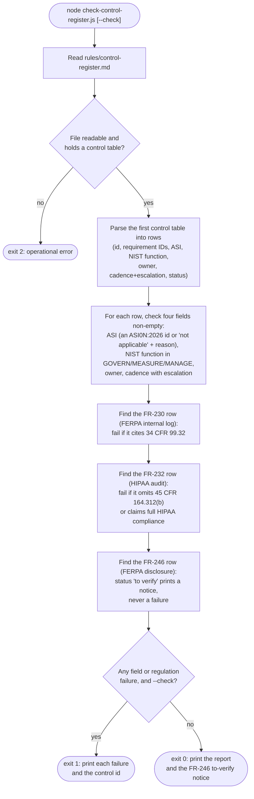
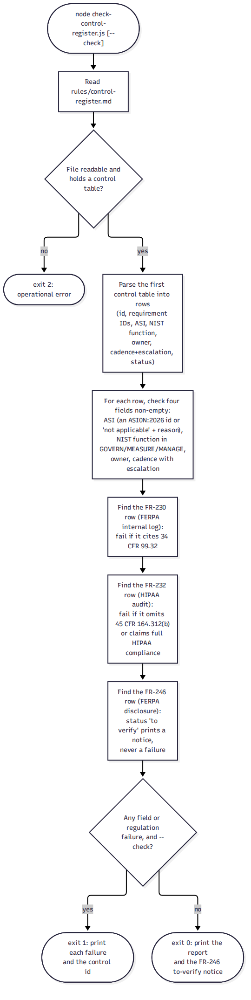

# spec-governance-control-register

## Metadata

| Field | Value |
|---|---|
| **Feature** | Governance control register: one row per harness-governance control mapped to OWASP Agentic AI Top 10 and NIST AI RMF, with owner, cadence, and status, plus the `check-control-register.js --check` validator |
| **Parent feature** | spec-hooks-platform.md |
| **Sub-features** | None |
| **Requirement refs** | BR-021, UR-070, FR-235, FR-236, FR-240, FR-241, NFR-028, NFR-033, NFR-035 |
| **Feature type** | General (Policy and Tooling) |
| **Status** | Draft |

Status values: Draft, Review, Approved, Implemented.

Paths that start with `rules/` or `scripts/` are relative to `plugins/assist-plugin/`. This spec describes planned behavior for harness-governance Tranche 5 (task plan `docs/task-plans/task-plan-harness-governance-20261028-0759.md`, Steps 38 and 39); nothing here is built. It traces to FR-NFR-harness-governance.md v1.3 (2026-10-30).

## Description

The control register is a rules document, `rules/control-register.md`, with one row per harness-governance control. Each row maps a control to an OWASP Agentic AI Top 10 item (ASI01 to ASI10) or a reasoned "not applicable", to a NIST AI RMF function, to an owner role, to a review cadence with an escalation path, and to a status. The register satisfies FR-235 (map each control to an ASI item or a reasoned not-applicable) and FR-236 (map each control to a NIST AI RMF function with an owner and a review cadence). A companion script, `scripts/check-control-register.js`, validates the register in `--check` mode: it fails when a row is missing a mapped field and enforces the fixed per-regulation statuses for the FERPA internal-access log (FR-230), the HIPAA audit log (FR-232), and the FERPA disclosure control (FR-246).

The register rests on verified reference data. The NIST AI RMF functions come from NIST.AI.100-1 (January 2023; GOVERN, MAP, MEASURE, MANAGE; high confidence). The OWASP Agentic AI Top 10 identifiers come from the OWASP GenAI Security Project Agentic Security Initiative (identifier format `ASI0N:2026`); the official publication was gated and the names were cross-confirmed, so the ASI mapping is labeled directional per NFR-033 (medium-to-high confidence). The hook facts behind FR-219 (hook types and timeouts) are directional, the default review cadence is an estimate, and every control that rests on a vendor source is labeled directional (NFR-033). This spec fixes the control-ID row set, the schema, the owner-role set, the escalation wording, the per-regulation statuses, and the check-script contract; the register file (Step 38) renders the row set and the check script (Step 39) validates it.

## Triggered by

| Trigger type | Source | Condition |
|---|---|---|
| Manual or CI command | `node scripts/check-control-register.js [--check]` | A maintainer or a CI job validates `rules/control-register.md` |
| Governance review | The owner role on each row, on the review cadence | A periodic control review (default quarterly, estimate) |

## Required data

| Data | Source | Type | Notes |
|---|---|---|---|
| Control register | `rules/control-register.md` | Markdown table | The first control table under the fixed register heading; one row per control |
| Control-ID row set | This spec, Requirement: Control-ID row set and inclusion rule | Enumerated list | The 31 control rows; their Requirement IDs fields name FR-214 to FR-247 (32 control FR IDs, plus FR-240 and FR-241 named on the CTL-239 row); the register renders exactly this set |
| OWASP Agentic AI Top 10 | OWASP GenAI Security Project, Agentic Security Initiative (`ASI01` to `ASI10`, format `ASI0N:2026`) | Reference catalog | Directional per NFR-033; names cross-confirmed, the official PDF gated |
| NIST AI RMF functions | NIST.AI.100-1 (January 2023): GOVERN, MAP, MEASURE, MANAGE | Reference catalog | The register uses GOVERN, MEASURE, and MANAGE (FR-236); MAP is covered by the roadmap's requirements work, not a runtime control |
| URD role set | URD-harness-governance.md section 2 | Role list | plugin maintainer, plugin user, security lead, compliance officer, auditor |
| Per-regulation status | OQ-9 (`DECISIONS.md`, 2026-10-28, "OQ-9 resolved; FERPA control reframed, HIPAA scope tightened"); NFR-033 | Fixed statuses | HIPAA FR-232 verified against 164.312(b) as one safeguard; FERPA FR-230 general support, no 99.32; FERPA FR-246 "to verify" |

## Behavior

### Requirement: Control-ID row set and inclusion rule

The register SHALL hold one row per harness-governance control, and a functional requirement in the FR-214 to FR-247 range SHALL be a control row when it mandates a guard (a deny or ask decision), a log or record the plugin writes, or a governance policy or mechanism the plugin runs (a gate, a write bar, an iteration cap, a hash chain, a verification or export command, a configuration read, a protected-path rule, a severity policy, an advisory-baseline gate, or the register itself); a requirement that only fixes an output or field format that another control consumes (FR-240, reviewer finding fields; FR-241, SARIF output), and every non-functional requirement (NFR-026 to NFR-036, for example the NFR-032 log rotation size), SHALL NOT be a row of its own; a format requirement SHALL be named in the Requirement IDs field of the row of the control it serves (CTL-239 for FR-240 and FR-241) and realized through that control, and an NFR SHALL be cited inside the row it qualifies.

**Requirement refs:** FR-235, FR-236, FR-240, FR-241, UR-070 | **Status:** Planned (harness-governance Tranche 5) | **Source:** FR-NFR-harness-governance.md v1.3, FR-235 (section 2.22), FR-236 (section 2.23), FR-240 (section 2.27), FR-241; task plan Step 38 ("one row per control from this roadmap"; "Include rows for FR-246 and FR-247 as controls"); `DECISIONS.md`, 2026-11-13, "Harness-governance Tranche 5 (control register) approved for build" (choice 1, a new spec file fixes the control-ID row set)

The row set is deterministic. The check script validates per-row fields and regulation citations and lists each row it enumerates in its report; it does not enforce the row count or the inclusion rule. The 31-row inclusion set is enforced by the Step 41 tests (`tests/scripts/check-control-register.test.js`, task plan Step 41), which assert the exact set of row ids and the Requirement IDs each names. The row set gives every FR from FR-214 to FR-247 a row of its own except FR-240 and FR-241, which are the two output-and-field-format requirements; FR-240 and FR-241 appear on the CTL-239 row instead, because FR-239 routes on the severity and confidence fields and sets the routing field (FR-240), and the SARIF output (FR-241) carries the findings FR-239 routes. FR-246 and FR-247 are included explicitly. FR-235 and FR-236 together describe the register itself and share one control row. The result is 31 rows, and their Requirement IDs fields together name all 34 FR IDs from FR-214 to FR-247 (32 as the row's own control, FR-240 and FR-241 on CTL-239). NFRs are not rows: each is cited inside the row it qualifies (for example NFR-032's rotation size under the FR-224 row, NFR-028's fail-closed behavior under the FR-233 and FR-246 rows and, in blocking mode only, the FR-219 and FR-220 rows, NFR-034's precision bar under the FR-238 row).

The authoritative row set, with the directional ASI mapping and the fixed NIST function, owner, and status, is the table below. The register file (`rules/control-register.md`, Step 38) renders exactly this set. The ASI letters are directional (NFR-033); the row set, the owner, the NIST function, the cadence, and the status are fixed by this spec.

| id | Requirement IDs | OWASP Agentic (ASI, directional) | NIST AI RMF | Owner role | Review cadence and escalation | Status |
|---|---|---|---|---|---|---|
| CTL-214 | FR-214 | ASI01:2026 Agent Goal Hijack | MANAGE | security lead | Quarterly (estimate); escalation: owner, then security lead | Active |
| CTL-215 | FR-215 | ASI02:2026 Tool Misuse & Exploitation | MANAGE | plugin maintainer | Quarterly (estimate); escalation: owner, then security lead | Active |
| CTL-216 | FR-216 | ASI03:2026 Identity and Privilege Abuse | MEASURE | plugin maintainer | Quarterly (estimate); escalation: owner, then security lead | Active (health check ships; gap 3 closes on named-remote grants) |
| CTL-217 | FR-217 | ASI02:2026 Tool Misuse & Exploitation | MANAGE | plugin maintainer | Quarterly (estimate); escalation: owner, then security lead | Active |
| CTL-218 | FR-218 | ASI08:2026 Cascading Failures | MANAGE | plugin maintainer | Quarterly (estimate); escalation: owner, then security lead | Active |
| CTL-219 | FR-219 | ASI01:2026 Agent Goal Hijack | MANAGE | security lead | Quarterly (estimate); escalation: owner, then security lead | Active, advisory until promotion (blocking wired, enabled only by a user-run promotion; fails closed in blocking mode per NFR-028, fails open in advisory mode; severity-policy draft-2) |
| CTL-220 | FR-220 | ASI05:2026 Unexpected Code Execution | MANAGE | security lead | Quarterly (estimate); escalation: owner, then security lead | Active, advisory (blocking wired, enabled only by a user-run promotion; fails closed in blocking mode per NFR-028, fails open in advisory mode; severity-policy draft-2) |
| CTL-221 | FR-221 | ASI09:2026 Human-Agent Trust Exploitation | GOVERN | plugin maintainer | Quarterly (estimate); escalation: owner, then security lead | Active |
| CTL-222 | FR-222 | ASI03:2026 Identity and Privilege Abuse | GOVERN | plugin maintainer | Quarterly (estimate); escalation: owner, then security lead | Active |
| CTL-223 | FR-223 | ASI03:2026 Identity and Privilege Abuse | MANAGE | security lead | Quarterly (estimate); escalation: owner, then security lead | Active |
| CTL-224 | FR-224 | ASI10:2026 Rogue Agents | MEASURE | auditor | Quarterly (estimate); escalation: owner, then security lead | Active (NFR-032 rotation size an estimate) |
| CTL-225 | FR-225 | ASI10:2026 Rogue Agents | MEASURE | auditor | Quarterly (estimate); escalation: owner, then security lead | Active |
| CTL-226 | FR-226 | ASI03:2026 Identity and Privilege Abuse | MEASURE | compliance officer | Quarterly (estimate); escalation: owner, then security lead | Active |
| CTL-227 | FR-227 | ASI03:2026 Identity and Privilege Abuse | MEASURE | compliance officer | Quarterly (estimate); escalation: owner, then security lead | Active |
| CTL-228 | FR-228 | ASI10:2026 Rogue Agents | MEASURE | compliance officer | Quarterly (estimate); escalation: owner, then security lead | Active |
| CTL-229 | FR-229 | not applicable (compliance-evidence export over the plugin's own hook logs; it reports on the controls and mitigates no specific agentic threat of its own) | MEASURE | compliance officer | Quarterly (estimate); escalation: owner, then security lead | Active |
| CTL-230 | FR-230 | ASI03:2026 Identity and Privilege Abuse | MEASURE | compliance officer | Quarterly (estimate); escalation: owner, then security lead | Active, general FERPA governance support on the purpose dimension; cites no disclosure-recordation rule (directional, NFR-033) |
| CTL-231 | FR-231 | ASI06:2026 Memory & Context Poisoning | GOVERN | compliance officer | Quarterly (estimate); escalation: owner, then security lead | Active |
| CTL-232 | FR-232 | ASI03:2026 Identity and Privilege Abuse | MEASURE | compliance officer | Quarterly (estimate); escalation: owner, then security lead | Verified against 45 CFR 164.312(b) as one required technical safeguard only; asserts no HIPAA compliance |
| CTL-233 | FR-233 | ASI02:2026 Tool Misuse & Exploitation | MANAGE | compliance officer | Quarterly (estimate); escalation: owner, then security lead | Active (NFR-028 fail-closed) |
| CTL-234 | FR-234 | ASI04:2026 Agentic Supply Chain Vulnerabilities | GOVERN | compliance officer | Quarterly (estimate); escalation: owner, then security lead | Active |
| CTL-235 | FR-235, FR-236 | not applicable (a governance control-inventory and ownership mapping; a meta-governance artifact, not a runtime mitigation of a specific agentic threat) | GOVERN | security lead | Quarterly (estimate); escalation: owner, then security lead | Active |
| CTL-237 | FR-237 | not applicable (a governance severity policy that defines the levels for this repo; the threat mitigation is in the rules it governs, FR-219 and FR-220) | GOVERN | plugin maintainer | Quarterly (estimate); escalation: owner, then security lead | Approved, advisory (severity-policy draft-2; a rule blocks only after the FR-238 baseline and a user-run promotion) |
| CTL-238 | FR-238 | not applicable (an advisory-baseline-first governance gate that bars blocking until a baseline and the precision bar are met; a process control) | GOVERN | plugin maintainer | Quarterly (estimate); escalation: owner, then security lead | Approved, advisory (NFR-034 precision bar an estimate) |
| CTL-239 | FR-239, FR-240, FR-241 | ASI05:2026 Unexpected Code Execution | MANAGE | plugin maintainer | Quarterly (estimate); escalation: owner, then security lead | Approved, advisory (blocks only at High confidence and HIGH or CRITICAL; active only after a promotion; severity-policy draft-2) |
| CTL-242 | FR-242 | ASI06:2026 Memory & Context Poisoning | MEASURE | security lead | Quarterly (estimate); escalation: owner, then security lead | Active |
| CTL-243 | FR-243 | ASI06:2026 Memory & Context Poisoning | GOVERN | compliance officer | Quarterly (estimate); escalation: owner, then security lead | Active |
| CTL-244 | FR-244 | ASI10:2026 Rogue Agents | MEASURE | compliance officer | Quarterly (estimate); escalation: owner, then security lead | Active |
| CTL-245 | FR-245 | ASI03:2026 Identity and Privilege Abuse | MANAGE | security lead | Quarterly (estimate); escalation: owner, then security lead | Active (six protected paths) |
| CTL-246 | FR-246 | ASI02:2026 Tool Misuse & Exploitation | MANAGE | compliance officer | Quarterly (estimate); escalation: owner, then security lead | To verify (34 CFR 99.32; NFR-028 fail-closed; exception handling pending review) |
| CTL-247 | FR-247 | ASI06:2026 Memory & Context Poisoning | MEASURE | compliance officer | Quarterly (estimate); escalation: owner, then security lead | Active |

#### Scenario: Every mandated control is a row

- **GIVEN** the register renders the row set above
- **WHEN** the Step 41 test enumerates the register's row ids
- **THEN** the register SHALL hold 31 rows with a row of its own for FR-214 to FR-239 (FR-235 and FR-236 sharing one row) and FR-242 to FR-247
- **AND** the register SHALL hold no row with the id CTL-240 or CTL-241, and no row for any NFR

#### Scenario: A non-control requirement is not a row

- **GIVEN** FR-241 fixes the SARIF output format and NFR-032 fixes the log rotation size
- **WHEN** the Step 41 test enumerates the register's row ids
- **THEN** neither SHALL appear as its own row
- **AND** the SARIF format SHALL be realized through the FR-239 routing row, and the rotation size SHALL be cited inside the FR-224 row

#### Scenario: Format requirements are named on the control they serve

- **GIVEN** FR-240 fixes the reviewer finding fields and FR-241 fixes the SARIF output format
- **WHEN** the Step 41 test reads the Requirement IDs field of the CTL-239 row
- **THEN** the field SHALL name FR-239, FR-240, and FR-241
- **AND** every FR ID from FR-214 to FR-247 SHALL appear in the Requirement IDs field of exactly one row

### Requirement: Register schema

Each register row SHALL carry seven fields in this order: `id` (a stable control id `CTL-NNN`), `Requirement IDs` (the FR IDs the control realizes), `OWASP Agentic (ASI)` (one ASI item `ASI01` to `ASI10` or `not applicable` with a reason), `NIST AI RMF` (one of GOVERN, MEASURE, or MANAGE), `Owner role` (one URD role), `Review cadence and escalation` (a cadence and an escalation path), and `Status`.

**Requirement refs:** FR-235, FR-236, UR-070 | **Status:** Planned (harness-governance Tranche 5) | **Source:** FR-NFR-harness-governance.md v1.3, FR-235 (section 2.22), FR-236 (section 2.23, "map each control to one NIST AI RMF function (GOVERN, MEASURE, or MANAGE), an owner role, and a review cadence with an escalation path"); task plan Step 38 (the row schema)

The `id` is a control id of the form `CTL-NNN`, where NNN is the primary FR number the row covers (CTL-214 to CTL-247), so a reader resolves a row to its requirement without a separate lookup. The `Requirement IDs` field names every FR the row realizes: the row's own control FR, plus the output-and-field-format FRs the control carries. Two rows name more than one FR: the FR-235, FR-236 row (one control, two requirements) and the CTL-239 row (FR-239 with the FR-240 and FR-241 format requirements). The NIST field is one of GOVERN, MEASURE, or MANAGE: NIST.AI.100-1 defines four functions (GOVERN, MAP, MEASURE, MANAGE), and FR-236 scopes the register to the three that name a runtime governance, measurement, or management action; MAP (context framing) is covered by the roadmap's requirements and URD work, not by a register row.

#### Scenario: Complete row

- **GIVEN** a row lists CTL-223, FR-223, ASI03, MANAGE, owner security lead, a quarterly cadence with the escalation path, and a status
- **WHEN** the register check runs
- **THEN** the check SHALL pass the row

#### Scenario: NIST function outside the set

- **GIVEN** a row names a NIST function of MAP
- **WHEN** the register check runs
- **THEN** the check SHALL fail and name the control, because the register uses GOVERN, MEASURE, or MANAGE only

### Requirement: Owner roles and escalation

Each row's owner SHALL be one role from the URD role set (plugin maintainer, plugin user, security lead, compliance officer, auditor), and each row's escalation path SHALL read "owner, then security lead".

**Requirement refs:** FR-236, UR-070 | **Status:** Planned (harness-governance Tranche 5) | **Source:** FR-NFR-harness-governance.md v1.3, FR-236 (section 2.23); URD-harness-governance.md section 2 (stakeholder roles); `DECISIONS.md`, 2026-11-13, "Harness-governance Tranche 5 (control register) approved for build" (choice 1, owner roles and escalation wording fixed by this spec)

The owner is the role accountable for the control, drawn from the URD stakeholder map: security lead for the LLM-surface guards and the protected-path and register controls; plugin maintainer for the commit, gate, approval, and severity-policy controls; compliance officer for the attribution, profile, and FERPA and HIPAA controls; auditor for the hash-chain and verification controls. The escalation path is uniform: an unresolved review finding on any control goes to the owner first, then to the security lead. The default review cadence is quarterly, an estimate (FR-236) until a review history sets it.

#### Scenario: Owner from the URD set

- **GIVEN** a row names owner "compliance officer"
- **WHEN** the register check runs
- **THEN** the check SHALL accept the owner, because it is a URD role

#### Scenario: Missing owner

- **GIVEN** a row names no owner role
- **WHEN** the register check runs
- **THEN** the check SHALL fail and name the control

### Requirement: Per-regulation status is fixed

The register SHALL carry the settled per-regulation statuses: the HIPAA audit control (FR-232) reads as verified against 45 CFR 164.312(b) as one required technical safeguard only and SHALL NOT claim full HIPAA compliance; the FERPA internal access log (FR-230) reads as general FERPA governance support and SHALL carry no 34 CFR 99.32 citation; the FERPA disclosure control (FR-246) reads "to verify" and SHALL NOT read "complete"; and the severity-routing controls (FR-237, FR-238, FR-239, and the blocking aspects of FR-219 and FR-220) read as approved but advisory, citing severity-policy version draft-2.

**Requirement refs:** NFR-033, NFR-028, FR-219, FR-235, FR-236 | **Status:** Planned (harness-governance Tranche 5) | **Source:** FR-NFR-harness-governance.md v1.3, NFR-033 (section 3.5); `DECISIONS.md`, 2026-10-28, "OQ-9 resolved; FERPA control reframed, HIPAA scope tightened"; `DECISIONS.md`, 2026-10-31, "Severity policy approved" (version draft-2); `DECISIONS.md`, 2026-11-13, "Harness-governance Tranche 5 (control register) approved for build" (per-regulation status settled from the documents, not re-derived); `DECISIONS.md`, 2026-11-13, "FR-219 (goal-guard) joins the NFR-028 fail-closed set in blocking mode" (the CTL-219 fail-closed wording)

These statuses are settled and are not re-derived here. HIPAA FR-232 is verified against 45 CFR 164.312(b), which requires mechanisms that record and examine activity, and the control implements that one safeguard, not full HIPAA compliance; the other technical, administrative, and physical safeguards are separate. The FR-232 register row states this scope as "one required technical safeguard only; asserts no HIPAA compliance", worded so it does not collide with the check's full-compliance claim detection (Requirement: Check script regulation-citation validation). FERPA FR-230 is general governance support on the purpose dimension and does not implement the 34 CFR 99.32 recordation duty, which covers disclosures to outside parties (FR-246). FERPA FR-246 is the only control cited against 34 CFR 99.32 and stays "to verify" until its 99.32(d) exception handling is reviewed. The severity-routing controls rest on severity-policy draft-2 and block only after the FR-238 advisory baseline and a user-run promotion; every ASI mapping and every fact resting on a vendor source is directional (NFR-033). The FR-219 row (CTL-219) reads advisory until a user-run promotion and, once blocking, fail-closed under NFR-028: FR-219 joins the NFR-028 set in blocking mode only by the user decision `DECISIONS.md`, 2026-11-13, "FR-219 (goal-guard) joins the NFR-028 fail-closed set in blocking mode" (the NFR-028 enumeration in FR-NFR-harness-governance.md section 3.2 gains FR-219 in the Tranche 5 documentation sync, task plan Step 8; see spec-hooks-goal-guard.md, Change Log 2026-11-13 (Tranche 5)). In advisory mode the hook fails open.

#### Scenario: HIPAA control states its scope

- **GIVEN** the FR-232 row is marked verified
- **WHEN** the register check runs
- **THEN** the row SHALL cite 45 CFR 164.312(b) as one safeguard
- **AND** the row SHALL NOT make an affirmative full-HIPAA-compliance claim, and the row as specified ("one required technical safeguard only; asserts no HIPAA compliance") SHALL pass the claim check

#### Scenario: FERPA internal log not cited as 99.32

- **GIVEN** the FR-230 row sits in the register
- **WHEN** the register check runs
- **THEN** the row SHALL NOT cite 34 CFR 99.32 and SHALL read as general governance support

#### Scenario: FERPA disclosure control to verify

- **GIVEN** the FR-246 row carries status "to verify"
- **WHEN** the register check runs
- **THEN** the row SHALL read "to verify" and SHALL NOT read "complete"

#### Scenario: Goal-guard row states blocking-mode fail-closed

- **GIVEN** the register renders the CTL-219 row
- **WHEN** the Step 41 test reads the row's Status field
- **THEN** the row SHALL read advisory until a user-run promotion
- **AND** the row SHALL state that FR-219 fails closed in blocking mode per NFR-028 and fails open in advisory mode

### Requirement: Check script field validation

The script `scripts/check-control-register.js` in `--check` mode SHALL exit 1 and name the control for any row whose ASI field holds neither an ASI id (`ASI01` to `ASI10`) nor a reasoned "not applicable", whose NIST function is not one of GOVERN, MEASURE, or MANAGE, whose owner field is empty, or whose review-cadence field is empty.

**Requirement refs:** FR-235, FR-236, NFR-035 | **Status:** Planned (harness-governance Tranche 5) | **Source:** FR-NFR-harness-governance.md v1.3, FR-235 (section 2.22, Unmapped control), FR-236 (section 2.23, Missing owner); task plan Step 39 ("`--check` exits 1 and names a control with no ASI id or reasoned `not applicable`, no owner, no function, or no cadence"); modeled on `scripts/check-fsa-tables.js` and `scripts/sync-writing-standard.js`

A "reasoned not applicable" is the literal text "not applicable" followed by a non-empty reason in the same cell; "not applicable" alone, with no reason, fails. Each of the four fields (ASI mapping, NIST function, owner, cadence) must be non-empty for a row to pass. The script reads `rules/control-register.md`, parses the first control table the way the model scripts parse their tables, and reports one line per row, `ok` or a named problem, mirroring the `DRIFT`/`ok` report style of `check-fsa-tables.js`. The script enumerates the rows in that report but does not assert the row count or the 31-row inclusion set; the Step 41 tests enforce that set (Requirement: Control-ID row set and inclusion rule).

#### Scenario: Unmapped control fails

- **GIVEN** a row whose ASI cell is empty and whose NIST, owner, and cadence are present
- **WHEN** `check-control-register.js --check` runs
- **THEN** the script SHALL exit 1 and name the control

#### Scenario: Not-applicable without a reason fails

- **GIVEN** a row whose ASI cell reads "not applicable" with no reason
- **WHEN** `check-control-register.js --check` runs
- **THEN** the script SHALL exit 1 and name the control

#### Scenario: Complete register passes

- **GIVEN** every row carries an ASI id or a reasoned not-applicable, a NIST function, an owner, and a cadence
- **WHEN** `check-control-register.js --check` runs
- **THEN** the script SHALL exit 0

### Requirement: Check script regulation-citation validation

The script in `--check` mode SHALL exit 1 when the FERPA internal-log row (FR-230) cites 34 CFR 99.32, and SHALL exit 1 when the HIPAA row (FR-232) omits 45 CFR 164.312(b) or carries an affirmative full-HIPAA-compliance claim, matching every citation as a literal string and detecting a claim by a negation-aware phrase match.

**Requirement refs:** NFR-033, FR-235 | **Status:** Planned (harness-governance Tranche 5) | **Source:** FR-NFR-harness-governance.md v1.3, NFR-033 (section 3.5, the three register scenarios); task plan Step 39 ("exits 1 when the FERPA internal-log entry (FR-230) cites 34 CFR 99.32 or when the HIPAA entry (FR-232) omits 45 CFR 164.312(b) or claims full HIPAA compliance")

The script locates the FR-230 row by its requirement-IDs cell holding `FR-230` and the FR-232 row by its cell holding `FR-232`. Every string test below is a literal `indexOf` match on the row text, never an unescaped regular expression: `164.312(b)` holds parentheses, which are regex metacharacters, and `99.32` and `164.312(b)` hold a dot, which a regex would treat as a wildcard (so a pattern could match `99x32` or `164x312(b)`, or fail on the parentheses). For FR-230 it fails on any occurrence of the substring `99.32` in the row, so the register's FR-230 row names no regulation and relies on the general-FERPA-governance-support wording; the author keeps `99.32` out of that row, and a negation such as "no 99.32 citation" would still fail the substring check and so is not used. For FR-232 it fails when the row does not hold the literal `164.312(b)`, and fails when the row holds an affirmative full-compliance claim. The citation checks assume the row exists: when no row holds `FR-230`, `FR-232`, or `FR-246` in its requirement-IDs cell, the script has no row to test and `--check` does not fail on the absence; row presence is enforced by the Step 41 tests (the exact set of row ids and the Requirement IDs each names), not by `--check`.

Claim detection is negation-aware, because the FR-232 row must be free to say what it does not claim. The script lowercases the row text and searches it with `indexOf` for each phrase of a fixed list: "full hipaa compliance", "fully hipaa compliant", "complete hipaa compliance", "fully compliant with hipaa", and "hipaa compliant". Hits that overlap are judged once, at the earliest start index, so "fully hipaa compliant" is one hit and its tail "hipaa compliant" is not a second hit. A hit is an affirmative claim unless the whole word immediately before the phrase is "not" or "no"; the check errs toward failing, so a hedge such as "not yet full HIPAA compliance" (the word before the phrase is "yet") still fails. A bare "HIPAA compliance" is not on the list, so a scope statement that names it without claiming it passes. The register avoids the collision by wording the FR-232 status as "one required technical safeguard only; asserts no HIPAA compliance" (no listed phrase), and a negated mention ("one required technical safeguard", "not full HIPAA compliance") also passes. The FR-246 row is allowed to cite 34 CFR 99.32, since FR-246 is the only control cited against it; the 99.32 check applies to the FR-230 row only.

#### Scenario: FERPA internal log cites 99.32

- **GIVEN** the FR-230 row cites 34 CFR 99.32
- **WHEN** `check-control-register.js --check` runs
- **THEN** the script SHALL exit 1 and name FR-230

#### Scenario: HIPAA citation missing

- **GIVEN** the FR-232 row does not hold `164.312(b)`
- **WHEN** `check-control-register.js --check` runs
- **THEN** the script SHALL exit 1 and name FR-232

#### Scenario: HIPAA full-compliance claim

- **GIVEN** the FR-232 row states "full HIPAA compliance" and holds `164.312(b)`
- **WHEN** `check-control-register.js --check` runs
- **THEN** the script SHALL exit 1 and name FR-232

#### Scenario: Negated scope statement passes

- **GIVEN** the FR-232 row holds `164.312(b)` and reads "not full HIPAA compliance"
- **WHEN** `check-control-register.js --check` runs
- **THEN** the script SHALL NOT fail the row on the claim check

#### Scenario: Citations are matched as exact strings

- **GIVEN** one FR-232 row holds `164.312b` and a second holds `164x312(b)`, and an FR-230 row holds `99x32`
- **WHEN** `check-control-register.js --check` runs on each
- **THEN** the script SHALL exit 1 and name FR-232 for both FR-232 rows, because neither holds the literal `164.312(b)`
- **AND** the script SHALL NOT fail the FR-230 row on `99x32`, because it is not the literal `99.32`

#### Scenario: The register as specified passes its own check

- **GIVEN** the register renders this spec's row set with the CTL-232 status "Verified against 45 CFR 164.312(b) as one required technical safeguard only; asserts no HIPAA compliance"
- **WHEN** `check-control-register.js --check` runs
- **THEN** the script SHALL exit 0
- **AND** the script SHALL report the FR-232 row as `ok`

### Requirement: FERPA disclosure control to-verify passes with a notice

The script SHALL treat the FERPA disclosure control (FR-246) with status "to verify" as a pass, exiting 0 on that row, and SHALL print a notice that the control is unverified; a status of "complete" on that row is not this requirement's concern and is left to the author, while the absence of a mapped field still fails under Requirement: Check script field validation.

**Requirement refs:** NFR-033, FR-246 | **Status:** Planned (harness-governance Tranche 5) | **Source:** FR-NFR-harness-governance.md v1.3, NFR-033 (section 3.5, Unverified FERPA disclosure control); task plan Step 39 ("reports 'to verify' for the unverified FERPA disclosure control (FR-246)"); `DECISIONS.md`, 2026-11-13, "Harness-governance Tranche 5 (control register) approved for build" (FR-246 "to verify" passes with a notice)

The "to verify" status is the correct, settled state of FR-246, so it must not fail the check. The script prints a notice naming FR-246 as unverified against 34 CFR 99.32 so a reviewer sees the open item, and the notice alone never raises the exit code. As with the other citation checks, the FR-246 handling assumes the row exists; row presence is enforced by the Step 41 tests, not by `--check` (Requirement: Check script regulation-citation validation).

#### Scenario: To-verify passes with a notice

- **GIVEN** the FR-246 row carries status "to verify" and every mapped field
- **WHEN** `check-control-register.js --check` runs
- **THEN** the script SHALL exit 0
- **AND** the script SHALL print a notice that FR-246 is unverified

### Requirement: Check script CLI contract and exit codes

The script SHALL run from any directory as `node scripts/check-control-register.js` (print the report, exit 0) and `node scripts/check-control-register.js --check` (print the report, exit 1 when any field or regulation check fails), SHALL exit 2 on an operational error (the register file is unreadable or holds no control table), and SHALL depend on no package and use ES2015 syntax only.

**Requirement refs:** NFR-035, FR-235, FR-236 | **Status:** Planned (harness-governance Tranche 5) | **Source:** task plan Step 39 ("Model the CLI on `scripts/check-fsa-tables.js` and `scripts/sync-writing-standard.js`"); `scripts/check-fsa-tables.js` (exit 0 in sync or no `--check`, 1 drift found by `--check`, 2 operational error); NFR-035 (both sync checks exit 0)

The CLI mirrors the two model scripts: a bare run reports and exits 0 regardless of findings; `--check` turns a finding into exit 1; an unreadable file or a missing table is an operational error with exit 2, printed to stderr with a `check-control-register:` prefix. The FR-246 to-verify notice is not a finding and never raises the exit code. The script is a standing check in the "Keeping counts in sync" list of `CLAUDE.md`, mirroring the `check-fsa-tables.js --check` line (Step 39).

#### Scenario: Bare run exits 0

- **GIVEN** the register holds a field problem
- **WHEN** `node scripts/check-control-register.js` runs with no `--check`
- **THEN** the script SHALL print the problem and exit 0

#### Scenario: Check run fails on a problem

- **GIVEN** the register holds a field or regulation problem
- **WHEN** `node scripts/check-control-register.js --check` runs
- **THEN** the script SHALL exit 1

#### Scenario: Unreadable register

- **GIVEN** `rules/control-register.md` is missing or holds no control table
- **WHEN** the script runs
- **THEN** the script SHALL exit 2 and print the error to stderr

## Algorithmic steps

Start-to-end flow of one `check-control-register.js` run. Source: [spec-governance-control-register-check-flow.mmd](spec-governance-control-register-check-flow.mmd).

**Note:** Rendered on 2026-11-13 with `mmdc -i specs/spec-governance-control-register-check-flow.mmd -o specs/spec-governance-control-register-check-flow.png`. The `.mmd` source is the record; re-render it after any edit.

1. Parse `--check` from `argv`; absent means report-only.
2. Read `rules/control-register.md`; on a read error or an absent control table, print to stderr and exit 2.
3. Parse the first control table into rows (seven fields each).
4. For each row, record a problem when the ASI field is neither an ASI id nor a reasoned not-applicable, the NIST function is outside GOVERN/MEASURE/MANAGE, the owner is empty, or the cadence is empty.
5. Find the FR-230 row; record a problem when `indexOf` finds `99.32` in it (literal match).
6. Find the FR-232 row; record a problem when `indexOf` does not find `164.312(b)` in it (literal match) or when the negation-aware phrase match finds an affirmative full-compliance claim.
7. Find the FR-246 row; when its status reads "to verify", queue the unverified notice (never a problem).
8. Print one report line per row, then the FR-246 notice; exit 1 when `--check` and any problem, else exit 0.

Steps 5 to 7 assume the FR-230, FR-232, and FR-246 rows exist: a missing row is not a problem the script records, and the Step 41 tests, not `--check`, enforce row presence.

## Output / Outcome

| Output | Type | Description |
|---|---|---|
| Register report | stdout | One line per control, `ok` or a named problem, mirroring `check-fsa-tables.js` |
| FR-246 notice | stdout | A printed notice that the FERPA disclosure control is unverified against 34 CFR 99.32 |
| Exit code | Process exit | 0 in sync or report-only; 1 a field or regulation failure under `--check`; 2 an operational error |

## Error handling

| Error condition | Handling strategy | Outcome |
|---|---|---|
| `rules/control-register.md` unreadable | Print to stderr with the `check-control-register:` prefix | Exit 2; no row report |
| No control table in the register | Treat as an operational error | Exit 2 |
| A row missing a mapped field | Record a named problem | Exit 1 under `--check`; exit 0 otherwise |
| FR-230 cites 99.32, or FR-232 omits 164.312(b) or makes an affirmative full-compliance claim | Record a named problem | Exit 1 under `--check` |
| FR-246 status "to verify" | Print the unverified notice | No exit-code change |

## Events emitted

Not applicable: the register is a static rules document and the check script writes no event. The control-evidence export (FR-229, spec-hooks-compliance.md) reports on the controls this register names; it does not read the register file.

## Dependencies

| Dependency | Type | Required | Notes |
|---|---|---|---|
| `rules/control-register.md` | Build-time | yes | The register file the check reads (Step 38) |
| Node.js | Runtime | yes | ES2015, no package dependency, like the two model scripts |
| OWASP Agentic AI Top 10 (`ASI01` to `ASI10`, `ASI0N:2026`) | External reference | yes | Directional per NFR-033; names cross-confirmed, the official PDF gated |
| NIST AI RMF (NIST.AI.100-1, January 2023) | External reference | yes | GOVERN, MAP, MEASURE, MANAGE; the register uses GOVERN, MEASURE, MANAGE |
| `CLAUDE.md` "Keeping counts in sync" | Build-time | yes | Gains a `check-control-register.js --check` line, mirroring `check-fsa-tables.js` (Step 39) |

## Sub-feature breakdown

Not applicable: a leaf feature of spec-hooks-platform.md.

## Traceability

| Requirement | Spec section | Verified by |
|---|---|---|
| FR-235 | Requirement: Control-ID row set and inclusion rule; Requirement: Check script field validation | The Step 41 tests assert the 31-row set, with a row of its own for every FR from FR-214 to FR-247 except FR-240 and FR-241; an unmapped control fails `--check` (`tests/scripts/check-control-register.test.js`, task plan Step 41) |
| FR-240, FR-241 | Requirement: Control-ID row set and inclusion rule | Both IDs appear in the Requirement IDs field of the CTL-239 row and no CTL-240 or CTL-241 row exists (`tests/scripts/check-control-register.test.js`, task plan Step 41) |
| NFR-028 | Requirement: Per-regulation status is fixed | The CTL-219 row reads advisory until promotion and fail-closed in blocking mode; the basis is `DECISIONS.md`, 2026-11-13, "FR-219 (goal-guard) joins the NFR-028 fail-closed set in blocking mode" (`tests/scripts/check-control-register.test.js`, task plan Step 41) |
| FR-236 | Requirement: Register schema; Requirement: Owner roles and escalation | Each row carries a NIST function in GOVERN/MEASURE/MANAGE, a URD owner, and a cadence with escalation; a missing owner fails `--check` (`tests/scripts/check-control-register.test.js`) |
| NFR-033 | Requirement: Per-regulation status is fixed; Requirement: Check script regulation-citation validation; Requirement: FERPA disclosure control to-verify passes with a notice | FR-230 carries no 99.32 citation, FR-232 cites 164.312(b) as one safeguard with no full-compliance claim, FR-246 reads "to verify" and passes with a notice; the ASI mapping is labeled directional (`tests/scripts/check-control-register.test.js`, `tests/docs/contracts-docs-governance.test.js`, task plan Step 41) |
| NFR-035 | Requirement: Check script CLI contract and exit codes | The script exits 0, 1, or 2 on the model-script contract and reports through a standing check in `CLAUDE.md` (`tests/scripts/check-control-register.test.js`) |
| UR-070 | Requirement: Control-ID row set and inclusion rule; Requirement: Owner roles and escalation | The security lead sees each control mapped to an ASI item and a NIST function with an owner and a cadence |
