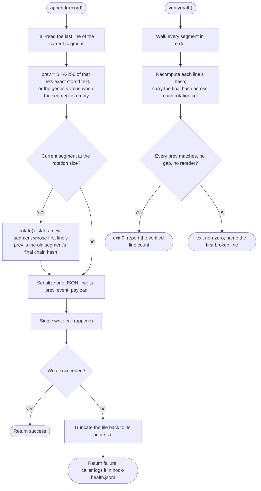
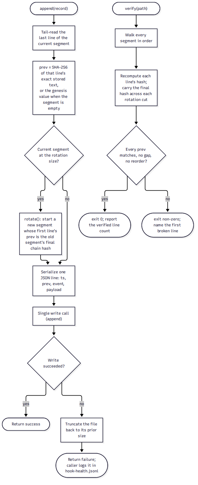

# spec-hooks-audit

## Metadata

| Field | Value |
|---|---|
| **Feature** | Governance audit log: hash-chained append, rotation, decision logging, first-session and disablement logging, and chain verification |
| **Parent feature** | spec-hooks-platform.md |
| **Sub-features** | None |
| **Requirement refs** | BR-019, BR-020, UR-065, UR-067, FR-224, FR-225, FR-228, FR-245, NFR-026, NFR-030, NFR-031, NFR-032 |
| **Feature type** | Functionality |
| **Status** | Review |

Status values: Draft, Review, Approved, Implemented.

Paths that start with `hooks/`, `scripts/`, or `skills/` are relative to `plugins/assist-plugin/`. This spec describes planned behavior for harness-governance Tranche 2 (task plan `docs/task-plans/task-plan-harness-governance-20261028-0759.md`, Steps 11 to 14); nothing here is built. It traces to FR-NFR-harness-governance.md v1.3 (2026-10-30).

## Description

The governance audit log is an append-only, hash-chained JSONL file at `.agent/logs/governance/audit.jsonl` under the project root. Each line holds the SHA-256 hash of the prior line, so a later reader can detect any edit, deletion, or reordering. The log is written by the guard runtime (`lib/health.js`, after a deny or ask decision) and by the audit-writer hook (`audit-log`), both through the shared library `hooks/lib/audit-chain.js`. A command walks the chain and reports the first line where it breaks. Logging is active from the first session after install, with no opt-in, and a guard disabled through `hooks-disabled.json` produces a logged disablement event.

This spec covers the Tranche 2 behavior: the chain, size-based rotation with at least 12 months of retention, decision logging in every guard, first-session and disablement logging, and chain verification. The Tranche 2 record schema holds a timestamp, the prior-line hash, the event, and a payload slot; the decision record adds the agent identity, the decision, and the rule id. The full per-access attribution schema (operation, data accessed as a path and data-class tag, human authorizer) and the per-agent identity helper are task plan Steps 21 and 22 (Tranche 3) and are out of scope for this spec. The hook registration and counts are in spec-hooks-platform.md (Change Log 2026-11-06); the user-facing `/assist-plugin:health` verify-audit mode is in spec-skills-health.md (Change Log 2026-11-06); the protection of the log path from subagent writes is in spec-hooks-fsa-write-bar.md.

## Triggered by

| Trigger type | Source | Condition |
|---|---|---|
| Called by the guard runtime | `guard()` in `hooks/lib/health.js` | After a `deny` or `ask` decision (NFR-026), appends a decision record |
| Event | PostToolUse, `audit-log` hook (spec-hooks-platform.md, Change Log 2026-11-06) | A tool event the audit-writer hook records |
| User action | `/assist-plugin:health --verify-audit` | The user verifies the chain (spec-skills-health.md) |
| SessionStart | `health-check.js --session-start` | First-session logging and a disablement event for each guard in `hooks-disabled.json` (FR-228) |

## Required data

| Data | Source | Type | Notes |
|---|---|---|---|
| Prior line | `.agent/logs/governance/audit.jsonl` (tail read) | JSON line | The hash input for the next append |
| Genesis value | `hooks/lib/audit-chain.js` | Constant | The prior-hash of the first line of the first segment |
| Record fields | The caller (guard runtime, audit-writer hook) | Object | Tranche 2: `ts`, `prev`, `event`, payload slot; the decision record adds agent identity, decision, rule id |
| Rotation size | `hooks/lib/audit-chain.js` | Integer | Configured; an estimate until measured against the NFR-030 time target |
| Segment files | `.agent/logs/governance/` | JSONL segments | `verify` walks them in order across the rotation cut |
| `hooks-disabled.json` | `${CLAUDE_PLUGIN_DATA}` | JSON | Read at SessionStart to log a disablement event (FR-228) |

## Preconditions

| Condition | Check | If not met |
|---|---|---|
| The log directory can be created and written | `append` creates `.agent/logs/governance/` | On a write failure, the append returns failure and the caller logs it in `hook-health.jsonl` (no partial line) |
| The log path is not a symlink | Out of scope here; the write bar and the `/do` symlink guards cover their own writes | The library writes the path it is given |
| Platform preconditions | spec-hooks-platform.md | Fail open, except where a guard fails closed (NFR-028) |

## Algorithmic steps

Start-to-end flow of one append and of one verification. Source: [spec-hooks-audit-flow.mmd](spec-hooks-audit-flow.mmd).

**Note:** Rendered on 2026-11-06 with `mmdc -i specs/spec-hooks-audit-flow.mmd -o specs/spec-hooks-audit-flow.png`. The `.mmd` source is the record; re-render it after any edit.

### Requirement: Hash-chained append

The library SHALL append one JSON line per event to `.agent/logs/governance/audit.jsonl`, each line holding the SHA-256 hash of the prior line's exact stored text in a `prev` field, with a defined genesis value for the first line of the first segment, writing each line in a single write call.

**Requirement refs:** FR-224, UR-065 | **Status:** Planned (harness-governance Tranche 2) | **Source:** FR-NFR-harness-governance.md v1.3, FR-224 (section 2.11); task plan Step 11 (`hooks/lib/audit-chain.js`: `append(record)`, SHA-256 from Node `crypto`, a defined genesis value, one JSON line per event)

The hash input is the exact stored text of the prior line. Two parallel subagents can append at once, so the library uses an exclusive lock file, or a single `O_APPEND` write plus a re-verify on mismatch, and the race is tested (task plan Step 11, Notes).

#### Scenario: Append extends the chain

- **GIVEN** the log holds N lines
- **WHEN** a new event is appended
- **THEN** the new line's `prev` field SHALL equal the SHA-256 hash of line N

#### Scenario: First line uses the genesis value

- **GIVEN** an empty log
- **WHEN** the first event is appended
- **THEN** the line's `prev` field SHALL hold the defined genesis value

### Requirement: Failed append leaves the chain intact

The library SHALL, on any write error, truncate the file back to its prior size and return failure for the caller to log, so the log holds no partial line.

**Requirement refs:** FR-224, NFR-032, UR-065 | **Status:** Planned (harness-governance Tranche 2) | **Source:** FR-NFR-harness-governance.md v1.3, FR-224 (section 2.11, the failed-append scenario); task plan Step 11

#### Scenario: Failed append leaves the chain intact

- **GIVEN** the disk is full
- **WHEN** an append fails
- **THEN** the log SHALL hold no partial line
- **AND** the health log (`hook-health.jsonl`) SHALL record the failure

### Requirement: Size-based rotation with retention

The library SHALL rotate the log by byte size: when the current segment reaches the configured rotation size, a new segment SHALL start whose first line's `prev` holds the old segment's final chain hash, so the chain verifies across the cut, and SHALL retain every segment for at least 12 months.

**Requirement refs:** NFR-032, FR-224, UR-065 | **Status:** Planned (harness-governance Tranche 2) | **Source:** FR-NFR-harness-governance.md v1.3, NFR-032 (section 3.4); task plan Step 11; `DECISIONS.md`, 2026-10-30, "Audit-logging stores settled (per-access split, rotation and retention, confirmation-store writer)" (D-6, OQ-3)

`rotate()` never deletes a segment younger than 12 months. The rotation size is a configured implementation value, labeled an estimate until measured against the NFR-030 verification-time target. The same rotation serves the subagent log where it is chained (task plan Step 22, Tranche 3, out of scope here).

#### Scenario: Rotation keeps the chain

- **GIVEN** the log reaches its configured rotation size
- **WHEN** rotation runs
- **THEN** the first line of the new segment SHALL hold the hash of the last line of the old segment
- **AND** chain verification SHALL pass across the cut

### Requirement: Decision logging in every guard

The guard runtime SHALL, after a `deny` or `ask` decision, append a decision record holding a timestamp, the agent identity, the decision, and the rule id to the governance audit log through the library, logging fails open, so a failed append records the failure in `hook-health.jsonl` and never changes the decision, except where a guard fails closed for its guarded class (NFR-028).

**Requirement refs:** NFR-026, FR-224, NFR-031 | **Status:** Planned (harness-governance Tranche 2) | **Source:** FR-NFR-harness-governance.md v1.3, NFR-026 (section 3.2); task plan Step 12 (`guard()` in `hooks/lib/health.js` appends the decision record; the `audit-log` hook)

The record holds the rule id, decision, tool name, and a path with its data-class tag, never command text (NFR-031, Requirement: Privacy of the audit record). This completes the NFR-026 decision logging that the platform spec (Change Log 2026-11-05) deferred to this step. In Tranche 2 the decision record sources the agent identity directly from the raw hook input (`agent_type` and `agent_id`); the richer per-agent identity helper (`lib/identity.js`) is task plan Step 21 (Tranche 3), so until it lands the `unidentified` flag noted under Requirement: Chain verification (`:177`) matches nothing.

#### Scenario: Deny logged

- **GIVEN** a guard returns a `deny` decision with a rule id
- **WHEN** the runtime finishes
- **THEN** the audit log SHALL hold a decision record with a timestamp, the agent identity, the decision `deny`, and the rule id

#### Scenario: Logging fails open

- **GIVEN** the audit-log append fails while recording a non-security-critical guard's ask decision
- **WHEN** the runtime finishes
- **THEN** the ask decision SHALL stand unchanged
- **AND** the failure SHALL be recorded in `hook-health.jsonl`

### Requirement: Logging from the first session and logged disablement

The plugin SHALL keep event logging active from the first session after install with no opt-in and independent of the compliance profile flag, and a guard disabled through `hooks-disabled.json` SHALL produce a logged disablement event naming the guard and the time, deduplicated to one event per disabled guard per session.

**Requirement refs:** FR-228, UR-067, NFR-032 | **Status:** Planned (harness-governance Tranche 2) | **Source:** FR-NFR-harness-governance.md v1.3, FR-228 (section 2.15); task plan Step 13 (the `--session-start` path reads `hooks-disabled.json` and appends a disablement event; `disabledEntry()` in `hooks/lib/health.js`)

Core logging has no opt-out and is not gated by the compliance profile flag (task plan Step 13, Notes). Disablement events are kept at least 12 months by the size-based rotation, with no line cap.

#### Scenario: Fresh install

- **GIVEN** a new install with no configuration
- **WHEN** the first session runs a governed action
- **THEN** a log record for that action SHALL exist in `.agent/logs/governance/audit.jsonl`

#### Scenario: Guard disabled

- **GIVEN** a user adds a guard to `hooks-disabled.json`
- **WHEN** the next session starts
- **THEN** the log SHALL hold a disablement event naming the guard and the time
- **AND** a second session SHALL add no duplicate event for the same disabled guard

### Requirement: Chain verification

The plugin SHALL provide a command that walks the log, recomputes each hash across rotated segments, and exits 0 with the count of verified lines when the chain is intact, or exits non-zero and names the first line where the chain breaks, detecting every single-line edit, deletion, and reordering, and flagging any `unidentified` record.

**Requirement refs:** FR-225, NFR-030, UR-065 | **Status:** Planned (harness-governance Tranche 2) | **Source:** FR-NFR-harness-governance.md v1.3, FR-225 (section 2.12), NFR-030 (section 3.3); task plan Step 14 (`scripts/verify-audit-chain.js`; the `--verify-audit` mode of `hooks/impl/health-check.js`)

Verification MUST finish a 100,000-line log in at most 10 seconds (NFR-030, an estimate until measured). The `/assist-plugin:health` verify-audit mode calls the same module (spec-skills-health.md). The `unidentified` record flag anticipates the per-agent identity of task plan Step 21 (Tranche 3); in Tranche 2 no record carries that identity yet, so the flag matches nothing until Step 21 lands.

#### Scenario: Intact chain

- **GIVEN** an unmodified log of 500 lines
- **WHEN** the command runs
- **THEN** it SHALL exit 0
- **AND** it SHALL report 500 lines verified

#### Scenario: Edited line

- **GIVEN** line 7 was edited after writing
- **WHEN** the command runs
- **THEN** it SHALL exit non-zero
- **AND** it SHALL name line 7 as the first break

#### Scenario: Tamper detection

- **GIVEN** three variants of a test corpus, one with an edited line, one with a deleted line, and one with a reordered line
- **WHEN** verification runs on each variant
- **THEN** it SHALL detect all three

### Requirement: Privacy of the audit record

Each audit record SHALL hold a rule id, a decision, a tool name, and a path with its data-class tag, and SHALL NOT hold prompt text, file contents, or secret values.

**Requirement refs:** NFR-031, NFR-026 | **Status:** Planned (harness-governance Tranche 2) | **Source:** FR-NFR-harness-governance.md v1.3, NFR-031 (section 3.2); task plan Step 12 (the privacy rule)

#### Scenario: Secret kept out of the log

- **GIVEN** a guard denies a command that holds the string `token=abc123`
- **WHEN** the decision record is appended
- **THEN** the record SHALL hold the rule id, decision, and tool name
- **AND** the record SHALL NOT contain `abc123` or the command text

### Requirement: Protected store

The governance audit log SHALL be written only by the guard runtime and the audit-writer hook, and `.agent/logs/governance/**` SHALL be protected from every subagent write.

**Requirement refs:** FR-245, UR-065 | **Status:** Planned (harness-governance Tranche 2) | **Source:** FR-NFR-harness-governance.md v1.3, FR-245 (section 2.32); task plan Step 11 (the protected glob in `hooks/lib/fsa-paths.js`); the write-bar enforcement is spec-hooks-fsa-write-bar.md

A subagent Write, Edit, MultiEdit, or NotebookEdit to a path under `.agent/logs/governance/` is denied by `fsa-write-bar`, and a subagent shell write is denied by the Bash route of task plan Step 15 (spec-hooks-fsa-write-bar.md, Change Log 2026-11-06). The library writes with `fs`, so it is not stopped by a tool-level deny.

#### Scenario: Subagent write denied

- **GIVEN** a subagent writes `.agent/logs/governance/audit.jsonl`
- **WHEN** `fsa-write-bar` evaluates it
- **THEN** the write SHALL be denied (spec-hooks-fsa-write-bar.md)

## Business rules

| Rule ID | Rule | Traces to | Applied at |
|---|---|---|---|
| RULE-001 | Each line holds the hash of the prior line; the first line uses the genesis value | FR-224 | Requirement: Hash-chained append |
| RULE-002 | A failed append leaves no partial line | FR-224 | Requirement: Failed append leaves the chain intact |
| RULE-003 | Rotation carries the prior segment's final hash into the new segment; segments kept at least 12 months | NFR-032 | Requirement: Size-based rotation with retention |
| RULE-004 | Logging is always on from the first session, with no opt-in and no profile gate | FR-228 | Requirement: Logging from the first session and logged disablement |
| RULE-005 | The log holds no command text, file contents, or secret values | NFR-031 | Requirement: Privacy of the audit record |

## Data transformations

| Input | Transformation | Output | Notes |
|---|---|---|---|
| Prior line text | SHA-256 | `prev` hash of the next line | The hash input is the exact stored text |
| Caller record | Serialize to one JSON line, prepend `ts` and `prev` | One appended line | Tranche 2 schema: `ts`, `prev`, `event`, payload |
| Segments in order | Recompute and compare each hash, carry the final hash across each cut | Verified count, or the first broken line | NFR-030 |

## Output / Outcome

| Output | Type | Description |
|---|---|---|
| Appended line | JSONL | One event, chained to the prior line |
| New segment | JSONL file | On rotation, carrying the prior segment's final hash |
| Verification result | Exit code and report | Exit 0 with the verified count, or non-zero naming the first break |

## Error handling

| Error condition | Handling strategy | Outcome |
|---|---|---|
| Write failure during append | Truncate back to the prior size; return failure | No partial line; caller logs the failure in `hook-health.jsonl` |
| Concurrent appends | Exclusive lock or `O_APPEND` plus re-verify on mismatch | The chain stays consistent (tested) |
| Verification finds a break | Exit non-zero; name the first broken line | The user sees the first break (spec-skills-health.md) |
| Guard runtime append fails (non-security-critical) | Fail open; record the failure | The decision stands; the failure is in `hook-health.jsonl` |

## Events emitted

| Event name | Payload | Consumer(s) | When emitted |
|---|---|---|---|
| Decision record | `ts`, agent identity, decision, rule id | Chain verification; control-evidence export (task plan Step 29, Tranche 3) | After a guard deny or ask |
| Disablement event | Guard name, time | Chain verification; `/assist-plugin:health` | At SessionStart for each guard in `hooks-disabled.json` |

## Events consumed

| Event name | Producer | Payload used | Handling |
|---|---|---|---|
| Guard decision | `guard()` in `hooks/lib/health.js` | Decision, rule id, tool name, path and data-class tag | Appended as a decision record |
| PostToolUse (audit-writer hook) | Claude Code | Tool event fields | Appended as an event record (schema completed in Step 22, Tranche 3) |

## Sub-feature breakdown

Not applicable: a leaf feature of spec-hooks-platform.md.

## Performance considerations

| Concern | Target | Approach |
|---|---|---|
| Per-write cost (NFR-029) | The audit-writer and decision-logging appends stay within the 30 ms per-hook and 150 ms total median budget | A tail read for the prior hash, not a full-file read; one write call per line (measured in task plan Step 12) |
| Verification time (NFR-030) | A 100,000-line log verified in at most 10 seconds (an estimate until measured) | Streaming walk across segments; one SHA-256 per line |

## Traceability

| Requirement | Spec section | Verified by |
|---|---|---|
| FR-224 | Requirement: Hash-chained append; Requirement: Failed append leaves the chain intact | Append-extends-chain and failed-append fixtures (`tests/hooks/audit-chain.test.js`, task plan Step 20) |
| NFR-032 | Requirement: Size-based rotation with retention | Rotation fixture: the new segment's first line holds the old segment's final hash; verification passes across the cut; no segment younger than 12 months deleted |
| NFR-026 | Requirement: Decision logging in every guard | A deny and an ask each append a decision record with timestamp, agent identity, decision, and rule id |
| FR-228 | Requirement: Logging from the first session and logged disablement | Fresh-install record exists; a disabled guard yields one disablement event per session (`tests/hooks/audit-log-disablement.test.js`) |
| FR-225, NFR-030 | Requirement: Chain verification | Intact, edited, deleted, and reordered corpora; a 100,000-line verify within the time target (`tests/scripts/verify-audit-chain.test.js`, `tests/fixtures/audit/`) |
| NFR-031 | Requirement: Privacy of the audit record | A denied command holding a secret appends a record without the secret or the command text |
| FR-245 | Requirement: Protected store | A subagent write to `.agent/logs/governance/**` is denied (spec-hooks-fsa-write-bar.md) |

## Change Log: 2026-11-06

**Source:** FR-NFR-harness-governance.md v1.3 (2026-10-30), FR-228 (section 2.15), NFR-032 (section 3.4); task plan `docs/task-plans/task-plan-harness-governance-20261028-0759.md`, Tranche 2 Step 13; the as-built disablement-logging behavior of the harness-governance Tranche 2 build (shipped and gate-approved), which the Step-13 statement underspecified. This entry reconciles the disablement dedup wording to that build. It adds no new requirement, so the change is Planned (harness-governance Tranche 2) and matches what shipped. This spec received a reconciliation delta, so its Status moves to `Review` (delta rule 6, no same-turn user approval).

### Direct edits in this pass (no behavior change)

- Status: Draft -> Review.

### Body text this entry supersedes (applied at the next fold)

- Description preamble: the sentence "This spec describes planned behavior for harness-governance Tranche 2 ...; nothing here is built" is superseded by the shipped, gate-approved harness-governance Tranche 2 build that this entry reconciles to. At the next fold the preamble reads as built; the Status stays `Review` until then, not `Implemented`.
- Requirement: Logging from the first session and logged disablement, the statement: the MODIFIED Now below (one `guard-disabled` event per guard per project, suppressed across sessions while the guard stays disabled).
- The Scenario "Guard disabled" and the Traceability row for FR-228 ("one disablement event per session"): the per-guard-per-project, cross-session wording of the MODIFIED Now and the Traceability added below.

### ADDED Requirements

None.

### MODIFIED Requirements

#### Requirement: Logging from the first session and logged disablement

**Was:** The plugin SHALL keep event logging active from the first session after install with no opt-in and independent of the compliance profile flag, and a guard disabled through `hooks-disabled.json` SHALL produce a logged disablement event naming the guard and the time, deduplicated to one event per disabled guard per session.

**Now:** The plugin SHALL keep event logging active from the first session after install with no opt-in and independent of the compliance profile flag, and a guard disabled through `hooks-disabled.json` SHALL produce a logged `guard-disabled` event naming the guard and the time, deduplicated to one event per guard per project and suppressed across sessions while the guard stays disabled; re-enabling the guard and disabling it again SHALL log a new event.

**Reason:** The build stores the dedup state in `${CLAUDE_PLUGIN_DATA}/health-state.json`, keyed by guard name as a set of truncated per-project-root hashes, so a guard logged once stays suppressed across later sessions while it remains in `hooks-disabled.json`, and a re-enable then re-disable records a fresh event. The "per session" wording of the Step-13 statement was narrower than the built behavior. Accepted best-effort limits, recorded and not defects: a rare concurrent first-recording can append a duplicate (never a suppression), and a guard disabled across more than 100 projects under one timestamp can re-log through roots eviction.

**Requirement refs:** FR-228, UR-067, NFR-032 | **Status:** Planned (harness-governance Tranche 2); matches the shipped build

##### Scenario: Guard disabled logged once per project across sessions

- **GIVEN** a user adds a guard to `hooks-disabled.json`
- **WHEN** the next session starts
- **THEN** the log SHALL hold one `guard-disabled` event naming the guard and the time
- **AND** a later session SHALL add no duplicate event for the same guard in the same project while the guard stays disabled

##### Scenario: Re-enable then re-disable logs a new event

- **GIVEN** a guard that was logged disabled, then removed from `hooks-disabled.json`, then added again
- **WHEN** a session starts after the guard is disabled again
- **THEN** the log SHALL hold a new `guard-disabled` event for the guard

### REMOVED Requirements

None.

### Traceability added

| Requirement | Spec section | Verified by |
|---|---|---|
| FR-228 | Change Log 2026-11-06: Requirement: Logging from the first session and logged disablement | A disabled guard yields one `guard-disabled` event per guard per project, suppressed across sessions while it stays disabled; a re-enable then re-disable logs a new event (`tests/hooks/audit-log-disablement.test.js`) |
