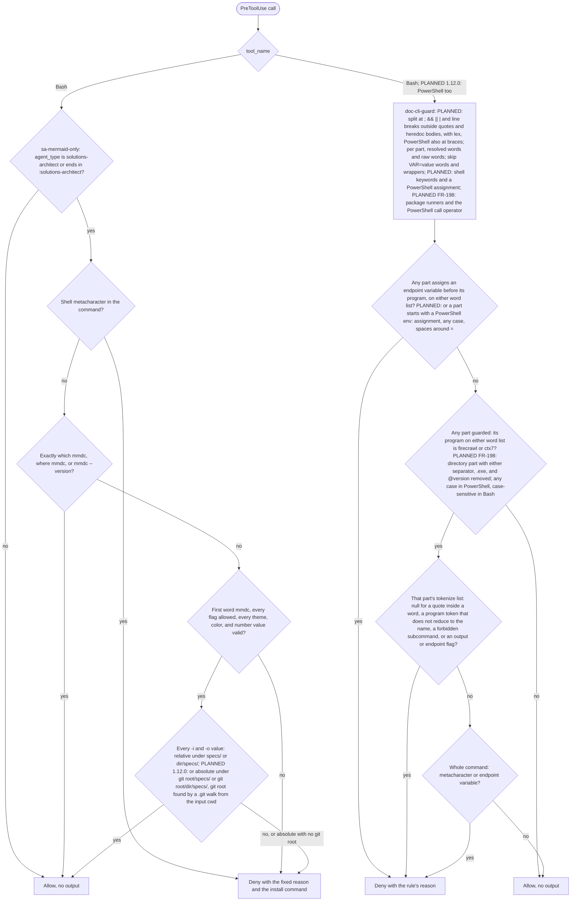

# spec-hooks-bash-guards

## Metadata

| Field | Value |
|---|---|
| **Feature** | Bash CLI guards: `sa-mermaid-only` and `doc-cli-guard` |
| **Parent feature** | spec-hooks-platform.md |
| **Sub-features** | None |
| **Requirement refs** | BR-006, UR-021, FR-092, FR-093, FR-094, FR-198, NFR-009 |
| **Feature type** | Functionality |
| **Status** | Approved |

Status values: Draft, Review, Approved, Implemented.

## Description

Two PreToolUse guards limit Bash commands to safe forms. `sa-mermaid-only` limits the `solutions-architect` agent's Bash tool to mermaid-cli with a fixed flag list and paths under `specs/`, so a spec author cannot run other commands or write diagram output into auto-loaded or hidden files. `doc-cli-guard` limits the documentation CLIs `firecrawl` and `ctx7`, for every agent and the main session, to read-only forms, because the skills' `allowed-tools` wildcards would also match output flags and shell operators (`impl/doc-cli-guard.js:4-5`). Both run on the platform in spec-hooks-platform.md and fail open. This spec describes the behavior at commit 4803a0d, which assist-plugin 1.11.1 (commit 41034c1) keeps at every cited line (read 2026-10-16). The change log at the end records the 1.12.0 (PLANNED) changes: absolute `mmdc` paths under the git root (FR-093), PowerShell coverage of `doc-cli-guard` (FR-094), and program-name detection with package runners and Windows names (FR-198).

Related requirements in other areas: FR-085 (Area A, `solutions-architect` renders diagrams with `mmdc` and never installs it) and FR-167 (Area C, the `code` skill's `ctx7` and `firecrawl` command shapes).

## Triggered by

| Trigger type | Source | Condition |
|---|---|---|
| Event | Claude Code PreToolUse, matcher `Bash` (`hooks/hooks.json:5-17`) | Any Bash tool call, from the main session or any subagent |

## Required data

| Data | Source | Type | Notes |
|---|---|---|---|
| `tool_name` | Hook input | string | Both guards act only on `Bash`; any other value is allowed with no output |
| `tool_input.command` | Hook input | string | Missing or null is treated as the empty string |
| `agent_type` | Hook input | string | Used by `sa-mermaid-only` only; missing or null is the empty string |

## Preconditions

| Condition | Check | If not met |
|---|---|---|
| Hook input is JSON | `JSON.parse` in `lib/health.js` | Failure path `malformed-input` (spec-hooks-platform.md) |
| Guard not disabled | `hooks-disabled.json` | Warn and allow (spec-hooks-platform.md) |
| Node 6 or newer | `lib/launch.js` | Warn and allow |

## Algorithmic steps

Start-to-end flow. Source: [spec-hooks-bash-guards-flow.mmd](spec-hooks-bash-guards-flow.mmd).



**Note:** PNG rendering requires mermaid-cli with its headless browser, which is missing on this machine (see spec-hooks-platform.md). Render with `mmdc -i specs/spec-hooks-bash-guards-flow.mmd -o specs/spec-hooks-bash-guards-flow.png` once it is installed.

### Requirement: Mermaid guard scope

The `sa-mermaid-only` hook SHALL judge only Bash calls whose `agent_type` matches `(^|:)solutions-architect$`; every other call passes with no output.

**Requirement refs:** FR-092, FR-093, UR-021
**Status:** Built; FR-092 covers every agent type that is `solutions-architect` or ends in `:solutions-architect` (OP-B3 closed 2026-10-16, no code change)
**Source:** `hooks/impl/sa-mermaid-only.js:17`, `:97-102`; self-test case `plugin:assist:solutions-architect` (`hooks/impl/health-check.js:851`)

#### Scenario: Other agent

- **GIVEN** `assist-plugin:developer` runs `rm -rf build`
- **WHEN** the hook evaluates it
- **THEN** the hook SHALL allow it with no output

#### Scenario: Main session

- **GIVEN** the main session (no `agent_type`) runs `npx mmdc -i a.mmd -o a.png`
- **WHEN** the hook evaluates it
- **THEN** the hook SHALL allow it with no output

#### Scenario: Same agent name from another plugin

- **GIVEN** an agent with `agent_type` `other-plugin:solutions-architect` runs `ls`
- **WHEN** the hook evaluates it
- **THEN** the hook SHALL deny it, because the pattern matches any `:solutions-architect` suffix

### Requirement: Mermaid guard command forms

The `sa-mermaid-only` hook SHALL allow a judged command only when, after trimming, it equals `which mmdc`, `where mmdc`, or `mmdc --version`, or its first word is exactly `mmdc` and every following word is an allowed flag followed by one valid value.

**Requirement refs:** FR-092, UR-021
**Status:** Built
**Source:** `hooks/impl/sa-mermaid-only.js:20-34`, `:43-53`, `:64-94`

Allowed flags and value rules:

| Flags | Value rule |
|---|---|
| `-i`, `--input` | Input path rule (next Requirement), file name ends in `.mmd` |
| `-o`, `--output` | Input path rule, file name ends in `.svg`, `.png`, or `.pdf` |
| `-t`, `--theme`, `-b`, `--backgroundColor` | `^#?[A-Za-z0-9_-]+$` |
| `-w`, `--width`, `-H`, `--height`, `-s`, `--scale` | `^\d+(\.\d+)?$` |

A long flag may carry its value as `--flag=value`; a short flag may not (`-i=x` is an unknown flag). A flag may repeat. Neither `-i` nor `-o` is required, so `mmdc` alone is allowed. Words split on whitespace; a word may be wrapped whole in double or single quotes; a quote inside a bare word denies the command.

#### Scenario: Lookup command

- **GIVEN** `solutions-architect` runs `which mmdc`
- **WHEN** the hook evaluates it
- **THEN** the hook SHALL allow it with no output

#### Scenario: Full render command

- **GIVEN** `solutions-architect` runs `mmdc -i specs/diagrams/a.mmd -o specs/diagrams/a.svg -t dark -b transparent -w 800 -H 600 -s 2`
- **WHEN** the hook evaluates it
- **THEN** the hook SHALL allow it

#### Scenario: Download form

- **GIVEN** `solutions-architect` runs `npx mmdc -i specs/a.mmd -o specs/a.png`
- **WHEN** the hook evaluates it
- **THEN** the hook SHALL deny it with the reason in Requirement: Mermaid guard deny reason

#### Scenario: Unknown flag

- **GIVEN** `solutions-architect` runs `mmdc -i specs/a.mmd -p cfg.json`
- **WHEN** the hook evaluates it
- **THEN** the hook SHALL deny it

#### Scenario: Program given by path

- **GIVEN** `solutions-architect` runs `/usr/local/bin/mmdc -i specs/a.mmd -o specs/a.png`
- **WHEN** the hook evaluates it
- **THEN** the hook SHALL deny it, because the first word is not exactly `mmdc`

### Requirement: Mermaid guard paths

The `sa-mermaid-only` hook SHALL accept an `-i` or `-o` value only when it is a relative path whose first or second segment is `specs`, with at least one segment after `specs`, no empty segment, and no segment that starts with a dot, and whose last segment has the required extension, compared without regard to case.

**Requirement refs:** FR-093, UR-021
**Status:** Built for relative paths; PLANNED (1.12.0): absolute paths under the git root (Change Log 2026-10-16, MODIFIED)
**Source:** `hooks/impl/sa-mermaid-only.js:55-68`; `DECISIONS.md` (2026-10-13, Protected-path guard covers every subagent)

A value starting with `-` or `/`, or with a drive letter (`C:`), is rejected. Because `.` and `..` start with a dot, they are rejected as segments.

#### Scenario: Output into an auto-loaded file

- **GIVEN** `solutions-architect` runs `mmdc -i specs/a.mmd -o CLAUDE.md`
- **WHEN** the hook evaluates it
- **THEN** the hook SHALL deny it

#### Scenario: Hidden or climbing paths

- **GIVEN** `solutions-architect` runs `mmdc -i specs/a.mmd -o specs/.hidden/x.png` or `mmdc -i specs/a.mmd -o specs/../CLAUDE.md`
- **WHEN** the hook evaluates each command
- **THEN** the hook SHALL deny both

#### Scenario: Specs one level down

- **GIVEN** `solutions-architect` runs `mmdc --input pkg/specs/a.mmd --output pkg/specs/a.pdf --theme dark --width 800`
- **WHEN** the hook evaluates it
- **THEN** the hook SHALL allow it

#### Scenario: Specs two levels down

- **GIVEN** `solutions-architect` runs `mmdc -i specs/a.mmd -o a/b/specs/a.svg`
- **WHEN** the hook evaluates it
- **THEN** the hook SHALL deny it

#### Scenario: Wrong extension

- **GIVEN** `solutions-architect` runs `mmdc -i specs/a.mmd -o specs/x.md`
- **WHEN** the hook evaluates it
- **THEN** the hook SHALL deny it

### Requirement: Mermaid guard metacharacters and quotes

The `sa-mermaid-only` hook SHALL deny a judged command that holds any of these characters, before any other check: `;`, `&`, `|`, a backtick, `<`, `>`, `$`, `{`, `\`, `*`, `?`, `[`, `]`, `(`, `)`, `~`, `!`, a newline, or a carriage return.

**Requirement refs:** FR-093, UR-021
**Status:** Built
**Source:** `hooks/impl/sa-mermaid-only.js:18-19`, `:88-91`

#### Scenario: Chained command

- **GIVEN** `solutions-architect` runs `mmdc -i a.mmd; rm -rf x`
- **WHEN** the hook evaluates it
- **THEN** the hook SHALL deny it

#### Scenario: Brace expansion

- **GIVEN** `solutions-architect` runs `mmdc -i {a,b}.mmd`
- **WHEN** the hook evaluates it
- **THEN** the hook SHALL deny it

#### Scenario: Quoted path with a space

- **GIVEN** `solutions-architect` runs `mmdc -i specs/a.mmd -o "specs/my dir/a.svg"`
- **WHEN** the hook evaluates it
- **THEN** the hook SHALL allow it

### Requirement: Mermaid guard deny reason

The `sa-mermaid-only` hook SHALL give every denial the same fixed reason, which names the allowed flags and paths and the install command.

**Requirement refs:** FR-092, UR-021
**Status:** Built; PLANNED (1.12.0): the reason names the absolute path form (Change Log 2026-10-16, MODIFIED)
**Source:** `hooks/impl/sa-mermaid-only.js:37-40`

The reason text is: "solutions-architect may only run mermaid-cli (mmdc) with -i/-o/-t/-b/-w/-H/-s, a .mmd input, and a .svg, .png, or .pdf output, both under specs/ or <dir>/specs/ (relative, no .., no segment starting with a dot). If mmdc is missing, show the user: npm install -g @mermaid-js/mermaid-cli"

#### Scenario: Reason names the install command

- **GIVEN** any denied `solutions-architect` command
- **WHEN** the hook denies it
- **THEN** `permissionDecisionReason` SHALL end with `npm install -g @mermaid-js/mermaid-cli`

#### Scenario: No rewrite

- **GIVEN** any denied command
- **WHEN** the hook returns
- **THEN** the output SHALL carry no `updatedInput`

### Requirement: Documentation CLI program detection

The `doc-cli-guard` hook SHALL find the program of a Bash command by splitting it on whitespace, removing whole-word outer quotes, and skipping leading `VAR=value` words and the wrappers `env`, `command`, `timeout`, `nice`, `nohup`, `stdbuf`, and `time` with their options, judging the command only when that program's base name is `firecrawl` or `ctx7`.

**Requirement refs:** FR-094, UR-021
**Status:** Built for Bash and the bare program names; PLANNED (1.12.0): PowerShell commands, package runners, and Windows program names (FR-094, FR-198; OP-B8, OP-B9, and OP-B10 closed 2026-10-16; Change Log 2026-10-16, MODIFIED)
**Source:** `hooks/impl/doc-cli-guard.js:45-54`, `:57-66`; `hooks/lib/shell-program.js:7-62`

Wrapper options that consume a value: `env` `-u`, `--unset`, `-C`, `--chdir`; `timeout` `-s`, `--signal`, `-k`, `--kill-after` (and a duration after the options); `nice` `-n`, `--adjustment`; `stdbuf` `-i`, `-o`, `-e`; `time` `-f`, `--format`, `-o`, `--output`. A `--` ends a wrapper's options.

#### Scenario: Wrapped program

- **GIVEN** the command `timeout 30 firecrawl scrape https://x -o a --only-main-content`
- **WHEN** the hook evaluates it
- **THEN** the hook SHALL deny it as a `firecrawl` command with an output flag

#### Scenario: Unguarded program

- **GIVEN** the command `git status`
- **WHEN** the hook evaluates it
- **THEN** the hook SHALL allow it with no output

### Requirement: Documentation CLI denial rules

The `doc-cli-guard` hook SHALL deny, for every agent and the main session, a judged command that matches any rule in the table below, checked in table order, with that rule's reason.

**Requirement refs:** FR-094, UR-021, BR-006
**Status:** Built for Bash; rule 1 applies before any program, as FR-094 now states (OP-B4 closed 2026-10-16); PLANNED (1.12.0): PowerShell coverage (OP-B8 closed; Change Log 2026-10-16, MODIFIED)
**Source:** `hooks/impl/doc-cli-guard.js:22-31`, `:57-94`

| Order | Rule | Reason |
|---|---|---|
| 1 | A word `FIRECRAWL_API_URL=...` or `CONTEXT7_<name containing URL>=...` before the program; applies to any program, guarded or not | R1 |
| 2 | Any of `;`, `&`, `\|`, a backtick, `$`, `>`, `<`, `\`, `{`, `}`, a newline, or a carriage return | R2 |
| 3 | An endpoint variable assignment anywhere in the command | R3 |
| 4 | A quote inside a word (quotes may wrap whole words only) | R4 |
| 5 | The first argument that does not start with `-` makes `firecrawl env`, `ctx7 setup`, or `ctx7 login` | R5 |
| 6 | An argument matching `^-[A-Za-z]*o` (a short flag cluster holding `o`) or `^--(output\|base-url\|api-url)(=\|$)` | R6 |

Reason texts, where `<p>` is the program name and `<sub>` the subcommand (`impl/doc-cli-guard.js:62`, `:69`, `:72`, `:76`, `:81`, `:84`):

```text
R1  FIRECRAWL_API_URL and CONTEXT7_*URL* overrides are not allowed
R2  <p>: shell operators (; & | ` $ > < \ { }) and newlines are not allowed
R3  <p>: FIRECRAWL_API_URL and CONTEXT7_*URL* overrides are not allowed
R4  <p>: quotes are allowed only around whole words
R5  <p> <sub> writes config or credentials; ask the user to run it themselves
R6  <p>: -o, --output, --base-url, and --api-url are not allowed
```

#### Scenario: Output flag

- **GIVEN** the command `firecrawl scrape https://example.com -o out.md`
- **WHEN** the hook evaluates it
- **THEN** the hook SHALL deny it with the rule 6 reason

#### Scenario: Plain lookup

- **GIVEN** the command `ctx7 docs /org/project "routing" --json`
- **WHEN** the hook evaluates it
- **THEN** the hook SHALL allow it with no output

#### Scenario: Endpoint override before an unrelated program

- **GIVEN** the command `CONTEXT7_BASE_URL=http://e npm test`
- **WHEN** the hook evaluates it
- **THEN** the hook SHALL deny it with the rule 1 reason (FR-094)

#### Scenario: Command substitution

- **GIVEN** the command `firecrawl search "$(id)" --json`
- **WHEN** the hook evaluates it
- **THEN** the hook SHALL deny it with the rule 2 reason

#### Scenario: Credential subcommand

- **GIVEN** the command `ctx7 login`
- **WHEN** the hook evaluates it
- **THEN** the hook SHALL deny it with the reason `ctx7 login writes config or credentials; ask the user to run it themselves`

## Business rules

| Rule ID | Rule | Traces to | Applied at step | Example |
|---|---|---|---|---|
| RULE-001 | Only `solutions-architect` agent types are held to the mermaid allowlist | FR-092 | Requirement: Mermaid guard scope | `developer` runs anything |
| RULE-002 | Diagram files live under `specs/` or `<dir>/specs/`, never hidden, never climbing | FR-093 | Requirement: Mermaid guard paths | `specs/spec-auth-architecture.png` |
| RULE-003 | Agents never install or download mermaid-cli | FR-092, FR-085 | Requirement: Mermaid guard command forms | `npx` denied; install command shown |
| RULE-004 | Documentation CLIs run read-only: no output files, no endpoint changes, no credential setup | FR-094 | Requirement: Documentation CLI denial rules | `ctx7 setup` denied |
| RULE-005 | Endpoint override variables are refused before any program | FR-094 | Requirement: Documentation CLI denial rules, rule 1 | `FIRECRAWL_API_URL=... ls` denied |
| RULE-006 | Not covered at 1.11.1: PowerShell tool calls (registration `hooks/hooks.json:5-17`, check `impl/doc-cli-guard.js:91`), Windows program names such as `ctx7.exe` (`impl/doc-cli-guard.js:65-66`), and package-runner launch forms such as `npx ctx7` (`lib/shell-program.js:11-19`). PLANNED (1.12.0): covered by FR-094 and FR-198; the guard stays best-effort, with the known gaps listed in the Change Log 2026-10-16 (`DECISIONS.md:198-201`) | FR-094, FR-198 | Requirement: Documentation CLI program detection; Requirement: Documentation CLI denial rules | OP-B8, OP-B9, and OP-B10 closed 2026-10-16 (spec-hooks-platform.md, Open points) |

## Data transformations

| Input | Transformation | Output | Notes |
|---|---|---|---|
| `tool_input.command` | Trim; split into words honoring whole-word quotes | Word list or "rejected" | A quote inside a bare word rejects the command in both guards |
| Word list (`doc-cli-guard`) | Skip assignments and wrappers | Program index plus an endpoint-assignment flag | `lib/shell-program.js` |

## Output / Outcome

| Output | Type | Description |
|---|---|---|
| Deny decision | PreToolUse JSON on stdout | `permissionDecision: "deny"` with the reason from the matching rule; exit 0 |
| Allow | No stdout | Exit 0; Claude Code's normal permission flow continues |

## Error handling

| Error condition | Handling strategy | Outcome |
|---|---|---|
| Malformed hook input, throw, timeout, old Node | Platform failure path | `systemMessage` warning; the command runs unchecked |
| Guard listed in `hooks-disabled.json` | Platform disabled path | Warning on every call; the command runs unchecked |
| Command is not a string | Treated as the empty string | `sa-mermaid-only` denies a judged empty command (it is not `mmdc`); `doc-cli-guard` allows it |

## Events emitted

| Event name | Payload | Consumer(s) | When emitted |
|---|---|---|---|
| PreToolUse deny | `hookSpecificOutput` with `permissionDecisionReason` | Claude Code | A rule matched |

## Events consumed

| Event name | Producer | Payload used | Handling |
|---|---|---|---|
| PreToolUse (`Bash`) | Claude Code | `tool_name`, `tool_input.command`, `agent_type` | Evaluated as above |

## Sub-feature breakdown

Not applicable: both guards are leaf features of spec-hooks-platform.md.

## Performance considerations

| Concern | Target | Approach |
|---|---|---|
| Latency | Finish within the 5 s registration (NFR-007) | No file or network I/O; one pass over the command words. PLANNED (1.12.0): `sa-mermaid-only` walks for `.git` once, only for a command with an absolute `-i` or `-o` value |
| Self-test coverage | Fixed allow and deny cases pass (FR-118) | 10 allow and 14 deny cases for `doc-cli-guard` (`impl/health-check.js:803-834`), 10 allow and 19 deny cases for `sa-mermaid-only` (`:841-877`), at 1.11.1 |

## Traceability

| Requirement | Spec section | Verified by |
|---|---|---|
| BR-006 | Business rules | Health-check deny corpus |
| UR-021 | Requirement: Mermaid guard command forms; Requirement: Documentation CLI denial rules | Self-test cases in `impl/health-check.js:802-877` |
| FR-092 | Requirement: Mermaid guard scope; Requirement: Mermaid guard command forms; Requirement: Mermaid guard deny reason | Lookup, full render, download, and unknown-flag scenarios |
| FR-093 | Requirement: Mermaid guard paths; Requirement: Mermaid guard metacharacters and quotes; Requirement: Mermaid guard scope | `CLAUDE.md` output, hidden path, chained command, other-agent scenarios |
| FR-094 | Requirement: Documentation CLI program detection; Requirement: Documentation CLI denial rules | Output flag, plain lookup, substitution, and credential scenarios |
| NFR-009 | Error handling | Platform failure-path tests run against both guards |

## Change Log: 2026-10-16

**Source:** `docs/requirements/FR-NFR-assist-plugin.md` v1.1 (2026-10-16, final and approved; baseline assist-plugin 1.11.1, commit 41034c1): FR-092 reworded to the built scope (`:1919-1938`), FR-093 absolute paths under `<git root>/specs/` and `<git root>/<dir>/specs/` (`:1940-1994`), FR-094 PowerShell coverage, the endpoint rule, the case rule, per-part judging, the PowerShell assignment before a hidden name, and the known gaps of a best-effort guard (`:1996-2055`), FR-198 added, with `exec`, `sudo`, and `eval` as wrappers (`:2800-2844`); `DECISIONS.md:138-141`, `:148-151`, `:153-156`, `:158-161`, `:168-171`, `:173-176`, `:188-196`, `:198-201`; the answers to OP-B3, OP-B4, OP-B8, OP-B9, and OP-B10 in `.agent/main-plan/plan-deferred-decisions-20261016-1059.md` (User Decisions).

### Body edits without a behavior change

- Status: Draft -> Review. Requirement refs: FR-198 added.
- Description: the baseline is 1.11.1; the cited lines of `sa-mermaid-only.js`, `doc-cli-guard.js`, and `shell-program.js` are unchanged since 4803a0d (read 2026-10-16).
- Status lines: Requirement: Mermaid guard scope (OP-B3 closed, no code change) and Requirement: Documentation CLI denial rules (OP-B4 closed: rule 1 applies before any program, as FR-094 states). The scenario Endpoint override before an unrelated program loses its "pending" note.
- RULE-005 and RULE-006: the open-point notes replaced by FR-094 and FR-198.
- Flow diagram (`spec-hooks-bash-guards-flow.mmd` and the copy in this file): the PLANNED branches added. Rendering skipped (spec-hooks-platform.md, note under Data flow).
- Self-test cites refreshed to `impl/health-check.js:802-877`.

### ADDED Requirements

None. FR-198 changes Requirement: Documentation CLI program detection below.

### MODIFIED Requirements

#### Requirement: Mermaid guard paths

**Was:** The `sa-mermaid-only` hook SHALL accept an `-i` or `-o` value only when it is a relative path whose first or second segment is `specs`, with at least one segment after `specs`, no empty segment, and no segment that starts with a dot, and whose last segment has the required extension, compared without regard to case.

**Now:** The `sa-mermaid-only` hook SHALL accept an `-i` or `-o` value only when its last segment has the required extension, compared without regard to case, and the value is either a relative path whose first or second segment is `specs`, with at least one segment after `specs`, no empty segment, and no segment that starts with a dot, or an absolute path under the git root of the hook input's `cwd` whose part below the git root meets that same relative rule, so it sits under `<git root>/specs/` or `<git root>/<dir>/specs/`; when no git root is found, every absolute value is denied.

**Reason:** FR-093; `DECISIONS.md:148-151` (absolute `-i` and `-o` paths under `<git root>/specs/`, so rendering works in a subdirectory session), `DECISIONS.md:158-161` (the walk starts at the hook input's `cwd`, absolute paths denied when no `.git` is found), and `DECISIONS.md:173-176` (also under `<git root>/<dir>/specs/`, with the same segment rules, so diagrams render where the Spec step writes in a multi-project repository). FR-093 states both forms (`:1942`, scenario Absolute path under a submodule specs folder `:1971-1974`).

**Status:** Built (1.11.1) for relative paths; PLANNED (1.12.0) for absolute paths.

Rules:
1. **Relative values** keep the built rule (`hooks/impl/sa-mermaid-only.js:55-62`): `.` and `..` start with a dot, so they are rejected as segments anywhere, and `<dir>/specs/` is one level deep at most.
2. **Absolute by the string rule.** A value is absolute when it starts with `/`, or with a drive letter, `:`, and `/`, the rule `fsa-write-bar` uses (`hooks/impl/fsa-write-bar.js:118-123`). A backslash or `~` never reaches this test: both are metacharacters, so a command that holds one is denied first (Requirement: Mermaid guard metacharacters and quotes). A drive-relative value such as `C:specs/a.mmd` is not absolute and fails the relative rule.
3. **Git root.** When the input `cwd` is a non-empty string that is absolute by the same string rule, the hook calls `findGitRoot(cwd)` from `hooks/lib/git-root.js`: from that directory up to the file-system root, the first directory that holds a `.git` entry (a directory, or a file as in a linked worktree), with no `git` process; a stat error counts as no `.git`, and the walk continues (`hooks/lib/git-root.js:18-36`). FR-181 and FR-186 use the same walk. A missing, empty, or relative `cwd`, or a walk that finds nothing, gives no git root. `CLAUDE_PROJECT_DIR` plays no part. On a host where `path.isAbsolute` rejects a drive-letter directory (Linux, macOS), the walk from such a `cwd` returns null (`hooks/lib/git-root.js:28`), so absolute values are denied there.
4. **Prefix test.** Let R be the git root with backslashes turned into slashes and a trailing `/` removed. The value starts with R followed by `/`, compared with case, except that an R that starts with a drive letter compares without case, as `hooks/lib/fsa-paths.js:146-149` does. R may itself hold dot-led segments: a worktree at `<repo>/.claude/worktrees/w` is its own git root.
5. **Segment rule below R.** The part of the value after `R/` must pass the relative rule of rule 1: it splits on `/`, its first or second segment is `specs`, at least one segment follows `specs`, and no segment is empty or starts with a dot. So `R/specs/...` and `R/<dir>/specs/...` are accepted, and `R/<a>/<b>/specs/...` is denied, as its relative form is. The value is not normalized first, so `R/specs/../src/a.mmd` and `R/.hidden/specs/a.mmd` are denied.
6. **Walk only when needed.** The hook calls `findGitRoot` at most once per call, and only when the command passed every other check and holds an absolute `-i` or `-o` value. A command without one causes no file-system access.
7. **Test option (FR-088).** `evaluate(input, options)` takes `options.findGitRoot`, a function from an absolute directory to the git root or null, which replaces the walk; any other value counts as absent. The comments at `hooks/impl/sa-mermaid-only.js:5`, `:10-14`, and `:96` change to name the walk.
8. **Self-test (FR-118).** The built cases (`hooks/impl/health-check.js:841-877`) carry no `cwd`, so their absolute values (`/etc/x`) stay denied without a walk. The new cases below carry a `cwd` and a `findGitRoot` stub. The self-test wrapper passes `findGitRoot: input.findGitRoot` and throws for a case that has a `cwd` but no function `findGitRoot`, so the case is listed under "case threw" and the real walk never runs in a self-test, the same guard the `task-planner` cases have (`hooks/impl/health-check.js:903-910`).

Proposed self-test cases, with `R` = `/assist-selftest/project` and the agent type `solutions-architect`:

| # | Expect | Input `cwd` | `findGitRoot` returns | Command |
|---|---|---|---|---|
| 1 | allow | `R/src` | `R` | `mmdc -i R/specs/a.mmd -o R/specs/a.png` |
| 2 | allow | `R` | `R` | `mmdc -i specs/a.mmd -o R/specs/diagrams/a.svg` |
| 3 | allow | `R/.claude/worktrees/w` | `R/.claude/worktrees/w` | `mmdc -i R/.claude/worktrees/w/specs/a.mmd -o R/.claude/worktrees/w/specs/a.png` |
| 4 | allow | `C:/proj` | `C:\proj` | `mmdc -i c:/proj/specs/a.mmd -o C:/proj/specs/a.pdf` |
| 5 | allow | `/assist-selftest/nogit` | null | `mmdc -i specs/a.mmd -o specs/a.png` |
| 6 | deny | `R` | `R` | `mmdc -i R/specs/a.mmd -o R/CLAUDE.md` |
| 7 | allow | `R/src` | `R` | `mmdc -i R/backend/specs/a.mmd -o R/backend/specs/a.png` |
| 8 | deny | `R` | `R` | `mmdc -i R/specs/../src/a.mmd -o R/specs/a.png` |
| 9 | deny | `R` | `R` | `mmdc -i R/.hidden/specs/a.mmd -o R/specs/a.png` |
| 10 | deny | `R` | `R` | `mmdc -i /tmp/specs/a.mmd -o /tmp/specs/a.png` |
| 11 | deny | `/assist-selftest/nogit` | null | `mmdc -i /assist-selftest/nogit/specs/a.mmd -o /assist-selftest/nogit/specs/a.png` |
| 12 | deny | none | not called | `mmdc -i R/specs/a.mmd -o R/specs/a.png` |
| 13 | deny | `R` | `R` | `mmdc -i R/specs/a.mmd -o R/specs/` |
| 14 | deny | `R` | `R` | `mmdc -i R/a/b/specs/a.mmd -o R/specs/a.png` |
| 15 | deny | `R` | `R` | `mmdc -i R/backend/.cache/specs/a.mmd -o R/backend/specs/a.png` |

##### Scenario: Absolute path under the git root from a subdirectory session

- **GIVEN** a session started in `<repo>/src`, whose git root is `<repo>`
- **WHEN** `solutions-architect` runs `mmdc -i <repo>/specs/a.mmd -o <repo>/specs/a.png`
- **THEN** the hook SHALL allow it with no output

##### Scenario: Walk starts at the cwd

- **GIVEN** a hook input whose `cwd` is `<repo>/src`, a `.git` in `<repo>`, and no `.git` in `<repo>/src`
- **WHEN** the hook evaluates `mmdc -i <repo>/specs/a.mmd -o <repo>/specs/a.png`
- **THEN** the hook SHALL take `<repo>` as the git root and allow the command

##### Scenario: Absolute path outside the git root's specs folder

- **GIVEN** git root `<repo>`, and `/tmp` is not under it
- **WHEN** `solutions-architect` runs `mmdc -i <repo>/specs/a.mmd -o <repo>/CLAUDE.md`, and then `mmdc -i /tmp/specs/a.mmd -o /tmp/specs/a.png`
- **THEN** the hook SHALL deny both

##### Scenario: Absolute path under a submodule specs folder

- **GIVEN** a session started in `<repo>/src`, whose git root is `<repo>`
- **WHEN** `solutions-architect` runs `mmdc -i <repo>/backend/specs/a.mmd -o <repo>/backend/specs/a.png`
- **THEN** the hook SHALL allow it with no output, with the same segment rules as for a relative path (FR-093; `DECISIONS.md:173-176`)
- **AND** the hook SHALL also allow the relative form `mmdc -i backend/specs/a.mmd -o backend/specs/a.png`

##### Scenario: Absolute path two levels down

- **GIVEN** git root `<repo>`
- **WHEN** `solutions-architect` runs `mmdc -i <repo>/a/b/specs/a.mmd -o <repo>/specs/a.png`
- **THEN** the hook SHALL deny it, as it denies the relative `a/b/specs/a.mmd`

##### Scenario: No .git found

- **GIVEN** a hook input whose `cwd` has no `.git` in it or in any parent
- **WHEN** `solutions-architect` runs `mmdc -i /work/proj/specs/a.mmd -o /work/proj/specs/a.png`
- **THEN** the hook SHALL deny it
- **AND** the hook SHALL still allow `mmdc -i specs/a.mmd -o specs/a.png`

##### Scenario: Absolute path with a dot-dot segment

- **GIVEN** git root `<repo>`
- **WHEN** `solutions-architect` runs `mmdc -i <repo>/specs/../src/a.mmd -o <repo>/specs/a.png`
- **THEN** the hook SHALL deny it

##### Scenario: Absolute path with a dot-led folder below the git root

- **GIVEN** git root `<repo>`
- **WHEN** `solutions-architect` runs `mmdc -i <repo>/.hidden/specs/a.mmd -o <repo>/specs/a.png`
- **THEN** the hook SHALL deny it

##### Scenario: No usable cwd

- **GIVEN** a hook input with no `cwd`
- **WHEN** `solutions-architect` runs `mmdc -i /work/repo/specs/a.mmd -o /work/repo/specs/a.png`
- **THEN** the hook SHALL deny it without walking the file system

##### Scenario: Worktree root under a hidden folder

- **GIVEN** a session in the worktree `<repo>/.claude/worktrees/w`, which holds a `.git` file
- **WHEN** `solutions-architect` runs `mmdc -i <repo>/.claude/worktrees/w/specs/a.mmd -o <repo>/.claude/worktrees/w/specs/a.png`
- **THEN** the hook SHALL allow it, because the segment rule applies only below the git root

##### Scenario: Relative command needs no walk

- **GIVEN** a test `findGitRoot` that records its calls
- **WHEN** `solutions-architect` runs `mmdc --input pkg/specs/a.mmd --output pkg/specs/a.pdf --theme dark --width 800`
- **THEN** the hook SHALL allow it and SHALL NOT call `findGitRoot`

##### Scenario: Self-test case without a git-root stub

- **GIVEN** a `sa-mermaid-only` self-test case that carries a `cwd` and no function `findGitRoot`
- **WHEN** the health check runs it
- **THEN** the wrapper SHALL throw for that case, the report SHALL list it under "case threw", the self-test SHALL be FAIL, and the guard SHALL stay out of `hooks-disabled.json`

The scenarios Output into an auto-loaded file, Hidden or climbing paths, Specs one level down, Specs two levels down, and Wrong extension are unchanged.

#### Requirement: Mermaid guard deny reason

**Was:** The reason text is: "solutions-architect may only run mermaid-cli (mmdc) with -i/-o/-t/-b/-w/-H/-s, a .mmd input, and a .svg, .png, or .pdf output, both under specs/ or <dir>/specs/ (relative, no .., no segment starting with a dot). If mmdc is missing, show the user: npm install -g @mermaid-js/mermaid-cli"

**Now:** The reason text is (proposed wording): "solutions-architect may only run mermaid-cli (mmdc) with -i/-o/-t/-b/-w/-H/-s, a .mmd input, and a .svg, .png, or .pdf output, each under specs/ or <dir>/specs/, as a relative path or as an absolute path under the git root, with no empty, . or .. segment and no segment starting with a dot. If mmdc is missing, show the user: npm install -g @mermaid-js/mermaid-cli". Binding: one fixed reason for every denial, both path forms named, and the install command at the end.

**Reason:** FR-093 adds absolute paths; the built text says "relative" and would steer the agent away from a path the guard accepts.

**Status:** PLANNED (1.12.0)

##### Scenario: Reason names both path forms

- **GIVEN** any denied `solutions-architect` command
- **WHEN** the hook denies it
- **THEN** `permissionDecisionReason` SHALL contain `as a relative path or as an absolute path under the git root` and SHALL end with `npm install -g @mermaid-js/mermaid-cli`

The scenario No rewrite is unchanged.

#### Requirement: Documentation CLI program detection

**Was:** The `doc-cli-guard` hook SHALL find the program of a Bash command by splitting it on whitespace, removing whole-word outer quotes, and skipping leading `VAR=value` words and the wrappers `env`, `command`, `timeout`, `nice`, `nohup`, `stdbuf`, and `time` with their options, judging the command only when that program's base name is `firecrawl` or `ctx7`.

**Now:** The `doc-cli-guard` hook SHALL find the program of each part of a Bash or PowerShell command (parts as Requirement: Documentation CLI denial rules splits them) twice, on the part's quote-resolved words from `lex` and on its raw words, each time skipping leading `VAR=value` words, shell keywords, the wrappers `env`, `command`, `timeout`, `nice`, `nohup`, `stdbuf`, and `time`, `sudo` and `exec` with their value options, and `eval`, the package runners `npx`, `npm exec`, `pnpx`, `pnpm dlx`, `yarn dlx`, `bunx`, `bun x`, and `node`, each with its options, and, in PowerShell, a leading call operator `&` and a leading variable assignment; it SHALL reduce each program word to a name by removing the directory part up to the last `/` or `\`, an `@version` suffix, and a `.exe` suffix, and judge a part when either name is `firecrawl` or `ctx7`, comparing names without regard to case in PowerShell and with case in Bash, as built.

**Reason:** FR-198 (answers to OP-B9 and OP-B10) and FR-094 (answer to OP-B8; per-part judging from `DECISIONS.md:188-196`); `DECISIONS.md:138-141`, `:153-156`, `:168-171` (PowerShell names without regard to case; Bash matching as built), and `:198-201` (best-effort guard; `exec`, `sudo`, and `eval` as wrappers; the PowerShell assignment before a hidden name closed; known gaps listed).

**Status:** PLANNED (1.12.0)

Rules:
1. **Tools.** `tool_name` `Bash` or `PowerShell`; every other tool is allowed with no output (`hooks/impl/doc-cli-guard.js:91` changes, and the registration in spec-hooks-platform.md, Change Log 2026-10-16).
2. **Two word lists, a guarded part.** Each part has (a) resolved words, the `words` that `lex` returns for it, with quotes and escapes resolved as the shell would (a Bash backslash, a PowerShell backtick); for a PowerShell part they come from `lex(stripAssignment(raw), true)`, so a leading assignment is removed before the name is resolved (``$r = ct`x7 login`` resolves to `ctx7`); and (b) raw words, the built `looseWords` (`hooks/impl/doc-cli-guard.js:45-48`) on the part's raw text after the assignment strip of rule 3. `findProgram` runs on both lists. A part is guarded when the program found on either list reduces to `firecrawl` or `ctx7`. Rule 1 also runs on both lists: an endpoint assignment that `findProgram` meets on either list matches it. The resolved list catches a name that quoting or escapes hide (`c"tx7" login`, `"c"tx7 login`, `"ct""x7" login`, `ct\x7 login`, ``ct`x7 login``, `X="a b" ctx7 login`, `& 'C:\Program Files\ctx7\ctx7.exe' login`); the raw list keeps the built reading of words as written (`C:\tools\ctx7.exe login` in Bash, whose resolved word is `C:toolsctx7.exe`, because Bash resolves the backslashes as escapes too).
3. **Skipped before the program,** in any order and any number of times: `VAR=value` words; the wrappers of `hooks/lib/shell-program.js:11-19` with their options; the wrappers `sudo` and `exec` with the value options `commit-attribution-guard` defines for them (`hooks/impl/commit-attribution-guard.js:41-44`: `sudo` `-u`, `-g`, `-h`, `-p`, `-C`, `-D`, `-R`, `-T`, `-U`; `exec` `-a`), passed through the built `wrappers` option of `findProgram` (`hooks/lib/shell-program.js:33`, `:48`), and `eval` with no value option (`DECISIONS.md:198-201`); the package runners below with their options; in PowerShell, a call operator word `&`, a leading assignment, and an opening `(` or `$(` at the start of the program word. The assignment is removed by pattern from the part's raw text before the raw words and tokens are split: a leading match of `^\s*\$(env:)?[A-Za-z_][A-Za-z0-9_]*\s*=\s*`, with `env:` compared without case, so `$r=ctx7 login` and `$r = ctx7 login` both read `ctx7`; rule 1P runs on the raw text before this removal. And, in both tools, the shell keywords `!`, `if`, `then`, `else`, `elif`, `do`, `while`, `until`, and `{` (the list `commit-attribution-guard` uses, `hooks/impl/commit-attribution-guard.js:45`), passed through the built `keywords` option of `findProgram` (`hooks/lib/shell-program.js:32`, `:43-46`) and compared without case in PowerShell. FR-099 requires the assignment and parenthesis skips for the injection filter (spec-hooks-injection-filter.md, Change Log 2026-10-16); `doc-cli-guard` gets them from the same helper (rule 8), which only adds denials, such as for `$r = ctx7 login` (a design choice for sign-off). The keyword skip also only adds denials: the body of a loop or a conditional, such as the part `do ctx7 docs $lib -o out.md`, is judged by its real program (`DECISIONS.md:193-196`: per-part judging adds checks and removes none).
4. **Package runners.** Every word that starts with `-` after the runner is one of its options; an option in the value column also takes the next word; a long option may carry `=value`; `--` ends the options. The word after the options is the program word; for `node`, it is the script path. `npm`, `pnpm`, `yarn`, and `bun` followed by any other word are programs, not runners, so `npm test` judges `npm`. The value lists are proposed from each runner's common options and are to be confirmed against each runner's documentation at build time: an option missing from a list is read as a flag, and its value would then be read as the program word.

| Runner | Words | Options that take the next word as their value |
|---|---|---|
| `npx` | `npx` | `-p`, `--package`, `-c`, `--call` |
| `npm exec` | `npm`, then `exec` | `-p`, `--package`, `-c`, `--call`, `-w`, `--workspace` |
| `pnpx` | `pnpx` | none |
| `pnpm dlx` | `pnpm`, then `dlx` | `--package` |
| `yarn dlx` | `yarn`, then `dlx` | `-p`, `--package` |
| `bunx` | `bunx` | `-p`, `--package` |
| `bun x` | `bun`, then `x` | `-p`, `--package` |
| `node <path>` | `node` | `-r`, `--require`, `--import` |

5. **Program name.** From the program word: (a) remove everything up to and including the last `/` or `\`; (b) remove an `@version` suffix, from the first `@` that is not the first character to the end (`ctx7@latest` -> `ctx7`; `@scope/tool@2` -> `tool`); (c) remove a final `.exe`. The name is then compared with `firecrawl` and `ctx7`. The reasons R2 to R6 name this program name.
6. **Case.** In PowerShell every name comparison ignores case: the program name and its `.exe` suffix (`C:\Tools\CTX7.EXE` -> `ctx7`, lower-cased before the comparison and in the reasons), the wrapper and runner words, and the call operator's program. In Bash every comparison keeps case, as built: `CTX7 login` is not judged, and only a lower-case `.exe` is removed. Arguments keep their case in both tools: the subcommand test of rule 5 and the flag tests of rule 6 compare them as written, because the CLI reads its own arguments.
7. **One token list for rules 4 to 6.** For a guarded part, the hook runs the built `tokenize` (`hooks/impl/doc-cli-guard.js:33-43`) on the part's raw text after the assignment strip. A `null` result (a quote inside a bare word) is rule 4. Otherwise `findProgram` runs on these tokens for the program position. When the token at that position does not reduce to `firecrawl` or `ctx7`, the name is spelled with quotes or escapes that only the resolved words undo (`"c"tx7 login`, whose tokens are `c` and `tx7`; `"ct""x7" login`; `ct\x7 login`; ``ct`x7 login``), and the part is denied with the rule 4 reason, naming the program as the resolved words read it. Otherwise rule 5 reads the reduced name of the token at that position and the first later token that does not start with `-`, and rule 6 reads the tokens after that position. The position never comes from another list, so an earlier token with the program's text, such as the `-p` value in `npx -p ctx7 ctx7 login`, is not the program (at 1.11.1, `:78` takes the first token equal to the program word). `ctx7 docs /a/b "use -o here" --json` stays allowed, because the quoted argument is one token that does not start with `-`.
8. **Shared interface.** `hooks/lib/shell-program.js` exports two functions that both hooks call:
   - `findProgram(words, options)`, built, gains two options: `runners: true` turns on the package runners of rule 4, and `powershell: true` turns on the call operator and the assignment and parenthesis skips of rule 3 and the case rule of rule 6, including keyword comparison without case. `doc-cli-guard` also passes the built `keywords` option with the keyword list of rule 3 and the built `wrappers` option with `sudo`, `exec`, and `eval`. The result stays `{index, endpointAssigned}`, where `index` is the position of the program word (rule 7).
   - `programName(word, options)`, new: the reduction of rule 5, with the case rule of rule 6 when `options.powershell` is true; it returns the name, lower-cased in PowerShell.
   - `stripAssignment(text)`, new: removes the leading PowerShell assignment of rule 3 from a part's text; both hooks call it on PowerShell parts only, and `doc-cli-guard` lexes the stripped text again for the part's resolved words (rule 2).
   With either option set, `findProgram` reduces every wrapper and runner word with `programName` before it compares it, so `/usr/local/bin/npx` is a runner in Bash and `npx.exe` or `NPX` is one in PowerShell. `doc-cli-guard` calls `findProgram(words, {runners: true, powershell, keywords, wrappers, isEndpoint})` and `programName` in place of `words[index].split("/").pop()` (`hooks/impl/doc-cli-guard.js:53`, `:65`); `injection-filter` calls the same two functions (`hooks/impl/injection-filter.js:22`, `:51-52`). `commit-attribution-guard` passes neither option and keeps its own `baseName` (`hooks/impl/commit-attribution-guard.js:351-358`), so its behavior is unchanged, because FR-198 does not name it.
9. **Known gaps.** `doc-cli-guard` is a best-effort string-matching guard, and Claude Code's permission prompts remain the primary control (`DECISIONS.md:198-201`; FR-094 Source `:2000` and scenario Known gaps `:2032-2035`). This list names the forms known to pass it; it is not exhaustive, and a bypass form found later is added here rather than reopening the spec. Known gaps: a program word taken from a variable or parameter expansion, such as `C=ctx7; $C login`; brace expansion, such as `{ctx7,} login`; a glob in the program word, such as `ct?7 login`; a program that runs another program from its arguments or stdin, such as `xargs`, `find -exec`, or `watch`; `eval` given a quoted string, such as `eval "ctx7 login"`, whose program word is the whole string; `env -S 'ctx7 login'` or `env --split-string 'ctx7 login'`, whose string `env` splits into a command while the guard reads it as one word; a Bash function or coprocess that runs the CLI, such as `function f { ctx7 login; }; f` or `coproc ctx7 login`; PowerShell `& (Get-Command ctx7) login`, whose program comes from an expression; PowerShell `iex 'ctx7 login'`, the `iex` alias of `Invoke-Expression`; a command string given to `npx -c`, `npm exec -c`, `node -e`, `bash -c`, `sh -c`, `pwsh -Command`, `cmd /c`, `Invoke-Expression`, or `Start-Process`; `pnpm exec`, `yarn <program>`, and `npm run`; `.cmd`, `.bat`, and `.ps1` shims such as `firecrawl.cmd`; a package whose name differs from the program it installs; a Bash program name in another case, such as `CTX7`; a `node` script path whose file name is not the program name, such as `node ./node_modules/ctx7/dist/index.js`; PowerShell splatting (`@args`); and a PowerShell endpoint variable set without the `$env:NAME =` form, such as `${env:CONTEXT7_BASE_URL} = "http://e"`, `Set-Item Env:CONTEXT7_BASE_URL http://e`, or `[Environment]::SetEnvironmentVariable("CONTEXT7_BASE_URL", "http://e")`, in a command where no part runs `ctx7` or `firecrawl`; and a documentation CLI run inside a command substitution of another program, such as `echo $(ctx7 login)` or a Bash backtick form, because the lexer keeps the substitution as one word of the `echo` part (as built, where the program is also `echo`); and a Bash arithmetic shift read as a heredoc, such as `(( x = 1 << 2 ))` followed on the next line by `ctx7 login`, because `lex` reads `<< 2` as a heredoc whose delimiter is `2` and takes the following lines, up to a line `2`, as stdin text. This delta adds coverage for chained commands (each part outside quotes is judged, Requirement: Documentation CLI denial rules), for loop and conditional bodies (rule 3), and for the wrappers `sudo`, `exec`, and `eval` (rule 3); other forms are not claimed.

##### Scenario: Windows path and suffix

- **GIVEN** the command `C:\tools\ctx7.exe login`, in Bash or in PowerShell
- **WHEN** `doc-cli-guard` evaluates it
- **THEN** the hook SHALL read the program as `ctx7` and deny it with the rule 5 reason (rule 2 also matches the whole command, because `\` is a metacharacter)

##### Scenario: Windows name from the path

- **GIVEN** the PowerShell command `ctx7.exe login`
- **WHEN** `doc-cli-guard` evaluates it
- **THEN** the hook SHALL deny it with the reason `ctx7 login writes config or credentials; ask the user to run it themselves`

##### Scenario: Windows program name in capitals

- **GIVEN** the PowerShell command `CTX7.EXE login` and the Bash command `CTX7 login`
- **WHEN** `doc-cli-guard` evaluates each
- **THEN** the hook SHALL deny the PowerShell command with the reason `ctx7 login writes config or credentials; ask the user to run it themselves`
- **AND** the hook SHALL NOT read the Bash program as `ctx7`, so the Bash command passes with no output, as built

##### Scenario: Case in Bash stays as built

- **GIVEN** the Bash commands `CTX7 login` and `CTX7.EXE login`
- **WHEN** `doc-cli-guard` evaluates each
- **THEN** the hook SHALL NOT read the program as `ctx7` and SHALL allow both with no output, because Bash matching is case-sensitive and removes only a lower-case `.exe` (FR-198, `:2836-2839`)

##### Scenario: Case in PowerShell with a path

- **GIVEN** the PowerShell command `C:\Tools\CTX7.EXE login`
- **WHEN** `doc-cli-guard` evaluates it
- **THEN** the hook SHALL read the program as `ctx7` and deny it

##### Scenario: Package runner with a version

- **GIVEN** the command `npx -y ctx7@latest docs /org/project "routing" -o out.md`
- **WHEN** `doc-cli-guard` evaluates it
- **THEN** the hook SHALL read the program as `ctx7` and deny it with the rule 6 reason

##### Scenario: Other runners

- **GIVEN** the commands `bunx firecrawl env`, `pnpm dlx ctx7 setup`, `node ./node_modules/.bin/ctx7 login`, `npm exec ctx7 login`, `pnpx ctx7 login`, `yarn dlx firecrawl env`, and `bun x ctx7 setup`
- **WHEN** `doc-cli-guard` evaluates each
- **THEN** the hook SHALL deny all seven with the rule 5 reason

##### Scenario: Lookup through a runner

- **GIVEN** the command `npx -y ctx7@latest docs /org/project "routing" --json`
- **WHEN** `doc-cli-guard` evaluates it
- **THEN** the hook SHALL allow it with no output

##### Scenario: Package option before the program

- **GIVEN** the command `npx -p ctx7 ctx7 login`
- **WHEN** `doc-cli-guard` evaluates it
- **THEN** the hook SHALL deny it with the rule 5 reason

##### Scenario: Runner for another program

- **GIVEN** the command `npx vite build`
- **WHEN** `doc-cli-guard` evaluates it
- **THEN** the hook SHALL read the program as `vite` and allow it with no output

##### Scenario: Runner given by a path or with a suffix

- **GIVEN** the Bash command `/usr/local/bin/npx ctx7 login` and the PowerShell command `npx.exe ctx7 login`
- **WHEN** `doc-cli-guard` evaluates each
- **THEN** the hook SHALL read each runner through `programName`, read the program as `ctx7`, and deny both with the rule 5 reason

##### Scenario: PowerShell call operator

- **GIVEN** the PowerShell command `& ctx7 login`
- **WHEN** `doc-cli-guard` evaluates it
- **THEN** the hook SHALL read the program as `ctx7` and deny it with the rule 5 reason (rule 2 also matches, because `&` is a metacharacter)

##### Scenario: Loop body

- **GIVEN** the Bash command `for lib in react vue; do ctx7 docs $lib -o out.md; done`
- **WHEN** `doc-cli-guard` evaluates it
- **THEN** the hook SHALL skip the keyword `do` in the part `do ctx7 docs $lib -o out.md`, read the program as `ctx7`, and deny the command with the rule 6 reason

##### Scenario: PowerShell conditional body

- **GIVEN** the PowerShell command `if ($true) { ctx7 login }`
- **WHEN** `doc-cli-guard` evaluates it
- **THEN** the hook SHALL judge the part `ctx7 login`, which ends at the braces (Requirement: Documentation CLI denial rules, step 1), and deny the command with the rule 5 reason

##### Scenario: Quoting or escapes that hide the name

- **GIVEN** the Bash commands `c"tx7" login`, `"c"tx7 login`, `"ct""x7" login`, `ct\x7 login`, and `X="a b" ctx7 login`, and the PowerShell commands `& 'C:\Program Files\ctx7\ctx7.exe' login` and ``ct`x7 login``
- **WHEN** `doc-cli-guard` evaluates each
- **THEN** the hook SHALL treat each part as guarded through its resolved words and deny all seven: `& 'C:\Program Files\ctx7\ctx7.exe' login` with the rule 5 reason, because its token at the program position reduces to `ctx7`, and the other six with the rule 4 reason, because `tokenize` returns null (`c"tx7" login`, `X="a b" ctx7 login`) or the token at the program position does not reduce to `ctx7` (`"c"tx7 login`, `"ct""x7" login`, `ct\x7 login`, ``ct`x7 login``)

##### Scenario: Assignment before a hidden name in PowerShell

- **GIVEN** the PowerShell command ``$r = ct`x7 login``
- **WHEN** `doc-cli-guard` evaluates it
- **THEN** the hook SHALL take the resolved words from ``lex(stripAssignment(raw), true)``, read `ctx7`, and deny the command with the rule 4 reason, because the token at the program position, ``ct`x7``, does not reduce to `ctx7` (FR-094, `:2027-2030`)

##### Scenario: sudo, exec, and eval as wrappers

- **GIVEN** the Bash commands `exec ctx7 login`, `sudo -u root ctx7 login`, and `eval ctx7 login`
- **WHEN** `doc-cli-guard` evaluates each
- **THEN** the hook SHALL skip the wrapper and its value option, read the program as `ctx7`, and deny all three with the rule 5 reason (FR-198, `:2826-2829`; `DECISIONS.md:198-201`)

##### Scenario: Quoted text that looks like a flag

- **GIVEN** the Bash command `ctx7 docs /a/b "use -o here" --json`
- **WHEN** `doc-cli-guard` evaluates it
- **THEN** the hook SHALL allow it with no output, because the quoted argument is one token that does not start with `-`

##### Scenario: PowerShell assignment before the program

- **GIVEN** the PowerShell commands `$r=ctx7 login` and `$r = ctx7 login`
- **WHEN** `doc-cli-guard` evaluates each
- **THEN** the hook SHALL remove the leading assignment, read the program as `ctx7`, and deny both with the rule 5 reason

The scenarios Wrapped program and Unguarded program are unchanged.

#### Requirement: Documentation CLI denial rules

**Was:** The `doc-cli-guard` hook SHALL deny, for every agent and the main session, a judged command that matches any rule in the table below, checked in table order, with that rule's reason.

**Now:** The `doc-cli-guard` hook SHALL, for every agent and the main session and in both the Bash and the PowerShell tool, split the command into parts at `;`, `&&`, `||`, `|`, and line breaks that stand outside single and double quotes and outside heredoc and here-string bodies, and deny it when any part matches rule 1, or in PowerShell rule 1P, whatever its program, when a guarded part (Requirement: Documentation CLI program detection, rule 2) matches rule 4, 5, or 6, or, only when a guarded part exists, when the whole command matches rule 2 or 3, with the reason of the first rule that matches in the order below.

**Reason:** FR-094 (answers to OP-B4 and OP-B8; `:1998`, scenarios `:2007-2045`); `DECISIONS.md:138-141`, `:168-171` (PowerShell variables without regard to case; Bash matching as built, so the Bash rule 1 pattern stays case-sensitive), `:188-191` (judge each part of a chained command), and `:193-196` (a shell metacharacter in the whole command stays denied when any part runs `ctx7` or `firecrawl`; per-part judging adds checks and removes none).

**Status:** Built (1.11.1) for single Bash commands; PLANNED (1.12.0) for PowerShell and for judging each part.

Order of the checks:
1. **Split, quote-aware.** The split reuses the shell lexer of `commit-attribution-guard`, `lex(command, powershell)` (today at `hooks/impl/commit-attribution-guard.js:63-345`, exported at `:534`, used at `:526`; rules at `:173-302`): it ends a part only at a separator outside single and double quotes, outside `$( )` text, and outside heredoc (`<<`, `<<-`) and here-string (`<<<`, PowerShell `@' '@` and `@" "@`) bodies, which it attaches to their part as stdin text and never treats as words. The lexer's separators are `;`, `&`, `|`, `(`, `)`, and line breaks, which hold the FR-094 list (`;`, `&&`, `||`, `|`, line breaks) and add a lone `&` and parentheses; with its raw-text argument on, PowerShell parts also end at `{` and `}` outside quotes, so a script block body (`try { ctx7 login }`, `% { ... }`, `. { ... }`) is a part of its own. The extra splits only add parts to judge. `doc-cli-guard` needs each part's text as written as well as its resolved words: the raw text feeds the quote rule (rule 4), the token list of rules 5 and 6, and the built reading of words as written, such as `C:\tools\ctx7.exe login` in Bash, whose resolved word is `C:toolsctx7.exe` because Bash itself resolves the backslashes as escapes, as `lex` does; FR-198's Windows-path scenario asks to deny it, and only the raw word reduces to `ctx7`. So the lexer moves, with its helpers (`readHeredoc`, `parseHeredocStart`, `skipDouble`, `skipSubstitution`, `skipPowershellDouble`, `unescapePowershell`, `unescapeDouble`) and the constants they use (`WORD_BREAK`, `hooks/impl/commit-attribution-guard.js:37`, used by `parseHeredocStart` at `:102`; `ANSI_ESCAPES`, `:171`, used by `lex` at `:270`), to a new `hooks/lib/shell-lex.js` (ES2015, no dependencies), and both hooks import it from there. Its signature becomes `lex(command, powershell, raw)`: the third argument is off by default, and when it is `true` each segment also carries `raw`, the part's text as written, and PowerShell segments also end at `{` and `}` outside quotes (only `doc-cli-guard` passes it; `commit-attribution-guard` keeps its built segments). `raw` starts where the lexer reads the segment's first character, which is after the separator and after any heredoc bodies the lexer consumed at that separator (`hooks/impl/commit-attribution-guard.js:208-216`), and ends at the next separator; heredoc bodies are never part of any `raw` text, while the heredoc operator (`<<'EOF'`) stays in the `raw` of the part that opened it. With no third argument `lex` returns the same `{words, heredocs}` segments as at 1.11.1. `commit-attribution-guard` keeps calling `lex(command, powershell)` and keeps exporting `lex` from its module, re-exported from `hooks/lib/shell-lex.js`, so existing imports keep working.
2. **Per part, in order:** rule 1, the prefix assignment that `findProgram` meets on the part's resolved words or raw words, in both tools (`findProgram` skips `VAR=value` words for Bash and PowerShell calls alike); in PowerShell, rule 1P on the part's raw text; then, for a guarded part, rule 4 (`tokenize` returns null, or the token at the program position does not reduce to `firecrawl` or `ctx7`), and rules 5 and 6 on the token list (Requirement: Documentation CLI program detection, rule 7).
3. **Whole command,** only when at least one part is guarded: rule 2 (R2, or R2P in PowerShell), then rule 3. A separator, `$`, or `ctx7` inside a quoted string or a heredoc body of another command (a commit message, a pull request body) neither makes a part nor turns on these rules.
4. Otherwise allow with no output. The reasons R2 to R6 name the first guarded part's program name.

The quote-aware split is the orchestrator's reading of FR-094 (fix pass 2 of step 2c, 2026-10-16): FR-094 names the separators and no requirement asks for a split inside quotes, and a split that ignored quotes would deny `git commit -m "fix guard; ctx7 login is manual"` as a `ctx7 login` part.

Because the per-part rules come first, `cd x; ctx7 login` reports rule 5, which names the subcommand, in place of rule 2, which the built single-command order would report. For a command of one part the only change is that rules 4 to 6 come before rules 2 and 3; every command the built order denies is still denied.

Changes to the rule table; the conditions of rules 3 to 6 are unchanged and apply to both tools:

| Order | Rule | Reason |
|---|---|---|
| 1 | Per part, in both tools, on the resolved words and on the raw words: a word `FIRECRAWL_API_URL=...` or `CONTEXT7_<name containing URL>=...` before the part's program, whatever the program (FR-094; built for a single Bash command) | R1 |
| 1P | PowerShell only, per part: a part whose raw text starts with an assignment to `$env:FIRECRAWL_API_URL` or to `$env:CONTEXT7_<name containing URL>`, with the `$env:` prefix and the variable name compared without regard to case and any spaces or tabs between the name and `=`; whatever program runs in this or a later part. Proposed pattern on the part's raw text, case-insensitive: `^\s*\$env:(FIRECRAWL_API_URL\|CONTEXT7_[A-Za-z0-9_]*URL[A-Za-z0-9_]*)\s*=`. A `$env:` text inside a quoted string does not match | R1 |
| 2 | Whole command, only when a guarded part exists. Bash: the built characters. PowerShell: the same characters plus `(` and `)` | R2 in Bash, R2P in PowerShell |
| 3 | Whole command, only when a guarded part exists: an endpoint variable assignment anywhere (built) | R3 |
| 4 to 6 | Per guarded part: the built conditions on the part's `tokenize` list, and rule 4 also when the token at the program position does not reduce to `firecrawl` or `ctx7` (Requirement: Documentation CLI program detection, rule 7) | R4 to R6 |

```text
R2P  <p>: shell operators (; & | ` $ > < \ { } ( )) and newlines are not allowed
```

Rule 1P matches at the start of any part, because a `$env:` assignment is its own PowerShell statement (`$env:CONTEXT7_BASE_URL = "http://e"; npm test` splits into an assignment part and a program part) and changes the environment of every program that runs after it in the session, so the program it comes before sits in a later part or a later command. Rule 2 adds the parentheses in PowerShell because PowerShell runs a parenthesized pipeline placed in an argument (`ctx7 docs /org/project (Get-Content .env)` would pass the file's text to `ctx7`); Bash needs `$` for that, which rule 2 already denies.

##### Scenario: PowerShell environment assignment

- **GIVEN** the PowerShell command `$env:FIRECRAWL_API_URL = "http://e"; npm test`, and another that sets `$env:CONTEXT7_BASE_URL=http://e`
- **WHEN** the hook evaluates each
- **THEN** the hook SHALL deny both with the rule 1 reason, and SHALL allow `$env:NODE_ENV = "test"; npm test`

##### Scenario: PowerShell case and spacing

- **GIVEN** the PowerShell commands `$Env:Firecrawl_Api_Url="http://e"; npm test` and `$ENV:context7_base_url   =   "http://e"; npm test`
- **WHEN** the hook evaluates each
- **THEN** the hook SHALL deny both, because the match ignores case and allows spaces around `=`

##### Scenario: PowerShell assignment after the program

- **GIVEN** the PowerShell command `npm test; $env:CONTEXT7_BASE_URL = "http://e"`
- **WHEN** the hook evaluates it
- **THEN** the hook SHALL deny it with the rule 1 reason

##### Scenario: PowerShell command

- **GIVEN** `doc-cli-guard` is registered for `Bash|PowerShell` and a PowerShell call runs `ctx7 login`
- **WHEN** the hook evaluates it
- **THEN** the hook SHALL deny it, and SHALL allow `ctx7 docs /org/project "routing" --json` run through PowerShell

##### Scenario: PowerShell expression in an argument

- **GIVEN** the PowerShell command `ctx7 docs /org/project (Get-Content .env) --json`
- **WHEN** the hook evaluates it
- **THEN** the hook SHALL deny it with the R2P reason

##### Scenario: Chained command

- **GIVEN** the Bash command `cd x; ctx7 login`, the PowerShell command `$env:NODE_ENV = "test"; ctx7 login`, the Bash commands `ctx7 docs /org/project "routing" --json | head` and `ctx7 docs x --json | tee out.md`, and the Bash command `firecrawl scrape https://x; rm -rf ~; echo --only-main-content`
- **WHEN** `doc-cli-guard` evaluates each
- **THEN** the hook SHALL deny the first two with the rule 5 reason, because it judges the part `ctx7 login` on its own, and the last three with the rule 2 reason, because the whole command holds `|` or `;` while a part runs `ctx7` or `firecrawl` (FR-094, `:2012-2015`)

##### Scenario: Metacharacter in a command with no documentation CLI

- **GIVEN** the Bash command `cd x; npm test | head`
- **WHEN** `doc-cli-guard` evaluates it
- **THEN** the hook SHALL allow it with no output, because no part runs `ctx7` or `firecrawl` (FR-094, `:2017-2020`)

##### Scenario: Endpoint variable in a later part

- **GIVEN** the Bash command `cd x; CONTEXT7_BASE_URL=http://e npm test`
- **WHEN** `doc-cli-guard` evaluates it
- **THEN** the hook SHALL deny it with the rule 1 reason, because the second part assigns the variable before its program

##### Scenario: Bash-form assignment in a PowerShell call

- **GIVEN** the PowerShell command `FIRECRAWL_API_URL=http://e npm test`
- **WHEN** `doc-cli-guard` evaluates it
- **THEN** the hook SHALL deny it with the rule 1 reason, because rule 1 runs on PowerShell calls too and `findProgram` skips the `VAR=value` word as it does for Bash (PowerShell itself would try to run a program named `FIRECRAWL_API_URL=http://e`, so the denial blocks nothing that works)

##### Scenario: Endpoint variable after a quoted assignment

- **GIVEN** the Bash command `X="a b" CONTEXT7_BASE_URL=http://e npm test`
- **WHEN** `doc-cli-guard` evaluates it
- **THEN** the hook SHALL deny it with the rule 1 reason, because `findProgram` on the resolved words `X=a b`, `CONTEXT7_BASE_URL=http://e`, `npm`, `test` meets the endpoint assignment before the program (on the raw words the program would be `b"`)

##### Scenario: PowerShell script blocks

- **GIVEN** the PowerShell commands `if ($a) { echo hi } else { ctx7 login }`, `try { ctx7 login } catch { }`, `1..3 | % { ctx7 docs $_ -o out.md }`, `. { ctx7 login }`, `DO { ctx7 login } while ($x)`, and `if ($true) { $env:CONTEXT7_BASE_URL = "http://e" }`
- **WHEN** `doc-cli-guard` evaluates each
- **THEN** the hook SHALL deny all six, because PowerShell parts end at `{` and `}`: `1..3 | % { ctx7 docs $_ -o out.md }` with the rule 6 reason, `if ($true) { $env:CONTEXT7_BASE_URL = "http://e" }` with the rule 1 reason (rule 1P on the part `$env:CONTEXT7_BASE_URL = "http://e"`), and the other four with the rule 5 reason

##### Scenario: Separator inside a quoted commit message

- **GIVEN** the Bash command `git commit -m "fix guard; ctx7 login is manual"`
- **WHEN** `doc-cli-guard` evaluates it
- **THEN** the hook SHALL allow it with no output, because the `;` sits inside double quotes, the only part's program is `git`, and rules 2 and 3 do not run

##### Scenario: Heredoc commit message

- **GIVEN** the Bash command `git commit -F - <<'EOF'`, a body line `fix guard; ctx7 login is manual`, and the line `EOF`
- **WHEN** `doc-cli-guard` evaluates it
- **THEN** the hook SHALL allow it with no output, because the heredoc body is stdin text of the `git` part and makes no part

##### Scenario: Pull request body with such a line

- **GIVEN** the Bash command `gh pr create --title t --body "Notes: run ctx7 login yourself | then retry"`
- **WHEN** `doc-cli-guard` evaluates it
- **THEN** the hook SHALL allow it with no output, because the `|` and `ctx7` sit inside double quotes and the only part's program is `gh`

##### Scenario: Quoted assignment text in PowerShell

- **GIVEN** the PowerShell command `git commit -m "set $env:CONTEXT7_BASE_URL=http://e in the docs"`
- **WHEN** `doc-cli-guard` evaluates it
- **THEN** the hook SHALL allow it with no output, because rule 1P matches only at the start of a part

##### Scenario: Heredoc body that names a documentation CLI

- **GIVEN** the Bash command of four lines `git commit -F - <<'EOF'`, `ctx7 setup notes`, `EOF`, and `ls`
- **WHEN** `doc-cli-guard` evaluates it
- **THEN** the hook SHALL allow it with no output, because the body line `ctx7 setup notes` is stdin text of the `git` part, and the next part's `raw` is `ls`

##### Scenario: Command after a heredoc

- **GIVEN** the Bash command of four lines `cat <<EOF`, `hello`, `EOF`, and `ctx7 login`
- **WHEN** `doc-cli-guard` evaluates it
- **THEN** the hook SHALL deny it with the rule 5 reason, because the part after the heredoc body has the `raw` text `ctx7 login`

##### Scenario: Moved lexer keeps the commit guard's results

- **GIVEN** `lex` moved to `hooks/lib/shell-lex.js` with its third argument, and every command in `COMMIT_GUARD_ALLOW` and `COMMIT_GUARD_DENY` (`hooks/impl/health-check.js:781-799`, `:756-779`), each with its own tool (`powershell` true for the PowerShell cases)
- **WHEN** a test calls `lex(cmd, powershell)` with no third argument for each command
- **THEN** each call SHALL return the same `{words, heredocs}` segments as the 1.11.1 `lex`, with no `raw` field
- **AND** the `commit-attribution-guard` self-test SHALL pass all 17 allow and 22 deny cases

The scenarios Output flag, Plain lookup, Endpoint override before an unrelated program, Command substitution, and Credential subcommand are unchanged. `commit-attribution-guard` still judges the commit message and pull request body of these commands on its own (spec-hooks-commit-attribution-guard.md).

Proposed `doc-cli-guard` self-test cases to add (FR-118), beside the built ones at `hooks/impl/health-check.js:803-834`. PowerShell cases use a new builder `powershell(command, agentType)` that returns `{tool_name: "PowerShell", agent_type, tool_input: {command}}`, beside `bash()` (`:78-80`). The counts become 16 allow and 23 deny cases:

| # | Expect | Tool | Command |
|---|---|---|---|
| 1 | allow | PowerShell | `ctx7 docs /org/project "routing" --json` |
| 2 | allow | PowerShell | `$env:NODE_ENV = "test"; npm test` |
| 3 | allow | Bash | `npx vite build` |
| 4 | allow | Bash | `cd x; npm test \| head` |
| 5 | deny | PowerShell | `CTX7.EXE login` |
| 6 | deny | PowerShell | `$ENV:context7_base_url = "http://e"; npm test` |
| 7 | deny | Bash | `npx -y ctx7@latest docs /a/b "t" -o out.md` |
| 8 | deny | Bash | `cd x; ctx7 login` |
| 9 | allow | Bash | `git commit -m "fix guard; ctx7 login is manual"` |
| 10 | allow | Bash | `ctx7 docs /a/b "use -o here" --json` |
| 11 | deny | Bash | `c"tx7" login` |
| 12 | deny | PowerShell | `try { ctx7 login } catch { }` |
| 13 | deny | PowerShell | `$r=ctx7 login` |
| 14 | deny | Bash | `X="a b" CONTEXT7_BASE_URL=http://e npm test` |
| 15 | deny | Bash | `"c"tx7 login` |

#### Business rule: RULE-006

**Was:** Not covered at commit 4803a0d: PowerShell tool calls, Windows program names such as `ctx7.exe`, and package-runner launch forms such as `npx ctx7`; each is an open point, not a requirement.

**Now:** Added from 1.12.0 (PLANNED): PowerShell tool calls and chained commands judged part by part (FR-094), Windows program names and package-runner launch forms (FR-198), and the wrappers `sudo`, `exec`, and `eval`. The guard stays best-effort, and Claude Code's permission prompts remain the primary control; Requirement: Documentation CLI program detection, rule 9, lists the known gaps, and a bypass form found later is added there (`DECISIONS.md:198-201`).

**Reason:** OP-B8, OP-B9, and OP-B10 closed with option (b); `DECISIONS.md:198-201`.

### REMOVED Requirements

None.

### Traceability added

| Requirement | Spec section | Verified by |
|---|---|---|
| FR-093 | Change Log 2026-10-16: Requirement: Mermaid guard paths; Requirement: Mermaid guard deny reason | Absolute-path scenarios; proposed self-test cases 1 to 15 |
| FR-094 | Change Log 2026-10-16: Requirement: Documentation CLI denial rules | PowerShell assignment, case, command, and expression scenarios; chained-command, no-CLI, later-part, quoted-separator, heredoc, PR-body, quoted-assignment, heredoc-body, command-after-heredoc, moved-lexer, PowerShell Bash-form assignment, quoted-assignment endpoint, and script-block scenarios; proposed self-test cases 1 to 15 |
| FR-198 | Change Log 2026-10-16: Requirement: Documentation CLI program detection | Windows name, capitals, runner, version, package-option, call-operator, loop-body, conditional-body, hidden-name, assignment-before-hidden-name, wrapper, quoted-flag-text, and PowerShell-assignment scenarios |

### Design choices for sign-off

These choices fill gaps the requirements leave open; each needs the user's sign-off at step 4.

1. Package-runner option lists (Requirement: Documentation CLI program detection, rule 4) are proposed and to be confirmed against each runner's documentation at build time.
2. Rule 1P matches a part that starts with a PowerShell `$env:` endpoint assignment, whatever program runs in this or a later part, where FR-094 says "before any program".
3. Rule 2P adds `(` and `)` to the PowerShell metacharacters; no requirement names them.
4. `sa-mermaid-only` takes a `findGitRoot` test option, and the self-test wrapper throws for a case with a `cwd` and no stub (Requirement: Mermaid guard paths, rules 7 and 8).
5. The known gaps in Requirement: Documentation CLI program detection, rule 9, stay open; the user decided the guard is best-effort and that later bypass forms join that list (`DECISIONS.md:198-201`).
6. `doc-cli-guard` also removes the PowerShell assignment (by the pattern of rule 3) and skips the opening-parenthesis forms, which FR-099 requires for the injection filter only, because both hooks share `stripAssignment` and `findProgram` (rules 3 and 8 of Requirement: Documentation CLI program detection).
7. The per-part rules run before the whole-command rules 2 and 3, so a chained command reports the part's own reason (Requirement: Documentation CLI denial rules, order of the checks).
8. The split reuses `lex`, whose separators add a lone `&` and parentheses to the FR-094 list, and, with the raw-text argument on, braces for PowerShell; `lex` moves to `hooks/lib/shell-lex.js` with an off-by-default `raw` third argument (order of the checks, step 1). The quote-aware split itself is the orchestrator's reading of FR-094, recorded in step 1.
9. A part is guarded when the program on either its resolved words or its raw words reduces to `ctx7` or `firecrawl`, and rules 4 to 6 read one `tokenize` list (Requirement: Documentation CLI program detection, rules 2 and 7); both only add denials.
10. `doc-cli-guard` skips the shell keywords `!`, `if`, `then`, `else`, `elif`, `do`, `while`, `until`, and `{` before the program word, compared without case in PowerShell (Requirement: Documentation CLI program detection, rule 3); this only adds denials.

## Change Log: 2026-10-17

**Source:** `docs/requirements/FR-NFR-assist-plugin.md` v1.2 (2026-10-17): FR-094 (`:1996-2055`; Source `:2000`: the guard is best-effort and the forms of `DECISIONS.md:213-216` are known gaps; scenario Known gaps `:2032-2035`: a bypass form found later is added to the list), FR-198 (statement `:2802`), and FR-093 (statement `:1942`, unchanged); `DECISIONS.md:198-201` (best-effort guard) and `:213-216` (the forms found in the security review go on the known-gaps list). Status stays Approved: the change applies recorded user decisions.

### ADDED Requirements

None.

### MODIFIED Requirements

#### Requirement: Mermaid guard paths

**Was:** (Change Log 2026-10-16, rule 4) "**Prefix test.** Let R be the git root with backslashes turned into slashes and a trailing `/` removed. The value starts with R followed by `/`, compared with case, except that an R that starts with a drive letter compares without case, as `hooks/lib/fsa-paths.js:146-149` does. R may itself hold dot-led segments: a worktree at `<repo>/.claude/worktrees/w` is its own git root."

**Now:** Rule 4 as in Was, plus: a git root at a drive root, `C:\`, becomes `C:` after the two steps; `C:` still starts with a drive letter, so it compares without case, a value such as `c:/specs/a.mmd` starts with R followed by `/`, and the part below R is `specs/a.mmd`.

**Reason:** Clarification from the 2026-10-17 review (FR-093, `:1942`). No behavior change: the drive-letter rule already covers `C:`.

**Status:** PLANNED (1.12.0)

##### Scenario: Git root at a drive root

- **GIVEN** the input `cwd` `C:/work` and a test `findGitRoot` that returns `C:\`
- **WHEN** `solutions-architect` runs `mmdc -i c:/specs/a.mmd -o C:/specs/a.png`
- **THEN** the hook SHALL allow it with no output
- **AND** the hook SHALL deny `mmdc -i D:/specs/a.mmd -o C:/specs/a.png`, whose input is outside the git root

The other scenarios of this requirement are unchanged.

#### Requirement: Documentation CLI program detection

**Was:** (Change Log 2026-10-16) Rule 3 passes `sudo` and `exec`, with the value options `commit-attribution-guard` defines for them (`hooks/impl/commit-attribution-guard.js:41-44`), and `eval` through the built `wrappers` option of `findProgram`, and rule 8 says `doc-cli-guard` passes "the built `wrappers` option with `sudo`, `exec`, and `eval`". Rule 9 lists the known gaps, ending with a Bash arithmetic shift read as a heredoc, and names no PowerShell typographic quote, block comment, dot-source operator, typed, scoped, or compound assignment, leading redirection, or long `sudo` option.

**Now:** The value of the `wrappers` option (rules 3 and 8) is `EXTRA_WRAPPERS`, a map exported by `hooks/lib/shell-program.js` (`sudo` with `-u`, `-g`, `-h`, `-p`, `-C`, `-D`, `-R`, `-T`, `-U`; `exec` with `-a`; `eval` with none), which `injection-filter` passes too; the default `WRAPPERS` map stays unchanged, so `commit-attribution-guard` and any caller without the option behave as built. Rule 9 keeps its text and adds these known gaps before its last sentence:
- PowerShell typographic quotes (U+2018 to U+201B as single quotes, U+201C to U+201E as double quotes) used as string quotes, such as the name `ctx7` written between U+201C and U+201D, or the flag `-o` written that way in `ctx7 docs /a/b` followed by that flag and `out.md`, because `lex`, `tokenize`, and `looseWords` treat only ASCII quotes as quotes: the program word keeps the typographic quotes and does not reduce to `ctx7`, and the quoted flag does not start with `-`.
- A PowerShell block comment `<# ... #>` before the program word, such as `<# note #> ctx7 login`, because the lexer does not read PowerShell comments, so the program word is `<#`.
- The PowerShell dot-source operator before a command name, such as `. ctx7 login`, because only the call operator `&` is skipped (rule 3); a dot-sourced script block such as `. { ctx7 login }` is judged, because its braces end the part.
- A PowerShell assignment that the pattern of rule 3 does not match, so it is not removed and the program word is the variable: typed (`[string]$r = ctx7 login`), scoped (`$global:r = ctx7 login`, `$script:r = ctx7 login`; the pattern allows only the `env:` prefix), or compound (`$r += ctx7 login`). Rule 1P likewise misses a compound endpoint assignment, such as `$env:CONTEXT7_BASE_URL += "http://e"`, in a command where no part runs `ctx7` or `firecrawl`.
- A Bash redirection before the program word, such as `>/dev/null ctx7 login` or `2>&1 ctx7 login`, because neither word list skips a redirection, so the program word is the redirection or a piece of it.
- A long `sudo` option with a separate value, such as `sudo --user root ctx7 login`, because `EXTRA_WRAPPERS` lists the short value options only, so `root` is read as the program word; `sudo --user=root ctx7 login` and `sudo -u root ctx7 login` are judged.

**Reason:** `DECISIONS.md:213-216` puts the forms found in the security review on the known-gaps list, as `DECISIONS.md:198-201` and FR-094 (Source `:2000`, scenario `:2032-2035`) require for a bypass form found later; FR-198 (`:2802`) gives both hooks the same wrappers. The compound endpoint form was found while writing this entry and joins the list under the same rule.

**Status:** PLANNED (1.12.0)

##### Scenario: Form found in the 2026-10-17 review

- **GIVEN** the PowerShell command `. ctx7 login`, the Bash command `sudo --user root ctx7 login`, or another form this entry adds to rule 9
- **WHEN** a reviewer judges `doc-cli-guard` against FR-094
- **THEN** the reviewer SHALL treat the form as a listed known gap, not as a defect of the hook (FR-094, scenario Known gaps, `:2032-2035`)

##### Scenario: Long sudo option with an attached value

- **GIVEN** the Bash command `sudo --user=root ctx7 login`
- **WHEN** `doc-cli-guard` evaluates it
- **THEN** the hook SHALL skip `sudo` and its option, read the program as `ctx7`, and deny the command with the rule 5 reason

The other scenarios of this requirement are unchanged.

#### Business rule: RULE-006

**Was:** Added from 1.12.0 (PLANNED): PowerShell tool calls and chained commands judged part by part (FR-094), Windows program names and package-runner launch forms (FR-198), and the wrappers `sudo`, `exec`, and `eval`. The guard stays best-effort, and Claude Code's permission prompts remain the primary control; Requirement: Documentation CLI program detection, rule 9, lists the known gaps, and a bypass form found later is added there (`DECISIONS.md:198-201`).

**Now:** The text of Was, plus: the known gaps include the forms found in the 2026-10-17 review: PowerShell typographic quotes, block comments, the dot-source operator, typed, scoped, and compound assignments, leading redirections, and long `sudo` options with a separate value (`DECISIONS.md:213-216`; Change Log 2026-10-17, Requirement: Documentation CLI program detection).

**Reason:** `DECISIONS.md:213-216`.

### REMOVED Requirements

None.

### Traceability added

| Requirement | Spec section | Verified by |
|---|---|---|
| FR-093 | Change Log 2026-10-17: Requirement: Mermaid guard paths, rule 4 | Drive-root scenario |
| FR-094 | Change Log 2026-10-17: Requirement: Documentation CLI program detection, rule 9; RULE-006 | Review-form scenario |
| FR-198 | Change Log 2026-10-17: Requirement: Documentation CLI program detection, rules 3 and 8 | Attached-value `sudo` scenario |
