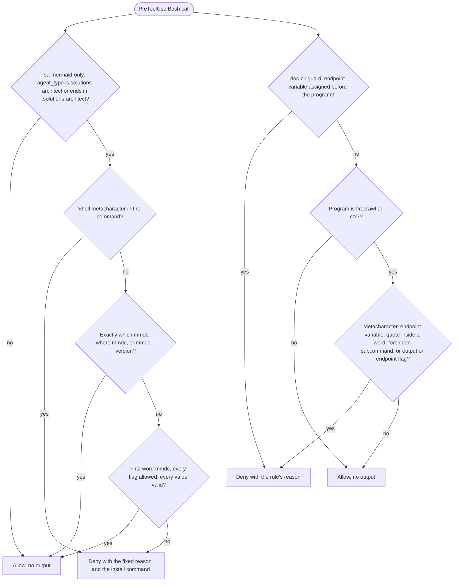

# spec-hooks-bash-guards

## Metadata

| Field | Value |
|---|---|
| **Feature** | Bash CLI guards: `sa-mermaid-only` and `doc-cli-guard` |
| **Parent feature** | spec-hooks-platform.md |
| **Sub-features** | None |
| **Requirement refs** | BR-006, UR-021, FR-092, FR-093, FR-094, NFR-009 |
| **Feature type** | Functionality |
| **Status** | Draft |

Status values: Draft, Review, Approved, Implemented.

## Description

Two PreToolUse guards limit Bash commands to safe forms. `sa-mermaid-only` limits the `solutions-architect` agent's Bash tool to mermaid-cli with a fixed flag list and paths under `specs/`, so a spec author cannot run other commands or write diagram output into auto-loaded or hidden files. `doc-cli-guard` limits the documentation CLIs `firecrawl` and `ctx7`, for every agent and the main session, to read-only forms, because the skills' `allowed-tools` wildcards would also match output flags and shell operators (`impl/doc-cli-guard.js:4-5`). Both run on the platform in spec-hooks-platform.md and fail open. This spec describes the behavior at commit 4803a0d.

Related requirements in other areas: FR-085 (Area A, `solutions-architect` renders diagrams with `mmdc` and never installs it) and FR-167 (Area C, the `code` skill's `ctx7` and `firecrawl` command shapes).

## Triggered by

| Trigger type | Source | Condition |
|---|---|---|
| Event | Claude Code PreToolUse, matcher `Bash` (`hooks/hooks.json:5-17`) | Any Bash tool call, from the main session or any subagent |

## Required data

| Data | Source | Type | Notes |
|---|---|---|---|
| `tool_name` | Hook input | string | Both guards act only on `Bash`; any other value is allowed with no output |
| `tool_input.command` | Hook input | string | Missing or null is treated as the empty string |
| `agent_type` | Hook input | string | Used by `sa-mermaid-only` only; missing or null is the empty string |

## Preconditions

| Condition | Check | If not met |
|---|---|---|
| Hook input is JSON | `JSON.parse` in `lib/health.js` | Failure path `malformed-input` (spec-hooks-platform.md) |
| Guard not disabled | `hooks-disabled.json` | Warn and allow (spec-hooks-platform.md) |
| Node 6 or newer | `lib/launch.js` | Warn and allow |

## Algorithmic steps

Start-to-end flow. Source: [spec-hooks-bash-guards-flow.mmd](spec-hooks-bash-guards-flow.mmd).



**Note:** PNG rendering requires mermaid-cli with its headless browser, which is missing on this machine (see spec-hooks-platform.md). Render with `mmdc -i specs/spec-hooks-bash-guards-flow.mmd -o specs/spec-hooks-bash-guards-flow.png` once it is installed.

### Requirement: Mermaid guard scope

The `sa-mermaid-only` hook SHALL judge only Bash calls whose `agent_type` matches `(^|:)solutions-architect$`; every other call passes with no output.

**Requirement refs:** FR-092, FR-093, UR-021
**Status:** Built; holding other plugins' `:solutions-architect` agents to the guard is pending OP-B3 (spec-hooks-platform.md, Open points)
**Source:** `hooks/impl/sa-mermaid-only.js:17`, `:97-102`

#### Scenario: Other agent

- **GIVEN** `assist-plugin:developer` runs `rm -rf build`
- **WHEN** the hook evaluates it
- **THEN** the hook SHALL allow it with no output

#### Scenario: Main session

- **GIVEN** the main session (no `agent_type`) runs `npx mmdc -i a.mmd -o a.png`
- **WHEN** the hook evaluates it
- **THEN** the hook SHALL allow it with no output

#### Scenario: Same agent name from another plugin

- **GIVEN** an agent with `agent_type` `other-plugin:solutions-architect` runs `ls`
- **WHEN** the hook evaluates it
- **THEN** the hook SHALL deny it, because the pattern matches any `:solutions-architect` suffix

### Requirement: Mermaid guard command forms

The `sa-mermaid-only` hook SHALL allow a judged command only when, after trimming, it equals `which mmdc`, `where mmdc`, or `mmdc --version`, or its first word is exactly `mmdc` and every following word is an allowed flag followed by one valid value.

**Requirement refs:** FR-092, UR-021
**Status:** Built
**Source:** `hooks/impl/sa-mermaid-only.js:20-34`, `:43-53`, `:64-94`

Allowed flags and value rules:

| Flags | Value rule |
|---|---|
| `-i`, `--input` | Input path rule (next Requirement), file name ends in `.mmd` |
| `-o`, `--output` | Input path rule, file name ends in `.svg`, `.png`, or `.pdf` |
| `-t`, `--theme`, `-b`, `--backgroundColor` | `^#?[A-Za-z0-9_-]+$` |
| `-w`, `--width`, `-H`, `--height`, `-s`, `--scale` | `^\d+(\.\d+)?$` |

A long flag may carry its value as `--flag=value`; a short flag may not (`-i=x` is an unknown flag). A flag may repeat. Neither `-i` nor `-o` is required, so `mmdc` alone is allowed. Words split on whitespace; a word may be wrapped whole in double or single quotes; a quote inside a bare word denies the command.

#### Scenario: Lookup command

- **GIVEN** `solutions-architect` runs `which mmdc`
- **WHEN** the hook evaluates it
- **THEN** the hook SHALL allow it with no output

#### Scenario: Full render command

- **GIVEN** `solutions-architect` runs `mmdc -i specs/diagrams/a.mmd -o specs/diagrams/a.svg -t dark -b transparent -w 800 -H 600 -s 2`
- **WHEN** the hook evaluates it
- **THEN** the hook SHALL allow it

#### Scenario: Download form

- **GIVEN** `solutions-architect` runs `npx mmdc -i specs/a.mmd -o specs/a.png`
- **WHEN** the hook evaluates it
- **THEN** the hook SHALL deny it with the reason in Requirement: Mermaid guard deny reason

#### Scenario: Unknown flag

- **GIVEN** `solutions-architect` runs `mmdc -i specs/a.mmd -p cfg.json`
- **WHEN** the hook evaluates it
- **THEN** the hook SHALL deny it

#### Scenario: Program given by path

- **GIVEN** `solutions-architect` runs `/usr/local/bin/mmdc -i specs/a.mmd -o specs/a.png`
- **WHEN** the hook evaluates it
- **THEN** the hook SHALL deny it, because the first word is not exactly `mmdc`

### Requirement: Mermaid guard paths

The `sa-mermaid-only` hook SHALL accept an `-i` or `-o` value only when it is a relative path whose first or second segment is `specs`, with at least one segment after `specs`, no empty segment, and no segment that starts with a dot, and whose last segment has the required extension, compared without regard to case.

**Requirement refs:** FR-093, UR-021
**Status:** Built
**Source:** `hooks/impl/sa-mermaid-only.js:55-68`; `DECISIONS.md` (2026-10-13, Protected-path guard covers every subagent)

A value starting with `-` or `/`, or with a drive letter (`C:`), is rejected. Because `.` and `..` start with a dot, they are rejected as segments.

#### Scenario: Output into an auto-loaded file

- **GIVEN** `solutions-architect` runs `mmdc -i specs/a.mmd -o CLAUDE.md`
- **WHEN** the hook evaluates it
- **THEN** the hook SHALL deny it

#### Scenario: Hidden or climbing paths

- **GIVEN** `solutions-architect` runs `mmdc -i specs/a.mmd -o specs/.hidden/x.png` or `mmdc -i specs/a.mmd -o specs/../CLAUDE.md`
- **WHEN** the hook evaluates each command
- **THEN** the hook SHALL deny both

#### Scenario: Specs one level down

- **GIVEN** `solutions-architect` runs `mmdc --input pkg/specs/a.mmd --output pkg/specs/a.pdf --theme dark --width 800`
- **WHEN** the hook evaluates it
- **THEN** the hook SHALL allow it

#### Scenario: Specs two levels down

- **GIVEN** `solutions-architect` runs `mmdc -i specs/a.mmd -o a/b/specs/a.svg`
- **WHEN** the hook evaluates it
- **THEN** the hook SHALL deny it

#### Scenario: Wrong extension

- **GIVEN** `solutions-architect` runs `mmdc -i specs/a.mmd -o specs/x.md`
- **WHEN** the hook evaluates it
- **THEN** the hook SHALL deny it

### Requirement: Mermaid guard metacharacters and quotes

The `sa-mermaid-only` hook SHALL deny a judged command that holds any of these characters, before any other check: `;`, `&`, `|`, a backtick, `<`, `>`, `$`, `{`, `\`, `*`, `?`, `[`, `]`, `(`, `)`, `~`, `!`, a newline, or a carriage return.

**Requirement refs:** FR-093, UR-021
**Status:** Built
**Source:** `hooks/impl/sa-mermaid-only.js:18-19`, `:88-91`

#### Scenario: Chained command

- **GIVEN** `solutions-architect` runs `mmdc -i a.mmd; rm -rf x`
- **WHEN** the hook evaluates it
- **THEN** the hook SHALL deny it

#### Scenario: Brace expansion

- **GIVEN** `solutions-architect` runs `mmdc -i {a,b}.mmd`
- **WHEN** the hook evaluates it
- **THEN** the hook SHALL deny it

#### Scenario: Quoted path with a space

- **GIVEN** `solutions-architect` runs `mmdc -i specs/a.mmd -o "specs/my dir/a.svg"`
- **WHEN** the hook evaluates it
- **THEN** the hook SHALL allow it

### Requirement: Mermaid guard deny reason

The `sa-mermaid-only` hook SHALL give every denial the same fixed reason, which names the allowed flags and paths and the install command.

**Requirement refs:** FR-092, UR-021
**Status:** Built
**Source:** `hooks/impl/sa-mermaid-only.js:37-40`

The reason text is: "solutions-architect may only run mermaid-cli (mmdc) with -i/-o/-t/-b/-w/-H/-s, a .mmd input, and a .svg, .png, or .pdf output, both under specs/ or <dir>/specs/ (relative, no .., no segment starting with a dot). If mmdc is missing, show the user: npm install -g @mermaid-js/mermaid-cli"

#### Scenario: Reason names the install command

- **GIVEN** any denied `solutions-architect` command
- **WHEN** the hook denies it
- **THEN** `permissionDecisionReason` SHALL end with `npm install -g @mermaid-js/mermaid-cli`

#### Scenario: No rewrite

- **GIVEN** any denied command
- **WHEN** the hook returns
- **THEN** the output SHALL carry no `updatedInput`

### Requirement: Documentation CLI program detection

The `doc-cli-guard` hook SHALL find the program of a Bash command by splitting it on whitespace, removing whole-word outer quotes, and skipping leading `VAR=value` words and the wrappers `env`, `command`, `timeout`, `nice`, `nohup`, `stdbuf`, and `time` with their options, judging the command only when that program's base name is `firecrawl` or `ctx7`.

**Requirement refs:** FR-094, UR-021
**Status:** Built; recognizing Windows program names is pending OP-B9 and package-runner launch forms OP-B10 (spec-hooks-platform.md, Open points)
**Source:** `hooks/impl/doc-cli-guard.js:45-54`, `:57-66`; `hooks/lib/shell-program.js:7-62`

Wrapper options that consume a value: `env` `-u`, `--unset`, `-C`, `--chdir`; `timeout` `-s`, `--signal`, `-k`, `--kill-after` (and a duration after the options); `nice` `-n`, `--adjustment`; `stdbuf` `-i`, `-o`, `-e`; `time` `-f`, `--format`, `-o`, `--output`. A `--` ends a wrapper's options.

#### Scenario: Wrapped program

- **GIVEN** the command `timeout 30 firecrawl scrape https://x -o a --only-main-content`
- **WHEN** the hook evaluates it
- **THEN** the hook SHALL deny it as a `firecrawl` command with an output flag

#### Scenario: Unguarded program

- **GIVEN** the command `git status`
- **WHEN** the hook evaluates it
- **THEN** the hook SHALL allow it with no output

### Requirement: Documentation CLI denial rules

The `doc-cli-guard` hook SHALL deny, for every agent and the main session, a judged command that matches any rule in the table below, checked in table order, with that rule's reason.

**Requirement refs:** FR-094, UR-021, BR-006
**Status:** Built; rule 1 applying to any program is pending OP-B4, and Bash-only coverage OP-B8 (spec-hooks-platform.md, Open points)
**Source:** `hooks/impl/doc-cli-guard.js:22-31`, `:57-94`

| Order | Rule | Reason |
|---|---|---|
| 1 | A word `FIRECRAWL_API_URL=...` or `CONTEXT7_<name containing URL>=...` before the program; applies to any program, guarded or not | R1 |
| 2 | Any of `;`, `&`, `\|`, a backtick, `$`, `>`, `<`, `\`, `{`, `}`, a newline, or a carriage return | R2 |
| 3 | An endpoint variable assignment anywhere in the command | R3 |
| 4 | A quote inside a word (quotes may wrap whole words only) | R4 |
| 5 | The first argument that does not start with `-` makes `firecrawl env`, `ctx7 setup`, or `ctx7 login` | R5 |
| 6 | An argument matching `^-[A-Za-z]*o` (a short flag cluster holding `o`) or `^--(output\|base-url\|api-url)(=\|$)` | R6 |

Reason texts, where `<p>` is the program name and `<sub>` the subcommand (`impl/doc-cli-guard.js:62`, `:69`, `:72`, `:76`, `:81`, `:84`):

```text
R1  FIRECRAWL_API_URL and CONTEXT7_*URL* overrides are not allowed
R2  <p>: shell operators (; & | ` $ > < \ { }) and newlines are not allowed
R3  <p>: FIRECRAWL_API_URL and CONTEXT7_*URL* overrides are not allowed
R4  <p>: quotes are allowed only around whole words
R5  <p> <sub> writes config or credentials; ask the user to run it themselves
R6  <p>: -o, --output, --base-url, and --api-url are not allowed
```

#### Scenario: Output flag

- **GIVEN** the command `firecrawl scrape https://example.com -o out.md`
- **WHEN** the hook evaluates it
- **THEN** the hook SHALL deny it with the rule 6 reason

#### Scenario: Plain lookup

- **GIVEN** the command `ctx7 docs /org/project "routing" --json`
- **WHEN** the hook evaluates it
- **THEN** the hook SHALL allow it with no output

#### Scenario: Endpoint override before an unrelated program

- **GIVEN** the command `CONTEXT7_BASE_URL=http://e npm test`
- **WHEN** the hook evaluates it
- **THEN** the hook SHALL deny it with the rule 1 reason (built behavior; pending OP-B4)

#### Scenario: Command substitution

- **GIVEN** the command `firecrawl search "$(id)" --json`
- **WHEN** the hook evaluates it
- **THEN** the hook SHALL deny it with the rule 2 reason

#### Scenario: Credential subcommand

- **GIVEN** the command `ctx7 login`
- **WHEN** the hook evaluates it
- **THEN** the hook SHALL deny it with the reason `ctx7 login writes config or credentials; ask the user to run it themselves`

## Business rules

| Rule ID | Rule | Traces to | Applied at step | Example |
|---|---|---|---|---|
| RULE-001 | Only `solutions-architect` agent types are held to the mermaid allowlist | FR-092 | Requirement: Mermaid guard scope | `developer` runs anything |
| RULE-002 | Diagram files live under `specs/` or `<dir>/specs/`, never hidden, never climbing | FR-093 | Requirement: Mermaid guard paths | `specs/spec-auth-architecture.png` |
| RULE-003 | Agents never install or download mermaid-cli | FR-092, FR-085 | Requirement: Mermaid guard command forms | `npx` denied; install command shown |
| RULE-004 | Documentation CLIs run read-only: no output files, no endpoint changes, no credential setup | FR-094 | Requirement: Documentation CLI denial rules | `ctx7 setup` denied |
| RULE-005 | Endpoint override variables are refused before any program (pending OP-B4) | FR-094 | Requirement: Documentation CLI denial rules, rule 1 | `FIRECRAWL_API_URL=... ls` denied |
| RULE-006 | Not covered at commit 4803a0d: PowerShell tool calls (registration `hooks/hooks.json:5-17`, check `impl/doc-cli-guard.js:91`), Windows program names such as `ctx7.exe` (`impl/doc-cli-guard.js:65-66`), and package-runner launch forms such as `npx ctx7` (`lib/shell-program.js:11-19`); each is an open point, not a requirement | FR-094 | Requirement: Documentation CLI program detection; Requirement: Documentation CLI denial rules | Pending OP-B8, OP-B9, OP-B10 (spec-hooks-platform.md, Open points) |

## Data transformations

| Input | Transformation | Output | Notes |
|---|---|---|---|
| `tool_input.command` | Trim; split into words honoring whole-word quotes | Word list or "rejected" | A quote inside a bare word rejects the command in both guards |
| Word list (`doc-cli-guard`) | Skip assignments and wrappers | Program index plus an endpoint-assignment flag | `lib/shell-program.js` |

## Output / Outcome

| Output | Type | Description |
|---|---|---|
| Deny decision | PreToolUse JSON on stdout | `permissionDecision: "deny"` with the reason from the matching rule; exit 0 |
| Allow | No stdout | Exit 0; Claude Code's normal permission flow continues |

## Error handling

| Error condition | Handling strategy | Outcome |
|---|---|---|
| Malformed hook input, throw, timeout, old Node | Platform failure path | `systemMessage` warning; the command runs unchecked |
| Guard listed in `hooks-disabled.json` | Platform disabled path | Warning on every call; the command runs unchecked |
| Command is not a string | Treated as the empty string | `sa-mermaid-only` denies a judged empty command (it is not `mmdc`); `doc-cli-guard` allows it |

## Events emitted

| Event name | Payload | Consumer(s) | When emitted |
|---|---|---|---|
| PreToolUse deny | `hookSpecificOutput` with `permissionDecisionReason` | Claude Code | A rule matched |

## Events consumed

| Event name | Producer | Payload used | Handling |
|---|---|---|---|
| PreToolUse (`Bash`) | Claude Code | `tool_name`, `tool_input.command`, `agent_type` | Evaluated as above |

## Sub-feature breakdown

Not applicable: both guards are leaf features of spec-hooks-platform.md.

## Performance considerations

| Concern | Target | Approach |
|---|---|---|
| Latency | Finish within the 5 s registration (NFR-007) | No file or network I/O; one pass over the command words |
| Self-test coverage | Fixed allow and deny cases pass (FR-118) | 10 allow and 14 deny cases for `doc-cli-guard`, 10 allow and 19 deny cases for `sa-mermaid-only` (`impl/health-check.js:716-790`) |

## Traceability

| Requirement | Spec section | Verified by |
|---|---|---|
| BR-006 | Business rules | Health-check deny corpus |
| UR-021 | Requirement: Mermaid guard command forms; Requirement: Documentation CLI denial rules | Self-test cases in `impl/health-check.js:716-790` |
| FR-092 | Requirement: Mermaid guard scope; Requirement: Mermaid guard command forms; Requirement: Mermaid guard deny reason | Lookup, full render, download, and unknown-flag scenarios |
| FR-093 | Requirement: Mermaid guard paths; Requirement: Mermaid guard metacharacters and quotes; Requirement: Mermaid guard scope | `CLAUDE.md` output, hidden path, chained command, other-agent scenarios |
| FR-094 | Requirement: Documentation CLI program detection; Requirement: Documentation CLI denial rules | Output flag, plain lookup, substitution, and credential scenarios |
| NFR-009 | Error handling | Platform failure-path tests run against both guards |
