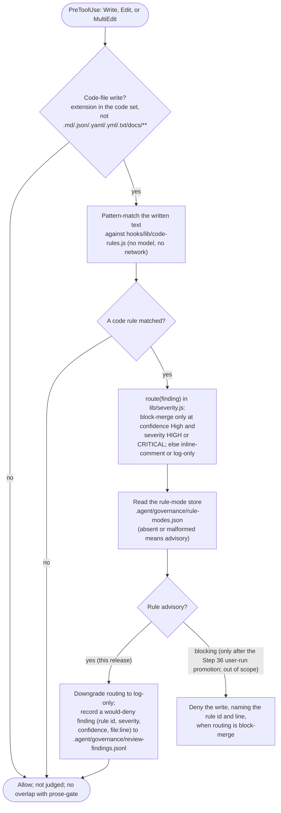
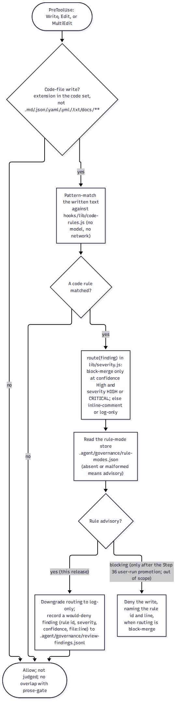

# spec-hooks-code-scan

## Metadata

| Field | Value |
|---|---|
| **Feature** | Insecure generated-code scan, and the shift-left severity-routing mechanism (routing policy, rule-mode store, advisory baseline, and promotion gate) it runs on |
| **Parent feature** | spec-hooks-platform.md |
| **Sub-features** | None |
| **Requirement refs** | BR-018, BR-022, UR-062, UR-071, UR-072, FR-220, FR-237, FR-238, FR-239, FR-219, NFR-028, NFR-029, NFR-034, NFR-027, NFR-035, FR-245 |
| **Feature type** | Functionality |
| **Status** | Review |

Status values: Draft, Review, Approved, Implemented.

Paths that start with `hooks/`, `scripts/`, or `rules/` are relative to `plugins/assist-plugin/`; the `.agent/` stores resolve against the session's git root. This spec describes planned behavior for harness-governance Tranche 4 (task plan `docs/task-plans/task-plan-harness-governance-20261028-0759.md`, Steps 31, 32, 35, and 36); nothing here is built. It traces to FR-NFR-harness-governance.md v1.3 (2026-10-30).

## Description

`code-scan` is a PreToolUse hook on `Write`, `Edit`, and `MultiEdit` that pattern-matches the written text of a code file against a rule catalog (`hooks/lib/code-rules.js`) and routes each finding through the shared severity policy. The hook is the first blocking-capable check built on the shift-left severity-routing mechanism of Tranche 4, so this spec is the home for that mechanism: the pure routing function `route(finding)` (`hooks/lib/severity.js`), the rule-mode store that marks each rule advisory or blocking (`.agent/governance/rule-modes.json`), the advisory baseline and its precision report (`.agent/governance/review-findings.jsonl`, `scripts/label-findings.js`, `scripts/baseline-report.js`), and the promotion gate (`scripts/promote-rule.js`). The goal-hijack guardrail of FR-219 (spec-hooks-goal-guard.md) is the second rule that uses the same mechanism; its Tranche 4 delta references the requirements below.

Release posture is advisory-only. Every rule starts advisory, the caller downgrades its routing to `log-only` while it is advisory, the hook records a would-deny finding and allows, and the denial (rule id and line) applies only after a user-run promotion (task plan Step 36), which is out of scope for this release and builds no enabled blocking. An absent or malformed rule-mode configuration means advisory for every rule and never fails open into blocking. The fail-closed denial of the NFR-028 class (FR-220 is a member) is defined but dormant while the rule is advisory; it activates only at promotion. This posture is the settled design for Tranche 4 (task plan Steps 32, 35, and 36, Ordering Rationale; `DECISIONS.md`, 2026-10-31, "Severity policy approved", which permits a blocking rule only after the FR-238 advisory baseline).

The severity policy itself is `rules/severity-policy.md` (approved in `DECISIONS.md`), a rules document and not part of this feature; this spec cites it as the basis `route(finding)` applies. The hook registration and counts are in spec-hooks-platform.md (Change Log 2026-11-13 (Tranche 4)); the rule-mode store's write protection is in spec-hooks-fsa-write-bar.md (Change Log 2026-11-13 (Tranche 4)).

## Triggered by

| Trigger type | Source | Condition |
|---|---|---|
| Event | PreToolUse, matcher `Write\|Edit\|MultiEdit` (spec-hooks-platform.md, Change Log 2026-11-13 (Tranche 4); the matcher string is proposed, task plan Step 35 naming the events) | Every `Write`, `Edit`, or `MultiEdit` that targets a code file |

## Required data

| Data | Source | Type | Notes |
|---|---|---|---|
| Written text and path | Hook input `tool_input` | Text and path | The text the pattern rules read, and the file extension that decides the code-file class |
| Code rules | `hooks/lib/code-rules.js` | Rule catalog | Each rule carries an id, a pattern, a severity, and a confidence; the code-extension set lives here too |
| Rule mode | `.agent/governance/rule-modes.json` | JSON | Advisory or blocking per rule; absent or malformed means advisory |
| Severity policy basis | `rules/severity-policy.md` | Rules document (read by `route`) | CRITICAL, HIGH, MEDIUM, LOW and the block rule (confidence High and severity HIGH or CRITICAL) |

## Preconditions

| Condition | Check | If not met |
|---|---|---|
| The call is a `Write`, `Edit`, or `MultiEdit` | Matcher and `tool_name` | Not judged |
| The target is a code file | Extension in the code set and not excluded (Requirement: Code-file class and no overlap with prose-gate) | Allowed, not judged |
| Platform preconditions | spec-hooks-platform.md | Fail open |

## Algorithmic steps

Start-to-end flow of one advisory scan. Source: [spec-hooks-code-scan-flow.mmd](spec-hooks-code-scan-flow.mmd).

**Note:** Rendered on 2026-11-13 with `mmdc -i specs/spec-hooks-code-scan-flow.mmd -o specs/spec-hooks-code-scan-flow.png`. The `.mmd` source is the record; re-render it after any edit.

### Requirement: Advisory scan of a code-file write

The `code-scan` hook SHALL pattern-match the written text of a `Write`, `Edit`, or `MultiEdit` on a code file against the rules of `hooks/lib/code-rules.js` and, while the rule is advisory, SHALL record a would-deny finding (rule id, severity, confidence, and the file and line) to the advisory baseline store and SHALL allow the write; it SHALL deny the write, naming the rule id and line, only for a finding that routes `block-merge` while the rule is blocking, which this release does not enable.

**Requirement refs:** FR-220, FR-238, FR-239, UR-062 | **Status:** Planned (harness-governance Tranche 4) | **Source:** FR-NFR-harness-governance.md v1.3, FR-220 (section 2.7), FR-238 (section 2.25, advisory run); task plan Step 35 (`hooks/code-scan.js`, `hooks/impl/code-scan.js`, PreToolUse on `Write`, `Edit`, `MultiEdit`; the denial names rule id and line), Step 36 (promotion, out of scope)

In advisory mode the hook records a finding and does not block (FR-238). FR-220 is a `Should` requirement. The scan is pattern-based (rule matching on the written text), imports no model client, and makes no network call, so it fits the per-write budget of NFR-029.

#### Scenario: Injection-prone code recorded, advisory

- **GIVEN** the rule mode is advisory (the default) and a `Write` to `src/db.js` builds an SQL string from request input
- **WHEN** the hook scans the write
- **THEN** the hook SHALL record a would-deny finding naming the rule id and the line to the advisory baseline store
- **AND** the hook SHALL allow the write

#### Scenario: Safe code passes

- **GIVEN** a `Write` to `src/db.js` that uses a parameterized query
- **WHEN** the hook scans the write
- **THEN** no rule SHALL match, the hook SHALL record no finding, and the hook SHALL allow the write

#### Scenario: Denial only when blocking (not this release)

- **GIVEN** a write whose SQL-from-input finding routes `block-merge` and the rule is blocking after a user-run promotion
- **WHEN** the hook scans the write
- **THEN** the hook SHALL deny the write and name the rule id and line
- **AND** this release SHALL enable no blocking, so the rule stays advisory until the Step 36 promotion

### Requirement: Code-file class and no overlap with prose-gate

The `code-scan` hook SHALL judge only a write whose target has a code extension in the standard set (`js`, `mjs`, `cjs`, `ts`, `tsx`, `py`, `sh`, `bash`, `sql`, `go`, `java`, `rb`, `php`, `pl`, `ps1`), held in `hooks/lib/code-rules.js`, and SHALL NOT judge a write to a `.md`, `.json`, `.yaml`, `.yml`, or `.txt` file or to any path under `docs/`, so it never overlaps `prose-gate`.

**Requirement refs:** FR-220, NFR-029, NFR-027 | **Status:** Planned (harness-governance Tranche 4) | **Source:** FR-NFR-harness-governance.md v1.3, FR-220 (section 2.7), NFR-029 (section 3.1); task plan Step 35 (the guarded class is a write of a code file, defined by the standard code-extension set, excluding `.md`, `.json`, `.yaml`/`.yml`, `.txt`, and `docs/**`; the list lives in `hooks/lib/code-rules.js`; must not overlap `prose-gate`)

The code-extension set is the guarded fail-closed class of NFR-028 (Requirement: Fail-closed class is defined and dormant while advisory). A write outside the set is allowed with no scan, so the hook adds no cost to a prose or data write and `prose-gate` keeps sole ownership of prose files (FR-103, spec-hooks-prose-hooks.md).

#### Scenario: Code file judged

- **GIVEN** a `Write` to `src/app.py`
- **WHEN** the hook evaluates it
- **THEN** the hook SHALL run the pattern scan, because `py` is in the code set

#### Scenario: Prose file not judged

- **GIVEN** a `Write` to `docs/guide.md` and a `Write` to `config/data.json`
- **WHEN** the hook evaluates each
- **THEN** the hook SHALL allow each with no scan, because `.md` and `.json` are excluded and `docs/**` is out of the class

#### Scenario: No overlap with prose-gate

- **GIVEN** a `Write` to a `.md` file that `prose-gate` judges
- **WHEN** both PreToolUse hooks run
- **THEN** `code-scan` SHALL add no decision for that write, so only `prose-gate` judges it

### Requirement: Severity routing policy function

The routing function `route(finding)` in `hooks/lib/severity.js` SHALL be a pure policy function that returns one of `block-merge`, `inline-comment`, or `log-only`, returning `block-merge` only when the finding's confidence is High and its severity is HIGH or CRITICAL under the severity policy, and the caller SHALL downgrade the returned routing to `log-only` while the rule is advisory.

**Requirement refs:** FR-239, FR-237 | **Status:** Planned (harness-governance Tranche 4) | **Source:** FR-NFR-harness-governance.md v1.3, FR-239 (section 2.26), FR-237 (section 2.24); task plan Step 32 (`hooks/lib/severity.js`: `route(finding)` returns `block-merge`, `inline-comment`, or `log-only`; blocking only for high confidence and HIGH or CRITICAL); `DECISIONS.md`, 2026-10-30, "Severity-policy basis and SARIF writer settled" (the block rule and the four levels)

`route(finding)` reads only the finding's severity and confidence and the fixed policy basis; it makes no I/O, starts no process, and holds no mode. The caller (the `code-scan` hook or the `/do` orchestrator) applies the mode: it downgrades a `block-merge` or `inline-comment` to `log-only` while the rule is advisory. The severity policy is `rules/severity-policy.md`, approved in `DECISIONS.md`; this function applies its block rule and is the single routing authority the `code-scan` hook, the goal-hijack guardrail (FR-219), and the reviewer-finding routing (spec-orchestration-review-gates.md) share.

#### Scenario: Critical, high confidence routes block-merge

- **GIVEN** a finding with severity CRITICAL and confidence High
- **WHEN** `route(finding)` runs
- **THEN** it SHALL return `block-merge`

#### Scenario: High severity, low confidence does not block

- **GIVEN** a finding with severity HIGH and confidence Low
- **WHEN** `route(finding)` runs
- **THEN** it SHALL return `inline-comment` or `log-only` and SHALL NOT return `block-merge`

#### Scenario: Advisory caller downgrades to log-only

- **GIVEN** a finding that `route(finding)` routes `block-merge` and the rule is advisory
- **WHEN** the caller applies the mode
- **THEN** the caller SHALL downgrade the routing to `log-only` and record the finding without blocking

### Requirement: Rule-mode store governs advisory versus blocking

The rule-mode store `.agent/governance/rule-modes.json` SHALL hold the advisory or blocking mode of each check, and an absent or malformed store SHALL mean advisory for every rule and SHALL NOT fail open into blocking; a hook, the `/do` orchestrator, or the user-run `scripts/promote-rule.js` MAY write the store, and every subagent SHALL be denied a write to it.

**Requirement refs:** FR-238, FR-245 | **Status:** Planned (harness-governance Tranche 4) | **Source:** FR-NFR-harness-governance.md v1.3, FR-238 (section 2.25), FR-245 (section 2.32); task plan Step 32 (the rule-mode store `.agent/governance/rule-modes.json`, fixed by PN-8, protected from agents); `DECISIONS.md`, 2026-10-30, "Proposed governance file names and store paths approved (PN-8)"

The store is the sixth of the six FR-245 protected paths. Its write protection is enforced by `fsa-write-bar` (spec-hooks-fsa-write-bar.md, Change Log 2026-11-13 (Tranche 4)): a subagent write of the store is denied, while a hook, the orchestrator, or the user-run `promote-rule.js` writes it. The fail-open-into-advisory default is the safe direction: a missing or corrupt store never silently turns a rule blocking, which keeps the advisory-only release from ever denying a write on a store defect.

#### Scenario: Absent store means advisory

- **GIVEN** `.agent/governance/rule-modes.json` does not exist
- **WHEN** the `code-scan` hook reads the mode of its rule
- **THEN** the mode SHALL be advisory, and the hook SHALL record findings and block nothing

#### Scenario: Malformed store means advisory

- **GIVEN** `.agent/governance/rule-modes.json` is invalid JSON
- **WHEN** the hook reads the mode
- **THEN** the mode SHALL be advisory, and the hook SHALL NOT treat the defect as blocking

#### Scenario: Subagent write denied

- **GIVEN** a subagent session with an `agent_id` writes `.agent/governance/rule-modes.json`
- **WHEN** `fsa-write-bar` evaluates it
- **THEN** the write SHALL be denied (spec-hooks-fsa-write-bar.md)

### Requirement: Advisory baseline and precision from user labels

Each advisory finding SHALL be recorded to `.agent/governance/review-findings.jsonl`, the user-run `scripts/label-findings.js` SHALL set a true or false label on each finding, and `scripts/baseline-report.js` SHALL compute the finding counts and the precision over 14 days or 20 reviews, whichever is later, from the user-set labels only; an unlabelled finding SHALL be shown as unlabelled and SHALL NOT be counted as an agent judgment.

**Requirement refs:** FR-238, NFR-034 | **Status:** Planned (harness-governance Tranche 4) | **Source:** FR-NFR-harness-governance.md v1.3, FR-238 (section 2.25), NFR-034 (section 3.5); task plan Step 32 (`scripts/baseline-report.js`: finding counts and precision over 14 days or 20 reviews, whichever is later; precision from the user-set true or false label on each finding); `DECISIONS.md`, 2026-10-30, "Baseline precision labeller settled (PN-3)"

`review-findings.jsonl` is not one of the six FR-245 protected paths: it holds advisory findings and the user's labels, and `baseline-report.js` counts only the user-set labels, so an unlabelled or forged finding cannot inflate precision. The 14-day-or-20-review window is an estimate (BRD A-5) until measured. The precision bar for a promotion to blocking is at least 90% (NFR-034, estimate, BRD A-6), checked by `promote-rule.js` (Requirement: Promotion gate), not by the baseline report, which only reports.

#### Scenario: Unlabelled finding is not counted

- **GIVEN** a baseline finding with no user label and an agent judges it true
- **WHEN** `baseline-report.js` computes precision
- **THEN** the report SHALL NOT count the agent's judgment as a label
- **AND** the report SHALL show the finding as unlabelled

#### Scenario: Precision from the user's labels

- **GIVEN** the user has labelled each baseline finding true or false with `label-findings.js`
- **WHEN** `baseline-report.js` runs over a window of at least 14 days or 20 reviews, whichever is later
- **THEN** the report SHALL compute the precision from those labels and list the finding counts

### Requirement: Promotion gate

The `scripts/promote-rule.js` script SHALL read the latest `DECISIONS.md` entry whose heading matches `^## [0-9]{4}-[0-9]{2}-[0-9]{2}: Severity policy approved$` and whose body names the policy file's current version (`draft-2`), and SHALL refuse a switch of a rule to blocking with the missing-policy reason when no such entry exists, the missing-baseline reason when no baseline report exists, or the precision value when the baseline precision is under 90%.

**Requirement refs:** FR-237, FR-238, NFR-034 | **Status:** Planned (harness-governance Tranche 4) | **Source:** FR-NFR-harness-governance.md v1.3, FR-237 (section 2.24), FR-238 (section 2.25), NFR-034 (section 3.5); task plan Step 32 (`scripts/promote-rule.js`: refuses with the missing-policy reason, the missing-baseline reason, or the precision value when below 90%; reads `DECISIONS.md` for the approval heading and policy version), Step 36 (the user-run promotion)

The approval is matched by the heading pattern and the policy file's current version in the entry body, so editing the policy raises its version and the old approval no longer covers it (`DECISIONS.md`, 2026-10-30, "Severity policy approved"). A severity policy must exist and be approved for the current version before any rule blocks (FR-237); every blocking-capable rule must also have run advisory, produced a baseline, and met the precision bar (FR-238, NFR-034). `promote-rule.js` is the only writer of a blocking mode in the rule-mode store, and running it is a user-run operation (task plan Step 36).

#### Scenario: Policy missing refuses the switch

- **GIVEN** no `DECISIONS.md` entry matches the approval heading for the policy's current version
- **WHEN** a rule is switched to blocking through `promote-rule.js`
- **THEN** the switch SHALL be refused with the missing-policy reason

#### Scenario: No baseline refuses the switch

- **GIVEN** an approved policy and no baseline report for the rule
- **WHEN** a rule is switched to blocking
- **THEN** the switch SHALL be refused with the missing-baseline reason

#### Scenario: Low precision refuses the switch

- **GIVEN** an approved policy, a baseline report, and a baseline precision of 70% from the user's labels
- **WHEN** a rule is switched to blocking
- **THEN** the switch SHALL be refused with the precision value

### Requirement: Promotion is a user-run operation and this release enables no blocking

This release SHALL build the severity-routing, baseline, and promotion mechanism only and SHALL enable no blocking; `scripts/promote-rule.js` SHALL be the user-run operation that switches a rule to blocking, and both FR-219 (the goal-hijack guardrail) and FR-220 (the code scan) SHALL ship advisory-only.

**Requirement refs:** FR-238, FR-219, FR-220 | **Status:** Planned (harness-governance Tranche 4) | **Source:** FR-NFR-harness-governance.md v1.3, FR-238 (section 2.25); task plan Step 36 (promotion to blocking is a user-run operation; this release builds the mechanism only and enables no blocking), Ordering Rationale (Tranche 4)

The rule-mode store defaults every rule to advisory (Requirement: Rule-mode store governs advisory versus blocking), so a fresh install enforces no severity-based deny. Promotion of FR-219 and FR-220 to blocking is task plan Step 36, run by the user after the baseline period (14 days or 20 reviews, whichever is later) and a precision at or above 90%; for FR-219 the `PostToolUse` output shape that withholds a result is confirmed before the switch (spec-hooks-goal-guard.md). This spec builds the mechanism; it enables no rule.

#### Scenario: Fresh install enforces no severity deny

- **GIVEN** a fresh install with no rule-mode store
- **WHEN** a code-file write matches a HIGH-severity rule
- **THEN** the hook SHALL record the finding and allow the write, because every rule is advisory

#### Scenario: Promotion is user-run

- **GIVEN** the mechanism is built
- **WHEN** no user has run `promote-rule.js`
- **THEN** no rule SHALL be blocking, and neither FR-219 nor FR-220 SHALL deny a call on severity

### Requirement: Fail-closed class is defined and dormant while advisory

The `code-scan` hook SHALL define its NFR-028 guarded fail-closed class as a write of a code file (the code-extension set of Requirement: Code-file class and no overlap with prose-gate), and the fail-closed denial of that class SHALL be dormant while the rule is advisory and SHALL activate only after the user-run promotion; while advisory, an evaluation error, a timeout, or an unreadable configuration SHALL let the write proceed and SHALL record the failure in `hook-health.jsonl`.

**Requirement refs:** NFR-028, FR-220 | **Status:** Planned (harness-governance Tranche 4) | **Source:** FR-NFR-harness-governance.md v1.3, NFR-028 (section 3.2), FR-220 (section 2.7); task plan Step 1 (the NFR-028 class covers FR-220), Step 35 (ships advisory-only; the guarded class is a write of a code file); `DECISIONS.md`, 2026-10-28, "Compliance profile flags, enforced by default" (D-1)

FR-220 is a member of the NFR-028 security-critical class (spec-hooks-platform.md, Change Log 2026-11-05, Requirement: Failure path). The fail-closed denial of that class is held until promotion, because the release is advisory-only and an absent or malformed rule-mode configuration means advisory and never fails open into blocking (Requirement: Rule-mode store governs advisory versus blocking). At promotion the hook becomes a guard that declares the `failClosedFor(input)` classifier of the platform Failure-path requirement, and the fail-closed deny of a code-file write activates. This deliberate narrowing of the NFR-028 deny to the post-promotion state is the Tranche 4 design (settled: the advisory-baseline-first mandate of FR-238 governs when any denial, fail-closed or routine, turns on). This spec records the relationship; the active fail-closed branch lands with the Step 36 promotion and is out of scope here.

#### Scenario: Advisory error lets the write proceed

- **GIVEN** the rule is advisory and the scan throws, times out, or cannot read its configuration while judging a code-file write
- **WHEN** the hook returns
- **THEN** the hook SHALL let the write proceed and SHALL record the failure in `hook-health.jsonl`

### Requirement: No write tools, no new grant, and a self-test

The `code-scan` hook SHALL hold no write tools, SHALL introduce no new unscoped `Bash` grant, and SHALL ship a self-test corpus with a known-prohibited sample (an SQL string built from request input) and a known-safe sample (a parameterized query), reported through `/assist-plugin:health`.

**Requirement refs:** NFR-027, NFR-035, NFR-029 | **Status:** Planned (harness-governance Tranche 4) | **Source:** FR-NFR-harness-governance.md v1.3, NFR-027 and NFR-029 (section 3.2 and 3.1), NFR-035 (section 3.3); task plan Step 35 (the health-check corpus with a string-built SQL case denied and a parameterized case allowed; pattern-based so it fits the per-write budget)

The hook ships an ES5 entry file, an explicit short `timeout` in `hooks.json` for the NFR-029 budget, and a self-test corpus reported through `/assist-plugin:health` (NFR-035; spec-hooks-health-check.md, Change Log 2026-11-13 (Tranche 4)). The per-write cost stays within the NFR-029 budget (at most 30 ms added at the median, 150 ms total), confirmed by measurement; a heavier scan would need a revised budget (FR-220 Constraint).

#### Scenario: Guard holds no write tools

- **GIVEN** the `code-scan` hook and its registration
- **WHEN** a reviewer reads its implementation
- **THEN** it SHALL write no file through a tool and SHALL add no unscoped `Bash` grant

#### Scenario: Self-test corpus

- **GIVEN** the `code-scan` self-test with an SQL-from-input sample and a parameterized-query sample
- **WHEN** the health check runs
- **THEN** the SQL-from-input sample SHALL produce a would-deny finding and the parameterized-query sample SHALL produce none

## Business rules

| Rule ID | Rule | Traces to | Applied at |
|---|---|---|---|
| RULE-001 | Advisory mode records a would-deny finding and blocks nothing | FR-220, FR-238 | Requirement: Advisory scan of a code-file write |
| RULE-002 | Only a code-file write is judged; prose and data files stay with `prose-gate` | FR-220, NFR-029 | Requirement: Code-file class and no overlap with prose-gate |
| RULE-003 | `route(finding)` blocks only at confidence High and severity HIGH or CRITICAL; the caller downgrades to log-only while advisory | FR-239, FR-237 | Requirement: Severity routing policy function |
| RULE-004 | An absent or malformed rule-mode store means advisory and never fails open into blocking | FR-238, FR-245 | Requirement: Rule-mode store governs advisory versus blocking |
| RULE-005 | Precision is computed from the user's labels only; an unlabelled finding is never counted | FR-238, NFR-034 | Requirement: Advisory baseline and precision from user labels |
| RULE-006 | A switch to blocking is refused without an approved policy for the current version, a baseline, and precision at or above 90% | FR-237, FR-238, NFR-034 | Requirement: Promotion gate |
| RULE-007 | The fail-closed deny of the code-file class is dormant while advisory and activates only at promotion | NFR-028, FR-220 | Requirement: Fail-closed class is defined and dormant while advisory |

## Data transformations

| Input | Transformation | Output | Notes |
|---|---|---|---|
| Written text of a code file | Pattern-match against `code-rules.js` | A finding (rule id, severity, confidence, file:line), or none | No model, no network |
| A finding | `route(finding)` then the mode | `block-merge`, `inline-comment`, or `log-only`, downgraded to `log-only` while advisory | `lib/severity.js` and the rule-mode store |
| An advisory finding | Append to `review-findings.jsonl` | A baseline record awaiting a user label | Not an FR-245 protected path |

## Output / Outcome

| Output | Type | Description |
|---|---|---|
| Would-deny finding | `review-findings.jsonl` line | A rule matched; advisory mode blocks nothing |
| No stdout | Exit 0 | A code-file write proceeds in advisory mode; a non-code write is not judged |
| Deny JSON | PreToolUse output | Only after promotion, for a `block-merge` finding on a blocking rule |

## Error handling

| Error condition | Handling strategy | Outcome |
|---|---|---|
| Scan throws, times out, or cannot read its rules while advisory | Platform failure path; record in `hook-health.jsonl` | The write proceeds (fail open while advisory) |
| Rule-mode store absent or malformed | Treat as advisory | The write proceeds; no store defect turns a rule blocking |
| Baseline append fails | Record the failure in `hook-health.jsonl` | The write proceeds; no finding is stored |
| Scan error while blocking (post-promotion, out of scope) | Fail closed for the code-file class | The write is denied (Step 36) |

## Events emitted

| Event name | Payload | Consumer(s) | When emitted |
|---|---|---|---|
| Would-deny finding | Rule id, severity, confidence, file:line | `baseline-report.js`, `label-findings.js` | A code rule matched in advisory mode |

## Events consumed

| Event name | Producer | Payload used | Handling |
|---|---|---|---|
| PreToolUse (`Write`, `Edit`, `MultiEdit`) | Claude Code | `tool_input` text and path | Code-file check, pattern scan, advisory record |

## Sub-feature breakdown

Not applicable: a leaf feature of spec-hooks-platform.md. The severity-routing mechanism (`route`, the rule-mode store, the baseline, and the promotion gate) is documented here because the `code-scan` hook is its first consumer; the goal-hijack guardrail (FR-219) references these requirements.

## Performance considerations

| Concern | Target | Approach |
|---|---|---|
| Per-write cost (NFR-029) | At most 30 ms added at the median, 150 ms total | An explicit short `timeout` in `hooks.json`; a pattern-match pass over the written text, no model and no network; a non-code write returns before any scan |

## Traceability

| Requirement | Spec section | Verified by |
|---|---|---|
| FR-220 | Requirement: Advisory scan of a code-file write; Requirement: Code-file class and no overlap with prose-gate | SQL-from-input sample records a would-deny and allows; a parameterized sample records none; a `.md` and a `.json` write are not judged (`tests/hooks/code-scan.test.js`, task plan Step 37) |
| FR-239, FR-237 | Requirement: Severity routing policy function | CRITICAL and High routes `block-merge`; HIGH and Low routes `inline-comment` or `log-only`; the advisory caller downgrades to `log-only` (`tests/hooks/severity.test.js`, task plan Step 37) |
| FR-238, FR-245 | Requirement: Rule-mode store governs advisory versus blocking | An absent or malformed store reads advisory; a subagent write is denied (spec-hooks-fsa-write-bar.md) |
| FR-238, NFR-034 | Requirement: Advisory baseline and precision from user labels | An unlabelled finding is shown unlabelled and not counted; precision is computed from the user's labels (`tests/scripts/baseline-report.test.js`, task plan Step 37) |
| FR-237, FR-238, NFR-034 | Requirement: Promotion gate | A switch is refused with the missing-policy, missing-baseline, or precision reason (`tests/scripts/promote-rule.test.js`, task plan Step 37) |
| FR-238, FR-219, FR-220 | Requirement: Promotion is a user-run operation and this release enables no blocking | A fresh install enforces no severity deny; no rule is blocking without a user-run promotion |
| NFR-028, FR-220 | Requirement: Fail-closed class is defined and dormant while advisory | An advisory evaluation error lets the write proceed; the fail-closed deny is out of scope until promotion |
| NFR-027, NFR-035, NFR-029 | Requirement: No write tools, no new grant, and a self-test | Tool review; the self-test corpus reports through `/assist-plugin:health`; the per-write budget holds |

## Change Log: 2026-11-13 (Tranche 4 as-built reconciliation)

**Source:** the shipped, gate-approved harness-governance Tranche 4 build, read on 2026-11-13: `hooks/lib/severity.js`, `hooks/lib/code-rules.js`, `hooks/impl/code-scan.js`, `scripts/baseline-report.js`, `scripts/label-findings.js`, and `scripts/promote-rule.js` (task plan `docs/task-plans/task-plan-harness-governance-20261028-0759.md`, Tranche 4 Steps 32 and 35); FR-NFR-harness-governance.md v1.3 (2026-10-30): FR-220, FR-237, FR-238, FR-239, NFR-028, NFR-029, NFR-034; `DECISIONS.md`, 2026-10-31, "Severity policy approved" (policy version `draft-2`). This spec described planned behavior; the mechanism is now built, so this entry reconciles the spec to the as-built code where the two differ and records the implementation facts the planned body left open. The severity policy stays at version `draft-2`. This spec received a delta, so its Status moves to `Review` (delta rule 6, no same-turn approval).

### Direct edits in this pass (no behavior change)

- Status: Draft -> Review.

### Body text this entry supersedes (applied at the next fold)

- Preamble: "This spec describes planned behavior for harness-governance Tranche 4 ...; nothing here is built" is superseded by the shipped, gate-approved build this entry reconciles to. At the next fold the preamble reads as built, and the Status stays `Review` until then, not `Implemented`.
- Required data, the Rule mode row, and Requirement: Rule-mode store governs advisory versus blocking: the store is a flat JSON object that maps a rule id to the string `"advisory"` or `"blocking"`, and only the exact value `"blocking"` marks a rule blocking; any other value, a rule the store does not name, a non-object, or malformed JSON reads as advisory (`hooks/lib/severity.js`, `modeOf`, `parseRuleModes`).
- Data transformations and Events emitted, the finding payload: the advisory baseline record is `{id, rule_id, severity, confidence, file, line, timestamp, review_id}`, where `review_id` is the session id (so the baseline counts a session as one review) and the hook sets no `label`; the record holds the path relative to the project root and the line number and never the matched text, the written text, or a prompt (NFR-031; `hooks/impl/code-scan.js`).
- Requirement: Advisory baseline and precision from user labels: `label` is a real boolean only; the string `"true"`, a number, or any non-boolean value reads as unlabelled and is never counted (`hooks/lib/severity.js`, `labelOf`; NFR-034).
- The advisory downgrade, everywhere the body states it (Requirement: Severity routing policy function statement and its Scenario "Advisory caller downgrades to log-only", RULE-003, the Data transformations routing row, and the Algorithmic steps flow node REC): while advisory the caller downgrades only a first-row `block-merge` to `inline-comment`, not to `log-only`, and leaves an `inline-comment` or a `log-only` unchanged; the "downgrade to `log-only` while advisory" wording of those places is corrected to this behavior (`hooks/lib/severity.js` `applyMode`; `rules/severity-policy.md:83`, `:87`, `:93`, draft-2). The flow's branches are unchanged (only node REC's label text), so the diagram's `.mmd` and PNG are re-rendered at the fold, not in this pass.

### ADDED Requirements

None.

### MODIFIED Requirements

#### Requirement: Code-file class and no overlap with prose-gate

**Was:** ... a code extension in the standard set (`js`, `mjs`, `cjs`, `ts`, `tsx`, `py`, `sh`, `bash`, `sql`, `go`, `java`, `rb`, `php`, `pl`, `ps1`), held in `hooks/lib/code-rules.js` ...

**Now:** ... a code extension in the standard set (`js`, `mjs`, `cjs`, `ts`, `tsx`, `jsx`, `py`, `sh`, `bash`, `sql`, `go`, `java`, `rb`, `php`, `pl`, `ps1`), held in `hooks/lib/code-rules.js`; the set holds sixteen extensions, `jsx` included by the user's sign-off decision (`CODE_EXTENSIONS`). The excluded prose and data set (`.md`, `.json`, `.yaml`, `.yml`, `.txt`, and `docs/**`) is unchanged.

**Reason:** The as-built `CODE_EXTENSIONS` includes `jsx`; the planned list omitted it. The exclusion set and the scan flow are unchanged, so the flow diagram (`spec-hooks-code-scan-flow.mmd`) and its PNG need no re-render.

**Requirement refs:** FR-220, NFR-029, NFR-027 | **Status:** Built (harness-governance Tranche 4)

The rule catalog (`hooks/lib/code-rules.js`) holds 14 rules, each a `{id, severity, confidence, pattern, needles, fix}` record. A needle pre-filter runs first: a rule names lower-case `needles`, at least one of which must appear in the lower-cased text before any line is matched against that rule, so a file with no SQL word never runs a SQL pattern. The per-write cost is bounded by `MAX_TEXT` 1,000,000 characters (the text is capped), `MAX_LINE` 1000 characters (each line is cut), `MAX_FINDINGS` 10 (the scan stops at ten findings), and `TIME_BUDGET_MS` 15 (the scan stops and returns what it has found) (NFR-029).

#### Requirement: Severity routing policy function

**Was:** The routing function `route(finding)` in `hooks/lib/severity.js` SHALL be a pure policy function that returns one of `block-merge`, `inline-comment`, or `log-only` ... and the caller SHALL downgrade the returned routing to `log-only` while the rule is advisory.

**Now:** As the Was, and `hooks/lib/severity.js` exports, besides the pure `route(finding)` (which reads only `severity` and `confidence` and applies no mode): `applyMode(routing, mode)`, the function the caller uses to apply the rule's mode: while the mode is not exactly `"blocking"` (advisory, the default) it downgrades only a first-row `block-merge` to `inline-comment`, and it leaves an `inline-comment` or a `log-only` unchanged, so only the first row changes between modes and rows 2 to 5 route the same either way (`rules/severity-policy.md:83`, `:87`, `:93`, draft-2); `parseRuleModes(text)` and `modeOf(modes, ruleId)`, which read the rule-mode store defensively (an absent, malformed, or oddly shaped store, and any value other than `"blocking"`, read as advisory; `parseRuleModes` builds the map through the internal `ruleModesOf` helper, which is not exported); `labelOf(record)`, which returns a finding's boolean label or null; and `checkFinding(record)`, the single validator every reader and writer of the baseline shares, which normalizes a record of the shape `{id, rule_id, severity, confidence, file, line, timestamp, review_id?, label?}` and returns null for any record that does not match.

**Reason:** The as-built `hooks/lib/severity.js` factors the policy into these pure functions. `applyMode` is the "caller applies the mode" step named in the body; `parseRuleModes`, `modeOf`, `labelOf`, and `checkFinding` are the shared helpers the `code-scan` hook, the baseline scripts, and the promotion gate call. `ruleModesOf` exists as an internal helper and is not in `module.exports`.

**Requirement refs:** FR-239, FR-237, FR-238 | **Status:** Built (harness-governance Tranche 4)

**Correction (2026-11-13):** `applyMode` was first built, and first described in this entry, to downgrade both `block-merge` and `inline-comment` to `log-only` while advisory. That contradicted the approved severity policy (draft-2): in advisory mode the first row routes as `inline-comment`, not `log-only`, and rows 2 to 5 route the same in either mode (`rules/severity-policy.md:83`, `:87`; only the first row blocks, `:93`). The code was fixed (`hooks/lib/severity.js` `applyMode`: while the mode is not exactly `"blocking"` it turns a `block-merge` into `inline-comment` and leaves every other routing unchanged), and this requirement's `applyMode` description above is reconciled to it. Only a rule whose mode is exactly `"blocking"` keeps a `block-merge`. The policy version stays `draft-2`.

#### Requirement: Promotion gate

**Was:** The `scripts/promote-rule.js` script SHALL ... refuse a switch of a rule to blocking with the missing-policy reason when no such entry exists, the missing-baseline reason when no baseline report exists, or the precision value when the baseline precision is under 90%.

**Now:** The `scripts/promote-rule.js` script SHALL refuse a switch of a rule to blocking, in order, with the missing-policy reason when no `DECISIONS.md` approval names the policy file's current version (`draft-2`), the missing-baseline reason when the rule has no finding, its baseline window is still open, or no finding carries a user label, and the precision reason when the baseline precision is under 90%; and SHALL refuse with the store-unreadable reason, ahead of those three, when the existing rule-mode store is not a JSON object (overwriting it would destroy it). The 90% bar is an integer comparison (`labelledTrue * 10 >= (labelledTrue + labelledFalse) * 9`), so a precision of exactly 90% passes and no rounding moves a value across the bar. A baseline is complete only when the rule has findings, its window is complete (14 days AND 20 distinct `review_id` values, the later of the two moments), and at least one finding is user-labelled. On success the script writes the rule-mode store atomically, through a temporary file in the same directory and a rename, and it exits 0 (the rule is blocking, switched now or already blocking), 1 (refused, reason printed), or 2 (cannot run: bad arguments, an unknown project root, or an unreadable or unwritable file).

**Reason:** The as-built `scripts/promote-rule.js` adds a fourth refusal, `store-unreadable` (checked before the policy, baseline, and precision checks), and the baseline-complete test has three parts checked through `scripts/baseline-report.js` `baselineFor` and `windowOf`. The 90% bar is an integer comparison, so exactly 90% passes. The policy version stays `draft-2`.

**Requirement refs:** FR-237, FR-238, NFR-034 | **Status:** Built (harness-governance Tranche 4)

##### Scenario: Unreadable store refuses the switch

- **GIVEN** an approved policy, a complete baseline above 90%, and a `.agent/governance/rule-modes.json` that is not a JSON object
- **WHEN** a rule is switched to blocking through `promote-rule.js`
- **THEN** the switch SHALL be refused with the store-unreadable reason, and the store SHALL be left unchanged

##### Scenario: Exactly 90% passes

- **GIVEN** an approved policy, a complete baseline, and a precision of exactly 90% from the user's labels
- **WHEN** a rule is switched to blocking
- **THEN** the switch SHALL be allowed, because the bar is an integer comparison and 90% is not under 90%

#### Requirement: Fail-closed class is defined and dormant while advisory

**Was:** ... At promotion the hook becomes a guard that declares the `failClosedFor(input)` classifier of the platform Failure-path requirement, and the fail-closed deny of a code-file write activates.

**Now:** As the Was. As built, `hooks/impl/code-scan.js` exports `failClosedFor(input)` (it returns true for a write of a code file) but does not wire it to a runner: the hook runs on the filter runtime (`health.transform`), which has no fail-closed branch, so while advisory an evaluation error, a timeout, or an unreadable store lets the write proceed and the failure is noted in `hook-health.jsonl`. The classifier activates only when the Step 36 promotion makes the hook a guard (`health.guard`).

**Reason:** This records the as-built wiring: `failClosedFor` is defined and exported but dormant (unwired) in the advisory release, matching the requirement's intent.

**Requirement refs:** NFR-028, FR-220 | **Status:** Built (harness-governance Tranche 4)

### REMOVED Requirements

None.

### Traceability added

| Requirement | Spec section | Verified by |
|---|---|---|
| FR-220, NFR-029 | Change Log 2026-11-13 (Tranche 4 as-built reconciliation): Requirement: Code-file class and no overlap with prose-gate | `CODE_EXTENSIONS` holds sixteen extensions, `jsx` included; 14 rules; the needle pre-filter and the `MAX_TEXT`, `MAX_LINE`, `MAX_FINDINGS`, and `TIME_BUDGET_MS` budgets (`tests/hooks/code-scan.test.js`, task plan Step 37) |
| FR-239, FR-237, FR-238 | Change Log 2026-11-13 (Tranche 4 as-built reconciliation): Requirement: Severity routing policy function | `route`, `applyMode`, `parseRuleModes`, `modeOf`, `labelOf`, and `checkFinding` are exported and pure; the store is a flat map and only `"blocking"` marks a rule blocking (`tests/hooks/severity.test.js`, task plan Step 37) |
| FR-237, FR-238, NFR-034 | Change Log 2026-11-13 (Tranche 4 as-built reconciliation): Requirement: Promotion gate | The four refusals (store-unreadable, missing-policy, missing-baseline, precision); exactly 90% passes; the three-part baseline-complete test; the atomic write and exit codes 0/1/2 (`tests/scripts/promote-rule.test.js`, task plan Step 37) |
| NFR-028, FR-220 | Change Log 2026-11-13 (Tranche 4 as-built reconciliation): Requirement: Fail-closed class is defined and dormant while advisory | `failClosedFor` is exported and unwired; the hook runs as `health.transform`, so the advisory fail-open path holds (`tests/hooks/code-scan.test.js`, task plan Step 37) |
