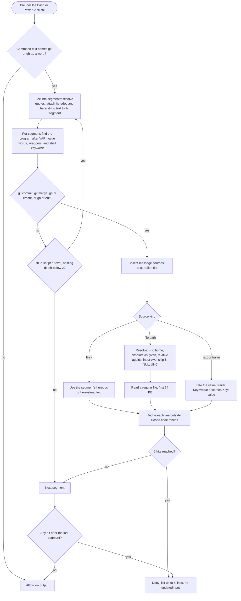

# spec-hooks-commit-attribution-guard

## Metadata

| Field | Value |
|---|---|
| **Feature** | Commit attribution guard: deny AI attribution lines in commit messages and pull request bodies |
| **Parent feature** | spec-hooks-platform.md |
| **Sub-features** | None |
| **Requirement refs** | BR-009, UR-015, FR-095, FR-096, FR-097, FR-098, NFR-009, NFR-014 |
| **Feature type** | Functionality |
| **Status** | Approved |

Status values: Draft, Review, Approved, Implemented.

## Description

`commit-attribution-guard` is a PreToolUse guard on Bash and PowerShell. It reads the commit message or pull request body that a `git commit`, `git merge`, `gh pr create`, or `gh pr edit` command carries, and denies the command when a line in that text is an AI attribution trailer, footer, or session link. It implements the 2026-10-12 decision "No AI attribution in commits or PRs" (`DECISIONS.md`) and the No AI Attribution Rule in `rules/assist-plugin-rule.md`. It judges only text it can read, never rewrites the command, and fails open. This spec describes the behavior at commit 4803a0d, which assist-plugin 1.11.1 (commit 41034c1) keeps at every cited line of `commit-attribution-guard.js` (read 2026-10-16); the self-test cites point at 1.11.1. The read-only attribution-settings report is FR-120 (spec-hooks-health-check.md).

## Triggered by

| Trigger type | Source | Condition |
|---|---|---|
| Event | Claude Code PreToolUse, matcher `Bash\|PowerShell` (`hooks/hooks.json:19-28`) | Any Bash or PowerShell tool call, from the main session or any subagent |

## Required data

| Data | Source | Type | Notes |
|---|---|---|---|
| `tool_name` | Hook input | string | `Bash` or `PowerShell`; anything else is allowed with no output |
| `tool_input.command` | Hook input | string | A non-string command is allowed with no output |
| `cwd` | Hook input | string | Base for relative message-file paths; used only when absolute |
| Message file contents | Local file system | UTF-8 text | Regular files only, first 65,536 bytes |

## Preconditions

| Condition | Check | If not met |
|---|---|---|
| The command names `git` or `gh` as a word | `(^\|[^a-z0-9_])(git\|gh)(\.exe)?([^a-z0-9_]\|$)`, case-insensitive (`impl/commit-attribution-guard.js:35`, `:523`) | Allow with no output, before any parsing |
| Platform preconditions | See spec-hooks-platform.md | Fail open |

## Algorithmic steps

Start-to-end flow. Source: [spec-hooks-commit-attribution-guard-flow.mmd](spec-hooks-commit-attribution-guard-flow.mmd).

**Note:** PNG rendering requires mermaid-cli with its headless browser, which is missing on this machine (see spec-hooks-platform.md). Render with `mmdc -i specs/spec-hooks-commit-attribution-guard-flow.mmd -o specs/spec-hooks-commit-attribution-guard-flow.png` once it is installed.

### Requirement: Command lexing

The guard SHALL split the command into segments at `;`, `|`, `&`, `(`, `)`, and line breaks outside quotes, resolve quoting, and attach each heredoc body and here-string word to the segment that opened it as that segment's stdin text.

**Requirement refs:** FR-095, UR-015
**Status:** Built
**Source:** `hooks/impl/commit-attribution-guard.js:63-345`

Lexing rules:

| Shell | Rule |
|---|---|
| Bash | Single quotes literal; double quotes resolve `\"`, `\\`, `` \$ ``, `` \` `` and a backslash-newline, and keep `$( )` text verbatim; `$'...'` resolves `\n`, `\t`, `\r`, `\\`, `\'`, `\"`; a backslash escapes the next character; `#` at a word start begins a comment |
| Bash | `<<DELIM` and `<<-DELIM` (delimiter optionally quoted) read the body from the next line to the delimiter line; `<<-` strips leading tabs before comparing |
| Bash | `<<< word` attaches the word as stdin text and not as an argument |
| PowerShell | Backtick escapes (`` `n ``, `` `t ``, `` `r ``); `''` inside single quotes; `""` inside double quotes; `@'...'@` and `@"..."@` here-strings; no heredoc or `<<<` parsing |

#### Scenario: Heredoc message

- **GIVEN** the Bash command `git add . && git commit -m "$(cat <<'EOF'` with the body `feat: don't break`, a blank line, and `Co-Authored-By: Claude <noreply@anthropic.com>`, then `EOF` and `)"`
- **WHEN** the guard evaluates it
- **THEN** the guard SHALL read the heredoc text inside the `-m` value and deny the command

#### Scenario: Heredoc fed to -F -

- **GIVEN** the command `git commit -F - <<'EOF' && git push` followed by body lines that hold an AI co-author trailer and the line `EOF`
- **WHEN** the guard evaluates it
- **THEN** the guard SHALL judge the heredoc body as the commit message and deny the command

#### Scenario: PowerShell escapes

- **GIVEN** the PowerShell command ``git commit -m "feat: add login`n`nCo-Authored-By: Claude <noreply@anthropic.com>"``
- **WHEN** the guard evaluates it
- **THEN** the guard SHALL turn each `` `n `` into a line break and deny the command

### Requirement: Covered commands and message sources

The guard SHALL judge a segment only when its program, found after `VAR=value` words, wrappers, and shell keywords, is `git` with subcommand `commit` or `merge`, or `gh` with `pr create` or `pr edit`, reading only the message sources the table below lists.

**Requirement refs:** FR-095, UR-015
**Status:** Built
**Source:** `hooks/impl/commit-attribution-guard.js:39-61`, `:350-417`; `hooks/lib/shell-program.js`

Program detection: wrappers `env`, `command`, `timeout`, `nice`, `nohup`, `stdbuf`, `time`, `sudo`, `exec` with their value options; keywords `!`, `if`, `then`, `else`, `elif`, `do`, `while`, `until`, `{`; the program name is compared without directory, without `.exe`, and in lower case, so PowerShell's `Git` counts.

| Command | Global options skipped (with values) | Text sources | File sources | Other |
|---|---|---|---|---|
| `git commit`, `git merge` | `-C`, `-c`, `--git-dir`, `--work-tree`, `--namespace`, `--super-prefix`, `--config-env` | `-m`, `--message` | `-F`, `--file` | `--trailer` (`Key=value` judged as `Key: value`); in a short-flag cluster `S` and `u` end the cluster; `C`, `c`, `t` (commit) and `s`, `X` (merge) take a value that is not judged |
| `gh pr create`, `gh pr edit` | `-R`, `--repo` | `-b`, `--body`, `-b=value` | `-F`, `--body-file` | `t`, `B`, `H`, `R`, `a`, `l`, `m`, `p`, `r` take a value that is not judged |

Long options take `--name=value` or `--name value`. A `--` ends option scanning.

#### Scenario: Co-author in -m

- **GIVEN** `git commit -m "feat: add login" -m "Co-Authored-By: GPT-5 <noreply@openai.com>"`
- **WHEN** the guard evaluates it
- **THEN** the guard SHALL deny it

#### Scenario: Pull request body

- **GIVEN** `gh pr create --title t --body` followed by a body whose last line is a robot pictograph and `Generated with [Claude Code](https://claude.com/claude-code)`
- **WHEN** the guard evaluates it
- **THEN** the guard SHALL deny it

#### Scenario: Other git command

- **GIVEN** `git tag -a v1.0.0 -m` with a message that holds `Co-Authored-By: Claude <noreply@anthropic.com>`
- **WHEN** the guard evaluates it
- **THEN** the guard SHALL allow it with no output, because `git tag` is not covered

### Requirement: Nested scripts

The guard SHALL judge the script of `sh`, `bash`, `zsh`, `dash`, or `ksh` given with an option ending in `c` (`-c`, `-lc`, `-ec`), and the joined arguments of `eval`, as a command of its own, up to two levels of nesting.

**Requirement refs:** FR-095, UR-015
**Status:** Built
**Source:** `hooks/impl/commit-attribution-guard.js:32`, `:36`, `:419-432`, `:486-494`

#### Scenario: sh -c string

- **GIVEN** `bash -c 'git commit -m "x` followed by a line break, a blank line, and `Co-Authored-By: Claude <noreply@anthropic.com>"'`
- **WHEN** the guard evaluates it
- **THEN** the guard SHALL deny it

#### Scenario: Third level of nesting

- **GIVEN** a covered command nested three shells deep (`sh -c` inside `sh -c` inside `sh -c`)
- **WHEN** the guard evaluates it
- **THEN** the guard SHALL NOT judge the innermost command and SHALL allow the call

### Requirement: Message files

The guard SHALL read a file named by `-F`, `--file`, or `--body-file` only when the value is not `-`, holds no `$`, no NUL, and is not a UNC path, resolving `~` and `~/` against the home directory, an absolute path as given, and a relative path against the hook input's `cwd` when that `cwd` is absolute, and reading at most the first 65,536 bytes of a regular file.

**Requirement refs:** FR-098, NFR-014, UR-015
**Status:** Built
**Source:** `hooks/impl/commit-attribution-guard.js:31`, `:33`, `:434-466`, `:499-507`

A value of `-` uses the segment's heredoc or here-string text. A missing file, a directory, an unreadable file, or a path that cannot be resolved yields no text, and that source is skipped. The UNC check runs before and after resolution, because opening `\\host\share` would contact a network share before the user's permission prompt.

#### Scenario: Message file with attribution

- **GIVEN** `gh pr create --body-file body.md`, an absolute input `cwd`, and a 2 KB `body.md` in that directory whose last line is `Co-Authored-By: Claude <noreply@anthropic.com>`
- **WHEN** the guard evaluates the command
- **THEN** the guard SHALL deny it and name `the pull request body file body.md`

#### Scenario: Oversized message file

- **GIVEN** `gh pr create --body-file body.md` and a 100 KB `body.md` whose only attribution line sits after byte 65,536
- **WHEN** the guard evaluates the command
- **THEN** the guard SHALL read only the first 65,536 bytes and allow the command

#### Scenario: Absolute and relative paths

- **GIVEN** `git commit -F /tmp/msg.txt` and `git commit -F msg.txt` with the hook input's `cwd` set to `/work/project`
- **WHEN** the guard evaluates each command
- **THEN** the guard SHALL read `/tmp/msg.txt` and `/work/project/msg.txt`

#### Scenario: UNC path

- **GIVEN** `git commit -F //server/share/msg-ai.txt`
- **WHEN** the guard evaluates the command
- **THEN** the guard SHALL NOT open the path and SHALL allow the command

#### Scenario: Message on a pipe

- **GIVEN** `printf 'x\n\nCo-Authored-By: Claude <noreply@anthropic.com>\n' | git commit -F -`
- **WHEN** the guard evaluates the command
- **THEN** the guard SHALL allow it, because the `git commit` segment has no heredoc or here-string text

### Requirement: Attribution line rules

The guard SHALL deny a message or body that holds, outside a closed code fence, a line that the first matching rule in the table below flags, judging at most the first 600 characters of each line after leading whitespace.

**Requirement refs:** FR-096, UR-015, BR-009
**Status:** Built
**Source:** `hooks/lib/attribution-rules.js:21-186`; `rules/assist-plugin-rule.md` (No AI Attribution Rule)

| Order | Rule name in the reason | Line shape (case-insensitive) | Flagged when |
|---|---|---|---|
| 1 | AI co-author trailer | `Co-Authored-By:` | The value is an AI identity (below) |
| 2 | AI session trailer | `<word>[-<word>...]-Session:` | The value holds a host on the AI host list |
| 3 | AI tool trailer | `Generated-by:` or `Assisted-by:` | The value names a tool name or `claude` or `devin` as a whole word, or holds an AI host |
| 4 | AI session link | The whole line is one `http` or `https` URL, optionally inside `<` `>` | The host is on the AI host list and the path holds `/session_` or `/session-` followed by a letter or digit |
| 5 | AI generated-with line | `Generated with` or `Generated by`, after optional leading pictographs | The rest names a tool name or `claude` or `devin` as a whole word, or holds an AI host |

AI identity in a `Co-Authored-By:` value (`attribution-rules.js:67-90`):
- a `noreply` or `no-reply` address at `anthropic.com`, `openai.com`, or a subdomain of either; or
- a name (or, with no name, the email's local part) whose first word is `claude` or `devin` and that is either that one word or followed by a word starting with a digit or one of `ai`, `code`, `agent`, `bot`, `opus`, `sonnet`, `haiku`, `instant`, `assistant`, `cli`, `sdk`, `integration`; or
- a name or local part that holds, as a whole word, one of: anthropic, openai, chatgpt, gpt, codex, copilot, gemini, google bard, cursor, aider, windsurf, codeium, amazon q, codewhisperer, tabnine, sourcegraph, replit, jetbrains ai, mistral, grok, xai, deepseek, qwen, llama.

AI host list (a host or any subdomain of it): `claude.ai`, `claude.com`, `anthropic.com`, `chatgpt.com`, `openai.com`, `gemini.google.com`, `bard.google.com`, `copilot.microsoft.com`, `cursor.com`, `cursor.sh`, `devin.ai`, `codeium.com`, `windsurf.com`, `mistral.ai`, `grok.com`, `x.ai`, `deepseek.com`, `aider.chat`, `tabnine.com`.

Code fences: a fence opens with three or more backticks or tildes and closes on a line of the same character, at least as long, followed only by spaces or tabs. A fence that never closes hides nothing. A line longer than 600 characters is never a fence line.

#### Scenario: AI co-author

- **GIVEN** a commit message ending with `Co-Authored-By: Claude <noreply@anthropic.com>`
- **WHEN** the guard evaluates the command
- **THEN** the guard SHALL deny it

#### Scenario: Human co-author named Claude

- **GIVEN** a commit message ending with `Co-Authored-By: Claude Dupont <claude@example.com>`
- **WHEN** the guard evaluates the command
- **THEN** the guard SHALL allow it

#### Scenario: Human at a vendor mail domain

- **GIVEN** a commit message ending with `Co-authored-by: Ada Lovelace <ada@sourcegraph.com>`
- **WHEN** the guard evaluates the command
- **THEN** the guard SHALL allow it

#### Scenario: Trailer inside a closed code fence

- **GIVEN** a `gh pr create --body` text that shows `Co-Authored-By: Claude <noreply@anthropic.com>` only inside a closed three-backtick fence
- **WHEN** the guard evaluates the command
- **THEN** the guard SHALL allow it

#### Scenario: Sentence that mentions the trailer

- **GIVEN** `git commit -m "docs: explain the Co-Authored-By trailer"`
- **WHEN** the guard evaluates it
- **THEN** the guard SHALL allow it, because the line does not start with the trailer

#### Scenario: Documentation link about sessions

- **GIVEN** a commit message whose last line is `https://docs.anthropic.com/en/api/sessions`
- **WHEN** the guard evaluates the command
- **THEN** the guard SHALL allow it, because the path has no `/session_` or `/session-` segment

### Requirement: Deny reason

The guard SHALL deny with one reason that lists each flagged line, at most 5 across the whole command, and with no `updatedInput`.

**Requirement refs:** FR-097, UR-015
**Status:** Built
**Source:** `hooks/impl/commit-attribution-guard.js:15-16`, `:473-482`, `:486-528`; `hooks/lib/attribution-rules.js:63`, `:104-106`

Reason format: a first line `assist-plugin commit-attribution-guard denied this command: it carries <N> AI attribution line[s]:`, with ` (listing stops at 5)` before the colon when N is 5; one line per hit `- <where> has an <rule name>: "<line>"`; then `Remove that line from the message or body and retry. Human co-authors are allowed. Run /assist-plugin:health to check the Claude Code attribution settings that add these lines.` (`those lines` when N is above 1). `<where>` is `the commit message`, `the pull request body`, either with ` (stdin text)` or ` file <base name>` appended for those sources. `<line>` has control characters replaced by spaces and is cut to 140 characters.

#### Scenario: Seven lines

- **GIVEN** a message with seven attribution lines
- **WHEN** the guard denies it
- **THEN** the reason SHALL list five lines and say `(listing stops at 5)`

#### Scenario: No rewrite

- **GIVEN** any denied command
- **WHEN** the guard returns
- **THEN** the output SHALL carry no `updatedInput`, so the user's permission prompt is not skipped

### Requirement: Unseen messages pass

The guard SHALL allow a covered command when it cannot read the message text: a message built from a variable or a command substitution result, a message on a pipe, a message the editor supplies, or a file it cannot resolve or read.

**Requirement refs:** FR-098, UR-015
**Status:** Built
**Source:** `hooks/impl/commit-attribution-guard.js:9-14`, `:17-20`; `rules/assist-plugin-rule.md` (No AI Attribution Rule); `docs/requirements/FR-NFR-assist-plugin.md` section 6

#### Scenario: Message from a variable

- **GIVEN** `git commit -m "$MSG"` where `MSG` holds an AI co-author trailer
- **WHEN** the guard evaluates the command
- **THEN** the guard SHALL allow it, because the text it reads is the literal `$MSG`

#### Scenario: Missing message file

- **GIVEN** `git commit -F msg-missing.txt` and no such file
- **WHEN** the guard evaluates the command
- **THEN** the guard SHALL allow it

## Business rules

| Rule ID | Rule | Traces to | Applied at step | Example |
|---|---|---|---|---|
| RULE-001 | Human co-authors always pass; a name is a tool only by the identity rules | FR-096 | Requirement: Attribution line rules | `Mary Bard` passes; `Claude Opus 5.5 <noreply@anthropic.com>` is denied |
| RULE-002 | Only lines that start a trailer, footer, or bare link are judged | FR-096 | Requirement: Attribution line rules | A sentence that mentions the trailer passes |
| RULE-003 | The guard never edits the command | FR-097 | Requirement: Deny reason | No `updatedInput` |
| RULE-004 | Text the guard cannot see passes; the rule still binds whoever writes the message | FR-098 | Requirement: Unseen messages pass | `$MSG` |
| RULE-005 | Not covered: `git tag`, `gh pr merge --subject/--body`, `git revert`, `git cherry-pick`, and every other command | FR-095 | Requirement: Covered commands and message sources | `git tag -m` passes |

## Data transformations

| Input | Transformation | Output | Notes |
|---|---|---|---|
| Command string | Lex into segments of words plus stdin texts | Segment list | Bash or PowerShell rules by `tool_name` |
| Segment words | Locate program, subcommand, message options | Sources `{kind, value}` | `text`, `trailer`, `file` |
| Source | Resolve file, read 64 KB, or rewrite trailer | Message text | Empty or unreadable sources are skipped |
| Message text | Split lines, mark closed fences, apply line rules | Hits `{rule, line}` | At most 5 |

## Output / Outcome

| Output | Type | Description |
|---|---|---|
| Deny decision | PreToolUse JSON | Reason in the format above; exit 0 |
| Allow | No stdout | Exit 0 |

## Error handling

| Error condition | Handling strategy | Outcome |
|---|---|---|
| File stat or read error | Return no text for that source | Source skipped; other sources still judged |
| Unclosed quote or substitution | Lexer reads to the end of the command | Best-effort judgment; no error |
| Thrown error, malformed input, timeout | Platform failure path | `systemMessage` warning; the command runs unchecked |
| Guard disabled | Platform disabled path | Warning on every call; the command runs unchecked |

## Events emitted

| Event name | Payload | Consumer(s) | When emitted |
|---|---|---|---|
| PreToolUse deny | `permissionDecisionReason` listing up to 5 lines | Claude Code; the agent or user who retries | At least one hit |

## Events consumed

| Event name | Producer | Payload used | Handling |
|---|---|---|---|
| PreToolUse (`Bash`, `PowerShell`) | Claude Code | `tool_name`, `tool_input.command`, `cwd` | Evaluated as above |

## Sub-feature breakdown

Not applicable: a leaf feature of spec-hooks-platform.md.

## Performance considerations

| Concern | Target | Approach |
|---|---|---|
| Latency | Within the 5 s registration (NFR-007) | Early exit when the command does not name `git` or `gh`; at most one 64 KB read per file source |
| Rule cost | Bounded per line | Each line rule runs on at most 600 characters; the fence scan is linear (`attribution-rules.js:17-18`) |
| Self-test | 22 deny and 17 allow cases pass (FR-118) | Fixed `cwd` and a stub file reader (`impl/health-check.js:734-799`, `:835-840`) |

## Traceability

| Requirement | Spec section | Verified by |
|---|---|---|
| BR-009 | Requirement: Attribution line rules | SC-006: deny corpus in `impl/health-check.js:756-779` |
| UR-015 | Requirement: Covered commands and message sources | Self-test allow and deny corpora |
| FR-095 | Requirement: Command lexing; Requirement: Covered commands and message sources; Requirement: Nested scripts | Heredoc, PowerShell, `sh -c`, and `git tag` scenarios |
| FR-096 | Requirement: Attribution line rules | AI co-author, human co-author, fence, and docs-link scenarios |
| FR-097 | Requirement: Deny reason | Seven-lines and no-rewrite scenarios |
| FR-098 | Requirement: Message files; Requirement: Unseen messages pass | Message-file, path, UNC, pipe, variable scenarios |
| NFR-009 | Error handling | Platform failure-path tests |
| NFR-014 | Requirement: Message files | Oversized message file scenario |
