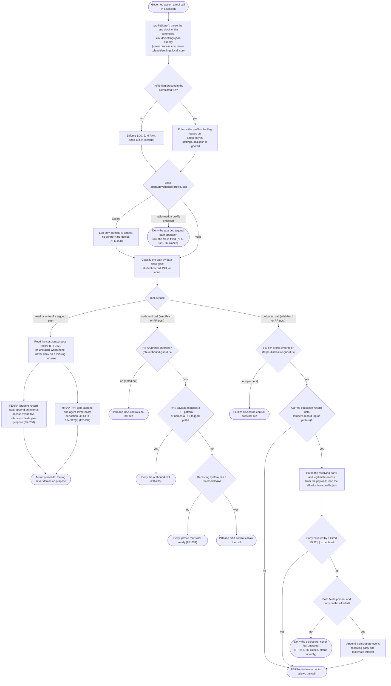
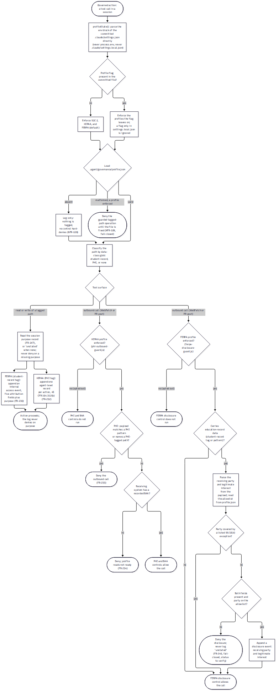

# spec-hooks-compliance

## Metadata

| Field | Value |
|---|---|
| **Feature** | Compliance control subsystem: governance profile configuration and data-class tags, session purpose capture, FERPA and HIPAA access logs, PHI and FERPA outbound guards, and BAA readiness |
| **Parent feature** | spec-hooks-platform.md |
| **Sub-features** | None |
| **Requirement refs** | BR-020, UR-068, UR-069, UR-075, UR-076, FR-230, FR-231, FR-232, FR-233, FR-234, FR-243, FR-244, FR-245, FR-246, FR-247, NFR-026, NFR-028, NFR-029, NFR-031, NFR-033, NFR-035 |
| **Feature type** | Functionality |
| **Status** | Draft |

Status values: Draft, Review, Approved, Implemented.

Paths that start with `hooks/`, `scripts/`, or `skills/` are relative to `plugins/assist-plugin/`. This spec describes planned behavior for harness-governance Tranche 3 (task plan `docs/task-plans/task-plan-harness-governance-20261028-0759.md`, Steps 23 to 28, including 27a and 27b); nothing here is built. It traces to FR-NFR-harness-governance.md v1.3 (2026-10-30).

## Description

The compliance control subsystem reads a per-project compliance posture and applies the SOC 2, HIPAA, and FERPA controls the project has left on. All three profiles are enforced by default: a project turns one off only by a change the user applies to the committed `.claude/settings.json`, and the plugin never edits a settings file. A shared library (`hooks/lib/data-class.js`) reads the profile state by parsing the `env` block of the committed project `.claude/settings.json` directly, loads the data file `.agent/governance/profile.json`, and classifies a path against the data-class globs. On that base sit a session purpose-capture hook, two access logs (FERPA internal access on student-record paths, HIPAA agent-level audit on PHI-tagged paths), two outbound guards (a PHI outbound guard and a FERPA disclosure-recordation guard), and a profile readiness check for recorded BAA references.

This spec owns the governance-profile configuration read, the data-class tagging, the purpose record, the two access logs, the two outbound guards, and the BAA readiness check. It does not own the hash-chained audit log the logs write into (spec-hooks-audit.md: `lib/audit-chain.js`, the schema, rotation, and verification), the per-agent identity helper and the attribution-record schema (`lib/identity.js` and `lib/authorizer.js`, spec-hooks-audit.md, Change Log 2026-11-06 (Tranche 3)), the write-bar protection of the two configuration files and the purpose record (spec-hooks-fsa-write-bar.md), or the `/assist-plugin:health` reports of a malformed `profile.json`, an ignored personal flag, an un-decided profile opt-out, and the profile-disablement log event (spec-hooks-health-check.md, Change Log 2026-11-06 (Tranche 3)). Each hook's self-test corpus (NFR-035) is enumerated in spec-hooks-health-check.md, Requirement: Self-tests.

Three configuration points exist and this spec names each one and its role, and fixes neither its literal name nor its JSON shape, because each is a build-time choice the developer states in the plugin rule sections under review: (1) the profile flag in the `env` block of the committed `.claude/settings.json`, whose name and value format turn profiles on or off; (2) the form in which the user declares a session purpose, which the purpose-capture hook reads; (3) the receiving-party allowlist key in `.agent/governance/profile.json`, whose name and shape hold the parties a FERPA disclosure may name. The requirements fix the three file paths by name (`.claude/settings.json`, `.agent/governance/profile.json`, and `.agent/logs/governance/audit.jsonl`); the three configuration points above stay build-time.

## Triggered by

| Trigger type | Source | Condition |
|---|---|---|
| Event | UserPromptSubmit, `purpose-capture` hook | The user submits a prompt; the hook writes the session purpose record when the user declares a purpose (FR-247) |
| Event | PreToolUse on `Read`, `Grep`, `Glob`, `Write`, `Edit`, `MultiEdit`, `NotebookEdit`, `data-access-log` hook | An agent accesses a path that classifies as student-record (FR-230) or PHI (FR-232) |
| Event | PreToolUse on `WebFetch` and on `Bash` PR-post commands, `phi-outbound-guard` hook | An outbound call carries a PHI pattern or names a PHI-tagged path (FR-233) |
| Event | PreToolUse on `WebFetch` and on `Bash` PR-post commands, `ferpa-disclosure-guard` hook | An outbound call carries education-record data (FR-246) |
| Called by feature | `/assist-plugin:health` profile readiness report | The BAA readiness check runs in report mode (FR-234; spec-hooks-health-check.md) |

## Required data

| Data | Source | Type | Notes |
|---|---|---|---|
| Profile flag | The `env` block of the committed `.claude/settings.json` | Config value | Read by a direct parse of the committed project file, never from `process.env` and never from `.claude/settings.local.json` (FR-231, FR-243). An absent flag enforces all three profiles. Name and value format are a build-time choice stated in the rule section |
| PHI patterns | `.agent/governance/profile.json` | Patterns | Matched against an outbound payload (FR-233); absent file runs log-only (NFR-028) |
| Data-class path globs | `.agent/governance/profile.json` | Globs | Classify a path as student-record or PHI through `matchGlob` from `lib/fsa-paths.js` (FR-231) |
| Receiving-party allowlist | `.agent/governance/profile.json` | List | The parties a FERPA disclosure may name (FR-246). Key name and shape are a build-time choice stated in the rule section |
| 34 CFR 99.32(d) exception list | `.agent/governance/profile.json` | List | A receiving party covered by a listed exception needs no disclosure entry (FR-246) |
| BAA references | `.agent/governance/profile.json` | Records | Identifier, counterparty, date per external system that may receive data (FR-234) |
| Session purpose record | The purpose-capture hook (FR-247), read through `lib/purpose-record.js` | Record | The purpose the user declared, plus the writer `hook`; read by the access-logging hooks; `unstated` when absent |
| Declared purpose | The user's own prompt | Text | The declaration form is a build-time choice stated in the rule section; model output and PR, web, or file text never create or alter the record |
| Receiving party and legitimate interest | The outbound call payload | Text | Parsed by the FERPA disclosure guard; validated against the allowlist (FR-246) |
| Agent identity | `lib/identity.js` (spec-hooks-audit.md) | Object | Agent type, agent id, plugin version; `main-session` or `unidentified` as the rule decides |

## Preconditions

| Condition | Check | If not met |
|---|---|---|
| A profile is enforced | `profileState()` parses the committed `.claude/settings.json` | A profile the project opted out of does not run its controls; the hook exits early so an opted-out session pays almost nothing (NFR-029) |
| `.agent/governance/profile.json` exists | `lib/data-class.js` loads it | Absent: the controls run log-only and never hard-deny, because nothing is tagged (NFR-028) |
| `.agent/governance/profile.json` is valid JSON | `lib/data-class.js` parses it | Malformed while a profile is enforced: the tagged-path controls deny their guarded operations until the file is fixed (NFR-028), and the health check reports the error (spec-hooks-health-check.md) |
| Platform preconditions | spec-hooks-platform.md | Fail open, except where a control fails closed for its guarded class (NFR-028) |

## Algorithmic steps

Start-to-end flow of the configuration read and the three control surfaces (tagged-path access, PHI outbound, FERPA disclosure). Source: [spec-hooks-compliance-flow.mmd](spec-hooks-compliance-flow.mmd).

**Note:** Rendered on 2026-11-06 with `mmdc -i specs/spec-hooks-compliance-flow.mmd -o specs/spec-hooks-compliance-flow.png`. The `.mmd` source is the record; re-render it after any edit.

### Requirement: Profile state from the committed settings file

The library SHALL read the compliance profile state by parsing the `env` block of the committed project `.claude/settings.json` directly, never the merged process environment and never `.claude/settings.local.json`, and SHALL enforce SOC 2, HIPAA, and FERPA when the flag is absent from the committed file.

**Requirement refs:** FR-231, FR-243, UR-068, UR-069, UR-075 | **Status:** Planned (harness-governance Tranche 3) | **Source:** FR-NFR-harness-governance.md v1.3, FR-231 (section 2.18), FR-243 (section 2.30); task plan Step 23 (`hooks/lib/data-class.js`: `profileState()`); `DECISIONS.md`, 2026-10-28, "Compliance profile flags, enforced by default" and "Compliance flag is read from the committed settings file directly"

The hooks read the committed project file because Claude Code settings precedence places `.claude/settings.local.json` above the project file, so a merged read would carry a personal local override and silently disable enforcement. The flag's name and value format are a build-time choice the developer states in the rule section; this spec fixes neither. The committed file is resolved from the project root the way the other hooks resolve it, with file reads only (a guard's only I/O). Every later control reads the flag through `lib/data-class.js`, not through `process.env`.

#### Scenario: Flag absent

- **GIVEN** the `env` block of the committed `.claude/settings.json` holds no profile flag
- **WHEN** a hook reads the profile state by parsing the committed project file
- **THEN** the hook SHALL treat SOC 2, HIPAA, and FERPA as enforced

#### Scenario: Opt-out in committed settings

- **GIVEN** the user changed the committed `.claude/settings.json` to turn the FERPA profile off
- **WHEN** the next session starts
- **THEN** the FERPA controls SHALL stop enforcing
- **AND** the SOC 2 and HIPAA profiles SHALL stay enforced

#### Scenario: Personal settings cannot disable

- **GIVEN** `.claude/settings.local.json` holds a flag that turns the HIPAA profile off and the committed `.claude/settings.json` does not
- **WHEN** a hook reads the profile state by parsing the committed project file
- **THEN** the HIPAA profile SHALL stay enforced
- **AND** the ignored personal flag SHALL be reported by the health check (spec-hooks-health-check.md)

### Requirement: Data-class tagging

The library SHALL classify a path by matching it against the data-class globs in `.agent/governance/profile.json`, returning the class (student-record, PHI, or none), and SHALL run the tagged-path controls log-only when the file is absent and deny their guarded operations when the file is malformed while a profile is enforced.

**Requirement refs:** FR-231, NFR-028, UR-068, UR-069 | **Status:** Planned (harness-governance Tranche 3) | **Source:** FR-NFR-harness-governance.md v1.3, FR-231 (section 2.18), NFR-028 (section 3.2); task plan Step 23 (`lib/data-class.js` classifies a path by glob using `matchGlob` from `lib/fsa-paths.js`); `DECISIONS.md`, 2026-10-28, "Compliance profile flags, enforced by default" (D-1)

An absent `profile.json` is the safe default: nothing is tagged, so no control hard-denies. A malformed `profile.json` under an enforced profile is the fail-closed exception to the Hook Fail-Open Rule (NFR-028, D-1): the tagged-path controls deny until the file is fixed, and the health check reports the error.

#### Scenario: Path matches a tag

- **GIVEN** `.agent/governance/profile.json` tags `records/**` as student-record
- **WHEN** a hook classifies `records/grades.csv`
- **THEN** the hook SHALL return the class student-record

#### Scenario: Absent configuration runs log-only

- **GIVEN** a profile is enforced by default and `.agent/governance/profile.json` does not exist
- **WHEN** a session reads a path and sends an outbound call
- **THEN** the controls SHALL log the events in log-only mode
- **AND** no control SHALL hard-deny, because nothing is tagged to match

#### Scenario: Malformed configuration denies

- **GIVEN** a profile is enforced and `.agent/governance/profile.json` is invalid JSON
- **WHEN** a hook loads it
- **THEN** the tagged-path controls SHALL deny their guarded operations until the file is fixed
- **AND** the error SHALL be reported through the health check (spec-hooks-health-check.md)

### Requirement: Session purpose capture

A hook on `UserPromptSubmit` SHALL write the session purpose record from a purpose the user declares in their own message, naming the writer `hook`, and SHALL NOT create or alter the record from model output or from PR, web page, or file text.

**Requirement refs:** FR-247, NFR-031, UR-068, UR-069 | **Status:** Planned (harness-governance Tranche 3) | **Source:** FR-NFR-harness-governance.md v1.3, FR-247 (section 2.34); task plan Step 24 (`hooks/purpose-capture.js`, `hooks/impl/purpose-capture.js`, `hooks/lib/purpose-record.js`); `DECISIONS.md`, 2026-10-28, "FERPA/HIPAA purpose capture, missing-purpose handling, and governance path protection" (OQ-11, D-11)

The writer is a hook, not the orchestrator, the same trust model as the FR-242 confirmation store: a hook writes with `fs`, so model output or PR, web, or file text in context cannot forge the stated purpose. The declaration form is a build-time choice the developer states in the rule section; this spec fixes neither its literal form nor its record shape. The record holds the declared purpose and the writer, never the surrounding prompt text (NFR-031). When the user declares no purpose, the hook writes no record, and the access-logging hooks log `unstated` and flag the record. The record path is protected from every tool caller (spec-hooks-fsa-write-bar.md, Change Log 2026-11-06 (Tranche 3)).

#### Scenario: User declares a purpose

- **GIVEN** the user states a purpose of the session in their own message
- **WHEN** the purpose-capture hook runs
- **THEN** the session purpose record SHALL hold that purpose
- **AND** the record SHALL name the writer as a hook

#### Scenario: Forged purpose rejected

- **GIVEN** a PR description or file text claims the session purpose
- **WHEN** the model or a subagent tries to write the session purpose record from that text
- **THEN** the write SHALL be denied (spec-hooks-fsa-write-bar.md)
- **AND** the access log SHALL NOT show that purpose

### Requirement: FERPA internal access log

While the FERPA profile is enforced, the hook SHALL append to the audit log, for each agent access to a student-record-tagged path, the five attribution fields plus the purpose from the session purpose record (FR-247) or `unstated`, SHALL flag the record when the purpose is `unstated`, and SHALL NOT deny the access on the missing purpose alone.

**Requirement refs:** FR-230, NFR-033, NFR-026, NFR-031, UR-068 | **Status:** Planned (harness-governance Tranche 3) | **Source:** FR-NFR-harness-governance.md v1.3, FR-230 (section 2.17), NFR-033 (section 3.5); task plan Step 25 (`hooks/data-access-log.js`, `hooks/impl/data-access-log.js`); `DECISIONS.md`, 2026-10-28, "FERPA/HIPAA purpose capture, missing-purpose handling, and governance path protection" (OQ-6) and "OQ-9 resolved; FERPA control reframed, HIPAA scope tightened"

This log is general FERPA governance support on the purpose dimension, labeled directional (NFR-033). It carries no 34 CFR 99.32 claim; the hook header, the health row, and the control register do not cite 99.32. The disclosure-recordation control (Requirement: FERPA disclosure recordation) is the only control cited against 99.32. A read-time hook sees a path and not a purpose, so a deny on a missing purpose would block legitimate work; the control stays a log control, never a deny control, on the purpose dimension. The five attribution fields (operation, data accessed as path and data-class tag, agent identity, human authorizer, timestamp) come from the audit schema of spec-hooks-audit.md (Change Log 2026-11-06 (Tranche 3)). The log holds the path and class tag only, never file contents (NFR-031). A shell read such as `cat records/grades.csv` is not seen unless the hook parses Bash; the hook leaves that path uncovered as a recorded known limit.

#### Scenario: Access with purpose

- **GIVEN** the FERPA profile is enforced, `records/grades.csv` is tagged student-record, and a session purpose record exists
- **WHEN** an agent reads the file
- **THEN** the audit log SHALL hold the five attribution fields plus the purpose from that record

#### Scenario: Access without purpose

- **GIVEN** the same setup and no session purpose record
- **WHEN** an agent reads the file
- **THEN** the audit log SHALL hold the purpose `unstated`
- **AND** the record SHALL be flagged for review
- **AND** the read SHALL NOT be denied on the missing purpose

### Requirement: HIPAA agent-level audit log

While the HIPAA profile is enforced, the hook SHALL append to the audit log, at agent level (one record per agent action, not per session or per inference call), each action that reads, writes, or sends data from a PHI-tagged path, with the purpose from the session purpose record (FR-247) or `unstated`, in a record readable for review (path, agent identity, and timestamp per line).

**Requirement refs:** FR-232, NFR-033, NFR-026, NFR-031, UR-069 | **Status:** Planned (harness-governance Tranche 3) | **Source:** FR-NFR-harness-governance.md v1.3, FR-232 (section 2.19), NFR-033 (section 3.5); task plan Step 26 (`hooks/impl/data-access-log.js` for PHI-tagged paths; `lib/identity.js` `unidentified` rule; `scripts/verify-audit-chain.js` flags `unidentified`); `DECISIONS.md`, 2026-10-28, "OQ-9 resolved; FERPA control reframed, HIPAA scope tightened"

This control is verified against 45 CFR 164.312(b), which requires mechanisms that record and examine activity, so the record supports review of the log. It implements that one required technical safeguard and is not full HIPAA compliance; access control, integrity, authentication, transmission security, and the administrative and physical safeguards are separate, and the hook header, the health text, and the register do not describe it as full compliance (NFR-033). An action with no agent id that is not the main session records the identity `unidentified` (spec-hooks-audit.md, `lib/identity.js`), and chain verification flags that record (spec-hooks-audit.md, Requirement: Chain verification). The log holds the path and class tag only, never file contents (NFR-031).

#### Scenario: Agent action logged

- **GIVEN** the HIPAA profile is enforced and `data/patients.csv` is tagged PHI
- **WHEN** a subagent reads the file
- **THEN** the log SHALL hold a record naming that subagent and the path
- **AND** the record SHALL hold the purpose from the session purpose record, or `unstated` when none exists

#### Scenario: Unidentified actor

- **GIVEN** the same setup
- **WHEN** an action arrives with no agent id and is not the main session
- **THEN** the record SHALL carry the identity `unidentified`
- **AND** chain verification output SHALL flag the record

### Requirement: PHI outbound guard

While the HIPAA profile is enforced, the guard SHALL deny a `WebFetch` or a PR-post call whose payload matches a configured PHI pattern or names a PHI-tagged path, and SHALL log the denial.

**Requirement refs:** FR-233, NFR-028, NFR-026, NFR-031, UR-069 | **Status:** Planned (harness-governance Tranche 3) | **Source:** FR-NFR-harness-governance.md v1.3, FR-233 (section 2.20), NFR-028 (section 3.2); task plan Step 27 (`hooks/phi-outbound-guard.js`, `hooks/impl/phi-outbound-guard.js`; payload extraction through `lib/pr-verdict.js`); `DECISIONS.md`, 2026-10-28, "Compliance profile flags, enforced by default" (D-1)

FR-233 belongs to the NFR-028 security-critical set: when the guard throws, times out, or cannot read its configuration, it denies calls in its guarded class (spec-hooks-platform.md, the `failClosedFor(input)` branch); an absent `profile.json` runs log-only and never hard-denies; a malformed `profile.json` under an enforced profile denies until the file is fixed. A `--body-file` payload is a file read, which a guard may do. Known limits, recorded and not closed (FR-NFR-harness-governance.md section 4): a paraphrase of PHI can escape a pattern match, and the guard sees one call at a time, so it cannot tell that a payload carries content read earlier from a PHI-tagged path; session-level taint tracking is out of scope. The denial record holds the rule or pattern name, the tool name, and a path with its data-class tag, never the matched value (NFR-031).

#### Scenario: PHI pattern in a PR comment

- **GIVEN** the HIPAA profile is enforced and `profile.json` holds a medical-record-number pattern
- **WHEN** the session posts a PR comment containing a string that matches the pattern
- **THEN** the guard SHALL deny the post
- **AND** the denial SHALL be logged

#### Scenario: Clean payload

- **GIVEN** the HIPAA profile is enforced with the same `profile.json`
- **WHEN** the session posts a PR comment that matches no pattern and names no PHI-tagged path
- **THEN** the guard SHALL allow the post

### Requirement: FERPA disclosure recordation

While the FERPA profile is enforced, the guard SHALL, for an outbound call that carries education-record data, parse the receiving party and the legitimate interest from the payload, validate the receiving party against the allowlist in `.agent/governance/profile.json`, append a disclosure event holding both fields to the audit log, deny the call when either field is missing or the receiving party is not on the allowlist, and apply the 34 CFR 99.32(d) exceptions the allowlist file lists.

**Requirement refs:** FR-246, NFR-028, NFR-033, NFR-026, NFR-031, UR-076 | **Status:** Planned (harness-governance Tranche 3); status to verify | **Source:** FR-NFR-harness-governance.md v1.3, FR-246 (section 2.33), NFR-028 (section 3.2), NFR-033 (section 3.5); task plan Steps 27a and 27b (`hooks/ferpa-disclosure-guard.js`, `hooks/impl/ferpa-disclosure-guard.js`; `lib/data-class.js` reads the student-record patterns, the receiving-party allowlist, and the 99.32(d) exception list); `DECISIONS.md`, 2026-10-28, "OQ-9 resolved; FERPA control reframed, HIPAA scope tightened"; `DECISIONS.md`, 2026-10-30, "FERPA disclosure control denies on missing attribution and is fail-closed" and "FR-246 disclosure attribution comes from the payload, validated against a profile.json allowlist" (PN-9)

This is the only control cited against 34 CFR 99.32, which governs recording disclosures of education-record data to outside parties and makes the legitimate interest mandatory (99.32(a)(3)(ii)). It is the FERPA analogue of the PHI outbound guard. The log never accepts `unstated` for the receiving party or the legitimate interest: a call missing either field, or naming a party not on the allowlist, is denied, not logged and flagged. Because a subagent assembles the payload, the allowlist in `.agent/governance/profile.json`, a file protected from every subagent write under FR-245 (spec-hooks-fsa-write-bar.md), is the trust anchor on which parties pass, not the raw payload text. No new store and no seventh protected path is added; FR-245 stays at six. The allowlist key name and shape, and the 99.32(d) exception list shape, are a build-time choice the developer states in the rule section (fixed by `DECISIONS.md`, 2026-10-30, "Proposed governance file names and store paths approved (PN-8)"); this spec fixes neither. FR-246 belongs to the NFR-028 security-critical set: on an error, timeout, or unreadable configuration it denies calls in its guarded class; an absent `profile.json` runs log-only; a malformed `profile.json` under an enforced profile denies until fixed. The status stays "to verify" until the exception handling is reviewed (NFR-033); the control is not marked complete and not described as full 34 CFR 99 compliance. Known limit, recorded in the rule section and the health row (FR-NFR-harness-governance.md section 4): outbound disclosure detection is imperfect; a paraphrase of education-record data, or a payload assembled from content read earlier, can escape a pattern or path match, and the guard sees one call at a time. The log holds the receiving-party identifier, a legitimate-interest label, the path, and the class tag, never education-record content (NFR-031).

#### Scenario: Disclosure recorded

- **GIVEN** the FERPA profile is enforced and an outbound call names a student-record path, with a receiving party and a legitimate interest declared and the party on the allowlist
- **WHEN** the call is sent
- **THEN** the audit log SHALL hold the receiving party and the legitimate interest for that disclosure

#### Scenario: Missing party or interest

- **GIVEN** the same setup and no declared legitimate interest
- **WHEN** the session attempts the outbound call
- **THEN** the guard SHALL deny the call
- **AND** the log SHALL NOT hold the value `unstated` for the receiving party or the legitimate interest

#### Scenario: Party not on the allowlist

- **GIVEN** the same setup and a receiving party that is not on the `profile.json` allowlist
- **WHEN** the session attempts the outbound call
- **THEN** the guard SHALL deny the call
- **AND** the log SHALL hold no disclosure entry for it

#### Scenario: Exception applies

- **GIVEN** the receiving party falls under a 99.32(d) exception that `profile.json` lists
- **WHEN** the call is sent
- **THEN** the guard SHALL apply the exception and SHALL NOT require a disclosure entry

### Requirement: BAA reference and profile readiness

While the HIPAA profile is enforced, the plugin SHALL require a BAA reference (identifier, counterparty, date) for each external system that may receive data, SHALL report the profile as not ready when one is missing, SHALL deny outbound calls to a system with no BAA reference, and SHALL NOT assess the agreement text.

**Requirement refs:** FR-234, UR-069 | **Status:** Planned (harness-governance Tranche 3) | **Source:** FR-NFR-harness-governance.md v1.3, FR-234 (section 2.21); task plan Step 28 (`lib/data-class.js` reads BAA references; the profile readiness report in `hooks/impl/health-check.js`; `hooks/impl/phi-outbound-guard.js` denies calls to a system with no BAA reference)

A BAA reference holds identifier, counterparty, and date, and lives in `.agent/governance/profile.json`. The readiness report runs in report mode (spec-hooks-health-check.md) while the HIPAA profile is enforced, which is the default. The plugin never assesses the agreement text, only that a reference exists.

#### Scenario: BAA recorded

- **GIVEN** `profile.json` lists a BAA reference for the model provider
- **WHEN** the profile readiness check runs
- **THEN** the check SHALL report ready

#### Scenario: BAA missing

- **GIVEN** `profile.json` lists an external system with no BAA reference
- **WHEN** the readiness check runs
- **THEN** the check SHALL report not ready
- **AND** the outbound guard SHALL deny calls to that system

### Requirement: Profile disablement is logged and recorded

Each profile disablement SHALL write a logged event that names the profile and the time, and SHALL have its own `DECISIONS.md` entry; the health check SHALL report a disablement that lacks a decision entry.

**Requirement refs:** FR-244, NFR-026, UR-075 | **Status:** Planned (harness-governance Tranche 3) | **Source:** FR-NFR-harness-governance.md v1.3, FR-244 (section 2.31); task plan Step 23 (the `--session-start` path appends a profile-disablement event; the health check reports a profile off with no `DECISIONS.md` entry)

This extends the guard-disablement logging of FR-228 (spec-hooks-audit.md; spec-hooks-health-check.md, Change Log 2026-11-06 (Tranche 3)) to profile opt-outs. The disablement event is written to the governance audit log through `lib/audit-chain.js`. The health-check report side (the malformed-profile report, the ignored personal-flag report, and the un-decided-opt-out report) is owned by spec-hooks-health-check.md. The plugin never edits a settings file; the user applies the opt-out to the committed `.claude/settings.json` and records the decision.

#### Scenario: Disablement logged

- **GIVEN** the committed settings turn the HIPAA profile off
- **WHEN** the next session starts
- **THEN** the audit log SHALL hold a disablement event naming the HIPAA profile and the time

#### Scenario: No decision entry

- **GIVEN** a profile is off and `DECISIONS.md` holds no entry for that disablement
- **WHEN** the health check runs
- **THEN** the report SHALL list the disablement as lacking a decision entry

### Requirement: Governance configuration and stores protected from writes

The two configuration files and the session purpose record SHALL be protected from subagent writes as part of the six FR-245 paths, enforced by `fsa-write-bar`.

**Requirement refs:** FR-245, UR-075 | **Status:** Planned (harness-governance Tranche 3) | **Source:** FR-NFR-harness-governance.md v1.3, FR-245 (section 2.32); task plan Steps 23 and 24; the write-bar enforcement is spec-hooks-fsa-write-bar.md (Change Log 2026-11-06 (Tranche 3))

`.claude/settings.json` and `.agent/governance/profile.json` are denied to every subagent (D-12); the session purpose record is denied to every tool caller, because its purpose-capture hook is the sole writer. The confirmation store (Tranche 1) and `.agent/logs/governance/**` (Tranche 2) are already protected; the rule-mode store (Tranche 4) completes the six. The write-bar lists and the shell-write route enforce these paths (spec-hooks-fsa-write-bar.md); this spec reads them, it does not define the enforcement.

#### Scenario: Subagent write denied

- **GIVEN** a subagent session writes `.agent/governance/profile.json` or `.claude/settings.json`
- **WHEN** `fsa-write-bar` evaluates it
- **THEN** the write SHALL be denied (spec-hooks-fsa-write-bar.md)

#### Scenario: Read allowed

- **GIVEN** a subagent session reads `.agent/governance/profile.json`
- **WHEN** `fsa-write-bar` evaluates it
- **THEN** the read SHALL be allowed

## Business rules

| Rule ID | Rule | Traces to | Applied at step | Example |
|---|---|---|---|---|
| RULE-001 | All three profiles are enforced unless the committed `.claude/settings.json` opts one out; a personal `.claude/settings.local.json` cannot disable enforcement | FR-231, FR-243 | Requirement: Profile state from the committed settings file | Flag absent -> SOC 2, HIPAA, FERPA enforced |
| RULE-002 | Absent `profile.json` runs log-only; a malformed `profile.json` under an enforced profile denies guarded operations until fixed | NFR-028 | Requirement: Data-class tagging | Fail-closed on malformed config |
| RULE-003 | A hook, not the orchestrator, writes the session purpose record from the user's own declaration; model or file text never does | FR-247 | Requirement: Session purpose capture | Forged purpose rejected |
| RULE-004 | A missing purpose is logged `unstated` and flagged, never denied on that alone | FR-230, FR-232 | Requirement: FERPA internal access log; Requirement: HIPAA agent-level audit log | Access without a purpose record |
| RULE-005 | The FERPA internal access log carries no 34 CFR 99.32 claim; only the disclosure-recordation control is cited against 99.32, and it stays "to verify" | NFR-033 | Requirement: FERPA internal access log; Requirement: FERPA disclosure recordation | Register entry without a 99.32 citation |
| RULE-006 | The HIPAA audit control is one required 45 CFR 164.312(b) safeguard, not full HIPAA compliance | NFR-033 | Requirement: HIPAA agent-level audit log | Register entry states its scope |
| RULE-007 | A disclosure denied for a missing field or an off-allowlist party is never logged with `unstated`; the allowlist in `profile.json`, not the payload, decides which parties pass | FR-246 | Requirement: FERPA disclosure recordation | Off-allowlist party denied |
| RULE-008 | Logs hold a path and a data-class tag only, never prompt text, file contents, or secret values | NFR-031 | All logging requirements | PHI pattern name logged, not the value |

## Data transformations

| Input | Transformation | Output | Notes |
|---|---|---|---|
| Committed `.claude/settings.json` env block | Parse the flag directly | Enforced-profile set | Never `process.env`, never settings.local.json |
| Path plus `profile.json` globs | `matchGlob` | Data-class tag (student-record, PHI, or none) | Absent file -> none; malformed -> deny while enforced |
| User prompt declaration | Purpose-capture hook write | Session purpose record (purpose, writer `hook`) | Model and file text excluded |
| Access event plus purpose record | Build the five attribution fields plus purpose | One audit-log access record | `unstated` and flagged when no purpose |
| Outbound payload | Parse receiving party and legitimate interest; validate against the allowlist | Disclosure event, or a deny | 99.32(d) exception -> allow with no entry |

## Output / Outcome

| Output | Type | Description |
|---|---|---|
| Enforced-profile set | Value | Which of SOC 2, HIPAA, FERPA are on for the project |
| Data-class tag | Value | student-record, PHI, or none for a path |
| Session purpose record | File | The user's declared purpose plus the writer `hook` |
| Access record | Audit-log line | FERPA internal access (five fields plus purpose) or HIPAA agent-level record |
| Outbound deny | PreToolUse deny | PHI outbound or FERPA disclosure denial, logged |
| Disclosure event | Audit-log line | Receiving party and legitimate interest |
| Profile readiness report | Report line | Ready or not ready per BAA references (spec-hooks-health-check.md) |
| Profile-disablement event | Audit-log line | Names the profile and the time |

## Error handling

| Error condition | Handling strategy | Outcome |
|---|---|---|
| `profile.json` absent | Run log-only; nothing tagged | No control hard-denies (NFR-028) |
| `profile.json` malformed while a profile is enforced | Fail closed for the guarded class | Tagged-path controls deny until fixed; health check reports it |
| A security-critical guard throws, times out, or cannot read its configuration | `failClosedFor(input)` branch (spec-hooks-platform.md) | The guarded class is denied; a call outside the class proceeds |
| Profile opted out for the session | Exit early | The opted-out controls do not run; near-zero cost (NFR-029) |
| Purpose record absent | Log `unstated` and flag | The access is not denied on the missing purpose (FR-230) |
| Outbound disclosure missing a field or off the allowlist | Deny; record no `unstated` | The call is blocked (FR-246) |
| Log append fails (non-security-critical) | Fail open; record the failure in `hook-health.jsonl` | The action proceeds; failure logged |

## Events emitted

| Event name | Payload | Consumer(s) | When emitted |
|---|---|---|---|
| FERPA access event | Five attribution fields plus purpose; path and class tag | Chain verification; control-evidence export (spec-hooks-health-check.md, `--export-evidence`) | An agent accesses a student-record path |
| HIPAA agent-level record | Path, agent identity, timestamp, purpose | Chain verification; control-evidence export | An agent action touches a PHI-tagged path |
| PHI outbound deny | Rule or pattern name, tool name, path and class tag | Chain verification | A PHI pattern or path match on an outbound call |
| FERPA disclosure event | Receiving party, legitimate-interest label, path, class tag | Chain verification; control-evidence export | A permitted disclosure of education-record data |
| Profile-disablement event | Profile name, time | Chain verification; `/assist-plugin:health` | A profile is opted out (at session start) |

## Events consumed

| Event name | Producer | Payload used | Handling |
|---|---|---|---|
| Session purpose record | Purpose-capture hook (FR-247) | The declared purpose | Read by the access-logging hooks; `unstated` when absent |
| Agent identity | `lib/identity.js` (spec-hooks-audit.md) | Agent type, agent id, plugin version | Attached to each record; `unidentified` where the rule applies |
| Audit append | `lib/audit-chain.js` (spec-hooks-audit.md) | The record this subsystem builds | Appended as one chained line |

## Sub-feature breakdown

Not applicable: a leaf feature of spec-hooks-platform.md.

## Performance considerations

| Concern | Target | Approach |
|---|---|---|
| Per-write cost (NFR-029) | The access-logging and guard hooks stay within the 30 ms per-hook and 150 ms total median budget | Exit early when the profile is opted out; file reads only; one append per event; measured in the Tranche 3 build |
| Self-test (NFR-035) | Each new guard and filter ships a self-test corpus with a known-safe and a known-prohibited case, reported through `/assist-plugin:health`, and the build passes `check-fsa-tables.js --check` and `sync-writing-standard.js --check` | The self-test enumeration is owned by spec-hooks-health-check.md, Requirement: Self-tests |

## Traceability

| Requirement | Spec section | Verified by |
|---|---|---|
| FR-231 | Requirement: Profile state from the committed settings file; Requirement: Data-class tagging | Flag-absent default, opt-out, ignored-local-flag, path-match, and malformed-config cases (`tests/hooks/data-class.test.js`, task plan Step 30) |
| FR-243 | Requirement: Profile state from the committed settings file | Committed-opt-out and personal-settings-cannot-disable cases, with a differing `process.env` value set (`tests/hooks/data-class.test.js`) |
| FR-244 | Requirement: Profile disablement is logged and recorded | A profile opt-out yields a disablement event; a profile off with no `DECISIONS.md` entry is reported (spec-hooks-health-check.md) |
| FR-245 | Requirement: Governance configuration and stores protected from writes | Subagent write denied and read allowed for both configuration files (spec-hooks-fsa-write-bar.md) |
| FR-247 | Requirement: Session purpose capture | Declared-purpose, forged-purpose, and no-purpose cases (`tests/hooks/purpose-capture.test.js`) |
| FR-230 | Requirement: FERPA internal access log | Access-with-purpose and access-without-purpose cases; no 99.32 citation in the register (`tests/hooks/data-access-log.test.js`) |
| FR-232 | Requirement: HIPAA agent-level audit log | Agent-action and unidentified-actor cases; register states the 164.312(b) scope (`tests/hooks/data-access-log.test.js`) |
| FR-233 | Requirement: PHI outbound guard | PHI-pattern deny and clean-payload allow cases (`tests/hooks/phi-outbound-guard.test.js`) |
| FR-246 | Requirement: FERPA disclosure recordation | Disclosure-recorded, missing-field deny, off-allowlist deny, and exception cases (`tests/hooks/ferpa-disclosure-guard.test.js`, task plan Step 27b) |
| FR-234 | Requirement: BAA reference and profile readiness | BAA-recorded ready and BAA-missing not-ready cases |
| NFR-028 | Requirement: Data-class tagging; Requirement: PHI outbound guard; Requirement: FERPA disclosure recordation | Absent-config log-only, malformed-config deny, and fail-closed-on-error cases (`tests/hooks/guard-fail-closed.test.js`) |
| NFR-029 | Performance considerations | Median per-hook cost within 30 ms and total median cost within 150 ms per write, an opted-out profile exiting early; measured in the Tranche 3 build |
| NFR-031 | Business rule RULE-008; all logging requirements | No log record holds prompt text, file contents, or a secret value |
| NFR-033 | Requirement: FERPA internal access log; Requirement: HIPAA agent-level audit log; Requirement: FERPA disclosure recordation | Register check: FR-230 no 99.32 citation, FR-232 cites 164.312(b) as one safeguard, FR-246 status "to verify" |
| NFR-035 | Performance considerations | Self-test corpora reported through `/assist-plugin:health` (spec-hooks-health-check.md); both sync scripts exit 0 |
