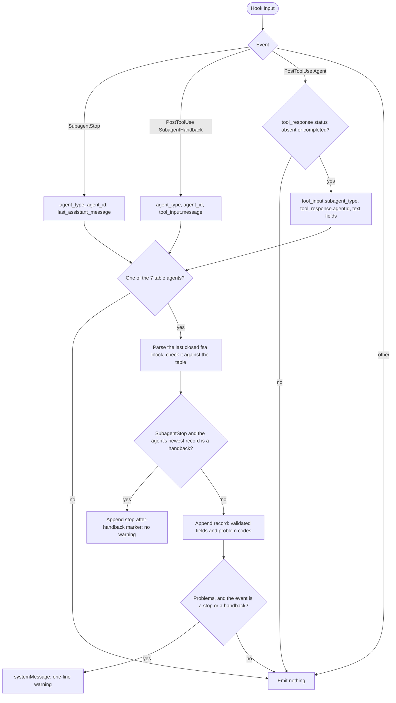

# spec-hooks-fsa-log

## Metadata

| Field | Value |
|---|---|
| **Feature** | FSA log: check subagent terminal blocks against their state tables, in warn mode |
| **Parent feature** | spec-hooks-platform.md |
| **Sub-features** | None |
| **Requirement refs** | BR-006, BR-007, UR-023, FR-115, FR-116, FR-117, NFR-009, NFR-014, NFR-016 |
| **Feature type** | Functionality |
| **Status** | Approved |

Status values: Draft, Review, Approved, Implemented.

## Description

`fsa-log` reads the final report of each of the seven `assist-plugin` agents that have a transition table in `hooks/lib/fsa-tables.js`, parses its last `fsa` terminal block, checks the block against the table, and appends one JSON line to `${CLAUDE_PLUGIN_DATA}/fsa-log.jsonl` with the checked fields and problem codes. It runs in warn mode: a broken report gets a one-line `systemMessage` for the user and nothing else, so the subagent never continues because of the hook (UR-023). The `/do` parsing of terminal blocks and the template (`skills/do/references/fsa-template.md`) are Area A. This spec describes the behavior at commit 4803a0d, which assist-plugin 1.11.1 (commit 41034c1) keeps at every cited line of `fsa-log.js` and `fsa-tables.js` (read 2026-10-16); the self-test cite points at 1.11.1.

## Triggered by

| Trigger type | Source | Condition |
|---|---|---|
| Event | SubagentStop, matcher `.*` (`hooks/hooks.json:147-157`) | A subagent ended |
| Event | PostToolUse, matcher `SubagentHandback` (`hooks/hooks.json:91-100`) | In auto mode a subagent hands back its report through the tool |
| Event | PostToolUse, matcher `Agent` (`hooks/hooks.json:81-90`) | The main loop received a subagent's result |

## Required data

| Data | Source | Type | Notes |
|---|---|---|---|
| `hook_event_name`, `tool_name` | Hook input | string | Pick the source in Requirement: Report sources |
| `agent_type`, `agent_id`, `last_assistant_message` | Hook input (SubagentStop) | string | |
| `agent_type`, `agent_id`, `tool_input.message` | Hook input (SubagentHandback) | string | |
| `tool_input.subagent_type`, `tool_response` | Hook input (Agent) | string, object | `tool_response.agentId`, `tool_response.status`, text under `content`, `text`, `result`, `output`, `message` |
| `session_id` | Hook input | string | Stored when it matches `^[A-Za-z0-9_-]{1,64}$` |
| Transition tables | `hooks/lib/fsa-tables.js:30-124` | object | `developer-tester`, `qa` (tableless), `reviewer`, `code-reviewer`, `intake-reviewer`, `developer`, `task-planner` |
| Recent log records | `fsa-log.jsonl` | JSON lines | Read on SubagentStop only |

## Preconditions

| Condition | Check | If not met |
|---|---|---|
| The event is one of the three sources | `source()` (`impl/fsa-log.js:74-91`) | Emit nothing |
| The agent has a table and `agent: true` | `agentFromType()` (`lib/fsa-tables.js:158-164`) | Emit nothing, write nothing |
| The message is a string (non-empty for an Agent result) | `impl/fsa-log.js:107` | Emit nothing, write nothing |
| Platform preconditions | spec-hooks-platform.md | Fail open |

## Algorithmic steps

Start-to-end flow. Source: [spec-hooks-fsa-log-flow.mmd](spec-hooks-fsa-log-flow.mmd).

**Note:** PNG rendering requires mermaid-cli with its headless browser, which is missing on this machine (see spec-hooks-platform.md). Render with `mmdc -i specs/spec-hooks-fsa-log-flow.mmd -o specs/spec-hooks-fsa-log-flow.png` once it is installed.

### Requirement: Report sources

The `fsa-log` hook SHALL read the report of a SubagentStop from `last_assistant_message`, of a SubagentHandback from `tool_input.message`, and of an Agent result from the string values under `content`, `text`, `result`, `output`, and `message` of `tool_response`, skipping an Agent result whose `tool_response.status` is present and not `completed`.

**Requirement refs:** FR-115, UR-023
**Status:** Built
**Source:** `hooks/impl/fsa-log.js:51-91`

Agent-result text is gathered to depth 4 and up to 400,000 characters, joined with line breaks. An Agent result with empty text is skipped.

#### Scenario: Result with a content array

- **GIVEN** an Agent result `{"status": "completed", "content": [{"type": "text", "text": <report with a legal developer-tester block>}]}`
- **WHEN** the hook runs
- **THEN** the hook SHALL append one record with event `agent-result` and an empty problem list

#### Scenario: Launch not finished

- **GIVEN** an Agent result with `status` `async_launched`
- **WHEN** the hook runs
- **THEN** the hook SHALL write nothing and emit nothing

### Requirement: Agents covered

The hook SHALL check only reports from the seven agents in `hooks/lib/fsa-tables.js` (`developer-tester`, `qa`, `reviewer`, `code-reviewer`, `intake-reviewer`, `developer`, `task-planner`), requiring the `assist-plugin:` prefix on SubagentStop and SubagentHandback and accepting the bare name or the prefixed name on an Agent result.

**Requirement refs:** FR-115, UR-023
**Status:** Built
**Source:** `hooks/lib/fsa-tables.js:156-164`; `hooks/impl/fsa-log.js:106-107`

#### Scenario: Agent without a table

- **GIVEN** a SubagentStop from `assist-plugin:planner` with no block
- **WHEN** the hook runs
- **THEN** the hook SHALL write nothing and emit nothing

#### Scenario: Same name from another plugin

- **GIVEN** a SubagentStop from `other-plugin:reviewer` with no block
- **WHEN** the hook runs
- **THEN** the hook SHALL write nothing and emit nothing

### Requirement: Terminal block parsing

The hook SHALL take the last closed `fsa` block in the final 200,000 characters of the report: an opening line of up to 3 spaces, 3 to 10 backticks, and `fsa`; up to 30 `key: value` lines (key of 1 to 20 lowercase letters or underscores, value of up to 400 characters, trimmed); and a closing line of 3 to 10 backticks.

**Requirement refs:** FR-115, UR-023
**Status:** Built
**Source:** `hooks/lib/fsa-tables.js:128-190`

An unclosed block does not count. A report with no closed block gets the single problem `no-block`.

#### Scenario: The last block wins

- **GIVEN** a `reviewer` report with an illegal block followed by a legal block
- **WHEN** the hook parses it
- **THEN** the record SHALL hold an empty problem list

#### Scenario: Unclosed block

- **GIVEN** a `reviewer` report whose block has no closing fence
- **WHEN** the hook parses it
- **THEN** the record SHALL hold the problem `no-block`

### Requirement: Block checks and problem codes

The hook SHALL check the block against the agent's table, or against a table the block names that the agent may report, recording at most 8 problems from the codes below, echoing a model-chosen value only when it is a known state, table name, or class, and `<invalid>` otherwise.

**Requirement refs:** FR-115, UR-023
**Status:** Built
**Source:** `hooks/lib/fsa-tables.js:192-289`; `skills/health/SKILL.md` (FSA problem codes)

| Code | Condition |
|---|---|
| `no-block` | No closed `fsa` block |
| `fsa-mismatch: <value>` | `fsa` is not `<table>/<version>` |
| `bad-state: <value>` | `state` is not `Done`, `NeedsInput`, or `Error` |
| `missing-field: trace` | No `trace` (tables with states only) |
| `trace-too-long` | More than 40 states in `trace` |
| `unknown-state` | `trace` names a state outside the table and the terminals |
| `bad-start: <value>` | `trace` does not start at `Intake` |
| `illegal-transition: A>B` | No edge from A to B; at most 3 reported |
| `trace-not-terminal: <value>` | `trace` does not end in a terminal |
| `terminal-mismatch: A vs B` | `trace` ends in a terminal other than `state` |
| `bad-error-class: <value> on <state>` | Outside the closed list on `Error`, or not `none` on another state |
| `bad-verdict` | `verdict` fails the table's pattern, is `none` on `Done`, or fails `verdictByStep` for the state before `Done` |
| `bad-resume-at` | `NeedsInput` whose `resume_at` is not a state of the table |

Closed error-class list: `missing-input`, `precondition-failed`, `policy-rejection`, `budget-exhausted`, `tool-missing`, `tool-failed`, `out-of-scope`. `qa` has no table (`tableless`): its `trace` is not checked and `bad-resume-at` does not apply. `intake-reviewer` pairs verdicts with the state before `Done`: `Decide` gives `accepted` or `needs-changes`, `Verify` gives `clear` or `needs-clarification` (`lib/fsa-tables.js:82-85`).

#### Scenario: Clean report

- **GIVEN** a `reviewer` report with trace `Intake > AssembleContext > Review > Decide > Done` and verdict `approved`
- **WHEN** the hook checks it
- **THEN** the record SHALL hold an empty problem list

#### Scenario: Illegal transition

- **GIVEN** a `reviewer` trace `Intake > Review > Done`
- **WHEN** the hook checks it
- **THEN** the problems SHALL include `illegal-transition: Intake>Review`

#### Scenario: Verdict of the wrong mode

- **GIVEN** an `intake-reviewer` block with trace `Intake > AssembleContext > Compare > Verify > Done` and verdict `accepted`
- **WHEN** the hook checks it
- **THEN** the problems SHALL include `bad-verdict`

### Requirement: Record fields and privacy

The hook SHALL append one record per checked report holding only `ts`, `session_id`, `event`, `agent_type`, `agent_id`, the block fields `fsa`, `state`, `verdict`, `error_class`, and `trace`, the count `out_of_scope_count`, and `problems`, each validated, and never message text, prompts, artifact paths, questions, out-of-scope items, or file contents.

**Requirement refs:** FR-115, NFR-016, BR-006
**Status:** Built
**Source:** `hooks/impl/fsa-log.js:9-13`, `:34-36`, `:100-123`; `hooks/lib/fsa-tables.js:291-319`

| Field | Rule |
|---|---|
| `ts` | ISO 8601 UTC |
| `session_id`, `agent_id` | `^[A-Za-z0-9_-]{1,64}$`, else `<invalid>` |
| `event` | `subagent-stop`, `handback`, `agent-result`, or `stop-after-handback` |
| `agent_type` | `^[A-Za-z0-9:_-]{1,60}$`, else `<invalid>` |
| `fsa` | `^[a-z-]{1,30}/\d{1,3}$`, else `<invalid>` |
| `state` | A terminal, else `<invalid>` |
| `verdict` | `none` or the table's pattern, else `<invalid>` |
| `error_class` | `none` or the closed list, else `<invalid>` |
| `trace` | Known states joined by `>`, each unknown step `<invalid>`, at most 40; omitted for `qa` |
| `out_of_scope_count` | Number of comma-separated items, 0 for `none`, at most 99 |
| `problems` | Codes from Requirement: Block checks and problem codes |

#### Scenario: Message text never stored

- **GIVEN** a report whose prose and `artifact` hold the string `SENTINEL-7731`
- **WHEN** the hook logs it
- **THEN** the record SHALL NOT contain `SENTINEL-7731`

#### Scenario: Out-of-scope paths counted

- **GIVEN** a `developer` block with `out_of_scope: tests/a.test.ts, tests/b.test.ts`
- **WHEN** the hook logs it
- **THEN** the record SHALL hold `out_of_scope_count` 2 and no path

### Requirement: Log cap

The hook SHALL keep only the newest 500 lines of `fsa-log.jsonl`.

**Requirement refs:** NFR-014, FR-115
**Status:** Built
**Source:** `hooks/impl/fsa-log.js:30`, `:125-127`; `hooks/lib/health.js:196-206`

#### Scenario: Cap reached

- **GIVEN** `fsa-log.jsonl` holds 500 lines
- **WHEN** another report is logged
- **THEN** the file SHALL hold 500 lines, the oldest removed

#### Scenario: Data directory unset

- **GIVEN** `CLAUDE_PLUGIN_DATA` is unset
- **WHEN** a broken SubagentStop report arrives
- **THEN** the hook SHALL write no file and SHALL still show the warning

### Requirement: Warn mode

When a SubagentStop or SubagentHandback report has problems, the hook SHALL emit only `{"systemMessage": "assist-plugin fsa: <agent> final report 
; see /assist-plugin:health"}`, with no decision, no `additionalContext`, and no block; an Agent result gets no warning.

**Requirement refs:** FR-116, UR-023
**Status:** Built
**Source:** `hooks/impl/fsa-log.js:15-17`, `:39-40`, `:93-98`, `:177-182`

`
` is `has no fsa terminal block` for `no-block`, else `has terminal block problems: <first 3 codes joined by ", ">` plus ` and <N> more` when there are more.

#### Scenario: Broken report

- **GIVEN** a subagent final message with no `fsa` block
- **WHEN** SubagentStop fires
- **THEN** the hook SHALL warn once with `has no fsa terminal block` and let the run end unchanged

#### Scenario: Agent result event

- **GIVEN** the same report arrives as an `Agent` tool result
- **WHEN** the hook logs it
- **THEN** the hook SHALL log it and SHALL NOT warn again

### Requirement: Stop after handback

The hook SHOULD, on a SubagentStop whose `agent_id` is valid, write a `stop-after-handback` marker record (with `ts`, `session_id`, `event`, `agent_type`, `agent_id`, and an empty `problems` list) in place of a second check when the newest record for that `agent_id`, ignoring `agent-result` records, is a handback.

**Requirement refs:** FR-117, UR-023
**Status:** Built
**Source:** `hooks/impl/fsa-log.js:18-21`, `:129-169`

#### Scenario: Handback then stop

- **GIVEN** a handback record is the newest for an agent id
- **WHEN** that agent's SubagentStop fires
- **THEN** the hook SHALL write the marker, show no warning, and not check the report again

#### Scenario: Resumed run

- **GIVEN** the marker is the newest record and the agent resumes and stops without a handback
- **WHEN** SubagentStop fires
- **THEN** the hook SHALL check and log the stop like any other

#### Scenario: Another agent's handback

- **GIVEN** the newest handback record belongs to another agent id
- **WHEN** this agent's SubagentStop fires
- **THEN** the hook SHALL check and log the stop

### Requirement: Log write failure

The hook SHALL, when appending to `fsa-log.jsonl` fails, add a health-log record of kind `log-write-error` and still show the warning the report would get.

**Requirement refs:** FR-115, NFR-009
**Status:** Built
**Source:** `hooks/impl/fsa-log.js:170-182`

Health-log message: `fsa-log.jsonl could not be written: <error name, code, and source line>`.

#### Scenario: Unwritable data directory

- **GIVEN** a data directory that rejects writes and a broken SubagentStop report
- **WHEN** the hook runs
- **THEN** the hook SHALL show the warning
- **AND** the hook SHALL attempt a `log-write-error` health-log record

## Business rules

| Rule ID | Rule | Traces to | Applied at step | Example |
|---|---|---|---|---|
| RULE-001 | The hook never blocks, sends back, or adds context to a subagent | FR-116 | Requirement: Warn mode | Warning only |
| RULE-002 | One warning per report: the stop or the handback warns, the Agent result does not | FR-116, FR-117 | Requirement: Warn mode; Requirement: Stop after handback | Handback then stop |
| RULE-003 | Only validated values reach the log and the user | FR-115, NFR-016 | Requirement: Record fields and privacy | `<invalid>` |
| RULE-004 | The markdown `## States` tables are the source of truth for the code tables | FR-121 | Required data | spec-hooks-fsa-table-check.md |

## Data transformations

| Input | Transformation | Output | Notes |
|---|---|---|---|
| Report text | Find the last closed block, parse fields | `{key: value}` | Bounded |
| Block and table | Check transitions, terminals, classes, verdict | Problem codes | At most 8 |
| Block | Validate each stored field | Record | Free text dropped; `out_of_scope` counted |

## Output / Outcome

| Output | Type | Description |
|---|---|---|
| Log record | `fsa-log.jsonl` line | One per checked report, or a marker |
| Warning | `systemMessage` | Broken stop or handback report |
| Health-log record | `hook-health.jsonl` line | `log-write-error` |

## Error handling

| Error condition | Handling strategy | Outcome |
|---|---|---|
| Log append fails | Health-log record `log-write-error` | Warning still shown when due |
| Corrupt log line while reading recent records | Skipped | Handback lookup uses the readable lines |
| Thrown error, malformed input, timeout | Platform failure path, suffix `this subagent report was not checked` | Warning; the run continues |
| Hook disabled after a failed self-test | Platform disabled path, note `subagent reports are no longer logged or checked` | One-time warning per disable event |

## Events emitted

| Event name | Payload | Consumer(s) | When emitted |
|---|---|---|---|
| `fsa-log.jsonl` record | Fields above | `health-check` session notice and report (spec-hooks-health-check.md) | Each checked report |
| `systemMessage` | One line | The user | Broken stop or handback report |

## Events consumed

| Event name | Producer | Payload used | Handling |
|---|---|---|---|
| SubagentStop | Claude Code | `agent_type`, `agent_id`, `last_assistant_message`, `session_id` | Checked, or marker after a handback |
| PostToolUse `SubagentHandback` | Claude Code | `agent_type`, `agent_id`, `tool_input.message`, `session_id` | Checked |
| PostToolUse `Agent` | Claude Code | `tool_input.subagent_type`, `tool_response` | Checked, never warns |

## Sub-feature breakdown

Not applicable: a leaf feature of spec-hooks-platform.md.

## Performance considerations

| Concern | Target | Approach |
|---|---|---|
| Latency | Within the 5 s registration (NFR-007) | Bounded parse; one append; one log read on SubagentStop |
| Log size | 500 lines (NFR-014) | Trim after append |
| Self-test | 32 clean and 32 broken reports classified correctly (FR-118) | `impl/health-check.js:569-732`, `:914-921`; a record that holds the sentinel text, or output other than one `systemMessage`, fails the case |

## Traceability

| Requirement | Spec section | Verified by |
|---|---|---|
| BR-006 | Requirement: Record fields and privacy | Sentinel test |
| BR-007 | Requirement: Warn mode | Broken report scenario |
| UR-023 | Requirement: Block checks and problem codes | `/assist-plugin:health` report rows |
| FR-115 | Requirement: Report sources; Requirement: Agents covered; Requirement: Terminal block parsing; Requirement: Block checks and problem codes; Requirement: Record fields and privacy | Clean and broken corpora |
| FR-116 | Requirement: Warn mode | Broken report and Agent result scenarios |
| FR-117 | Requirement: Stop after handback | Handback, resumed run, other-agent scenarios |
| NFR-009 | Requirement: Log write failure; Error handling | Unwritable directory and failure-path tests |
| NFR-014 | Requirement: Log cap | 500-line test |
| NFR-016 | Requirement: Record fields and privacy | Sentinel test |
