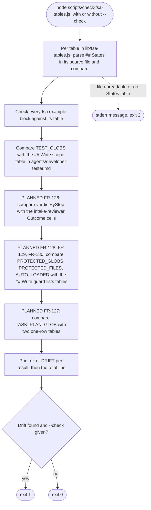

# spec-hooks-fsa-table-check

## Metadata

| Field | Value |
|---|---|
| **Feature** | FSA table check: compare the hook tables and write guard lists in code with the markdown that documents them |
| **Parent feature** | spec-hooks-platform.md |
| **Sub-features** | None |
| **Requirement refs** | BR-015, UR-044, UR-051, FR-121, FR-122, FR-126, FR-127, FR-128, FR-129, FR-180, FR-186, NFR-011, NFR-021 |
| **Feature type** | Tooling |
| **Status** | Draft |

Status values: Draft, Review, Approved, Implemented.

## Description

`scripts/check-fsa-tables.js` is a maintainer script. It compares the transition tables in `hooks/lib/fsa-tables.js` with the `## States` tables in the agent and skill files, the test globs in `hooks/lib/fsa-paths.js` with the `## Write scope` table in `agents/developer-tester.md`, and checks that every example `fsa` block in those files is a legal run of its table. The markdown is the source of truth: on drift, the JavaScript is edited to match (`docs/requirements/FR-NFR-assist-plugin.md` section 7). Requirements marked **Built** describe commit 4803a0d.

Release 1.11.1 (**PLANNED**) adds, per `DECISIONS.md` (2026-10-14, Write guard lists live in rules/assist-plugin-rule.md): a `## Write guard lists` section in `plugins/assist-plugin/rules/assist-plugin-rule.md` and a one-row table under `## Write scope` in `agents/task-planner.md` (FR-180), and checks of `verdictByStep` (FR-126), `TASK_PLAN_GLOB` (FR-127), `PROTECTED_GLOBS` and `PROTECTED_FILES` (FR-128), and `AUTO_LOADED` (FR-129) against the markdown. The task-plan glob in both task-plan tables is `docs/task-plans/task-plan-*.md`, the scope that FR-186 gives `task-planner` in the same release (`DECISIONS.md:78-86`, 2026-10-16; spec-hooks-fsa-write-bar.md, Requirement: Task-planner write scope in docs/task-plans/).

Paths below are relative to `plugins/assist-plugin/`, the script's plugin root (`scripts/check-fsa-tables.js:21`).

## Triggered by

| Trigger type | Source | Condition |
|---|---|---|
| Manual process | Maintainer runs `node plugins/assist-plugin/scripts/check-fsa-tables.js [--check]` from any directory | After editing a `## States` table, a Write scope table, a terminal-block example, or (PLANNED) a write guard list (`CLAUDE.md`, Keeping counts in sync) |
| Release | Release checklist (UC-005 in `docs/requirements/URD-assist-plugin.md`) | Before each release; NFR-021 requires exit 0 |

## Required data

| Data | Source | Type | Notes |
|---|---|---|---|
| `TABLES`, `TERMINALS`, `ERROR_CLASSES`, `INITIAL` | `hooks/lib/fsa-tables.js` | JavaScript constants | Loaded with `require` |
| `TEST_GLOBS`, `TASK_PLAN_GLOB`, `PROTECTED_GLOBS`, `PROTECTED_FILES`, `AUTO_LOADED` | `hooks/lib/fsa-paths.js:20-43` | JavaScript constants | The last four are PLANNED inputs |
| `## States` tables | `skills/create-test/SKILL.md`, `agents/reviewer.md`, `agents/code-reviewer.md`, `agents/intake-reviewer.md`, `agents/developer.md`, `skills/task-plan/SKILL.md`; `agents/qa.md` (must have none) | markdown | One source per `TABLES` entry |
| Example `fsa` blocks | The table sources plus `skills/do/references/fsa-template.md`, `agents/developer-tester.md`, `agents/task-planner.md` | markdown | |
| `## Write scope` table | `agents/developer-tester.md` | markdown | Test globs |
| `## Write guard lists` section | `rules/assist-plugin-rule.md` | markdown | PLANNED (FR-180) |
| `## Write scope` one-row table | `agents/task-planner.md` | markdown | PLANNED (FR-180) |
| `--check` | Command line | flag | Exit 1 on drift only with this flag |

## Behavior

### Requirement: Markdown parsing rules

The script SHALL read a section as the lines after a heading line whose trimmed text equals the heading (a `## ` line) up to the next level-1 or level-2 heading outside a code fence, and a table as the rows of the first table in those lines, without its header and separator rows, at most 38 data rows (the 40-row cap counts the header and separator rows, `scripts/check-fsa-tables.js:30`, `:82`, `:91`), splitting cells on `|` outside backtick code spans.

**Requirement refs:** FR-121, UR-044
**Status:** Built
**Source:** `scripts/check-fsa-tables.js:28-30`, `:36-92`

A code fence opens on a line of up to 3 spaces and 3 to 10 backticks or tildes, and the same character closes it. Leading and trailing `|` are dropped and each cell is trimmed. `### ` lines stay inside a `## ` section.

#### Scenario: Pipe inside a code span

- **GIVEN** a table cell that holds `` `a|b` ``
- **WHEN** the script splits the row
- **THEN** the cell SHALL stay one cell holding `` `a|b` ``

#### Scenario: Heading inside a code fence

- **GIVEN** a `## States` section that holds a fenced example with a `## Other` line inside the fence
- **WHEN** the script reads the section
- **THEN** the section SHALL continue past the fenced line

### Requirement: State table comparison

The script SHALL, for each table in `hooks/lib/fsa-tables.js`, parse the first table under `## States` in its source file and report drift when the first state is not `Intake`, the state sets differ, the terminal row differs from `Done`, `NeedsInput`, `Error`, an error class is outside the closed list, or a state's set of next states differs.

**Requirement refs:** FR-121, UR-044, NFR-021
**Status:** Built
**Source:** `scripts/check-fsa-tables.js:97-148`; `hooks/lib/fsa-tables.js:17-23`, `:30-124`

Row parsing: the first cell is the state; a second cell of `terminal` makes the row the terminal list (first cell split on commas); otherwise the fourth cell splits on `;`, and each segment with `->` contributes the state name that follows (`[A-Z][A-Za-z]{0,30}`) and, when present, its `(<class>)`. A tableless agent (`qa`) is drift when its source file has a line `## States`. A source file with no `## States` table is an operational error (exit 2).

Problem texts: `first state is <X>, expected Intake`; `state: <X> is in the markdown only`; `state: <X> is in lib/fsa-tables.js only`; `terminals: ...`; `error class <X> is not in the closed list`; `transition from <S>: <X> is in ... only`; `<source> has a ## States section but qa is tableless in lib/fsa-tables.js`.

#### Scenario: In sync

- **GIVEN** the code tables match the markdown
- **WHEN** the script runs with `--check`
- **THEN** it SHALL print `FSA tables match the markdown.` and exit 0

#### Scenario: Drift

- **GIVEN** `fsa-tables.js` lists a transition `Review -> Done` that the `reviewer` table does not
- **WHEN** the script runs with `--check`
- **THEN** it SHALL print `transition from Review: Done is in lib/fsa-tables.js only` under a `DRIFT` line and exit 1

#### Scenario: Error class outside the list

- **GIVEN** a `## States` row with `-> Error(no-terminal-block)`
- **WHEN** the script runs with `--check`
- **THEN** it SHALL report `error class no-terminal-block is not in the closed list` and exit 1

### Requirement: Example block check

The script SHALL check every `fsa` block, in each table source and in `skills/do/references/fsa-template.md`, `agents/developer-tester.md`, and `agents/task-planner.md`, whose `fsa:` value names a table, as a terminal block of that table, reporting each problem as `example block <table>: <problem>`.

**Requirement refs:** FR-121, UR-044
**Status:** Built
**Source:** `scripts/check-fsa-tables.js:25-27`, `:150-177`; `hooks/lib/fsa-tables.js:166-245`

A block naming no table (a placeholder such as `<agent>/<version>`) is skipped. The checks and problem codes are those of `fsa-log` (spec-hooks-fsa-log.md, Requirement: Block checks and problem codes).

#### Scenario: Example block outside its table

- **GIVEN** an example `fsa` block in `agents/task-planner.md` whose trace skips `CheckPlan`
- **WHEN** the script runs with `--check`
- **THEN** it SHALL report `example block task-planner: illegal-transition: PlanSteps>WritePlan` and exit 1

#### Scenario: Placeholder block

- **GIVEN** the template block with `fsa: <agent>/<version>`
- **WHEN** the script runs
- **THEN** it SHALL skip the block

### Requirement: Test glob comparison

The script SHALL compare the first cells of the `## Write scope` table in `agents/developer-tester.md`, with backticks removed, against `TEST_GLOBS` as sets.

**Requirement refs:** FR-121, UR-044
**Status:** Built
**Source:** `scripts/check-fsa-tables.js:179-185`

This comparison stays lenient about backticks; the exact-form rule of FR-180 applies only to the new tables.

#### Scenario: Extra glob in code

- **GIVEN** `TEST_GLOBS` holds `**/*.it.*`, which the table does not list
- **WHEN** the script runs with `--check`
- **THEN** it SHALL report `test glob: **/*.it.* is in lib/fsa-paths.js only` and exit 1

#### Scenario: Globs match

- **GIVEN** the table lists the 9 globs of `TEST_GLOBS`
- **WHEN** the script runs
- **THEN** it SHALL print `ok    test globs (agents/developer-tester.md): 9 globs`

### Requirement: Output and exit codes

The script SHALL print one line per comparison, `ok    <label>` or `DRIFT <label>` followed by each problem indented 6 spaces, then a total line, exiting 1 only when `--check` is given and drift exists, 0 otherwise, and 2 with `check-fsa-tables: <message>` on stderr when a file it must read is unreadable or a `## States` table is missing.

**Requirement refs:** FR-121, FR-122, UR-044
**Status:** Built
**Source:** `scripts/check-fsa-tables.js:10-15`, `:187-208`

Total line: `FSA tables match the markdown.` or `<N> difference(s) between lib and the markdown. The markdown is the source of truth.`

#### Scenario: No flag

- **GIVEN** drift exists
- **WHEN** the script runs without `--check`
- **THEN** it SHALL print the comparison and exit 0

#### Scenario: Missing file

- **GIVEN** an agent file named by the script is missing
- **WHEN** the script runs
- **THEN** it SHALL print an error to stderr and exit 2

### Requirement: Write guard lists in the markdown

The plugin SHALL hold the write guard lists in markdown tables whose first column gives the exact code string in backticks: four tables in `plugins/assist-plugin/rules/assist-plugin-rule.md`, each under its own subheading of `## Write guard lists` (`### Protected globs`, `### Protected files`, `### Auto-loaded names`, `### Task-plan glob`), and a one-row table for the task-plan glob under `## Write scope` in `agents/task-planner.md`. The task-plan glob in both tables is `docs/task-plans/task-plan-*.md` once FR-186 is built.

**Requirement refs:** FR-180, FR-186, UR-051, BR-015
**Status:** PLANNED (1.11.1)
**Source:** `docs/requirements/FR-NFR-assist-plugin.md:2401-2415` (FR-180); `DECISIONS.md:68-70` (2026-10-14, Write guard lists live in rules/assist-plugin-rule.md) and `DECISIONS.md:78-86` (2026-10-16, task plans in `docs/task-plans/`); `hooks/lib/fsa-paths.js:32-43` (values at 4803a0d)

Content to add to `rules/assist-plugin-rule.md`, as a new section after `## Hook Fail-Open Rule` and before `## Governance Enforcement`. The headings and the first-column strings are binding; the second column and the opening paragraph are the proposed wording:

```markdown
## Write guard lists

`fsa-write-bar` enforces these lists from `hooks/lib/fsa-paths.js`. This section is the source of truth: `node plugins/assist-plugin/scripts/check-fsa-tables.js --check` exits 1 while the code differs, and the fix is to edit the JavaScript. The first column holds the exact code string. Removing or narrowing an entry under Protected globs, Protected files, or Auto-loaded names, or any change to the Task-plan glob, needs a user decision recorded in `DECISIONS.md` before the JavaScript follows this section.

### Protected globs

| Glob | Meaning |
|---|---|
| `**/.agent/main-plan/**` | The `/do` plan files, which hold sign-off and waiver state; no subagent writes them |

### Protected files

| File name | Meaning |
|---|---|
| `DECISIONS.md` | The decision log, in any directory; no subagent writes it |

### Auto-loaded names

| File name | Meaning |
|---|---|
| `CLAUDE.md` | Claude Code loads it into later sessions |
| `CLAUDE.local.md` | Claude Code loads it into later sessions |
| `AGENTS.md` | Claude Code loads it into later sessions |

### Task-plan glob

| Glob | Meaning |
|---|---|
| `docs/task-plans/task-plan-*.md` | The only files `task-planner` writes: a `task-plan-*.md` file directly under `docs/task-plans/` of the git root of the session's working directory (a worktree uses its own root); root-level task plans in older projects are read, never written |
```

Content to add under `## Write scope` in `agents/task-planner.md`, after the existing paragraph:

```markdown
| Glob | Where |
|---|---|
| `docs/task-plans/task-plan-*.md` | Directly under `docs/task-plans/` of the session's git root (a worktree uses its own root; outside a git repository, the working directory), no deeper; a rework of a root-level plan is written here as a new file |
```

The paragraph above that table in `agents/task-planner.md:42` describes the root-level scope of 4803a0d and changes with FR-186. The `task-plan` skill's output folder and grant change under FR-184 and FR-185 (Area C).

Both files are on the plugin's executable surface, so the change needs `✓ LLM Security Clear` before merge (NFR-011).

#### Scenario: Tables present

- **GIVEN** the rule file and the agent file after the change
- **WHEN** a test reads them with the parsing rules of Requirement: Write guard list parsing
- **THEN** the rule file SHALL hold four tables, one under each of the four `###` subheadings of `## Write guard lists`, and the agent file SHALL hold a one-row table under `## Write scope`

#### Scenario: Values equal the code

- **GIVEN** the same files and `hooks/lib/fsa-paths.js` with FR-186 built (`TASK_PLAN_GLOB` is `docs/task-plans/task-plan-*.md`; the other three lists as at 4803a0d)
- **WHEN** `check-fsa-tables.js --check` runs
- **THEN** every write-guard comparison SHALL print `ok`

#### Scenario: Tables added before the code moves

- **GIVEN** both task-plan tables hold `docs/task-plans/task-plan-*.md` and `TASK_PLAN_GLOB` still holds `task-plan-*.md`, the value at 4803a0d
- **WHEN** `check-fsa-tables.js --check` runs
- **THEN** both task-plan comparisons SHALL print `DRIFT`, each naming `docs/task-plans/task-plan-*.md` as markdown-only and `task-plan-*.md` as code-only and followed by the `DECISIONS.md` line (the decision exists at `DECISIONS.md:83-86`), and the script SHALL exit 1

### Requirement: Write guard list parsing

The script SHALL read each write guard table as the first table in the lines of its `###` subsection, where a subsection is the lines of the `## Write guard lists` section after a line whose trimmed text equals the subheading, up to the next heading of level 1 to 3 outside a code fence, accepting a data row only when its trimmed first cell is exactly one code span: a backtick, one or more characters that are not backticks, and a backtick, with nothing else.

**Requirement refs:** FR-180, UR-051
**Status:** PLANNED (1.11.1)
**Source:** `scripts/check-fsa-tables.js:36-92` (`sectionLines`, `splitRow`, `firstTable`, reused); `DECISIONS.md` (2026-10-14)

Rules:
- The section comes from `sectionLines(text, "## Write guard lists")`. A new helper takes the subsection from those lines with the same fence tracking. The task-planner table comes from `firstTable(sectionLines(text, "## Write scope"))` on `agents/task-planner.md`.
- The value of a row is the text inside the code span, unchanged (no trimming inside the backticks).
- A first cell in any other form is drift: `<file>, <heading>, row <n>: first cell <cell> is not one code span`, with the cell as written, cut to 80 characters.
- A missing section, subsection, or table is drift: `<file>: no table under <heading>`. Exit code 2 stays reserved for unreadable files (FR-122), because a malformed table is drift the maintainer fixes in the markdown, the same way as a wrong value.
- A value listed twice in one table is drift: `<file>, <heading>: <value> is listed twice`.
- The four code lists are compared as sets, like the existing comparisons.

#### Scenario: Not in exact code form

- **GIVEN** a first-column cell `DECISIONS.md` without backticks under `### Protected files`
- **WHEN** `check-fsa-tables.js --check` parses the table
- **THEN** the script SHALL report the cell with its file, heading, and row number and exit 1

#### Scenario: Code span with extra text

- **GIVEN** a first-column cell `` `CLAUDE.md` (root) `` under `### Auto-loaded names`
- **WHEN** the script parses the table
- **THEN** the script SHALL report the cell and exit 1 with `--check`

#### Scenario: Section missing

- **GIVEN** `rules/assist-plugin-rule.md` without `## Write guard lists`
- **WHEN** the script runs with `--check`
- **THEN** it SHALL report `rules/assist-plugin-rule.md: no table under ### Protected globs` and the three other subheadings, and exit 1

#### Scenario: Rule file unreadable

- **GIVEN** `rules/assist-plugin-rule.md` cannot be read
- **WHEN** the script runs
- **THEN** it SHALL print `check-fsa-tables: <message>` to stderr and exit 2

### Requirement: Protected path drift check

The script `scripts/check-fsa-tables.js --check` SHALL exit 1 when `PROTECTED_GLOBS` or `PROTECTED_FILES` in `hooks/lib/fsa-paths.js` differ from the strings in backticks in the first column of the tables under `### Protected globs` and `### Protected files` in the `## Write guard lists` section of `plugins/assist-plugin/rules/assist-plugin-rule.md`, with the markdown as the source of truth.

**Requirement refs:** FR-128, UR-051, NFR-021
**Status:** PLANNED (1.11.1)
**Source:** `hooks/lib/fsa-paths.js:36-39`

Result labels: `write guard list PROTECTED_GLOBS (rules/assist-plugin-rule.md, ### Protected globs): <n> entries` and the same for `PROTECTED_FILES` and `### Protected files`. Problems: `PROTECTED_FILES: <value> is in the markdown only` or `PROTECTED_FILES: <value> is in lib/fsa-paths.js only`.

Decision guard on the fix: a value that is in `lib/fsa-paths.js` only means that following the markdown would remove or narrow a protection the hook enforces today. When a `PROTECTED_GLOBS`, `PROTECTED_FILES`, or `AUTO_LOADED` comparison has at least one such value, the script prints, after that comparison's problems, the line `      this write guard change needs a user decision recorded in DECISIONS.md before lib/fsa-paths.js follows the markdown` (the `DECISIONS.md` line). The line adds no problem to the count. A value in the markdown only (code to gain an entry) needs no decision. The same line is printed for any `TASK_PLAN_GLOB` drift (Requirement: Task-plan glob drift check). The script never reads `DECISIONS.md`; the line tells the maintainer what must exist before the JavaScript changes.

#### Scenario: Paths match

- **GIVEN** `PROTECTED_GLOBS` holds the exact string `**/.agent/main-plan/**` and `PROTECTED_FILES` holds `DECISIONS.md`, and the tables list the same strings in backticks in their first column
- **WHEN** the script runs with `--check`
- **THEN** it SHALL exit 0

#### Scenario: Extra protected file

- **GIVEN** `PROTECTED_FILES` lists `ROADMAP.md`, which the markdown does not
- **WHEN** the script runs with `--check`
- **THEN** it SHALL report `PROTECTED_FILES: ROADMAP.md is in lib/fsa-paths.js only` and exit 1
- **AND** it SHALL print the `DECISIONS.md` line

#### Scenario: Different glob form

- **GIVEN** the `### Protected globs` table lists `` `.agent/main-plan/**` `` and the code holds `**/.agent/main-plan/**`
- **WHEN** the script runs with `--check`
- **THEN** it SHALL report both strings, one as markdown-only and one as code-only, and exit 1
- **AND** it SHALL print the `DECISIONS.md` line, because the markdown form protects fewer paths

#### Scenario: New protected file in the markdown

- **GIVEN** the `### Protected files` table adds `` `ROADMAP.md` `` and `PROTECTED_FILES` does not hold it
- **WHEN** the script runs with `--check`
- **THEN** it SHALL report `PROTECTED_FILES: ROADMAP.md is in the markdown only`, exit 1, and SHALL NOT print the `DECISIONS.md` line

### Requirement: Auto-loaded file drift check

The script `scripts/check-fsa-tables.js --check` SHALL exit 1 when `AUTO_LOADED` in `hooks/lib/fsa-paths.js` differs from the strings in backticks in the first column of the table under `### Auto-loaded names` in the `## Write guard lists` section of `plugins/assist-plugin/rules/assist-plugin-rule.md`, with the markdown as the source of truth.

**Requirement refs:** FR-129, UR-051, NFR-021
**Status:** PLANNED (1.11.1)
**Source:** `hooks/lib/fsa-paths.js:41-43`

Result label: `write guard list AUTO_LOADED (rules/assist-plugin-rule.md, ### Auto-loaded names): <n> entries`. The comparison is exact and case-sensitive; the hook folds case only when it matches a path. The protection guard on the fix (Requirement: Protected path drift check) applies to this list too.

#### Scenario: Names match

- **GIVEN** `AUTO_LOADED` lists `CLAUDE.md`, `CLAUDE.local.md`, and `AGENTS.md`, and the table holds the same three strings in backticks
- **WHEN** the script runs with `--check`
- **THEN** it SHALL exit 0

#### Scenario: Name missing in code

- **GIVEN** `AUTO_LOADED` omits `CLAUDE.local.md`
- **WHEN** the script runs with `--check`
- **THEN** it SHALL report `AUTO_LOADED: CLAUDE.local.md is in the markdown only` and exit 1

#### Scenario: Name dropped from the markdown

- **GIVEN** the `### Auto-loaded names` table no longer lists `` `AGENTS.md` `` and `AUTO_LOADED` still holds it
- **WHEN** the script runs with `--check`
- **THEN** it SHALL report `AUTO_LOADED: AGENTS.md is in lib/fsa-paths.js only`, print the `DECISIONS.md` line, and exit 1

### Requirement: Task-plan glob drift check

The script `scripts/check-fsa-tables.js --check` SHALL exit 1 when `TASK_PLAN_GLOB` in `hooks/lib/fsa-paths.js` differs from the glob in either of two tables: the table under `### Task-plan glob` in the `## Write guard lists` section of `plugins/assist-plugin/rules/assist-plugin-rule.md`, or the one-row table under `## Write scope` in `agents/task-planner.md`, with the markdown as the source of truth.

**Requirement refs:** FR-127, FR-186, UR-051, NFR-021
**Status:** PLANNED (1.11.1)
**Source:** `docs/requirements/FR-NFR-assist-plugin.md:2348-2367` (FR-127); `hooks/lib/fsa-paths.js:32-34` (`task-plan-*.md` at 4803a0d; `docs/task-plans/task-plan-*.md` after FR-186); `agents/task-planner.md:40-42` (Write scope, prose only at commit 4803a0d)

Each table is a separate comparison with its own result line: `TASK_PLAN_GLOB (rules/assist-plugin-rule.md, ### Task-plan glob)` and `TASK_PLAN_GLOB (agents/task-planner.md, ## Write scope)`. Each table holds exactly one data row; another count is drift: `<file>, <heading>: <n> rows; expected 1`. Problems: `TASK_PLAN_GLOB: <value> is in the markdown only` or `TASK_PLAN_GLOB: <value> is in lib/fsa-paths.js only`.

Decision guard on the fix: any value difference in a task-plan comparison means that following the markdown would change the code value, and with it what `task-planner` may write. A wider glob such as `**/*.md` would let `task-planner` overwrite any markdown file outside hidden folders, including documents later agents read and act on (OWASP LLM04, data and model poisoning). So whenever a task-plan comparison reports a value in the markdown only or in `lib/fsa-paths.js` only, the script prints the `DECISIONS.md` line of Requirement: Protected path drift check after that comparison's problems. A row-count problem alone, with the one code value present, prints no line. The planned move to `docs/task-plans/task-plan-*.md` already has its decision (`DECISIONS.md:83-86`, 2026-10-16, Legacy root documents and the requirements JSON), so the maintainer updates `TASK_PLAN_GLOB`, and `--check` then passes.

#### Scenario: Glob matches

- **GIVEN** `TASK_PLAN_GLOB` is `docs/task-plans/task-plan-*.md` (the glob after FR-186; `task-plan-*.md` at 4803a0d) and both tables hold the same string in backticks in the first column
- **WHEN** the script runs with `--check`
- **THEN** it SHALL exit 0

#### Scenario: Glob drifts

- **GIVEN** `TASK_PLAN_GLOB` is `plan-*.md` and both tables hold `docs/task-plans/task-plan-*.md`
- **WHEN** the script runs with `--check`
- **THEN** it SHALL print two `DRIFT` lines naming `TASK_PLAN_GLOB`, each followed by the `DECISIONS.md` line, and exit 1

#### Scenario: One table drifts

- **GIVEN** `TASK_PLAN_GLOB` and the table in `agents/task-planner.md` hold `docs/task-plans/task-plan-*.md`, but the `### Task-plan glob` table still holds `task-plan-*.md`
- **WHEN** the script runs with `--check`
- **THEN** it SHALL print `DRIFT TASK_PLAN_GLOB (rules/assist-plugin-rule.md, ### Task-plan glob)` followed by the `DECISIONS.md` line, and `ok    TASK_PLAN_GLOB (agents/task-planner.md, ## Write scope)`, and exit 1

#### Scenario: Wider glob in the markdown

- **GIVEN** `TASK_PLAN_GLOB` is `docs/task-plans/task-plan-*.md` and both tables hold `**/*.md`
- **WHEN** the script runs with `--check`
- **THEN** it SHALL report `TASK_PLAN_GLOB: **/*.md is in the markdown only` and `TASK_PLAN_GLOB: docs/task-plans/task-plan-*.md is in lib/fsa-paths.js only` for each table, print the `DECISIONS.md` line after each comparison, and exit 1
- **AND** the script SHALL leave `lib/fsa-paths.js` unchanged, since it only reports

#### Scenario: Recorded move to docs/task-plans

- **GIVEN** both tables hold `docs/task-plans/task-plan-*.md`, `TASK_PLAN_GLOB` still holds `task-plan-*.md`, and `DECISIONS.md:83-86` records the move
- **WHEN** the maintainer runs `--check`, sets `TASK_PLAN_GLOB` to `docs/task-plans/task-plan-*.md`, and runs `--check` again
- **THEN** the first run SHALL print two `DRIFT` lines, each followed by the `DECISIONS.md` line, and exit 1, and the second run SHALL print `ok` for both task-plan comparisons and exit 0

#### Scenario: Two rows

- **GIVEN** the `agents/task-planner.md` table holds two data rows
- **WHEN** the script runs with `--check`
- **THEN** it SHALL report `agents/task-planner.md, ## Write scope: 2 rows; expected 1` and exit 1

### Requirement: Verdict pairing drift check

The script `scripts/check-fsa-tables.js --check` SHALL exit 1 when `verdictByStep` in `hooks/lib/fsa-tables.js` differs from the verdict named in the Outcome cells of the `Decide` and `Verify` rows of the `## States` table in `agents/intake-reviewer.md`, with the markdown as the source of truth.

**Requirement refs:** FR-126, UR-051, NFR-021
**Status:** PLANNED (1.11.1)
**Open point:** comparing other tables' verdicts is pending OP-B12 (spec-hooks-platform.md, Open points)
**Source:** `docs/requirements/FR-NFR-assist-plugin.md:2332-2346` (FR-126); `hooks/lib/fsa-tables.js:77-94` (`verdictByStep`); `agents/intake-reviewer.md:63-77` (`## States` table and its note on the pairing)

Markdown side: the script reads the `## States` table of `agents/intake-reviewer.md` with the existing parser and, for each row, splits the fourth (Outcome) cell on `;`. A segment whose text after `->` starts with `Done with verdict` followed by one code span names a verdict for that row's state. The markdown pairing maps each state with at least one such segment to its set of verdicts. At commit 4803a0d this gives `Decide`: `accepted`, `needs-changes`; `Verify`: `clear`, `needs-clarification`.

Code side: each `verdictByStep` key is a state; its pattern's source must have the form `^(v1|v2|...)$` where each `v` is a lowercase word with hyphens. A pattern in any other form is drift: `verdictByStep.<state> is not a plain list of verdicts`.

Comparison: the state sets, then each state's verdict sets. Problems: `verdict step <state> is in the markdown only` or `... is in lib/fsa-tables.js only`; `verdict after <state>: <verdict> is in the markdown only` or `... is in lib/fsa-tables.js only`. Result label: `verdict pairing (agents/intake-reviewer.md): <n> steps`. The total line already says the markdown is the source of truth.

Reading the pattern's alternation gives exact set equality, which also catches an extra alternative that no markdown verdict would exercise; testing the pattern against the markdown verdicts alone would miss it.

Limit, pending OP-B12 (spec-hooks-platform.md, Open points): only `verdictByStep` is compared, and only `intake-reviewer` has one. Not compared: the `Done with verdict` pairs in the other tables, such as `agents/reviewer.md:51` and `agents/code-reviewer.md:52` (`approved`, `returned`), and each table's own `verdict` pattern (`hooks/lib/fsa-tables.js:35`, `:50`, `:57`, `:69`, `:81`, `:99`, `:114`). A change to either side of those passes `--check`.

#### Scenario: Pairing matches

- **GIVEN** `verdictByStep` maps `Decide` to `^(accepted|needs-changes)$` and `Verify` to `^(clear|needs-clarification)$`
- **WHEN** the script runs with `--check`
- **THEN** it SHALL exit 0

#### Scenario: Pairing drifts

- **GIVEN** `verdictByStep` maps `Verify` to `^(accepted|clear|needs-clarification)$`
- **WHEN** the script runs with `--check`
- **THEN** it SHALL print `verdict after Verify: accepted is in lib/fsa-tables.js only`, end with the line that says the markdown is the source of truth, and exit 1

#### Scenario: Pattern not a plain list

- **GIVEN** `verdictByStep` maps `Decide` to `^(accepted|needs-.*)$`
- **WHEN** the script runs with `--check`
- **THEN** it SHALL report `verdictByStep.Decide is not a plain list of verdicts` and exit 1

## Algorithmic steps

Start-to-end flow. Source: [spec-hooks-fsa-table-check-flow.mmd](spec-hooks-fsa-table-check-flow.mmd).



**Note:** PNG rendering requires mermaid-cli with its headless browser, which is missing on this machine (see spec-hooks-platform.md). Render with `mmdc -i specs/spec-hooks-fsa-table-check-flow.mmd -o specs/spec-hooks-fsa-table-check-flow.png` once it is installed.

1. Load `hooks/lib/fsa-tables.js` and `hooks/lib/fsa-paths.js`.
2. Run the state table comparison for every table, then the example block check for every source file, then the test glob comparison (Built).
3. PLANNED: run the verdict pairing, the three write-guard-list comparisons, and the two task-plan comparisons, in that order.
4. Print each result and the total line; choose the exit code.

## Output / Outcome

| Output | Type | Description |
|---|---|---|
| Comparison lines | stdout | `ok` or `DRIFT` per result, with problems |
| Total line | stdout | Match or difference count |
| Exit code | Process status | 0, 1 (`--check` and drift), or 2 (operational error) |
| Error message | stderr | `check-fsa-tables: <message>` on exit 2 |

## Error handling

| Error condition | Handling strategy | Outcome |
|---|---|---|
| A file cannot be read | Throw, caught at the top level | stderr message, exit 2 |
| A `## States` table is missing in a table's source | Throw | stderr message, exit 2 |
| PLANNED: write guard section, subsection, or table missing | Drift problem | `DRIFT` line; exit 1 with `--check` |
| PLANNED: first cell not one code span | Drift problem naming the cell | `DRIFT` line; exit 1 with `--check` |

## Events emitted (if applicable)

Not applicable: the script prints and exits.

## Dependencies

| Dependency | Type | Required | Notes |
|---|---|---|---|
| Node.js | Runtime | yes | ES2015 syntax, no packages |
| `hooks/lib/fsa-tables.js`, `hooks/lib/fsa-paths.js` | Runtime | yes | The code side of every comparison |
| Agent, skill, and rule markdown | Runtime | yes | The source of truth |
| `CLAUDE.md` (Keeping counts in sync), `README.md` (FSA hooks), the script's header comment | Documentation | no | PLANNED: name the write guard lists among the tables to check after editing |
| `✓ LLM Security Clear` | Process | yes | Changes to `rules/*.md`, `agents/*.md`, and `hooks/**` (NFR-011) |

## Sub-feature breakdown (if applicable)

Not applicable.

## Submodule scope (if applicable)

Not applicable.

## Traceability

| Requirement | Spec section | Verified by |
|---|---|---|
| BR-015 | Requirement: State table comparison; Requirement: Write guard lists in the markdown | SC-008: `--check` exits 0 at release |
| UR-044 | Requirement: State table comparison; Requirement: Test glob comparison | In-sync and drift scenarios |
| UR-051 | Requirement: Protected path drift check; Requirement: Auto-loaded file drift check; Requirement: Task-plan glob drift check; Requirement: Verdict pairing drift check | PLANNED drift scenarios |
| FR-121 | Requirement: Markdown parsing rules; Requirement: State table comparison; Requirement: Example block check; Requirement: Test glob comparison; Requirement: Output and exit codes | Drift, error class, example block, and glob scenarios |
| FR-122 | Requirement: Output and exit codes | No-flag and missing-file scenarios |
| FR-126 | Requirement: Verdict pairing drift check | Pairing matches and drifts scenarios |
| FR-127 | Requirement: Task-plan glob drift check | Glob matches, drifts, one-table, two-rows scenarios |
| FR-128 | Requirement: Protected path drift check | Paths match and extra-file scenarios |
| FR-129 | Requirement: Auto-loaded file drift check | Names match and missing-name scenarios |
| FR-180 | Requirement: Write guard lists in the markdown; Requirement: Write guard list parsing | Tables-present and code-form scenarios |
| FR-186 | Requirement: Write guard lists in the markdown; Requirement: Task-plan glob drift check | The `docs/task-plans/task-plan-*.md` value in both tables; tables-added-before-the-code-moves scenario |
| NFR-011 | Requirement: Write guard lists in the markdown; Dependencies | Merge policy review |
| NFR-021 | Requirement: State table comparison | `--check` exit 0 at every release |
