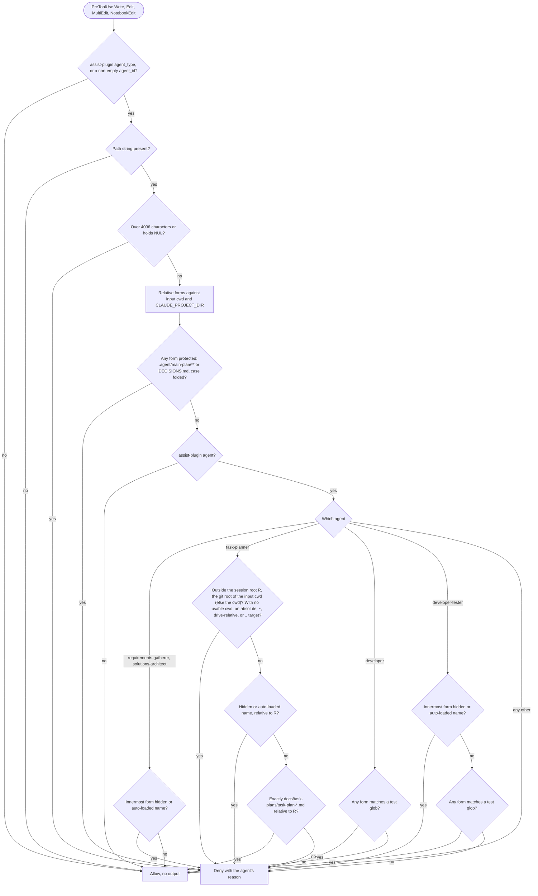

# spec-hooks-fsa-write-bar

## Metadata

| Field | Value |
|---|---|
| **Feature** | FSA write bar: per-agent write limits and protected paths |
| **Parent feature** | spec-hooks-platform.md |
| **Sub-features** | None |
| **Requirement refs** | BR-005, BR-006, BR-012, UR-019, UR-037, UR-049, FR-108, FR-109, FR-110, FR-111, FR-112, FR-113, FR-114, FR-186, NFR-008, NFR-009 |
| **Feature type** | Functionality |
| **Status** | Approved |

Status values: Draft, Review, Approved, Implemented.

## Description

`fsa-write-bar` is a PreToolUse guard on Write, Edit, MultiEdit, and NotebookEdit. It keeps `developer-tester` to test paths and `developer` out of them, limits `task-planner` to a `task-plan-*.md` file directly under `docs/task-plans/` of the git root of the session's working directory (FR-186, built in 1.11.1; a root-level `task-plan-*.md` at 4803a0d), keeps the chain agents that read untrusted documents before sign-off away from hidden paths and auto-loaded files, and denies every subagent the `/do` plan files and `DECISIONS.md`, so only the orchestrator and the user record plans, sign-off, waivers, and decisions (UR-019). It implements the 2026-10-13 decisions in `DECISIONS.md` (task-planner agent and plan-file write guard; Protected-path guard covers every subagent; Narrow the hidden-path bar). It is a guardrail and fails open. This spec describes the behavior at assist-plugin 1.11.1 (commit 41034c1), including the task-plan location from `DECISIONS.md:78-86` and `:93-96` (2026-10-16 entries "Requirements in docs/requirements/, task plans in docs/task-plans/", "Legacy root documents and the requirements JSON", and "docs/requirements/ and docs/task-plans/ resolve against the session's git root"), built in 1.11.1. The lists it enforces live in `hooks/lib/fsa-paths.js`; their markdown sources and drift checks are in spec-hooks-fsa-table-check.md (FR-121, and FR-127 to FR-129 and FR-180, built in 1.11.1). The change log at the end records the OP-B7 decision and the requirement 1.11.1 replaced.

## Triggered by

| Trigger type | Source | Condition |
|---|---|---|
| Event | PreToolUse, matcher `Write\|Edit\|MultiEdit\|NotebookEdit` (`hooks/hooks.json:49-58`) | Every write by the main session or a subagent |

## Required data

| Data | Source | Type | Notes |
|---|---|---|---|
| `tool_name` | Hook input | string | `Write`, `Edit`, `MultiEdit` read `tool_input.file_path`; `NotebookEdit` reads `tool_input.notebook_path`; any other tool is allowed |
| `agent_type` | Hook input | string | Missing means empty |
| `agent_id` | Hook input | string | Present only inside a subagent |
| `cwd` | Hook input | string | First root; for `task-planner`, also the start of the `.git` walk that finds the session root (FR-186) |
| `CLAUDE_PROJECT_DIR` | Hook process environment | string | Second root; plays no part in the `task-planner` session root |
| `.git` entries | Local file system, through `findGitRoot` in `hooks/lib/git-root.js:27-36` | directory entries | `task-planner` calls only; replaced by `options.findGitRoot` in tests |
| `TEST_GLOBS`, `TASK_PLAN_GLOB`, `PROTECTED_GLOBS`, `PROTECTED_FILES`, `AUTO_LOADED` | `hooks/lib/fsa-paths.js:20-44` | string lists | Mirrors of markdown tables (spec-hooks-fsa-table-check.md) |

Test globs (`hooks/lib/fsa-paths.js:20-30`, from the `## Write scope` table in `agents/developer-tester.md`): `**/test/**`, `**/tests/**`, `**/__tests__/**`, `**/*.test.*`, `**/*_test.*`, `**/*.spec.*`, `**/test_*.py`, `**/*Test.kt`, `**/*_test.go`.

## Preconditions

| Condition | Check | If not met |
|---|---|---|
| The call is judged: `agent_type` starts with `assist-plugin:`, or `agent_id` is a non-empty string | `impl/fsa-write-bar.js:171-176` | Allow with no output |
| The path is a non-empty string | `impl/fsa-write-bar.js:177-179` | Allow with no output |
| Platform preconditions | spec-hooks-platform.md | Fail open |

## Algorithmic steps

Start-to-end flow. Source: [spec-hooks-fsa-write-bar-flow.mmd](spec-hooks-fsa-write-bar-flow.mmd).



**Note:** PNG rendering requires mermaid-cli with its headless browser, which is missing on this machine (see spec-hooks-platform.md). Render with `mmdc -i specs/spec-hooks-fsa-write-bar-flow.mmd -o specs/spec-hooks-fsa-write-bar-flow.png` once it is installed.

### Requirement: Calls the bar judges

The `fsa-write-bar` hook SHALL judge a Write, Edit, MultiEdit, or NotebookEdit call only when its `agent_type` starts with `assist-plugin:` or its `agent_id` is a non-empty string, so an `assist-plugin:<name>` agent's rules reach a main session only when that session was started with `--agent assist-plugin:<name>`.

**Requirement refs:** FR-113, FR-112, UR-019
**Status:** Built; OP-B7 closed 2026-10-16 (`DECISIONS.md:133-136`; Change Log 2026-10-16, MODIFIED)
**Source:** `hooks/impl/fsa-write-bar.js:26-28`, `:169-179`

A main session started with `--agent` carries an `agent_type` and no `agent_id`. With an `assist-plugin:` type it is judged by that agent's rules (and by the limits and protected paths); with any other type it is a main-session call and is allowed. `DECISIONS.md:133-136` (2026-10-16, "A non-plugin --agent main session is a main session") decides that second case, refining `DECISIONS.md:55`, and FR-112 states it.

#### Scenario: Main session

- **GIVEN** the main session (no `agent_type`, no `agent_id`) writes `DECISIONS.md`
- **WHEN** the hook evaluates it
- **THEN** the hook SHALL allow it with no output

#### Scenario: Main session started as an assist-plugin agent

- **GIVEN** a main session started with `--agent assist-plugin:developer` writes `src/auth_test.go`
- **WHEN** the hook evaluates it
- **THEN** the hook SHALL deny it by the `developer` rules

#### Scenario: Main session started as another agent

- **GIVEN** a call with `agent_type` `my-main-agent` and no `agent_id` writes `<project>/.agent/main-plan/x.md`
- **WHEN** the hook evaluates it
- **THEN** the hook SHALL allow it with no output (FR-112; `DECISIONS.md:133-136`)

### Requirement: Path limits

The hook SHALL deny every judged call whose path is longer than 4096 characters or holds a NUL character.

**Requirement refs:** FR-113, UR-019
**Status:** Built
**Source:** `hooks/impl/fsa-write-bar.js:183-188`; `hooks/lib/fsa-paths.js:46`, `:104-105`

The check runs first, because the protected-path check cannot judge such a path and must not be bypassed through it.

#### Scenario: Over-long path

- **GIVEN** a subagent of another plugin, with an `agent_id`, writes a path of 5000 characters ending in `DECISIONS.md`
- **WHEN** the hook evaluates it
- **THEN** the hook SHALL deny it

#### Scenario: NUL character

- **GIVEN** `assist-plugin:qa` writes `<project>/src/a` followed by NUL and `.ts`
- **WHEN** the hook evaluates it
- **THEN** the hook SHALL deny it

### Requirement: Project-relative path forms

The hook SHOULD judge a path inside the hook input's `cwd` or `CLAUDE_PROJECT_DIR` relative to that root, so a project under a directory named `tests` is not all test paths.

**Requirement refs:** FR-114, UR-019
**Status:** Built
**Source:** `hooks/impl/fsa-write-bar.js:30-35`, `:112-116`; `hooks/lib/fsa-paths.js:86-99`, `:144-199`

Rules:
- Roots are the input `cwd` and `CLAUDE_PROJECT_DIR`, each when a non-empty string.
- Paths and roots are normalized: backslashes become slashes, then POSIX dot-segment normalization. A root contains a path when the path starts with the root plus `/`; a root that starts with a drive letter compares without regard to case.
- The forms of a path are its path relative to each root that contains it, without duplicates, or the normalized path alone when no root contains it. A relative path is judged as written.
- The innermost form is the path relative to the longest containing root.
- Test globs consider every form: `developer` is denied if any form matches; `developer-tester` needs one form that matches. Hidden-path and auto-loaded denials use the innermost form only, so a worktree under `<root>/.claude/worktrees/` is not hidden from its own `tests/` directory.
- Glob matching works on path segments, case-sensitively: `**/` is zero or more directories, a trailing `/**` is one or more segments, `*` is any run inside one segment. A path of more than 128 segments matches no glob.

#### Scenario: Project under tests

- **GIVEN** a project at `/work/tests/app` (the input `cwd`) and `developer` writes `/work/tests/app/src/main.ts`
- **WHEN** the hook evaluates it
- **THEN** the hook SHALL allow it

#### Scenario: Two roots

- **GIVEN** roots `/x/tests/proj` and `/x`, and `developer` writes `/x/tests/proj/tests/a.js`
- **WHEN** the hook evaluates it
- **THEN** the hook SHALL deny it, because a relative form matches a test glob

#### Scenario: Worktree under a hidden directory

- **GIVEN** roots `<project>` and `<project>/.claude/worktrees/w`, and `developer-tester` writes `<project>/.claude/worktrees/w/tests/a.test.js`
- **WHEN** the hook evaluates it
- **THEN** the hook SHALL allow it, because the innermost form `tests/a.test.js` is not hidden

### Requirement: Protected paths for every subagent

The hook SHALL deny every judged call, from any plugin, whose path in any form is under `**/.agent/main-plan/**` or has the file name `DECISIONS.md`, matched without regard to case, trailing dots or spaces, or a `:stream` suffix.

**Requirement refs:** FR-112, UR-019, BR-012
**Status:** Built; OP-B7 closed 2026-10-16: a non-plugin `--agent` main session is a main session (`DECISIONS.md:133-136`; Change Log 2026-10-16, MODIFIED)
**Source:** `hooks/impl/fsa-write-bar.js:192-196`; `hooks/lib/fsa-paths.js:37-40`, `:119-142`; `DECISIONS.md` (2026-10-13, Protected-path guard covers every subagent; 2026-10-16, A non-plugin --agent main session is a main session)

Folding of each path segment: cut at the first `:`, upper-case then lower-case (so U+017F and U+0131 fold as a case-insensitive file system folds them), strip trailing dots and spaces.

#### Scenario: Plan file

- **GIVEN** any subagent call with an `agent_id` writes `<project>/.agent/main-plan/plan-x.md`
- **WHEN** the hook evaluates it
- **THEN** the hook SHALL deny it with the reason naming `**/.agent/main-plan/**`

#### Scenario: Spelling variants

- **GIVEN** `assist-plugin:developer` writes `decisions.md.`, `DECISIONS.md:stream`, or `Decisions.MD`
- **WHEN** the hook evaluates each write
- **THEN** the hook SHALL deny all three

#### Scenario: Built-in agent

- **GIVEN** a `general-purpose` subagent (no plugin prefix, with an `agent_id`) writes `<project>/DECISIONS.md`
- **WHEN** the hook evaluates it
- **THEN** the hook SHALL deny it

#### Scenario: Similar names

- **GIVEN** `assist-plugin:developer` writes `<project>/.agent/main-plan.md` and `<project>/docs/DECISIONS.md.bak`
- **WHEN** the hook evaluates each write
- **THEN** the hook SHALL allow both

### Requirement: Chain agents

The hook SHALL deny `assist-plugin:requirements-gatherer` and `assist-plugin:solutions-architect` any path whose innermost form has a segment that starts with a dot, or whose file name, folded, is `CLAUDE.md`, `CLAUDE.local.md`, or `AGENTS.md`.

**Requirement refs:** FR-111, UR-019, BR-006
**Status:** Built
**Source:** `hooks/impl/fsa-write-bar.js:53-54`, `:198-203`; `hooks/lib/fsa-paths.js:42-44`, `:101-110`; `DECISIONS.md` (2026-10-13, Narrow the hidden-path bar)

Other `assist-plugin` agents (`devops`, `worker`, `qa`, `general-purpose`, `planner`, and the rest) keep dot-path and auto-loaded-file writes, because CI and config files are their work; only the limits and protected paths apply to them.

#### Scenario: Auto-loaded file

- **GIVEN** `requirements-gatherer` writes `CLAUDE.md`
- **WHEN** the hook evaluates it
- **THEN** the hook SHALL deny it

#### Scenario: Hidden settings file

- **GIVEN** `requirements-gatherer` writes `<project>/.claude/settings.local.json`
- **WHEN** the hook evaluates it
- **THEN** the hook SHALL deny it

#### Scenario: Spec file

- **GIVEN** `solutions-architect` writes `<project>/specs/spec-x.md`
- **WHEN** the hook evaluates it
- **THEN** the hook SHALL allow it

#### Scenario: CI agent unaffected

- **GIVEN** `devops` writes `.github/workflows/ci.yml`
- **WHEN** the hook evaluates it
- **THEN** the hook SHALL allow it

### Requirement: Task-planner write scope at the project root

The hook SHALL deny `assist-plugin:task-planner` any path outside every root, any innermost form that is hidden or an auto-loaded name, and any innermost form that does not match `task-plan-*.md` as a single path segment (`**/task-plan-*.md` when there is no root).

**Requirement refs:** FR-110, UR-019
**Status:** Replaced in 1.11.1 by Requirement: Task-planner write scope in docs/task-plans/ (FR-186); kept as the record of 4803a0d (Change Log 2026-10-16, REMOVED). Root-level plans in older projects are read but never written.
**Source (4803a0d; line numbers of that commit and of the requirements document before v1.1, where FR-110 now sits at `:2333-2347`):** `docs/requirements/FR-NFR-assist-plugin.md:2062-2076` (FR-110); `hooks/impl/fsa-write-bar.js:148-154`; `hooks/lib/fsa-paths.js:32-34`, `:111-115`, `:149-160`, `:173-181`; `agents/task-planner.md` (Write scope)

This requirement describes commit 4803a0d. Requirement: Task-planner write scope in docs/task-plans/ replaced it in 1.11.1, judging against the git root of the session's working directory as `DECISIONS.md:93-96` decides (OP-B6, closed).

A path is outside when no root contains it and it is absolute, starts with `~`, is drive-relative (`C:name`), or climbs out (`..` or `../...`); with no roots, nothing is outside. The glob match is case-sensitive. The innermost form is relative to the longest root that contains the path, and the roots are the input `cwd` and `CLAUDE_PROJECT_DIR`, so "the project root" in this test is the session's working directory whenever that directory lies inside `CLAUDE_PROJECT_DIR`.

#### Scenario: Root task plan (4803a0d)

- **GIVEN** a session whose `cwd` is `<project>` and `task-planner` writes `<project>/task-plan-auth-20261012-101500.md`
- **WHEN** the hook evaluates it
- **THEN** the hook SHALL allow it

#### Scenario: Subdirectory task plan

- **GIVEN** a session whose `cwd` is `<project>` and `task-planner` writes `<project>/docs/task-plan-auth.md`
- **WHEN** the hook evaluates it
- **THEN** the hook SHALL deny it

#### Scenario: Task plan in a subdirectory session

- **GIVEN** `CLAUDE_PROJECT_DIR` is `<project>`, the session `cwd` is `<project>/sub`, and `task-planner` writes `<project>/sub/task-plan-x.md`
- **WHEN** the hook evaluates it
- **THEN** the hook SHALL allow it, because the path relative to the innermost root `<project>/sub` is `task-plan-x.md` (built behavior at 4803a0d, matching the self-test at `impl/health-check.js:376`; FR-186 replaces it)

#### Scenario: Outside the project

- **GIVEN** `task-planner` writes `/elsewhere/task-plan-x.md` or `../outside/task-plan-x.md`
- **WHEN** the hook evaluates each write
- **THEN** the hook SHALL deny both with the reason that the path is outside the project

#### Scenario: Name without a suffix

- **GIVEN** `task-planner` writes `<project>/task-plan.md`
- **WHEN** the hook evaluates it
- **THEN** the hook SHALL deny it

### Requirement: Task-planner write scope in docs/task-plans/

The hook SHALL deny `assist-plugin:task-planner` any path other than a `task-plan-*.md` file directly under `docs/task-plans/` of the session root, which is the git root of the hook input's `cwd` (a worktree uses its own root; outside a git repository, the `cwd`), and any hidden path or auto-loaded file name; when the hook input has no usable `cwd`, the only allowed target is a plain relative `docs/task-plans/task-plan-*.md` path, and absolute, `~`, drive-relative, and `..` targets are denied.

**Requirement refs:** FR-186, FR-110, UR-019, UR-037, BR-012
**Status:** Built (1.11.1)
**Source:** `docs/requirements/FR-NFR-assist-plugin.md:2754-2798` (FR-186 in v1.1, statement at `:2756`, no-`cwd` scenarios at `:2790-2798`); `DECISIONS.md:98-101` (2026-10-16, "1.11.1 design points for root notes, change check, and grants": the no-`cwd` rule; closes OP-B13); `DECISIONS.md:93-96` (2026-10-16, "docs/requirements/ and docs/task-plans/ resolve against the session's git root"; closes OP-B6); `DECISIONS.md:78-86` (2026-10-16: task plans go to `docs/task-plans/`; task-planner writes only `docs/task-plans/task-plan-*.md`; root-level plans in older projects stay and are read, and a rework writes a new file in `docs/task-plans/`); built at `hooks/impl/fsa-write-bar.js:118-165`, `:204`; `hooks/lib/git-root.js:18-36`; `hooks/lib/fsa-paths.js:32-35`, `:112-117`, `:146-149`; `tests/hooks/fsa-write-bar-task-plans.test.js`

Steps for a `task-planner` call, after the limit check and the protected-path check, which stay as built (`hooks/impl/fsa-write-bar.js:183-196`, forms against the input `cwd` and `CLAUDE_PROJECT_DIR`):
1. **Session root R.** When the input `cwd` is usable, a non-empty absolute path (after backslashes become slashes: it starts with `/`, or with a drive letter, `:`, and `/`), the hook checks that directory and then each parent, up to the file-system root, for an entry named `.git` (a directory, or a file as in a linked worktree or a submodule). R is the first directory that holds one; when none does, R is the `cwd`. This is the walk of `hooks/lib/git-root.js:27-36`, which `sa-mermaid-only` also uses (FR-093): it does not start a `git` process, it never throws, and an error while checking one directory counts as "no `.git` here" and the walk continues upward. `CLAUDE_PROJECT_DIR` plays no part in R.
2. **Target.** After backslashes become slashes, the target counts as absolute by the same string rule as step 1: it starts with `/`, or with a drive letter, `:`, and `/`. An absolute target is used as given; any other target is joined to the `cwd` with `/` (`<cwd>/<target>`). The hook decides this by the string rule alone and does not call `path.resolve` or `path.isAbsolute`, whose answers depend on the platform the hook runs on: on Linux or macOS they treat `C:/proj` as relative and resolve it against the process directory, the plugin root, which would deny case 14 below. The result is then normalized with POSIX dot-segment rules, as `hooks/lib/fsa-paths.js:86-90` does.
3. **Judgment with R.** A target that is neither R nor below R (compared at a path-separator boundary, without regard to case for a drive-letter root, as `hooks/lib/fsa-paths.js:146-149` does; built as `belowRoot`, `hooks/impl/fsa-write-bar.js:133-142`) is denied with C-plan-outside. Otherwise F is the target relative to R. F with a segment that starts with `.` is denied as hidden; F whose file name folds to `CLAUDE.md`, `CLAUDE.local.md`, or `AGENTS.md` is denied as auto-loaded; F that matches `TASK_PLAN_GLOB`, which becomes `docs/task-plans/task-plan-*.md` (exactly three segments, `docs`, `task-plans`, and a `task-plan-*.md` file name, compared with case), is allowed; any other F is denied with C-plan-scope.
4. **Without a usable `cwd`** (missing, empty, or relative), there is no R, and the fallback is never wider than the built rule. The target, normalized as in step 2 but not joined, is denied with C-plan-outside when it is absolute by the string rule, starts with `~`, is drive-relative (`C:name`), or is `..` or starts with `../`, the forms `outsideRoots` treats as outside (`hooks/lib/fsa-paths.js:151-162`; built at `hooks/impl/fsa-write-bar.js:153-160`). Any other target, a plain relative path, gets the hidden and auto-loaded tests and must match `docs/task-plans/task-plan-*.md` exactly as written (three segments, no `**/` prefix); anything else is denied with C-plan-scope. Claude Code sends `cwd` with every hook input, so this branch serves tests and malformed input. `DECISIONS.md:98-101` decides this rule (OP-B13, closed), and FR-186 states it (v1.1 `:2756`, scenarios `:2790-2798`). `CLAUDE_PROJECT_DIR` does not stand in for the missing `cwd`.

The hook never reads `DECISIONS.md`, so a recorded root location does not widen the scope. A Read of a root-level plan is not a write and is never judged.

Code lines that build this requirement in 1.11.1 (the planned list of this spec, as built; read 2026-10-16):

| File and lines | Built behavior |
|---|---|
| `hooks/lib/fsa-paths.js:32-35` | `TASK_PLAN_GLOB` is `docs/task-plans/task-plan-*.md`; the comment names `docs/task-plans/` of the session's git root |
| `hooks/lib/fsa-paths.js:112-117` | `isTaskPlanFile` takes the form relative to the session root and never matches an absolute path |
| `hooks/lib/git-root.js:1-38` | The `.git` walk, shared with `hooks/impl/sa-mermaid-only.js` (FR-093); `hooks/lib/prose-diff.js` shared it for FR-181 from 1.11.1 to 1.13.0, and stops in 1.13.1 (PLANNED; spec-hooks-prose-hooks.md, Change Log 2026-10-23) |
| `hooks/impl/fsa-write-bar.js:9-14` | The header describes the scope |
| `hooks/impl/fsa-write-bar.js:85-93` | Reasons C-plan-scope and C-plan-outside name the scope (Requirement: Deny reasons) |
| `hooks/impl/fsa-write-bar.js:118-165` | `absoluteByString`, `sessionRoot` (with the `findGitRoot` option), `belowRoot`, and `judgePlanner` (steps 1 to 4) |
| `hooks/impl/fsa-write-bar.js:167-168`, `:204` | `evaluate` takes `{roots, findGitRoot}`; its comment names the walk as its only I/O (OP-B1); the task-planner branch calls `judgePlanner` |
| `hooks/impl/health-check.js:17-24` | The corpus comment describes the scope |
| `hooks/impl/health-check.js:388-405`, `:903-910` | `fsaPlan` and `fsaPlanAtRoot` give every task-planner case a `cwd` and a `findGitRoot` stub; the wrapper throws an `Error` naming a task-planner case without a function `findGitRoot`, so it is recorded under "case threw" (`:949-951`) and the self-test is FAIL; a thrown case never disables a guard (`:969-975`) |

Self-test cases for the scope, with `FSA_ROOT` = `/assist-selftest/project` (`hooks/impl/health-check.js:375`) and a stub `findGitRoot` that returns the listed root for every directory. Built in 1.11.1: cases 1, 2, 3, 6, 8, 14, 15, and 16 at `hooks/impl/health-check.js:428-436`; cases 9 to 12, 4, 5, 7, and 17 to 21 at `:504-516`; case 13 at `:497`; case 22 in `tests/hooks/fsa-write-bar-task-plans.test.js`:

| # | Expect | Input `cwd` | `findGitRoot` returns | Target |
|---|---|---|---|---|
| 1 | allow | `FSA_ROOT` | `FSA_ROOT` | `FSA_ROOT/docs/task-plans/task-plan-auth-20261016-1000.md` |
| 2 | allow | `FSA_ROOT` | `FSA_ROOT` | `docs/task-plans/task-plan-x.md` (relative) |
| 3 | allow | `FSA_ROOT/src` | `FSA_ROOT` | `FSA_ROOT/docs/task-plans/task-plan-x.md` |
| 4 | deny | `FSA_ROOT/src` | `FSA_ROOT` | `FSA_ROOT/src/docs/task-plans/task-plan-x.md` |
| 5 | deny | `FSA_ROOT/src` | `FSA_ROOT` | `docs/task-plans/task-plan-x.md` (relative, so under `src`) |
| 6 | allow | `FSA_ROOT/.claude/worktrees/w` | `FSA_ROOT/.claude/worktrees/w` | `FSA_ROOT/.claude/worktrees/w/docs/task-plans/task-plan-x.md` |
| 7 | deny | `FSA_ROOT/.claude/worktrees/w` | `FSA_ROOT/.claude/worktrees/w` | `FSA_ROOT/docs/task-plans/task-plan-x.md` |
| 8 | allow | `/assist-selftest/nogit` | null | `/assist-selftest/nogit/docs/task-plans/task-plan-x.md` |
| 9 | deny | `FSA_ROOT` | `FSA_ROOT` | `FSA_ROOT/task-plan-x.md` (root level) |
| 10 | deny | `FSA_ROOT` | `FSA_ROOT` | `FSA_ROOT/docs/task-plans/sub/task-plan-x.md` |
| 11 | deny | `FSA_ROOT` | `FSA_ROOT` | `FSA_ROOT/docs/task-plans/plan-x.md` |
| 12 | deny | `FSA_ROOT` | `FSA_ROOT` | `/elsewhere/docs/task-plans/task-plan-x.md` |
| 13 | deny | `FSA_ROOT` | `FSA_ROOT` | `FSA_ROOT/.claude/docs/task-plans/task-plan-x.md` |
| 14 | allow | `C:\proj` | `C:\proj` | `c:\proj\docs\task-plans\task-plan-x.md` (absolute by the string rule on every platform; the drive-letter root compares without case) |
| 15 | allow | `C:\proj` | `C:\proj` | `docs\task-plans\task-plan-x.md` (relative, joined to the `cwd` with `/`) |
| 16 | allow | none | not called | `docs/task-plans/task-plan-x.md` (no usable `cwd`, plain relative path) |
| 17 | deny | none | not called | `/elsewhere/docs/task-plans/task-plan-x.md` (no usable `cwd`, absolute) |
| 18 | deny | none | not called | `../outside/docs/task-plans/task-plan-x.md` (no usable `cwd`, climbs out) |
| 19 | deny | none | not called | `~/docs/task-plans/task-plan-x.md` (no usable `cwd`, home-relative) |
| 20 | deny | none | not called | `C:docs/task-plans/task-plan-a.md` (no usable `cwd`, drive-relative) |
| 21 | deny | none | not called | `x/docs/task-plans/task-plan-x.md` (no usable `cwd`, not the exact three-segment form) |
| 22 | throws | `FSA_ROOT` | key missing | `FSA_ROOT/docs/task-plans/task-plan-x.md`; a unit test of the wrapper at `hooks/impl/health-check.js:903-910` only, never in `FSA_WRITE_ALLOW` or `FSA_WRITE_DENY`, where it would fail the self-test on every run |

Cases 16 to 21 still carry a `findGitRoot` stub, because the wrapper requires one for every task-planner case; with no usable `cwd` the hook never calls it.

The task-planner deny cases for auto-loaded names, `DECISIONS.md`, the plan files, NUL, and over-long paths carry a `cwd` and the stub and keep their result (`hooks/impl/health-check.js:493-503`, `:534-535`, `:553-558`, `:561`, `:563-564`).

#### Scenario: New location

- **GIVEN** a session whose `cwd` is `<repo>`, which holds `.git`, and `task-planner` writes `<repo>/docs/task-plans/task-plan-auth-20261016-1000.md`
- **WHEN** the hook evaluates it
- **THEN** the hook SHALL allow it

#### Scenario: Root-level task plan

- **GIVEN** a session whose `cwd` is `<repo>` and `task-planner` writes `<repo>/task-plan-auth-20261016-1000.md`, whatever `DECISIONS.md` says
- **WHEN** the hook evaluates it
- **THEN** the hook SHALL deny it with reason C-plan-scope, without reading `DECISIONS.md`

#### Scenario: Rework of a legacy root-level plan

- **GIVEN** an older project keeps `<repo>/task-plan-shop-20261001-0900.md` and `task-planner` has read it for a rework
- **WHEN** the agent writes `<repo>/docs/task-plans/task-plan-shop-20261016-1000.md`, and then makes a second Write to `<repo>/task-plan-shop-20261001-0900.md` (the agent has no Edit tool, `agents/task-planner.md:7`)
- **THEN** the hook SHALL allow the first Write and deny the second

#### Scenario: Nested folder

- **GIVEN** a session whose `cwd` is `<repo>` and `task-planner` writes `<repo>/docs/task-plans/sub/task-plan-x.md`
- **WHEN** the hook evaluates it
- **THEN** the hook SHALL deny it, because the form relative to the session root has four segments

#### Scenario: Other names in the folder

- **GIVEN** a session whose `cwd` is `<repo>` and `task-planner` writes `<repo>/docs/task-plans/plan-x.md`, `<repo>/docs/task-plans/task-plan-x.txt`, `<repo>/docs/task-plans/task-plan.md`, or `<repo>/Docs/task-plans/task-plan-x.md`
- **WHEN** the hook evaluates each write
- **THEN** the hook SHALL deny all four

#### Scenario: Subdirectory session

- **GIVEN** a session started in `<repo>/src`, where `<repo>` holds `.git` and `<repo>/src` does not
- **WHEN** `task-planner` writes `<repo>/docs/task-plans/task-plan-auth-20261016-1000.md`, and then `<repo>/src/docs/task-plans/task-plan-auth-20261016-1000.md`
- **THEN** the hook SHALL allow the first, which is under the git root, and deny the second with reason C-plan-scope

#### Scenario: Relative target in a subdirectory session

- **GIVEN** a session started in `<repo>/src`
- **WHEN** `task-planner` writes the relative path `docs/task-plans/task-plan-x.md`
- **THEN** the hook SHALL resolve it to `<repo>/src/docs/task-plans/task-plan-x.md` and deny it with reason C-plan-scope

#### Scenario: Worktree session

- **GIVEN** a session in the worktree `<repo>/.claude/worktrees/feature-a`, which holds a `.git` file
- **WHEN** `task-planner` writes `<repo>/.claude/worktrees/feature-a/docs/task-plans/task-plan-auth.md`, and then `<repo>/docs/task-plans/task-plan-auth.md`
- **THEN** the hook SHALL allow the first, which is under the worktree's own root and holds no hidden segment relative to it, and deny the second with reason C-plan-outside, because the main checkout is outside the worktree's root

#### Scenario: Outside a git repository

- **GIVEN** a session whose `cwd` is `/work/scratch`, with no `.git` in it or any parent
- **WHEN** `task-planner` writes `/work/scratch/docs/task-plans/task-plan-x.md`
- **THEN** the hook SHALL take `/work/scratch` as the session root and allow the write

#### Scenario: Project directory variable ignored

- **GIVEN** `CLAUDE_PROJECT_DIR` is `/other/project` and the session starts in `<repo>/src`, where `<repo>` holds `.git`
- **WHEN** `task-planner` writes `<repo>/docs/task-plans/task-plan-x.md`
- **THEN** the hook SHALL allow it, because the session root comes from the `cwd` alone

#### Scenario: Outside the session root

- **GIVEN** a session whose `cwd` is `<repo>` and `task-planner` writes `/elsewhere/docs/task-plans/task-plan-x.md`
- **WHEN** the hook evaluates it
- **THEN** the hook SHALL deny it with reason C-plan-outside

#### Scenario: Hidden folder

- **GIVEN** a session whose `cwd` is `<repo>` and `task-planner` writes `<repo>/.claude/docs/task-plans/task-plan-x.md`
- **WHEN** the hook evaluates it
- **THEN** the hook SHALL deny it as a hidden path

#### Scenario: Unreadable parent during the walk

- **GIVEN** a session started in `<repo>/src`, where checking `<repo>/src` for `.git` raises a permission error and `<repo>` holds `.git`
- **WHEN** `task-planner` writes `<repo>/docs/task-plans/task-plan-x.md`
- **THEN** the walk SHALL continue to `<repo>`, the hook SHALL allow the write, and the hook SHALL NOT take the failure path

#### Scenario: No usable cwd, plain relative target

- **GIVEN** a hook input with no `cwd` and `task-planner` writes the relative path `docs/task-plans/task-plan-x.md`
- **WHEN** the hook evaluates it
- **THEN** the hook SHALL allow it, because it matches `docs/task-plans/task-plan-*.md` exactly as written

#### Scenario: No usable cwd, target outside

- **GIVEN** a hook input with no `cwd` and `task-planner` writes `/tmp/docs/task-plans/task-plan-a.md`, `~/docs/task-plans/task-plan-a.md`, `C:docs/task-plans/task-plan-a.md`, and `../docs/task-plans/task-plan-a.md`
- **WHEN** the hook evaluates each write
- **THEN** the hook SHALL deny all four with reason C-plan-outside

#### Scenario: Drive-letter paths on a non-Windows host

- **GIVEN** the hook runs on Linux, the input `cwd` is `C:\proj`, the `findGitRoot` stub returns `C:\proj`, and `task-planner` writes `c:\proj\docs\task-plans\task-plan-x.md`
- **WHEN** the hook evaluates it
- **THEN** the hook SHALL treat the target as absolute by the string rule, compare the drive-letter root without case, and allow the write

#### Scenario: Self-test case without a git-root stub

- **GIVEN** a task-planner self-test case built without a function `findGitRoot`
- **WHEN** the health check runs it
- **THEN** the wrapper SHALL throw for that case, the report SHALL list it under "case threw", the `fsa-write-bar` self-test SHALL be FAIL, and the guard SHALL stay out of `hooks-disabled.json`

### Requirement: Developer stays out of test paths

The hook SHALL deny `assist-plugin:developer` any path whose any form matches a test glob, naming the glob.

**Requirement refs:** FR-109, UR-019, UR-049, BR-005
**Status:** Built
**Source:** `hooks/impl/fsa-write-bar.js:205-211`; `hooks/lib/fsa-paths.js:164-170`; `agents/developer.md` (Write scope)

`developer` may write hidden paths and auto-loaded files; only the protected paths and limits also apply.

#### Scenario: Test file

- **GIVEN** `developer` writes `src/auth_test.go`
- **WHEN** the hook evaluates it
- **THEN** the hook SHALL deny it and name the glob `**/*_test.*`

#### Scenario: Source file

- **GIVEN** `developer` writes `src/auth.go`
- **WHEN** the hook evaluates it
- **THEN** the hook SHALL allow it

#### Scenario: Segment that only contains test

- **GIVEN** `developer` writes `<project>/src/attest/seal.js`
- **WHEN** the hook evaluates it
- **THEN** the hook SHALL allow it, because no segment equals `test`

### Requirement: Developer-tester stays in test paths

The hook SHALL deny `assist-plugin:developer-tester` any path whose innermost form is hidden or an auto-loaded name, and any path none of whose forms matches a test glob.

**Requirement refs:** FR-108, UR-019, UR-049
**Status:** Built
**Source:** `hooks/impl/fsa-write-bar.js:213-219`; `agents/developer-tester.md` (Write scope)

#### Scenario: Test path

- **GIVEN** `developer-tester` writes `tests/auth/login.test.ts`
- **WHEN** the hook evaluates it
- **THEN** the hook SHALL allow it

#### Scenario: Source path

- **GIVEN** `developer-tester` writes `src/auth.ts`
- **WHEN** the hook evaluates it
- **THEN** the hook SHALL deny it and name the Write scope section of `agents/developer-tester.md`

#### Scenario: Auto-loaded file in a test directory

- **GIVEN** `developer-tester` writes `<project>/tests/CLAUDE.md`
- **WHEN** the hook evaluates it
- **THEN** the hook SHALL deny it

#### Scenario: Similar name that is a test file

- **GIVEN** `developer-tester` writes `<project>/tests/CLAUDE.mdx`
- **WHEN** the hook evaluates it
- **THEN** the hook SHALL allow it

### Requirement: Deny reasons

Every denial SHALL name the path (control characters replaced by spaces, cut to 200 characters), the rule, the agent file section that states it, and what the agent does next.

**Requirement refs:** FR-108, FR-109, FR-110, FR-111, FR-112, FR-113, FR-186
**Status:** Built (1.11.1), including the FR-186 task-planner causes (Change Log 2026-10-16, MODIFIED)
**Source:** `hooks/impl/fsa-write-bar.js:58-110`

A reason is `<prefix><cause>. <tail>`, where the prefix is `assist-plugin fsa-write-bar denied this write to <path>: `. Causes:

```text
C-limit        the path is empty, longer than 4096 characters, or holds a NUL character
C-hidden       a segment of the path starts with a dot, and <agent> never writes hidden paths
C-auto         CLAUDE.md, CLAUDE.local.md, and AGENTS.md load into later sessions, and <agent> never writes them
C-tester-scope developer-tester writes only test paths, and this path matches none of the test globs listed under Write scope in agents/developer-tester.md
C-dev-glob     developer never writes test paths, and this path matches the test glob <glob> (Write scope in agents/developer-tester.md, referenced from agents/developer.md)
C-plan-scope   task-planner writes only a task-plan-*.md file at the project root (Write scope in agents/task-planner.md)
C-plan-outside the path is outside the project, and task-planner writes only a task-plan-*.md file at the project root (Write scope in agents/task-planner.md)
               Built in 1.11.1 (FR-186), in place of the two lines above for both task-planner causes: "task-planner writes only a task-plan-*.md file directly under docs/task-plans/ of the session's git root, and writes a rework of a root-level plan as a new file there (Write scope in agents/task-planner.md)", with the prefix "the path is outside the session's git root, and " for C-plan-outside
C-protected    no subagent writes <rule>. The /do plan files hold the user's sign-off and waivers, and DECISIONS.md holds the user's decisions; only the user changes them
```

Tails:

```text
T-tester   Do not write it. End in Error(policy-rejection) and name the path in the prose above the terminal block.
T-dev      Tests belong to developer-tester. Do not write it. List the path in the out_of_scope field of the terminal block, name it in the prose above the block, and continue with the rest of the work.
T-plan     Do not write it. If this is the task-plan file, end in Error(policy-rejection); otherwise list the path in the out_of_scope field of the terminal block and name it in the prose above the block.
T-chain    Do not write it. List the path in the out_of_scope field of the terminal block and name it in the prose above the block.
T-other    Do not write it. List the path in the out_of_scope field of the terminal block (or end in Error(policy-rejection) if the task cannot continue) and name it in the prose above the block.
```

| Agent and rule | Cause | Tail |
|---|---|---|
| `developer-tester`: limit, hidden, auto-loaded | C-limit, C-hidden, C-auto, each followed by ` (Write scope in agents/developer-tester.md)` | T-tester |
| `developer-tester`: no glob matches | C-tester-scope | T-tester |
| `task-planner`: limit, hidden, auto-loaded | C-limit, C-hidden, C-auto, each followed by ` (Write scope in agents/task-planner.md)` | T-plan |
| `task-planner`: outside, or not `task-plan-*.md` | C-plan-outside, C-plan-scope | T-plan |
| Chain agent: hidden, auto-loaded | C-hidden, C-auto | T-chain |
| `developer`: glob match | C-dev-glob | T-dev |
| Any other judged call: limit | C-limit | T-other |
| Any judged call: protected path | C-protected | T-other |

#### Scenario: Developer reason names the glob

- **GIVEN** `developer` writes `<project>/web/login.spec.ts`
- **WHEN** the hook denies it
- **THEN** the reason SHALL contain `matches the test glob **/*.spec.*`

#### Scenario: Protected reason names the rule

- **GIVEN** `assist-plugin:qa` writes `<project>/.agent/main-plan/plan-x.md`
- **WHEN** the hook denies it
- **THEN** the reason SHALL contain `no subagent writes **/.agent/main-plan/**`

### Requirement: Scope of the bar

The hook SHALL judge only the four write tools and the path as written: a Bash command that writes a file is not seen, symlinks and Windows 8.3 short names are not resolved, and the test-glob and `task-plan-*.md` matches are case-sensitive.

**Requirement refs:** FR-108, FR-114, UR-019
**Status:** Built
**Source:** `hooks/impl/fsa-write-bar.js:36-39`; `docs/requirements/FR-NFR-assist-plugin.md` section 6 (out of scope: Bash writes and symlink resolution); `docs/requirements/URD-assist-plugin.md` section 5

#### Scenario: Bash write

- **GIVEN** `developer-tester` runs a Bash command that writes `src/app.ts`
- **WHEN** Claude Code dispatches PreToolUse hooks
- **THEN** `fsa-write-bar` SHALL NOT run, because it is registered for the four write tools only

#### Scenario: Capitalized test directory

- **GIVEN** `developer` writes `<project>/Tests/a.js`
- **WHEN** the hook evaluates it
- **THEN** the hook SHALL allow it, because `Tests` does not match `**/tests/**`

## Business rules

| Rule ID | Rule | Traces to | Applied at step | Example |
|---|---|---|---|---|
| RULE-001 | Only the orchestrator and the user write `.agent/main-plan/**` and `DECISIONS.md` | FR-112 | Requirement: Protected paths for every subagent | Any subagent denied |
| RULE-002 | Tests belong to `developer-tester`; code belongs to `developer` | FR-108, FR-109 | Requirement: Developer stays out of test paths; Requirement: Developer-tester stays in test paths | `src/auth_test.go` |
| RULE-003 | Agents that read untrusted documents before sign-off, or write only tests or task plans, never write hidden paths or auto-loaded files | FR-110, FR-111, FR-108 | Requirement: Chain agents | `.claude/rules/x.md` |
| RULE-004 | `task-planner` writes one file pattern: `docs/task-plans/task-plan-*.md` under the git root of the session's working directory (built in 1.11.1; root-level `task-plan-*.md` at 4803a0d), with root-level plans in older projects read and never written | FR-110, FR-186 | Requirement: Task-planner write scope in docs/task-plans/ | `docs/task-plans/task-plan-auth-20261016-1000.md` |
| RULE-005 | The markdown tables are the source of truth for the lists | FR-121, FR-127 to FR-129 (built in 1.11.1) | Required data | spec-hooks-fsa-table-check.md |

## Data transformations

| Input | Transformation | Output | Notes |
|---|---|---|---|
| Path and roots | Normalize, strip each containing root | Relative forms and the innermost form | `relativeForms`, `relativeTo` |
| Path segments | Fold case, `:stream`, trailing dots and spaces | Folded segments | Protected and auto-loaded checks only |

## Output / Outcome

| Output | Type | Description |
|---|---|---|
| Deny decision | PreToolUse JSON | Reason per Requirement: Deny reasons |
| Allow | No stdout | Exit 0 |

## Error handling

| Error condition | Handling strategy | Outcome |
|---|---|---|
| Missing `tool_input` or path | Allow | No output |
| Thrown error, malformed input, timeout | Platform failure path | Warning; the write proceeds unchecked |
| Hook disabled after a false deny in its self-test | Platform disabled path | Warning on every write; no agent write limit applies |

## Events emitted

| Event name | Payload | Consumer(s) | When emitted |
|---|---|---|---|
| PreToolUse deny | Reason | Claude Code; the agent ends in `Error(policy-rejection)` or lists the path in `out_of_scope` | A rule matched |

## Events consumed

| Event name | Producer | Payload used | Handling |
|---|---|---|---|
| PreToolUse (`Write`, `Edit`, `MultiEdit`, `NotebookEdit`) | Claude Code | `tool_name`, `tool_input.file_path` or `notebook_path`, `agent_type`, `agent_id`, `cwd` | Evaluated as above |

## Sub-feature breakdown

Not applicable: a leaf feature of spec-hooks-platform.md.

## Performance considerations

| Concern | Target | Approach |
|---|---|---|
| Per-write latency (NFR-008) | At most 110 ms, measured as the median wall-clock time of 20 runs of `node hooks/fsa-write-bar.js` on a `Write` by `assist-plugin:developer` to `src/main.ts` with 2 KB of content (method confirmed by the user, `DECISIONS.md:103-106`) | No file I/O for this input; segment-based glob matcher, no regular expression built from input |
| `.git` walk (FR-186, built in 1.11.1) | Within the same 110 ms | Runs for `task-planner` calls only, one `stat` per directory from the input `cwd` to the first `.git` or the file-system root; no `git` process |
| Self-test | 51 allow and 106 deny cases pass at 1.11.1 (FR-118) | `impl/health-check.js:372-567`, with explicit roots per case and, for every task-planner case, a `cwd` and a `findGitRoot` stub |

## Traceability

| Requirement | Spec section | Verified by |
|---|---|---|
| BR-005 | Requirement: Developer stays out of test paths | Developer deny cases |
| BR-006 | Requirement: Chain agents | Chain-agent deny cases |
| BR-012 | Requirement: Protected paths for every subagent | SC-011: protected-path deny corpus |
| UR-019 | Requirement: Calls the bar judges | Self-test corpora |
| UR-049 | Requirement: Developer-tester stays in test paths | Tester allow and deny cases |
| FR-108 | Requirement: Developer-tester stays in test paths; Requirement: Scope of the bar | Test-path and source-path scenarios |
| FR-109 | Requirement: Developer stays out of test paths | Test-file and source-file scenarios |
| FR-110 | Requirement: Task-planner write scope in docs/task-plans/ (since 1.11.1; the project-root requirement of 4803a0d is removed in the Change Log 2026-10-16) | New location and subdirectory-session scenarios |
| FR-186 | Requirement: Task-planner write scope in docs/task-plans/ | New location, root-level, rework, nested, other-name, subdirectory, relative-target, worktree, outside-git, variable-ignored, outside, hidden, unreadable-parent, no-cwd (relative and outside), drive-letter, and missing-stub scenarios; self-test cases 1 to 21 and the wrapper unit test (case 22) |
| UR-037 | Requirement: Task-planner write scope in docs/task-plans/ | New location scenario |
| FR-111 | Requirement: Chain agents | Auto-loaded file and CI agent scenarios |
| FR-112 | Requirement: Protected paths for every subagent | Plan file and spelling-variant scenarios |
| FR-113 | Requirement: Calls the bar judges; Requirement: Path limits | Over-long path and main-session scenarios |
| FR-114 | Requirement: Project-relative path forms | Project-under-tests and two-roots scenarios |
| NFR-008 | Performance considerations | Median of 20 timed runs |
| NFR-009 | Error handling | Platform failure-path tests |

## Change Log: 2026-10-16

**Source:** `docs/requirements/FR-NFR-assist-plugin.md` v1.1 (2026-10-16, final and approved; baseline assist-plugin 1.11.1, commit 41034c1): FR-112 (`:2365-2389`), FR-113 (`:2391-2410`, unchanged), FR-110 and FR-186 Built (1.11.1) (`:2333-2347`, `:2754-2798`); `DECISIONS.md:133-136` (2026-10-16, "A non-plugin --agent main session is a main session"); the answer to OP-B7 in `.agent/main-plan/plan-deferred-decisions-20261016-1059.md` (User Decisions).

### Body edits without a behavior change

- Status: Draft -> Review.
- Description, Required data, Business rules RULE-004 and RULE-005, and the flow diagram (`spec-hooks-fsa-write-bar-flow.mmd` and the copy in this file): the `docs/task-plans/` scope and the `.git` walk are Built (1.11.1); the PLANNED labels are gone. Rendering skipped (spec-hooks-platform.md, note under Data flow).
- Requirement: Task-planner write scope in docs/task-plans/: Status PLANNED (1.11.1) -> Built (1.11.1); the table of code lines to change became the table of code lines that build it; the self-test cases name their corpus lines.
- Requirement: Calls the bar judges and Requirement: Protected paths for every subagent: the OP-B7 notes replaced by the decision.
- Requirement: Deny reasons: the FR-186 causes are marked built.
- Performance considerations: NFR-008 method confirmed (`DECISIONS.md:103-106`); 1.11.1 self-test counts (51 allow, 106 deny).
- Line cites refreshed against 1.11.1 (`impl/fsa-write-bar.js`, `lib/fsa-paths.js`, `impl/health-check.js`).

### ADDED Requirements

None.

### MODIFIED Requirements

#### Requirement: Protected paths for every subagent

**Was:** The hook SHALL deny every judged call, from any plugin, whose path in any form is under `**/.agent/main-plan/**` or has the file name `DECISIONS.md`, matched without regard to case, trailing dots or spaces, or a `:stream` suffix. Status: whether a non-plugin `--agent` main session counts was pending OP-B7.

**Now:** The hook SHALL deny every subagent call (an `agent_id` present, any plugin or built-in agent) and every call from a main session started with `--agent assist-plugin:<name>`, whose path in any form is under `**/.agent/main-plan/**` or has the file name `DECISIONS.md`, matched without regard to case, trailing dots or spaces, or a `:stream` suffix; a call whose `agent_type` lacks the `assist-plugin:` prefix and that carries no `agent_id` is a main-session call and is allowed.

**Reason:** OP-B7 closed with option (a): `DECISIONS.md:133-136` refines `DECISIONS.md:53-56`, the code stays as built (`hooks/impl/fsa-write-bar.js:26-28`, `:171-176`), and FR-112 states the rule. The statement now names the judged calls that Requirement: Calls the bar judges defines.

**Status:** Built (1.11.1); no code change.

Source difference, recorded and not a change: `DECISIONS.md:135` says a call with an `agent_type` but no `agent_id` is the main session, which reads broader than FR-112. FR-112 keeps a main session started with `--agent assist-plugin:<name>` denied the protected paths, as the heading at `DECISIONS.md:133` and the comment at `hooks/impl/fsa-write-bar.js:26-28` say; section 7 of `FR-NFR-assist-plugin.md` (`:4539`) records this reading.

##### Scenario: Main session started with a custom agent

- **GIVEN** a call with `agent_type` `my-main-agent` and no `agent_id`, from a main session started with `--agent my-main-agent`
- **WHEN** the hook evaluates a write to `<project>/DECISIONS.md` and an Edit of `<project>/.agent/main-plan/x.md`
- **THEN** the hook SHALL allow both with no output (self-test cases `hooks/impl/health-check.js:443-444`)
- **AND** the hook SHALL deny the same writes when the call carries an `agent_id` (`:526-528`)

##### Scenario: Main session started as an assist-plugin agent

- **GIVEN** a main session started with `--agent assist-plugin:developer`, whose calls carry the `agent_type` `assist-plugin:developer` and no `agent_id`
- **WHEN** the hook evaluates a write to `<project>/DECISIONS.md` or to `<project>/.agent/main-plan/plan-x.md`
- **THEN** the hook SHALL deny it with the reason naming the matched rule

The scenarios Plan file, Spelling variants, Built-in agent, and Similar names are unchanged.

#### Requirement: Deny reasons

**Was:** C-plan-scope: "task-planner writes only a task-plan-*.md file at the project root (Write scope in agents/task-planner.md)". C-plan-outside: "the path is outside the project, and task-planner writes only a task-plan-*.md file at the project root (Write scope in agents/task-planner.md)".

**Now:** C-plan-scope: "task-planner writes only a task-plan-*.md file directly under docs/task-plans/ of the session's git root, and writes a rework of a root-level plan as a new file there (Write scope in agents/task-planner.md)". C-plan-outside: "the path is outside the session's git root, and " followed by the C-plan-scope text.

**Reason:** FR-186, built in 1.11.1 (`hooks/impl/fsa-write-bar.js:85-93`), with the wording this spec proposed.

**Status:** Built (1.11.1)

##### Scenario: Task-planner reason names the scope

- **GIVEN** a session whose `cwd` is `<repo>` and `task-planner` writes `<repo>/task-plan-x.md`
- **WHEN** the hook denies it
- **THEN** the reason SHALL contain `directly under docs/task-plans/ of the session's git root` and SHALL NOT contain `the path is outside`

##### Scenario: Task-planner reason for a path outside the root

- **GIVEN** a session whose `cwd` is `<repo>` and `task-planner` writes `/elsewhere/docs/task-plans/task-plan-x.md`
- **WHEN** the hook denies it
- **THEN** the reason SHALL contain `the path is outside the session's git root, and task-planner writes only`

The scenarios Developer reason names the glob and Protected reason names the rule are unchanged.

### REMOVED Requirements

#### Requirement: Task-planner write scope at the project root

**Reason:** Replaced in 1.11.1 by Requirement: Task-planner write scope in docs/task-plans/, which judges against the git root of the session's working directory (`DECISIONS.md:93-96`).

**Requirement ref:** FR-110, restated in `docs/requirements/FR-NFR-assist-plugin.md` v1.1 (`:2333-2347`) to point at FR-186 (`:2754-2798`).

**Migration:** A root-level `task-plan-*.md` in an older project stays where it is and is still read; `task-planner` writes a rework as a new timestamped file in `docs/task-plans/` (`DECISIONS.md:83-86`) and is denied a write to the root-level file (`hooks/impl/health-check.js:504`). The 4803a0d self-test case that let a session in `<project>/sub` write `<project>/sub/task-plan-x.md` is gone. The requirement text stays in the body as the record of 4803a0d until the next `create` pass folds this change log.

### Traceability added

| Requirement | Spec section | Verified by |
|---|---|---|
| FR-112 | Change Log 2026-10-16: Requirement: Protected paths for every subagent | Custom main agent and assist-plugin main session scenarios; self-test cases `hooks/impl/health-check.js:443-444`, `:526-528` |
| FR-186 | Change Log 2026-10-16: Requirement: Deny reasons | Task-planner reason scenarios |

## Change Log: 2026-10-23

**Source:** `docs/requirements/FR-NFR-assist-plugin.md` version 1.5 (2026-10-23, DRAFT): FR-181 retired (`:2754-2790`; `:2756`), which removes the `docs/tts/` exemption whose requirement in spec-hooks-prose-hooks.md this spec pointed at; FR-186 unchanged. `hooks/impl/sa-mermaid-only.js:22` and `hooks/lib/git-root.js:27-36` read on 2026-10-23.

### Direct edits in this pass (no behavior change)

- Requirement: Task-planner write scope in docs/task-plans/, step 1: the pointer to spec-hooks-prose-hooks.md, Requirement: Voice-script exemption under the project root and the session directory (removed there on 2026-10-23), now points at `hooks/lib/git-root.js:27-36` and names `sa-mermaid-only` (FR-093) as the walk's other consumer.
- The code-lines table: the `hooks/lib/git-root.js:1-38` row says the walk is shared with `sa-mermaid-only`, and that `hooks/lib/prose-diff.js` shared it for FR-181 until 1.13.1.

The task-planner scope, the walk, and every scenario are unchanged, so this entry records no ADDED, MODIFIED, or REMOVED requirement and the Status stays `Approved` (`skills/spec-from-requirements/references/delta-format.md`, When to use delta: a wording fix with no behavior change is a direct edit).
