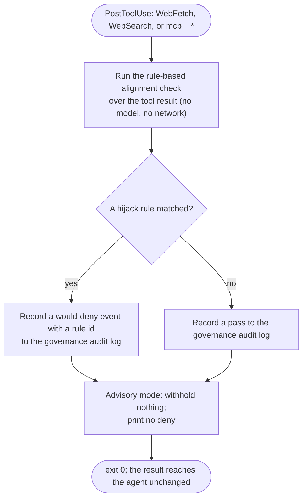
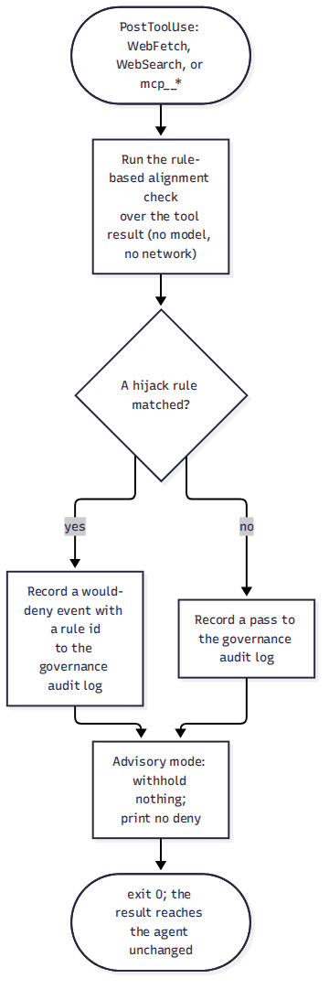

# spec-hooks-goal-guard

## Metadata

| Field | Value |
|---|---|
| **Feature** | Goal-hijack guardrail: a rule-based, advisory-first alignment check on tool results |
| **Parent feature** | spec-hooks-platform.md |
| **Sub-features** | None |
| **Requirement refs** | BR-018, UR-062, FR-219, FR-238, NFR-026, NFR-027, NFR-035 |
| **Feature type** | Functionality |
| **Status** | Review |

Status values: Draft, Review, Approved, Implemented.

Paths that start with `hooks/` are relative to `plugins/assist-plugin/`. This spec describes planned behavior for harness-governance Tranche 2 (task plan `docs/task-plans/task-plan-harness-governance-20261028-0759.md`, Step 19); nothing here is built. It traces to FR-NFR-harness-governance.md v1.3 (2026-10-30).

## Description

`goal-guard` is a PostToolUse hook on `WebFetch`, `WebSearch`, and `mcp__*` that runs a rule-based alignment check over a tool result. The check looks for text that tries to redirect the agent from the user's stated goal, for example a fetched page that tells the agent to send repository files to a URL. In Tranche 2 the hook ships advisory-only: when a rule matches, it records a would-deny event with a rule id to the governance audit log and withholds nothing; when nothing matches, it records a pass. The check is rule-based and calls no model, by deliberate choice, because it reads attacker-controlled text and a model-evaluating hook would itself be a prompt-injection surface (`DECISIONS.md`, 2026-10-30, "Build-time open items resolved (PN-1, PN-7, Step 18, Step 34, Step 3 binding)", D-13).

The existing `injection-filter` replaces injection phrasing with a marker and never blocks (spec-hooks-injection-filter.md); `goal-guard` adds a separate, deny-capable alignment layer and does not change `injection-filter`. Promotion from advisory to blocking is task plan Step 36 (Tranche 4), governed by the advisory-baseline-first gate of FR-238 and the severity policy, and is out of scope for this spec. The hook registration and counts are in spec-hooks-platform.md (Change Log 2026-11-06); the audit log that holds the would-deny and pass records is in spec-hooks-audit.md.

## Triggered by

| Trigger type | Source | Condition |
|---|---|---|
| Event | PostToolUse, matcher `WebFetch\|WebSearch\|mcp__.*` (spec-hooks-platform.md, Change Log 2026-11-06; the matcher string is proposed, task plan Step 19 naming the events) | Every result of a `WebFetch`, `WebSearch`, or `mcp__*` tool call |

## Required data

| Data | Source | Type | Notes |
|---|---|---|---|
| Tool result | Hook input `tool_response` | Text | The attacker-controlled text the check reads |
| User goal | The source the `UserPromptSubmit` hook sees (directional, task plan Step 19, Notes) | Text | How the check learns the goal is a build-time confirmation; advisory mode needs no withhold |
| Hijack rules | `hooks/lib/hijack-rules.js` | Rule catalog | Built in the style of `hooks/lib/injection-rules.js` |

## Preconditions

| Condition | Check | If not met |
|---|---|---|
| The result is a `WebFetch`, `WebSearch`, or `mcp__*` result | Matcher and `tool_name` | Not judged |
| Platform preconditions | spec-hooks-platform.md | Fail open |

## Algorithmic steps

Start-to-end flow of one advisory check. Source: [spec-hooks-goal-guard-flow.mmd](spec-hooks-goal-guard-flow.mmd).

**Note:** Rendered on 2026-11-06 with `mmdc -i specs/spec-hooks-goal-guard-flow.mmd -o specs/spec-hooks-goal-guard-flow.png`. The `.mmd` source is the record; re-render it after any edit.

### Requirement: Advisory alignment check on tool results

The `goal-guard` hook SHALL run a rule-based alignment check over a `WebFetch`, `WebSearch`, or `mcp__*` result and, in advisory mode, SHALL record a would-deny event with a rule id to the governance audit log when a rule finds that the result tries to redirect the agent from the user's stated goal, and a pass record otherwise, and SHALL withhold nothing from the agent.

**Requirement refs:** FR-219, FR-238, NFR-026, UR-062 | **Status:** Planned (harness-governance Tranche 2) | **Source:** FR-NFR-harness-governance.md v1.3, FR-219 (section 2.6), FR-238 (section 2.25, advisory run); task plan Step 19 (`hooks/goal-guard.js`, `hooks/impl/goal-guard.js`, PostToolUse on `WebFetch`, `WebSearch`, and `mcp__*`)

In advisory mode the hook records a finding and does not block (FR-238). The design of the deny path and the withholding of a result are confirmed against current hooks documentation before Step 36 promotes the rule; advisory mode needs no withhold (task plan Step 19, Notes). FR-219 is a `Should` requirement.

#### Scenario: Hijack would-deny recorded

- **GIVEN** the user's goal is "summarize this page" and a fetched page tells the agent to send repository files to a URL
- **WHEN** the WebFetch result reaches the hook in advisory mode
- **THEN** the audit log SHALL hold a would-deny event with a rule id
- **AND** the hook SHALL pass the result to the agent unchanged

#### Scenario: Benign result passes

- **GIVEN** a fetched page holds only documentation text
- **WHEN** the result reaches the hook
- **THEN** the hook SHALL pass the result unchanged
- **AND** the audit log SHALL hold a pass record

### Requirement: Rule-based, no model call

The `goal-guard` alignment check SHALL be rule-based, loading its rules from `hooks/lib/hijack-rules.js`, and SHALL import no model client and make no network call.

**Requirement refs:** FR-219, NFR-027 | **Status:** Planned (harness-governance Tranche 2) | **Source:** FR-NFR-harness-governance.md v1.3, FR-219 (section 2.6, "MUST be rule-based ... and MUST NOT call a model"); `DECISIONS.md`, 2026-10-30, "Build-time open items resolved (PN-1, PN-7, Step 18, Step 34, Step 3 binding)" (D-13); task plan Step 19

The check reads attacker-controlled text (a PR, a web page, a tool result), so a model-evaluating hook would itself be an injection surface; the rule-based choice is deliberate and may be revisited only after the FR-238 baseline (task plan Step 19, Notes; the hook facts cited there are directional).

#### Scenario: No model client

- **GIVEN** the `goal-guard` implementation and its rule library
- **WHEN** a test inspects them
- **THEN** they SHALL import no model client and SHALL make no network call

### Requirement: No write tools and no new grant

The `goal-guard` hook SHALL hold no write tools, and its addition SHALL introduce no new unscoped `Bash` grant.

**Requirement refs:** NFR-027, FR-219 | **Status:** Planned (harness-governance Tranche 2) | **Source:** FR-NFR-harness-governance.md v1.3, NFR-027 (section 3.2); task plan Step 19 (the guardrail holds no write tools)

#### Scenario: Guardrail holds no write tools

- **GIVEN** the `goal-guard` hook
- **WHEN** a reviewer reads its implementation and the registration
- **THEN** it SHALL neither write files nor add an unscoped `Bash` grant

### Requirement: Fails open and records to the audit log

The `goal-guard` hook SHALL fail open: when the check throws, times out, or cannot read its rules, it SHALL record the failure in `hook-health.jsonl` and withhold nothing, and each would-deny and pass record SHALL carry a rule id to the governance audit log.

**Requirement refs:** NFR-026, FR-219, NFR-035 | **Status:** Planned (harness-governance Tranche 2) | **Source:** FR-NFR-harness-governance.md v1.3, NFR-026 (section 3.2); task plan Step 19 (an explicit short `timeout` in `hooks.json` for the NFR-029 budget; the self-test corpus with a hijack sample and a benign sample)

The hook ships a self-test corpus with a known hijack sample and a known benign sample, reported through `/assist-plugin:health` (NFR-035; spec-hooks-health-check.md). The records reach the chain of spec-hooks-audit.md.

#### Scenario: Check error withholds nothing

- **GIVEN** the alignment check throws while reading a result
- **WHEN** the hook returns
- **THEN** the hook SHALL record the failure in `hook-health.jsonl`
- **AND** the result SHALL reach the agent unchanged

## Business rules

| Rule ID | Rule | Traces to | Applied at |
|---|---|---|---|
| RULE-001 | Advisory mode records and withholds nothing | FR-219, FR-238 | Requirement: Advisory alignment check on tool results |
| RULE-002 | The check is rule-based and calls no model | FR-219 | Requirement: Rule-based, no model call |
| RULE-003 | The guardrail holds no write tools and adds no new grant | NFR-027 | Requirement: No write tools and no new grant |
| RULE-004 | The hook fails open; records carry a rule id | NFR-026 | Requirement: Fails open and records to the audit log |

## Data transformations

| Input | Transformation | Output | Notes |
|---|---|---|---|
| Tool result text | Rule-based alignment match | Match or no match | `hooks/lib/hijack-rules.js` |
| Match or no match | Record with a rule id | A would-deny or pass record in the audit log | Advisory mode withholds nothing |

## Output / Outcome

| Output | Type | Description |
|---|---|---|
| Would-deny record | Audit log line | A rule matched; advisory mode withholds nothing |
| Pass record | Audit log line | No rule matched |
| No stdout | Exit 0 | The result reaches the agent unchanged in advisory mode |

## Error handling

| Error condition | Handling strategy | Outcome |
|---|---|---|
| Check throws, times out, or cannot read its rules | Platform failure path; record in `hook-health.jsonl` | Withhold nothing; the result proceeds |
| Audit-log append fails | Record the failure in `hook-health.jsonl` | The result proceeds; no would-deny or pass record is stored |

## Events emitted

| Event name | Payload | Consumer(s) | When emitted |
|---|---|---|---|
| Would-deny record | Rule id, tool name | Chain verification; control-evidence export (task plan Step 29, Tranche 3) | A hijack rule matched |
| Pass record | Tool name | Same | No rule matched |

## Events consumed

| Event name | Producer | Payload used | Handling |
|---|---|---|---|
| PostToolUse (`WebFetch`, `WebSearch`, `mcp__*`) | Claude Code | `tool_response` | Alignment check, advisory record |

## Sub-feature breakdown

Not applicable: a leaf feature of spec-hooks-platform.md.

## Performance considerations

| Concern | Target | Approach |
|---|---|---|
| Per-call cost (NFR-029) | Within the per-hook median budget | An explicit short `timeout` in `hooks.json`; a rule-match pass over the result, no model and no network |

## Traceability

| Requirement | Spec section | Verified by |
|---|---|---|
| FR-219, FR-238 | Requirement: Advisory alignment check on tool results | Hijack sample records a would-deny and passes the result; benign sample records a pass (`tests/hooks/goal-guard.test.js`, task plan Step 20) |
| FR-219 | Requirement: Rule-based, no model call | The hook imports no model client and makes no network call (asserted in the test) |
| NFR-027 | Requirement: No write tools and no new grant | Tool review; no new `Bash` grant in the registration |
| NFR-026, NFR-035 | Requirement: Fails open and records to the audit log | A check error withholds nothing and records the failure; the self-test corpus reports through `/assist-plugin:health` |

## Change Log: 2026-11-06

**Source:** FR-NFR-harness-governance.md v1.3 (2026-10-30), FR-219 (section 2.6), FR-238 (section 2.25), NFR-026 (section 3.2); task plan `docs/task-plans/task-plan-harness-governance-20261028-0759.md`, Step 19; the as-built advisory-record behavior of the harness-governance Tranche 2 build (shipped and gate-approved), which a loose line of this spec misworded. This entry reconciles the record-fields wording to that build and records the advisory-recall reassessment items. It adds no new requirement, so the change is Planned (harness-governance Tranche 2) and matches what shipped. This spec received a reconciliation delta, so its Status moves to `Review` (delta rule 6, no same-turn user approval).

### Direct edits in this pass (no behavior change)

- Status: Draft -> Review.

### Body text this entry supersedes (applied at the next fold)

- Description preamble: the sentence "This spec describes planned behavior for harness-governance Tranche 2 ...; nothing here is built" is superseded by the shipped, gate-approved harness-governance Tranche 2 build that this entry reconciles to. At the next fold the preamble reads as built; the Status stays `Review` until then, not `Implemented`.
- Events emitted: the Would-deny record row reads "Rule id, rule family, rule count (`rule_count`), tool name, agent identity" and the Pass record row reads "Tool name, agent identity" (no rule id).
- Data transformations, the "Match or no match" row: a would-deny record carries the rule id, rule family, count of matching rules (`rule_count`), tool name, and agent identity; a pass record carries the tool name and agent identity and no rule id.

### ADDED Requirements

None.

### MODIFIED Requirements

#### Requirement: Fails open and records to the audit log

**Was:** The `goal-guard` hook SHALL fail open: when the check throws, times out, or cannot read its rules, it SHALL record the failure in `hook-health.jsonl` and withhold nothing, and each would-deny and pass record SHALL carry a rule id to the governance audit log.

**Now:** The `goal-guard` hook SHALL fail open: when the check throws, times out, or cannot read its rules, it SHALL record the failure in `hook-health.jsonl` and withhold nothing; a would-deny record SHALL carry a rule id, the rule family, the count of matching rules (`rule_count`), the tool name, and the agent identity to the governance audit log, and a pass record SHALL carry the tool name and the agent identity and no rule id.

**Reason:** The loose clause "each would-deny and pass record SHALL carry a rule id" contradicted this spec's own record-fields table (Events emitted), where a pass record holds the tool name only. As built the would-deny record is fuller than the table first stated: it carries the rule family, the count of matching rules (`rule_count`), and the agent identity besides the rule id and tool name, and the pass record carries the tool name and the agent identity. This reconciles the statement to the record-fields table and to the build.

**Requirement refs:** NFR-026, FR-219, NFR-035 | **Status:** Planned (harness-governance Tranche 2); matches the shipped build

##### Scenario: Pass record carries no rule id

- **GIVEN** a `WebFetch` result that matches no hijack rule
- **WHEN** the hook records a pass to the governance audit log
- **THEN** the pass record SHALL hold the tool name and the agent identity
- **AND** the pass record SHALL NOT hold a rule id

##### Scenario: Would-deny record carries the rule id and family

- **GIVEN** a `WebFetch` result that matches a hijack rule in advisory mode
- **WHEN** the hook records a would-deny event
- **THEN** the would-deny record SHALL hold the rule id, the rule family, the count of matching rules (`rule_count`), the tool name, and the agent identity

### REMOVED Requirements

None.

### Advisory-recall reassessment items (Tranche 4 / task plan Step 36)

The build documents these recall limits in the rule library. They are known limits of the advisory baseline, not defects, and are carried for reassessment when Step 36 promotes the rule from advisory to blocking (FR-238):

- The scan reads the head (about 150 KB) and the tail (about 50 KB) of a tool result, so a hijack placed in the middle of a result larger than about 200 KB can be missed.
- The scan-window overlap can miss a long match that straddles a window boundary.
- The discussion and quote carve-out now excludes modal verbs, so `you must ignore ...` is caught, but it still exempts the `to`-marked phrasings (`you need to ignore ...`, `you have to ignore ...`) and does not match `disregard your rules` without a `previous|prior|system|...` qualifier.

### Traceability added

| Requirement | Spec section | Verified by |
|---|---|---|
| NFR-026 | Change Log 2026-11-06: Requirement: Fails open and records to the audit log | A pass record holds the tool name and agent identity and no rule id; a would-deny record holds the rule id, rule family, count of matching rules (`rule_count`), tool name, and agent identity (`tests/hooks/goal-guard.test.js`) |
| FR-238 | Change Log 2026-11-06: Advisory-recall reassessment items | The head and tail scan cap, the window-overlap gap, and the carve-out phrasings are recorded for the Step 36 promotion reassessment |
