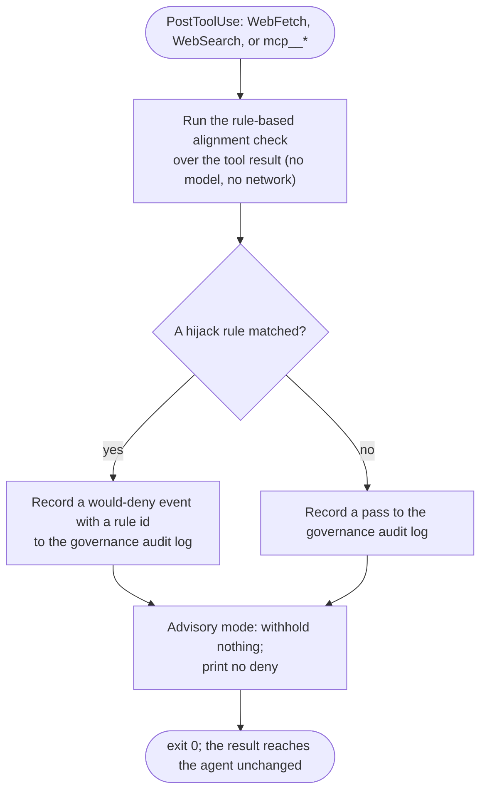
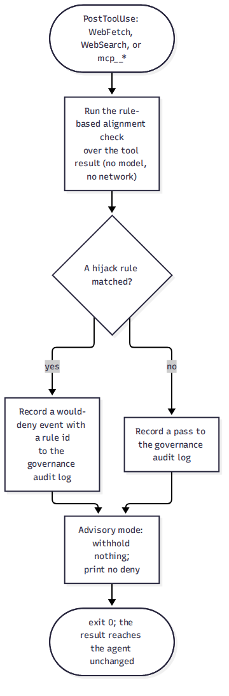

# spec-hooks-goal-guard

## Metadata

| Field | Value |
|---|---|
| **Feature** | Goal-hijack guardrail: a rule-based, advisory-first alignment check on tool results |
| **Parent feature** | spec-hooks-platform.md |
| **Sub-features** | None |
| **Requirement refs** | BR-018, UR-062, FR-219, FR-238, NFR-026, NFR-027, NFR-028 (blocking mode, per `DECISIONS.md` 2026-11-13), NFR-034, NFR-035 |
| **Feature type** | Functionality |
| **Status** | Review |

Status values: Draft, Review, Approved, Implemented.

Paths that start with `hooks/` are relative to `plugins/assist-plugin/`. This spec describes planned behavior for harness-governance Tranche 2 (task plan `docs/task-plans/task-plan-harness-governance-20261028-0759.md`, Step 19); nothing here is built. It traces to FR-NFR-harness-governance.md v1.3 (2026-10-30).

## Description

`goal-guard` is a PostToolUse hook on `WebFetch`, `WebSearch`, and `mcp__*` that runs a rule-based alignment check over a tool result. The check looks for text that tries to redirect the agent from the user's stated goal, for example a fetched page that tells the agent to send repository files to a URL. In Tranche 2 the hook ships advisory-only: when a rule matches, it records a would-deny event with a rule id to the governance audit log and withholds nothing; when nothing matches, it records a pass. The check is rule-based and calls no model, by deliberate choice, because it reads attacker-controlled text and a model-evaluating hook would itself be a prompt-injection surface (`DECISIONS.md`, 2026-10-30, "Build-time open items resolved (PN-1, PN-7, Step 18, Step 34, Step 3 binding)", D-13).

The existing `injection-filter` replaces injection phrasing with a marker and never blocks (spec-hooks-injection-filter.md); `goal-guard` adds a separate, deny-capable alignment layer and does not change `injection-filter`. Promotion from advisory to blocking is task plan Step 36 (Tranche 4), governed by the advisory-baseline-first gate of FR-238 and the severity policy, and is out of scope for this spec. The hook registration and counts are in spec-hooks-platform.md (Change Log 2026-11-06); the audit log that holds the would-deny and pass records is in spec-hooks-audit.md.

## Triggered by

| Trigger type | Source | Condition |
|---|---|---|
| Event | PostToolUse, matcher `WebFetch\|WebSearch\|mcp__.*` (spec-hooks-platform.md, Change Log 2026-11-06; the matcher string is proposed, task plan Step 19 naming the events) | Every result of a `WebFetch`, `WebSearch`, or `mcp__*` tool call |

## Required data

| Data | Source | Type | Notes |
|---|---|---|---|
| Tool result | Hook input `tool_response` | Text | The attacker-controlled text the check reads |
| User goal | The source the `UserPromptSubmit` hook sees (directional, task plan Step 19, Notes) | Text | How the check learns the goal is a build-time confirmation; advisory mode needs no withhold |
| Hijack rules | `hooks/lib/hijack-rules.js` | Rule catalog | Built in the style of `hooks/lib/injection-rules.js` |

## Preconditions

| Condition | Check | If not met |
|---|---|---|
| The result is a `WebFetch`, `WebSearch`, or `mcp__*` result | Matcher and `tool_name` | Not judged |
| Platform preconditions | spec-hooks-platform.md | Fail open |

## Algorithmic steps

Start-to-end flow of one advisory check. Source: [spec-hooks-goal-guard-flow.mmd](spec-hooks-goal-guard-flow.mmd).

**Note:** Rendered on 2026-11-06 with `mmdc -i specs/spec-hooks-goal-guard-flow.mmd -o specs/spec-hooks-goal-guard-flow.png`. The `.mmd` source is the record; re-render it after any edit.

### Requirement: Advisory alignment check on tool results

The `goal-guard` hook SHALL run a rule-based alignment check over a `WebFetch`, `WebSearch`, or `mcp__*` result and, in advisory mode, SHALL record a would-deny event with a rule id to the governance audit log when a rule finds that the result tries to redirect the agent from the user's stated goal, and a pass record otherwise, and SHALL withhold nothing from the agent.

**Requirement refs:** FR-219, FR-238, NFR-026, UR-062 | **Status:** Planned (harness-governance Tranche 2) | **Source:** FR-NFR-harness-governance.md v1.3, FR-219 (section 2.6), FR-238 (section 2.25, advisory run); task plan Step 19 (`hooks/goal-guard.js`, `hooks/impl/goal-guard.js`, PostToolUse on `WebFetch`, `WebSearch`, and `mcp__*`)

In advisory mode the hook records a finding and does not block (FR-238). The design of the deny path and the withholding of a result are confirmed against current hooks documentation before Step 36 promotes the rule; advisory mode needs no withhold (task plan Step 19, Notes). FR-219 is a `Should` requirement.

#### Scenario: Hijack would-deny recorded

- **GIVEN** the user's goal is "summarize this page" and a fetched page tells the agent to send repository files to a URL
- **WHEN** the WebFetch result reaches the hook in advisory mode
- **THEN** the audit log SHALL hold a would-deny event with a rule id
- **AND** the hook SHALL pass the result to the agent unchanged

#### Scenario: Benign result passes

- **GIVEN** a fetched page holds only documentation text
- **WHEN** the result reaches the hook
- **THEN** the hook SHALL pass the result unchanged
- **AND** the audit log SHALL hold a pass record

### Requirement: Rule-based, no model call

The `goal-guard` alignment check SHALL be rule-based, loading its rules from `hooks/lib/hijack-rules.js`, and SHALL import no model client and make no network call.

**Requirement refs:** FR-219, NFR-027 | **Status:** Planned (harness-governance Tranche 2) | **Source:** FR-NFR-harness-governance.md v1.3, FR-219 (section 2.6, "MUST be rule-based ... and MUST NOT call a model"); `DECISIONS.md`, 2026-10-30, "Build-time open items resolved (PN-1, PN-7, Step 18, Step 34, Step 3 binding)" (D-13); task plan Step 19

The check reads attacker-controlled text (a PR, a web page, a tool result), so a model-evaluating hook would itself be an injection surface; the rule-based choice is deliberate and may be revisited only after the FR-238 baseline (task plan Step 19, Notes; the hook facts cited there are directional).

#### Scenario: No model client

- **GIVEN** the `goal-guard` implementation and its rule library
- **WHEN** a test inspects them
- **THEN** they SHALL import no model client and SHALL make no network call

### Requirement: No write tools and no new grant

The `goal-guard` hook SHALL hold no write tools, and its addition SHALL introduce no new unscoped `Bash` grant.

**Requirement refs:** NFR-027, FR-219 | **Status:** Planned (harness-governance Tranche 2) | **Source:** FR-NFR-harness-governance.md v1.3, NFR-027 (section 3.2); task plan Step 19 (the guardrail holds no write tools)

#### Scenario: Guardrail holds no write tools

- **GIVEN** the `goal-guard` hook
- **WHEN** a reviewer reads its implementation and the registration
- **THEN** it SHALL neither write files nor add an unscoped `Bash` grant

### Requirement: Fails open and records to the audit log

The `goal-guard` hook SHALL fail open: when the check throws, times out, or cannot read its rules, it SHALL record the failure in `hook-health.jsonl` and withhold nothing, and each would-deny and pass record SHALL carry a rule id to the governance audit log.

**Requirement refs:** NFR-026, FR-219, NFR-035 | **Status:** Planned (harness-governance Tranche 2) | **Source:** FR-NFR-harness-governance.md v1.3, NFR-026 (section 3.2); task plan Step 19 (an explicit short `timeout` in `hooks.json` for the NFR-029 budget; the self-test corpus with a hijack sample and a benign sample)

The hook ships a self-test corpus with a known hijack sample and a known benign sample, reported through `/assist-plugin:health` (NFR-035; spec-hooks-health-check.md). The records reach the chain of spec-hooks-audit.md.

#### Scenario: Check error withholds nothing

- **GIVEN** the alignment check throws while reading a result
- **WHEN** the hook returns
- **THEN** the hook SHALL record the failure in `hook-health.jsonl`
- **AND** the result SHALL reach the agent unchanged

## Business rules

| Rule ID | Rule | Traces to | Applied at |
|---|---|---|---|
| RULE-001 | Advisory mode records and withholds nothing | FR-219, FR-238 | Requirement: Advisory alignment check on tool results |
| RULE-002 | The check is rule-based and calls no model | FR-219 | Requirement: Rule-based, no model call |
| RULE-003 | The guardrail holds no write tools and adds no new grant | NFR-027 | Requirement: No write tools and no new grant |
| RULE-004 | The hook fails open; records carry a rule id | NFR-026 | Requirement: Fails open and records to the audit log |

## Data transformations

| Input | Transformation | Output | Notes |
|---|---|---|---|
| Tool result text | Rule-based alignment match | Match or no match | `hooks/lib/hijack-rules.js` |
| Match or no match | Record with a rule id | A would-deny or pass record in the audit log | Advisory mode withholds nothing |

## Output / Outcome

| Output | Type | Description |
|---|---|---|
| Would-deny record | Audit log line | A rule matched; advisory mode withholds nothing |
| Pass record | Audit log line | No rule matched |
| No stdout | Exit 0 | The result reaches the agent unchanged in advisory mode |

## Error handling

| Error condition | Handling strategy | Outcome |
|---|---|---|
| Check throws, times out, or cannot read its rules | Platform failure path; record in `hook-health.jsonl` | Withhold nothing; the result proceeds |
| Audit-log append fails | Record the failure in `hook-health.jsonl` | The result proceeds; no would-deny or pass record is stored |

## Events emitted

| Event name | Payload | Consumer(s) | When emitted |
|---|---|---|---|
| Would-deny record | Rule id, tool name | Chain verification; control-evidence export (task plan Step 29, Tranche 3) | A hijack rule matched |
| Pass record | Tool name | Same | No rule matched |

## Events consumed

| Event name | Producer | Payload used | Handling |
|---|---|---|---|
| PostToolUse (`WebFetch`, `WebSearch`, `mcp__*`) | Claude Code | `tool_response` | Alignment check, advisory record |

## Sub-feature breakdown

Not applicable: a leaf feature of spec-hooks-platform.md.

## Performance considerations

| Concern | Target | Approach |
|---|---|---|
| Per-call cost (NFR-029) | Within the per-hook median budget | An explicit short `timeout` in `hooks.json`; a rule-match pass over the result, no model and no network |

## Traceability

| Requirement | Spec section | Verified by |
|---|---|---|
| FR-219, FR-238 | Requirement: Advisory alignment check on tool results | Hijack sample records a would-deny and passes the result; benign sample records a pass (`tests/hooks/goal-guard.test.js`, task plan Step 20) |
| FR-219 | Requirement: Rule-based, no model call | The hook imports no model client and makes no network call (asserted in the test) |
| NFR-027 | Requirement: No write tools and no new grant | Tool review; no new `Bash` grant in the registration |
| NFR-026, NFR-035 | Requirement: Fails open and records to the audit log | A check error withholds nothing and records the failure; the self-test corpus reports through `/assist-plugin:health` |

## Change Log: 2026-11-06

**Source:** FR-NFR-harness-governance.md v1.3 (2026-10-30), FR-219 (section 2.6), FR-238 (section 2.25), NFR-026 (section 3.2); task plan `docs/task-plans/task-plan-harness-governance-20261028-0759.md`, Step 19; the as-built advisory-record behavior of the harness-governance Tranche 2 build (shipped and gate-approved), which a loose line of this spec misworded. This entry reconciles the record-fields wording to that build and records the advisory-recall reassessment items. It adds no new requirement, so the change is Planned (harness-governance Tranche 2) and matches what shipped. This spec received a reconciliation delta, so its Status moves to `Review` (delta rule 6, no same-turn user approval).

### Direct edits in this pass (no behavior change)

- Status: Draft -> Review.

### Body text this entry supersedes (applied at the next fold)

- Description preamble: the sentence "This spec describes planned behavior for harness-governance Tranche 2 ...; nothing here is built" is superseded by the shipped, gate-approved harness-governance Tranche 2 build that this entry reconciles to. At the next fold the preamble reads as built; the Status stays `Review` until then, not `Implemented`.
- Events emitted: the Would-deny record row reads "Rule id, rule family, rule count (`rule_count`), tool name, agent identity" and the Pass record row reads "Tool name, agent identity" (no rule id).
- Data transformations, the "Match or no match" row: a would-deny record carries the rule id, rule family, count of matching rules (`rule_count`), tool name, and agent identity; a pass record carries the tool name and agent identity and no rule id.

### ADDED Requirements

None.

### MODIFIED Requirements

#### Requirement: Fails open and records to the audit log

**Was:** The `goal-guard` hook SHALL fail open: when the check throws, times out, or cannot read its rules, it SHALL record the failure in `hook-health.jsonl` and withhold nothing, and each would-deny and pass record SHALL carry a rule id to the governance audit log.

**Now:** The `goal-guard` hook SHALL fail open: when the check throws, times out, or cannot read its rules, it SHALL record the failure in `hook-health.jsonl` and withhold nothing; a would-deny record SHALL carry a rule id, the rule family, the count of matching rules (`rule_count`), the tool name, and the agent identity to the governance audit log, and a pass record SHALL carry the tool name and the agent identity and no rule id.

**Reason:** The loose clause "each would-deny and pass record SHALL carry a rule id" contradicted this spec's own record-fields table (Events emitted), where a pass record holds the tool name only. As built the would-deny record is fuller than the table first stated: it carries the rule family, the count of matching rules (`rule_count`), and the agent identity besides the rule id and tool name, and the pass record carries the tool name and the agent identity. This reconciles the statement to the record-fields table and to the build.

**Requirement refs:** NFR-026, FR-219, NFR-035 | **Status:** Planned (harness-governance Tranche 2); matches the shipped build

##### Scenario: Pass record carries no rule id

- **GIVEN** a `WebFetch` result that matches no hijack rule
- **WHEN** the hook records a pass to the governance audit log
- **THEN** the pass record SHALL hold the tool name and the agent identity
- **AND** the pass record SHALL NOT hold a rule id

##### Scenario: Would-deny record carries the rule id and family

- **GIVEN** a `WebFetch` result that matches a hijack rule in advisory mode
- **WHEN** the hook records a would-deny event
- **THEN** the would-deny record SHALL hold the rule id, the rule family, the count of matching rules (`rule_count`), the tool name, and the agent identity

### REMOVED Requirements

None.

### Advisory-recall reassessment items (Tranche 4 / task plan Step 36)

The build documents these recall limits in the rule library. They are known limits of the advisory baseline, not defects, and are carried for reassessment when Step 36 promotes the rule from advisory to blocking (FR-238):

- The scan reads the head (about 150 KB) and the tail (about 50 KB) of a tool result, so a hijack placed in the middle of a result larger than about 200 KB can be missed.
- The scan-window overlap can miss a long match that straddles a window boundary.
- The discussion and quote carve-out now excludes modal verbs, so `you must ignore ...` is caught, but it still exempts the `to`-marked phrasings (`you need to ignore ...`, `you have to ignore ...`) and does not match `disregard your rules` without a `previous|prior|system|...` qualifier.

### Traceability added

| Requirement | Spec section | Verified by |
|---|---|---|
| NFR-026 | Change Log 2026-11-06: Requirement: Fails open and records to the audit log | A pass record holds the tool name and agent identity and no rule id; a would-deny record holds the rule id, rule family, count of matching rules (`rule_count`), tool name, and agent identity (`tests/hooks/goal-guard.test.js`) |
| FR-238 | Change Log 2026-11-06: Advisory-recall reassessment items | The head and tail scan cap, the window-overlap gap, and the carve-out phrasings are recorded for the Step 36 promotion reassessment |

## Change Log: 2026-11-13 (Tranche 4)

**Source:** FR-NFR-harness-governance.md v1.3 (2026-10-30): FR-219 (section 2.6), FR-238 (section 2.25), FR-239 (section 2.26), NFR-034 (section 3.5); task plan `docs/task-plans/task-plan-harness-governance-20261028-0759.md`, Tranche 4 Step 32 (the rule-mode store, `route(finding)`, the baseline, and the promotion check) and Step 36 (promote FR-219 and FR-220 to blocking after the baseline); `DECISIONS.md`, 2026-10-31, "Severity policy approved". Harness-governance Tranche 4 is not built yet, so every change here is Planned (harness-governance Tranche 4). This spec received a delta, so its Status stays `Review` (delta rule 6, no same-turn approval). The severity-routing mechanism this entry ties `goal-guard` to (`route(finding)`, the rule-mode store, the advisory baseline, and the promotion gate) is specified in spec-hooks-code-scan.md; this entry only binds `goal-guard`'s advisory-or-blocking mode to it and records that this release enables no blocking.

### Direct edits in this pass (no behavior change)

- Requirement refs: FR-239 and NFR-034 added. FR-219 and FR-238 are already present.

### Body text this entry supersedes (applied at the next fold)

- Description, the sentence "Promotion from advisory to blocking is task plan Step 36 (Tranche 4), governed by the advisory-baseline-first gate of FR-238 and the severity policy, and is out of scope for this spec": now reads that the advisory-or-blocking mode of `goal-guard` is read from the rule-mode store `.agent/governance/rule-modes.json` (advisory when absent or malformed), and that promotion to blocking is the user-run `scripts/promote-rule.js` of task plan Step 36, built on the mechanism in spec-hooks-code-scan.md and governed by FR-238 and NFR-034; this release enables no blocking.

### ADDED Requirements

#### Requirement: Mode read from the rule-mode store, promotion disabled this release

The `goal-guard` hook SHALL read its advisory-or-blocking mode from the rule-mode store `.agent/governance/rule-modes.json`, treating an absent or malformed store as advisory and never failing open into blocking, and SHALL stay advisory this release; a switch to blocking SHALL be only the user-run `scripts/promote-rule.js` of task plan Step 36, which the advisory baseline and the precision bar gate (FR-238, NFR-034).

**Requirement refs:** FR-219, FR-238, NFR-034 | **Status:** Planned (harness-governance Tranche 4) | **Source:** FR-NFR-harness-governance.md v1.3, FR-219 (section 2.6), FR-238 (section 2.25); task plan Step 32 (the rule-mode store and the promotion check) and Step 36 (promotion is a user-run operation; this release builds the mechanism only and enables no blocking); spec-hooks-code-scan.md, Requirement: Rule-mode store governs advisory versus blocking and Requirement: Promotion gate

`goal-guard` is the first of the two rules that the Tranche 4 severity-routing mechanism governs (the insecure-code scan of FR-220 is the second; spec-hooks-code-scan.md). Its mode comes from the shared rule-mode store, so no `goal-guard`-specific toggle exists. The fail-open-into-advisory default means a missing or corrupt store never turns `goal-guard` blocking. Before the Step 36 switch, the `PostToolUse` output shape that withholds a result is confirmed against current hooks documentation (the open build-time item of the Description), because advisory mode withholds nothing and so never exercises it. FR-219 is not a member of the NFR-028 security-critical class (NFR-028 names FR-214, FR-217, FR-220, FR-223, FR-231, FR-233, and FR-246), so `goal-guard` fails open on an evaluation error in advisory mode and after promotion alike.

##### Scenario: Absent store keeps goal-guard advisory

- **GIVEN** `.agent/governance/rule-modes.json` does not exist
- **WHEN** a `WebFetch` result that matches a hijack rule reaches the hook
- **THEN** the hook SHALL record a would-deny event and withhold nothing, because the mode is advisory

##### Scenario: Promotion is user-run and off this release

- **GIVEN** the mechanism is built and no user has run `promote-rule.js`
- **WHEN** a hijack-matching result reaches `goal-guard`
- **THEN** the hook SHALL stay advisory and withhold nothing, because this release enables no blocking

### MODIFIED Requirements

#### Requirement: Advisory alignment check on tool results

**Was:** The `goal-guard` hook SHALL run a rule-based alignment check over a `WebFetch`, `WebSearch`, or `mcp__*` result and, in advisory mode, SHALL record a would-deny event with a rule id to the governance audit log when a rule finds that the result tries to redirect the agent from the user's stated goal, and a pass record otherwise, and SHALL withhold nothing from the agent.

**Now:** The `goal-guard` hook SHALL run a rule-based alignment check over a `WebFetch`, `WebSearch`, or `mcp__*` result and, while its mode in the rule-mode store is advisory (the default, including an absent or malformed store), SHALL record a would-deny event with a rule id to the governance audit log when a rule finds that the result tries to redirect the agent from the user's stated goal, and a pass record otherwise, and SHALL withhold nothing from the agent.

**Reason:** FR-238 and task plan Step 32: the advisory-or-blocking mode of each check is read from the rule-mode store, and the advisory default (an absent or malformed store) is the safe direction. The record behavior is unchanged; the clause only names the store as the source of the advisory mode.

**Requirement refs:** FR-219, FR-238, NFR-026, UR-062 | **Status:** Planned (harness-governance Tranche 4); the advisory record behavior matches the shipped Tranche 2 build

The scenarios Hijack would-deny recorded and Benign result passes are unchanged.

### REMOVED Requirements

None.

### Traceability added

| Requirement | Spec section | Verified by |
|---|---|---|
| FR-219, FR-238 | Change Log 2026-11-13 (Tranche 4): Requirement: Mode read from the rule-mode store, promotion disabled this release | An absent rule-mode store keeps `goal-guard` advisory; no blocking is enabled without a user-run `promote-rule.js` (`tests/hooks/goal-guard.test.js`, `tests/scripts/promote-rule.test.js`, task plan Step 37) |
| NFR-034 | Change Log 2026-11-13 (Tranche 4): Requirement: Mode read from the rule-mode store, promotion disabled this release | A promotion of `goal-guard` is refused below 90% precision (spec-hooks-code-scan.md, Requirement: Promotion gate) |

## Change Log: 2026-11-13 (Tranche 5)

**Source:** FR-NFR-harness-governance.md v1.3 (2026-10-30): FR-219 (section 2.6), FR-238 (section 2.25), NFR-028 (section 3.2); task plan `docs/task-plans/task-plan-harness-governance-20261028-0759.md`, Step 36 (promote FR-219 and FR-220 to blocking; "For FR-219, confirm the PostToolUse output shape that withholds a result (PN-1 note) before the switch"); `DECISIONS.md`, 2026-11-13, "Harness-governance Tranche 5 (control register) approved for build" (choice 3: the deferred FR-219 goal-guard blocking wiring, reading `.agent/governance/rule-modes.json` and the result-withhold mechanism, is built now; the runbook documents the path and performs no promotion); the Claude Code PostToolUse hook output shape, confirmed from the hooks documentation (`hookSpecificOutput.hookEventName` `"PostToolUse"` with `updatedToolOutput`; high confidence), which resolves the design this spec deferred at line 70 and line 262. This entry specifies the blocking-mode contract the advisory-only body left open; it enables no blocking (the default stays advisory, and a switch is a user-run promotion). FR-219's membership in the NFR-028 fail-closed set, in blocking mode only, rests on the user decision `DECISIONS.md`, 2026-11-13, "FR-219 (goal-guard) joins the NFR-028 fail-closed set in blocking mode". The NFR-028 enumeration in FR-NFR-harness-governance.md (section 3.2) does not list FR-219 today; it is updated to add FR-219 (blocking mode) in the Tranche 5 documentation sync (task plan Step 8), so this entry does not claim the enumeration already holds it. This spec received a delta, so its Status stays `Review` (delta rule 6, no same-turn approval).

### Direct edits in this pass (no behavior change)

- Requirement refs: NFR-028 added, for the blocking-mode fail-closed behavior this entry specifies; the basis is `DECISIONS.md`, 2026-11-13, "FR-219 (goal-guard) joins the NFR-028 fail-closed set in blocking mode". FR-219 and FR-238 are already present.

### Body text this entry supersedes (applied at the next fold)

- Description, line 70 ("The design of the deny path and the withholding of a result are confirmed against current hooks documentation before Step 36 promotes the rule"): now reads that the withhold mechanism is the Claude Code PostToolUse `updatedToolOutput` output (Requirement: Blocking-mode result withhold via PostToolUse `updatedToolOutput`), confirmed from the hooks documentation.
- Change Log 2026-11-13 (Tranche 4), Requirement: Mode read from the rule-mode store, promotion disabled this release, the clause "Before the Step 36 switch, the `PostToolUse` output shape that withholds a result is confirmed against current hooks documentation ... because advisory mode withholds nothing and so never exercises it": superseded; the output shape is confirmed and specified below, and the mode-read and withhold wiring is built this release (the Tranche 4 build left `goal-guard.js` hardcoded advisory per `DECISIONS.md`, 2026-11-13, "Harness-governance Tranche 4 ... built"; Tranche 5 wires it).
- Change Log 2026-11-13 (Tranche 4), the sentence "FR-219 is not a member of the NFR-028 security-critical class ..., so `goal-guard` fails open on an evaluation error in advisory mode and after promotion alike": the claim that FR-219 is not a member of the NFR-028 security-critical class and the "after promotion alike" clause are superseded by the user decision `DECISIONS.md`, 2026-11-13, "FR-219 (goal-guard) joins the NFR-028 fail-closed set in blocking mode" and by Requirement: Fail closed for the guarded class in blocking mode. Advisory mode still fails open; in blocking mode, a result the hook cannot finish evaluating is withheld (fail-closed for the guarded class). FR-219's `Should` priority is unchanged. The FR-NFR-harness-governance.md NFR-028 enumeration (section 3.2) is updated to add FR-219 (blocking mode) in the Tranche 5 documentation sync (task plan Step 8); until that sync lands the enumeration does not list it.
- Business rules, row RULE-004 ("The hook fails open; records carry a rule id", traced to NFR-026): now reads "The hook fails open in advisory mode; fails closed for the guarded class in blocking mode (NFR-028); records carry a rule id", and its Traces-to cell reads "NFR-026, NFR-028". The unqualified fail-open wording contradicts Requirement: Fail closed for the guarded class in blocking mode, which fails closed in blocking mode and keeps the fail-open behavior in advisory mode only.
- Requirements, Requirement: Fails open and records to the audit log (statement at line 114, and the "Now" wording of Change Log 2026-11-06): the opening clause "The `goal-guard` hook SHALL fail open: when the check throws, times out, or cannot read its rules, it SHALL record the failure in `hook-health.jsonl` and withhold nothing" is unqualified and contradicts Requirement: Fail closed for the guarded class in blocking mode. It now reads "The `goal-guard` hook SHALL fail open in advisory mode: when the check throws, times out, or cannot read its rules, it SHALL record the failure in `hook-health.jsonl` and withhold nothing; in blocking mode it SHALL fail closed for the guarded class (NFR-028), withholding a result it cannot finish evaluating through `updatedToolOutput` and recording the failure in `hook-health.jsonl`". The record-field clauses that follow in the 2026-11-06 "Now" wording (the would-deny and pass record fields) are unchanged, the requirement's Requirement refs gain NFR-028, and the heading is unchanged so existing references resolve. The advisory-mode scenario Check error withholds nothing is unchanged.
- Error handling, the first row (line 155), Outcome cell "Withhold nothing; the result proceeds": now scoped to advisory mode. The row's Error condition reads "Check throws, times out, or cannot read its rules (advisory mode)" and its Outcome stays "Withhold nothing; the result proceeds". A row is added for blocking mode: Error condition "Check throws, times out, or cannot read its rules after the hook has read the result (blocking mode)", Handling strategy "Platform failure path; record in `hook-health.jsonl`; withhold the result through `updatedToolOutput`", Outcome "The result is withheld; fail-closed for the guarded class (NFR-028)". The unqualified outcome contradicts Requirement: Fail closed for the guarded class in blocking mode, which withholds a result the hook cannot finish evaluating in blocking mode and keeps pass-through in advisory mode only.

### ADDED Requirements

#### Requirement: Blocking-mode result withhold via PostToolUse `updatedToolOutput`

While its mode in the rule-mode store `.agent/governance/rule-modes.json` is blocking, the `goal-guard` hook SHALL, on a hijack-rule match, withhold or rewrite the tool result the model sees by emitting a JSON stdout object whose `hookSpecificOutput.hookEventName` is `"PostToolUse"` and whose `updatedToolOutput` replaces the tool output, and SHALL record a deny record with the rule id to the governance audit log; an absent or malformed store SHALL keep the mode advisory and withhold nothing.

**Requirement refs:** FR-219, FR-238, NFR-028 | **Status:** Planned (harness-governance Tranche 5) | **Source:** FR-NFR-harness-governance.md v1.3, FR-219 (section 2.6, "withhold the result from the agent"), FR-238 (section 2.25); task plan Step 36; the Claude Code PostToolUse output shape (confirmed from the hooks documentation, high confidence); `DECISIONS.md`, 2026-11-13, "Harness-governance Tranche 5 (control register) approved for build" (choice 3)

The PostToolUse event fires after the tool has already executed, so the hook governs only what the model then sees, not whether the tool ran. The confirmed suppression path is `updatedToolOutput`: a `decision` of `"block"` with a `reason` appends the reason to the transcript but does not suppress the tool result, so a hijack result would still reach the model; replacing the result through `updatedToolOutput` is the mechanism that withholds or rewrites it. Withholding replaces the result with a short safe notice that names the rule id; rewriting strips the hijack span and keeps the benign remainder. The mode comes from the shared rule-mode store (spec-hooks-code-scan.md, Requirement: Rule-mode store governs advisory versus blocking); the default is advisory, and an absent, malformed, or non-promoting store never turns `goal-guard` blocking. This release wires the mode read and the `updatedToolOutput` path but performs no promotion, so `goal-guard` stays advisory until a user runs `scripts/promote-rule.js` (spec-hooks-code-scan.md, Requirement: Promotion gate).

##### Scenario: Blocking mode withholds a hijack result

- **GIVEN** the rule-mode store marks `goal-guard` blocking and a fetched page tells the agent to send repository files to a URL
- **WHEN** the `WebFetch` result reaches the hook
- **THEN** the hook SHALL emit a PostToolUse JSON object whose `updatedToolOutput` replaces the result the model sees
- **AND** the hook SHALL record a deny record with the rule id to the governance audit log

##### Scenario: A block decision alone does not suppress the result

- **GIVEN** the hook is in blocking mode on a hijack-matching result
- **WHEN** the hook forms its output
- **THEN** the hook SHALL use `updatedToolOutput` to replace the result, because a `decision` of `"block"` with a `reason` appends a reason and does not suppress the tool output

##### Scenario: Known limit, the tool has already run

- **GIVEN** a `WebFetch` whose result matches a hijack rule in blocking mode
- **WHEN** the hook runs
- **THEN** the hook SHALL govern only the result the model sees through `updatedToolOutput`
- **AND** the hook SHALL NOT be able to prevent the `WebFetch` from having run, which is a recorded limit of the PostToolUse timing

#### Requirement: Fail closed for the guarded class in blocking mode

While its mode is blocking, the `goal-guard` hook SHALL fail closed for its guarded class: when it errors or times out after reading its input on a result it cannot finish evaluating (a would-block result), it SHALL withhold that result through `updatedToolOutput` rather than pass it through; in advisory mode the hook SHALL continue to fail open and withhold nothing.

**Requirement refs:** NFR-028, FR-219 | **Status:** Planned (harness-governance Tranche 5) | **Source:** FR-NFR-harness-governance.md v1.3, NFR-028 (section 3.2, "MUST deny its own guarded operation class when it cannot evaluate because of an error or timeout"); task plan Step 36; `DECISIONS.md`, 2026-11-13, "Harness-governance Tranche 5 (control register) approved for build" (choice 3); `DECISIONS.md`, 2026-11-13, "FR-219 (goal-guard) joins the NFR-028 fail-closed set in blocking mode" (the basis for FR-219's NFR-028 membership)

FR-219 is a member of the NFR-028 fail-closed set in blocking mode only, by the explicit user decision `DECISIONS.md`, 2026-11-13, "FR-219 (goal-guard) joins the NFR-028 fail-closed set in blocking mode", which mirrors the 2026-10-30 FR-246 addition. The NFR-028 enumeration in FR-NFR-harness-governance.md (section 3.2) names FR-214, FR-217, FR-220, FR-223, FR-231, FR-233, and FR-246 and does not yet list FR-219; that enumeration is updated to add FR-219 (blocking mode) in the Tranche 5 documentation sync (task plan Step 8), so this spec does not claim the enumeration already lists it. Advisory mode is outside the NFR-028 membership and stays fail-open (NFR-026).

The guarded class is a `WebFetch`, `WebSearch`, or `mcp__*` result in blocking mode. When the hook has the result in hand but cannot complete the alignment check because it threw or hit its `timeout`, it treats the uncovered result as a would-block result and withholds it, because passing attacker-controlled text through on an evaluation failure is the unsafe direction. This fail-closed behavior is scoped to blocking mode only: in advisory mode, and before any user-run promotion, the hook withholds nothing and records the failure in `hook-health.jsonl` (Requirement: Fails open and records to the audit log, as modified 2026-11-06). The record of the failure still reaches `hook-health.jsonl`.

##### Scenario: Evaluation error in blocking mode withholds

- **GIVEN** the rule-mode store marks `goal-guard` blocking and the alignment check throws or times out after reading a `WebFetch` result
- **WHEN** the hook returns
- **THEN** the hook SHALL withhold the result through `updatedToolOutput`
- **AND** the hook SHALL record the failure in `hook-health.jsonl`

##### Scenario: Evaluation error in advisory mode passes through

- **GIVEN** the rule-mode store is absent or marks `goal-guard` advisory and the alignment check throws
- **WHEN** the hook returns
- **THEN** the hook SHALL pass the result to the agent unchanged
- **AND** the hook SHALL record the failure in `hook-health.jsonl`

### MODIFIED Requirements

#### Requirement: Mode read from the rule-mode store, promotion disabled this release

**Was:** The `goal-guard` hook SHALL read its advisory-or-blocking mode from the rule-mode store `.agent/governance/rule-modes.json`, treating an absent or malformed store as advisory and never failing open into blocking, and SHALL stay advisory this release; a switch to blocking SHALL be only the user-run `scripts/promote-rule.js` of task plan Step 36, which the advisory baseline and the precision bar gate (FR-238, NFR-034).

**Now:** The `goal-guard` hook SHALL read its advisory-or-blocking mode from the rule-mode store `.agent/governance/rule-modes.json`, treating an absent, malformed, or non-promoting store as advisory and never failing open into blocking, and SHALL act on a blocking mode by withholding or rewriting the result through the PostToolUse `updatedToolOutput` path (Requirement: Blocking-mode result withhold via PostToolUse `updatedToolOutput`); this release wires the mode read and the withhold path but performs no promotion, so `goal-guard` stays advisory until a user runs `scripts/promote-rule.js` of task plan Step 36, which the advisory baseline and the precision bar gate (FR-238, NFR-034).

**Reason:** Tranche 5 builds the deferred FR-219 blocking wiring (`DECISIONS.md`, 2026-11-13, "Harness-governance Tranche 5 ... approved for build", choice 3): the hook now reads the store and acts on a blocking mode through the confirmed `updatedToolOutput` path, where the Tranche 4 build left `goal-guard.js` hardcoded advisory. The default stays advisory and no promotion is performed, so the release enables no blocking.

**Requirement refs:** FR-219, FR-238, NFR-034 | **Status:** Planned (harness-governance Tranche 5)

The scenarios Absent store keeps goal-guard advisory and Promotion is user-run and off this release are unchanged.

### REMOVED Requirements

None.

### Traceability added

| Requirement | Spec section | Verified by |
|---|---|---|
| FR-219 | Change Log 2026-11-13 (Tranche 5): Requirement: Blocking-mode result withhold via PostToolUse `updatedToolOutput` | In blocking mode a hijack-matching result is replaced through `updatedToolOutput` and a deny record holds the rule id; a `block` decision alone does not suppress the result (`tests/hooks/goal-guard.test.js`, task plan Step 41) |
| NFR-028 | Change Log 2026-11-13 (Tranche 5): Requirement: Fail closed for the guarded class in blocking mode | In blocking mode an evaluation error or timeout withholds the result through `updatedToolOutput`; in advisory mode the same error passes the result through (`tests/hooks/goal-guard.test.js`). FR-219 (blocking mode) joins the NFR-028 set by `DECISIONS.md`, 2026-11-13, "FR-219 (goal-guard) joins the NFR-028 fail-closed set in blocking mode"; the FR-NFR NFR-028 enumeration (section 3.2) gains FR-219 in the Tranche 5 documentation sync (task plan Step 8) |
| FR-219, FR-238 | Change Log 2026-11-13 (Tranche 5): Requirement: Mode read from the rule-mode store, promotion disabled this release | The hook reads the store and acts on a blocking mode; the default stays advisory and no promotion is performed this release (`tests/hooks/goal-guard.test.js`, `tests/scripts/promote-rule.test.js`) |

## Change Log: 2026-11-13 (Tranche 5, FR-219 end-to-end: advisory findings-write)

**Source:** FR-NFR-harness-governance.md v1.3 (2026-10-30): FR-219 (section 2.6), FR-238 (section 2.25, "record every finding, and produce a baseline report with finding counts and precision before promotion"), NFR-034 (section 3.5, the at-least-90% precision bar computed from the user's true or false labels); `DECISIONS.md`, 2026-11-13, "FR-219 completed end-to-end (goal-guard writes advisory findings for the promotion baseline)"; the shared baseline store and scripts of spec-hooks-code-scan.md (Requirement: Advisory baseline and precision from user labels, Requirement: Promotion gate, Requirement: Rule-mode store governs advisory versus blocking). This entry adds the advisory findings-write that makes `goal-guard` promotable under FR-238: in advisory mode the hook records each hijack would-deny match as a finding in the baseline store `.agent/governance/review-findings.jsonl`, besides its existing governance audit-log would-deny and pass records. Without this write `scripts/promote-rule.js goal-guard` refuses with the missing-baseline reason forever, because the baseline the promotion gate reads is the findings store, not the audit log, and `goal-guard` wrote only the audit log through the Tranche 4 build. The findings-write changes none of the mode behaviors the earlier Tranche 5 blocking delta specifies: advisory mode still fails open and withholds nothing, and blocking mode withholds or rewrites the result through `updatedToolOutput` and fails closed for the guarded class. This entry enables no blocking (the mode default stays advisory, and a switch is still the user-run `scripts/promote-rule.js`). This spec received a delta, so its Status stays `Review` (delta rule 6, no same-turn approval).

### Direct edits in this pass (no behavior change)

- Requirement refs: NFR-034 added, for the promotion precision bar the advisory findings-write feeds; this also applies the NFR-034 addition that the Change Log 2026-11-13 (Tranche 4) direct-edits line recorded but the metadata block had not yet carried. FR-219 and FR-238 are already present.
- Correction to this entry's finding-field wording (no behavior change): the baseline finding's `rule_id` is the fixed string `"goal-guard"`, not the per-hijack rule id. `scripts/baseline-report.js` and `scripts/promote-rule.js` group and filter findings by `rule_id` equal to the rule-mode store key, so a finding whose `rule_id` is a per-hijack id such as `go-ignore-previous` leaves `promote-rule.js goal-guard` with zero findings and a missing-baseline refusal, which defeats the findings-write. The per-hijack rule id moves to a separate field, `hijack_rule_id`. The corrected wording is in the Algorithmic steps and Events emitted bullets below, Requirement: Advisory would-deny finding written to the baseline store (now with a field table), Requirement: Rule-mode store key for goal-guard is the flat key "goal-guard", Requirement: Findings keep accruing in blocking mode, and the Traceability rows. The record shape matches the as-built `hooks/impl/goal-guard.js` (`findingOf`).

### Body text this entry supersedes (applied at the next fold)

- Description, the sentence (line 20) "when a rule matches, it records a would-deny event with a rule id to the governance audit log and withholds nothing; when nothing matches, it records a pass": now reads that, in advisory mode, besides the governance audit-log would-deny and pass records, the hook also records each would-deny (hijack match) as a finding in the baseline store `.agent/governance/review-findings.jsonl` (Requirement: Advisory would-deny finding written to the baseline store). The audit-log records are unchanged.
- Requirement: Advisory alignment check on tool results (statement at line 66, and the "Now" wording of Change Log 2026-11-13 (Tranche 4)): the clause "SHALL record a would-deny event with a rule id to the governance audit log ... and a pass record otherwise" stays unchanged for the audit log and is supplemented: in advisory mode the hook also writes a finding to `.agent/governance/review-findings.jsonl` on each would-deny, per Requirement: Advisory would-deny finding written to the baseline store. The withhold behavior is unchanged.
- Algorithmic steps, the advisory flow: on a hijack match in advisory mode the "Record a would-deny event ... to the governance audit log" node gains a parallel step, "Append a finding (`rule_id` `"goal-guard"`, `hijack_rule_id`, severity, confidence, tool name) to `.agent/governance/review-findings.jsonl`"; the branch structure is otherwise unchanged (the finding is a second record, not a new branch), so the diagram's `.mmd` and PNG are re-rendered at the next fold, not in this pass.
- Business rules: a row RULE-005 is added, "Each advisory would-deny is also recorded as a finding in `review-findings.jsonl` for the FR-238 baseline", with Traces-to "FR-238, NFR-034" and Applied-at "Requirement: Advisory would-deny finding written to the baseline store".
- Data transformations: a row is added, Input "A would-deny (hijack match)", Transformation "Append a finding record", Output "A baseline record in `.agent/governance/review-findings.jsonl` awaiting a user label", Notes "The shared store code-scan uses; not an FR-245 protected path (FR-245 Origin)". The existing audit-record rows are unchanged.
- Output / Outcome: a row is added, Output "Would-deny finding", Type "`review-findings.jsonl` line", Description "A hijack rule matched; the baseline record the FR-238 promotion gate reads". The existing audit-log and exit rows are unchanged.
- Events emitted: a row is added, Event name "Would-deny finding", Payload "The fields of the finding field table in Requirement: Advisory would-deny finding written to the baseline store: `rule_id` (the fixed string `"goal-guard"`), `hijack_rule_id` (the matching hijack rule id), severity, confidence, `file` (the tool name), `line` (1), and `review_id` when the session id fits the id pattern; never the matched text, the result text, a URL, or a query", Consumer(s) "`scripts/label-findings.js`, `scripts/baseline-report.js`, `scripts/promote-rule.js` (spec-hooks-code-scan.md)", When emitted "A hijack rule matched (advisory mode; also blocking mode under Requirement: Findings keep accruing in blocking mode)". The existing Would-deny record and Pass record rows (the audit-log records) are unchanged.

### ADDED Requirements

#### Requirement: Advisory would-deny finding written to the baseline store

In advisory mode the `goal-guard` hook SHALL record a finding, whose `rule_id` is the fixed string `"goal-guard"`, to the shared baseline store `.agent/governance/review-findings.jsonl` on each hijack-rule match, besides its governance audit-log would-deny record, so the check produces the baseline the FR-238 promotion gate reads.

**Requirement refs:** FR-219, FR-238, NFR-034 | **Status:** Planned (harness-governance Tranche 5) | **Source:** FR-NFR-harness-governance.md v1.3, FR-219 (section 2.6), FR-238 (section 2.25, "record every finding"); `DECISIONS.md`, 2026-11-13, "FR-219 completed end-to-end (goal-guard writes advisory findings for the promotion baseline)"; spec-hooks-code-scan.md, Requirement: Advisory baseline and precision from user labels (the shared record shape and the session-id `review_id`), Requirement: Promotion gate (the missing-baseline refusal)

The finding is one record in the shared finding schema that `checkFinding` validates and that `scripts/baseline-report.js`, `scripts/label-findings.js`, and `scripts/promote-rule.js` read (spec-hooks-code-scan.md, Requirement: Advisory baseline and precision from user labels). The hook builds it field by field as the table states, and the Step 9 tests (`tests/hooks/goal-guard.test.js`) assert exactly these fields:

| Field | Value | Notes |
|---|---|---|
| `id` | A minted unique id with the prefix `gg` | 1 to 64 characters of `A-Z a-z 0-9 . _ : -`, starting with a letter or digit (the `checkFinding` id pattern) |
| `rule_id` | The fixed string `"goal-guard"` | The rule-mode store key. `baseline-report.js` and `promote-rule.js` filter findings by `rule_id` equal to the store key, so this value lets `promote-rule.js goal-guard` find its baseline. It is not the per-hijack rule id |
| `hijack_rule_id` | The id of the first matching hijack rule, for example `go-ignore-previous` | An extra field, the same id the audit would-deny or deny record carries as its `rule_id`. `checkFinding` ignores extra fields, and `scripts/label-findings.js` preserves them |
| `severity` | `"HIGH"`, fixed | A fixed heuristic mapping for the hijack rule set (see the note below the table) |
| `confidence` | `"Medium"`, fixed | Same note |
| `file` | The tool name: `WebFetch`, `WebSearch`, or an MCP tool name of the form `mcp__<server>__<tool>` | The schema requires `file`, and a tool result has no file path, so the tool name stands in |
| `line` | `1` | The schema requires `line`, and a tool result has no line, so the value is fixed |
| `timestamp` | The UTC time the finding was recorded, ISO 8601 | Set by the hook at write time |
| `review_id` | The session id when it matches the id pattern; otherwise the field is omitted | The baseline counts a session as one review |
| `label` | Absent | The hook sets no label; only the user-run `scripts/label-findings.js` does (NFR-034) |

The `severity` and `confidence` values are a fixed heuristic mapping for the hijack rule set, not values drawn from the severity policy (`rules/severity-policy.md`): the rules of `hooks/lib/hijack-rules.js` carry no severity or confidence of their own, so the hook sets the same pair on every goal-guard finding (a goal hijack in tool output is high impact, and the rule set is a heuristic signal). The pair feeds baseline labeling only. It does not drive `goal-guard`'s block decision, which the rule-mode store alone gates, and the user's labels, not these values, decide the precision.

The hook writes one finding per result, for the first matching rule. A pass (no hijack rule matched) and a fail-closed withhold (an evaluation failure, not a hijack match) write no finding. The finding never carries the matched text, the result text, a URL, or a query, the same privacy rule the existing audit-log would-deny and pass records follow (NFR-031).

The store `.agent/governance/review-findings.jsonl` is the one `code-scan` writes and is not an FR-245 protected path (FR-245 Origin). This is the write FR-238 requires of an advisory-first check ("record every finding, and produce a baseline report"): the user labels the goal-guard findings true or false with `scripts/label-findings.js`, `scripts/baseline-report.js` computes the precision over the baseline window from those user-set labels only, and `scripts/promote-rule.js` gates a goal-guard promotion on that precision (at least 90%, NFR-034). Reading the store and acting on a blocking mode is unchanged (Requirement: Mode read from the rule-mode store, promotion disabled this release); this requirement adds only the advisory record the gate reads.

##### Scenario: Advisory hijack writes a baseline finding

- **GIVEN** the rule-mode store is absent or marks `goal-guard` advisory and a fetched page tells the agent to send repository files to a URL
- **WHEN** the WebFetch result reaches the hook and a hijack rule matches
- **THEN** the hook SHALL append a finding to `.agent/governance/review-findings.jsonl` whose `rule_id` is `"goal-guard"` and whose `hijack_rule_id` is the id of the matching hijack rule
- **AND** the finding SHALL carry `severity` `"HIGH"`, `confidence` `"Medium"`, `file` equal to the tool name (`WebFetch`), and `line` 1, and SHALL carry no `label`
- **AND** the finding SHALL NOT carry the matched text, the result text, a URL, or a query
- **AND** the hook SHALL also record its governance audit-log would-deny record and withhold nothing

##### Scenario: Finding groups under the rule-mode key

- **GIVEN** an advisory `WebFetch` result that matches the hijack rule `go-ignore-previous` and is recorded as a finding
- **WHEN** `scripts/baseline-report.js --rule goal-guard` or `scripts/promote-rule.js goal-guard` reads `review-findings.jsonl`
- **THEN** the script SHALL count that finding under `goal-guard`, because the finding's `rule_id` is `"goal-guard"`
- **AND** the finding's `rule_id` SHALL NOT be `go-ignore-previous`, which appears only in `hijack_rule_id` (and as the audit record's `rule_id`)

##### Scenario: review_id follows the session id

- **GIVEN** an advisory hijack match in a session whose id matches the id pattern, and a second match in a session whose id does not
- **WHEN** the hook writes each finding
- **THEN** the first finding SHALL carry `review_id` equal to the session id
- **AND** the second finding SHALL omit `review_id`

##### Scenario: Benign result writes no finding

- **GIVEN** a fetched page holds only documentation text
- **WHEN** the result reaches the hook and no hijack rule matches
- **THEN** the hook SHALL write no finding to `.agent/governance/review-findings.jsonl`
- **AND** the hook SHALL record its governance audit-log pass record

##### Scenario: Findings-write makes goal-guard promotable

- **GIVEN** `goal-guard` has recorded advisory findings over the baseline window and the user has labelled them true or false with `scripts/label-findings.js`
- **WHEN** the user runs `scripts/baseline-report.js` and then `scripts/promote-rule.js goal-guard`
- **THEN** `promote-rule.js` SHALL read a non-empty goal-guard baseline from `review-findings.jsonl` and SHALL NOT refuse on an absent baseline
- **AND** the switch SHALL still be gated on an approved policy and a precision of at least 90% (NFR-034)

##### Scenario: Without the findings-write promotion refuses

- **GIVEN** a build in which `goal-guard` records only to the governance audit log and writes no finding to `review-findings.jsonl`
- **WHEN** the user runs `scripts/promote-rule.js goal-guard`
- **THEN** the switch SHALL be refused with the missing-baseline reason, because the baseline the gate reads is the findings store and not the audit log

#### Requirement: Rule-mode store key for goal-guard is the flat key "goal-guard"

The mode of the goal-hijack check in the rule-mode store `.agent/governance/rule-modes.json` SHALL be the single flat key `"goal-guard"`, which `scripts/promote-rule.js` sets to `"blocking"` by writing `{"goal-guard": "blocking"}` on a promotion; the per-hijack-rule id is carried in the audit would-deny record as its `rule_id` and in the baseline finding as `hijack_rule_id`, and is not a rule-mode key, while the baseline finding's own `rule_id` is the same flat key `"goal-guard"`.

**Requirement refs:** FR-219, FR-238 | **Status:** Planned (harness-governance Tranche 5) | **Source:** `DECISIONS.md`, 2026-11-13, "FR-219 completed end-to-end (goal-guard writes advisory findings for the promotion baseline)" ("The rule-mode store key for goal-guard is the flat key \"goal-guard\" (promote-rule.js writes {\"goal-guard\": \"blocking\"}); the per-hijack-rule id stays the audit rule_id"); spec-hooks-code-scan.md, Requirement: Rule-mode store governs advisory versus blocking

`goal-guard` is governed as one check, so one rule-mode key covers it; the many hijack rules of `hooks/lib/hijack-rules.js` are not promoted one at a time. The promotion scripts look findings up by that same key: `baseline-report.js` and `promote-rule.js` match a finding's `rule_id` to the store key, so the baseline finding carries `"goal-guard"` as its `rule_id` and keeps the matching hijack rule in `hijack_rule_id` (Requirement: Advisory would-deny finding written to the baseline store). The DECISIONS.md line cited above names the audit `rule_id`, which stays the per-hijack id. The key sits in the same flat store `code-scan` reads (spec-hooks-code-scan.md), where an absent key, any value other than `"blocking"`, a non-object, or malformed JSON reads as advisory and never fails open into blocking (Requirement: Mode read from the rule-mode store, promotion disabled this release).

##### Scenario: promote-rule writes the flat goal-guard key

- **GIVEN** an approved policy and a goal-guard baseline at or above 90% precision
- **WHEN** the user runs `scripts/promote-rule.js goal-guard`
- **THEN** the rule-mode store SHALL hold `{"goal-guard": "blocking"}` for the check
- **AND** no per-hijack rule id (the audit `rule_id` or the finding's `hijack_rule_id`) SHALL appear as a rule-mode key

#### Requirement: Findings keep accruing in blocking mode

The `goal-guard` hook SHOULD continue to record a would-deny finding to `.agent/governance/review-findings.jsonl` on each hijack-rule match while its mode is blocking, so findings keep accruing for review after a promotion.

**Requirement refs:** FR-238, NFR-034 | **Status:** Planned (harness-governance Tranche 5) | **Source:** `DECISIONS.md`, 2026-11-13, "FR-219 completed end-to-end (goal-guard writes advisory findings for the promotion baseline)"; FR-NFR-harness-governance.md v1.3, FR-238 (section 2.25); spec-hooks-code-scan.md, Requirement: Advisory baseline and precision from user labels

The baseline that gates a promotion under FR-238 and NFR-034 is the advisory-period precision: `scripts/baseline-report.js` and `scripts/promote-rule.js` read the findings the hook recorded while the check was advisory and the user labelled. A blocking-mode finding is recorded and labelled the same way, but it feeds ongoing monitoring, not the promotion gate that a promotion has already cleared. Recording in blocking mode is additive: it changes neither the blocking-mode audit-log deny record nor the `updatedToolOutput` withhold (Requirement: Blocking-mode result withhold via PostToolUse `updatedToolOutput`) and neither the advisory fail-open nor the blocking fail-closed behavior (Requirement: Fail closed for the guarded class in blocking mode). A build that records findings in advisory mode only still satisfies FR-238, because the gate reads the advisory baseline; recording in both modes is the recommended default so post-promotion findings are not lost.

##### Scenario: Blocking-mode hijack records a finding

- **GIVEN** the rule-mode store marks `goal-guard` blocking and a fetched page tells the agent to send repository files to a URL
- **WHEN** the WebFetch result reaches the hook and a hijack rule matches
- **THEN** the hook SHOULD append a finding to `.agent/governance/review-findings.jsonl` with the same fields as an advisory finding: `rule_id` `"goal-guard"`, `hijack_rule_id`, `severity` `"HIGH"`, `confidence` `"Medium"`, `file` the tool name, and `line` 1
- **AND** the hook SHALL still withhold the result through `updatedToolOutput` and record its blocking-mode audit-log deny record

##### Scenario: The promotion gate reads the advisory baseline

- **GIVEN** `goal-guard` has recorded findings in both advisory and blocking periods
- **WHEN** `scripts/promote-rule.js goal-guard` evaluates a promotion
- **THEN** the precision bar SHALL be computed over the advisory-period findings the user labelled, the baseline FR-238 requires, not over blocking-mode findings alone

### MODIFIED Requirements

None. The existing audit-log record requirement (Requirement: Fails open and records to the audit log) is unchanged; the findings-write is an added, separate record, and the lines that read as audit-log-only are qualified above under "Body text this entry supersedes".

### REMOVED Requirements

None.

### Traceability added

| Requirement | Spec section | Verified by |
|---|---|---|
| FR-219, FR-238 | Change Log 2026-11-13 (Tranche 5, FR-219 end-to-end): Requirement: Advisory would-deny finding written to the baseline store | An advisory hijack match writes a finding to `review-findings.jsonl` with `rule_id` `"goal-guard"`, `hijack_rule_id`, `severity` `"HIGH"`, `confidence` `"Medium"`, `file` the tool name, `line` 1, `review_id` from the session id when it fits the id pattern, no `label`, and no matched, result, URL, or query text; the finding groups under `goal-guard` in the baseline; a benign result writes none (`tests/hooks/goal-guard.test.js`, Step 9) |
| FR-238, NFR-034 | Change Log 2026-11-13 (Tranche 5, FR-219 end-to-end): Requirement: Advisory would-deny finding written to the baseline store | With the findings-write `promote-rule.js goal-guard` reads a non-empty baseline and is gated on the 90% precision bar; without it the switch refuses with the missing-baseline reason (`tests/hooks/goal-guard.test.js`, `tests/scripts/promote-rule.test.js`) |
| FR-219, FR-238 | Change Log 2026-11-13 (Tranche 5, FR-219 end-to-end): Requirement: Rule-mode store key for goal-guard is the flat key "goal-guard" | `promote-rule.js goal-guard` writes `{"goal-guard": "blocking"}`; no per-hijack id is a rule-mode key, and the baseline finding's `rule_id` equals the key `"goal-guard"` so `baseline-report.js` and `promote-rule.js` find the findings (`tests/scripts/promote-rule.test.js`, `tests/hooks/goal-guard.test.js`) |
| FR-238, NFR-034 | Change Log 2026-11-13 (Tranche 5, FR-219 end-to-end): Requirement: Findings keep accruing in blocking mode | A blocking-mode hijack match records a finding, and the promotion gate computes precision over the advisory-period baseline (`tests/hooks/goal-guard.test.js`) |
