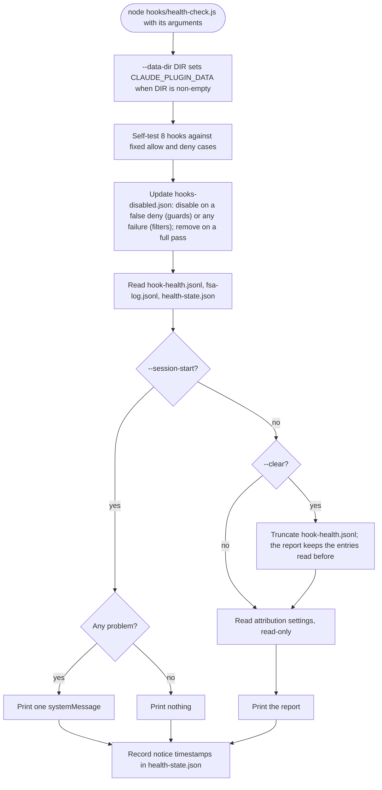

# spec-hooks-health-check

## Metadata

| Field | Value |
|---|---|
| **Feature** | Health check: hook self-tests, auto-disable, session notice, health report, attribution settings |
| **Parent feature** | spec-hooks-platform.md |
| **Sub-features** | None |
| **Requirement refs** | BR-007, BR-009, UR-015, UR-017, UR-018, FR-091, FR-118, FR-119, FR-120, NFR-007, NFR-009, NFR-016 |
| **Feature type** | Functionality |
| **Status** | Draft |

Status values: Draft, Review, Approved, Implemented.

## Description

`hooks/health-check.js` self-tests the eight hooks that make decisions against fixed allow and deny cases, keeps `hooks-disabled.json` in step with the results, and either prints one notice at session start when something is wrong or prints a full report for `/assist-plugin:health`. The report also reads, without writing, Claude Code's `attribution.commit` and `attribution.pr` settings. It implements UR-018 and the auto-disable side of the fail-open design (the consumer side is in spec-hooks-platform.md). The `/health` skill that runs the report and explains its findings is FR-166 (Area C). This spec describes the behavior at commit 4803a0d.

## Triggered by

| Trigger type | Source | Condition |
|---|---|---|
| Event | SessionStart, matcher `startup\|resume`, argument `--session-start`, timeout 10 s (`hooks/hooks.json:114-123`) | Session start and resume (not `clear` or `compact`) |
| Called by feature | `/assist-plugin:health` skill (FR-166) | `node "${CLAUDE_PLUGIN_ROOT}/hooks/health-check.js" --data-dir "${CLAUDE_PLUGIN_DATA}"`, with `--clear` when the user passes it |

## Required data

| Data | Source | Type | Notes |
|---|---|---|---|
| Arguments | Command line | strings | `--session-start`, `--clear`, `--data-dir DIR` |
| Self-test corpora | `impl/health-check.js:81-828` | fixed objects | Test data; injection samples are inert text and are never printed |
| `hooks-disabled.json`, `health-state.json`, `hook-health.jsonl`, `fsa-log.jsonl` | `${CLAUDE_PLUGIN_DATA}` | JSON | Validated on read (spec-hooks-platform.md) |
| Settings files | `<project>/.claude/settings.local.json`, `<project>/.claude/settings.json`, `$CLAUDE_CONFIG_DIR/settings.json` or `~/.claude/settings.json` | JSON | `<project>` is `CLAUDE_PROJECT_DIR`, else the process working directory; report mode only |

## Preconditions

| Condition | Check | If not met |
|---|---|---|
| Node 6 or newer | `lib/launch.js` | `unsupported-node` warning; the check does not run |
| `CLAUDE_PLUGIN_DATA` set (directly or through `--data-dir`) | `canPersist` (`impl/health-check.js:1071`) | Self-tests still run and report; nothing is disabled, re-enabled, or remembered |

## Algorithmic steps

Start-to-end flow. Source: [spec-hooks-health-check-flow.mmd](spec-hooks-health-check-flow.mmd).

**Note:** PNG rendering requires mermaid-cli with its headless browser, which is missing on this machine (see spec-hooks-platform.md). Render with `mmdc -i specs/spec-hooks-health-check-flow.mmd -o specs/spec-hooks-health-check-flow.png` once it is installed.

### Requirement: Self-tests

The health check SHALL, in both modes, run each of the eight hooks below against its fixed allow and deny cases, calling the same `evaluate()` the hook runs, with no disk access for test files, a fixed `cwd`, and explicit allowlists, roots, and temp directories per case.

**Requirement refs:** FR-118, UR-018
**Status:** Built; `writing-context` having no self-test is pending OP-B5 (spec-hooks-platform.md, Open points)
**Source:** `hooks/impl/health-check.js:3-34`, `:715-866`, `:1073`

| Hook | Kind | Allow cases (must not be flagged) | Deny cases (must be flagged) | Flagged means |
|---|---|---|---|---|
| `doc-cli-guard` | guard | 10 | 14 | `deny === true` |
| `commit-attribution-guard` | guard | 17 | 22 | `deny === true`; stub file reader, `cwd` `/assist-selftest/project` |
| `sa-mermaid-only` | guard | 10 | 19 | `deny === true` |
| `injection-filter` | filter | 23 benign | 34 injection | The scan finds a rule, strips an invisible character, or changes the text; the two end-to-end cases flag when the hook emits a rewrite |
| `prose-gate` | guard | 27 | 26 | `deny === true`; stub file reader, explicit allowlist and temp directory |
| `prose-advisor` | filter | 10 clean | 8 advisory | The advisor returns output |
| `fsa-write-bar` | guard | 47 | 93 | `deny === true`; explicit roots. Counts at 4803a0d; the task-planner cases change with FR-186 (PLANNED 1.11.1, spec-hooks-fsa-write-bar.md) |
| `fsa-log` | filter | 32 clean reports | 32 broken reports | The record holds problems; a record holding the sentinel text, or output other than exactly one `systemMessage` on a warning event, makes the case throw |

`writing-context` has no self-test; its problems show only in the health log. A case result is one of: correct, false deny (an allow case flagged), false allow (a deny case not flagged), or threw.

PLANNED (1.11.1, FR-181): every `prose-gate` and `prose-advisor` case carries the keys `projectDir` and `findGitRoot`, `diskReader` (`:165-167`) forwards them and throws for a case that lacks them, and 13 cases are added, as specified in spec-hooks-prose-hooks.md (Requirement: Self-test isolation for the project root).

#### Scenario: All pass

- **GIVEN** every case of every hook gives the expected result
- **WHEN** the session starts
- **THEN** the health check SHALL print nothing

#### Scenario: Case throws

- **GIVEN** a hook's `evaluate` throws on one fixed case
- **WHEN** the self-test runs
- **THEN** the result SHALL record that case under "case threw" with the error's name and source line, and the hook's result SHALL be FAIL

### Requirement: Auto-disable and re-enable

When `CLAUDE_PLUGIN_DATA` is set, the health check SHALL add a hook to `hooks-disabled.json` when its latest self-test has a false deny (guards) or any false deny, false allow, or thrown case (filters), and remove a listed hook when its latest self-test passes every case.

**Requirement refs:** FR-091, UR-017, UR-018
**Status:** Built; the difference from the FR-091 statement (a listed guard whose latest run fails only by false allows or throws stays listed) is pending OP-B2 (spec-hooks-platform.md, Open points)
**Source:** `hooks/impl/health-check.js:868-895`, `:1075-1084`; `hooks/lib/health.js:135-147`

Rules:
- Entry: `{"<hook>": {"reason": "self-test: <reasons>", "ts": <ISO time>}}`. Guard reason: `<falseDeny noun> <altered verb> (<N> case[s])`, for example `known-safe command denied (1 case)`. Filter reasons, joined by `, `: `<N> <falseDeny noun>(s) <altered verb>`, `<N> <falseAllow noun>(s) <missed verb>`, `<N> case(s) threw`.
- A guard with only false allows or thrown cases is not disabled; it is reported as failing and stays enabled.
- A listed hook whose latest self-test fails without a disabling reason (a guard with only false allows or throws) keeps its entry; only a full pass removes it.
- An empty list deletes the file. A write error adds the note `could not update hooks-disabled.json (<error>)` to the report.

#### Scenario: Buggy guard

- **GIVEN** a guard that denies a known-safe command in its self-test
- **WHEN** the health check runs
- **THEN** it SHALL add the guard to `hooks-disabled.json`, so the guard passes commands with a warning, and report it

#### Scenario: Fixed guard

- **GIVEN** a disabled guard that passes all cases after an update
- **WHEN** the health check runs
- **THEN** it SHALL remove the guard from `hooks-disabled.json` and report `<name> re-enabled: all self-tests pass`

#### Scenario: Guard misses a known-prohibited case

- **GIVEN** a guard that allows a known-prohibited command in its self-test
- **WHEN** the health check runs
- **THEN** it SHALL report the failure and leave the guard out of `hooks-disabled.json`

#### Scenario: Filter misses in either direction

- **GIVEN** the `injection-filter` alters a benign sample, or the `fsa-log` flags a clean report
- **WHEN** the health check runs
- **THEN** it SHALL add that filter to `hooks-disabled.json`

#### Scenario: Data directory unset

- **GIVEN** `CLAUDE_PLUGIN_DATA` is unset, `--data-dir` is absent, and a guard's self-test has a false deny
- **WHEN** the health check runs with `--session-start`
- **THEN** the health check SHALL write no file, and the notice SHALL include `<name> self-test failed (...); could not disable it (CLAUDE_PLUGIN_DATA is not set)`

#### Scenario: Data directory unset in report mode

- **GIVEN** the same state
- **WHEN** the health check runs without `--session-start`
- **THEN** the report SHALL show `Data directory: NOT SET (failures cannot be logged and guards cannot be disabled)` (`impl/health-check.js:934`) and the guard's `FAIL` line, write no file, and list no change under `Changes made:`

#### Scenario: Entry for a hook without a self-test

- **GIVEN** `hooks-disabled.json` holds an entry for `writing-context`, which has no self-test
- **WHEN** the health check runs with `--session-start`
- **THEN** the notice SHALL include `writing-context guard is disabled (protection is off)`, and SHALL include it again at every later session start while the entry exists

### Requirement: Session-start notice

With `--session-start`, the health check SHALL print one `{"systemMessage": "assist-plugin health: <problems joined by "; ">. Run /assist-plugin:health for details."}` when at least one problem below exists, print nothing otherwise, and never print plain text.

**Requirement refs:** FR-118, UR-017, UR-018
**Status:** Built; the notice wording for a guard with only missed denies is pending OP-B5 (spec-hooks-platform.md, Open points)
**Source:** `hooks/impl/health-check.js:42-46`, `:906-928`, `:1076`, `:1086-1114`

Problems, in order:
1. Per failed self-test: `<name> self-test failed (<counts>)`, followed by `; guard disabled until a later check passes` or `; filter disabled until a later check passes` when this run added the entry (`impl/health-check.js:882-887`, `:911`), or by `; could not disable it (CLAUDE_PLUGIN_DATA is not set)` when the run had a disabling failure but no data directory (`:912`). The first suffix is printed even when the later write of `hooks-disabled.json` fails (`:1078-1083`); that failure shows only as a note in report mode.
2. Per entry still in the list after this run's update whose hook did not fail this run: `<name> guard is disabled (protection is off)` (`impl/health-check.js:915-918`). The list checked is the in-memory list after `updateDisabled` (`:1076`, passed on at `:1108`), and that update already removed every hook that passed all cases (`:888-891`). The line therefore appears only for an entry that names no self-tested hook, such as a hand-added `writing-context` entry or a stale name, and it repeats every session while that entry exists. A listed hook that failed this run appears only through item 1, so a listed guard whose latest run fails only by false allows shows `self-test failed (...)` with no word that it is still disabled.
3. When health-log entries are newer than `lastNotified`: `<N> hook failure(s) logged since the last notice (latest: <hook> <kind>)`.
4. When `fsa-log` records of event `subagent-stop` or `handback` with problems are newer than `fsaLastNotified`: `<N> subagent report(s) with terminal-block problems logged since the last notice (latest: <agent> <first problem>)`.

After either mode, when new entries existed and `CLAUDE_PLUGIN_DATA` is set, the timestamps of the newest counted entries are stored in `health-state.json` as `lastNotified` and `fsaLastNotified`. The attribution settings are not read in this mode.

`<counts>` reads, for example, `1 known-prohibited command(s) allowed` for a guard with one false allow. The notice does not say "weak"; the `/health` skill's finding table explains that the guard stays enabled with weak protection (`skills/health/SKILL.md:43`). The FR-118 scenario expects the word (`docs/requirements/FR-NFR-assist-plugin.md:2208-2211`); pending OP-B5.

#### Scenario: Weak guard

- **GIVEN** a guard allows a known-prohibited case
- **WHEN** the session starts
- **THEN** the notice SHALL read `<name> self-test failed (1 known-prohibited command(s) allowed)` and the guard SHALL stay enabled (built wording; pending OP-B5)

#### Scenario: New hook failures

- **GIVEN** two `timeout` records newer than `lastNotified`
- **WHEN** the session starts
- **THEN** the notice SHALL include `2 hook failure(s) logged since the last notice (latest: <hook> timeout)`
- **AND** the next session start SHALL NOT repeat them

### Requirement: Health report

Without `--session-start`, the health check SHALL print a plain-text report with, in order: the Node version, the data directory, each hook's self-test result with its failing case labels, changes made to `hooks-disabled.json`, disabled hooks, the attribution settings section, the newest 20 health-log entries, and the newest 20 `fsa-log` records with problems.

**Requirement refs:** FR-119, UR-018, NFR-016
**Status:** Built
**Source:** `hooks/impl/health-check.js:930-968`, `:1116-1127`

Line formats:
- `assist-plugin hook health`, a blank line.
- `Node: <version> (minimum supported: 6) OK`; `Data directory: <path>` or `Data directory: NOT SET (failures cannot be logged and guards cannot be disabled)`.
- `Guard self-tests:` then per hook `  <name>: PASS|FAIL (<allow count> <allow noun>, <deny count> <deny noun>)`, then per failing case `    <noun> was <DENIED|ALLOWED|ALTERED|MISSED|ADVISED|FLAGGED>: <label>` or `    case threw: <label> (<error>)`. Case labels are printed, never sample text.
- `Changes made:` with one line per disable or re-enable, when any.
- `Disabled guards:` then `  <name>: <reason> (since <ts>)` or `  none`.
- The attribution section (Requirement: Attribution settings report).
- `Hook failure log (<N> entr(y|ies), newest 20 shown, <M> new since the last report):` then `  <ts>  <hook>  <node>  <kind>  <message>` or `  none`.
- `FSA report log (<N> entr(y|ies), 
 with problems, <M> new since the last report; newest 20 problem rows shown):` then `  <ts>  <event>  <agent>  <state>  <problems joined by "; ">` or `  none`.

#### Scenario: Report

- **GIVEN** one guard is disabled
- **WHEN** the report runs
- **THEN** the report SHALL list the guard under `Disabled guards:` with its reason and time

#### Scenario: Unreadable log line

- **GIVEN** `hook-health.jsonl` holds one line that is not JSON among valid lines
- **WHEN** the report runs
- **THEN** the report SHALL skip that line and list the others

### Requirement: Clear the failure log

With `--clear` in report mode, the health check SHALL read the health-log entries, then truncate `hook-health.jsonl`, print the report with the entries it read, and add `Cleared <N> log entr(y|ies) from hook-health.jsonl.`, leaving `fsa-log.jsonl` unchanged.

**Requirement refs:** FR-119, UR-018
**Status:** Built
**Source:** `hooks/impl/health-check.js:1086`, `:1116-1117`, `:966`; `hooks/lib/health.js:212-223`

#### Scenario: Clear

- **GIVEN** `--clear` is passed and the log holds 3 entries
- **WHEN** the report finishes
- **THEN** `hook-health.jsonl` SHALL be empty, the report SHALL list the 3 entries and end with `Cleared 3 log entries from hook-health.jsonl.`
- **AND** `fsa-log.jsonl` SHALL be unchanged

#### Scenario: Clear in session-start mode

- **GIVEN** `--session-start --clear`
- **WHEN** the check runs
- **THEN** the check SHALL NOT truncate the log

### Requirement: Attribution settings report

In report mode the health check SHALL read the local, project, and user Claude Code settings files, in that precedence, and report, read-only, when the effective `attribution.commit` or `attribution.pr` is unset or not `""`, naming the file and key.

**Requirement refs:** FR-120, UR-015, UR-018, BR-009
**Status:** Built
**Source:** `hooks/impl/health-check.js:36-40`, `:970-1064`, `:1118-1123`; `DECISIONS.md` (2026-10-12, No AI attribution in commits or PRs)

Output:
- First line `Claude Code attribution settings (read-only; this check never edits settings):`.
- One line per file: `  <local|project|user> (<path>): attribution.commit <= value | not set>, attribution.pr <...>`, or a state of `missing`, `unreadable`, `invalid JSON`, or `not a JSON object`. String values are sanitized and cut to 40 characters; other values show as `a <type> value`.
- Per key, the effective value is the first file in precedence order that sets it. No file sets it: `attribution.<key> is not set in any settings file; set it to "" in <user file>`. A value other than `""`: `attribution.<key> is <value> in <file>; set it to "" there`.
- With no problem: `  OK: attribution.commit and attribution.pr are "", so Claude Code adds no Co-Authored-By trailer or pull request footer.`
- With a problem: an explanation line and `  Setting: {"attribution": {"commit": "", "pr": ""}}`.
- Always: `  Source: https://code.claude.com/docs/en/agent-sdk/modifying-system-prompts`.
- The deprecated `includeCoAuthoredBy` setting is not read.
- An error in this section prints `Claude Code attribution settings: could not be checked (<error>)` and the rest of the report still prints.

#### Scenario: Unset key

- **GIVEN** no settings file sets `attribution.commit`
- **WHEN** the report runs
- **THEN** the report SHALL name the key and the user settings file and show `{"attribution": {"commit": "", "pr": ""}}`

#### Scenario: Local file wins

- **GIVEN** the user file sets `attribution.pr` to `""` and the local file sets it to `"Generated"`
- **WHEN** the report runs
- **THEN** the report SHALL name the local file for `attribution.pr`

#### Scenario: Never writes

- **GIVEN** any settings state
- **WHEN** the report runs
- **THEN** the health check SHALL NOT write a settings file

### Requirement: Health check failure handling

The health check SHALL fail open: an error takes the platform failure path with kind `exception` and suffix `the health check did not complete`, a run longer than 8000 ms takes it with kind `timeout`, and a normal run exits with status 0 after its output is flushed.

**Requirement refs:** NFR-007, NFR-009, UR-017
**Status:** Built
**Source:** `hooks/impl/health-check.js:51`, `:55`, `:1130-1141`

#### Scenario: Error during the run

- **GIVEN** a test fault makes `run()` throw an error (the file readers in `lib/health.js` catch their own errors, so a corrupt state file does not reach this path)
- **WHEN** the check runs at session start
- **THEN** the check SHALL print one `systemMessage` warning and exit 0, and the session SHALL start

#### Scenario: Slow disk

- **GIVEN** the run has not finished after 8000 ms
- **WHEN** the watchdog fires
- **THEN** the check SHALL print a `timeout` warning and exit 0 within the 10 s registration

## Business rules

| Rule ID | Rule | Traces to | Applied at step | Example |
|---|---|---|---|---|
| RULE-001 | A false deny makes a guard untrustworthy: disable it; a false allow only weakens it: keep it | FR-091 | Requirement: Auto-disable and re-enable | `known-safe command denied (1 case)` |
| RULE-002 | A filter that fails in either direction is disabled, because its rewrites or logs can no longer be trusted | FR-091 | Requirement: Auto-disable and re-enable | `1 benign sample(s) altered` |
| RULE-003 | The session-start mode speaks only when something is wrong | FR-118 | Requirement: Session-start notice | Silent when healthy |
| RULE-004 | Settings are reported, never edited | FR-120 | Requirement: Attribution settings report | Read-only |
| RULE-005 | Test data never reaches output: labels only | FR-119, NFR-016 | Requirement: Health report | Injection sample text is not printed |

## Data transformations

| Input | Transformation | Output | Notes |
|---|---|---|---|
| Corpus case | `evaluate()` of the hook | Correct, false deny, false allow, or threw | Per hook |
| Results and the flag file | Disable and re-enable rules | New flag file and notes | Only with `CLAUDE_PLUGIN_DATA` |
| Logs and state | Filter entries newer than the stored timestamps | New counts | Health log and stop or handback problem rows |
| Settings files | Parse, pick the effective value per key | Report lines | Report mode only |

## Output / Outcome

| Output | Type | Description |
|---|---|---|
| Notice | `systemMessage` JSON | Session-start mode, only with problems |
| Report | Plain text on stdout | Report mode |
| `hooks-disabled.json` | File | Updated per Requirement: Auto-disable and re-enable |
| `health-state.json` | File | `lastNotified`, `fsaLastNotified` |
| Truncated `hook-health.jsonl` | File | `--clear` in report mode |

## Error handling

| Error condition | Handling strategy | Outcome |
|---|---|---|
| `hooks-disabled.json` write fails | Note in the report | Hooks keep their old state |
| `health-state.json` write fails | Ignored | The notice may repeat next session |
| Settings file missing, unreadable, or invalid | State shown on its line | The other files still decide |
| Thrown error, timeout, old Node | Platform failure path | One warning; exit 0 |

## Events emitted

| Event name | Payload | Consumer(s) | When emitted |
|---|---|---|---|
| `hooks-disabled.json` change | `{<hook>: {reason, ts}}` | `guard()`, `transform()` (spec-hooks-platform.md) | A self-test result changes a hook's state |
| SessionStart notice | `systemMessage` | The user | Problems at session start |

## Events consumed

| Event name | Producer | Payload used | Handling |
|---|---|---|---|
| SessionStart (`startup`, `resume`) | Claude Code | none (argument `--session-start`) | Notice mode |
| `hook-health.jsonl` records | All hooks (spec-hooks-platform.md) | `ts`, `hook`, `kind` | Counted and listed |
| `fsa-log.jsonl` records | `fsa-log` (spec-hooks-fsa-log.md) | `ts`, `event`, `agent_type`, `state`, `problems` | Counted and listed |

## Sub-feature breakdown

Not applicable: a leaf feature of spec-hooks-platform.md.

## Performance considerations

| Concern | Target | Approach |
|---|---|---|
| Session-start latency | Within 10 s (NFR-007) | In-process self-tests with no disk access for test files; 8 s watchdog |
| Notice noise | One line per session at most | Timestamps in `health-state.json` |

## Traceability

| Requirement | Spec section | Verified by |
|---|---|---|
| BR-007 | Requirement: Self-tests; Requirement: Health check failure handling | UC-004 run: hook failure then `/assist-plugin:health` |
| BR-009 | Requirement: Attribution settings report | Unset-key scenario |
| UR-015 | Requirement: Attribution settings report | Local-file-wins scenario |
| UR-017 | Requirement: Auto-disable and re-enable | Buggy guard scenario |
| UR-018 | Requirement: Health report; Requirement: Clear the failure log | Report and clear scenarios |
| FR-091 | Requirement: Auto-disable and re-enable | Buggy, fixed, weak guard, and filter scenarios |
| FR-118 | Requirement: Self-tests; Requirement: Session-start notice | All-pass and weak-guard scenarios |
| FR-119 | Requirement: Health report; Requirement: Clear the failure log | Report and clear scenarios |
| FR-120 | Requirement: Attribution settings report | Unset-key and never-writes scenarios |
| NFR-007 | Requirement: Health check failure handling | Slow disk scenario |
| NFR-009 | Requirement: Health check failure handling | Error-during-run scenario |
| NFR-016 | Requirement: Health report | Labels-only check on a failing injection case |
