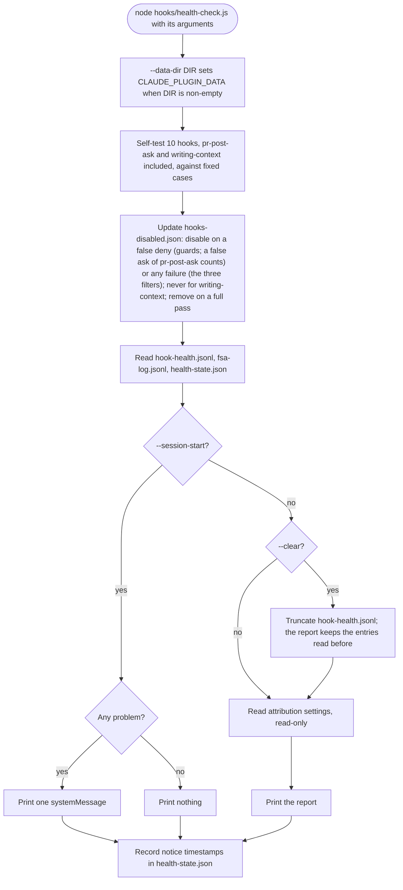

# spec-hooks-health-check

## Metadata

| Field | Value |
|---|---|
| **Feature** | Health check: hook self-tests, auto-disable, session notice, health report, attribution settings |
| **Parent feature** | spec-hooks-platform.md |
| **Sub-features** | None |
| **Requirement refs** | BR-007, BR-009, UR-015, UR-017, UR-018, UR-055, FR-091, FR-104, FR-107, FR-118, FR-119, FR-120, FR-206, FR-213, NFR-007, NFR-009, NFR-016 |
| **Feature type** | Functionality |
| **Status** | Review |

Status values: Draft, Review, Approved, Implemented.

## Description

`hooks/health-check.js` self-tests the ten hooks that make decisions (the guards `doc-cli-guard`, `commit-attribution-guard`, `sa-mermaid-only`, `pr-post-ask`, `prose-gate`, and `fsa-write-bar`; the filters `injection-filter`, `prose-advisor`, and `fsa-log`; and the report-only `writing-context`) against fixed cases, keeps `hooks-disabled.json` in step with the results, and either prints one notice at session start when something is wrong or prints a full report for `/assist-plugin:health`. The report also reads, without writing, Claude Code's `attribution.commit` and `attribution.pr` settings. It implements UR-018 and the auto-disable side of the fail-open design (the consumer side is in spec-hooks-platform.md). The `/health` skill that runs the report and explains its findings is FR-166 (Area C). Requirements Self-tests, Auto-disable and re-enable, and Session-start notice describe the build of 2026-10-22 (follow-up to 1.12.0), folded from the Change Logs 2026-10-16, 2026-10-17, and 2026-10-22; the other requirements keep their 1.11.1 (commit 41034c1) text, with their line cites refreshed against the built files on 2026-10-22.

## Triggered by

| Trigger type | Source | Condition |
|---|---|---|
| Event | SessionStart, matcher `startup\|resume`, argument `--session-start`, timeout 10 s (`hooks/hooks.json:118-128`) | Session start and resume (not `clear` or `compact`) |
| Called by feature | `/assist-plugin:health` skill (FR-166) | `node "${CLAUDE_PLUGIN_ROOT}/hooks/health-check.js" --data-dir "${CLAUDE_PLUGIN_DATA}"`, with `--clear` when the user passes it |

## Required data

| Data | Source | Type | Notes |
|---|---|---|---|
| Arguments | Command line | strings | `--session-start`, `--clear`, `--data-dir DIR` |
| Self-test corpora | `impl/health-check.js:97-1139` (read on 2026-10-22) | fixed objects | Test data; injection samples are inert text and are never printed |
| `hooks-disabled.json`, `health-state.json`, `hook-health.jsonl`, `fsa-log.jsonl` | `${CLAUDE_PLUGIN_DATA}` | JSON | Validated on read (spec-hooks-platform.md) |
| Settings files | `<project>/.claude/settings.local.json`, `<project>/.claude/settings.json`, `$CLAUDE_CONFIG_DIR/settings.json` or `~/.claude/settings.json` | JSON | `<project>` is `CLAUDE_PROJECT_DIR`, else the process working directory; report mode only |

## Preconditions

| Condition | Check | If not met |
|---|---|---|
| Node 6 or newer | `lib/launch.js` | `unsupported-node` warning; the check does not run |
| `CLAUDE_PLUGIN_DATA` set (directly or through `--data-dir`) | `canPersist` (`impl/health-check.js:1392`) | Self-tests still run and report; nothing is disabled, re-enabled, or remembered |

## Algorithmic steps

Start-to-end flow. Source: [spec-hooks-health-check-flow.mmd](spec-hooks-health-check-flow.mmd).

**Note:** PNG rendering requires mermaid-cli with its headless browser, which is missing on this machine (see spec-hooks-platform.md; the run of 2026-10-22 failed the same way). Render with `mmdc -i specs/spec-hooks-health-check-flow.mmd -o specs/spec-hooks-health-check-flow.png` once it is installed.

### Requirement: Self-tests

The health check SHALL, in both modes, run each of the ten hooks below against its fixed cases, calling the same `evaluate()` the hook runs, with no disk access for test files, a fixed `cwd`, and explicit allowlists, roots, git-root finders, file readers, and temp directories per case; one `writing-context` case reads the installed `rules/writing-standard-compact.md` through the hook's own reader, because checking that file is the point of that case; and `pr-post-ask` runs as a guard whose ask cases are its deny list and whose no-ask cases are its allow list.

**Requirement refs:** FR-118, FR-107, FR-206, UR-018, UR-055
**Status:** Built: the `writing-context` self-test in 1.12.0 (commit `bb09e29`); the `pr-post-ask` self-test in the follow-up to 1.12.0 (build of 2026-10-22). Folded from the Change Logs 2026-10-16, 2026-10-17, and 2026-10-22
**Source:** `hooks/impl/health-check.js`, read on 2026-10-22: the header `:3-62` (the `pr-post-ask` line `:38-40`), the `require` list `:69-85`, the `GUARDS` entries `:928-1139` (`pr-post-ask` `:1041-1080`, `writing-context` `:1129-1138`), `nounsFor` `:1143-1151`, `selfTest` `:1160-1178`

| Hook | Kind | Allow cases (must not be flagged) | Deny cases (must be flagged) | Flagged means |
|---|---|---|---|---|
| `doc-cli-guard` | guard | 16 | 23 | `deny === true` |
| `commit-attribution-guard` | guard | 17 | 22 | `deny === true`; stub file reader, `cwd` `/assist-selftest/project` |
| `sa-mermaid-only` | guard | 16 | 28 | `deny === true`; a case with a `cwd` carries a `findGitRoot` stub, and the wrapper throws for one without it |
| `pr-post-ask` | guard | 13 no-ask cases | 14 ask cases | `ask === true`, which the wrapper maps to `deny === true` |
| `injection-filter` | filter | 23 benign | 36 injection | The scan finds a rule, strips an invisible character, or changes the text; the end-to-end cases (one benign, three injected: WebFetch, PowerShell, and the `sudo` wrapper) flag when the hook emits a rewrite |
| `prose-gate` | guard | 32 | 31 | `deny === true`; stub file reader, explicit allowlist, temp directory, `projectDir`, and `findGitRoot` |
| `prose-advisor` | filter | 11 clean | 10 advisory | The advisor returns output |
| `fsa-write-bar` | guard | 51 | 106 | `deny === true`; explicit roots, and a `cwd` and `findGitRoot` stub for every task-planner case |
| `fsa-log` | filter | 32 clean reports | 32 broken reports | The record holds problems; a record holding the sentinel text, or output other than exactly one `systemMessage` on a warning event, makes the case throw |
| `writing-context` | report-only filter | 3 silent cases | 3 context cases | The hook returns a `stdout` object |

Counts at the build of 2026-10-22, counted by reading the corpora of `hooks/impl/health-check.js`: injection `:101-160` and the end-to-end inputs `:362-390`, prose `:235-359`, `fsa-write-bar` `:437-598`, `fsa-log` `:643-739`, `writing-context` `:822-834`, `commit-attribution-guard` `:868-911`, and the inline cases of `doc-cli-guard`, `sa-mermaid-only`, and `pr-post-ask` in `GUARDS` `:929-1080`. A case result is one of: correct, false deny (an allow case flagged), false allow (a deny case not flagged), or threw.

Isolation, built in 1.11.1 (FR-181, FR-186): every `prose-gate` and `prose-advisor` case carries the keys `projectDir` and `findGitRoot` (`withRoot`, `:177-179`), `diskReader` (`:193-204`) forwards them and throws for a case that lacks them, and the 13 cases of spec-hooks-prose-hooks.md (Requirement: Self-test isolation for the project root) are in the corpora; every task-planner case carries a `cwd` and a `findGitRoot` stub, and the wrapper throws for a case without one (`:1110-1117`).

`writing-context` cases (the hook's `evaluate(input, options)` takes `{env, readFile}`, so the hook's code did not change):

| Kind | Label | Input | Reader | Correct result |
|---|---|---|---|---|
| context | installed standard at SessionStart | `{"hook_event_name": "SessionStart", "source": "startup"}` | the hook's own reader, at the plugin root | `stdout.hookSpecificOutput.additionalContext` starts with the exported `HEADER` and a line break and is longer than that |
| context | SubagentStart | `{"hook_event_name": "SubagentStart"}` | stub returning `- Rule one.\n- Rule two.\n` | `hookEventName` `SubagentStart` and `additionalContext` equal to `HEADER` + `\n` + `- Rule one.\n- Rule two.` |
| context | over the cap | `{"hook_event_name": "SessionStart"}` | stub returning 12,000 characters of bullet lines | `additionalContext` of at most 10,000 characters and `logKind` `standard-truncated`; a longer context makes the case throw |
| silent | other event | `{"hook_event_name": "PostToolUse"}` | stub, not called | `null` |
| silent | missing standard | `{"hook_event_name": "SessionStart"}` | stub returning null | no `stdout`, `logKind` `missing-standard` |
| silent | empty standard | `{"hook_event_name": "SessionStart"}` | stub returning `\n\n` | no `stdout`, `logKind` `empty-standard` |

Rules:
- `writing-context` is report-only: its `GUARDS` entry carries `reportOnly: true`; `updateDisabled` never adds it to `hooks-disabled.json`, and `buildProblems` gives it no suffix (Requirement: Auto-disable and re-enable; Requirement: Session-start notice). A full pass still removes a listed `writing-context` entry, as for every self-tested hook (FR-091).
- Report nouns of `writing-context`: allow `silent cases`, deny `context cases`, false deny `silent case` (verb `INJECTED`), false allow `context case` (verb `MISSED`). Report line at a pass: `  writing-context: PASS (3 silent cases, 3 context cases)`.
- The self-test calls each hook's `evaluate` and never the runtime, so a self-test case never writes `hook-health.jsonl`; the `writing-context` `logKind` is checked on the returned object.
- Every condition in the Correct result column is checked. Flagged (a `stdout` object present) decides correct, false deny, or false allow. A case whose `stdout` presence is right but which fails any other condition throws an `Error` that names the case and the failed condition, so the report lists it under "case threw" with that condition (`writingContextFlagged`, `:838-844`; `failedCondition`, `:784-788`).
- The `pr-post-ask` entry: `name: prPostAsk.NAME`, `evaluate: (input) => ({ deny: prPostAsk.evaluate(input).ask === true })`, `allow` and `deny` holding the 27 cases of spec-hooks-pr-post-ask.md, Requirement 8 (built with `bash()` and `powershell()`, `:89-95`, each commented with its case number), and `nouns: { allow: "no-ask cases", deny: "ask cases", falseDeny: "known-safe command", falseAllow: "known posting command", altered: "ASKED", missed: "NOT ASKED" }`. It has no `filter` and no `reportOnly` flag, so `updateDisabled` and `buildProblems` treat it as a guard. Its cases carry no `cwd` and need no stub: the hook reads no file and walks no directory. Report line at a pass: `  pr-post-ask: PASS (13 no-ask cases, 14 ask cases)`.
- `module.exports` (`:1464`) exports `GUARDS` and the `writing-context` corpora, among others, for unit tests.

#### Scenario: All pass

- **GIVEN** every case of every hook gives the expected result
- **WHEN** the session starts
- **THEN** the health check SHALL print nothing

#### Scenario: Case throws

- **GIVEN** a hook's `evaluate` throws on one fixed case
- **WHEN** the self-test runs
- **THEN** the result SHALL record that case under "case threw" with the error's name and source line, and the hook's result SHALL be FAIL

#### Scenario: Writing-context self-test passes

- **GIVEN** `rules/writing-standard-compact.md` is present and readable
- **WHEN** the session-start self-test runs `writing-context` against its fixed cases
- **THEN** every case SHALL be correct and the notice SHALL NOT name `writing-context`

#### Scenario: Compact standard unreadable

- **GIVEN** `rules/writing-standard-compact.md` is missing or unreadable
- **WHEN** the session starts
- **THEN** the notice SHALL include `writing-context self-test failed (1 context case(s) missed)` with no suffix
- **AND** the health check SHALL NOT add `writing-context` to `hooks-disabled.json`

#### Scenario: Writing-context case throws

- **GIVEN** a test fault makes the over-the-cap case return a context longer than 10,000 characters
- **WHEN** the self-test runs
- **THEN** the report SHALL list the case under "case threw", the `writing-context` self-test SHALL be FAIL, and `hooks-disabled.json` SHALL NOT gain `writing-context`

#### Scenario: Right stdout presence, wrong content

- **GIVEN** a test fault makes the SubagentStart case return a `stdout` object whose `hookEventName` is `SessionStart`
- **WHEN** the self-test runs
- **THEN** the case SHALL throw an `Error` naming the case and the condition `hookEventName SubagentStart`, and the report SHALL list it under "case threw"

#### Scenario: Ask-hook self-test passes

- **GIVEN** `pr-post-ask` gives the expected result on every case
- **WHEN** the session starts
- **THEN** the notice SHALL NOT name `pr-post-ask`, and the report SHALL show `  pr-post-ask: PASS (13 no-ask cases, 14 ask cases)`

#### Scenario: A no-ask case asks

- **GIVEN** a hook defect makes `gh pr view 1` return `ask: true`
- **WHEN** the report runs
- **THEN** the report SHALL show `  pr-post-ask: FAIL (13 no-ask cases, 14 ask cases)` and the line `    known-safe command was ASKED: Bash: gh pr view 1`

### Requirement: Auto-disable and re-enable

When `CLAUDE_PLUGIN_DATA` is set, the health check SHALL add a hook to `hooks-disabled.json` when its latest self-test has a false deny (guards, where an ask by `pr-post-ask` on a known-safe case counts as a false deny) or any false deny, false allow, or thrown case (the filters `injection-filter`, `prose-advisor`, and `fsa-log`), SHALL never add `writing-context`, whose self-test is report-only, SHALL leave `pr-post-ask` in its state and report weak protection when it only misses an ask, and SHALL remove a listed hook when its latest self-test passes every case.

**Requirement refs:** FR-091, FR-206, UR-017, UR-018
**Status:** Built: the eight hooks of 1.11.1 and `writing-context` in 1.12.0 (commit `bb09e29`); `pr-post-ask` in the follow-up to 1.12.0 (build of 2026-10-22). Folded from the Change Logs 2026-10-16 and 2026-10-22
**Source:** `hooks/impl/health-check.js:1182-1211` (`updateDisabled`, read on 2026-10-22), the header lines `:5-11` and `:38-40`; `rules/assist-plugin-rule.md:413` (Hook Fail-Open Rule)

Rules:
- Entry: `{"<hook>": {"reason": "self-test: <reasons>", "ts": <ISO time>}}`. Guard reason: `<falseDeny noun> <altered verb> (<N> case[s])`, for example `known-safe command denied (1 case)`, or for `pr-post-ask` `known-safe command asked (1 case)`. Filter reasons, joined by `, `: `<N> <falseDeny noun>(s) <altered verb>`, `<N> <falseAllow noun>(s) <missed verb>`, `<N> case(s) threw`.
- A guard with only false allows or thrown cases is not disabled; it is reported as failing and keeps its state. For `pr-post-ask` a false allow is a missed ask.
- A report-only hook (`writing-context`) is never added: `updateDisabled` tests `reportOnly` before the filter branches (`:1189-1197`).
- A listed hook whose latest self-test fails without a disabling reason (a guard with only false allows or throws) keeps its entry; only a full pass removes it.
- An empty list deletes the file. A write error adds the note `could not update hooks-disabled.json (<error>)` to the report.
- The Hook Fail-Open Rule (`rules/assist-plugin-rule.md:413`) states the same rule: a guard whose self-test denies a known-safe command, and a filter whose self-test fails in any way, is auto-disabled until a later full pass; a guard that only misses a known-prohibited command keeps its state; a failed `writing-context` self-test is reported only; a guard whose self-test asks on a known-safe command (the PR posting ask hook) is treated like one that denies it. The header of `hooks/impl/health-check.js` (`:8-9`) says a guard that only misses keeps its state, enabled or listed until a full pass. The rule file is on the LLM surface (NFR-011).

#### Scenario: Buggy guard

- **GIVEN** a guard that denies a known-safe command in its self-test
- **WHEN** the health check runs
- **THEN** it SHALL add the guard to `hooks-disabled.json`, so the guard passes commands with a warning, and report it

#### Scenario: Fixed guard

- **GIVEN** a disabled guard that passes all cases after an update
- **WHEN** the health check runs
- **THEN** it SHALL remove the guard from `hooks-disabled.json` and report `<name> re-enabled: all self-tests pass`

#### Scenario: Guard misses a known-prohibited case

- **GIVEN** a guard that allows a known-prohibited command in its self-test
- **WHEN** the health check runs
- **THEN** it SHALL report the failure and leave the guard out of `hooks-disabled.json`

#### Scenario: Filter misses in either direction

- **GIVEN** the `injection-filter` alters a benign sample, or the `fsa-log` flags a clean report
- **WHEN** the health check runs
- **THEN** it SHALL add that filter to `hooks-disabled.json`

#### Scenario: Data directory unset

- **GIVEN** `CLAUDE_PLUGIN_DATA` is unset, `--data-dir` is absent, and a guard's self-test has a false deny
- **WHEN** the health check runs with `--session-start`
- **THEN** the health check SHALL write no file, and the notice SHALL include `<name> self-test failed (...); could not disable it (CLAUDE_PLUGIN_DATA is not set)`

#### Scenario: Data directory unset in report mode

- **GIVEN** the same state
- **WHEN** the health check runs without `--session-start`
- **THEN** the report SHALL show `Data directory: NOT SET (failures cannot be logged and guards cannot be disabled)` (`impl/health-check.js:1255`) and the guard's `FAIL` line, write no file, and list no change under `Changes made:`

#### Scenario: Entry for a hook without a self-test

- **GIVEN** `hooks-disabled.json` holds an entry for `retired-hook`, a name that no self-test covers
- **WHEN** the health check runs with `--session-start`
- **THEN** the notice SHALL include `retired-hook guard is disabled (protection is off)`, and SHALL include it again at every later session start while the entry exists

#### Scenario: Writing-context failure never disables it

- **GIVEN** the `writing-context` self-test fails and `CLAUDE_PLUGIN_DATA` is set
- **WHEN** the health check runs
- **THEN** it SHALL report the failure and SHALL NOT add `writing-context` to `hooks-disabled.json`

#### Scenario: Hand-added writing-context entry and a full pass

- **GIVEN** `hooks-disabled.json` holds a `writing-context` entry and its self-test passes every case
- **WHEN** the health check runs with `CLAUDE_PLUGIN_DATA` set
- **THEN** it SHALL remove the entry and report `writing-context re-enabled: all self-tests pass`

#### Scenario: Listed guard that now only misses a deny

- **GIVEN** a guard already listed in `hooks-disabled.json` whose latest self-test no longer denies a known-safe case but still allows a known-prohibited case
- **WHEN** the health check runs
- **THEN** it SHALL keep the guard in `hooks-disabled.json`, because an entry is removed only after a full passing self-test

#### Scenario: False ask disables the hook

- **GIVEN** `pr-post-ask` returns an ask decision for the known-safe case `gh pr view 1`
- **WHEN** the health check runs with `CLAUDE_PLUGIN_DATA` set
- **THEN** it SHALL add `{"pr-post-ask": {"reason": "self-test: known-safe command asked (1 case)", "ts": <ISO time>}}` to `hooks-disabled.json`, report `pr-post-ask disabled: self-test: known-safe command asked (1 case)` under `Changes made:`, and the notice SHALL end that item with `; guard disabled until a later check passes`

#### Scenario: Re-enabled after a full pass

- **GIVEN** `pr-post-ask` is listed and its latest self-test passes all 27 cases
- **WHEN** the health check runs
- **THEN** it SHALL remove the entry and report `pr-post-ask re-enabled: all self-tests pass`

#### Scenario: Missed ask is weak protection

- **GIVEN** `pr-post-ask` returns no decision for the ask case `gh pr merge 123` and asks on no known-safe case
- **WHEN** the session starts
- **THEN** the notice SHALL read `pr-post-ask self-test failed (1 known posting command(s) not asked); protection is weak`, and the hook SHALL stay out of `hooks-disabled.json`, or stay listed when it was listed before

### Requirement: Session-start notice

With `--session-start`, the health check SHALL print one `{"systemMessage": "assist-plugin health: <problems joined by "; ">. Run /assist-plugin:health for details."}` when at least one problem below exists, print nothing otherwise, and never print plain text.

**Requirement refs:** FR-118, UR-017, UR-018
**Status:** Built: the `; protection is weak` ending and the report-only rule in 1.12.0 (commit `bb09e29`). Folded from the Change Log 2026-10-16
**Source:** `hooks/impl/health-check.js:1222-1249` (`buildProblems`, read on 2026-10-22), `:1213-1220` (`failureLabel`)

Problems, in order:
1. Per failed self-test: `<name> self-test failed (<counts>)`, followed by `; guard disabled until a later check passes` or `; filter disabled until a later check passes` when this run added the entry (`disabledNow`, `impl/health-check.js:1201`, `:1230`), by `; could not disable it (CLAUDE_PLUGIN_DATA is not set)` when the run had a disabling failure but no data directory (`:1231`), or by `; protection is weak` for a guard whose self-test has at least one false allow and no false deny, whether or not it is listed in `hooks-disabled.json` (`:1232`). A report-only hook (`writing-context`) gets no suffix (`:1229`). Thrown cases do not change the choice: a thrown case never disables a guard, so a guard with false allows and thrown cases and no false deny also gets `; protection is weak`. The first suffix is printed even when the later write of `hooks-disabled.json` fails; that failure shows only as a note in report mode.
2. Per entry still in the list after this run's update whose hook did not fail this run: `<name> guard is disabled (protection is off)` (`impl/health-check.js:1236-1239`). The list checked is the in-memory list after `updateDisabled`, and that update already removed every hook that passed all cases (`:1204-1207`). The line therefore appears only for an entry that names no self-tested hook, such as a stale name, and it repeats every session while that entry exists. A listed hook that failed this run appears only through item 1: a listed guard whose latest run fails only by false allows shows `self-test failed (...); protection is weak`, and the report's `Disabled guards:` section shows that it stays listed.
3. When health-log entries are newer than `lastNotified`: `<N> hook failure(s) logged since the last notice (latest: <hook> <kind>)`.
4. When `fsa-log` records of event `subagent-stop` or `handback` with problems are newer than `fsaLastNotified`: `<N> subagent report(s) with terminal-block problems logged since the last notice (latest: <agent> <first problem>)`.

After either mode, when new entries existed and `CLAUDE_PLUGIN_DATA` is set, the timestamps of the newest counted entries are stored in `health-state.json` as `lastNotified` and `fsaLastNotified`. The attribution settings are not read in this mode.

`<counts>` reads, for example, `1 known-prohibited command(s) allowed` for a guard with one false allow, or `1 known posting command(s) not asked` for `pr-post-ask` (its nouns, Requirement: Self-tests).

#### Scenario: Weak guard

- **GIVEN** a guard that is not listed allows a known-prohibited case and denies no known-safe case
- **WHEN** the session starts
- **THEN** the notice SHALL read `<name> self-test failed (1 known-prohibited command(s) allowed); protection is weak` and the guard SHALL stay enabled

#### Scenario: Weak guard with a thrown case

- **GIVEN** `doc-cli-guard` is not listed, and its self-test has one false allow, one thrown case, and no false deny
- **WHEN** the session starts
- **THEN** the notice SHALL read `doc-cli-guard self-test failed (1 known-prohibited command(s) allowed, 1 case(s) threw); protection is weak`

#### Scenario: Listed guard that only misses

- **GIVEN** `doc-cli-guard` is listed from an earlier run and its latest self-test has one false allow and no false deny
- **WHEN** the session starts
- **THEN** the notice SHALL read `doc-cli-guard self-test failed (1 known-prohibited command(s) allowed); protection is weak`, and the entry SHALL stay

#### Scenario: New hook failures

- **GIVEN** two `timeout` records newer than `lastNotified`
- **WHEN** the session starts
- **THEN** the notice SHALL include `2 hook failure(s) logged since the last notice (latest: <hook> timeout)`
- **AND** the next session start SHALL NOT repeat them

### Requirement: Health report

Without `--session-start`, the health check SHALL print a plain-text report with, in order: the Node version, the data directory, each hook's self-test result with its failing case labels, changes made to `hooks-disabled.json`, disabled hooks, the attribution settings section, the newest 20 health-log entries, and the newest 20 `fsa-log` records with problems.

**Requirement refs:** FR-119, UR-018, NFR-016
**Status:** Built
**Source:** `hooks/impl/health-check.js:1251-1289` (`formatReport`), `:1437-1448` (report mode in `run`), read on 2026-10-22

Line formats:
- `assist-plugin hook health`, a blank line.
- `Node: <version> (minimum supported: 6) OK`; `Data directory: <path>` or `Data directory: NOT SET (failures cannot be logged and guards cannot be disabled)`.
- `Guard self-tests:` then per hook `  <name>: PASS|FAIL (<allow count> <allow noun>, <deny count> <deny noun>)`, then per failing case `    <noun> was <DENIED|ALLOWED|ALTERED|MISSED|ADVISED|FLAGGED|INJECTED|ASKED|NOT ASKED>: <label>` (the nouns and verbs of each hook, Requirement: Self-tests) or `    case threw: <label> (<error>)`. Case labels are printed, never sample text.
- `Changes made:` with one line per disable or re-enable, when any.
- `Disabled guards:` then `  <name>: <reason> (since <ts>)` or `  none`.
- The attribution section (Requirement: Attribution settings report).
- `Hook failure log (<N> entr(y|ies), newest 20 shown, <M> new since the last report):` then `  <ts>  <hook>  <node>  <kind>  <message>` or `  none`.
- `FSA report log (<N> entr(y|ies), 
 with problems, <M> new since the last report; newest 20 problem rows shown):` then `  <ts>  <event>  <agent>  <state>  <problems joined by "; ">` or `  none`.

#### Scenario: Report

- **GIVEN** one guard is disabled
- **WHEN** the report runs
- **THEN** the report SHALL list the guard under `Disabled guards:` with its reason and time

#### Scenario: Unreadable log line

- **GIVEN** `hook-health.jsonl` holds one line that is not JSON among valid lines
- **WHEN** the report runs
- **THEN** the report SHALL skip that line and list the others

### Requirement: Clear the failure log

With `--clear` in report mode, the health check SHALL read the health-log entries, then truncate `hook-health.jsonl`, print the report with the entries it read, and add `Cleared <N> log entr(y|ies) from hook-health.jsonl.`, leaving `fsa-log.jsonl` unchanged.

**Requirement refs:** FR-119, UR-018
**Status:** Built
**Source:** `hooks/impl/health-check.js:1391`, `:1437-1438`, `:1287` (read on 2026-10-22); `hooks/lib/health.js:212-223`

#### Scenario: Clear

- **GIVEN** `--clear` is passed and the log holds 3 entries
- **WHEN** the report finishes
- **THEN** `hook-health.jsonl` SHALL be empty, the report SHALL list the 3 entries and end with `Cleared 3 log entries from hook-health.jsonl.`
- **AND** `fsa-log.jsonl` SHALL be unchanged

#### Scenario: Clear in session-start mode

- **GIVEN** `--session-start --clear`
- **WHEN** the check runs
- **THEN** the check SHALL NOT truncate the log

### Requirement: Attribution settings report

In report mode the health check SHALL read the local, project, and user Claude Code settings files, in that precedence, and report, read-only, when the effective `attribution.commit` or `attribution.pr` is unset or not `""`, naming the file and key.

**Requirement refs:** FR-120, UR-015, UR-018, BR-009
**Status:** Built
**Source:** `hooks/impl/health-check.js:47-51` (header), `:1291-1385` (`attributionFiles`, `inspectSettings`, `attributionReport`), `:1439-1444` (the call in report mode), read on 2026-10-22; `DECISIONS.md` (2026-10-12, No AI attribution in commits or PRs)

Output:
- First line `Claude Code attribution settings (read-only; this check never edits settings):`.
- One line per file: `  <local|project|user> (<path>): attribution.commit <= value | not set>, attribution.pr <...>`, or a state of `missing`, `unreadable`, `invalid JSON`, or `not a JSON object`. String values are sanitized and cut to 40 characters; other values show as `a <type> value`.
- Per key, the effective value is the first file in precedence order that sets it. No file sets it: `attribution.<key> is not set in any settings file; set it to "" in <user file>`. A value other than `""`: `attribution.<key> is <value> in <file>; set it to "" there`.
- With no problem: `  OK: attribution.commit and attribution.pr are "", so Claude Code adds no Co-Authored-By trailer or pull request footer.`
- With a problem: an explanation line and `  Setting: {"attribution": {"commit": "", "pr": ""}}`.
- Always: `  Source: https://code.claude.com/docs/en/agent-sdk/modifying-system-prompts`.
- The deprecated `includeCoAuthoredBy` setting is not read.
- An error in this section prints `Claude Code attribution settings: could not be checked (<error>)` and the rest of the report still prints.

#### Scenario: Unset key

- **GIVEN** no settings file sets `attribution.commit`
- **WHEN** the report runs
- **THEN** the report SHALL name the key and the user settings file and show `{"attribution": {"commit": "", "pr": ""}}`

#### Scenario: Local file wins

- **GIVEN** the user file sets `attribution.pr` to `""` and the local file sets it to `"Generated"`
- **WHEN** the report runs
- **THEN** the report SHALL name the local file for `attribution.pr`

#### Scenario: Never writes

- **GIVEN** any settings state
- **WHEN** the report runs
- **THEN** the health check SHALL NOT write a settings file

### Requirement: Health check failure handling

The health check SHALL fail open: an error takes the platform failure path with kind `exception` and suffix `the health check did not complete`, a run longer than 8000 ms takes it with kind `timeout`, and a normal run exits with status 0 after its output is flushed.

**Requirement refs:** NFR-007, NFR-009, UR-017
**Status:** Built
**Source:** `hooks/impl/health-check.js:62` (header), `:66` (`WATCHDOG_MS`), `:1451-1462` (`main`), read on 2026-10-22

#### Scenario: Error during the run

- **GIVEN** a test fault makes `run()` throw an error (the file readers in `lib/health.js` catch their own errors, so a corrupt state file does not reach this path)
- **WHEN** the check runs at session start
- **THEN** the check SHALL print one `systemMessage` warning and exit 0, and the session SHALL start

#### Scenario: Slow disk

- **GIVEN** the run has not finished after 8000 ms
- **WHEN** the watchdog fires
- **THEN** the check SHALL print a `timeout` warning and exit 0 within the 10 s registration

## Business rules

| Rule ID | Rule | Traces to | Applied at step | Example |
|---|---|---|---|---|
| RULE-001 | A false deny makes a guard untrustworthy: disable it; a false allow only weakens it: keep it. For `pr-post-ask` a false ask is a false deny and a missed ask is a false allow | FR-091, FR-206 | Requirement: Auto-disable and re-enable | `known-safe command denied (1 case)`; `known-safe command asked (1 case)` |
| RULE-002 | A filter that fails in either direction is disabled, because its rewrites or logs can no longer be trusted; the report-only `writing-context` is never disabled | FR-091, FR-118 | Requirement: Auto-disable and re-enable | `1 benign sample(s) altered` |
| RULE-003 | The session-start mode speaks only when something is wrong | FR-118 | Requirement: Session-start notice | Silent when healthy |
| RULE-004 | Settings are reported, never edited | FR-120 | Requirement: Attribution settings report | Read-only |
| RULE-005 | Test data never reaches output: labels only | FR-119, NFR-016 | Requirement: Health report | Injection sample text is not printed |

## Data transformations

| Input | Transformation | Output | Notes |
|---|---|---|---|
| Corpus case | `evaluate()` of the hook | Correct, false deny, false allow, or threw | Per hook |
| Results and the flag file | Disable and re-enable rules | New flag file and notes | Only with `CLAUDE_PLUGIN_DATA` |
| Logs and state | Filter entries newer than the stored timestamps | New counts | Health log and stop or handback problem rows |
| Settings files | Parse, pick the effective value per key | Report lines | Report mode only |

## Output / Outcome

| Output | Type | Description |
|---|---|---|
| Notice | `systemMessage` JSON | Session-start mode, only with problems |
| Report | Plain text on stdout | Report mode |
| `hooks-disabled.json` | File | Updated per Requirement: Auto-disable and re-enable |
| `health-state.json` | File | `lastNotified`, `fsaLastNotified` |
| Truncated `hook-health.jsonl` | File | `--clear` in report mode |

## Error handling

| Error condition | Handling strategy | Outcome |
|---|---|---|
| `hooks-disabled.json` write fails | Note in the report | Hooks keep their old state |
| `health-state.json` write fails | Ignored | The notice may repeat next session |
| Settings file missing, unreadable, or invalid | State shown on its line | The other files still decide |
| Thrown error, timeout, old Node | Platform failure path | One warning; exit 0 |

## Events emitted

| Event name | Payload | Consumer(s) | When emitted |
|---|---|---|---|
| `hooks-disabled.json` change | `{<hook>: {reason, ts}}` | `guard()`, `transform()` (spec-hooks-platform.md) | A self-test result changes a hook's state |
| SessionStart notice | `systemMessage` | The user | Problems at session start |

## Events consumed

| Event name | Producer | Payload used | Handling |
|---|---|---|---|
| SessionStart (`startup`, `resume`) | Claude Code | none (argument `--session-start`) | Notice mode |
| `hook-health.jsonl` records | All hooks (spec-hooks-platform.md) | `ts`, `hook`, `kind` | Counted and listed |
| `fsa-log.jsonl` records | `fsa-log` (spec-hooks-fsa-log.md) | `ts`, `event`, `agent_type`, `state`, `problems` | Counted and listed |

## Sub-feature breakdown

Not applicable: a leaf feature of spec-hooks-platform.md.

## Performance considerations

| Concern | Target | Approach |
|---|---|---|
| Session-start latency | Within 10 s (NFR-007) | In-process self-tests with no disk access for test files; 8 s watchdog |
| Notice noise | One line per session at most | Timestamps in `health-state.json` |

## Traceability

| Requirement | Spec section | Verified by |
|---|---|---|
| BR-007 | Requirement: Self-tests; Requirement: Health check failure handling | UC-004 run: hook failure then `/assist-plugin:health` |
| BR-009 | Requirement: Attribution settings report | Unset-key scenario |
| UR-015 | Requirement: Attribution settings report | Local-file-wins scenario |
| UR-017 | Requirement: Auto-disable and re-enable | Buggy guard scenario |
| UR-018 | Requirement: Health report; Requirement: Clear the failure log | Report and clear scenarios |
| FR-091 | Requirement: Auto-disable and re-enable | Buggy, fixed, weak guard, and filter scenarios; writing-context, hand-added entry, and listed-guard scenarios (`tests/hooks/health-check-1-12-0.test.js`) |
| FR-107 | Requirement: Self-tests | Writing-context case table |
| FR-118 | Requirement: Self-tests; Requirement: Session-start notice | All-pass and weak-guard scenarios; writing-context pass, unreadable, and throw scenarios; report and notice of a run with the 27 `pr-post-ask` cases |
| FR-206, UR-055 | Requirement: Self-tests; Requirement: Auto-disable and re-enable | `hooks-disabled.json` after a false ask, a full pass, and a missed ask; a run with a no-ask case that asks (`tests/hooks/health-check-pr-post-ask.test.js`); HEALTH run at qa on 2026-10-22: ten PASS lines, `pr-post-ask` 13 and 14 (`.agent/main-plan/plan-build-post-1-12-0-followups-20261022-1612.md:95`) |
| FR-119 | Requirement: Health report; Requirement: Clear the failure log | Report and clear scenarios |
| FR-120 | Requirement: Attribution settings report | Unset-key and never-writes scenarios |
| NFR-007 | Requirement: Health check failure handling | Slow disk scenario |
| NFR-009 | Requirement: Health check failure handling | Error-during-run scenario |
| NFR-016 | Requirement: Health report | Labels-only check on a failing injection case |

## Change Log: 2026-10-16

Folded into the main body on 2026-10-22: Requirement: Self-tests and Requirement: Auto-disable and re-enable through the Change Log 2026-10-22, whose MODIFIED Requirements quote this entry's Now text as their Was, and Requirement: Session-start notice directly, because the folded Auto-disable statement reports weak protection.

**Source:** `docs/requirements/FR-NFR-assist-plugin.md` v1.1 (2026-10-16, final and approved; baseline assist-plugin 1.11.1, commit 41034c1): FR-091 reworded, with the writing-context scenario (`:1881-1915`, scenario `:1907-1910`), FR-118 PLANNED parts (`:2478-2507`, scenarios `:2484-2497`; the weak-protection ending applies to a guard listed in `hooks-disabled.json` or not, `:2494-2497`); `DECISIONS.md:168-171` (a failed writing-context self-test is reported and never disables writing-context); the answers to OP-B2, OP-B5a, and OP-B5b in `.agent/main-plan/plan-deferred-decisions-20261016-1059.md` (User Decisions).

### Body edits without a behavior change

- Status: Draft -> Review. Requirement refs: FR-107 added (the hook the new self-test covers).
- Description: the baseline is 1.11.1.
- Requirement: Self-tests: case counts at 1.11.1 (`prose-gate` 32 and 31, `prose-advisor` 11 and 10, `fsa-write-bar` 51 and 106), and the FR-181 and FR-186 self-test changes marked Built (1.11.1).
- Status lines of Requirement: Auto-disable and re-enable (OP-B2 closed; FR-091 states the built rule) and Requirement: Session-start notice (OP-B5 closed).
- Line cites refreshed against 1.11.1 throughout (`impl/health-check.js` grew from about 1,140 to 1,238 lines in 1.11.1).
- Flow diagram (`spec-hooks-health-check-flow.mmd` and the copy in this file): nine self-tests PLANNED, and the disable rule names the three filters. Rendering skipped (spec-hooks-platform.md, note under Data flow).

### ADDED Requirements

None.

### MODIFIED Requirements

#### Requirement: Self-tests

**Was:** The health check SHALL, in both modes, run each of the eight hooks below against its fixed allow and deny cases, calling the same `evaluate()` the hook runs, with no disk access for test files, a fixed `cwd`, and explicit allowlists, roots, and temp directories per case.

**Now:** The health check SHALL, in both modes, run each of the nine hooks below against its fixed cases, calling the same `evaluate()` the hook runs, with no disk access for test files, a fixed `cwd`, and explicit allowlists, roots, git-root finders, file readers, and temp directories per case; one `writing-context` case reads the installed `rules/writing-standard-compact.md` through the hook's own reader, because checking that file is the point of that case.

**Reason:** FR-118 self-tests `writing-context` too (answer to OP-B5a, option (b)).

**Status:** PLANNED (1.12.0)

New row of the self-test table:

| Hook | Kind | Allow cases (must not be flagged) | Deny cases (must be flagged) | Flagged means |
|---|---|---|---|---|
| `writing-context` | report-only filter | 3 silent cases | 3 context cases | The hook returns a `stdout` object |

Proposed cases (the hook's `evaluate(input, options)` already takes `{env, readFile}`, `hooks/impl/writing-context.js:40-45`, so the hook's code does not change):

| Kind | Label | Input | Reader | Correct result |
|---|---|---|---|---|
| context | installed standard at SessionStart | `{"hook_event_name": "SessionStart", "source": "startup"}` | the hook's own reader, at the plugin root | `stdout.hookSpecificOutput.additionalContext` starts with the exported `HEADER` and a line break and is longer than that |
| context | SubagentStart | `{"hook_event_name": "SubagentStart"}` | stub returning `- Rule one.\n- Rule two.\n` | `hookEventName` `SubagentStart` and `additionalContext` equal to `HEADER` + `\n` + `- Rule one.\n- Rule two.` |
| context | over the cap | `{"hook_event_name": "SessionStart"}` | stub returning 12,000 characters of bullet lines | `additionalContext` of at most 10,000 characters and `logKind` `standard-truncated`; a longer context makes the case throw |
| silent | other event | `{"hook_event_name": "PostToolUse"}` | stub, not called | `null` |
| silent | missing standard | `{"hook_event_name": "SessionStart"}` | stub returning null | no `stdout`, `logKind` `missing-standard` |
| silent | empty standard | `{"hook_event_name": "SessionStart"}` | stub returning `\n\n` | no `stdout`, `logKind` `empty-standard` |

Rules:
- Report-only: the entry in `GUARDS` (`hooks/impl/health-check.js:802-922`) carries a flag such as `reportOnly: true`. `updateDisabled` (`:964-989`) never adds a report-only hook to `hooks-disabled.json`, and `buildProblems` (`:1000-1008`) gives it neither a disable suffix nor `; could not disable it (CLAUDE_PLUGIN_DATA is not set)`. A full pass still removes a listed `writing-context` entry, as for every self-tested hook (FR-091).
- Report nouns: allow `silent cases`, deny `context cases`, false deny `silent case` (verb `INJECTED`), false allow `context case` (verb `MISSED`). Report line at a pass: `  writing-context: PASS (3 silent cases, 3 context cases)`.
- The self-test calls the hook's `evaluate` and never the runtime, so a self-test case never writes `hook-health.jsonl`; the `logKind` is checked on the returned object.
- Every condition in the Correct result column is checked. Flagged (a `stdout` object present) decides correct, false deny, or false allow, as for every hook. A case whose `stdout` presence is right but which fails any other condition of its Correct result (a context that does not start with `HEADER` and a line break, a wrong `hookEventName` or text, a context over 10,000 characters, a missing or wrong `logKind`) throws an `Error` that names the case and the failed condition, so the report lists it under "case threw" with that condition. This mirrors `fsaLogFlagged` (`hooks/impl/health-check.js:721-732`).
- The PLANNED `doc-cli-guard`, `sa-mermaid-only`, and `injection-filter` cases in spec-hooks-bash-guards.md and spec-hooks-injection-filter.md (Change Log 2026-10-16) change those rows' counts: `doc-cli-guard` 16 allow and 23 deny, `sa-mermaid-only` 16 allow and 28 deny with the proposed absolute-path cases, `injection-filter` 23 benign and 36 injection (the PowerShell case of spec-hooks-injection-filter.md, Change Log 2026-10-16, rule 8, and the `sudo` wrapper case of its Change Log 2026-10-17).
- `module.exports` (`:1237`) adds the two corpora for unit tests.

PLANNED (1.12.0) skill text: FR-118's Source names `skills/health/SKILL.md:17` (`docs/requirements/FR-NFR-assist-plugin.md:2482`), which says `writing-context` has no self-test. `specs/spec-skills-health.md` owns the wording of that line and of the findings row for a failed `writing-context` self-test (FR-166, FR-118); this spec cross-references it by FR ID and does not word them.

##### Scenario: Writing-context self-test passes

- **GIVEN** `rules/writing-standard-compact.md` is present and readable
- **WHEN** the session-start self-test runs `writing-context` against its fixed cases
- **THEN** every case SHALL be correct and the notice SHALL NOT name `writing-context`

##### Scenario: Compact standard unreadable

- **GIVEN** `rules/writing-standard-compact.md` is missing or unreadable
- **WHEN** the session starts
- **THEN** the notice SHALL include `writing-context self-test failed (1 context case(s) missed)` with no suffix
- **AND** the health check SHALL NOT add `writing-context` to `hooks-disabled.json`

##### Scenario: Writing-context case throws

- **GIVEN** a test fault makes the over-the-cap case return a context longer than 10,000 characters
- **WHEN** the self-test runs
- **THEN** the report SHALL list the case under "case threw", the `writing-context` self-test SHALL be FAIL, and `hooks-disabled.json` SHALL NOT gain `writing-context`

##### Scenario: Right stdout presence, wrong content

- **GIVEN** a test fault makes the SubagentStart case return a `stdout` object whose `hookEventName` is `SessionStart`
- **WHEN** the self-test runs
- **THEN** the case SHALL throw an `Error` naming the case and the condition `hookEventName SubagentStart`, and the report SHALL list it under "case threw"

#### Requirement: Auto-disable and re-enable

**Was:** When `CLAUDE_PLUGIN_DATA` is set, the health check SHALL add a hook to `hooks-disabled.json` when its latest self-test has a false deny (guards) or any false deny, false allow, or thrown case (filters), and remove a listed hook when its latest self-test passes every case.

**Now:** When `CLAUDE_PLUGIN_DATA` is set, the health check SHALL add a hook to `hooks-disabled.json` when its latest self-test has a false deny (guards) or any false deny, false allow, or thrown case (the filters `injection-filter`, `prose-advisor`, and `fsa-log`), SHALL never add `writing-context`, whose self-test is report-only, and SHALL remove a listed hook when its latest self-test passes every case.

**Reason:** FR-091 reworded to the built rule (answer to OP-B2, option (a)), with the writing-context scenario (`DECISIONS.md:168-171`).

**Status:** Built (1.11.1) for the eight hooks; PLANNED (1.12.0) for `writing-context` and for the wording below.

PLANNED (1.12.0) wording, proposed. FR-091 names "the `hooks/impl/health-check.js:10-16` header" (`docs/requirements/FR-NFR-assist-plugin.md:1884`); the line in that header that needs the edit is `hooks/impl/health-check.js:8`:
- `rules/assist-plugin-rule.md:411`: "A guard whose self-test denies a known-safe command, and a filter (`injection-filter`, `prose-advisor`, `fsa-log`) whose self-test fails in any way, is auto-disabled (with a warning) and stays listed until a later self-test passes every case; a guard that only misses a known-prohibited command keeps its state; a failed `writing-context` self-test is reported only. `/assist-plugin:health` shows the state".
- `hooks/impl/health-check.js:8`: "known-deny allowed -> report that protection is weak (the guard keeps its state: enabled, or listed until a full pass)", plus a header line for the report-only `writing-context` self-test.

##### Scenario: Entry for a hook without a self-test

- **GIVEN** `hooks-disabled.json` holds an entry for `retired-hook`, a name that no self-test covers
- **WHEN** the health check runs with `--session-start`
- **THEN** the notice SHALL include `retired-hook guard is disabled (protection is off)`, and SHALL include it again at every later session start while the entry exists

This scenario replaces the one of the same name that used `writing-context` as the example, which gains a self-test.

##### Scenario: Writing-context failure never disables it

- **GIVEN** the `writing-context` self-test fails and `CLAUDE_PLUGIN_DATA` is set
- **WHEN** the health check runs
- **THEN** it SHALL report the failure and SHALL NOT add `writing-context` to `hooks-disabled.json`

##### Scenario: Hand-added writing-context entry and a full pass

- **GIVEN** `hooks-disabled.json` holds a `writing-context` entry and its self-test passes every case
- **WHEN** the health check runs with `CLAUDE_PLUGIN_DATA` set
- **THEN** it SHALL remove the entry and report `writing-context re-enabled: all self-tests pass`

##### Scenario: Listed guard that now only misses a deny

- **GIVEN** a guard already listed in `hooks-disabled.json` whose latest self-test no longer denies a known-safe case but still allows a known-prohibited case
- **WHEN** the health check runs
- **THEN** it SHALL keep the guard in `hooks-disabled.json`, because an entry is removed only after a full passing self-test

The scenarios Buggy guard, Fixed guard, Guard misses a known-prohibited case, Filter misses in either direction, Data directory unset, and Data directory unset in report mode are unchanged.

#### Requirement: Session-start notice

**Was:** Problem 1: per failed self-test, `<name> self-test failed (<counts>)`, followed by `; guard disabled until a later check passes` or `; filter disabled until a later check passes` when this run added the entry, or by `; could not disable it (CLAUDE_PLUGIN_DATA is not set)` when the run had a disabling failure but no data directory.

**Now:** Problem 1: per failed self-test, `<name> self-test failed (<counts>)`, followed by `; guard disabled until a later check passes` or `; filter disabled until a later check passes` when this run added the entry, by `; could not disable it (CLAUDE_PLUGIN_DATA is not set)` when the run had a disabling failure but no data directory, or by `; protection is weak` for a guard whose self-test has at least one false allow and no false deny, whether or not it is listed in `hooks-disabled.json`. A report-only hook (`writing-context`) gets no suffix. The statement of the requirement and problems 2 to 4 are unchanged.

**Reason:** FR-118 (answer to OP-B5b, option (b); scenario `docs/requirements/FR-NFR-assist-plugin.md:2494-2497`, "a guard, listed in `hooks-disabled.json` or not").

**Status:** PLANNED (1.12.0)

Rules:
- Thrown cases do not change the choice: a thrown case never disables a guard, so a guard with false allows and thrown cases and no false deny also gets `; protection is weak`.
- A guard still listed from an earlier run gets the same ending; problem 2 adds no line for it, because it failed this run, and the report's `Disabled guards:` section shows that it stays listed.
- Code: `hooks/impl/health-check.js:1003-1007`.

##### Scenario: Weak guard

- **GIVEN** a guard that is not listed allows a known-prohibited case and denies no known-safe case
- **WHEN** the session starts
- **THEN** the notice SHALL read `<name> self-test failed (1 known-prohibited command(s) allowed); protection is weak` and the guard SHALL stay enabled

##### Scenario: Weak guard with a thrown case

- **GIVEN** `doc-cli-guard` is not listed, and its self-test has one false allow, one thrown case, and no false deny
- **WHEN** the session starts
- **THEN** the notice SHALL read `doc-cli-guard self-test failed (1 known-prohibited command(s) allowed, 1 case(s) threw); protection is weak`

##### Scenario: Listed guard that only misses

- **GIVEN** `doc-cli-guard` is listed from an earlier run and its latest self-test has one false allow and no false deny
- **WHEN** the session starts
- **THEN** the notice SHALL read `doc-cli-guard self-test failed (1 known-prohibited command(s) allowed); protection is weak`, and the entry SHALL stay

The scenario New hook failures is unchanged.

### REMOVED Requirements

None.

### Traceability added

| Requirement | Spec section | Verified by |
|---|---|---|
| FR-091 | Change Log 2026-10-16: Requirement: Auto-disable and re-enable | Writing-context, hand-added entry, and listed-guard scenarios |
| FR-107 | Change Log 2026-10-16: Requirement: Self-tests | Writing-context case table |
| FR-118 | Change Log 2026-10-16: Requirement: Self-tests; Requirement: Session-start notice | Writing-context pass, unreadable, and throw scenarios; weak-guard scenarios |

### Design choices for sign-off

These choices fill gaps the requirements leave open; each needs the user's sign-off at step 4.

1. A full passing self-test removes a hand-added `writing-context` entry, as for every self-tested hook (Requirement: Auto-disable and re-enable, scenario Hand-added writing-context entry and a full pass).
2. The six `writing-context` cases, their report nouns, and the rule that a wrong-content result throws are proposed (Requirement: Self-tests).

## Change Log: 2026-10-17

Folded into the main body on 2026-10-22 (the `injection-filter` counts of Requirement: Self-tests).

**Source:** `docs/requirements/FR-NFR-assist-plugin.md` v1.2 (2026-10-17): FR-198 (statement `:2802`: `exec`, `sudo`, and `eval` are wrappers for both `doc-cli-guard` and `injection-filter`) and FR-118 (`:2478-2507`, unchanged); `DECISIONS.md:198-201`.

### Body edits without a behavior change

- Change Log 2026-10-16, Requirement: Self-tests, the rule on the PLANNED counts: `injection-filter` reads 23 benign and 36 injection cases. The 36th case is the end-to-end `sudo` wrapper case that spec-hooks-injection-filter.md (Change Log 2026-10-17) specifies, `HOOK_SUDO_INPUT` at `hooks/impl/health-check.js:380-386` in the 1.12.0 working tree (read 2026-10-17). The other rows and the self-test rules are unchanged.

### ADDED Requirements

None.

### MODIFIED Requirements

None.

### REMOVED Requirements

None.

## Change Log: 2026-10-22

Folded into the main body on 2026-10-22.

**Source:** `docs/requirements/FR-NFR-assist-plugin.md` version 1.3 (2026-10-17, DRAFT): FR-206 (`:4655-4734`; scenarios Self-test cases `:4696-4699`, False ask disables the hook `:4701-4704`, Missed ask is weak protection `:4706-4709`), FR-091 (`:1890-1924`; the clause at `:1892`: the posting ask hook counts as a guard, a false ask is treated like a false deny, and a missed ask like a missed deny), and FR-118 (`:2487-2516`; the clause at `:2489`: its fixed cases are ask and no-ask cases); `DECISIONS.md:223-226`, and `:238-241` (the ask on an unrecognized `bkt api` option, which adds cases 25 to 27 to the table of spec-hooks-pr-post-ask.md, Requirement 8, so the hook has 27 cases). Every change in this entry is PLANNED (follow-up to 1.12.0). This spec received a delta, so its Status returns to `Review` (FR-154).

Read on 2026-10-22: at 1.12.0 (commit `bb09e29`) `GUARDS` (`hooks/impl/health-check.js:924-1095`) holds nine entries, `writing-context` included as a report-only filter (`:1085-1094`); `selfTest` (`:1116-1134`) flags a case by `decision.deny === true`; `updateDisabled` (`:1138-1167`) disables a guard on a false deny only; and `buildProblems` (`:1178-1205`) ends the notice of a guard with only false allows with `; protection is weak`.

### Direct edits in this pass (no behavior change)

- Status: Approved -> Review. Requirement refs: UR-055 and FR-206 added.

### Body text this entry supersedes (applied at the next fold)

- Description: the health check self-tests ten hooks, `pr-post-ask` included.
- Algorithmic steps, node B of the flow diagram (inline and `spec-hooks-health-check-flow.mmd`): "Self-test 10 hooks, `pr-post-ask` included". The `.mmd` source is not edited in this pass; the node text follows at the fold.

### ADDED Requirements

None.

### MODIFIED Requirements

#### Requirement: Self-tests

**Was:** (Change Log 2026-10-16) The health check SHALL, in both modes, run each of the nine hooks below against its fixed cases, calling the same `evaluate()` the hook runs, with no disk access for test files, a fixed `cwd`, and explicit allowlists, roots, git-root finders, file readers, and temp directories per case; one `writing-context` case reads the installed `rules/writing-standard-compact.md` through the hook's own reader, because checking that file is the point of that case.

**Now:** The health check SHALL, in both modes, run each of the ten hooks below against its fixed cases, calling the same `evaluate()` the hook runs, with no disk access for test files, a fixed `cwd`, and explicit allowlists, roots, git-root finders, file readers, and temp directories per case; one `writing-context` case reads the installed `rules/writing-standard-compact.md` through the hook's own reader, because checking that file is the point of that case; and `pr-post-ask` runs as a guard whose ask cases are its deny list and whose no-ask cases are its allow list.

**Reason:** FR-118 (clause at `:2489`) and FR-206 (scenario Self-test cases, `:4696-4699`).

**Requirement refs:** FR-118, FR-206, UR-018, UR-055 | **Status:** PLANNED (follow-up to 1.12.0)

New row of the self-test table:

| Hook | Kind | Allow cases (must not be flagged) | Deny cases (must be flagged) | Flagged means |
|---|---|---|---|---|
| `pr-post-ask` | guard | 13 no-ask cases | 14 ask cases | `ask === true`, which the wrapper maps to `deny === true` |

Rules:
- The `GUARDS` entry: `name: prPostAsk.NAME`, `evaluate: (input) => ({ deny: prPostAsk.evaluate(input).ask === true })`, `allow` and `deny` holding the cases of spec-hooks-pr-post-ask.md, Requirement 8 (built with `bash()` and `powershell()`, `hooks/impl/health-check.js:85-91`), and `nouns: { allow: "no-ask cases", deny: "ask cases", falseDeny: "known-safe command", falseAllow: "known posting command", altered: "ASKED", missed: "NOT ASKED" }`. It has no `filter` and no `reportOnly` flag, so `updateDisabled` and `buildProblems` treat it as a guard with no code change there.
- The module joins the `require` list at `hooks/impl/health-check.js:70-81`, and the header comment (`:3-48`) gains a line: "The pr-post-ask is a guard: its corpus holds `gh` and `bkt` posting commands (must ask) and read commands, quoted mentions, and `bkt api` reads (must not ask); a false ask disables it like a false deny, and a missed ask reports weak protection."
- The cases carry no `cwd` and need no stub: `pr-post-ask` reads no file and walks no directory.
- Report line at a pass: `  pr-post-ask: PASS (13 no-ask cases, 14 ask cases)`.

##### Scenario: Ask-hook self-test passes

- **GIVEN** `pr-post-ask` gives the expected result on every case
- **WHEN** the session starts
- **THEN** the notice SHALL NOT name `pr-post-ask`, and the report SHALL show its PASS line

##### Scenario: A no-ask case asks

- **GIVEN** a hook defect makes `gh pr view 1` return `ask: true`
- **WHEN** the report runs
- **THEN** the report SHALL show `  pr-post-ask: FAIL (13 no-ask cases, 14 ask cases)` and the line `    known-safe command was ASKED: Bash: gh pr view 1`

#### Requirement: Auto-disable and re-enable

**Was:** (Change Log 2026-10-16) When `CLAUDE_PLUGIN_DATA` is set, the health check SHALL add a hook to `hooks-disabled.json` when its latest self-test has a false deny (guards) or any false deny, false allow, or thrown case (the filters `injection-filter`, `prose-advisor`, and `fsa-log`), SHALL never add `writing-context`, whose self-test is report-only, and SHALL remove a listed hook when its latest self-test passes every case.

**Now:** When `CLAUDE_PLUGIN_DATA` is set, the health check SHALL add a hook to `hooks-disabled.json` when its latest self-test has a false deny (guards, where an ask by `pr-post-ask` on a known-safe case counts as a false deny) or any false deny, false allow, or thrown case (the filters `injection-filter`, `prose-advisor`, and `fsa-log`), SHALL never add `writing-context`, whose self-test is report-only, SHALL leave `pr-post-ask` in its state and report weak protection when it only misses an ask, and SHALL remove a listed hook when its latest self-test passes every case.

**Reason:** FR-091 (clause at `:1892`) and FR-206 (scenarios `:4701-4709`).

**Requirement refs:** FR-091, FR-206, UR-017, UR-018 | **Status:** PLANNED (follow-up to 1.12.0)

Planned conformance: the Hook Fail-Open Rule line at `rules/assist-plugin-rule.md:413` adds "a guard whose self-test asks on a known-safe command (the PR posting ask hook) is treated like one that denies it". The rule file is on the LLM surface (NFR-011).

##### Scenario: False ask disables the hook

- **GIVEN** `pr-post-ask` returns an ask decision for the known-safe case `gh pr view 1`
- **WHEN** the health check runs with `CLAUDE_PLUGIN_DATA` set
- **THEN** it SHALL add `{"pr-post-ask": {"reason": "self-test: known-safe command asked (1 case)", "ts": <ISO time>}}` to `hooks-disabled.json`, report `pr-post-ask disabled: self-test: known-safe command asked (1 case)` under `Changes made:`, and the notice SHALL end that item with `; guard disabled until a later check passes`

##### Scenario: Re-enabled after a full pass

- **GIVEN** `pr-post-ask` is listed and its latest self-test passes all 27 cases
- **WHEN** the health check runs
- **THEN** it SHALL remove the entry and report `pr-post-ask re-enabled: all self-tests pass`

##### Scenario: Missed ask is weak protection

- **GIVEN** `pr-post-ask` returns no decision for the ask case `gh pr merge 123` and asks on no known-safe case
- **WHEN** the session starts
- **THEN** the notice SHALL read `pr-post-ask self-test failed (1 known posting command(s) not asked); protection is weak`, and the hook SHALL stay out of `hooks-disabled.json`, or stay listed when it was listed before

The other scenarios of this requirement are unchanged.

### REMOVED Requirements

None.

### Traceability added

| Requirement | Spec section | Verified by |
|---|---|---|
| FR-118, FR-206 | Change Log 2026-10-22: Requirement: Self-tests | Report and notice of a run with the 27 cases; a run with a no-ask case that asks |
| FR-091, FR-206 | Change Log 2026-10-22: Requirement: Auto-disable and re-enable | `hooks-disabled.json` after a false ask, a full pass, and a missed ask |

### Design choices for sign-off

1. The report nouns of the `pr-post-ask` entry (`no-ask cases`, `ask cases`, `ASKED`, `NOT ASKED`), so the notice reads `known posting command(s) not asked` in place of FR-118's `known-prohibited command(s) allowed` while keeping its `; protection is weak` ending (FR-206, `:4706-4709`, asks for the ending only).

## Change Log: 2026-10-22 (fold)

**Source:** `DECISIONS.md:243-246` (the spec bodies are folded after qa in the same run) and `:248-251` (the 2026-10-22 deltas signed off); the build of `docs/task-plans/task-plan-post-1-12-0-followups-20261022-143806.md`, qa passed on 2026-10-22, HEALTH printing ten PASS lines with `pr-post-ask` at 13 no-ask and 14 ask cases (`.agent/main-plan/plan-build-post-1-12-0-followups-20261022-1612.md:95`). `hooks/impl/health-check.js` was read on 2026-10-22, and every case count in the body was counted by reading its corpus.

Folded into the main body:

- Change Log 2026-10-22, the list "Body text this entry supersedes": the Description names ten hooks, and node B of the flow diagram (inline and `spec-hooks-health-check-flow.mmd`) reads "Self-test 10 hooks, pr-post-ask and writing-context included"; node C names the false ask.
- Requirement: Self-tests, from the Change Log 2026-10-22 Now (which quotes the 2026-10-16 Now), with the `writing-context` row and case table of 2026-10-16, the `injection-filter` count of 2026-10-17, and the `pr-post-ask` row and rules of 2026-10-22. The row counts of `doc-cli-guard` (16, 23) and `sa-mermaid-only` (16, 28) are the 2026-10-16 PLANNED counts, now read in the built corpus; the other rows kept their 1.11.1 counts, also read in the built corpus. Line cites refreshed.
- Requirement: Auto-disable and re-enable, from the Change Log 2026-10-22 Now, with the 2026-10-16 scenarios (retired-hook entry, writing-context, hand-added entry, listed guard that only misses) and the 2026-10-22 scenarios (false ask, re-enabled, missed ask). The PLANNED wording of the rule file and the header comment is described as built (`rules/assist-plugin-rule.md:413`; `hooks/impl/health-check.js:8-9`).
- Requirement: Session-start notice, from the Change Log 2026-10-16 Now: the `; protection is weak` ending, no suffix for a report-only hook, and the three weak-guard scenarios. Problem 2 no longer names a hand-added `writing-context` entry as its example, because `writing-context` now has a self-test.
- Business rules RULE-001 and RULE-002, and Traceability rows for FR-107, FR-118, and FR-206.

Status: Review -> Draft, by the fold rule of `spec-from-requirements` (`references/delta-format.md`, Folding a delta into the main body, step 5); a `review` pass follows. Every pending change log entry of this spec is now folded. Rendering of the flow diagram failed again on 2026-10-22 (chrome-headless-shell missing).

### Rework 2: line cites refreshed (no behavior change)

The planning gate found cites that the build had moved. Re-read on 2026-10-22: the SessionStart entry is `hooks/hooks.json:118-128`; `canPersist` is `hooks/impl/health-check.js:1392`; the `Data directory: NOT SET` line is `:1255`. The Sources of Requirement: Health report (`:1251-1289`, `:1437-1448`), Requirement: Clear the failure log (`:1391`, `:1437-1438`, `:1287`), Requirement: Attribution settings report (`:47-51`, `:1291-1385`, `:1439-1444`), and Requirement: Health check failure handling (`:62`, `:66`, `:1451-1462`) are refreshed the same way, and the Description says so. The report's verb list in Requirement: Health report gains `INJECTED`, `ASKED`, and `NOT ASKED`, the verbs of the folded `writing-context` and `pr-post-ask` self-tests.

## Change Log: 2026-10-23

**Source:** `docs/requirements/FR-NFR-assist-plugin.md` version 1.5 (2026-10-23, DRAFT), release 1.13.1, "voice scripts without em dashes": FR-118 (`:2503-2543`; Status `:2506`, 1.13.1 Source `:2507`, scenarios `:2525-2533`), FR-091 (unchanged; a false deny disables a guard and any miss disables a filter), FR-104 (`:2245-2274`), FR-213 (`:3854-3883`), FR-181 retired (`:2756`), and the section 9 build list (`:5581`); `DECISIONS.md:273-276` and `:283-286` (the `prose-advisor` case in `docs/tts/` uses an advisory-tier tell). Every change in this entry is PLANNED (1.13.1). This spec received a delta, so its Status returns to `Review` (FR-154).

Read on 2026-10-23 at the 1.13.0 release (commit `50817b5`): the prose corpora of `hooks/impl/health-check.js`, `PROSE_GATE_DENY` `:235-268` (31 cases), `PROSE_GATE_ALLOW` `:270-304` (32), `PROSE_ADVISOR_FLAGGED` `:333-345` (10), and `PROSE_ADVISOR_CLEAN` `:347-359` (11), and the helpers `:162-232`, `:306-331`. Counted by reading the arrays.

### Direct edits in this pass (no behavior change)

- Status: Draft -> Review. Requirement refs: FR-104 and FR-213 added (the self-test cases check their 1.13.1 rule); FR-118 and FR-091 are listed.

### Body text this entry supersedes (applied at the next fold)

- Requirement: Self-tests: the `prose-gate` and `prose-advisor` rows and the Isolation paragraph take the Now text below. The counts sentence names the corpus lines after the build.

### ADDED Requirements

None.

### MODIFIED Requirements

#### Requirement: Self-tests

**Was:** The statement as in the body. Rows: `prose-gate` | guard | 32 | 31 | `deny === true`; stub file reader, explicit allowlist, temp directory, `projectDir`, and `findGitRoot`. `prose-advisor` | filter | 11 clean | 10 advisory | The advisor returns output. Isolation paragraph: "Isolation, built in 1.11.1 (FR-181, FR-186): every `prose-gate` and `prose-advisor` case carries the keys `projectDir` and `findGitRoot` (`withRoot`, `:177-179`), `diskReader` (`:193-204`) forwards them and throws for a case that lacks them, and the 13 cases of spec-hooks-prose-hooks.md (Requirement: Self-test isolation for the project root) are in the corpora; every task-planner case carries a `cwd` and a `findGitRoot` stub, and the wrapper throws for a case without one (`:1110-1117`)."

**Now:** The statement is unchanged. Rows: `prose-gate` | guard | 24 | 38 | `deny === true`; stub file reader, explicit allowlist, and temp directory. `prose-advisor` | filter | 10 clean | 12 advisory | The advisor returns output. Isolation paragraph: "Isolation: every `prose-gate` and `prose-advisor` case passes an explicit allowlist and a stub file reader, and a case with a relative target passes the fixed temp directory `TTS_TMP`, so no result depends on the session (spec-hooks-prose-hooks.md, Requirement: Self-test isolation for the project root); the prose cases carry no `projectDir` or `findGitRoot` key. Every task-planner case carries a `cwd` and a `findGitRoot` stub, and the wrapper throws for a case without one (FR-186, unchanged)."

**Reason:** FR-118 (scenarios `:2525-2533`): once the `docs/tts/` skip goes, a `docs/tts/` write with an em dash outside a fence is a `prose-gate` deny case only, a `docs/tts/` write with an advisory-tier tell outside a fence is a `prose-advisor` flagged case, and a `docs/tts/` write with no tell is an allow case and a clean case. A `docs/tts/` em-dash case left in the allow corpus would be a false deny, which FR-091 answers by disabling `prose-gate`.

**Requirement refs:** FR-118, FR-091, FR-104, FR-213, UR-018 | **Status:** PLANNED (1.13.1) | **Source:** `docs/requirements/FR-NFR-assist-plugin.md:2506-2507`, `:2525-2533`; `hooks/impl/health-check.js:41-45`, `:171-232`, `:262-281`, `:326-349` (read 2026-10-23)

Case changes (lines and labels at 1.13.0). "Kept" in the Label column means the label text stays.

| # | Case at 1.13.0 | Line | From | To | Label after the change | Content |
|---|---|---|---|---|---|---|
| 1 | `tts: em dash in docs/tts (relative path)` | `:271` | `PROSE_GATE_ALLOW` | `PROSE_GATE_DENY` | Kept | Unchanged: an em dash outside any fence |
| 2 | `tts: em dash in docs/tts (absolute path)` | `:272` | `PROSE_GATE_ALLOW` | `PROSE_GATE_DENY` | Kept | Unchanged |
| 3 | `tts: em dash in a docs/tts subdirectory` | `:273` | `PROSE_GATE_ALLOW` | `PROSE_GATE_DENY` | Kept | Unchanged |
| 4 | `tts: dot segments that stay inside docs/tts` | `:274` | `PROSE_GATE_ALLOW` | `PROSE_GATE_DENY` | Kept | Unchanged |
| 5 | `tts: notebook markdown cell in docs/tts` | `:275` | `PROSE_GATE_ALLOW` | `PROSE_GATE_DENY` | Kept | Unchanged: an em dash in a markdown cell |
| 6 | `tts: project variable, session in a subdirectory (project root)` | `:277` | `PROSE_GATE_ALLOW` | `PROSE_GATE_DENY` | `tts: session in a subdirectory, docs/tts at the root` | Unchanged; the `projectAt` argument goes |
| 7 | `tts: project variable, session in a subdirectory (relative path above the cwd)` | `:278` | `PROSE_GATE_ALLOW` | `PROSE_GATE_DENY` | `tts: session in a subdirectory, relative path above the cwd` | Unchanged; the `projectAt` argument goes |
| 8 | `tts: project variable, session in a subdirectory (session directory)` | `:279` | `PROSE_GATE_ALLOW` | `PROSE_GATE_DENY` | `tts: session in a subdirectory, docs/tts in the session directory` | Unchanged; the `projectAt` argument goes |
| 9 | `tts: project variable, worktree session (session directory)` | `:280` | `PROSE_GATE_ALLOW` | `PROSE_GATE_DENY` | `tts: worktree session, docs/tts in the worktree` | Unchanged; the `projectAt` argument goes |
| 10 | `tts: no project variable, git root above the session directory` | `:281` | `PROSE_GATE_ALLOW` | Dropped | none | Without its `gitRootAt` argument it has the target, `cwd`, and content of case 6 |
| 11 | `tts: advisory tells in docs/tts` | `:348` | `PROSE_ADVISOR_CLEAN` | `PROSE_ADVISOR_FLAGGED` | Kept | Unchanged: an intensifier, an AI-vocabulary word, and an en dash, all advisory tier |
| 12 | `tts: project variable, session in a subdirectory (session directory)` (advisor) | `:349` | `PROSE_ADVISOR_CLEAN` | `PROSE_ADVISOR_FLAGGED` | `tts: session in a subdirectory, docs/tts in the session directory` | Unchanged (`ADVISOR_TEXT`, `This is very robust.\n`); the `projectAt` argument goes |
| 13 | New: a `docs/tts/` write with no tell | none | none | `PROSE_GATE_ALLOW` | `tts: docs/tts without a tell` | Target `docs/tts/a.md`, `cwd` `TTS_ROOT`, temp directory `TTS_TMP`, content `Pause here, then go on.\n` |
| 14 | New: a `docs/tts/` write whose only em dash sits inside a fenced `text` block | none | none | `PROSE_GATE_ALLOW` | `tts: em dash only inside a fenced script block` | Same target, `cwd`, and temp directory; content: a `## Script` heading, then a fenced `text` block holding `Pause here`, an em dash, and `then go on.` |
| 15 | New: a `docs/tts/` write with no tell | none | none | `PROSE_ADVISOR_CLEAN` | `tts: docs/tts without a tell` | A PostToolUse Write of case 13's target, `cwd`, and content (`tool_response.type` `create`) |
| 16 | `tts: project variable, session in a subdirectory, session directory has no docs/tts` | `:263` | `PROSE_GATE_DENY` | `PROSE_GATE_DENY` | `tts: session at the root, docs/tts below a subdirectory` | Unchanged; the `projectAt` argument goes |
| 17 | `tts: project variable, session in another project` | `:264` | `PROSE_GATE_DENY` | `PROSE_GATE_DENY` | `tts: session in another directory, its docs/tts` | Unchanged; the `projectAt` argument goes |
| 18 | `tts: project variable, other docs path` | `:265` | `PROSE_GATE_DENY` | `PROSE_GATE_DENY` | `tts: session in a subdirectory, other docs path` | Unchanged; the `projectAt` argument goes |
| 19 | `tts: project variable, no cwd, relative path` | `:266` | `PROSE_GATE_DENY` | Dropped | none | Without its `projectAt` argument it has the target, `cwd`, and content of `tts: no cwd, relative path` (`:242`) |
| 20 | `tts: relative project variable, no cwd, relative path` | `:267` | `PROSE_GATE_DENY` | Dropped | none | Without its `projectAt` argument it duplicates `:242` too |
| 21 | `tts: project variable, session at the root, docs/tts below a subdirectory` | `:343` | `PROSE_ADVISOR_FLAGGED` | `PROSE_ADVISOR_FLAGGED` | `tts: session at the root, docs/tts below a subdirectory` | Unchanged; the `projectAt` argument goes |
| 22 | `tts: project variable, session in another project` (advisor) | `:344` | `PROSE_ADVISOR_FLAGGED` | `PROSE_ADVISOR_FLAGGED` | `tts: session in another directory, its docs/tts` | Unchanged; the `projectAt` argument goes |

Rules:
- A moved or relabeled case keeps its target, `cwd`, temp directory, and content. No label after the change names a project variable or a git root, or says a `docs/tts/` path is exempt. The `tts:` deny cases at `:236-246` keep their labels and their expected result, deny.
- Every `projectAt` and `gitRootAt` argument goes (`:263-267`, `:277-281`, `:343-344`, `:349`), and with it the three cases that then duplicate another case (10, 19, 20; settled by `/do` in fix pass 1).
- No em-dash case joins the advisor corpus: an em dash is block tier (`hooks/lib/prose-rules.js:70`), and `prose-advisor` reads advisory-tier tells only (`hooks/impl/prose-advisor.js:57`).
- Counts after the change: `prose-gate` 24 allow (32 - 10 + 2) and 38 deny (31 - 2 + 9); `prose-advisor` 10 clean (11 - 2 + 1) and 12 flagged (10 + 2). At a pass the report shows `  prose-gate: PASS (24 allow cases, 38 deny cases)` and `  prose-advisor: PASS (10 clean samples, 12 advisory samples)`, with the nouns of the `GUARDS` entries (`:1094`, `:1102`, unchanged).
- The header comment `:41-45` keeps the temp-directory and allowlist sentence and the explicit allowlist per case; its `docs/tts/`, `projectDir`, `findGitRoot`, and `CLAUDE_PROJECT_DIR` clauses go. The comments that name FR-181 or the exemption (`:171-173`, `:189-192`, `:213`, `:219`, `:226`, `:262`, `:276`, `:326`, `:342`) go or are reworded.
- Tests (`docs/requirements/FR-NFR-assist-plugin.md:2507`, `:5581`; read 2026-10-23): `tests/hooks/health-check-selftest.test.js:110-146` (every case carries both keys) and `:192-236` (the wrapper throws for a keyless case) go or invert to the scenario Case without the project-root keys of spec-hooks-prose-hooks.md; `:148-189` (corpus sizes and the 13-case table) take the counts and the case list above; `:384-399` changes, because no allow case holds a `docs/tts/` em dash outside a fence; `:418-438` (HEALTH and HEALTH-PROJ) take the counts 24 and 38, and 10 and 12, at `:426-427`.

##### Scenario: Docs/tts self-test cases after the skip is removed

- **GIVEN** the 1.13.1 corpora with the case changes above, and the hooks without the `docs/tts/` skip
- **WHEN** the session-start self-test runs
- **THEN** `prose-gate` and `prose-advisor` SHALL give the expected result on every case, and the health check SHALL NOT add either hook to `hooks-disabled.json` (FR-091)

##### Scenario: Stale docs/tts allow case

- **GIVEN** a build that removes the skip but leaves case 1 in `PROSE_GATE_ALLOW`
- **WHEN** the session-start self-test runs with `CLAUDE_PLUGIN_DATA` set
- **THEN** the self-test SHALL record a false deny for case 1, and the health check SHALL add `prose-gate` to `hooks-disabled.json` with the reason `self-test: known-safe write denied (1 case)`
- **AND** the case SHALL therefore move in the same build as the hook change

##### Scenario: Advisor case in docs/tts uses an advisory tell

- **GIVEN** case 11 in `PROSE_ADVISOR_FLAGGED`
- **WHEN** the self-test runs `prose-advisor`
- **THEN** the advisor SHALL return output for the case, and the case SHALL be correct

##### Scenario: Fenced em dash in docs/tts

- **GIVEN** case 14 in `PROSE_GATE_ALLOW`
- **WHEN** the self-test runs `prose-gate`
- **THEN** the hook SHALL allow the write, and the case SHALL be correct

The other scenarios of this requirement are unchanged.

### REMOVED Requirements

None.

### Planned conformance (files that change with this entry)

| File and lines (1.13.0, read 2026-10-23) | Change | Requirement |
|---|---|---|
| `hooks/impl/health-check.js:270-281`, `:235-268` | Cases 1 to 9 move from `PROSE_GATE_ALLOW` to `PROSE_GATE_DENY`; case 10 goes; cases 13 and 14 join `PROSE_GATE_ALLOW`; cases 16 to 18 are relabeled; cases 19 and 20 go | FR-118 |
| `hooks/impl/health-check.js:333-359` | Cases 11 and 12 move from `PROSE_ADVISOR_CLEAN` to `PROSE_ADVISOR_FLAGGED`; case 15 joins `PROSE_ADVISOR_CLEAN`; cases 21 and 22 (`:343-344`) are relabeled | FR-118 |
| `hooks/impl/health-check.js:171-232`, `:326-329`, and the root arguments at `:263-267`, `:277-281`, `:343-344`, `:349` | The project-root keys, the helpers `NO_GIT_ROOT`, `withRoot`, `gitRootAt`, and `projectAt`, the `roots` argument of `proseIn` and `postIn`, and every call that passes `projectAt` or `gitRootAt` go (spec-hooks-prose-hooks.md, Requirement: Self-test isolation for the project root, Change Log 2026-10-23) | FR-118, FR-091 |
| `hooks/impl/health-check.js:41-45` and the comments listed under Rules | The header and comment edits of the Rules list | FR-118 |
| `tests/hooks/health-check-selftest.test.js` | The ranges listed under Rules | FR-118 |

`hooks/impl/health-check.js` is on the LLM surface, so the change carries `✓ LLM Security Clear` (NFR-011).

### Traceability added

| Requirement | Spec section | Verified by |
|---|---|---|
| FR-118, FR-104, FR-213 | Change Log 2026-10-23: Requirement: Self-tests | HEALTH report with `prose-gate` 24 and 38 and `prose-advisor` 10 and 12, all PASS and no "case threw"; HEALTH-PROJ under `CLAUDE_PROJECT_DIR=/home/u/app` with the same result |
| FR-091 | Change Log 2026-10-23: Requirement: Self-tests, scenario Stale docs/tts allow case | A unit run of the self-test with case 1 left in the allow corpus: `prose-gate` gains a `hooks-disabled.json` entry |

### Design choices for sign-off

1. Case 14 (an em dash only inside a fenced block in `docs/tts/`) joins the allow corpus beside case 13. FR-118 asks for an allow case and a clean case with no tell; case 14 makes the self-test cover the fenced exemption that voice scripts rely on (FR-104 scenario Fenced script block stays exempt, `docs/requirements/FR-NFR-assist-plugin.md:2261-2264`; FR-105).
2. Moved and relabeled cases keep their content; the new label texts in the case table are proposed wording.

### Fix pass 1 (2026-10-23)

Review findings applied: `/do` settled that the three cases that duplicate another once `projectAt` and `gitRootAt` go are dropped (cases 10, 19, and 20), so `prose-gate` has 38 deny cases, not 41; the case table now gives a label after the change for every moved or relabeled case, the unmoved ones that named a project variable included (cases 16 to 18 at `:263-265`, cases 21 and 22 at `:343-344`); the helper-removal row names every root argument (`:263-267`, `:277-281`, `:343-344`, `:349`); Requirement refs gain FR-104 and FR-213.
