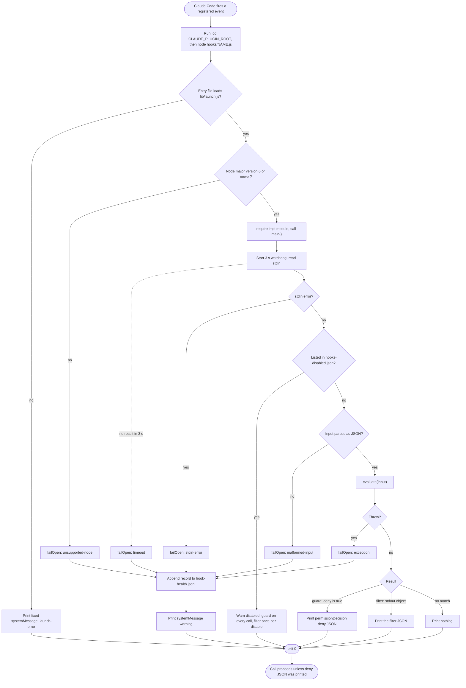
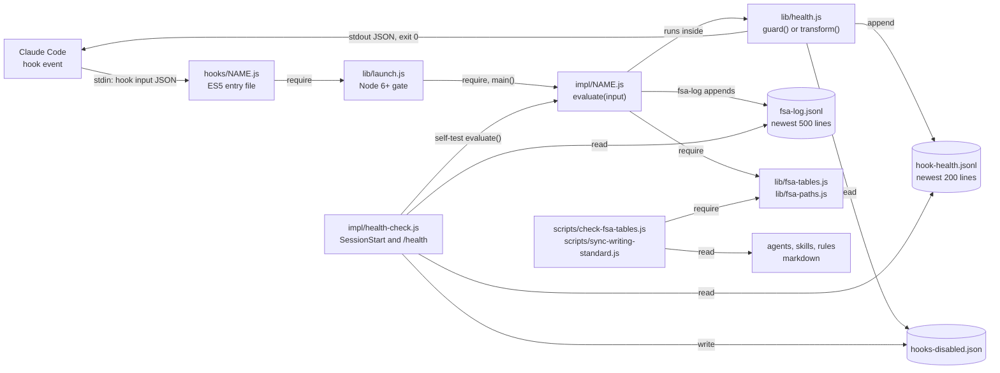

# spec-hooks-platform

## Metadata

| Field | Value |
|---|---|
| **Feature** | Hook platform: registration, launcher, fail-open runtime, disable flag, and health log |
| **Parent feature** | None |
| **Sub-features** | spec-hooks-bash-guards.md, spec-hooks-commit-attribution-guard.md, spec-hooks-injection-filter.md, spec-hooks-prose-hooks.md, spec-hooks-writing-context.md, spec-hooks-terse-output-style.md, spec-hooks-fsa-write-bar.md, spec-hooks-fsa-log.md, spec-hooks-health-check.md, spec-hooks-fsa-table-check.md, spec-hooks-writing-standard-sync.md |
| **Requirement refs** | BR-006, BR-007, UR-017, UR-018, FR-086, FR-087, FR-088, FR-089, FR-090, FR-091, NFR-007, NFR-009, NFR-011, NFR-014, NFR-016, NFR-017 |
| **Feature type** | Architecture |
| **Status** | Draft |

Status values: Draft, Review, Approved, Implemented.

## Description

The hook platform is the shared structure that every assist-plugin hook runs on: one registration file, ten ES5 entry files, a Node version gate, and a fail-open runtime that turns any hook defect into a one-line warning and exit status 0. It exists so a hook bug never blocks the user's session (BR-007) while guards still deny prohibited calls on a positive match. This spec describes the platform as built at assist-plugin 1.11.0 (commit 4803a0d); the child specs describe each hook's own logic. Paths are relative to `plugins/assist-plugin/` unless they start at the repository root.

Area A (orchestration, `specs/spec-orchestration*`) and Area C (skills, `specs/spec-skills*`) own the agents and skills that hooks act on. This spec cross-references them by requirement ID only.

## Open points

Each point is a difference between a requirement or a recorded decision and the code at commit 4803a0d, or a coverage gap no requirement settles. Every Requirement and Scenario a point touches states the built behavior and marks the disputed part "pending OP-B<n>". For each point the user chooses (a) change the requirement text to match the code, or (b) change the code to match the requirement; the other side then follows. Line numbers in `docs/requirements/FR-NFR-assist-plugin.md` refer to the file as it stands after the 2026-10-16 decision "1.11.1 design points for root notes, change check, and grants" (Area B starts at `:1646`). A point marked **Closed** is settled by a recorded decision and keeps its entry so references to it still resolve.

- **OP-B1: FR-088, `evaluate` is not pure.** Requirement: `docs/requirements/FR-NFR-assist-plugin.md:1684` and `rules/assist-plugin-rule.md:407` say a guard denies through "the pure `evaluate(input)`". Code: `commit-attribution-guard` reads a message file inside `evaluate` (`hooks/impl/commit-attribution-guard.js:519-528`, reader at `:435-454`); `prose-gate` reads the target file and its allowlist inside `evaluate` (`hooks/impl/prose-gate.js:55-61`, `hooks/lib/prose-diff.js:43-69`, `:244-261`). The PLANNED FR-181 and FR-186 add a `.git` walk (directory reads) inside the `evaluate` of `prose-gate` and `fsa-write-bar`, also replaceable by a test option. Choice: (a) reword to "the decision function `evaluate(input)`, whose only I/O is file reads a test can replace"; (b) move the reads out of `evaluate` and pass their results in. Pending in: spec-hooks-platform.md (Requirement: Guard decision and deny output).
- **OP-B2: FR-091, the disabled set.** Requirement: `docs/requirements/FR-NFR-assist-plugin.md:1732` says `hooks-disabled.json` equals the guards whose latest self-test denied a known-safe case plus the filters whose latest self-test missed in either direction. Code: an entry is removed only when the hook's latest self-test passes every case (`hooks/impl/health-check.js:888-891`), so a listed guard whose latest run fails only by a missed deny or a thrown case stays listed (`:877-887`). Choice: (a) reword FR-091 to "disable on a false deny (guards) or any failure (filters); remove only after a full pass"; (b) remove a listed hook whenever its latest run has no disabling failure. Pending in: spec-hooks-health-check.md (Requirement: Auto-disable and re-enable).
- **OP-B3: FR-092, any `:solutions-architect` agent.** Requirement: `docs/requirements/FR-NFR-assist-plugin.md:1760` limits "the `solutions-architect` agent's Bash tool". Code: the pattern `(^|:)solutions-architect$` also matches other plugins' agents such as `other-plugin:solutions-architect` (`hooks/impl/sa-mermaid-only.js:17`, `:98-99`); the self-test treats `plugin:assist:solutions-architect` as restricted (`hooks/impl/health-check.js:764`). Choice: (a) reword FR-092 to cover every agent type ending in `solutions-architect`; (b) match only `solutions-architect` and `assist-plugin:solutions-architect`, and update the self-test case. Pending in: spec-hooks-bash-guards.md (Requirement: Mermaid guard scope).
- **OP-B4: FR-094, endpoint variable before any program.** Requirement: `docs/requirements/FR-NFR-assist-plugin.md:1792` denies "a `firecrawl` or `ctx7` command that carries ... an endpoint override variable". Code: a `FIRECRAWL_API_URL=` or `CONTEXT7_*URL*=` word before the program denies the command whatever the program is, for example `CONTEXT7_BASE_URL=http://e npm test` (`hooks/impl/doc-cli-guard.js:60-63`, checked before the program test at `:64-66`). Choice: (a) reword FR-094 to deny such an assignment before any program; (b) apply rule 1 only when the program is `firecrawl` or `ctx7`. Pending in: spec-hooks-bash-guards.md (Requirement: Documentation CLI denial rules, rule 1).
- **OP-B5: FR-118, self-test coverage and notice wording.** (1) Requirement: `docs/requirements/FR-NFR-assist-plugin.md:2199` self-tests "each guard and filter"; `writing-context` runs as a filter (`hooks/impl/writing-context.js:64-66`) but has no entry in the self-test list (`hooks/impl/health-check.js:715-828`; `skills/health/SKILL.md:17` says it has no self-test). (2) The scenario at `docs/requirements/FR-NFR-assist-plugin.md:2208-2211` expects a warning "that protection is weak"; the notice reads `<name> self-test failed (<N> known-prohibited command(s) allowed)` with no such words (`hooks/impl/health-check.js:897-913`). Choice for each: (a) reword FR-118 (exclude `writing-context`; describe the notice as it reads); (b) add a `writing-context` self-test, and add "protection is weak" to the notice for a guard with only missed denies. Pending in: spec-hooks-health-check.md (Requirement: Self-tests; Requirement: Session-start notice).
- **OP-B6: FR-110 and FR-186, which root holds the task plans. Closed** by `DECISIONS.md:93-96` (2026-10-16, "docs/requirements/ and docs/task-plans/ resolve against the session's git root"). The question was whether `fsa-write-bar` judges task plans against the innermost of the input `cwd` and `CLAUDE_PROJECT_DIR` (the built rule, `hooks/impl/fsa-write-bar.js:107-110`, `:148-154`; `hooks/lib/fsa-paths.js:173-181`) or against the git root of the session's `cwd`. The user chose the git root of the session's working directory: a worktree uses its own root, and outside a git repository the working directory counts. FR-186 (`docs/requirements/FR-NFR-assist-plugin.md:2455`) now states it, with a subdirectory-session and a worktree-session scenario (`:2479-2487`). The built FR-110 behavior (`:2062-2076`), which lets a session in `<project>/sub` write `<project>/sub/task-plan-x.md` (`hooks/impl/health-check.js:376`), stays as described for 4803a0d and is replaced in 1.11.1. Specified in: spec-hooks-fsa-write-bar.md (Requirement: Task-planner write scope in docs/task-plans/).
- **OP-B7: DECISIONS.md:55, non-plugin `--agent` main sessions.** Decision: `DECISIONS.md:55` applies the protected paths to "every subagent (any non-empty agent_type, including other plugins' agents)"; FR-112 (`docs/requirements/FR-NFR-assist-plugin.md:2096`) says "every subagent, from any plugin". Code: a call whose `agent_type` lacks the `assist-plugin:` prefix is judged only when it carries an `agent_id` (`hooks/impl/fsa-write-bar.js:115-120`), so a main session started with `--agent my-main-agent` may write `DECISIONS.md` and `.agent/main-plan/**`; the self-test expects that (`hooks/impl/health-check.js:366-368`). Choice: (a) record a decision that refines `DECISIONS.md:55` (a non-plugin `--agent` main session is a main session) and keep the code; (b) judge every call with a non-empty `agent_type`, and change the three self-test cases. Pending in: spec-hooks-fsa-write-bar.md (Requirement: Calls the bar judges; Requirement: Protected paths for every subagent).
- **OP-B8: PowerShell is not covered by `doc-cli-guard`.** Requirement: FR-094 (`docs/requirements/FR-NFR-assist-plugin.md:1792`) applies "for every agent"; UR-021 (`docs/requirements/URD-assist-plugin.md:56`) limits the documentation CLIs to safe forms. Code: `doc-cli-guard` is registered for the `Bash` matcher only (`hooks/hooks.json:5-17`) and judges only `tool_name` `Bash` (`hooks/impl/doc-cli-guard.js:91`). Six agents declare the PowerShell tool: `developer`, `qa`, `researcher`, `worker`, `general-purpose`, and `devops` (`README.md:245`; for example `agents/developer.md:7`), and the main session can use it too. Choice: (a) state in FR-094 that only Bash is covered; (b) register `doc-cli-guard` for `Bash|PowerShell` and judge PowerShell commands. Pending in: spec-hooks-bash-guards.md (Business rules RULE-006).
- **OP-B9: Windows program names.** Requirement: FR-094 (`docs/requirements/FR-NFR-assist-plugin.md:1792`) and FR-099 (`:1879`) name `firecrawl` and `ctx7` (and `curl`, `wget`). Code: the program word is compared after removing the part before the last `/` only, so `ctx7.exe`, `C:\tools\ctx7`, and `firecrawl.cmd` are not recognized (`hooks/impl/doc-cli-guard.js:65-66`; `hooks/impl/injection-filter.js:52`), while `commit-attribution-guard` strips a directory with either separator and a `.exe` suffix (`hooks/impl/commit-attribution-guard.js:351-353`). Choice: (a) state in FR-094 and FR-099 that only the bare names are recognized; (b) normalize the program name the way `commit-attribution-guard` does. Pending in: spec-hooks-bash-guards.md (Requirement: Documentation CLI program detection), spec-hooks-injection-filter.md (Requirement: Tool results that are filtered).
- **OP-B10: Package-runner launch forms.** Requirement: FR-094 (`docs/requirements/FR-NFR-assist-plugin.md:1792`). Code: the wrappers skipped before the program are `env`, `command`, `timeout`, `nice`, `nohup`, `stdbuf`, and `time` (`hooks/lib/shell-program.js:11-19`), so in `npx ctx7 login` or `npx -y ctx7@latest docs ... -o out.md` the program is `npx` and the command is allowed (`hooks/impl/doc-cli-guard.js:64-66`); the same holds for `bunx`, `pnpm dlx`, and `node <path>/ctx7`. Choice: (a) state in FR-094 that launch through a package runner is not covered; (b) treat package runners as wrappers and strip an `@version` suffix from the program name. Pending in: spec-hooks-bash-guards.md (Requirement: Documentation CLI program detection).
- **OP-B11: Injection filter skips PowerShell downloads.** Requirement: FR-099 (`docs/requirements/FR-NFR-assist-plugin.md:1879`) filters "Bash commands that run `firecrawl`, `curl`, `wget`, or `ctx7`"; UR-020 (`docs/requirements/URD-assist-plugin.md:55`) asks for prompt-injection phrasing in untrusted tool results to be replaced. Code: only `tool_name` `Bash` is checked for these programs (`hooks/impl/injection-filter.js:56-61`), so a PowerShell result from `curl`, `Invoke-WebRequest`, or `Invoke-RestMethod` passes unfiltered. Choice: (a) record PowerShell downloads as not covered in FR-099; (b) extend FR-099 and the code to PowerShell download commands. Pending in: spec-hooks-injection-filter.md (Requirement: Tool results that are filtered; Business rules RULE-006).
- **OP-B12: Verdict pairing beyond `intake-reviewer`.** Requirement: FR-126 (`docs/requirements/FR-NFR-assist-plugin.md:2334`) compares only `verdictByStep` with the `intake-reviewer` Outcome cells. Not compared: the `Done with verdict` pairs in `agents/reviewer.md:51` and `agents/code-reviewer.md:52`, and each table's own `verdict` pattern (`hooks/lib/fsa-tables.js:35`, `:50`, `:57`, `:69`, `:81`, `:99`, `:114`). A change to those patterns or cells passes `--check`. Choice: (a) accept the limit as FR-126 states it; (b) add a requirement that compares every table's verdicts with its `Done with verdict` cells. Pending in: spec-hooks-fsa-table-check.md (Requirement: Verdict pairing drift check).
- **OP-B13: FR-186, task-planner writes when the hook input has no usable `cwd`. Closed** by `DECISIONS.md:98-101` (2026-10-16, "1.11.1 design points for root notes, change check, and grants"). The question was what `fsa-write-bar` allows `task-planner` when the `cwd` is missing, empty, or relative: at 4803a0d the roots are the input `cwd` and `CLAUDE_PROJECT_DIR` (`hooks/impl/fsa-write-bar.js:107-110`), and with neither nothing is outside (`hooks/lib/fsa-paths.js:151-160`) and the task-plan glob applies in any directory (`:113-115`). The user chose option (a): only a plain relative `docs/task-plans/task-plan-*.md` is allowed, and absolute, `~`, drive-relative, and `..` targets are denied; `CLAUDE_PROJECT_DIR` does not stand in. FR-186 now states it (`docs/requirements/FR-NFR-assist-plugin.md:2455`, scenarios `:2489-2497`). Specified in: spec-hooks-fsa-write-bar.md (Requirement: Task-planner write scope in docs/task-plans/, step 4; Scenarios: No usable cwd).

## Components

| Component | Responsibility | Owns data | Technology |
|---|---|---|---|
| `hooks/hooks.json` | Registers 10 scripts as 15 command entries with event, matcher, and timeout | none | Claude Code hook configuration |
| `hooks/<name>.js` (10 entry files) | Call `lib/launch.js` with the hook name and module path; if that call throws, print a fixed `systemMessage` and exit 0 | none | Node, ES5 syntax |
| `hooks/lib/launch.js` | Gate on Node 6 or newer, load `impl/<name>.js`, call its `main()`; route every failure to the runtime's fail-open path | none | ES5 syntax |
| `hooks/lib/health.js` | Fail-open runtime: `guard()` for PreToolUse deny hooks, `transform()` for output hooks, `failOpen()`, 3 s watchdog, stdin reader, disable-flag reader, health log | `hook-health.jsonl`, `health-state.json` (notice state) | ES5 syntax |
| `hooks/impl/*.js` (9 hook modules) | Each hook's decision logic, exported as `evaluate(input)` plus `main()` | per child spec | ES2015 syntax |
| `hooks/impl/health-check.js` | Self-tests, disable-flag writes, session notice, `/assist-plugin:health` report | `hooks-disabled.json`, `health-state.json` (notice timestamps) | ES2015 syntax |
| `hooks/lib/` shared logic (`attribution-rules.js`, `injection-rules.js`, `prose-rules.js`, `prose-diff.js`, `shell-program.js`, `fsa-tables.js`, `fsa-paths.js`) | Rule catalogs, parsers, and tables used by the hook modules and the scripts | none | ES2015 syntax |
| `scripts/check-fsa-tables.js`, `scripts/sync-writing-standard.js` | Maintainer drift check and writing-standard sync, run by hand | none | Node, ES2015 syntax |
| `output-styles/terse.md` | Opt-in output style, not a hook | none | Claude Code output style |

Files in the plugin data directory (`${CLAUDE_PLUGIN_DATA}`):

| File | Writer | Readers | Bound |
|---|---|---|---|
| `hook-health.jsonl` | `lib/health.js` for every hook | `health-check` | newest 200 lines (`lib/health.js:25`) |
| `hooks-disabled.json` | `health-check` | `guard()` and `transform()` in `lib/health.js` | one entry per hook name |
| `health-state.json` | `transform()` (`disabledNotice`), `health-check` (`lastNotified`, `fsaLastNotified`) | same | one object |
| `fsa-log.jsonl` | `fsa-log` | `fsa-log` (handback lookup), `health-check` | newest 500 lines (`impl/fsa-log.js:30`) |
| `prose-gate-allowlist.json` | the user | `prose-gate`, `prose-advisor` | 200 entries of at most 500 characters |
| `injection-allowlist.json` | the user | `injection-filter` | 200 entries of at most 500 characters |

## Component boundaries

| Boundary | What crosses it | Protocol | Auth |
|---|---|---|---|
| Claude Code -> entry file | Hook input JSON (`hook_event_name`, `tool_name`, `tool_input`, `tool_response`, `agent_type`, `agent_id`, `cwd`, `session_id`, `prompt`, `last_assistant_message`) | stdin, one JSON document | none; the command line is fixed in `hooks.json` |
| Entry file -> Claude Code | Deny JSON, filter JSON, or `{"systemMessage": ...}`; exit status 0 on every path | stdout | none |
| Process environment -> hooks | `CLAUDE_PLUGIN_ROOT`, `CLAUDE_PLUGIN_DATA`, `CLAUDE_PROJECT_DIR` | environment variables | none |
| Hook runtime -> data directory | Health log records, notice state | JSON lines and JSON files, atomic rename for rewrites | file permissions of the data directory |
| `health-check` -> hook modules | Fixed self-test inputs to the same `evaluate()` the hooks run | in-process function call | none |
| Scripts -> markdown and `lib/` tables | Table rows parsed from agent, skill, and rule files; constants from `lib/fsa-tables.js` and `lib/fsa-paths.js` | file read, `require` | none |

Each command runs `cd "${CLAUDE_PLUGIN_ROOT}" 2>/dev/null || true;` before `node` (`hooks/hooks.json:9`), so the hook process's working directory is the plugin root. A hook command that needs the project location reads the hook input's `cwd` field or `CLAUDE_PROJECT_DIR`, never `process.cwd()`. One code path does read `process.cwd()`: the health check's attribution report falls back to it when `CLAUDE_PROJECT_DIR` is unset (`impl/health-check.js:986`). That path runs only in report mode, started by the `/assist-plugin:health` skill through the Bash tool, where the working directory is the session's; the SessionStart command (`--session-start`) never reads the settings files (`impl/health-check.js:1107-1114`).

## Data flow

Start-to-end flow of one hook call. Source: [spec-hooks-platform-dataflow.mmd](spec-hooks-platform-dataflow.mmd).



**Note:** PNG rendering requires mermaid-cli with its headless browser. `mmdc` is installed on this machine, but its run on 2026-10-14 failed: "Could not find chrome-headless-shell (ver. 154.0.8037.57)". After the user installs the browser (`npx puppeteer browsers install chrome-headless-shell`), render with:

```bash
mmdc -i specs/spec-hooks-platform-dataflow.mmd -o specs/spec-hooks-platform-dataflow.png
mmdc -i specs/spec-hooks-platform-topology.mmd -o specs/spec-hooks-platform-topology.png
```

### Requirement: Hook registration

The plugin SHALL register exactly the 15 command entries below in `hooks/hooks.json`, built from 10 scripts, each with `"type": "command"`, a command of the form `cd "${CLAUDE_PLUGIN_ROOT}" 2>/dev/null || true; node "${CLAUDE_PLUGIN_ROOT}/hooks/<script>.js"`, and the listed timeout.

**Requirement refs:** FR-086, NFR-007, UR-017
**Status:** Built
**Source:** `hooks/hooks.json:3-158`

| # | Event | Matcher | Script | Extra argument | Timeout (s) |
|---|---|---|---|---|---|
| 1 | PreToolUse | `Bash` | `sa-mermaid-only` | none | 5 |
| 2 | PreToolUse | `Bash` | `doc-cli-guard` | none | 5 |
| 3 | PreToolUse | `Bash\|PowerShell` | `commit-attribution-guard` | none | 5 |
| 4 | PreToolUse | `Agent` | `injection-filter` | none | 5 |
| 5 | PreToolUse | `Write\|Edit\|MultiEdit\|NotebookEdit` | `prose-gate` | none | 5 |
| 6 | PreToolUse | `Write\|Edit\|MultiEdit\|NotebookEdit` | `fsa-write-bar` | none | 5 |
| 7 | PostToolUse | `.*` | `injection-filter` | none | 5 |
| 8 | PostToolUse | `Write\|Edit\|MultiEdit\|NotebookEdit` | `prose-advisor` | none | 5 |
| 9 | PostToolUse | `Agent` | `fsa-log` | none | 5 |
| 10 | PostToolUse | `SubagentHandback` | `fsa-log` | none | 5 |
| 11 | UserPromptSubmit | none | `injection-filter` | none | 5 |
| 12 | SessionStart | `startup\|resume` | `health-check` | `--session-start` | 10 |
| 13 | SessionStart | `startup\|resume\|clear\|compact` | `writing-context` | none | 5 |
| 14 | SubagentStart | `.*` | `writing-context` | none | 5 |
| 15 | SubagentStop | `.*` | `fsa-log` | none | 5 |

#### Scenario: Registration count

- **GIVEN** `hooks/hooks.json` at commit 4803a0d
- **WHEN** a test counts the entries whose `type` is `command`
- **THEN** the count SHALL be 15
- **AND** the set of script names SHALL be `sa-mermaid-only`, `doc-cli-guard`, `commit-attribution-guard`, `injection-filter`, `prose-gate`, `prose-advisor`, `fsa-write-bar`, `fsa-log`, `health-check`, and `writing-context`

#### Scenario: Timeouts

- **GIVEN** the same file
- **WHEN** a test reads each entry's `timeout`
- **THEN** every entry SHALL read 5 except `health-check.js --session-start`, which SHALL read 10

#### Scenario: Registration drift

- **GIVEN** a change that removes the `SubagentHandback` entry
- **WHEN** the registration test runs
- **THEN** the test SHALL fail and name the missing event and matcher

### Requirement: Entry file and Node version gate

Each hook command SHALL start in an ES5 entry file `hooks/<script>.js` that calls `lib/launch.js`, which loads `impl/<script>.js` only on Node 6 or newer and otherwise warns and exits 0 without denying.

**Requirement refs:** FR-087, NFR-017, NFR-009, UR-017
**Status:** Built
**Source:** `hooks/sa-mermaid-only.js:7-19` (same shape in all 10 entry files); `hooks/lib/launch.js:16`, `:27-30`, `:66-92`

Version handling: the major version comes from `process.version` (`v<major>[.<minor>[.<patch>]]`); anything else is "unknown" and unsupported (`lib/launch.js:19-30`).

#### Scenario: Supported Node

- **GIVEN** Node 18
- **WHEN** `node hooks/prose-gate.js` runs with a hook input on stdin
- **THEN** the launcher SHALL load `impl/prose-gate.js` and call its `main()`

#### Scenario: Node older than 6

- **GIVEN** Node 4.9.1 and a writable `CLAUDE_PLUGIN_DATA`
- **WHEN** `node hooks/prose-gate.js` runs
- **THEN** the hook SHALL print `{"systemMessage":"assist-plugin prose-gate hook failed (unsupported-node: Node v4.9.1 is not supported (minimum 6)); this write was not checked"}` and exit 0
- **AND** `hook-health.jsonl` SHALL gain one record with `kind` `unsupported-node`

#### Scenario: Launcher cannot load

- **GIVEN** `hooks/lib/launch.js` is missing
- **WHEN** `node hooks/fsa-log.js` runs
- **THEN** the entry file SHALL print `{"systemMessage":"assist-plugin fsa-log hook failed (launch-error); this subagent report was not checked"}` and exit 0

#### Scenario: Syntax check on Node 6

- **GIVEN** every file under `hooks/`
- **WHEN** Node 6.17.1 parses each file
- **THEN** no file SHALL raise a syntax error

### Requirement: Guard decision and deny output

A guard (a PreToolUse hook run through `guard()` in `lib/health.js`) SHALL block a call only when its `evaluate(input)` returns an object whose `deny` field is the boolean `true`, by printing one JSON document `{"hookSpecificOutput":{"hookEventName":"PreToolUse","permissionDecision":"deny","permissionDecisionReason":<reason>}}` and exiting 0.

**Requirement refs:** FR-088, NFR-009, UR-017
**Status:** Built; the wording "pure `evaluate(input)`" is pending OP-B1
**Source:** `hooks/lib/health.js:385-443`; `rules/assist-plugin-rule.md` (Hook Fail-Open Rule)

Rules:
- The guards are `sa-mermaid-only`, `doc-cli-guard`, `commit-attribution-guard`, `prose-gate`, and `fsa-write-bar`.
- `evaluate(input)` does not touch stdout or the process. Two guards read files inside it: `commit-attribution-guard` reads a message file (`impl/commit-attribution-guard.js:435-465`) and `prose-gate` reads the target file and its allowlist (`lib/prose-diff.js:43-69`). Both reads are replaceable through an `options` argument for tests.
- An empty or non-string reason becomes `blocked by assist-plugin guard <name>` (`lib/health.js:438`).
- No code path exits with a status other than 0.

#### Scenario: Positive match

- **GIVEN** the Bash command `ctx7 login`
- **WHEN** `doc-cli-guard` evaluates it
- **THEN** the hook SHALL print the deny JSON with the reason `ctx7 login writes config or credentials; ask the user to run it themselves` and exit 0

#### Scenario: No match

- **GIVEN** the Bash command `git status` from the main session
- **WHEN** every Bash guard evaluates it
- **THEN** each guard SHALL print nothing and exit 0

#### Scenario: Truthy value that is not true

- **GIVEN** a guard whose `evaluate` returns `{"deny": "yes"}`
- **WHEN** the runtime reads the decision
- **THEN** the runtime SHALL print nothing and exit 0

### Requirement: Filter output

A filter (a hook run through `transform()` in `lib/health.js`) SHALL print output only when its function returns an object holding a `stdout` object, printing that object as one JSON document, flushed before exit 0.

**Requirement refs:** FR-088, FR-089, NFR-009, UR-017
**Status:** Built
**Source:** `hooks/lib/health.js:460-527`, `:273-302`

Rules:
- The filters are `injection-filter`, `prose-advisor`, `fsa-log`, and `writing-context`.
- A result with a `logKind` matching `^[a-z-]{1,40}$` adds one health-log record of that kind with the result's `message` (`lib/health.js:508-510`).
- A `stdout` object that cannot be serialized goes to the failure path with kind `exception` (`lib/health.js:512-518`).
- A filter never returns a deny decision. `injection-filter` may return `permissionDecision: "ask"` (see spec-hooks-injection-filter.md).

#### Scenario: Positive result

- **GIVEN** `writing-context` returns `{"stdout": {"hookSpecificOutput": {...}}}`
- **WHEN** the runtime finishes
- **THEN** stdout SHALL hold exactly that JSON and the exit status SHALL be 0

#### Scenario: Null result

- **GIVEN** `prose-advisor` returns `null` for a clean write
- **WHEN** the runtime finishes
- **THEN** stdout SHALL be empty and the exit status SHALL be 0

#### Scenario: Output that cannot be serialized

- **GIVEN** a filter returns a `stdout` object that holds a circular reference
- **WHEN** the runtime serializes it
- **THEN** the runtime SHALL take the failure path with kind `exception`, print only the `systemMessage` warning, and exit 0

### Requirement: Failure path

Every hook SHALL, on a thrown error, uncaught exception, unhandled rejection, stdin error, malformed input, timeout, unsupported Node, or launcher error, append one health-log record, print only `{"systemMessage": "assist-plugin <hook> hook failed (<kind>[: <detail>]); <suffix>"}`, and exit 0 so the call proceeds.

**Requirement refs:** FR-089, NFR-009, UR-017, BR-007
**Status:** Built
**Source:** `hooks/lib/health.js:6-16`, `:316-347`, `:400-435`; `hooks/lib/launch.js:32-41`

Failure kinds and where they arise:

| Kind | Raised by | Detail text |
|---|---|---|
| `unsupported-node` | `lib/launch.js:75-82` | `Node <version> is not supported (minimum 6)` |
| `launch-error` | `lib/launch.js:85-90`, entry files | `could not start` plus the error description |
| `uncaught-exception`, `unhandled-rejection` | `lib/health.js:340-347` | error description |
| `timeout` | `lib/health.js:350-356` | `no result within 3000 ms` (8000 ms for `health-check`) |
| `stdin-error` | `lib/health.js:402-404` | `could not read hook input` |
| `malformed-input` | `lib/health.js:423-427` | `hook input is not valid JSON` |
| `exception` | `lib/health.js:430-434`, `:504-506`, `:512-518`; `impl/health-check.js:1134-1138` | `guard logic failed`, `filter logic failed`, `filter output could not be serialized` (`lib/health.js:516`), or `health check failed` (`impl/health-check.js:1137`), each followed by the error description |

The suffix depends on where the failure arises:

| Where | Suffix |
|---|---|
| `lib/launch.js` (`unsupported-node`, `launch-error`), by hook (`lib/launch.js:32-41`) | `health-check`: the health check did not run; `injection-filter`: this content was not filtered; `prose-gate`, `fsa-write-bar`: this write was not checked; `prose-advisor`: this write was not reviewed; `writing-context`: the writing standard was not loaded; `fsa-log`: this subagent report was not checked; other guards: this command was not checked |
| `guard()` in `lib/health.js` (every guard) | this command was not checked (`lib/health.js:27`; `guard()` passes no suffix) |
| `transform()` in `lib/health.js` | the hook's own: `injection-filter` this content was not filtered (default, `lib/health.js:467`); `prose-advisor` this write was not reviewed; `writing-context` the writing standard was not loaded; `fsa-log` this subagent report was not checked |
| `impl/health-check.js` | the health check did not complete (`impl/health-check.js:1131`) |

Only the first failure of a process prints; later failures in the same process are ignored (`finished` flag, `lib/health.js:320-321`).

#### Scenario: Malformed input

- **GIVEN** `fsa-write-bar` receives the stdin text `not json`
- **WHEN** it runs
- **THEN** it SHALL print `{"systemMessage":"assist-plugin fsa-write-bar hook failed (malformed-input: hook input is not valid JSON); this command was not checked"}` and exit 0
- **AND** the write SHALL proceed

#### Scenario: Guard logic throws

- **GIVEN** a guard whose `evaluate` throws a `TypeError` at `impl/doc-cli-guard.js:65`
- **WHEN** the runtime calls it
- **THEN** the hook SHALL print a `systemMessage` naming kind `exception` and exit 0
- **AND** the health-log record's message SHALL read `guard logic failed: TypeError at doc-cli-guard.js:65`

#### Scenario: Warning write fails

- **GIVEN** stdout is closed so the warning cannot be written
- **WHEN** the hook reaches the failure path
- **THEN** the hook SHALL exit 0 without output

### Requirement: Watchdog

Each guard and filter SHALL give up after 3000 ms without a result, before Claude Code's registered 5 s timeout, by taking the failure path with kind `timeout`.

**Requirement refs:** NFR-007, NFR-009
**Status:** Built
**Source:** `hooks/lib/health.js:26`, `:350-356`, `:399`, `:469`; `hooks/impl/health-check.js:55`, `:1133`

The watchdog timer is `unref`'d, so a hook that finishes early exits without waiting for it. `health-check` uses an 8000 ms watchdog against its 10 s registration.

#### Scenario: Hook does not answer

- **GIVEN** a guard whose stdin never closes
- **WHEN** 3000 ms pass
- **THEN** the hook SHALL print a `systemMessage` naming kind `timeout` and exit 0
- **AND** `hook-health.jsonl` SHALL gain one record with `kind` `timeout`

#### Scenario: Prompt finish

- **GIVEN** a guard that finishes in 50 ms
- **WHEN** it exits
- **THEN** the process SHALL exit without waiting for the watchdog

### Requirement: Disabled hooks pass through

The runtime SHALL let a call proceed without running a hook's logic when `${CLAUDE_PLUGIN_DATA}/hooks-disabled.json` lists that hook's name, warning on every call for a guard and once per disable event for a filter.

**Requirement refs:** FR-091, NFR-009, UR-017
**Status:** Built
**Source:** `hooks/lib/health.js:106-133`, `:406-421`, `:445-458`, `:476-493`

Rules:
- Only keys matching `^[a-z-]{1,40}$` count; `reason` and `ts` are sanitized or replaced by `<invalid>` (`lib/health.js:107-118`). A missing, unreadable, or non-object file means no hook is disabled.
- Guard warning: `assist-plugin <name> guard is disabled (<reason>); protection is off and this command was not checked. Run /assist-plugin:health for details.`
- Filter warning: `assist-plugin <name> is disabled (<reason>); <note>. Run /assist-plugin:health for details.`, where `<note>` is `subagent reports are no longer logged or checked` for `fsa-log` and `protection is off and this content was not filtered` for the others. The filter warning shows once per `ts` value, remembered in `health-state.json` under `disabledNotice`.
- The producer side (when `health-check` adds or removes an entry) is in spec-hooks-health-check.md.

#### Scenario: Disabled guard

- **GIVEN** `hooks-disabled.json` holds `{"doc-cli-guard": {"reason": "self-test: known-safe command denied (1 case)", "ts": "2026-10-14T09:00:00.000Z"}}`
- **WHEN** a Bash call runs `ctx7 login`
- **THEN** `doc-cli-guard` SHALL print the guard warning and exit 0 without a deny decision

#### Scenario: Disabled filter warns once

- **GIVEN** `injection-filter` is listed with one `ts` value
- **WHEN** two `WebFetch` results arrive in turn
- **THEN** the first SHALL produce the filter warning and the second SHALL produce no output

#### Scenario: Corrupt flag file

- **GIVEN** `hooks-disabled.json` holds the text `[1, 2]`
- **WHEN** any guard runs
- **THEN** the guard SHALL run its normal logic

### Requirement: Health log content, privacy, and cap

The runtime SHALL record each hook failure in `${CLAUDE_PLUGIN_DATA}/hook-health.jsonl` as one JSON line `{ts, hook, node, kind, message}` that holds no command text, arguments, environment values, stdin, or error message text, keeping only the newest 200 lines.

**Requirement refs:** FR-090, NFR-014, NFR-016, UR-018, BR-006
**Status:** Built
**Source:** `hooks/lib/health.js:14-16`, `:22-25`, `:80-104`, `:196-238`, `:240-254`, `:316-338`

Field rules:
- `ts`: ISO 8601 UTC with milliseconds; `node`: `v<major>[.<minor>[.<patch>]]`; `hook` and `kind`: `^[a-z-]{1,40}$`.
- `message`: a fixed detail string from plugin code plus an error description of name, `code` (`^[A-Z0-9_]{1,30}$`), and the first `<file>.js:<line>` of the stack. The error's own message is never copied, because a `JSON.parse` message can quote the input.
- `sanitize()` replaces control characters with spaces and cuts text to 200 characters.
- After each append the file is read back, and when it holds more than 200 lines the newest 200 are written to a temporary file and renamed over it.
- When `CLAUDE_PLUGIN_DATA` is unset, nothing is logged and guards cannot be disabled; the hooks still fail open (section 7 constraints of `docs/requirements/FR-NFR-assist-plugin.md`).
- A health-log write failure never changes the hook's outcome (`lib/health.js:226-238`, `:324-334`).

#### Scenario: Secret in a failing command

- **GIVEN** a guard throws while evaluating a command that holds the string `token=abc123`
- **WHEN** the runtime logs the failure
- **THEN** the record SHALL hold the error name and source line
- **AND** the file SHALL NOT contain `abc123`

#### Scenario: Line cap

- **GIVEN** `hook-health.jsonl` holds 200 lines
- **WHEN** another failure is logged
- **THEN** the file SHALL hold 200 lines, the oldest one removed

#### Scenario: Data directory unset

- **GIVEN** `CLAUDE_PLUGIN_DATA` is unset
- **WHEN** a hook receives malformed input
- **THEN** the hook SHALL print the `systemMessage` warning and exit 0
- **AND** no log file SHALL be created

## Topology

Component connections and data direction. Source: [spec-hooks-platform-topology.mmd](spec-hooks-platform-topology.mmd).



## Cloud boundaries

Not applicable: every component runs as a local Node process on the user's machine.

## Failure modes

| Failure | Impact | Detection | Mitigation |
|---|---|---|---|
| `node` missing from PATH | No hook runs; Claude Code shows its own hook error and the call proceeds | Claude Code hook error notice | `/assist-plugin:health` finding `node: command not found` (FR-166, Area C) |
| Node older than 6 | Guards and filters do not run | `unsupported-node` warning and log record | Install Node 6 or newer |
| Hook logic bug (throw) | That call is unchecked | `exception` warning and log record | Report; self-test may auto-disable the hook (spec-hooks-health-check.md) |
| Hook stalls | Call waits up to 3 s | `timeout` record | Watchdog takes the fail-open path |
| Guard denies safe calls | User work blocked | SessionStart self-test false deny | Auto-disable until a later self-test passes (FR-091) |
| `CLAUDE_PLUGIN_DATA` unset | No log, no auto-disable | Report line `Data directory: NOT SET` | Run through Claude Code with the plugin installed |
| Data directory unwritable | No log | Health log stays empty; `fsa-log` reports `log-write-error` when its own write fails | Fix permissions |
| A subagent writes through Bash | `fsa-write-bar` does not see it | none | Out of scope (`docs/requirements/FR-NFR-assist-plugin.md` section 6); hooks are guardrails |

## Non-functional requirements addressed

| NFR | Target | How this architecture achieves it |
|---|---|---|
| NFR-007 | Each command finishes within 5 s (10 s for the SessionStart health check) | Registered timeouts; 3 s watchdog in `guard()` and `transform()`, 8 s in `health-check` |
| NFR-009 | 0 denials from any failure kind; exit status 0 | Single deny path in `guard()`; every other branch ends in `exitZero()` |
| NFR-011 | `✓ LLM Security Clear` before merging any change under `hooks/**` or `rules/*.md` | Change-control rule owned by Area A (FR-061); applies to every file this spec and its children name under `hooks/`, `rules/`, and `agents/` |
| NFR-014 | 200 health-log lines, 500 `fsa-log` lines, 64 KB per message file | `MAX_LOG_LINES` in `lib/health.js:25` and `impl/fsa-log.js:30`; `MAX_FILE_BYTES` in `impl/commit-attribution-guard.js:31` |
| NFR-016 | 0 command, argument, environment, stdin, prompt, or report fields in the two logs | Fixed detail strings, error description without message, validated fields (`lib/health.js:94-104`; spec-hooks-fsa-log.md) |
| NFR-017 | Parse and run on Node 6 or newer | ES5 entry files, `lib/launch.js`, and `lib/health.js`; ES2015 elsewhere; matrix 6.17.1, 8, 10, 12, 14, 18, 26 (`lib/launch.js:12-16`) |

## Design decisions

| Decision | Options considered | Chosen | Rationale |
|---|---|---|---|
| How a hook blocks a call | Exit status 2; deny JSON with exit 0 | Deny JSON with exit 0 | Exit 2 also fires on crashes and would turn bugs into blocks; JSON makes the deny an explicit positive result (`rules/assist-plugin-rule.md`, Hook Fail-Open Rule) |
| Where the Node check lives | In each module; in a separate ES5 launcher | ES5 entry plus `lib/launch.js` | An ES2015 module fails to parse on old Node before any check could run |
| Decision logic placement | Inline in `main()`; pure `evaluate()` plus a shared runner | `evaluate()` plus `guard()` and `transform()` | `health-check` self-tests the same function the hook runs |
| Timeout handling | Rely on Claude Code's timeout; own watchdog | Own 3 s watchdog | The hook logs a `timeout` record and warns before Claude Code kills it |
| Disabled-hook notice | Every call; once per disable | Guards every call, filters once | A guard's protection gap matters per command; filters fire on every tool result and would flood the session |
| Error text in the log | Copy `err.message`; name, code, and line only | Name, code, and line | `JSON.parse` errors can quote input that holds secrets (NFR-016) |
| Hook process working directory | Inherit the session's; `cd` to the plugin root | `cd` to the plugin root | Module resolution does not depend on the session; the project comes from the input's `cwd` or `CLAUDE_PROJECT_DIR` |

## Sub-feature breakdown

| Sub-feature | Spec file | Description |
|---|---|---|
| Bash CLI guards | spec-hooks-bash-guards.md | `sa-mermaid-only` and `doc-cli-guard` (FR-092 to FR-094) |
| Commit attribution guard | spec-hooks-commit-attribution-guard.md | AI attribution lines in commit messages and PR bodies (FR-095 to FR-098) |
| Injection filter | spec-hooks-injection-filter.md | Marker replacement in untrusted tool results, subagent prompts, typed prompts (FR-099 to FR-102) |
| Prose hooks | spec-hooks-prose-hooks.md | `prose-gate` and `prose-advisor`, including the PLANNED project-root fix (FR-103 to FR-106, FR-181) |
| Writing context | spec-hooks-writing-context.md | Compact writing standard injected at session and subagent start (FR-107) |
| Terse output style | spec-hooks-terse-output-style.md | Opt-in output style (FR-125) |
| FSA write bar | spec-hooks-fsa-write-bar.md | Per-agent write limits and protected paths (FR-108 to FR-114), including the PLANNED move of task plans to `docs/task-plans/` (FR-186) |
| FSA log | spec-hooks-fsa-log.md | Terminal-block log in warn mode (FR-115 to FR-117) |
| Health check | spec-hooks-health-check.md | Self-tests, auto-disable, session notice, report (FR-091, FR-118 to FR-120) |
| FSA table check | spec-hooks-fsa-table-check.md | Drift check, including the PLANNED write guard lists (FR-121, FR-122, FR-126 to FR-129, FR-180) |
| Writing standard sync | spec-hooks-writing-standard-sync.md | Report Writing Standard block sync (FR-123, FR-124) |

## Submodule scope

Not applicable: the plugin has no submodules.

## Error handling

| Error condition | Handling strategy | Outcome |
|---|---|---|
| Any failure kind in the Failure path table | Log a record, print one `systemMessage`, exit 0 | The user sees one warning line; the tool call or content proceeds unchecked |
| Health-log write fails | Ignore the write error | The warning still prints; nothing is logged |
| stdout write fails | Fall back from `fs.writeSync` to the stream, then give up | Exit 0 with no output |
| Disabled hook | Skip the logic, warn | The call proceeds unchecked |
| Unknown or extra hook input fields | Ignored | Normal evaluation |

## Events

| Event name | Producer | Consumer(s) | Payload summary | Guarantee |
|---|---|---|---|---|
| PreToolUse, PostToolUse, UserPromptSubmit, SessionStart, SubagentStart, SubagentStop | Claude Code | The hooks in the registration table | Hook input JSON on stdin | One invocation per matching registration, best-effort (fail-open) |
| Hook output | Each hook | Claude Code | Deny JSON, filter JSON, or `systemMessage` | Best-effort; exit 0 on every path |
| `hook-health.jsonl` record | `lib/health.js`, `fsa-log` (`log-write-error`), `writing-context` (`missing-standard`, `empty-standard`, `standard-truncated`) | `health-check` session notice and report | `{ts, hook, node, kind, message}` | Best-effort append, newest 200 kept |
| `hooks-disabled.json` entry | `health-check` | `guard()`, `transform()` | `{<hook>: {reason, ts}}` | Atomic rewrite |
| `fsa-log.jsonl` record | `fsa-log` | `fsa-log`, `health-check` | See spec-hooks-fsa-log.md | Best-effort append, newest 500 kept |

## Traceability

| Requirement | Spec section | Verified by |
|---|---|---|
| BR-006 | Requirement: Health log content, privacy, and cap | Log privacy scenario |
| BR-007 | Requirement: Failure path; Non-functional requirements addressed | Fail-open scenarios; SC-004 run with malformed input and Node older than 6 |
| UR-017 | Requirement: Failure path; Requirement: Disabled hooks pass through | Malformed input and disabled-guard scenarios |
| UR-018 | Requirement: Health log content, privacy, and cap | Line cap scenario; `/assist-plugin:health` report |
| FR-086 | Requirement: Hook registration | Registration count and timeout tests on `hooks/hooks.json` |
| FR-087 | Requirement: Entry file and Node version gate | Node 4 and Node 18 runs of an entry file |
| FR-088 | Requirement: Guard decision and deny output; Requirement: Filter output | `ctx7 login` deny test; truthy-value test |
| FR-089 | Requirement: Failure path | Malformed input, throw, and closed-stdout tests |
| FR-090 | Requirement: Health log content, privacy, and cap | Secret-in-command and line-cap tests |
| FR-091 | Requirement: Disabled hooks pass through (consumer side) | Disabled guard and filter tests; producer side in spec-hooks-health-check.md |
| NFR-007 | Requirement: Watchdog | Stalled-stdin test |
| NFR-009 | Requirement: Failure path; Requirement: Watchdog | One test per failure kind, each asserting exit 0 and no deny |
| NFR-011 | Non-functional requirements addressed | Merge policy review of `✓ LLM Security Clear` |
| NFR-014 | Requirement: Health log content, privacy, and cap | Line cap test; bounds in child specs |
| NFR-016 | Requirement: Health log content, privacy, and cap | Secret-in-command test |
| NFR-017 | Requirement: Entry file and Node version gate | Node 6.17.1 parse of every file under `hooks/` |
