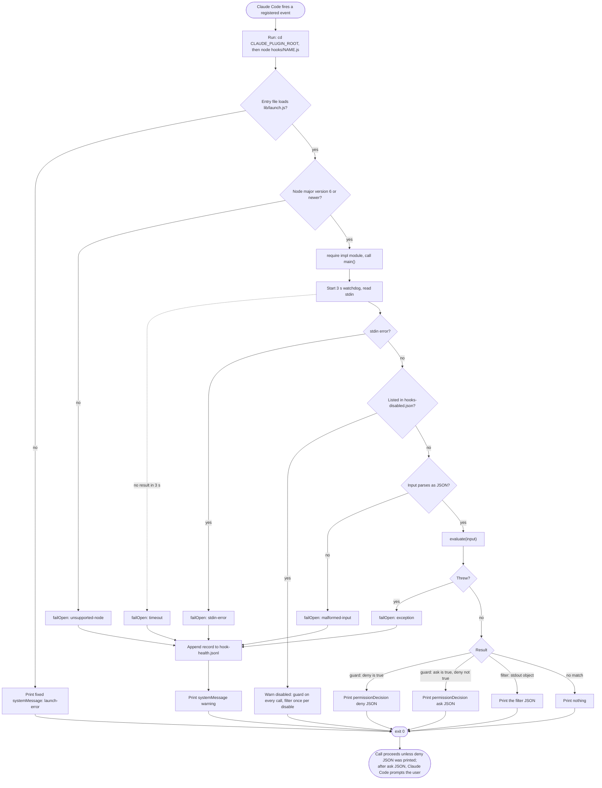
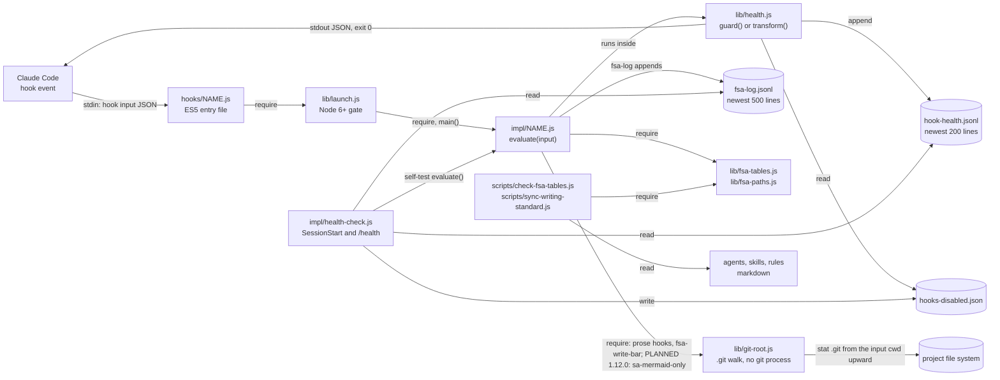
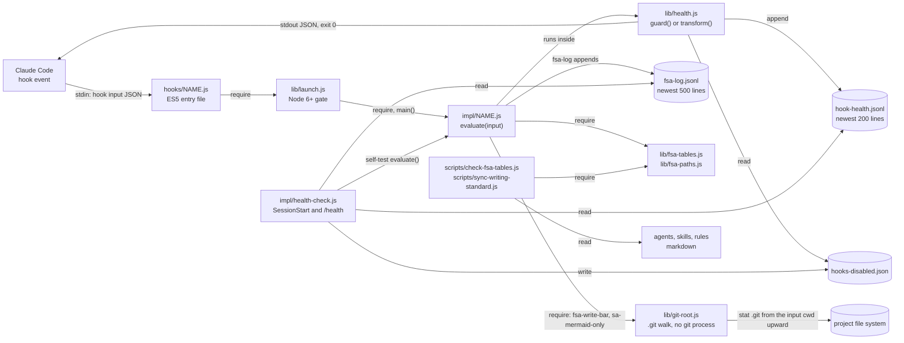

# spec-hooks-platform

## Metadata

| Field | Value |
|---|---|
| **Feature** | Hook platform: registration, launcher, fail-open runtime, disable flag, and health log |
| **Parent feature** | None |
| **Sub-features** | spec-hooks-bash-guards.md, spec-hooks-commit-attribution-guard.md, spec-hooks-injection-filter.md, spec-hooks-prose-hooks.md, spec-hooks-writing-context.md, spec-hooks-terse-output-style.md, spec-hooks-fsa-write-bar.md, spec-hooks-fsa-log.md, spec-hooks-health-check.md, spec-hooks-fsa-table-check.md, spec-hooks-writing-standard-sync.md, spec-hooks-pr-post-ask.md, spec-hooks-audit.md, spec-hooks-goal-guard.md, spec-hooks-compliance.md |
| **Requirement refs** | BR-006, BR-007, UR-017, UR-018, UR-055, UR-059, UR-062, UR-063, UR-065, UR-067, UR-068, UR-069, UR-075, FR-086, FR-087, FR-088, FR-089, FR-090, FR-091, FR-094, FR-104, FR-206, FR-213, FR-214, FR-217, FR-219, FR-220, FR-221, FR-223, FR-224, FR-225, FR-228, FR-230, FR-231, FR-232, FR-233, FR-242, FR-243, FR-245, FR-246, FR-247, NFR-007, NFR-009, NFR-011, NFR-014, NFR-016, NFR-017, NFR-025, NFR-026, NFR-028, NFR-029, NFR-030, NFR-031, NFR-032, NFR-035, NFR-036 |
| **Feature type** | Architecture |
| **Status** | Review |

Status values: Draft, Review, Approved, Implemented.

## Description

The hook platform is the shared structure that every assist-plugin hook runs on: one registration file, eleven ES5 entry files, a Node version gate, and a fail-open runtime that turns any hook defect into a one-line warning and exit status 0. It exists so a hook bug never blocks the user's session (BR-007) while guards still deny prohibited calls on a positive match, and the one ask guard (`pr-post-ask`, FR-206) asks the user before a pull request post. This spec describes the platform as built at assist-plugin 1.11.1 (commit 41034c1), which added `hooks/lib/git-root.js` for FR-181 and FR-186, except Requirement: Hook registration and Requirement: Guard decision and deny output, which describe the build of 2026-10-22 (follow-up to 1.12.0), folded from the Change Logs 2026-10-16 and 2026-10-22 (Change Log: 2026-10-22 (fold)); the child specs describe each hook's own logic. Paths are relative to `plugins/assist-plugin/` unless they start at the repository root.

Area A (orchestration, `specs/spec-orchestration*`) and Area C (skills, `specs/spec-skills*`) own the agents and skills that hooks act on. This spec cross-references them by requirement ID only.

## Open points

Each point was a difference between a requirement or a recorded decision and the code at commit 4803a0d, or a coverage gap no requirement settled. For each point the user chose (a) change the requirement text to match the code, or (b) change the code to match the requirement. All thirteen points are **Closed**: OP-B6 and OP-B13 by decisions recorded before the 1.11.1 build, and the other eleven by the user's answers of 2026-10-16 (`.agent/main-plan/plan-deferred-decisions-20261016-1059.md`, User Decisions), which `docs/requirements/FR-NFR-assist-plugin.md` v1.1 (2026-10-16, final and approved; Area B from `:1792`) applies, with the refinements at `DECISIONS.md:168-171` (PowerShell aliases and case, writing-context self-test) `:173-176` (`mmdc` reaches `<git root>/<dir>/specs/`), `:188-196` (`doc-cli-guard` judges each part of a chained command; the injection filter skips PowerShell assignment forms), `:198-201` (`doc-cli-guard` is best-effort, with `exec`, `sudo`, and `eval` as wrappers and a listed set of known gaps), and `:213-216` (more known-gap forms for `doc-cli-guard` and the injection filter). Each entry keeps its id so references to it still resolve. Line numbers in `FR-NFR-assist-plugin.md` refer to v1.2 (2026-10-17), whose Area B lines match v1.1, and code line numbers refer to assist-plugin 1.11.1 (commit 41034c1). Where a closed point changes behavior, the owning spec states the change as PLANNED (1.12.0) in its change log.

- **OP-B1: FR-088, `evaluate` is not pure. Closed** 2026-10-16, option (a). FR-088 (`:1828-1847`, statement `:1830`) now reads "the decision function `evaluate(input)` of a guard, whose only I/O is file reads that a test can replace". The code already behaves so: `commit-attribution-guard` reads a message file (`hooks/impl/commit-attribution-guard.js:434-466`, `:519-528`), `prose-gate` reads the target file and its allowlist and walks for `.git` (`hooks/impl/prose-gate.js:57-70`; `hooks/lib/prose-diff.js:47-72`, `:108-120`), and `fsa-write-bar` walks for `.git` on a `task-planner` call (`hooks/impl/fsa-write-bar.js:125-131`, `:167-168`), each replaceable through an `options` argument. PLANNED (1.12.0): the same wording in `rules/assist-plugin-rule.md:407` (Hook Fail-Open Rule), which still says "the pure `evaluate(input)`". Specified in: this spec (Change Log 2026-10-16, Requirement: Guard decision and deny output).
- **OP-B2: FR-091, the disabled set. Closed** 2026-10-16, option (a). FR-091 (`:1881-1915`, statement `:1883`) states the built rule: a guard is added on a false deny, a filter (`injection-filter`, `prose-advisor`, `fsa-log`) on any self-test failure, and an entry is removed only after a full passing self-test (`hooks/impl/health-check.js:962-989`). No code behavior changes for these hooks; the PLANNED `writing-context` self-test is reported and never adds `writing-context` to `hooks-disabled.json` (scenario `:1907-1910`; `DECISIONS.md:168-171`). PLANNED (1.12.0): the wording of the Hook Fail-Open Rule (`rules/assist-plugin-rule.md:411`) and of "the `hooks/impl/health-check.js:10-16` header", as FR-091 names it (`:1884`); the line that needs the edit is `hooks/impl/health-check.js:8`, which says a guard that only misses a deny "stays enabled", which is not so for a guard already listed. Specified in: spec-hooks-health-check.md (Change Log 2026-10-16).
- **OP-B3: FR-092, any `:solutions-architect` agent. Closed** 2026-10-16, option (a). FR-092 (`:1919-1938`, statement `:1921`) covers every agent whose type is `solutions-architect` or ends in `:solutions-architect`, which the built pattern `(^|:)solutions-architect$` already matches (`hooks/impl/sa-mermaid-only.js:17`, `:98-99`; self-test case `plugin:assist:solutions-architect`, `hooks/impl/health-check.js:851`). Built; no code change. Specified in: spec-hooks-bash-guards.md (Requirement: Mermaid guard scope).
- **OP-B4: FR-094, endpoint variable before any program. Closed** 2026-10-16, option (a). FR-094 (`:1996-2055`, statement `:1998`) denies an endpoint override variable assigned before any program, as built (`hooks/impl/doc-cli-guard.js:60-63`, checked before the program test at `:64-66`). PLANNED (1.12.0): the PowerShell form `$env:FIRECRAWL_API_URL=` or `$env:CONTEXT7_*URL*=`, matched without regard to case and with spaces allowed around `=`, while Bash matching stays as built and case-sensitive (scenarios `:2007-2010`, `:2037-2040`; `DECISIONS.md:168-171`). FR-094 also judges each part of a chained command and keeps the metacharacter rule on the whole command (`:1998`, scenarios `:2012-2020`; `DECISIONS.md:188-196`), denies a PowerShell assignment before a name hidden by quotes or escapes (scenario `:2027-2030`), and lists the known gaps of a best-effort guard (Source `:2000`, scenario `:2032-2035`; `DECISIONS.md:198-201`, `:213-216`). Specified in: spec-hooks-bash-guards.md (Change Log 2026-10-16).
- **OP-B5: FR-118, self-test coverage and notice wording. Closed** 2026-10-16, option (b) for both parts. (1) FR-118 (`:2478-2507`, statement `:2480`, scenarios `:2484-2492`) self-tests `writing-context` too, and a failed `writing-context` self-test is reported and never disables it (`DECISIONS.md:168-171`; FR-091); at 1.11.1 the self-test list has no `writing-context` entry (`hooks/impl/health-check.js:802-922`). (2) The notice for a guard whose self-test only misses denies, listed in `hooks-disabled.json` or not, ends with `; protection is weak` (scenario `:2494-2497`); at 1.11.1 it reads `<name> self-test failed (<N> known-prohibited command(s) allowed)` (`hooks/impl/health-check.js:1004`). Both PLANNED (1.12.0). Specified in: spec-hooks-health-check.md and spec-hooks-writing-context.md (Change Log 2026-10-16).
- **OP-B6: FR-110 and FR-186, which root holds the task plans. Closed** by `DECISIONS.md:93-96` (2026-10-16, "docs/requirements/ and docs/task-plans/ resolve against the session's git root"). The question was whether `fsa-write-bar` judges task plans against the innermost of the input `cwd` and `CLAUDE_PROJECT_DIR` (the rule at 4803a0d) or against the git root of the session's `cwd`. The user chose the git root of the session's working directory: a worktree uses its own root, and outside a git repository the working directory counts. FR-186 (`:2754-2798`) states it, FR-110 (`:2333-2347`) points to it, and both are Built (1.11.1) (`hooks/impl/fsa-write-bar.js:118-165`). Specified in: spec-hooks-fsa-write-bar.md (Requirement: Task-planner write scope in docs/task-plans/).
- **OP-B7: DECISIONS.md:55, non-plugin `--agent` main sessions. Closed** 2026-10-16, option (a). `DECISIONS.md:133-136` (2026-10-16, "A non-plugin --agent main session is a main session") refines `DECISIONS.md:53-56`: a call with an `agent_type` but no `agent_id` is the main session, so `/do` running under a custom main agent can still write `DECISIONS.md` and `.agent/main-plan/**`, and subagents (an `agent_id` present) stay denied. The code stays as built (`hooks/impl/fsa-write-bar.js:26-28`, `:171-176`; self-test cases `hooks/impl/health-check.js:443-445`), and FR-112 (`:2365-2389`) states it. Source difference: `DECISIONS.md:135` reads broader than FR-112, which keeps a main session started with `--agent assist-plugin:<name>` judged by that agent's rules and denied the protected paths (scenario `:2381-2384`; FR-113); the heading at `DECISIONS.md:133` names a non-plugin main session only, and section 7 of `FR-NFR-assist-plugin.md` (`:4539`) records this reading. Specified in: spec-hooks-fsa-write-bar.md (Change Log 2026-10-16).
- **OP-B8: PowerShell is not covered by `doc-cli-guard`. Closed** 2026-10-16, option (b). `doc-cli-guard` is registered for `Bash|PowerShell` and judges PowerShell commands (FR-094, statement `:1998`, scenarios `:2007-2045`; `DECISIONS.md:138-141`, `:168-171`, `:188-196`, `:198-201`). At 1.11.1 it is registered for `Bash` only (`hooks/hooks.json:5-17`) and judges `tool_name` `Bash` only (`hooks/impl/doc-cli-guard.js:91`). PLANNED (1.12.0). Specified in: this spec (Change Log 2026-10-16, Requirement: Hook registration) and spec-hooks-bash-guards.md (Change Log 2026-10-16).
- **OP-B9: Windows program names. Closed** 2026-10-16, option (b). FR-198 (`:2800-2844`, statement `:2802`): `doc-cli-guard` and `injection-filter` remove the directory part with either `/` or `\` and a `.exe` suffix from the program word, as `commit-attribution-guard` already does (`hooks/impl/commit-attribution-guard.js:351-353`); a PowerShell program name such as `CTX7.EXE` matches without regard to case, and Bash matching stays as built and case-sensitive (`DECISIONS.md:168-171`). At 1.11.1 only the part before the last `/` is removed (`hooks/impl/doc-cli-guard.js:65`; `hooks/impl/injection-filter.js:52`). PLANNED (1.12.0). Specified in: spec-hooks-bash-guards.md and spec-hooks-injection-filter.md (Change Log 2026-10-16).
- **OP-B10: Package-runner launch forms. Closed** 2026-10-16, option (b). FR-198: the package runners `npx`, `npm exec`, `pnpx`, `pnpm dlx`, `yarn dlx`, `bunx`, `bun x`, and `node <path>` count as wrappers, `exec`, `sudo` (with its value options), and `eval` count as wrappers too (scenario `:2826-2829`), and an `@version` suffix is removed from the program name (`DECISIONS.md:138-141`, `:153-156`, `:198-201`). At 1.11.1 the wrappers are `env`, `command`, `timeout`, `nice`, `nohup`, `stdbuf`, and `time` only (`hooks/lib/shell-program.js:11-19`). PLANNED (1.12.0). Specified in: the same two specs.
- **OP-B11: Injection filter skips PowerShell downloads. Closed** 2026-10-16, option (b). FR-099 (statement `:2130`, scenarios `:2134-2152`) filters PowerShell results of commands that run `firecrawl`, `curl`, `wget`, `ctx7`, `Invoke-WebRequest` (alias `iwr`), or `Invoke-RestMethod` (alias `irm`), matching PowerShell cmdlets, aliases, variables, and Windows program names without regard to case, while Bash matching stays as built and case-sensitive, and skips a leading `$name =` or `$env:NAME =` assignment and an opening `(` or `$(` before the PowerShell program word (`DECISIONS.md:138-141`, `:168-171`, `:188-191`). At 1.11.1 only `tool_name` `Bash` is checked (`hooks/impl/injection-filter.js:56-61`). PLANNED (1.12.0). Specified in: spec-hooks-injection-filter.md (Change Log 2026-10-16).
- **OP-B12: Verdict pairing beyond `intake-reviewer`. Closed** 2026-10-16, option (a): the user accepts the limit. FR-126 (`:2628-2647`; the limit is in its Source line `:2632` and scenario `:2644-2647`) compares only `verdictByStep` with the `intake-reviewer` Outcome cells and stays as written; when only another table's verdict pattern differs from its `Done with verdict` cell and nothing else drifts, `--check` exits 0. Not compared: the `Done with verdict` pairs in `agents/reviewer.md:51` and `agents/code-reviewer.md:52`, and each table's own `verdict` pattern (`hooks/lib/fsa-tables.js:35`, `:50`, `:57`, `:69`, `:81`, `:99`, `:114`). Built (1.11.1); no change. Specified in: spec-hooks-fsa-table-check.md (Requirement: Verdict pairing drift check).
- **OP-B13: FR-186, task-planner writes when the hook input has no usable `cwd`. Closed** by `DECISIONS.md:98-101` (2026-10-16, "1.11.1 design points for root notes, change check, and grants"). The user chose option (a): only a plain relative `docs/task-plans/task-plan-*.md` is allowed, and absolute, `~`, drive-relative, and `..` targets are denied; `CLAUDE_PROJECT_DIR` does not stand in. FR-186 states it (scenarios `:2790-2798`) and is Built (1.11.1) (`hooks/impl/fsa-write-bar.js:153-160`). Specified in: spec-hooks-fsa-write-bar.md (Requirement: Task-planner write scope in docs/task-plans/, step 4; Scenarios: No usable cwd).

## Components

| Component | Responsibility | Owns data | Technology |
|---|---|---|---|
| `hooks/hooks.json` | Registers 11 scripts as 16 command entries with event, matcher, and timeout | none | Claude Code hook configuration |
| `hooks/<name>.js` (11 entry files) | Call `lib/launch.js` with the hook name and module path; if that call throws, print a fixed `systemMessage` and exit 0 | none | Node, ES5 syntax |
| `hooks/lib/launch.js` | Gate on Node 6 or newer, load `impl/<name>.js`, call its `main()`; route every failure to the runtime's fail-open path | none | ES5 syntax |
| `hooks/lib/health.js` | Fail-open runtime: `guard()` for PreToolUse guards (a deny decision, or an ask decision for `pr-post-ask`), `transform()` for output hooks, `failOpen()`, 3 s watchdog, stdin reader, disable-flag reader, health log | `hook-health.jsonl`, `health-state.json` (notice state) | ES5 syntax |
| `hooks/impl/*.js` (10 hook modules besides `health-check`) | Each hook's decision logic, exported as `evaluate(input)` plus `main()` | per child spec | ES2015 syntax |
| `hooks/impl/health-check.js` | Self-tests, disable-flag writes, session notice, `/assist-plugin:health` report | `hooks-disabled.json`, `health-state.json` (notice timestamps) | ES2015 syntax |
| `hooks/lib/` shared logic (`attribution-rules.js`, `injection-rules.js`, `prose-rules.js`, `prose-diff.js`, `shell-program.js`, `fsa-tables.js`, `fsa-paths.js`, `git-root.js`) | Rule catalogs, parsers, and tables used by the hook modules and the scripts; `git-root.js` (built in 1.11.1) finds the git root of a directory by looking for a `.git` entry, without starting a `git` process | none | ES2015 syntax |
| `scripts/check-fsa-tables.js`, `scripts/sync-writing-standard.js` | Maintainer drift check and writing-standard sync, run by hand | none | Node, ES2015 syntax |
| `output-styles/terse.md` | Opt-in output style, not a hook | none | Claude Code output style |

Files in the plugin data directory (`${CLAUDE_PLUGIN_DATA}`):

| File | Writer | Readers | Bound |
|---|---|---|---|
| `hook-health.jsonl` | `lib/health.js` for every hook | `health-check` | newest 200 lines (`lib/health.js:25`) |
| `hooks-disabled.json` | `health-check` | `guard()` and `transform()` in `lib/health.js` | one entry per hook name |
| `health-state.json` | `transform()` (`disabledNotice`), `health-check` (`lastNotified`, `fsaLastNotified`) | same | one object |
| `fsa-log.jsonl` | `fsa-log` | `fsa-log` (handback lookup), `health-check` | newest 500 lines (`impl/fsa-log.js:30`) |
| `prose-gate-allowlist.json` | the user | `prose-gate`, `prose-advisor` | 200 entries of at most 500 characters |
| `injection-allowlist.json` | the user | `injection-filter` | 200 entries of at most 500 characters |

## Component boundaries

| Boundary | What crosses it | Protocol | Auth |
|---|---|---|---|
| Claude Code -> entry file | Hook input JSON (`hook_event_name`, `tool_name`, `tool_input`, `tool_response`, `agent_type`, `agent_id`, `cwd`, `session_id`, `prompt`, `last_assistant_message`) | stdin, one JSON document | none; the command line is fixed in `hooks.json` |
| Entry file -> Claude Code | Deny JSON, ask JSON (`pr-post-ask`), filter JSON, or `{"systemMessage": ...}`; exit status 0 on every path | stdout | none |
| Process environment -> hooks | `CLAUDE_PLUGIN_ROOT`, `CLAUDE_PLUGIN_DATA`, `CLAUDE_PROJECT_DIR` | environment variables | none |
| Hook runtime -> data directory | Health log records, notice state | JSON lines and JSON files, atomic rename for rewrites | file permissions of the data directory |
| `health-check` -> hook modules | Fixed self-test inputs to the same `evaluate()` the hooks run | in-process function call | none |
| Scripts -> markdown and `lib/` tables | Table rows parsed from agent, skill, and rule files; constants from `lib/fsa-tables.js` and `lib/fsa-paths.js` | file read, `require` | none |

Each command runs `cd "${CLAUDE_PLUGIN_ROOT}" 2>/dev/null || true;` before `node` (`hooks/hooks.json:9`), so the hook process's working directory is the plugin root. A hook command that needs the project location reads the hook input's `cwd` field or `CLAUDE_PROJECT_DIR`, never `process.cwd()`. One code path does read `process.cwd()`: the health check's attribution report falls back to it when `CLAUDE_PROJECT_DIR` is unset (`impl/health-check.js:1307`). That path runs only in report mode, started by the `/assist-plugin:health` skill through the Bash tool, where the working directory is the session's; the SessionStart command (`--session-start`) never reads the settings files (`impl/health-check.js:1428-1435`). The `.git` walk in `lib/git-root.js` starts only from a non-empty absolute directory taken from the hook input and returns null for any other value, so it never reads the process directory either (`lib/git-root.js:27-36`).

## Data flow

Start-to-end flow of one hook call. Source: [spec-hooks-platform-dataflow.mmd](spec-hooks-platform-dataflow.mmd).



**Note:** PNG rendering requires mermaid-cli with its headless browser. `mmdc` is installed on this machine, but its runs on 2026-10-14, 2026-10-16, and 2026-10-22 failed: "Could not find chrome-headless-shell (ver. 154.0.8037.57)". Rendering is skipped for every hooks diagram until the user installs the browser (`npx puppeteer browsers install chrome-headless-shell`); the agents never install it. Then render with:

```bash
mmdc -i specs/spec-hooks-platform-dataflow.mmd -o specs/spec-hooks-platform-dataflow.png
mmdc -i specs/spec-hooks-platform-topology.mmd -o specs/spec-hooks-platform-topology.png
```

### Requirement: Hook registration

The plugin SHALL register exactly 16 command entries in `hooks/hooks.json`, built from 11 scripts, each with `"type": "command"`, a command of the form `cd "${CLAUDE_PLUGIN_ROOT}" 2>/dev/null || true; node "${CLAUDE_PLUGIN_ROOT}/hooks/<script>.js"`, and the listed timeout: the 16 rows of the table below, row 16 (`pr-post-ask`) placed in the `Bash|PowerShell` group after `doc-cli-guard`.

**Requirement refs:** FR-086, FR-094, FR-206, NFR-007, UR-017, UR-055
**Status:** Built: rows 1 to 15 in 1.12.0 (commit `bb09e29`), row 2 on the `Bash|PowerShell` matcher included; row 16 in the follow-up to 1.12.0 (build of 2026-10-22). Folded from the Change Logs 2026-10-16 and 2026-10-22
**Source:** `hooks/hooks.json:3-164`, read on 2026-10-22: the `Bash` group at `:4-13`, the `Bash|PowerShell` group at `:14-33` (`commit-attribution-guard`, `doc-cli-guard`, `pr-post-ask`)

`sa-mermaid-only` keeps its own `Bash` group, because `solutions-architect` declares no PowerShell tool (`agents/solutions-architect.md:7`). The injection filter needs no PowerShell registration: its PostToolUse matcher `.*` already receives PowerShell results. The counts are stated in FR-086 and in the in-scope list of `docs/requirements/BRD-assist-plugin.md` (section 4); `CLAUDE.md` and `README.md` state no hook count. A new hook is on the LLM surface (`hooks/`), so its change carries `✓ LLM Security Clear` (NFR-011).

| # | Event | Matcher | Script | Extra argument | Timeout (s) |
|---|---|---|---|---|---|
| 1 | PreToolUse | `Bash` | `sa-mermaid-only` | none | 5 |
| 2 | PreToolUse | `Bash\|PowerShell` | `doc-cli-guard` | none | 5 |
| 3 | PreToolUse | `Bash\|PowerShell` | `commit-attribution-guard` | none | 5 |
| 4 | PreToolUse | `Agent` | `injection-filter` | none | 5 |
| 5 | PreToolUse | `Write\|Edit\|MultiEdit\|NotebookEdit` | `prose-gate` | none | 5 |
| 6 | PreToolUse | `Write\|Edit\|MultiEdit\|NotebookEdit` | `fsa-write-bar` | none | 5 |
| 7 | PostToolUse | `.*` | `injection-filter` | none | 5 |
| 8 | PostToolUse | `Write\|Edit\|MultiEdit\|NotebookEdit` | `prose-advisor` | none | 5 |
| 9 | PostToolUse | `Agent` | `fsa-log` | none | 5 |
| 10 | PostToolUse | `SubagentHandback` | `fsa-log` | none | 5 |
| 11 | UserPromptSubmit | none | `injection-filter` | none | 5 |
| 12 | SessionStart | `startup\|resume` | `health-check` | `--session-start` | 10 |
| 13 | SessionStart | `startup\|resume\|clear\|compact` | `writing-context` | none | 5 |
| 14 | SubagentStart | `.*` | `writing-context` | none | 5 |
| 15 | SubagentStop | `.*` | `fsa-log` | none | 5 |
| 16 | PreToolUse | `Bash\|PowerShell` | `pr-post-ask` | none | 5 |

#### Scenario: Registration count after the ask hook

- **GIVEN** `hooks/hooks.json` at the build of 2026-10-22
- **WHEN** a test counts the entries whose `type` is `command`
- **THEN** the count SHALL be 16 across 11 scripts
- **AND** the set of script names SHALL be `sa-mermaid-only`, `doc-cli-guard`, `commit-attribution-guard`, `pr-post-ask`, `injection-filter`, `prose-gate`, `prose-advisor`, `fsa-write-bar`, `fsa-log`, `health-check`, and `writing-context`
- **AND** the PreToolUse entry whose command runs `pr-post-ask.js` SHALL sit in a group whose matcher is `Bash|PowerShell`

#### Scenario: Timeouts with the ask hook

- **GIVEN** the same file
- **WHEN** a test reads each entry's `timeout`
- **THEN** every entry SHALL read 5, `pr-post-ask` included, except `health-check.js --session-start`, which SHALL read 10

#### Scenario: Documentation guard matcher

- **GIVEN** the same file
- **WHEN** a test finds the PreToolUse entry whose command runs `doc-cli-guard.js`
- **THEN** the matcher of its group SHALL be `Bash|PowerShell`
- **AND** the entry that runs `sa-mermaid-only.js` SHALL sit in a group whose matcher is `Bash`

#### Scenario: Count in the BRD scope list

- **GIVEN** `docs/requirements/BRD-assist-plugin.md` and `hooks/hooks.json` at the build of 2026-10-22
- **WHEN** a reviewer compares the counts
- **THEN** both SHALL state 11 scripts and 16 commands

#### Scenario: Registration drift

- **GIVEN** a change that removes the `SubagentHandback` entry
- **WHEN** the registration test runs
- **THEN** the test SHALL fail and name the missing event and matcher

### Requirement: Entry file and Node version gate

Each hook command SHALL start in an ES5 entry file `hooks/<script>.js` that calls `lib/launch.js`, which loads `impl/<script>.js` only on Node 6 or newer and otherwise warns and exits 0 without denying.

**Requirement refs:** FR-087, NFR-017, NFR-009, UR-017
**Status:** Built
**Source:** `hooks/sa-mermaid-only.js:7-19` (same shape in all 11 entry files); `hooks/lib/launch.js:16`, `:27-30`, `:66-92`

Version handling: the major version comes from `process.version` (`v<major>[.<minor>[.<patch>]]`); anything else is "unknown" and unsupported (`lib/launch.js:19-30`).

#### Scenario: Supported Node

- **GIVEN** Node 18
- **WHEN** `node hooks/prose-gate.js` runs with a hook input on stdin
- **THEN** the launcher SHALL load `impl/prose-gate.js` and call its `main()`

#### Scenario: Node older than 6

- **GIVEN** Node 4.9.1 and a writable `CLAUDE_PLUGIN_DATA`
- **WHEN** `node hooks/prose-gate.js` runs
- **THEN** the hook SHALL print `{"systemMessage":"assist-plugin prose-gate hook failed (unsupported-node: Node v4.9.1 is not supported (minimum 6)); this write was not checked"}` and exit 0
- **AND** `hook-health.jsonl` SHALL gain one record with `kind` `unsupported-node`

#### Scenario: Launcher cannot load

- **GIVEN** `hooks/lib/launch.js` is missing
- **WHEN** `node hooks/fsa-log.js` runs
- **THEN** the entry file SHALL print `{"systemMessage":"assist-plugin fsa-log hook failed (launch-error); this subagent report was not checked"}` and exit 0

#### Scenario: Syntax check on Node 6

- **GIVEN** every file under `hooks/`
- **WHEN** Node 6.17.1 parses each file
- **THEN** no file SHALL raise a syntax error

### Requirement: Guard decision and deny output

A guard (a PreToolUse hook run through `guard()` in `lib/health.js`) SHALL block a call only when its decision function `evaluate(input)`, whose only I/O is file reads that a test can replace through an `options` argument, returns an object whose `deny` field is the boolean `true`, by printing one JSON document `{"hookSpecificOutput":{"hookEventName":"PreToolUse","permissionDecision":"deny","permissionDecisionReason":<reason>}}` and exiting 0; and SHALL ask the user only when `evaluate` returns an object whose `ask` field is the boolean `true` and whose `deny` field is not `true`, by printing one JSON document `{"hookSpecificOutput":{"hookEventName":"PreToolUse","permissionDecision":"ask","permissionDecisionReason":<reason>}}` and exiting 0.

**Requirement refs:** FR-088, FR-206, NFR-009, UR-017
**Status:** Built: the deny output and the FR-088 wording in 1.12.0 (commit `bb09e29`); the ask output in the follow-up to 1.12.0 (build of 2026-10-22). Folded from the Change Logs 2026-10-16 and 2026-10-22
**Source:** `hooks/lib/health.js:385-459` (`denyOutput` `:385-393`, `askOutput` `:395-403`, the comment `:405-408`, `guard()` `:409-459`), read on 2026-10-22; `rules/assist-plugin-rule.md:409` (Hook Fail-Open Rule)

Rules:
- The guards are `sa-mermaid-only`, `doc-cli-guard`, `commit-attribution-guard`, `prose-gate`, `fsa-write-bar`, and `pr-post-ask`.
- `evaluate(input)` writes nothing, starts no process, and does not touch stdout. Its reads of `CLAUDE_PROJECT_DIR` are replaceable too (`projectDir`, `roots`). A hook called with no `options` reads the real files and walks the real file system; the health-check self-test passes the options for every case that would otherwise read test data from disk (FR-118). The reads inside each guard's `evaluate`:

| Guard | Reads inside `evaluate` | Test options that replace them | Status |
|---|---|---|---|
| `commit-attribution-guard` | The message file named by `-F`, `--file`, or `--body-file` (`hooks/impl/commit-attribution-guard.js:434-466` at 1.11.1) | `readFile` | Built |
| `prose-gate` | The target file, `prose-gate-allowlist.json` (`hooks/lib/prose-diff.js:47-72` at 1.11.1), and the `.git` walk (`:108-120`) | `readFile`, `allowlist`, `tmpdir`, `projectDir`, `findGitRoot` | Built (1.11.1) |
| `fsa-write-bar` | The `.git` walk, on a `task-planner` call only (`hooks/impl/fsa-write-bar.js:125-131` at 1.11.1) | `findGitRoot`, `roots` | Built (1.11.1) |
| `sa-mermaid-only` | The `.git` walk, only for an absolute `-i` or `-o` value (FR-093) | `findGitRoot` | Built (1.12.0); the self-test passes the stub (`hooks/impl/health-check.js:982-991`) |
| `doc-cli-guard` | none | none | Built |
| `pr-post-ask` | none | none | Built (follow-up to 1.12.0); spec-hooks-pr-post-ask.md, Requirement 7 |

- An empty or non-string reason on the deny path becomes `blocked by assist-plugin guard <name>` (`lib/health.js:450`); on the ask path, `assist-plugin guard <name> asks before this command` (`:454`).
- Deny wins: a result with `deny: true` prints the deny JSON whatever its `ask` field holds (`lib/health.js:448-456`).
- A truthy `ask` value that is not the boolean `true` prints nothing, as for `deny`.
- Only `pr-post-ask` returns `ask: true`; the other guards are unchanged. The ask path writes no `hook-health.jsonl` record, because it is a decision and not a failure.
- The disabled path is unchanged: a listed guard, `pr-post-ask` included, passes every call with the guard warning (Requirement: Disabled hooks pass through).
- No code path exits with a status other than 0.
- The Hook Fail-Open Rule (`rules/assist-plugin-rule.md:409`) reads: "Deny only through the `permissionDecision: "deny"` JSON with exit 0 returned by the decision function `evaluate(input)` of a guard, whose only I/O is file reads that a test can replace; a guard asks only through the `permissionDecision: "ask"` JSON with exit 0 when `evaluate` returns `ask: true` (the PR posting ask hook); never exit 2 and never exit non-zero to block". The rule file is on the LLM surface (NFR-011).

#### Scenario: Positive match

- **GIVEN** the Bash command `ctx7 login`
- **WHEN** `doc-cli-guard` evaluates it
- **THEN** the hook SHALL print the deny JSON with the reason `ctx7 login writes config or credentials; ask the user to run it themselves` and exit 0

#### Scenario: No match

- **GIVEN** the Bash command `git status` from the main session
- **WHEN** every Bash guard evaluates it
- **THEN** each guard SHALL print nothing and exit 0

#### Scenario: Truthy value that is not true

- **GIVEN** a guard whose `evaluate` returns `{"deny": "yes"}`
- **WHEN** the runtime reads the decision
- **THEN** the runtime SHALL print nothing and exit 0

#### Scenario: Reads a test can replace

- **GIVEN** the Bash command `git commit -F msg.txt`, an absolute input `cwd`, and a test reader that returns, for `<cwd>/msg.txt`, a message ending with `Co-Authored-By: Claude <noreply@anthropic.com>`
- **WHEN** a test calls `commit-attribution-guard`'s `evaluate(input, {readFile: <test reader>})`
- **THEN** `evaluate` SHALL return `deny: true` from the reader's text
- **AND** it SHALL write no file and start no process

#### Scenario: Git walk replaced in a test

- **GIVEN** `assist-plugin:task-planner` writes `<repo>/docs/task-plans/task-plan-x.md` with the input `cwd` `<repo>/src`, where neither directory exists on disk
- **WHEN** a test calls `fsa-write-bar`'s `evaluate(input, {roots: ["<repo>/src"], findGitRoot: () => "<repo>"})`
- **THEN** `evaluate` SHALL allow the write without checking the real file system for `.git`

#### Scenario: Wording in the rule file

- **GIVEN** `rules/assist-plugin-rule.md` at the build of 2026-10-22
- **WHEN** a reviewer reads the first requirement line of the Hook Fail-Open Rule (`:409`)
- **THEN** the line SHALL name the decision function `evaluate(input)` whose only I/O is file reads that a test can replace, SHALL NOT call it pure, and SHALL name the ask JSON of the PR posting ask hook

#### Scenario: Ask output

- **GIVEN** a guard whose `evaluate` returns `{"deny": false, "ask": true, "reason": "r"}`
- **WHEN** the runtime finishes
- **THEN** stdout SHALL hold exactly `{"hookSpecificOutput":{"hookEventName":"PreToolUse","permissionDecision":"ask","permissionDecisionReason":"r"}}` and the exit status SHALL be 0

#### Scenario: Deny wins over ask

- **GIVEN** a guard whose `evaluate` returns `{"deny": true, "ask": true, "reason": "r"}`
- **WHEN** the runtime finishes
- **THEN** stdout SHALL hold the deny JSON and no ask JSON

#### Scenario: Truthy ask that is not true

- **GIVEN** a guard whose `evaluate` returns `{"ask": "yes"}`
- **WHEN** the runtime reads the decision
- **THEN** the runtime SHALL print nothing and exit 0

### Requirement: Filter output

A filter (a hook run through `transform()` in `lib/health.js`) SHALL print output only when its function returns an object holding a `stdout` object, printing that object as one JSON document, flushed before exit 0.

**Requirement refs:** FR-088, FR-089, NFR-009, UR-017
**Status:** Built
**Source:** `hooks/lib/health.js:476-543`, `:273-302` (read on 2026-10-22)

Rules:
- The filters are `injection-filter`, `prose-advisor`, `fsa-log`, and `writing-context`.
- A result with a `logKind` matching `^[a-z-]{1,40}$` adds one health-log record of that kind with the result's `message` (`lib/health.js:524-526`).
- A `stdout` object that cannot be serialized goes to the failure path with kind `exception` (`lib/health.js:528-534`).
- A filter never returns a deny decision. `injection-filter` may return `permissionDecision: "ask"` (see spec-hooks-injection-filter.md).

#### Scenario: Positive result

- **GIVEN** `writing-context` returns `{"stdout": {"hookSpecificOutput": {...}}}`
- **WHEN** the runtime finishes
- **THEN** stdout SHALL hold exactly that JSON and the exit status SHALL be 0

#### Scenario: Null result

- **GIVEN** `prose-advisor` returns `null` for a clean write
- **WHEN** the runtime finishes
- **THEN** stdout SHALL be empty and the exit status SHALL be 0

#### Scenario: Output that cannot be serialized

- **GIVEN** a filter returns a `stdout` object that holds a circular reference
- **WHEN** the runtime serializes it
- **THEN** the runtime SHALL take the failure path with kind `exception`, print only the `systemMessage` warning, and exit 0

### Requirement: Failure path

Every hook SHALL, on a thrown error, uncaught exception, unhandled rejection, stdin error, malformed input, timeout, unsupported Node, or launcher error, append one health-log record, print only `{"systemMessage": "assist-plugin <hook> hook failed (<kind>[: <detail>]); <suffix>"}`, and exit 0 so the call proceeds.

**Requirement refs:** FR-089, NFR-009, UR-017, BR-007
**Status:** Built
**Source:** `hooks/lib/health.js:6-16`, `:316-347`, `:412-447` (read on 2026-10-22); `hooks/lib/launch.js:32-41`

Failure kinds and where they arise:

| Kind | Raised by | Detail text |
|---|---|---|
| `unsupported-node` | `lib/launch.js:75-82` | `Node <version> is not supported (minimum 6)` |
| `launch-error` | `lib/launch.js:85-90`, entry files | `could not start` plus the error description |
| `uncaught-exception`, `unhandled-rejection` | `lib/health.js:340-347` | error description |
| `timeout` | `lib/health.js:350-356` | `no result within 3000 ms` (8000 ms for `health-check`) |
| `stdin-error` | `lib/health.js:414-417`, `:488-491` | `could not read hook input` |
| `malformed-input` | `lib/health.js:435-440`, `:511-516` | `hook input is not valid JSON` |
| `exception` | `lib/health.js:442-447`, `:518-523`, `:528-534`; `impl/health-check.js:1455-1460` | `guard logic failed`, `filter logic failed`, `filter output could not be serialized` (`lib/health.js:532`), or `health check failed` (`impl/health-check.js:1458`), each followed by the error description |

The suffix depends on where the failure arises:

| Where | Suffix |
|---|---|
| `lib/launch.js` (`unsupported-node`, `launch-error`), by hook (`lib/launch.js:32-41`) | `health-check`: the health check did not run; `injection-filter`: this content was not filtered; `prose-gate`, `fsa-write-bar`: this write was not checked; `prose-advisor`: this write was not reviewed; `writing-context`: the writing standard was not loaded; `fsa-log`: this subagent report was not checked; other guards: this command was not checked |
| `guard()` in `lib/health.js` (every guard) | this command was not checked (`lib/health.js:27`; `guard()` passes no suffix) |
| `transform()` in `lib/health.js` | the hook's own: `injection-filter` this content was not filtered (default, `lib/health.js:483`); `prose-advisor` this write was not reviewed; `writing-context` the writing standard was not loaded; `fsa-log` this subagent report was not checked |
| `impl/health-check.js` | the health check did not complete (`impl/health-check.js:1452`) |

Only the first failure of a process prints; later failures in the same process are ignored (`finished` flag, `lib/health.js:320-321`).

#### Scenario: Malformed input

- **GIVEN** `fsa-write-bar` receives the stdin text `not json`
- **WHEN** it runs
- **THEN** it SHALL print `{"systemMessage":"assist-plugin fsa-write-bar hook failed (malformed-input: hook input is not valid JSON); this command was not checked"}` and exit 0
- **AND** the write SHALL proceed

#### Scenario: Guard logic throws

- **GIVEN** a guard whose `evaluate` throws a `TypeError` at `impl/doc-cli-guard.js:65`
- **WHEN** the runtime calls it
- **THEN** the hook SHALL print a `systemMessage` naming kind `exception` and exit 0
- **AND** the health-log record's message SHALL read `guard logic failed: TypeError at doc-cli-guard.js:65`

#### Scenario: Warning write fails

- **GIVEN** stdout is closed so the warning cannot be written
- **WHEN** the hook reaches the failure path
- **THEN** the hook SHALL exit 0 without output

### Requirement: Watchdog

Each guard and filter SHALL give up after 3000 ms without a result, before Claude Code's registered 5 s timeout, by taking the failure path with kind `timeout`.

**Requirement refs:** NFR-007, NFR-009
**Status:** Built
**Source:** `hooks/lib/health.js:26`, `:350-356`, `:411`, `:485`; `hooks/impl/health-check.js:66`, `:1454` (read on 2026-10-22)

The watchdog timer is `unref`'d, so a hook that finishes early exits without waiting for it. `health-check` uses an 8000 ms watchdog against its 10 s registration.

#### Scenario: Hook does not answer

- **GIVEN** a guard whose stdin never closes
- **WHEN** 3000 ms pass
- **THEN** the hook SHALL print a `systemMessage` naming kind `timeout` and exit 0
- **AND** `hook-health.jsonl` SHALL gain one record with `kind` `timeout`

#### Scenario: Prompt finish

- **GIVEN** a guard that finishes in 50 ms
- **WHEN** it exits
- **THEN** the process SHALL exit without waiting for the watchdog

### Requirement: Disabled hooks pass through

The runtime SHALL let a call proceed without running a hook's logic when `${CLAUDE_PLUGIN_DATA}/hooks-disabled.json` lists that hook's name, warning on every call for a guard and once per disable event for a filter.

**Requirement refs:** FR-091, NFR-009, UR-017
**Status:** Built
**Source:** `hooks/lib/health.js:106-133`, `:418-433`, `:461-474`, `:492-509` (read on 2026-10-22)

Rules:
- Only keys matching `^[a-z-]{1,40}$` count; `reason` and `ts` are sanitized or replaced by `<invalid>` (`lib/health.js:107-118`). A missing, unreadable, or non-object file means no hook is disabled.
- Guard warning: `assist-plugin <name> guard is disabled (<reason>); protection is off and this command was not checked. Run /assist-plugin:health for details.`
- Filter warning: `assist-plugin <name> is disabled (<reason>); <note>. Run /assist-plugin:health for details.`, where `<note>` is `subagent reports are no longer logged or checked` for `fsa-log` and `protection is off and this content was not filtered` for the others. The filter warning shows once per `ts` value, remembered in `health-state.json` under `disabledNotice`.
- The producer side (when `health-check` adds or removes an entry) is in spec-hooks-health-check.md.

#### Scenario: Disabled guard

- **GIVEN** `hooks-disabled.json` holds `{"doc-cli-guard": {"reason": "self-test: known-safe command denied (1 case)", "ts": "2026-10-14T09:00:00.000Z"}}`
- **WHEN** a Bash call runs `ctx7 login`
- **THEN** `doc-cli-guard` SHALL print the guard warning and exit 0 without a deny decision

#### Scenario: Disabled filter warns once

- **GIVEN** `injection-filter` is listed with one `ts` value
- **WHEN** two `WebFetch` results arrive in turn
- **THEN** the first SHALL produce the filter warning and the second SHALL produce no output

#### Scenario: Corrupt flag file

- **GIVEN** `hooks-disabled.json` holds the text `[1, 2]`
- **WHEN** any guard runs
- **THEN** the guard SHALL run its normal logic

### Requirement: Health log content, privacy, and cap

The runtime SHALL record each hook failure in `${CLAUDE_PLUGIN_DATA}/hook-health.jsonl` as one JSON line `{ts, hook, node, kind, message}` that holds no command text, arguments, environment values, stdin, or error message text, keeping only the newest 200 lines.

**Requirement refs:** FR-090, NFR-014, NFR-016, UR-018, BR-006
**Status:** Built
**Source:** `hooks/lib/health.js:14-16`, `:22-25`, `:80-104`, `:196-238`, `:240-254`, `:316-338`

Field rules:
- `ts`: ISO 8601 UTC with milliseconds; `node`: `v<major>[.<minor>[.<patch>]]`; `hook` and `kind`: `^[a-z-]{1,40}$`.
- `message`: a fixed detail string from plugin code plus an error description of name, `code` (`^[A-Z0-9_]{1,30}$`), and the first `<file>.js:<line>` of the stack. The error's own message is never copied, because a `JSON.parse` message can quote the input.
- `sanitize()` replaces control characters with spaces and cuts text to 200 characters.
- After each append the file is read back, and when it holds more than 200 lines the newest 200 are written to a temporary file and renamed over it.
- When `CLAUDE_PLUGIN_DATA` is unset, nothing is logged and guards cannot be disabled; the hooks still fail open (section 7 constraints of `docs/requirements/FR-NFR-assist-plugin.md`).
- A health-log write failure never changes the hook's outcome (`lib/health.js:226-238`, `:324-334`).

#### Scenario: Secret in a failing command

- **GIVEN** a guard throws while evaluating a command that holds the string `token=abc123`
- **WHEN** the runtime logs the failure
- **THEN** the record SHALL hold the error name and source line
- **AND** the file SHALL NOT contain `abc123`

#### Scenario: Line cap

- **GIVEN** `hook-health.jsonl` holds 200 lines
- **WHEN** another failure is logged
- **THEN** the file SHALL hold 200 lines, the oldest one removed

#### Scenario: Data directory unset

- **GIVEN** `CLAUDE_PLUGIN_DATA` is unset
- **WHEN** a hook receives malformed input
- **THEN** the hook SHALL print the `systemMessage` warning and exit 0
- **AND** no log file SHALL be created

## Topology

Component connections and data direction. Source: [spec-hooks-platform-topology.mmd](spec-hooks-platform-topology.mmd).



## Cloud boundaries

Not applicable: every component runs as a local Node process on the user's machine.

## Failure modes

| Failure | Impact | Detection | Mitigation |
|---|---|---|---|
| `node` missing from PATH | No hook runs; Claude Code shows its own hook error and the call proceeds | Claude Code hook error notice | `/assist-plugin:health` finding `node: command not found` (FR-166, Area C) |
| Node older than 6 | Guards and filters do not run | `unsupported-node` warning and log record | Install Node 6 or newer |
| Hook logic bug (throw) | That call is unchecked | `exception` warning and log record | Report; self-test may auto-disable the hook (spec-hooks-health-check.md) |
| Hook stalls | Call waits up to 3 s | `timeout` record | Watchdog takes the fail-open path |
| Guard denies safe calls | User work blocked | SessionStart self-test false deny | Auto-disable until a later self-test passes (FR-091) |
| `CLAUDE_PLUGIN_DATA` unset | No log, no auto-disable | Report line `Data directory: NOT SET` | Run through Claude Code with the plugin installed |
| Data directory unwritable | No log | Health log stays empty; `fsa-log` reports `log-write-error` when its own write fails | Fix permissions |
| A subagent writes through Bash | `fsa-write-bar` does not see it | none | Out of scope (`docs/requirements/FR-NFR-assist-plugin.md` section 6); hooks are guardrails |
| `pr-post-ask` disabled, failing, or bypassed by a listed gap | A PR post runs after only the written confirmation of the calling flow | Guard warning or `hook-health.jsonl` record; a listed gap is not detected | The calling flow's own confirmation still applies; the hook is a best-effort guardrail (FR-206, FR-NFR section 6; `DECISIONS.md:258-261`) |

## Non-functional requirements addressed

| NFR | Target | How this architecture achieves it |
|---|---|---|
| NFR-007 | Each command finishes within 5 s (10 s for the SessionStart health check) | Registered timeouts; 3 s watchdog in `guard()` and `transform()`, 8 s in `health-check` |
| NFR-009 | 0 denials from any failure kind; exit status 0 | Single deny path in `guard()`; every other branch ends in `exitZero()` |
| NFR-011 | `✓ LLM Security Clear` before merging any change under `hooks/**` or `rules/*.md` | Change-control rule owned by Area A (FR-061); applies to every file this spec and its children name under `hooks/`, `rules/`, and `agents/` |
| NFR-014 | 200 health-log lines, 500 `fsa-log` lines, 64 KB per message file | `MAX_LOG_LINES` in `lib/health.js:25` and `impl/fsa-log.js:30`; `MAX_FILE_BYTES` in `impl/commit-attribution-guard.js:31` |
| NFR-016 | 0 command, argument, environment, stdin, prompt, or report fields in the two logs | Fixed detail strings, error description without message, validated fields (`lib/health.js:94-104`; spec-hooks-fsa-log.md) |
| NFR-017 | Parse and run on Node 6 or newer | ES5 entry files, `lib/launch.js`, and `lib/health.js`; ES2015 elsewhere; matrix 6.17.1, 8, 10, 12, 14, 18, 26 (`lib/launch.js:12-16`) |
| NFR-025 | `pr-post-ask` adds at most 110 ms per Bash or PowerShell call (median of 20 runs on a `git status` input; method confirmed at `DECISIONS.md:243-246`) | No I/O in `evaluate`; one `lex` pass per command, plus one per PowerShell part and per command substitution it judges (spec-hooks-pr-post-ask.md, Performance considerations). qa measured a median of 57.6 ms on 2026-10-22 (`.agent/main-plan/plan-build-post-1-12-0-followups-20261022-1612.md:95`) |

## Design decisions

| Decision | Options considered | Chosen | Rationale |
|---|---|---|---|
| How a hook blocks a call | Exit status 2; deny JSON with exit 0 | Deny JSON with exit 0 | Exit 2 also fires on crashes and would turn bugs into blocks; JSON makes the deny an explicit positive result (`rules/assist-plugin-rule.md`, Hook Fail-Open Rule) |
| Where the Node check lives | In each module; in a separate ES5 launcher | ES5 entry plus `lib/launch.js` | An ES2015 module fails to parse on old Node before any check could run |
| Decision logic placement | Inline in `main()`; pure `evaluate()` plus a shared runner | `evaluate()` plus `guard()` and `transform()` | `health-check` self-tests the same function the hook runs |
| Timeout handling | Rely on Claude Code's timeout; own watchdog | Own 3 s watchdog | The hook logs a `timeout` record and warns before Claude Code kills it |
| Disabled-hook notice | Every call; once per disable | Guards every call, filters once | A guard's protection gap matters per command; filters fire on every tool result and would flood the session |
| Error text in the log | Copy `err.message`; name, code, and line only | Name, code, and line | `JSON.parse` errors can quote input that holds secrets (NFR-016) |
| Hook process working directory | Inherit the session's; `cd` to the plugin root | `cd` to the plugin root | Module resolution does not depend on the session; the project comes from the input's `cwd` or `CLAUDE_PROJECT_DIR` |

## Sub-feature breakdown

| Sub-feature | Spec file | Description |
|---|---|---|
| Bash CLI guards | spec-hooks-bash-guards.md | `sa-mermaid-only` and `doc-cli-guard` (FR-092 to FR-094, FR-198); PLANNED (1.12.0): absolute `mmdc` paths under the git root, PowerShell coverage, package runners, and Windows program names |
| Commit attribution guard | spec-hooks-commit-attribution-guard.md | AI attribution lines in commit messages and PR bodies (FR-095 to FR-098) |
| Injection filter | spec-hooks-injection-filter.md | Marker replacement in untrusted tool results, subagent prompts, typed prompts (FR-099 to FR-102, FR-198); PLANNED (1.12.0): PowerShell download results and FR-198 program names |
| Prose hooks | spec-hooks-prose-hooks.md | `prose-gate` and `prose-advisor`, with the project-root and session-directory exemption built in 1.11.1 (FR-103 to FR-106, FR-181) |
| Writing context | spec-hooks-writing-context.md | Compact writing standard injected at session and subagent start (FR-107); PLANNED (1.12.0): a report-only self-test (FR-118) |
| Terse output style | spec-hooks-terse-output-style.md | Opt-in output style (FR-125) |
| FSA write bar | spec-hooks-fsa-write-bar.md | Per-agent write limits and protected paths (FR-108 to FR-114), with the `docs/task-plans/` scope built in 1.11.1 (FR-186) |
| FSA log | spec-hooks-fsa-log.md | Terminal-block log in warn mode (FR-115 to FR-117) |
| Health check | spec-hooks-health-check.md | Self-tests, auto-disable, session notice, report (FR-091, FR-118 to FR-120); PLANNED (1.12.0): the `writing-context` self-test and the `; protection is weak` notice ending |
| FSA table check | spec-hooks-fsa-table-check.md | Drift check, with the write guard lists built in 1.11.1 (FR-121, FR-122, FR-126 to FR-129, FR-180) |
| Writing standard sync | spec-hooks-writing-standard-sync.md | Report Writing Standard block sync (FR-123, FR-124) |
| PR posting ask hook | spec-hooks-pr-post-ask.md | Asks before `gh` and `bkt` commands that post to, merge, or close a pull request (FR-206); built in the follow-up to 1.12.0 (2026-10-22) |

## Submodule scope

Not applicable: the plugin has no submodules.

## Error handling

| Error condition | Handling strategy | Outcome |
|---|---|---|
| Any failure kind in the Failure path table | Log a record, print one `systemMessage`, exit 0 | The user sees one warning line; the tool call or content proceeds unchecked |
| Health-log write fails | Ignore the write error | The warning still prints; nothing is logged |
| stdout write fails | Fall back from `fs.writeSync` to the stream, then give up | Exit 0 with no output |
| Disabled hook | Skip the logic, warn | The call proceeds unchecked |
| Unknown or extra hook input fields | Ignored | Normal evaluation |

## Events

| Event name | Producer | Consumer(s) | Payload summary | Guarantee |
|---|---|---|---|---|
| PreToolUse, PostToolUse, UserPromptSubmit, SessionStart, SubagentStart, SubagentStop | Claude Code | The hooks in the registration table | Hook input JSON on stdin | One invocation per matching registration, best-effort (fail-open) |
| Hook output | Each hook | Claude Code | Deny JSON, filter JSON, or `systemMessage` | Best-effort; exit 0 on every path |
| `hook-health.jsonl` record | `lib/health.js`, `fsa-log` (`log-write-error`), `writing-context` (`missing-standard`, `empty-standard`, `standard-truncated`) | `health-check` session notice and report | `{ts, hook, node, kind, message}` | Best-effort append, newest 200 kept |
| `hooks-disabled.json` entry | `health-check` | `guard()`, `transform()` | `{<hook>: {reason, ts}}` | Atomic rewrite |
| `fsa-log.jsonl` record | `fsa-log` | `fsa-log`, `health-check` | See spec-hooks-fsa-log.md | Best-effort append, newest 500 kept |

## Traceability

| Requirement | Spec section | Verified by |
|---|---|---|
| BR-006 | Requirement: Health log content, privacy, and cap | Log privacy scenario |
| BR-007 | Requirement: Failure path; Non-functional requirements addressed | Fail-open scenarios; SC-004 run with malformed input and Node older than 6 |
| UR-017 | Requirement: Failure path; Requirement: Disabled hooks pass through | Malformed input and disabled-guard scenarios |
| UR-018 | Requirement: Health log content, privacy, and cap | Line cap scenario; `/assist-plugin:health` report |
| FR-086 | Requirement: Hook registration | Registration count (16 across 11 scripts), timeout, and matcher tests on `hooks/hooks.json` (`tests/hooks/hooks-registration.test.js`); BRD count comparison |
| FR-087 | Requirement: Entry file and Node version gate | Node 4 and Node 18 runs of an entry file |
| FR-088 | Requirement: Guard decision and deny output; Requirement: Filter output | `ctx7 login` deny test; truthy-value test; reads-a-test-can-replace tests |
| FR-206 | Requirement: Guard decision and deny output (ask output); Requirement: Hook registration (row 16) | Ask-output, deny-wins, and truthy-ask tests of `guard()` (`tests/hooks/pr-post-ask-runtime.test.js`); child traceability in spec-hooks-pr-post-ask.md |
| NFR-025 | Non-functional requirements addressed | Median of 20 timed runs of `node hooks/pr-post-ask.js` on the `git status` input |
| FR-089 | Requirement: Failure path | Malformed input, throw, and closed-stdout tests |
| FR-090 | Requirement: Health log content, privacy, and cap | Secret-in-command and line-cap tests |
| FR-091 | Requirement: Disabled hooks pass through (consumer side) | Disabled guard and filter tests; producer side in spec-hooks-health-check.md |
| NFR-007 | Requirement: Watchdog | Stalled-stdin test |
| NFR-009 | Requirement: Failure path; Requirement: Watchdog | One test per failure kind, each asserting exit 0 and no deny |
| NFR-011 | Non-functional requirements addressed | Merge policy review of `✓ LLM Security Clear` |
| NFR-014 | Requirement: Health log content, privacy, and cap | Line cap test; bounds in child specs |
| NFR-016 | Requirement: Health log content, privacy, and cap | Secret-in-command test |
| NFR-017 | Requirement: Entry file and Node version gate | Node 6.17.1 parse of every file under `hooks/` |

## Change Log: 2026-10-16

Folded into the main body on 2026-10-22, through the Change Log 2026-10-22, whose two MODIFIED Requirements quote this entry's Now text as their Was.

**Source:** `docs/requirements/FR-NFR-assist-plugin.md` v1.1 (2026-10-16, final and approved; baseline assist-plugin 1.11.1, commit 41034c1): FR-088 reworded (`:1828-1847`), FR-091 reworded (`:1881-1915`), FR-094 PowerShell coverage and per-part judging (`:1996-2055`); FR-086 unchanged (`:1796-1810`); `DECISIONS.md:138-141` (2026-10-16, Documentation CLI guard and injection filter cover PowerShell and launchers) and `:168-171` (PowerShell aliases and case, writing-context self-test); the answers to OP-B1 to OP-B5 and OP-B7 to OP-B12 in `.agent/main-plan/plan-deferred-decisions-20261016-1059.md` (User Decisions).

### Body edits without a behavior change

- Status: Draft -> Review, because this spec receives the deltas below. Requirement refs: FR-094 added (registration row 2).
- Description: the baseline is assist-plugin 1.11.1 (commit 41034c1), which added `hooks/lib/git-root.js` (FR-181, FR-186).
- Open points: all thirteen marked Closed, each with the answer and its sources.
- Components: `hooks/lib/git-root.js` added to the shared logic row.
- Component boundaries: line cites refreshed (`impl/health-check.js:1080`, `:1201-1208`), and the `.git` walk named as a reader of the hook input's `cwd` only.
- Topology diagram (`spec-hooks-platform-topology.mmd` and the copy in this file): `lib/git-root.js` added. Rendering skipped (see the note under Data flow).
- Line cites refreshed against 1.11.1 in Requirement: Guard decision and deny output, Requirement: Failure path, and Requirement: Watchdog.
- Sub-feature breakdown: descriptions name the items built in 1.11.1 and the items PLANNED for 1.12.0.

### ADDED Requirements

None.

### MODIFIED Requirements

#### Requirement: Guard decision and deny output

**Was:** A guard (a PreToolUse hook run through `guard()` in `lib/health.js`) SHALL block a call only when its `evaluate(input)` returns an object whose `deny` field is the boolean `true`, by printing one JSON document `{"hookSpecificOutput":{"hookEventName":"PreToolUse","permissionDecision":"deny","permissionDecisionReason":<reason>}}` and exiting 0.

**Now:** A guard (a PreToolUse hook run through `guard()` in `lib/health.js`) SHALL block a call only when its decision function `evaluate(input)`, whose only I/O is file reads that a test can replace through an `options` argument, returns an object whose `deny` field is the boolean `true`, by printing one JSON document `{"hookSpecificOutput":{"hookEventName":"PreToolUse","permissionDecision":"deny","permissionDecisionReason":<reason>}}` and exiting 0.

**Reason:** FR-088 reworded (answer to OP-B1, option (a)); the 1.11.1 code already follows it.

**Status:** Built (1.11.1) for the code; PLANNED (1.12.0) for the wording of `rules/assist-plugin-rule.md:407` and, with FR-093, for `sa-mermaid-only`.

File-system reads inside each guard's `evaluate`:

| Guard | Reads inside `evaluate` | Test options that replace them | Status |
|---|---|---|---|
| `commit-attribution-guard` | The message file named by `-F`, `--file`, or `--body-file` (`hooks/impl/commit-attribution-guard.js:434-466`) | `readFile` | Built |
| `prose-gate` | The target file, `prose-gate-allowlist.json` (`hooks/lib/prose-diff.js:47-72`), and the `.git` walk (`:108-120`) | `readFile`, `allowlist`, `tmpdir`, `projectDir`, `findGitRoot` | Built (1.11.1) |
| `fsa-write-bar` | The `.git` walk, on a `task-planner` call only (`hooks/impl/fsa-write-bar.js:125-131`) | `findGitRoot`, `roots` | Built (1.11.1) |
| `sa-mermaid-only` | The `.git` walk, only for an absolute `-i` or `-o` value (FR-093) | `findGitRoot` | PLANNED (1.12.0); spec-hooks-bash-guards.md, Change Log 2026-10-16 |
| `doc-cli-guard` | none | none | Built |

Rules:
- `evaluate` writes nothing, starts no process, and does not touch stdout. Its reads of `CLAUDE_PROJECT_DIR` are replaceable too (`projectDir`, `roots`).
- A hook called with no `options` reads the real files and walks the real file system. The health-check self-test passes the options for every case that would otherwise read test data from disk (FR-118).
- PLANNED (1.12.0), proposed wording for the first requirement line of the Hook Fail-Open Rule (`rules/assist-plugin-rule.md:407`): "Deny only through the `permissionDecision: "deny"` JSON with exit 0 returned by the decision function `evaluate(input)` of a guard, whose only I/O is file reads that a test can replace; never exit 2 and never exit non-zero to block". The comments that call the `sa-mermaid-only` decision function pure (`hooks/impl/sa-mermaid-only.js:5`, `:96`) change when FR-093 adds its walk.

##### Scenario: Reads a test can replace

- **GIVEN** the Bash command `git commit -F msg.txt`, an absolute input `cwd`, and a test reader that returns, for `<cwd>/msg.txt`, a message ending with `Co-Authored-By: Claude <noreply@anthropic.com>`
- **WHEN** a test calls `commit-attribution-guard`'s `evaluate(input, {readFile: <test reader>})`
- **THEN** `evaluate` SHALL return `deny: true` from the reader's text
- **AND** it SHALL write no file and start no process

##### Scenario: Git walk replaced in a test

- **GIVEN** `assist-plugin:task-planner` writes `<repo>/docs/task-plans/task-plan-x.md` with the input `cwd` `<repo>/src`, where neither directory exists on disk
- **WHEN** a test calls `fsa-write-bar`'s `evaluate(input, {roots: ["<repo>/src"], findGitRoot: () => "<repo>"})`
- **THEN** `evaluate` SHALL allow the write without checking the real file system for `.git`

##### Scenario: Wording in the rule file

- **GIVEN** `rules/assist-plugin-rule.md` after the 1.12.0 change
- **WHEN** a reviewer reads the first requirement line of the Hook Fail-Open Rule
- **THEN** the line SHALL name the decision function `evaluate(input)` whose only I/O is file reads that a test can replace, and SHALL NOT call it pure

The scenarios Positive match, No match, and Truthy value that is not true are unchanged.

#### Requirement: Hook registration

**Was:** Row 2 of the registration table: PreToolUse, matcher `Bash`, script `doc-cli-guard`, no extra argument, timeout 5.

**Now:** Row 2: PreToolUse, matcher `Bash|PowerShell`, script `doc-cli-guard`, no extra argument, timeout 5. The table keeps 15 command entries from 10 scripts, and every other row is unchanged.

**Reason:** FR-094 covers PowerShell (answer to OP-B8, option (b)); `DECISIONS.md:138-141`.

**Status:** PLANNED (1.12.0)

The `doc-cli-guard` command moves out of the `Bash` group at `hooks/hooks.json:4-18` into a group whose matcher is `Bash|PowerShell`: the existing group at `:19-28`, beside `commit-attribution-guard`, or a new one. `sa-mermaid-only` keeps the `Bash` matcher, because `solutions-architect` declares no PowerShell tool (`agents/solutions-architect.md:7`). The injection filter needs no registration change: its PostToolUse matcher `.*` already receives PowerShell results (`hooks/hooks.json:61-70`).

##### Scenario: Documentation guard matcher

- **GIVEN** `hooks/hooks.json` after the change
- **WHEN** a test finds the PreToolUse entry whose command runs `doc-cli-guard.js`
- **THEN** the matcher of its group SHALL be `Bash|PowerShell`
- **AND** the entry that runs `sa-mermaid-only.js` SHALL sit in a group whose matcher is `Bash`

##### Scenario: Count unchanged

- **GIVEN** the same file
- **WHEN** a test counts the entries whose `type` is `command`
- **THEN** the count SHALL be 15, and every timeout SHALL be as in the registration table

### REMOVED Requirements

None.

## Change Log: 2026-10-22

Folded into the main body on 2026-10-22.

**Source:** `docs/requirements/FR-NFR-assist-plugin.md` version 1.3 (2026-10-17, DRAFT): FR-086 (`:1800-1819`; 11 scripts and 16 commands once the posting ask hook is built, the 15-command scenario holding until then), FR-206 (`:4655-4734`; a PreToolUse ask hook on Bash and PowerShell that is a guard under FR-091 and FR-118, with a decision function `evaluate(input)` that returns the ask decision), the ask-hook clauses of FR-091 (`:1892`) and FR-118 (`:2489`), and NFR-025 (`:4940`); `DECISIONS.md:223-226`, `:228-231`, and `:233-236` (2026-10-22). Every change in this entry is PLANNED (follow-up to 1.12.0). This spec received a delta, so its Status returns to `Review` (FR-154).

Read on 2026-10-22: `hooks/hooks.json:14-28` already holds the `Bash|PowerShell` group with `commit-attribution-guard` and `doc-cli-guard`, so the row 2 change of the Change Log 2026-10-16 is built in 1.12.0 (commit `bb09e29`), and the file holds 15 command entries from 10 scripts. `guard()` in `hooks/lib/health.js:397-443` prints output only for `deny === true`.

### Direct edits in this pass (no behavior change)

- Status: Approved -> Review. Requirement refs: UR-055, FR-206, and NFR-025 added. Sub-features: spec-hooks-pr-post-ask.md added.

### Body text this entry supersedes (applied at the next fold)

- Description: "ten ES5 entry files" reads eleven.
- Components: the `hooks/hooks.json` row registers 11 scripts as 16 command entries; the entry-file row reads 11 entry files; the `hooks/impl/*.js` row reads 10 hook modules besides `health-check`.
- Requirement: Guard decision and deny output, Rules: the guards are `sa-mermaid-only`, `doc-cli-guard`, `commit-attribution-guard`, `prose-gate`, `fsa-write-bar`, and `pr-post-ask`.
- Sub-feature breakdown: a row "PR posting ask hook | spec-hooks-pr-post-ask.md | Asks before `gh` and `bkt` commands that post to, merge, or close a pull request (FR-206); PLANNED (follow-up to 1.12.0)".
- Failure modes: a row "`pr-post-ask` disabled, failing, or bypassed by a listed gap | A PR post runs after only the written confirmation of the calling flow | Guard warning or `hook-health.jsonl` record | The calling flow's own confirmation still applies; the hook is a guardrail (FR-206, FR-NFR section 6)".
- Non-functional requirements addressed: a row "NFR-025 | `pr-post-ask` adds at most 110 ms (median of 20 runs on `git status`) | No I/O in `evaluate`; one `lex` pass (spec-hooks-pr-post-ask.md, Performance considerations)".

### ADDED Requirements

None. The hook's own requirements are in spec-hooks-pr-post-ask.md.

### MODIFIED Requirements

#### Requirement: Hook registration

**Was:** (Change Log 2026-10-16) Row 2: PreToolUse, matcher `Bash|PowerShell`, script `doc-cli-guard`, no extra argument, timeout 5. The table keeps 15 command entries from 10 scripts, and every other row is unchanged.

**Now:** The plugin SHALL register exactly 16 command entries in `hooks/hooks.json`, built from 11 scripts, each with `"type": "command"`, a command of the form `cd "${CLAUDE_PLUGIN_ROOT}" 2>/dev/null || true; node "${CLAUDE_PLUGIN_ROOT}/hooks/<script>.js"`, and the listed timeout: the 15 rows of the registration table with row 2 as in the Change Log 2026-10-16, plus row 16: PreToolUse, matcher `Bash|PowerShell`, script `pr-post-ask`, no extra argument, timeout 5, placed in the `Bash|PowerShell` group (`hooks/hooks.json:14-28`) after `doc-cli-guard`.

**Reason:** FR-206 adds the posting ask hook, and FR-086 sets the counts at 11 scripts and 16 commands with the same timeout rule.

**Requirement refs:** FR-086, FR-206, NFR-007, UR-017, UR-055 | **Status:** PLANNED (follow-up to 1.12.0) for row 16; Built (1.12.0) for the other 15 rows (read on 2026-10-22)

`sa-mermaid-only` keeps its own `Bash` group (`hooks/hooks.json:4-13`). The counts are stated in FR-086 and in the in-scope list of `docs/requirements/BRD-assist-plugin.md` (section 4); `CLAUDE.md` and `README.md` state no hook count (FR-086, `:1802`). The new hook is on the LLM surface (`hooks/`), so the change carries `✓ LLM Security Clear` (NFR-011).

##### Scenario: Registration count after the ask hook

- **GIVEN** `hooks/hooks.json` after FR-206 is built
- **WHEN** a test counts the entries whose `type` is `command`
- **THEN** the count SHALL be 16 across 11 scripts, the added script being `pr-post-ask`
- **AND** the PreToolUse entry whose command runs `pr-post-ask.js` SHALL sit in a group whose matcher is `Bash|PowerShell`

##### Scenario: Timeouts with the ask hook

- **GIVEN** the same file
- **WHEN** a test reads each entry's `timeout`
- **THEN** every entry SHALL read 5, `pr-post-ask` included, except `health-check.js --session-start`, which SHALL read 10

##### Scenario: Count holds until the hook is built

- **GIVEN** `hooks/hooks.json` at 1.12.0 (commit `bb09e29`)
- **WHEN** the registration test runs before FR-206 is built
- **THEN** the count SHALL be 15 across 10 scripts, as FR-086's first scenario states (`:1806-1809`)

##### Scenario: Count in the BRD scope list

- **GIVEN** `docs/requirements/BRD-assist-plugin.md` and `hooks/hooks.json` after FR-206 is built
- **WHEN** a reviewer compares the counts
- **THEN** both SHALL state 11 scripts and 16 commands

The scenarios Registration drift and Documentation guard matcher are unchanged.

#### Requirement: Guard decision and deny output

**Was:** (Change Log 2026-10-16) A guard (a PreToolUse hook run through `guard()` in `lib/health.js`) SHALL block a call only when its decision function `evaluate(input)`, whose only I/O is file reads that a test can replace through an `options` argument, returns an object whose `deny` field is the boolean `true`, by printing one JSON document `{"hookSpecificOutput":{"hookEventName":"PreToolUse","permissionDecision":"deny","permissionDecisionReason":<reason>}}` and exiting 0.

**Now:** A guard (a PreToolUse hook run through `guard()` in `lib/health.js`) SHALL block a call only when its decision function `evaluate(input)`, whose only I/O is file reads that a test can replace through an `options` argument, returns an object whose `deny` field is the boolean `true`, by printing one JSON document `{"hookSpecificOutput":{"hookEventName":"PreToolUse","permissionDecision":"deny","permissionDecisionReason":<reason>}}` and exiting 0; and SHALL ask the user only when `evaluate` returns an object whose `ask` field is the boolean `true` and whose `deny` field is not `true`, by printing one JSON document `{"hookSpecificOutput":{"hookEventName":"PreToolUse","permissionDecision":"ask","permissionDecisionReason":<reason>}}` and exiting 0.

**Reason:** FR-206: the posting ask hook is a guard (FR-091, FR-118) whose `evaluate(input)` returns an ask decision; at 1.12.0 `guard()` prints output only for `deny === true` (`hooks/lib/health.js:436-440`).

**Requirement refs:** FR-088, FR-206, NFR-009, UR-017 | **Status:** PLANNED (follow-up to 1.12.0) for the ask output; Built (1.12.0) for the deny output

Rules:
- Deny wins: a result with `deny: true` prints the deny JSON whatever its `ask` field holds.
- A truthy `ask` value that is not the boolean `true` prints nothing, as for `deny` (`Truthy value that is not true`).
- An empty or non-string reason on the ask path becomes `assist-plugin guard <name> asks before this command`.
- Only `pr-post-ask` returns `ask: true`; the other guards are unchanged. The ask path writes no `hook-health.jsonl` record, because it is a decision and not a failure.
- The disabled path is unchanged: a listed guard, `pr-post-ask` included, passes every call with the guard warning (Requirement: Disabled hooks pass through).
- Planned conformance: `hooks/lib/health.js:385-443` (an `askOutput` beside `denyOutput`, and the ask branch in `guard()`); the comment at `:395-396`; the Hook Fail-Open Rule in `rules/assist-plugin-rule.md:409`, proposed wording: "Deny only through the `permissionDecision: "deny"` JSON with exit 0 returned by the decision function `evaluate(input)` of a guard, whose only I/O is file reads that a test can replace; a guard asks only through the `permissionDecision: "ask"` JSON with exit 0 when `evaluate` returns `ask: true` (the PR posting ask hook); never exit 2 and never exit non-zero to block". The rule file is on the LLM surface (NFR-011).

##### Scenario: Ask output

- **GIVEN** a guard whose `evaluate` returns `{"deny": false, "ask": true, "reason": "r"}`
- **WHEN** the runtime finishes
- **THEN** stdout SHALL hold exactly `{"hookSpecificOutput":{"hookEventName":"PreToolUse","permissionDecision":"ask","permissionDecisionReason":"r"}}` and the exit status SHALL be 0

##### Scenario: Deny wins over ask

- **GIVEN** a guard whose `evaluate` returns `{"deny": true, "ask": true, "reason": "r"}`
- **WHEN** the runtime finishes
- **THEN** stdout SHALL hold the deny JSON and no ask JSON

##### Scenario: Truthy ask that is not true

- **GIVEN** a guard whose `evaluate` returns `{"ask": "yes"}`
- **WHEN** the runtime reads the decision
- **THEN** the runtime SHALL print nothing and exit 0

The scenarios Positive match, No match, Truthy value that is not true, Reads a test can replace, Git walk replaced in a test, and Wording in the rule file are unchanged.

### REMOVED Requirements

None.

### Traceability added

| Requirement | Spec section | Verified by |
|---|---|---|
| FR-086 | Change Log 2026-10-22: Requirement: Hook registration | Registration count (16 across 11 scripts), timeout, and matcher tests on `hooks/hooks.json`; BRD count comparison |
| FR-088, FR-206 | Change Log 2026-10-22: Requirement: Guard decision and deny output | Ask-output, deny-wins, and truthy-ask tests of `guard()` |
| FR-206, FR-091, FR-118, NFR-025 | spec-hooks-pr-post-ask.md; spec-hooks-health-check.md, Change Log 2026-10-22 | Child-spec traceability tables |

### Design choices for sign-off

1. Deny wins over ask inside one guard's result, and the ask path logs nothing (Requirement: Guard decision and deny output, rules 1 and 4).
2. The proposed wording of `rules/assist-plugin-rule.md:409`.

## Change Log: 2026-10-22 (fold)

**Source:** `DECISIONS.md:243-246` (the spec bodies are folded after qa in the same run) and `:248-251` (the 2026-10-22 deltas signed off); the build of `docs/task-plans/task-plan-post-1-12-0-followups-20261022-143806.md`, qa passed on 2026-10-22 (1427 of 1427 tests; `.agent/main-plan/plan-build-post-1-12-0-followups-20261022-1612.md:95`). The built files were read on 2026-10-22: `hooks/hooks.json` (16 command entries from 11 scripts), `hooks/lib/health.js:385-459`, and `rules/assist-plugin-rule.md:409`.

Folded into the main body:

- Change Log 2026-10-22, the list "Body text this entry supersedes": Description (eleven entry files), Components (11 scripts and 16 commands, 11 entry files, 10 hook modules besides `health-check`), the guard list of Requirement: Guard decision and deny output (`pr-post-ask` added), the Sub-feature breakdown row, the Failure modes row, and the NFR-025 row, each worded as built.
- Change Log 2026-10-22, MODIFIED Requirement: Hook registration, with row 2 of the Change Log 2026-10-16: the statement, the table (row 2 on `Bash|PowerShell`, row 16 added), and the Scenarios Registration count after the ask hook, Timeouts with the ask hook, Documentation guard matcher, and Count in the BRD scope list. The Scenario "Count holds until the hook is built" is retired: its condition (the hook not yet built) no longer holds.
- Change Log 2026-10-22, MODIFIED Requirement: Guard decision and deny output, with the FR-088 wording and the file-read table of the Change Log 2026-10-16: the statement, the rules (the ask rules and the Hook Fail-Open Rule line as built), and the Scenarios Reads a test can replace, Git walk replaced in a test, Wording in the rule file, Ask output, Deny wins over ask, and Truthy ask that is not true.
- The Data flow diagram (inline and `spec-hooks-platform-dataflow.mmd`) gains the ask edge of the folded guard requirement. Rendering failed again on 2026-10-22 (chrome-headless-shell missing); the `.mmd` source is the record.
- Traceability: the FR-086 and FR-088 rows name the built tests; FR-206 and NFR-025 rows added.

Status: Review -> Draft, by the fold rule of `spec-from-requirements` (`references/delta-format.md`, Folding a delta into the main body, step 5); a `review` pass follows. Every pending change log entry of this spec is now folded.

### Rework 2: line cites refreshed (no behavior change)

The build added the ask branch to `guard()` (`hooks/lib/health.js:452-456`), which moved the later lines of that file, and it moved lines of `hooks/impl/health-check.js`. Re-read on 2026-10-22 and refreshed: Component boundaries (`impl/health-check.js:1307`, `:1428-1435`; the entry-file output row names the ask JSON), Requirement: Filter output (`lib/health.js:476-543`, `:524-526`, `:528-534`), Requirement: Failure path (`:412-447`; the kind table `:414-417`, `:488-491`, `:435-440`, `:511-516`, `:442-447`, `:518-523`, `:528-534`, `:532`, and `impl/health-check.js:1455-1460`, `:1458`; the suffix table `lib/health.js:483` and `impl/health-check.js:1452`), Requirement: Watchdog (`lib/health.js:411`, `:485`; `impl/health-check.js:66`, `:1454`), and Requirement: Disabled hooks pass through (`lib/health.js:418-433`, `:461-474`, `:492-509`).

## Change Log: 2026-10-23

**Source:** `docs/requirements/FR-NFR-assist-plugin.md` version 1.5 (2026-10-23, DRAFT), release 1.13.1, "voice scripts without em dashes": FR-104 (`:2245-2274`; Status `:2248`), FR-181 retired (`:2754-2790`; `:2756`), FR-213 (`:3854-3883`), and FR-088 (statement unchanged); `DECISIONS.md:273-276` (2026-10-23), which supersedes `DECISIONS.md:3-6` and `:73-75`. Every change in this entry is PLANNED (1.13.1). This spec received a delta, so its Status returns to `Review` (FR-154).

Read on 2026-10-23 at the 1.13.0 release (commit `50817b5`): `hooks/lib/prose-diff.js:18-26`, `:47-72`, `:98-150`; `hooks/impl/prose-gate.js:54-66`; `hooks/impl/sa-mermaid-only.js:14-22`; `hooks/lib/git-root.js:1-38`. The prose hooks change itself is specified in spec-hooks-prose-hooks.md (Change Log 2026-10-23).

### Direct edits in this pass (no behavior change)

- Status: Draft -> Review. Requirement refs: FR-104 and FR-213 added (delta rule 7), since they drive the change to FR-088's file-read table.

### Body text this entry supersedes (applied at the next fold)

- Sub-feature breakdown, the Prose hooks row: "`prose-gate` and `prose-advisor` (FR-103 to FR-106, FR-213); from 1.13.1 they judge `docs/tts/` like any prose file, and the project-root and session-directory exemption of FR-181, built in 1.11.1, is retired".
- Topology, the edge into `lib/git-root.js` (the inline diagram under `## Topology`, and `specs/spec-hooks-platform-topology.mmd:15`, updated in this pass): "require: fsa-write-bar, sa-mermaid-only". `sa-mermaid-only` requires the module at `hooks/impl/sa-mermaid-only.js:22` (FR-093, built in 1.12.0), so the edge's "PLANNED 1.12.0" label goes too.
- The Description sentence on 1.11.1 adding `hooks/lib/git-root.js` for FR-181 and FR-186, OP-B1, and the Change Log 2026-10-16 bullet on the Description stay as history.

### Topology after the change

Source: `specs/spec-hooks-platform-topology.mmd`, updated in this pass. The inline copy in the body keeps the 1.13.0 edge until the fold.



Rendering not attempted: chrome-headless-shell is still not installed (note under Data flow). Render with `mmdc -i specs/spec-hooks-platform-topology.mmd -o specs/spec-hooks-platform-topology.png` once it is.

### ADDED Requirements

None.

### MODIFIED Requirements

#### Requirement: Guard decision and deny output

**Was:** The statement as in the body, with the rule "Its reads of `CLAUDE_PROJECT_DIR` are replaceable too (`projectDir`, `roots`)" and the file-read row: `prose-gate` | The target file, `prose-gate-allowlist.json` (`hooks/lib/prose-diff.js:47-72` at 1.11.1), and the `.git` walk (`:108-120`) | `readFile`, `allowlist`, `tmpdir`, `projectDir`, `findGitRoot` | Built (1.11.1).

**Now:** The statement is unchanged. The rule reads "Its reads of `CLAUDE_PROJECT_DIR` are replaceable too (`roots`, in `fsa-write-bar`)", and the row reads: `prose-gate` | The target file and `prose-gate-allowlist.json` (`hooks/lib/prose-diff.js:47-72`) | `readFile`, `allowlist`, `tmpdir` | Built; PLANNED (1.13.1): the `.git` walk, the `CLAUDE_PROJECT_DIR` read, and the `projectDir` and `findGitRoot` options leave `prose-gate`. The `fsa-write-bar` and `sa-mermaid-only` rows are unchanged; they keep the `.git` walk of `hooks/lib/git-root.js`.

**Reason:** FR-104 drops its `docs/tts/` clause and FR-181 is retired (`docs/requirements/FR-NFR-assist-plugin.md:2248`, `:2756`), so `prose-gate` no longer looks for a project root (spec-hooks-prose-hooks.md, Change Log 2026-10-23, REMOVED Requirement: Voice-script exemption under the project root and the session directory).

**Requirement refs:** FR-088, FR-104, FR-213 | **Status:** PLANNED (1.13.1) for the row and the rule | **Source:** `hooks/lib/prose-diff.js:18-26`, `:47-72`, `:103-137`; `hooks/impl/prose-gate.js:54-66` (read 2026-10-23)

##### Scenario: Prose-gate reads only the target file and the allowlist

- **GIVEN** `CLAUDE_PROJECT_DIR=/p`, a Write to `/p/docs/tts/a.md` from the input `cwd` `/p/src` whose added text holds an em dash outside any fence, and a test reader that returns null
- **WHEN** a test calls `prose-gate`'s `evaluate(input, {readFile: <test reader>, allowlist: [], tmpdir: "/t"})`
- **THEN** `evaluate` SHALL return `deny: true`
- **AND** it SHALL check no directory for `.git` and read no file except through the reader

The scenarios Positive match, No match, Truthy value that is not true, Reads a test can replace, Git walk replaced in a test, Wording in the rule file, Ask output, Deny wins over ask, and Truthy ask that is not true are unchanged.

### REMOVED Requirements

None.

### Planned conformance (files that change with this entry)

| File and lines | Change | Requirement |
|---|---|---|
| `specs/spec-hooks-platform-topology.mmd:15` | Done in this pass: the edge reads "require: fsa-write-bar, sa-mermaid-only" | FR-093, FR-186 (cross-reference) |
| Hook code | As spec-hooks-prose-hooks.md, Change Log 2026-10-23, lists | FR-104, FR-213 |

### Traceability added

| Requirement | Spec section | Verified by |
|---|---|---|
| FR-088, FR-104 | Change Log 2026-10-23: Requirement: Guard decision and deny output | Scenario Prose-gate reads only the target file and the allowlist, with a stubbed `fs.statSync` that fails the test when called |

### Fix pass 2 (2026-10-23)

Review finding applied: Requirement refs gain FR-104 and FR-213.

## Change Log: 2026-11-05

**Source:** FR-NFR-harness-governance.md v1.3 (2026-10-30): NFR-028 and NFR-026 (section 3.2), FR-214 (section 2.1), FR-242 (section 2.29), NFR-035; task plan `docs/task-plans/task-plan-harness-governance-20261028-0759.md`, Tranche 1 Step 1 (fail-closed Failure path), Step 3 (the `confirmation-record` hook, `hooks.json` entry at line 227), and Step 4 (the `pr-verdict-guard` hook, `hooks.json` entry at line 234). Harness-governance Tranche 1 is not built yet, so every change here is Planned (harness-governance Tranche 1). This spec received a delta; its Status stays `Review` (delta rule 6, no same-turn approval). The two new hooks are self-tested as a guard and a filter by spec-hooks-health-check.md, Change Log 2026-11-05 (twelve hooks), and this entry uses the same names and kinds.

### Direct edits in this pass (no behavior change)

- Requirement refs: UR-059, FR-214, FR-217, FR-220, FR-223, FR-231, FR-233, FR-242, FR-246, NFR-026, NFR-028, NFR-035, and NFR-036 added (from FR-NFR-harness-governance.md), since this delta traces to them. FR-217, FR-220, FR-223, FR-231, FR-233, and FR-246 are cited only as members of the NFR-028 security-critical class (Requirement: Failure path, Reason); NFR-036 is the LLM-surface clearance cited in Requirement: Hook registration. NFR-026 is traced as partially addressed only (see Traceability added).

### Body text this entry supersedes (applied at the next fold)

- Requirement: Guard decision and deny output, the Hook Fail-Open Rule quotation (`rules/assist-plugin-rule.md`): the rule gains the security-critical exception that NFR-028 defines, a named class of guards that denies its own guarded operation class on an error, a timeout, or an unreadable configuration, while keeping "never exit non-zero to block".
- Failure modes table: a row for a security-critical guard that cannot evaluate. Its impact is that the guarded operation class is denied, not that the call proceeds unchecked.
- Description: "eleven ES5 entry files" reads thirteen.
- Components: the `hooks/hooks.json` row registers 13 scripts as 18 command entries; the entry-file row reads 13 entry files; the `hooks/impl/*.js` row reads 12 hook modules besides `health-check`. The shared-logic row gains `confirmation-store.js` (task plan Steps 2 and 3) and `pr-verdict.js` (Step 4).
- Requirement: Entry file and Node version gate, Source: "same shape in all 11 entry files" reads 13 entry files.
- Requirement: Hook registration, scenarios Registration count after the ask hook and Count in the BRD scope list: the counts read 18 across 13 scripts; the script-name set gains `confirmation-record` and `pr-verdict-guard`. The Timeouts scenario holds for the two new entries (see the MODIFIED Hook registration below).
- Requirement: Guard decision and deny output, Rules: the guards list gains `pr-verdict-guard`, and the reads table gains a `pr-verdict-guard` row.
- Requirement: Filter output, Rules: the filters list gains `confirmation-record`.
- Traceability, FR-086 row: "16 across 11 scripts" reads "18 across 13 scripts". The FR-206 row ("row 16") is unchanged.

### ADDED Requirements

None. The two hooks' own requirements are in the skills-area spec for the PR flow (spec-skills-pr-review.md, Change Log 2026-11-05) and in spec-hooks-health-check.md (Requirement: Self-tests).

### MODIFIED Requirements

#### Requirement: Hook registration

**Was:** The plugin SHALL register exactly 16 command entries in `hooks/hooks.json`, built from 11 scripts, each with `"type": "command"`, a command of the form `cd "${CLAUDE_PLUGIN_ROOT}" 2>/dev/null || true; node "${CLAUDE_PLUGIN_ROOT}/hooks/<script>.js"`, and the listed timeout: the 16 rows of the table below, row 16 (`pr-post-ask`) placed in the `Bash|PowerShell` group after `doc-cli-guard`.

**Now:** The plugin SHALL register exactly 18 command entries in `hooks/hooks.json`, built from 13 scripts, each with `"type": "command"`, a command of the form `cd "${CLAUDE_PLUGIN_ROOT}" 2>/dev/null || true; node "${CLAUDE_PLUGIN_ROOT}/hooks/<script>.js"`, and an explicit timeout: the 16 rows of the registration table, plus row 17 (UserPromptSubmit, no matcher, script `confirmation-record`, no extra argument, timeout 5) and row 18 (PreToolUse, matcher `Bash|PowerShell`, script `pr-verdict-guard`, no extra argument, timeout 5).

**Reason:** Task plan Step 3 creates the `confirmation-record` entry file and adds one `UserPromptSubmit` entry with a `timeout` (task plan line 227); Step 4 creates the `pr-verdict-guard` entry file and adds one `PreToolUse` entry with matcher `Bash|PowerShell` and a `timeout` (task plan line 234). That is two new scripts and two new command entries: 11 + 2 = 13 scripts and 16 + 2 = 18 entries. The timeout value 5 is proposed wording that follows every other hook; the task plan requires an explicit `timeout` for each new entry and names no number, and the `UserPromptSubmit` default of 30 seconds is replaced by a smaller explicit value (Step 3, Notes). FR-214 and FR-242 name the behavior of the two hooks; NFR-035 requires their self-tests (spec-hooks-health-check.md, Change Log 2026-11-05).

**Requirement refs:** FR-086, FR-214, FR-242, NFR-007, NFR-035, UR-017, UR-059 | **Status:** Planned (harness-governance Tranche 1) for rows 17 and 18; Built for rows 1 to 16

The new hook is on the LLM surface (`hooks/`), so the change carries `✓ LLM Security Clear` (NFR-011, NFR-036). The counts in the BRD in-scope list (`docs/requirements/BRD-assist-plugin.md`, section 4) and in FR-086 read 11 scripts and 16 commands today; this spec states the planned 13 and 18 and leaves those documents to their owners.

##### Scenario: Registration count after Tranche 1

- **GIVEN** `hooks/hooks.json` after task plan Steps 3 and 4 are built
- **WHEN** a test counts the entries whose `type` is `command`
- **THEN** the count SHALL be 18 across 13 scripts, the added scripts being `confirmation-record` and `pr-verdict-guard`
- **AND** the PreToolUse entry whose command runs `pr-verdict-guard.js` SHALL sit in a group whose matcher is `Bash|PowerShell`
- **AND** the entry whose command runs `confirmation-record.js` SHALL be registered for the `UserPromptSubmit` event

##### Scenario: Timeouts with the two new hooks

- **GIVEN** the same file
- **WHEN** a test reads each entry's `timeout`
- **THEN** every entry SHALL read 5, `confirmation-record` and `pr-verdict-guard` included, except `health-check.js --session-start`, which SHALL read 10

##### Scenario: Count holds until the hooks are built

- **GIVEN** `hooks/hooks.json` before task plan Steps 3 and 4 are built
- **WHEN** the registration test runs
- **THEN** the count SHALL be 16 across 11 scripts, as in the main body

The scenarios Documentation guard matcher and Registration drift are unchanged.

#### Requirement: Guard decision and deny output

**Was:** Rules: "The guards are `sa-mermaid-only`, `doc-cli-guard`, `commit-attribution-guard`, `prose-gate`, `fsa-write-bar`, and `pr-post-ask`." The reads table ends with the row `pr-post-ask` | none | none | Built (follow-up to 1.12.0).

**Now:** The statement is unchanged. Rules: the guards are `sa-mermaid-only`, `doc-cli-guard`, `commit-attribution-guard`, `prose-gate`, `fsa-write-bar`, `pr-post-ask`, and `pr-verdict-guard`. The reads table gains the row: `pr-verdict-guard` | `confirmations.jsonl` in `.agent/governance/confirmations/`, by file read alone (it never reads `pending.jsonl` as a confirmation source) | a stub confirmation-store reader (option name set at the build) | Planned (harness-governance Tranche 1).

**Reason:** Task plan Step 4: `impl/pr-verdict-guard.js` exports `evaluate(input)`, registered through `guard()` on `PreToolUse` `Bash|PowerShell`, whose only I/O is the file read of the confirmation store. The guard denies; it never returns `ask: true`, so the rule "Only `pr-post-ask` returns `ask: true`" holds. FR-214 is in the security-critical class of NFR-028, so the guard declares the `failClosedFor(input)` classifier of Requirement: Failure path (Step 4, Blocked on: "the fail-closed branch ships with the guard"). The self-test treats `pr-verdict-guard` as a guard (spec-hooks-health-check.md, Change Log 2026-11-05).

**Requirement refs:** FR-088, FR-214, FR-242, NFR-028, NFR-035, UR-059 | **Status:** Planned (harness-governance Tranche 1)

The scenarios Positive match, No match, Truthy value that is not true, Reads a test can replace, Git walk replaced in a test, Wording in the rule file, Ask output, Deny wins over ask, and Truthy ask that is not true are unchanged. The deny and allow behavior of `pr-verdict-guard` itself is specified in spec-skills-pr-review.md, Change Log 2026-11-05.

#### Requirement: Filter output

**Was:** Rules: "The filters are `injection-filter`, `prose-advisor`, `fsa-log`, and `writing-context`."

**Now:** The statement is unchanged. Rules: the filters are `injection-filter`, `prose-advisor`, `fsa-log`, `writing-context`, and `confirmation-record`.

**Reason:** Task plan Step 3: `impl/confirmation-record.js` is a `UserPromptSubmit` hook that reads the user's own prompt and records a confirmation only when the prompt carries the matching token. It never returns a deny decision, which matches the filter rule, and the health-check delta lists it as a filter (spec-hooks-health-check.md, Change Log 2026-11-05, Requirement: Self-tests). Its fail-closed behavior for the FR-242 class follows D-1: when it cannot write, no record exists and `pr-verdict-guard` denies the post.

**Requirement refs:** FR-088, FR-089, FR-242, NFR-035, UR-059 | **Status:** Planned (harness-governance Tranche 1)

The scenarios Positive result, Null result, and Output that cannot be serialized are unchanged.

#### Requirement: Failure path

**Was:** Every hook SHALL, on a thrown error, uncaught exception, unhandled rejection, stdin error, malformed input, timeout, unsupported Node, or launcher error, append one health-log record, print only `{"systemMessage": "assist-plugin <hook> hook failed (<kind>[: <detail>]); <suffix>"}`, and exit 0 so the call proceeds.

**Now:** Every hook SHALL, on a thrown error, uncaught exception, unhandled rejection, stdin error, malformed input, timeout, unsupported Node, or launcher error, append one health-log record, print only `{"systemMessage": "assist-plugin <hook> hook failed (<kind>[: <detail>]); <suffix>"}`, and exit 0 so the call proceeds, except that a security-critical guard SHALL deny its own guarded operation class on the failure. A guard MAY declare an optional `failClosedFor(input)` classifier, and when its `evaluate` throws, times out, or cannot read its configuration and the classifier assigns the call to the guarded class, the runtime SHALL print the `permissionDecision: "deny"` JSON with exit 0 (and append the health-log record) in place of the systemMessage-and-proceed path; a call the classifier does not assign to the class SHALL still proceed, and no path SHALL exit non-zero.

**Reason:** NFR-028, the fail-closed exception to the Hook Fail-Open Rule, settled by `DECISIONS.md`, 2026-10-28, "Compliance profile flags, enforced by default" (D-1). Tranche 1 Step 1 adds the `failClosedFor(input)` classifier to `guard()` in `hooks/lib/health.js`. The security-critical class is FR-214, FR-217 (any hook-level wiring), FR-220, FR-223, FR-231, FR-233, and FR-246. The classifier is cheap and never throws; an absent `profile.json` is not an error and leaves its controls log-only.

**Requirement refs:** FR-089, NFR-009, UR-017, BR-007, NFR-028; NFR-026 partially addressed (the fail-closed path logs the failure event to `hook-health.jsonl`; full NFR-026 decision logging is deferred to the Tranche 2 Step 12 decision-log writer) | **Status:** Planned (harness-governance Tranche 1)

NFR-026 limit: the `hook-health.jsonl` record this requirement appends on the fail-closed deny holds only `{ts, hook, node, kind, message}`, with no command, rule, or identity text (Requirement: Health log content, privacy, and cap), so it cannot carry the agent identity, decision, and rule id that NFR-026 requires. This entry does not claim NFR-026 as satisfied. The decision record with timestamp, agent identity, decision, and rule id is the deliverable of task plan Step 12 (Tranche 2), which adds the append to `guard()` through `lib/audit-chain.js`.

##### Scenario: Fail-closed for the guarded class

- **GIVEN** a security-critical guard whose `failClosedFor(input)` assigns `gh pr review 42 --approve` to its guarded class
- **WHEN** the guard's `evaluate` throws, times out, or cannot read its configuration
- **THEN** the runtime SHALL print the `permissionDecision: "deny"` JSON and exit 0
- **AND** the runtime SHALL append one `hook-health.jsonl` record for the failure

##### Scenario: Call outside the class still proceeds

- **GIVEN** the same guard and the command `ls`, which `failClosedFor` does not assign to the class
- **WHEN** the guard's `evaluate` throws
- **THEN** the runtime SHALL print only the `systemMessage` warning and exit 0, and the call SHALL proceed

The scenarios Malformed input, Guard logic throws, and Warning write fails are unchanged, because none of them is a security-critical guarded-class call.

### REMOVED Requirements

None.

### Traceability added

| Requirement | Spec section | Verified by |
|---|---|---|
| NFR-028 | Change Log 2026-11-05: Requirement: Failure path | A guard that throws on a guarded-class call denies; `ls` still proceeds |
| NFR-026 (partial) | Change Log 2026-11-05: Requirement: Failure path | Partially addressed: the fail-closed deny appends one `hook-health.jsonl` record (`{ts, hook, node, kind, message}`) for the failure event, which holds no agent identity, decision, or rule id. Full NFR-026 decision logging is deferred to the Tranche 2 Step 12 decision-log writer and is not verified by this entry |
| FR-086 | Change Log 2026-11-05: Requirement: Hook registration | Registration count test on `hooks/hooks.json`: 18 command entries across 13 scripts, with `confirmation-record` on UserPromptSubmit and `pr-verdict-guard` on PreToolUse `Bash\|PowerShell`, and every `timeout` as listed (`tests/hooks/hooks-registration.test.js`, task plan Step 9) |
| FR-214, FR-242, NFR-035 | Change Log 2026-11-05: Requirements: Hook registration, Guard decision and deny output, Filter output | `pr-verdict-guard` listed as a guard and `confirmation-record` as a filter; self-test PASS lines for both in the HEALTH report (spec-hooks-health-check.md, Change Log 2026-11-05) |
| NFR-036 | Change Log 2026-11-05: Requirement: Hook registration | The two new entries sit on the LLM surface (`hooks/`) and carry `✓ LLM Security Clear` together with NFR-011 |
| FR-217, FR-220, FR-223, FR-231, FR-233, FR-246 | Change Log 2026-11-05: Requirement: Failure path | Named as members of the NFR-028 security-critical class; a guard whose `failClosedFor(input)` assigns a call to the class denies on failure. Each requirement's own behavior is specified in its own spec and is not verified by this entry |

## Change Log: 2026-11-06

**Source:** FR-NFR-harness-governance.md v1.3 (2026-10-30): FR-219 (section 2.6), FR-221 (section 2.8), FR-224 (section 2.11), FR-225 (section 2.12), FR-228 (section 2.15), FR-223 and FR-245 (sections 2.10 and 2.32), NFR-026 (section 3.2), NFR-029 (section 3.1), NFR-030 (section 3.3), NFR-031, NFR-032 (section 3.4), NFR-035; task plan `docs/task-plans/task-plan-harness-governance-20261028-0759.md`, Tranche 2 Step 11 (the `audit-chain.js` library and the `.agent/logs/governance/**` protected glob, task plan lines 286 to 291), Step 12 (the `audit-log` hook and decision logging in every guard, lines 293 to 298), Step 13 (first-session and disablement logging, lines 300 to 305), Step 14 (the chain-verification mode, lines 307 to 312), Step 15 (the `fsa-write-bar` Bash registration, lines 314 to 319), Step 17 (the `gate-evidence` hook, lines 328 to 333), and Step 19 (the `goal-guard` hook, lines 348 to 353). Harness-governance Tranche 2 is not built yet, so every change here is Planned (harness-governance Tranche 2). This spec received a delta, so its Status returns to `Review` (delta rule 6, no same-turn approval). The three new hooks' own requirements live in spec-hooks-audit.md (audit log, audit-writer hook, decision logging, chain verification), spec-hooks-goal-guard.md (goal-hijack guardrail), and spec-orchestration-review-gates.md (the gate-evidence semantics); their self-tests are in spec-hooks-health-check.md; this entry carries only the registration, the counts, the filter enumeration, and the NFR-026 reconciliation, parallel to how the Change Log 2026-11-05 added `confirmation-record` and `pr-verdict-guard`.

### Direct edits in this pass (no behavior change)

- Requirement refs: UR-062, UR-063, UR-065, UR-067, FR-219, FR-221, FR-224, FR-225, FR-228, FR-245, NFR-029, NFR-030, and NFR-032 added, since this delta traces to them. FR-245 is cited for the `.agent/logs/governance/**` protected glob that Step 11 adds; the write-bar behavior itself is in spec-hooks-fsa-write-bar.md. FR-219, FR-221, FR-224, FR-225, and FR-228 are cited as the hook behaviors registered here; each is specified in full in the owning spec named above. NFR-026 moves from partially addressed (Change Log 2026-11-05) to addressed by reference (see Traceability added).

### Body text this entry supersedes (applied at the next fold)

- Description: "thirteen ES5 entry files" reads sixteen.
- Components: the `hooks/hooks.json` row registers 16 scripts as 23 command entries; the entry-file row reads 16 entry files; the `hooks/impl/*.js` row reads 15 hook modules besides `health-check`. The shared-logic row gains `audit-chain.js` (Step 11: append, verify, size-based rotation, SHA-256 chain), `shell-writes.js` (Step 15: extract write targets from redirection, `tee`, `sed -i`, `cp`, `mv`, `rm`), `lib/gate-evidence.js` (Step 17: the command allowlist, the `PostToolUseFailure` status parser, and the coverage parsers), and `hijack-rules.js` (Step 19: the rule-based alignment check).
- A new project-root store, outside `${CLAUDE_PLUGIN_DATA}`: `.agent/logs/governance/audit.jsonl`, the hash-chained governance audit log, appended by the guard runtime (decision records) and the audit-writer hook, size-rotated, protected from every subagent write by `fsa-write-bar` and from shell writes by the Step 15 Bash route. Its schema, genesis value, rotation, and verification are specified in spec-hooks-audit.md; this spec names only the file and its writer.
- Sub-features (metadata) and Sub-feature breakdown: two new child specs are added, spec-hooks-audit.md (governance audit log: `audit-chain.js`, the `audit-log` hook, decision logging, first-session and disablement logging, chain verification; FR-224, FR-225, FR-228, NFR-026, NFR-030, NFR-032) and spec-hooks-goal-guard.md (goal-hijack guardrail, advisory; FR-219, FR-238). The `gate-evidence` hook has no child spec: its semantics live in spec-orchestration-review-gates.md (Change Log 2026-11-06, Requirement 14).
- Requirement: Guard decision and deny output, Rules: a new rule that, after a `deny` or `ask` decision, `guard()` in `lib/health.js` appends a decision record (timestamp, agent identity, decision, rule id) to `.agent/logs/governance/audit.jsonl` through `lib/audit-chain.js`, logging fails open (a failed append records the failure in `hook-health.jsonl` and never changes the decision), and the record holds no command text (NFR-031); the deny and ask output are unchanged (spec-hooks-audit.md, Requirement: Decision logging in every guard; task plan Step 12).

### ADDED Requirements

None. The audit log, the audit-writer hook, the decision logging, and the chain-verification command are specified in spec-hooks-audit.md; the goal-hijack guardrail in spec-hooks-goal-guard.md; the gate-evidence semantics in spec-orchestration-review-gates.md; and the three hooks' self-tests in spec-hooks-health-check.md.

### MODIFIED Requirements

#### Requirement: Hook registration

**Was:** (Change Log 2026-11-05) The plugin SHALL register exactly 18 command entries in `hooks/hooks.json`, built from 13 scripts, each with `"type": "command"`, a command of the form `cd "${CLAUDE_PLUGIN_ROOT}" 2>/dev/null || true; node "${CLAUDE_PLUGIN_ROOT}/hooks/<script>.js"`, and an explicit timeout: the 16 rows of the registration table, plus row 17 (UserPromptSubmit, no matcher, script `confirmation-record`, no extra argument, timeout 5) and row 18 (PreToolUse, matcher `Bash|PowerShell`, script `pr-verdict-guard`, no extra argument, timeout 5).

**Now:** The plugin SHALL register exactly 23 command entries in `hooks/hooks.json`, built from 16 scripts, each with `"type": "command"`, a command of the form `cd "${CLAUDE_PLUGIN_ROOT}" 2>/dev/null || true; node "${CLAUDE_PLUGIN_ROOT}/hooks/<script>.js"`, and an explicit timeout: the 18 rows of the Change Log 2026-11-05 registration, plus row 19 (PostToolUse, matcher `.*`, script `audit-log`, no extra argument, timeout 5), row 20 (PreToolUse, matcher `Bash`, script `fsa-write-bar`, no extra argument, timeout 5), row 21 (PostToolUse, matcher `Bash`, script `gate-evidence`, no extra argument, timeout 5), row 22 (PostToolUseFailure, matcher `Bash`, script `gate-evidence`, no extra argument, timeout 5), and row 23 (PostToolUse, matcher `WebFetch|WebSearch|mcp__.*`, script `goal-guard`, no extra argument, timeout 5).

**Reason:** Task plan Step 12 creates the `audit-log` entry file and adds one entry (line 294); Step 15 adds a second `fsa-write-bar` entry on the `Bash` matcher so the write bar judges subagent shell writes (line 315); Step 17 creates the `gate-evidence` entry file and registers it under both `PostToolUse` and `PostToolUseFailure` on the `Bash` matcher, two entries (line 329); Step 19 creates the `goal-guard` entry file and adds one `PostToolUse` entry on `WebFetch`, `WebSearch`, and `mcp__*` (line 349). That is three new scripts (`audit-log`, `gate-evidence`, `goal-guard`; `fsa-write-bar` is an existing script) and five new command entries: 13 + 3 = 16 scripts and 18 + 5 = 23 entries. The event and matcher of row 19 are proposed wording: the task plan registers `audit-log` in `hooks.json` with a timeout (line 294) and does not fix its event or matcher; `PostToolUse` `.*` follows the `injection-filter` PostToolUse row. The matcher of row 23 is proposed wording: the task plan names the events `WebFetch`, `WebSearch`, and `mcp__*` (line 349) and not the exact matcher string. The timeout 5 is proposed wording that follows every other hook; the task plan requires an explicit `timeout` for each new entry and names no number, and Step 19 asks for an explicit short `timeout` for the NFR-029 budget.

**Requirement refs:** FR-086, FR-219, FR-221, FR-224, FR-228, NFR-007, NFR-029, NFR-035, UR-017, UR-062, UR-063, UR-065, UR-067 | **Status:** Planned (harness-governance Tranche 2) for rows 19 to 23; Built for rows 1 to 16; Planned (harness-governance Tranche 1) for rows 17 and 18

The three new scripts are on the LLM surface (`hooks/`), so the change carries `✓ LLM Security Clear` (NFR-011, NFR-036). The counts in the BRD in-scope list (`docs/requirements/BRD-assist-plugin.md`, section 4) and in FR-086 read 11 scripts and 16 commands today; this spec states the planned 16 and 23 and leaves those documents to their owners. `fsa-write-bar` now appears in two rows (row 6 on `Write|Edit|MultiEdit|NotebookEdit` and row 20 on `Bash`), which keeps the script count unchanged while adding one command entry.

##### Scenario: Registration count after Tranche 2

- **GIVEN** `hooks/hooks.json` after task plan Steps 12, 15, 17, and 19 are built
- **WHEN** a test counts the entries whose `type` is `command`
- **THEN** the count SHALL be 23 across 16 scripts, the added scripts being `audit-log`, `gate-evidence`, and `goal-guard`
- **AND** `gate-evidence` SHALL be registered twice, once for `PostToolUse` and once for `PostToolUseFailure`, each on the `Bash` matcher
- **AND** `fsa-write-bar` SHALL be registered twice, once on `Write|Edit|MultiEdit|NotebookEdit` and once on `Bash`

##### Scenario: Timeouts with the Tranche 2 hooks

- **GIVEN** the same file
- **WHEN** a test reads each entry's `timeout`
- **THEN** every entry SHALL read 5, the five new entries included, except `health-check.js --session-start`, which SHALL read 10

##### Scenario: Count holds until the hooks are built

- **GIVEN** `hooks/hooks.json` before task plan Steps 12, 15, 17, and 19 are built
- **WHEN** the registration test runs
- **THEN** the count SHALL be 18 across 13 scripts, as in the Change Log 2026-11-05

The scenarios Documentation guard matcher and Registration drift are unchanged.

#### Requirement: Filter output

**Was:** (Change Log 2026-11-05) The statement is unchanged. Rules: the filters are `injection-filter`, `prose-advisor`, `fsa-log`, `writing-context`, and `confirmation-record`.

**Now:** The statement is unchanged. Rules: the filters are `injection-filter`, `prose-advisor`, `fsa-log`, `writing-context`, `confirmation-record`, `audit-log`, `gate-evidence`, and `goal-guard`.

**Reason:** Task plan Step 12 (`audit-log`), Step 17 (`gate-evidence`), and Step 19 (`goal-guard`) each add a PostToolUse logging hook that runs through `transform()` in `lib/health.js` and never returns a `deny` decision: `audit-log` appends an access record, `gate-evidence` records a command, exit code, and parsed value, and `goal-guard` records a would-deny event in advisory mode and withholds nothing (FR-238, Tranche 4 promotes it to blocking and is out of scope for this entry). Each writes a side effect (the audit log) and prints nothing or a `logKind`, the same shape as `fsa-log`. Their deny-or-pass behavior, record shapes, and self-tests are in spec-hooks-audit.md, spec-orchestration-review-gates.md, spec-hooks-goal-guard.md, and spec-hooks-health-check.md.

**Requirement refs:** FR-088, FR-089, FR-219, FR-221, FR-224, NFR-026, NFR-035 | **Status:** Planned (harness-governance Tranche 2)

The scenarios Positive result, Null result, and Output that cannot be serialized are unchanged.

### REMOVED Requirements

None.

### Traceability added

| Requirement | Spec section | Verified by |
|---|---|---|
| FR-086 | Change Log 2026-11-06: Requirement: Hook registration | Registration count test on `hooks/hooks.json`: 23 command entries across 16 scripts, with `gate-evidence` on both `PostToolUse` and `PostToolUseFailure`, `fsa-write-bar` on both `Write|Edit|MultiEdit|NotebookEdit` and `Bash`, and every `timeout` as listed (`tests/hooks/hooks-registration.test.js`, task plan Step 20) |
| FR-219, FR-221, FR-224, FR-228, NFR-035 | Change Log 2026-11-06: Requirements: Hook registration, Filter output | `audit-log`, `gate-evidence`, and `goal-guard` listed as filters and registered; each hook's own behavior and self-test verified in spec-hooks-audit.md, spec-orchestration-review-gates.md, spec-hooks-goal-guard.md, and spec-hooks-health-check.md, not by this entry |
| NFR-026 | Change Log 2026-11-06: Requirement: Guard decision and deny output (body note) | Addressed by reference: after a deny or ask the runtime appends a decision record with timestamp, agent identity, decision, and rule id to `.agent/logs/governance/audit.jsonl` through `lib/audit-chain.js` (spec-hooks-audit.md, Requirement: Decision logging in every guard; task plan Step 12). This reconciles the partial NFR-026 note of the Change Log 2026-11-05, whose fail-closed deny appended only a `hook-health.jsonl` record |
| NFR-036 | Change Log 2026-11-06: Requirement: Hook registration | The three new entry files sit on the LLM surface (`hooks/`) and carry `✓ LLM Security Clear` together with NFR-011 |

## Change Log: 2026-11-06 (Tranche 3)

**Source:** FR-NFR-harness-governance.md v1.3 (2026-10-30): FR-230 (section 2.17), FR-232 (section 2.19), FR-233 (section 2.20), FR-243 (section 2.30), FR-245 (section 2.32), FR-246 (section 2.33), FR-247 (section 2.34), NFR-028 (section 3.2), NFR-029 (section 3.1), NFR-031, NFR-035; task plan `docs/task-plans/task-plan-harness-governance-20261028-0759.md`, Tranche 3 Step 23 (`hooks/lib/data-class.js`: the profile-state parse of the committed `.claude/settings.json` and the data-class glob classifier), Step 24 (`hooks/purpose-capture.js`, `hooks/impl/purpose-capture.js`, `hooks/lib/purpose-record.js`, the `UserPromptSubmit` entry), Step 25 (`hooks/data-access-log.js`, `hooks/impl/data-access-log.js`, the `PreToolUse` entry for student-record paths), Step 26 (`data-access-log` for PHI-tagged paths and `hooks/lib/identity.js`), Step 27 (`hooks/phi-outbound-guard.js`, `hooks/impl/phi-outbound-guard.js`, its `PreToolUse` entry), and Steps 27a and 27b (`hooks/ferpa-disclosure-guard.js`, `hooks/impl/ferpa-disclosure-guard.js`, its `PreToolUse` entry). Harness-governance Tranche 3 is not built yet, so every change here is Planned (harness-governance Tranche 3); the counts and matchers below are read from the built `hooks/hooks.json` in the working tree on 2026-11-06. This spec received a delta, so its Status stays `Review` (delta rule 6, no same-turn approval). The four new hooks' compliance behavior lives in the new child spec spec-hooks-compliance.md (governance profile configuration, data-class tagging, session purpose capture, the FERPA and HIPAA access logs, the PHI and FERPA outbound guards, and BAA readiness); their self-tests are in spec-hooks-health-check.md, Change Log 2026-11-06 (Tranche 3); `lib/identity.js` and `lib/authorizer.js` are owned by spec-hooks-audit.md. This entry carries only the registration, the counts, the guard and filter enumeration, and the compliance sub-feature link, parallel to how the Change Log 2026-11-06 (Tranche 2) added `audit-log`, `gate-evidence`, and `goal-guard`.

### Direct edits in this pass (no behavior change)

- Requirement refs: UR-068, UR-069, UR-075, FR-230, FR-232, FR-243, FR-247, and NFR-031 added, since this delta traces to them. FR-233 and FR-246 (the two outbound guards) and FR-231 and FR-245 (the governance configuration they read and the write protection on it) are already listed. FR-230 and FR-232 are the FERPA and HIPAA access-log controls `data-access-log` carries; FR-247 is the purpose-capture hook; FR-243 is the committed-settings profile read; NFR-031 is the no-secret rule the two new logging filters follow.
- Sub-features: spec-hooks-compliance.md added, so the parent-child link resolves (the compliance control subsystem names this spec as its parent). The Sub-feature breakdown row follows at the fold (Body text this entry supersedes), as the Change Log 2026-11-06 (Tranche 2) added spec-hooks-audit.md and spec-hooks-goal-guard.md.

### Body text this entry supersedes (applied at the next fold)

- Description: "sixteen ES5 entry files" reads twenty.
- Components: the `hooks/hooks.json` row registers 20 scripts as 27 command entries; the entry-file row reads 20 entry files; the `hooks/impl/*.js` row reads 19 hook modules besides `health-check`. The shared-logic row gains `data-class.js` (Step 23: the profile-state parse of the committed `.claude/settings.json` and the data-class glob classifier via `matchGlob` from `lib/fsa-paths.js`; owned by spec-hooks-compliance.md), `purpose-record.js` (Step 24: the session purpose record read and write; spec-hooks-compliance.md), `identity.js` (Step 26: the per-agent identity helper; spec-hooks-audit.md), and `authorizer.js` (the human-authorizer attribution helper; spec-hooks-audit.md).
- A new project-root store, outside `${CLAUDE_PLUGIN_DATA}`: `.agent/governance/profile.json`, the data-class and compliance configuration read (never written) by the four new hooks through `lib/data-class.js`, and the session purpose record written only by `purpose-capture` through `lib/purpose-record.js`; both are protected from subagent and tool writes by `fsa-write-bar` (FR-245; spec-hooks-fsa-write-bar.md). Their shapes are specified in spec-hooks-compliance.md; this spec names only the files and their writers.
- Sub-feature breakdown: a new child row "Compliance control subsystem | spec-hooks-compliance.md | Governance profile configuration and data-class tags, session purpose capture, FERPA and HIPAA access logs, PHI and FERPA outbound guards, and BAA readiness (FR-230, FR-232, FR-233, FR-234, FR-243, FR-244, FR-246, FR-247, NFR-028); Planned (harness-governance Tranche 3)".
- Requirement: Guard decision and deny output, Rules: the guards list gains `phi-outbound-guard` and `ferpa-disclosure-guard`, and the reads table gains their rows (see the MODIFIED Requirement below).
- Requirement: Filter output, Rules: the filters list gains `purpose-capture` and `data-access-log` (see the MODIFIED Requirement below).
- Traceability, FR-086 row: "23 across 16 scripts" reads "27 across 20 scripts".

### Topology and data flow

The topology and data-flow diagrams draw one generic `impl/NAME.js` hook on the shared runtime (`lib/launch.js`, `lib/health.js`), so the four new hooks add no node and the diagrams need no edit, the same treatment the Change Logs 2026-11-05 and 2026-11-06 (Tranche 2) gave their new hooks. The new shared-logic files and the `.agent/governance/profile.json` store are named in Components above and are not drawn individually, as `audit-chain.js` and the governance audit log were not in the Tranche 2 entry. The compliance control flow itself is drawn in spec-hooks-compliance.md (`spec-hooks-compliance-flow.mmd`, rendered 2026-11-06). Rendering of this spec's diagrams stays skipped (chrome-headless-shell missing, note under Data flow); the `.mmd` sources are the record.

### ADDED Requirements

None. The four hooks' own behavior is specified in spec-hooks-compliance.md (and `lib/identity.js` in spec-hooks-audit.md); their self-tests are in spec-hooks-health-check.md, Change Log 2026-11-06 (Tranche 3).

### MODIFIED Requirements

#### Requirement: Hook registration

**Was:** (Change Log 2026-11-06 Tranche 2) The plugin SHALL register exactly 23 command entries in `hooks/hooks.json`, built from 16 scripts, each with `"type": "command"`, a command of the form `cd "${CLAUDE_PLUGIN_ROOT}" 2>/dev/null || true; node "${CLAUDE_PLUGIN_ROOT}/hooks/<script>.js"`, and an explicit timeout: the 18 rows of the Change Log 2026-11-05 registration, plus row 19 (PostToolUse, matcher `.*`, script `audit-log`, no extra argument, timeout 5), row 20 (PreToolUse, matcher `Bash`, script `fsa-write-bar`, no extra argument, timeout 5), row 21 (PostToolUse, matcher `Bash`, script `gate-evidence`, no extra argument, timeout 5), row 22 (PostToolUseFailure, matcher `Bash`, script `gate-evidence`, no extra argument, timeout 5), and row 23 (PostToolUse, matcher `WebFetch|WebSearch|mcp__.*`, script `goal-guard`, no extra argument, timeout 5).

**Now:** The plugin SHALL register exactly 27 command entries in `hooks/hooks.json`, built from 20 scripts, each with `"type": "command"`, a command of the form `cd "${CLAUDE_PLUGIN_ROOT}" 2>/dev/null || true; node "${CLAUDE_PLUGIN_ROOT}/hooks/<script>.js"`, and an explicit timeout: the 23 rows of the Change Log 2026-11-06 (Tranche 2) registration, plus row 24 (PreToolUse, matcher `Read|Grep|Glob|Write|Edit|MultiEdit|NotebookEdit`, script `data-access-log`, no extra argument, timeout 5), row 25 (PreToolUse, matcher `WebFetch|Bash|PowerShell`, script `phi-outbound-guard`, no extra argument, timeout 5), row 26 (PreToolUse, matcher `WebFetch|Bash|PowerShell`, script `ferpa-disclosure-guard`, no extra argument, timeout 5, in the same group as `phi-outbound-guard` and after it), and row 27 (UserPromptSubmit, no matcher, script `purpose-capture`, no extra argument, timeout 5).

**Reason:** Task plan Step 25 creates the `data-access-log` entry file and adds one `PreToolUse` entry on `Read|Grep|Glob|Write|Edit|MultiEdit|NotebookEdit`; Step 27 creates the `phi-outbound-guard` entry file and adds one `PreToolUse` entry on `WebFetch|Bash|PowerShell`; Steps 27a and 27b create the `ferpa-disclosure-guard` entry file and add it to the same `PreToolUse` group after `phi-outbound-guard`; Step 24 creates the `purpose-capture` entry file and adds one `UserPromptSubmit` entry. That is four new scripts (`data-access-log`, `phi-outbound-guard`, `ferpa-disclosure-guard`, `purpose-capture`) and four new command entries: 16 + 4 = 20 scripts and 23 + 4 = 27 entries. The matchers are read from the built `hooks/hooks.json` in the working tree (2026-11-06); the timeout 5 follows every other hook and the NFR-029 per-hook budget, and the `UserPromptSubmit` default of 30 seconds is replaced by the explicit value, as for `confirmation-record` and `purpose-capture`'s sibling `UserPromptSubmit` hooks.

**Requirement refs:** FR-086, FR-230, FR-232, FR-233, FR-246, FR-247, NFR-007, NFR-029, NFR-035, UR-017, UR-068, UR-069, UR-075 | **Status:** Planned (harness-governance Tranche 3) for rows 24 to 27; Built for rows 1 to 16; Planned (harness-governance Tranche 1) for rows 17 and 18; Planned (harness-governance Tranche 2) for rows 19 to 23

The four new scripts are on the LLM surface (`hooks/`), so the change carries `✓ LLM Security Clear` (NFR-011, NFR-036). The counts in the BRD in-scope list (`docs/requirements/BRD-assist-plugin.md`, section 4) and in FR-086 read 11 scripts and 16 commands today; this spec states the planned 20 and 27 and leaves those documents to their owners. `phi-outbound-guard` and `ferpa-disclosure-guard` share one `PreToolUse` group whose matcher is `WebFetch|Bash|PowerShell`, which keeps two entries in one group; `data-access-log` sits in its own `PreToolUse` group on the Read-and-write matcher, and `purpose-capture` joins the `UserPromptSubmit` group beside `injection-filter` and `confirmation-record`.

##### Scenario: Registration count after Tranche 3

- **GIVEN** `hooks/hooks.json` after task plan Steps 24, 25, 27, 27a, and 27b are built
- **WHEN** a test counts the entries whose `type` is `command`
- **THEN** the count SHALL be 27 across 20 scripts, the added scripts being `data-access-log`, `phi-outbound-guard`, `ferpa-disclosure-guard`, and `purpose-capture`
- **AND** `phi-outbound-guard` and `ferpa-disclosure-guard` SHALL each be registered on `PreToolUse` with the matcher `WebFetch|Bash|PowerShell`
- **AND** `data-access-log` SHALL be registered on `PreToolUse` with the matcher `Read|Grep|Glob|Write|Edit|MultiEdit|NotebookEdit`
- **AND** `purpose-capture` SHALL be registered on `UserPromptSubmit`

##### Scenario: Timeouts with the Tranche 3 hooks

- **GIVEN** the same file
- **WHEN** a test reads each entry's `timeout`
- **THEN** every entry SHALL read 5, the four new entries included, except `health-check.js --session-start`, which SHALL read 10

##### Scenario: Count holds until the hooks are built

- **GIVEN** `hooks/hooks.json` before task plan Steps 24, 25, 27, 27a, and 27b are built
- **WHEN** the registration test runs
- **THEN** the count SHALL be 23 across 16 scripts, as in the Change Log 2026-11-06 (Tranche 2)

The scenarios Documentation guard matcher and Registration drift are unchanged.

#### Requirement: Guard decision and deny output

**Was:** (Change Log 2026-11-05) Rules: the guards are `sa-mermaid-only`, `doc-cli-guard`, `commit-attribution-guard`, `prose-gate`, `fsa-write-bar`, `pr-post-ask`, and `pr-verdict-guard`. The reads table ends with the `pr-verdict-guard` row.

**Now:** The statement is unchanged. Rules: the guards are `sa-mermaid-only`, `doc-cli-guard`, `commit-attribution-guard`, `prose-gate`, `fsa-write-bar`, `pr-post-ask`, `pr-verdict-guard`, `phi-outbound-guard`, and `ferpa-disclosure-guard`. The reads table gains the row `phi-outbound-guard` | `.agent/governance/profile.json`, the committed `.claude/settings.json` env block (through `lib/data-class.js`), and a `--body-file` payload, by file read alone | the case's temporary project root (option name set at the build) | Planned (harness-governance Tranche 3), and the row `ferpa-disclosure-guard` | the same three reads (the profile holds the student-record patterns, the receiving-party allowlist, and the 34 CFR 99.32(d) exception list) | the same | Planned (harness-governance Tranche 3).

**Reason:** Task plan Steps 27, 27a, and 27b: `impl/phi-outbound-guard.js` and `impl/ferpa-disclosure-guard.js` export `evaluate(input)`, registered through `guard()` on `PreToolUse` `WebFetch|Bash|PowerShell`, whose only I/O is the file read of `profile.json`, the committed settings, and a `--body-file` payload. Both deny and never return `ask: true`, so the rule "Only `pr-post-ask` returns `ask: true`" holds. FR-233 and FR-246 are in the NFR-028 security-critical class (Change Log 2026-11-05, Requirement: Failure path), so each guard declares the `failClosedFor(input)` classifier: on an error, a timeout, or an unreadable configuration it denies calls in its guarded class, and a malformed `profile.json` under an enforced profile denies until fixed. The self-test treats both as guards (spec-hooks-health-check.md, Change Log 2026-11-06 (Tranche 3)).

**Requirement refs:** FR-088, FR-233, FR-246, NFR-028, NFR-035, UR-068, UR-069 | **Status:** Planned (harness-governance Tranche 3)

The scenarios Positive match, No match, Truthy value that is not true, Reads a test can replace, Git walk replaced in a test, Wording in the rule file, Ask output, Deny wins over ask, and Truthy ask that is not true are unchanged. The deny and allow behavior of `phi-outbound-guard` and `ferpa-disclosure-guard` is specified in spec-hooks-compliance.md.

#### Requirement: Filter output

**Was:** (Change Log 2026-11-06 Tranche 2) The statement is unchanged. Rules: the filters are `injection-filter`, `prose-advisor`, `fsa-log`, `writing-context`, `confirmation-record`, `audit-log`, `gate-evidence`, and `goal-guard`.

**Now:** The statement is unchanged. Rules: the filters are `injection-filter`, `prose-advisor`, `fsa-log`, `writing-context`, `confirmation-record`, `audit-log`, `gate-evidence`, `goal-guard`, `purpose-capture`, and `data-access-log`.

**Reason:** Task plan Step 24 (`purpose-capture`, a `UserPromptSubmit` hook that records the user's declared session purpose and never denies) and Steps 25 and 26 (`data-access-log`, a `PreToolUse` hook that appends a FERPA or HIPAA access record and never denies) each run through `transform()` in `lib/health.js` and return no `deny` decision. `data-access-log` is a report-only logging filter, never disabled, because disabling the writer would stop the access trail (NFR-032); `purpose-capture` is a filter disabled on a self-test failure, because a disabled `purpose-capture` writes no record and the access logs then read the purpose as `unstated`, the safe direction (spec-hooks-health-check.md, Change Log 2026-11-06 (Tranche 3), Requirement: Self-tests and Requirement: Auto-disable and re-enable). Their record shapes and self-tests are in spec-hooks-compliance.md and spec-hooks-health-check.md.

**Requirement refs:** FR-088, FR-089, FR-230, FR-232, FR-247, NFR-031, NFR-035 | **Status:** Planned (harness-governance Tranche 3)

The scenarios Positive result, Null result, and Output that cannot be serialized are unchanged.

### REMOVED Requirements

None.

### Traceability added

| Requirement | Spec section | Verified by |
|---|---|---|
| FR-086 | Change Log 2026-11-06 (Tranche 3): Requirement: Hook registration | Registration count test on `hooks/hooks.json`: 27 command entries across 20 scripts, with `phi-outbound-guard` and `ferpa-disclosure-guard` on `PreToolUse` `WebFetch\|Bash\|PowerShell`, `data-access-log` on `PreToolUse` `Read\|Grep\|Glob\|Write\|Edit\|MultiEdit\|NotebookEdit`, `purpose-capture` on `UserPromptSubmit`, and every `timeout` as listed (`tests/hooks/hooks-registration.test.js`, task plan Step 30) |
| FR-233, FR-246, NFR-028 | Change Log 2026-11-06 (Tranche 3): Requirement: Guard decision and deny output | `phi-outbound-guard` and `ferpa-disclosure-guard` listed as guards, each declaring `failClosedFor(input)`; each hook's own deny and allow behavior and its self-test are verified in spec-hooks-compliance.md and spec-hooks-health-check.md, not by this entry |
| FR-230, FR-232, FR-247, NFR-035 | Change Log 2026-11-06 (Tranche 3): Requirement: Filter output | `purpose-capture` and `data-access-log` listed as filters and registered; each hook's own behavior and self-test are verified in spec-hooks-compliance.md and spec-hooks-health-check.md |
| FR-245 | Change Log 2026-11-06 (Tranche 3): Body (Components, new store) | `.agent/governance/profile.json` and the session purpose record are protected from subagent and tool writes by `fsa-write-bar` (spec-hooks-fsa-write-bar.md) |
| NFR-036 | Change Log 2026-11-06 (Tranche 3): Requirement: Hook registration | The four new entry files sit on the LLM surface (`hooks/`) and carry `✓ LLM Security Clear` together with NFR-011 |
