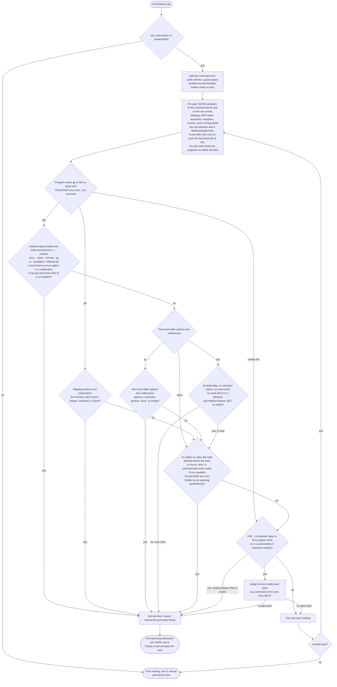

# spec-hooks-pr-post-ask

## Metadata

| Field | Value |
|---|---|
| **Feature** | PR posting ask hook: `pr-post-ask` asks the user before a command that posts to, merges, or closes a pull request |
| **Parent feature** | spec-hooks-platform.md |
| **Sub-features** | None |
| **Requirement refs** | BR-003, BR-006, BR-007, BR-012, UR-019, UR-055, FR-086, FR-088, FR-089, FR-091, FR-118, FR-198, FR-206, NFR-007, NFR-009, NFR-016, NFR-025 |
| **Feature type** | Functionality |
| **Status** | Draft |

Status values: Draft, Review, Approved, Implemented.

## Description

`pr-post-ask` is a PreToolUse guard on the Bash and PowerShell tools, active in every session and for every agent, that returns an ask decision before `gh pr review`, `gh pr merge`, `gh pr comment`, `gh pr close`, `bkt pr approve`, `bkt pr comment`, `bkt pr decline`, `bkt pr close`, `bkt pr merge`, or a `bkt api` call that may write runs. It exists because the confirmation of a direct `/pr-review` run is a written rule only and the skill holds unscoped Bash (FR-210, NFR-013), so attacker-controlled PR text reaches a session that can post; the hook adds a Claude Code permission prompt that does not rely on the model. It is a best-effort string-matching guard, like `doc-cli-guard`: Claude Code's permission prompts and the skills' own confirmation remain the primary control (`DECISIONS.md:258-261`). It fails open (NFR-009) and lists its known gaps (FR-206; FR-NFR section 6, "Hooks as a security boundary"), and a bypass form found later joins the five full gap lists of Requirement 9 without reopening this spec (`DECISIONS.md:268-271`). A hook cannot tell a `/do` post from a direct post, so both flows get the prompt after their own confirmation (FR-NFR section 9, open point 4, the user's chosen scope).

Created on 2026-10-22 from `docs/requirements/FR-NFR-assist-plugin.md` version 1.3: FR-206 (`:4655-4734`), NFR-025 (`:4940`, scenario `:4942-4945`), and the out-of-scope row at `:5158`; decisions `DECISIONS.md:223-226`, `:228-231`, `:233-236`, and `:238-241`. Signed off for the build on 2026-10-22 (`DECISIONS.md:248-251`). Built in the follow-up to 1.12.0 (build of 2026-10-22, qa passed; `.agent/main-plan/plan-build-post-1-12-0-followups-20261022-1612.md:95`) in `hooks/pr-post-ask.js` and `hooks/impl/pr-post-ask.js` (425 lines, read on 2026-10-22). The build-time decisions `DECISIONS.md:253-256` and `:258-261` and the step 1 research results (`:248-251`) are folded into this body (Change Log: 2026-10-22 (fold)). Paths are relative to `plugins/assist-plugin/` unless they start at the repository root.

## Triggered by

| Trigger type | Source | Condition |
|---|---|---|
| Event | Claude Code PreToolUse, matcher `Bash\|PowerShell`, the third command entry of the group at `hooks/hooks.json:14-33` (`:27-31`), after `commit-attribution-guard` and `doc-cli-guard`, timeout 5 s (FR-086; spec-hooks-platform.md, Requirement: Hook registration, row 16) | Any Bash or PowerShell tool call, from the main session or any subagent of any plugin |
| Called by feature | `hooks/impl/health-check.js` self-test, the `GUARDS` entry at `:1041-1080` (FR-118; spec-hooks-health-check.md, Requirement: Self-tests) | Session start (`startup`, `resume`) and `/assist-plugin:health` |

## Required data

| Data | Source | Type | Notes |
|---|---|---|---|
| `tool_name` | Hook input | string | Only `Bash` and `PowerShell` are judged; any other value gets no decision |
| `tool_input.command` | Hook input | string | Missing or null is the empty string |
| `agent_type`, `agent_id` | Hook input | string | Not read: the hook covers every session and every agent (FR-206, `DECISIONS.md:223-226`) |

## Preconditions

| Condition | Check | If not met |
|---|---|---|
| Hook input is JSON | `JSON.parse` in `lib/health.js` | Failure path `malformed-input`; the call runs with a warning (spec-hooks-platform.md) |
| Hook not listed in `hooks-disabled.json` | `guard()` in `lib/health.js:418-433` | Guard warning on every call; the call runs unchecked |
| Node 6 or newer | `lib/launch.js` | `unsupported-node` warning; the call runs |

## Algorithmic steps

Start-to-end flow. Source: [spec-hooks-pr-post-ask-flow.mmd](spec-hooks-pr-post-ask-flow.mmd).

**Note:** PNG rendering failed on 2026-10-22, again after the fold: `mmdc` is installed, but it reports "Could not find chrome-headless-shell (ver. 154.0.8037.57)". Rendering is skipped until the user installs the browser (`npx puppeteer browsers install chrome-headless-shell`); agents never install it. Then render with `mmdc -i specs/spec-hooks-pr-post-ask-flow.mmd -o specs/spec-hooks-pr-post-ask-flow.png`.

### Requirement 1: Judge only Bash and PowerShell calls, in every session

The `pr-post-ask` hook SHALL judge every Bash and PowerShell tool call, from the main session and from any agent of any plugin, and SHALL return no decision for any other tool.

**Requirement refs:** FR-206, UR-055 | **Status:** Built (follow-up to 1.12.0, build of 2026-10-22) | **Source:** `docs/requirements/FR-NFR-assist-plugin.md:4657`; `DECISIONS.md:223-226` ("covers every session")

#### Scenario: Subagent call

- **GIVEN** an agent of type `other-plugin:worker` runs `gh pr merge 123` through Bash
- **WHEN** the hook evaluates the call
- **THEN** the hook SHALL return an ask decision, whatever the `agent_type`

#### Scenario: Other tool

- **GIVEN** a `Write` tool call whose content holds the text `gh pr merge 123`
- **WHEN** the hook receives it (a test calls `evaluate` directly, because the hook is not registered for `Write`)
- **THEN** `evaluate` SHALL return no ask decision

### Requirement 2: Split the command into parts, quote-aware

The `pr-post-ask` hook SHALL split the command into parts with the shared lexer `lex(command, powershell, true)` of `hooks/lib/shell-lex.js`, as `doc-cli-guard` does (`hooks/impl/doc-cli-guard.js:92-105`), and SHALL judge each part on its own, so that a separator, `gh`, or `bkt` inside a quoted string or a heredoc body makes no part.

**Requirement refs:** FR-206, FR-198 | **Status:** Built (follow-up to 1.12.0, build of 2026-10-22) | **Source:** `docs/requirements/FR-NFR-assist-plugin.md:4691-4694` (quoted argument), `:4716-4719` (chained command); `hooks/lib/shell-lex.js` (built in 1.12.0, spec-hooks-bash-guards.md, Change Log 2026-10-16, Requirement: Documentation CLI denial rules, step 1); built in `hooks/impl/pr-post-ask.js:340-362` (`splitParts`)

Each part's resolved words are the `words` that `lex` returns for it; for a PowerShell part they are the words of `lex(stripAssignment(raw), true)`, so a leading `$r =` or `$env:NAME =` assignment is removed first, as `doc-cli-guard` does (`hooks/impl/doc-cli-guard.js:95-102`). The raw words are the part's raw text split on whitespace with whole-word outer quotes removed (the `looseWords` reading of `hooks/impl/doc-cli-guard.js:66-68`). The parts end at `;`, `&&`, `||`, `|`, a lone `&`, parentheses, and line breaks outside quotes and heredoc bodies, and, in PowerShell, also at `{` and `}`.

#### Scenario: Quoted argument is not a command

- **GIVEN** the Bash command `git commit -m "docs: explain gh pr review and bkt pr approve"`
- **WHEN** the hook evaluates it
- **THEN** the hook SHALL return no decision, because the only part's program is `git` and the words sit inside one quoted argument

#### Scenario: Chained command

- **GIVEN** the Bash command `echo done && gh pr close 123`
- **WHEN** the hook evaluates it
- **THEN** the hook SHALL judge the part `gh pr close 123` and return an ask decision

#### Scenario: Heredoc body

- **GIVEN** the Bash command of three lines `cat <<'EOF'`, `gh pr merge 123`, and `EOF`
- **WHEN** the hook evaluates it
- **THEN** the hook SHALL return no decision, because the body line is stdin text of the `cat` part

#### Scenario: PowerShell script block

- **GIVEN** the PowerShell command `if ($ok) { gh pr merge 123 }`
- **WHEN** the hook evaluates it
- **THEN** the hook SHALL judge the part `gh pr merge 123`, which ends at the braces, and return an ask decision

### Requirement 3: Find the program as FR-198 defines it

The `pr-post-ask` hook SHALL find each part's program on its resolved words and on its raw words with `findProgram(words, {runners: true, powershell, keywords: KEYWORDS, wrappers: EXTRA_WRAPPERS})` and reduce it with `programName(word, {powershell})` from `hooks/lib/shell-program.js`, and SHALL treat the part as a candidate when either name is `gh` or `bkt`, compared with case in Bash and without case in PowerShell, SHALL judge the arguments on each word list on which the name is `gh` or `bkt`, and SHALL return an ask decision when the judgment on either list asks.

**Requirement refs:** FR-206, FR-198 | **Status:** Built (follow-up to 1.12.0, build of 2026-10-22) | **Source:** `docs/requirements/FR-NFR-assist-plugin.md:4659` (FR-198 program-name detection); `hooks/lib/shell-program.js:19-23` (`EXTRA_WRAPPERS`), `:26` (`KEYWORDS`), `:88-97` (`programName`), `:100-102` (`stripAssignment`), `:136-188` (`findProgram`) as cited at 1.12.0; built in `hooks/impl/pr-post-ask.js:384-401` (`findFamily`)

After both lists are judged, the hook also judges the command substitutions in the program word and in the words before it, on the resolved words (Requirement 10).

The skipped words are the ones `doc-cli-guard` skips (spec-hooks-bash-guards.md, Change Log 2026-10-16 and 2026-10-17, Requirement: Documentation CLI program detection, rules 3 to 6): `VAR=value` words, the shell keywords `!`, `if`, `then`, `else`, `elif`, `do`, `while`, `until`, and `{`, the wrappers `env`, `command`, `timeout`, `nice`, `nohup`, `stdbuf`, `time`, `sudo`, `exec`, and `eval` with their value options, the package runners, and, in PowerShell, the call operator `&` and an opening `(` or `$(`. The arguments after the program are read from the same word list on which the program was found. When both lists find `gh` or `bkt`, both are judged, and the part asks when either judgment asks, whatever the other judgment is; a list on which the program is not found is not judged. The two lists differ when a word holds quotes inside it (the resolved words remove them; the raw words keep them unless the whole word is quoted) and when a quoted value holds spaces (the resolved words keep the value as one word; the raw words split it).

#### Scenario: Wrapped and Windows program names

- **GIVEN** the Bash command `env GH_PROMPT_DISABLED=1 gh pr review 1 --approve` and the PowerShell commands `GH.EXE pr review 1 --approve` and `& gh pr merge 1`
- **WHEN** the hook evaluates each
- **THEN** the hook SHALL read the program as `gh` and return an ask decision for all three

#### Scenario: Name hidden by quotes

- **GIVEN** the Bash command `g"h" pr merge 1`
- **WHEN** the hook evaluates it
- **THEN** the hook SHALL read `gh` on the resolved words and return an ask decision

#### Scenario: Bash name in capitals

- **GIVEN** the Bash command `GH pr merge 1`
- **WHEN** the hook evaluates it
- **THEN** the hook SHALL return no decision, because Bash names keep their case (FR-198), and the form is a listed known gap (Requirement 9)

#### Scenario: Resolved words ask, raw words do not

- **GIVEN** the Bash command `gh pr me"rge" 1`, whose resolved words read `gh pr merge 1` and whose raw word `me"rge"` is not `merge`
- **WHEN** the hook evaluates it
- **THEN** the hook SHALL return an ask decision, because the judgment on the resolved words asks

#### Scenario: Raw words ask, resolved words do not

- **GIVEN** the Bash command `bkt api /x --jq '.a | .b'`, whose resolved words keep `.a | .b` as the one value of `--jq` (a read) and whose raw words split it into the extra words `|` and `.b'`
- **WHEN** the hook evaluates it
- **THEN** the hook SHALL return an ask decision, because the judgment on the raw words asks; the prompt on this read is the cost of the either-list rule, and a self-test never uses this form as a no-ask case

### Requirement 4: Ask before a gh posting subcommand

The `pr-post-ask` hook SHALL return an ask decision for a `gh` part whose first word after the program's options and redirections is `pr` and whose next word after options and redirections is `review`, `merge`, `comment`, or `close`, compared as written.

**Requirement refs:** FR-206, UR-055 | **Status:** Built (follow-up to 1.12.0, build of 2026-10-22) | **Source:** `docs/requirements/FR-NFR-assist-plugin.md:4657`, scenarios `:4661-4669`, `:4711-4714`; built in `hooks/impl/pr-post-ask.js:136-147` (`judgeGh`) and `:103-123` (`skipOptions`)

Options and redirections: a word that starts with `-` is an option; `-R` and `--repo` also take the next word as their value unless the word holds `=`. A redirection word between the program and the verb (`2>/dev/null`, `>>log`, `<in`) is skipped, and when the operator stands alone (`>`) the word after it is skipped too (Requirement 10, rule 4). A word the walk reads that holds `$` or a backtick makes the call ask (Requirement 10, rule 3). Other `gh` option words take no value in this reading, so an unlisted option with a separate value before `pr` or between `pr` and the verb leaves its value standing where `pr` or the verb would, and the call passes: `gh --body x pr comment 1`, `gh pr --body x comment 1`, `gh pr -b x comment 1`, and `gh pr --body-file f review 1 --approve` are known gaps that Requirement 9 lists. The hook lists these forms as gaps and does not ask on an unlisted `gh` option, matching the `bkt` gap between `pr` and the verb (Design choice 3).

#### Scenario: Posting command asks

- **GIVEN** `/do` runs `gh pr review '123' --repo 'github.com/acme/shop' --approve --body-file '/r/.agent/pr-review/pr-123-review.body'` after the user confirmed the draft
- **WHEN** the hook evaluates the Bash call
- **THEN** the hook SHALL return an ask decision whose reason names `gh pr review`, and SHALL NOT deny the call

#### Scenario: Merge asks

- **GIVEN** a session runs `gh pr merge 123`
- **WHEN** the hook evaluates the call
- **THEN** the hook SHALL return an ask decision

#### Scenario: Read commands pass

- **GIVEN** a session runs `gh pr view 123`, `gh pr diff 123 --repo 'github.com/acme/shop'`, or `gh pr list`
- **WHEN** the hook evaluates each
- **THEN** the hook SHALL return no decision

#### Scenario: Redirection before the verb is skipped

- **GIVEN** a session runs `gh 2>/dev/null pr merge 1` or `gh > out pr merge 1`
- **WHEN** the hook evaluates each
- **THEN** the hook SHALL skip the redirection words and return an ask decision whose reason names `gh pr merge`

#### Scenario: Option with a separate value passes (known gap)

- **GIVEN** a session runs `gh pr --body x comment 1` or `gh --body x pr comment 1`
- **WHEN** the hook evaluates each
- **THEN** the hook MAY return no decision, because the value `x` is read as the word after the options, and a reviewer SHALL treat the form as a listed known gap (Requirement 9), not as a defect

### Requirement 5: Ask before a bkt pr posting subcommand or an unlisted bkt option

The `pr-post-ask` hook SHALL return an ask decision for a `bkt` part whose first word after the program's options is `pr` and whose next word after options is `approve`, `comment`, `decline`, `close`, or `merge`, compared as written, and for a `bkt` part that has an option before its subcommand other than the listed global options when a word that is neither an option nor a redirection follows that option, or when a word from that option on holds `$` or a backtick.

**Requirement refs:** FR-206, UR-055 | **Status:** Built (follow-up to 1.12.0, build of 2026-10-22) | **Source:** `docs/requirements/FR-NFR-assist-plugin.md:4657`, scenario `:4671-4674`; `DECISIONS.md:223-226`; `DECISIONS.md:238-241` (ask on a `bkt api` option the hook does not recognize); the unlisted-option rule is a spec reading of that decision and of FR-206 (see below); built in `hooks/impl/pr-post-ask.js:179-214` (`judgeBkt`)

Reading the words after `bkt`, in order (the same walk runs on each word list of Requirement 3):

1. The listed global options are `-c`, `--context`, `--format`, `--jq`, and `--template`, which take the next word as their value unless the word holds `=`, and `--json` and `--yaml`, which take none (the global flags, `.agent/research/bkt-cli-forms-20261017.md`, Command forms, `T/pkg/cmd/root/root.go#L50-L55`). An option is matched by the text before its first `=`. The hook skips a listed global option and its value, and skips a redirection word (and the target word after an operator that stands alone), as Requirement 4 does. A listed global option or value that holds `$` or a backtick makes the call ask unless it already asks as a post (Requirement 10, rule 3).
2. The first other word that starts with `-` is an unlisted option. When a listed global option or value walked before it, or any word from that option on, holds `$` or a backtick, the part asks (family `bkt with a word that is expanded at run time`; `hooks/impl/pr-post-ask.js:197`); otherwise, when any later word is neither an option nor a redirection, the part asks (family `bkt with an option the hook does not recognize`). The option may be a flag of the subcommand written ahead of it: bkt's command parser, cobra, finds the subcommand by skipping flags and then parses them on the subcommand, so `bkt --method=POST api /x`, `bkt --field=content.raw=x api /x`, and `bkt --input='{}' api /x` are `bkt api` calls with a method or a body (confirmed by the step 1 research on the bkt v0.34.0 source, item V7; `DECISIONS.md:248-251`, `.agent/main-plan/plan-build-post-1-12-0-followups-20261022-1612.md:67`). It may also take a separate value that hides the subcommand (`bkt --text x pr comment 1`, `bkt --field a=b api /x`). When no such word follows (`bkt --version`, `bkt --help`, `bkt --version 2>/dev/null`), this rule asks nothing.
3. The first word that does not start with `-`, other than the value of a listed global option or a redirection, is the subcommand, and the walk of items 1 and 2 stops there. A subcommand word that holds `$` or a backtick asks (Requirement 10, rule 3).
4. After the subcommand `pr`, the options before the verb are the listed global options plus `--workspace`, `--project`, and `--repo` (the repository flags, same report, How a PR is identified), which also take the next word as their value unless the word holds `=`; redirections are skipped; any other option there is skipped without a value (a known gap, Requirement 9). An option, value, or verb word there that holds `$` or a backtick asks (Requirement 10, rule 3).

`comments` (plural) is a read command and is not `comment`.

#### Scenario: Bitbucket commands ask

- **GIVEN** a session runs `bkt pr approve 123 --workspace acme --repo repo`, or `bkt --context cloud-prod pr decline 1 --project PROJ --repo repo`
- **WHEN** the hook evaluates each call
- **THEN** the hook SHALL return an ask decision for both

#### Scenario: /do comment command with its hash check

- **GIVEN** the Bash command `printf '%s  %s\n' '<hash>' '/r/.agent/pr-review/pr-1-review.body' | sha256sum -c --strict - && bkt pr comment '1' --context 'c' --workspace 'acme' --repo 'shop' --text="$(cat -- '/r/.agent/pr-review/pr-1-review.body')"`
- **WHEN** the hook evaluates it
- **THEN** the hook SHALL return an ask decision for the `bkt pr comment` part

#### Scenario: Read commands pass

- **GIVEN** a session runs `bkt pr view 123 --workspace acme --repo repo`, `bkt pr comments 1 --workspace acme --repo repo --json`, `bkt pr diff 1 --project PROJ --repo repo`, `bkt --version`, or `bkt auth status --json`
- **WHEN** the hook evaluates each
- **THEN** the hook SHALL return no decision

#### Scenario: Unlisted option before the subcommand asks

- **GIVEN** a session runs `bkt --method=POST api /x`, `bkt --field=content.raw=x api /x`, `bkt --input='{}' api /x`, or `bkt --field a=b api /x`
- **WHEN** the hook evaluates each call
- **THEN** the hook SHALL return an ask decision for all four, because `--method`, `--field`, and `--input` are not listed global options

#### Scenario: Unlisted option ahead of a pr command asks

- **GIVEN** a session runs `bkt --text x pr comment 1` or `bkt --method POST api /x`
- **WHEN** the hook evaluates each call
- **THEN** the hook SHALL return an ask decision for both, because `--text` and `--method` are unlisted options followed by words that are not options, even though their values `x` and `POST` stand where the subcommand would

#### Scenario: Option between pr and the verb passes (known gap)

- **GIVEN** a session runs `bkt pr --text x comment 1`
- **WHEN** the hook evaluates the call
- **THEN** the hook MAY return no decision, because `--text` is not a listed option after `pr` and its value `x` is read as the verb, and a reviewer SHALL treat the form as a listed known gap (Requirement 9), not as a defect

#### Scenario: Listed global options pass

- **GIVEN** a session runs `bkt --context cloud-prod pr view 1 --workspace acme --repo repo`, `bkt --json pr list --workspace acme --repo repo`, or `bkt -c cloud-prod --jq '.a' auth status`
- **WHEN** the hook evaluates each call
- **THEN** the hook SHALL return no decision

#### Scenario: Option with no subcommand after it

- **GIVEN** a session runs `bkt --version` or `bkt --help`
- **WHEN** the hook evaluates each call
- **THEN** the hook SHALL return no decision, because no word that is not an option follows the option

### Requirement 6: Ask before a bkt api call that may write

The `pr-post-ask` hook SHALL return an ask decision for a `bkt` part whose subcommand is `api`, unless no option before `api` is unlisted (Requirement 5), no word after `api` holds `$` or a backtick, and every word after `api` is the one path, a method option whose value is `GET` or `HEAD` (compared without case, each method option judged on its own), or a known read-only option, and no body option is present.

**Requirement refs:** FR-206, UR-055 | **Status:** Built (follow-up to 1.12.0, build of 2026-10-22) | **Source:** `docs/requirements/FR-NFR-assist-plugin.md:4657`, scenarios `:4676-4689`; `DECISIONS.md:223-226` (POST, PUT, PATCH, DELETE), `:228-231` (ask on a body flag with no method until the default method is confirmed), `:238-241` (ask on any `bkt api` option the hook does not recognize, beyond the FR-206 list; prompts only, never a block); FR-NFR section 9, open points 2 and 9 (`:5256`, `:5263`); `DECISIONS.md:248-251` (step 1 research); built in `hooks/impl/pr-post-ask.js:149-177` (`judgeApi`)

The no-method read rule holds: the step 1 read of the bkt v0.34.0 source confirmed that `bkt api` sends GET with no method option and no body option, and POST with a body option (items V1 and V2; `DECISIONS.md:248-251`; the orchestrator re-checked `pkg/cmd/api/api.go:40-44` and `:74-81` against the clone, `.agent/main-plan/plan-build-post-1-12-0-followups-20261022-1612.md:67-68`). The FR-206 exception for a call with no body flag and no method (`:4657`) therefore stands, and a body option asks whatever the method.

Word classes after `api` (see Design choice 2):

| Word | Class |
|---|---|
| Any word that holds `$` or a backtick | The call asks: the shell may expand it into a method or body option (Requirement 10, rule 3) |
| `--method <v>`, `--method=<v>` | Method; a value other than `GET` or `HEAD` (without case) makes the call a write |
| `--input <v>`, `--input=<v>`, `--field <v>`, `--field=<v>` | Body option; any body option makes the call a possible write, whatever the method |
| `-c <v>`, `--context <v>`, `--jq <v>`, `--template <v>`, `--format <v>`, each also with `=<v>`; `--json`; `--yaml` | Known read-only option |
| Any other word that starts with `-`, `--` included | Unknown option, so the call asks (`DECISIONS.md:238-241`). The step 1 research confirmed `-X` as the short spelling of `--method` (item V3) and found further short options (`-d`, `-F`, `-H`, `-P`) that the hook also treats as unknown (`.agent/main-plan/plan-build-post-1-12-0-followups-20261022-1612.md:67`). `bkt api` takes no repository flags (item V4), so `--workspace`, `--project`, and `--repo` after `api` are unknown options too |
| The first word that does not start with `-` | The path |
| A second word that does not start with `-` | Extra word: the call asks |

#### Scenario: Raw API write asks

- **GIVEN** a session runs `bkt api /repositories/acme/repo/pullrequests/123/request-changes --method POST`
- **WHEN** the hook evaluates the call
- **THEN** the hook SHALL return an ask decision

#### Scenario: Method in lower case

- **GIVEN** a session runs `bkt api /x --method=delete`
- **WHEN** the hook evaluates the call
- **THEN** the hook SHALL return an ask decision

#### Scenario: Raw API read passes

- **GIVEN** a session runs `bkt api /repositories/acme/repo/pullrequests/123 --method GET`, the same call with `--method HEAD`, or the same call with no method and no body option (bkt sends GET then; `DECISIONS.md:248-251`)
- **WHEN** the hook evaluates each
- **THEN** the hook SHALL return no decision and the call SHALL proceed

#### Scenario: Listed global option before api passes

- **GIVEN** a session runs `bkt --context cloud-prod api /x --method GET`
- **WHEN** the hook evaluates the call
- **THEN** the hook SHALL return no decision, because `--context` is a listed global option and its value `cloud-prod` is skipped

#### Scenario: Two method options

- **GIVEN** a session runs `bkt api /x --method GET --method POST`
- **WHEN** the hook evaluates the call
- **THEN** the hook SHALL return an ask decision, because the second method option is not `GET` or `HEAD`

#### Scenario: Raw API body option without a method asks

- **GIVEN** a session runs `bkt api /repositories/acme/repo/pullrequests/123/comments --field content.raw=hello` with no `--method`
- **WHEN** the hook evaluates the call
- **THEN** the hook SHALL return an ask decision

#### Scenario: Body option with GET asks

- **GIVEN** a session runs `bkt api /x --method GET --input '{"a":1}'`
- **WHEN** the hook evaluates the call
- **THEN** the hook SHALL return an ask decision, because FR-206 excepts only a call with no body option

#### Scenario: Unknown option asks

- **GIVEN** a session runs `bkt api /x -X POST`, `bkt api /x -X GET`, or `bkt api /x --workspace acme`, where `-X` is the short spelling of `--method` that the hook does not read as a method and `bkt api` takes no `--workspace` flag
- **WHEN** the hook evaluates each call
- **THEN** the hook SHALL return an ask decision for all three, because each holds an option the word-class table does not list

#### Scenario: Word expanded at run time after api

- **GIVEN** a session runs `bkt api "$P"` or `bkt api /x --method "$M"`
- **WHEN** the hook evaluates each call
- **THEN** the hook SHALL return an ask decision whose reason names `bkt api`

### Requirement 7: Ask output and reason

The `pr-post-ask` hook SHALL express its decision only by returning `{ask: true, reason}` from its decision function `evaluate(input)`, which reads no file and starts no process, so that the guard runtime prints one JSON document `{"hookSpecificOutput":{"hookEventName":"PreToolUse","permissionDecision":"ask","permissionDecisionReason":<reason>}}` and exits 0; it SHALL never return `deny: true`.

**Requirement refs:** FR-206, FR-088, NFR-009 | **Status:** Built (follow-up to 1.12.0, build of 2026-10-22) | **Source:** `docs/requirements/FR-NFR-assist-plugin.md:4657` ("its decision function `evaluate(input)` returns the ask decision with file reads that a test can replace (FR-088)"), scenario `:4661-4664`; the runtime side is spec-hooks-platform.md, Requirement: Guard decision and deny output (`hooks/lib/health.js:395-459`)

Reason text (binding: it names the matched command family and holds no other command text; built in `hooks/impl/pr-post-ask.js:64-70` and `:403-407`): `assist-plugin pr-post-ask: this command runs <family>, which posts to, merges, or closes a pull request. Allow it only if you meant to post it now.` The families:

| `<family>` | Raised by | Sentence |
|---|---|---|
| `gh pr <subcommand>` | Requirement 4 | "which posts to, merges, or closes a pull request" |
| `bkt pr <subcommand>` | Requirement 5 | "which posts to, merges, or closes a pull request" |
| `bkt api` | Requirement 6, a word expanded at run time after `api` included | "which posts to, merges, or closes a pull request" |
| `bkt with an option the hook does not recognize` | Requirement 5, item 2: any call with an unlisted option before the subcommand that a word that is not an option or a redirection follows, whatever subcommand or verb follows (so `bkt --text x pr comment 1` gets this family, not `bkt pr comment`). Exception: when a listed global option value before it, or any word from that option on, holds `$` or a backtick, the call gets `bkt with a word that is expanded at run time` instead (`hooks/impl/pr-post-ask.js:197`) | "which may post to, merge, or close a pull request" |
| `gh with a word that is expanded at run time` | Requirement 10, rule 3, in a `gh` part | "which may post to, merge, or close a pull request" |
| `bkt with a word that is expanded at run time` | Requirement 10, rule 3, in a `bkt` part | "which may post to, merge, or close a pull request" |
| `a command substitution nested too deep for the hook to read` | Requirement 10, rule 2 | "which may post to, merge, or close a pull request" |

A family found inside a command substitution is the family of the inner command (Requirement 10, rule 1). In a chained command the first part that asks names the family; within one part the resolved words are judged before the raw words and name the family when both ask, and the substitutions are judged last. The hook returns `{ask: false, deny: false, reason: ""}` when nothing matches.

#### Scenario: Reason names the family

- **GIVEN** the command `bkt pr approve 1 --workspace acme --repo repo`
- **WHEN** the hook asks
- **THEN** `permissionDecisionReason` SHALL contain `bkt pr approve` and SHALL NOT contain `acme`

#### Scenario: Unlisted option names its own family

- **GIVEN** the command `bkt --text x pr comment 1`
- **WHEN** the hook asks
- **THEN** `permissionDecisionReason` SHALL contain `bkt with an option the hook does not recognize` and `which may post to, merge, or close a pull request`

#### Scenario: Never denies

- **GIVEN** every case in the self-test table of Requirement 8
- **WHEN** a test calls `evaluate` on each
- **THEN** no result SHALL carry `deny: true`

### Requirement 8: Self-test as a guard

The health check SHALL self-test `pr-post-ask` at session start and in `/assist-plugin:health` as a guard, with the ask cases as its deny list and the no-ask cases as its allow list, SHALL add it to `hooks-disabled.json` when it asks on a no-ask case (a false ask), and SHALL report weak protection and leave it enabled when it does not ask on an ask case (a missed ask).

**Requirement refs:** FR-206, FR-091, FR-118 | **Status:** Built (follow-up to 1.12.0, build of 2026-10-22) | **Source:** `docs/requirements/FR-NFR-assist-plugin.md:4696-4709`; built in `hooks/impl/health-check.js:1041-1080` (the `GUARDS` entry, each case commented with its number below), `:1160-1178` (`selfTest`), `:1182-1211` (`updateDisabled`), `:1222-1249` (`buildProblems`), read on 2026-10-22. The health-check side is in spec-hooks-health-check.md, Requirements Self-tests and Auto-disable and re-enable

Cases, as built. Each Bash case uses `bash(command)` and each PowerShell case `powershell(command)` (`hooks/impl/health-check.js:89-95`); the wrapper maps `ask === true` to the harness's `deny === true`.

| # | Expect | Tool | Command |
|---|---|---|---|
| 1 | ask | Bash | `gh pr review 1 --approve` |
| 2 | ask | Bash | `bkt pr comment 1 --text x` |
| 3 | ask | Bash | `bkt api /x --method POST` |
| 4 | ask | Bash | `gh pr merge 123` |
| 5 | ask | Bash | `echo done && gh pr close 123` |
| 6 | ask | Bash | `bkt --context cloud-prod pr approve 123 --workspace acme --repo repo` |
| 7 | ask | Bash | `bkt api /repositories/acme/repo/pullrequests/123/comments --field content.raw=hello` |
| 8 | ask | Bash | `bkt api /x --method=delete` |
| 9 | ask | PowerShell | `GH.EXE pr comment 1 --body-file b.txt` |
| 10 | ask | Bash | `bkt pr decline 1 --project PROJ --repo repo` |
| 11 | ask | Bash | `printf '%s  %s\n' 'h' 'f' \| sha256sum -c --strict - && bkt pr comment '1' --context 'c' --workspace 'acme' --repo 'shop' --text="$(cat -- 'f')"` |
| 12 | ask | Bash | `bkt api /x -X POST` |
| 13 | no ask | Bash | `gh pr view 1` |
| 14 | no ask | Bash | `bkt api /x --method GET` |
| 15 | no ask | Bash | `git commit -m "docs: explain gh pr review"` |
| 16 | no ask | Bash | `bkt pr comments 1 --workspace acme --repo repo --json` |
| 17 | no ask | Bash | `bkt pr view 123 --workspace acme --repo repo` |
| 18 | no ask | Bash | `bkt api /repositories/acme/repo/pullrequests/123` |
| 19 | no ask | Bash | `gh pr diff 1 --repo 'github.com/acme/shop'` |
| 20 | no ask | Bash | `git status` |
| 21 | no ask | Bash | `echo "gh pr merge 1"` |
| 22 | no ask | PowerShell | `gh pr view 1` |
| 23 | no ask | Bash | `bkt auth status --json` |
| 24 | no ask | Bash | `bkt api /x --method HEAD` |
| 25 | ask | Bash | `bkt --method=POST api /x` |
| 26 | ask | Bash | `bkt --method POST api /x` |
| 27 | no ask | Bash | `bkt --context cloud-prod pr view 1 --workspace acme --repo repo` |

Cases 1 to 3 and 13 to 15 are the ones FR-206 names (`:4696-4699`). Cases 25 to 27 test the option rule of Requirement 5 (two options before `api` that ask, and a listed global option before `pr view` that does not); they keep the numbers of cases 1 to 24. The table holds 14 ask cases and 13 no-ask cases. Case 18 (no method, no body) stays a no-ask case, because bkt sends GET there (`DECISIONS.md:248-251`). The forms of Requirement 10 are covered by the unit tests (`tests/hooks/pr-post-ask.test.js`), not by the self-test.

#### Scenario: Self-test cases

- **GIVEN** the health check session-start self-test
- **WHEN** it runs the hook against its fixed cases
- **THEN** every ask case SHALL return an ask decision, every no-ask case SHALL return none, and the report SHALL read `  pr-post-ask: PASS (13 no-ask cases, 14 ask cases)`

#### Scenario: False ask disables the hook

- **GIVEN** a hook defect makes case 13 (`gh pr view 1`) return an ask decision
- **WHEN** the health check runs with `CLAUDE_PLUGIN_DATA` set
- **THEN** it SHALL add `pr-post-ask` to `hooks-disabled.json` with the reason `self-test: known-safe command asked (1 case)`, report it, and remove the entry only after a full passing self-test

#### Scenario: Missed ask is weak protection

- **GIVEN** a hook defect makes case 4 (`gh pr merge 123`) return no decision
- **WHEN** the session starts
- **THEN** the notice SHALL read `pr-post-ask self-test failed (1 known posting command(s) not asked); protection is weak`, and the hook SHALL stay out of `hooks-disabled.json`

### Requirement 9: Fail open and list the known gaps

The `pr-post-ask` hook SHALL fail open on every failure of the platform failure path, and each posting form it does not catch SHALL be listed as a known gap in the five full gap lists named below.

**Requirement refs:** FR-206, FR-089, NFR-009, NFR-016 | **Status:** Built (follow-up to 1.12.0, build of 2026-10-22) | **Source:** `docs/requirements/FR-NFR-assist-plugin.md:4721-4724` (hook failure), `:4731-4734` (known gaps), `:5149` and `:5158` (section 6, out of scope); `DECISIONS.md:253-256` (the gaps found in the security review), `:268-271` (the full list kept equal in five places; three summary files carry a pointer), and `:258-261` (best-effort guard; the remaining forms listed as gaps; a form found later added to every list without reopening the spec); the header comment of `hooks/impl/pr-post-ask.js:23-39`; the health documentation is in spec-skills-health.md, Requirement: Short summary with a fix per finding

The hook is a best-effort string-matching guard; Claude Code's permission prompts and the skills' own confirmation remain the primary control (`DECISIONS.md:258-261`). The shared lexer was not changed for it. The known gaps below are the 11 items of the header comment of `hooks/impl/pr-post-ask.js:23-39`. The full list is kept equal in five places: the hook's header comment, this Requirement, FR-206, the `/health` overview (`skills/health/SKILL.md:17`), and `README.md`. `CLAUDE.md`, `plugins/assist-plugin/Claude.md`, and `docs/ARCHITECTURE.md` carry only a short pointer that the hook is best-effort with known gaps, plus the unverified items below, and do not repeat the list (`DECISIONS.md:268-271`, which clarifies `:253-256`). The list is not exhaustive: a bypass form found later joins the five full lists without reopening this spec, as for `doc-cli-guard` (`DECISIONS.md:198-201`, `:258-261`).

1. A program word taken from a variable or an expression (`G=gh; $G pr merge 1`, PowerShell `& (Get-Command gh) pr merge 1`), and PowerShell splatting.
2. `gh api` with any method (for example `gh api -X POST repos/o/r/pulls/1/reviews`), `gh pr edit`, `gh pr ready`, `gh pr reopen`, a `gh` alias or extension that expands to a posting command, and `bkt pr` subcommands other than the five in Requirement 5 (for example `bkt pr reviewer-group`, `.agent/research/bkt-cli-forms-20261017.md`, List reviewers). `bkt api` has no gap of its own on this list: a method, a body option, an option the hook does not recognize, or a word expanded at run time asks (Requirement 6), and the program-name, wrapper, and quoting gaps of this list apply to it as to every other form.
3. A command string run by another program (`bash -c`, `sh -c`, `pwsh -Command`, `cmd /c`, `eval "gh pr merge 1"` (one quoted word), `Invoke-Expression`, `iex`, `Start-Process`, `xargs`, `find -exec`, `watch`, `npx -c`, `node -e`, a script file, a shell function, or a coprocess), and argv wrappers outside the wrapper list (`setsid`, `doas`, `ionice`, `stdbuf --output 0 gh ...`).
4. A posting command inside a command substitution in another program's argument, such as `echo $(gh pr merge 1)`, because the lexer keeps the substitution as one word of the `echo` part. A substitution in the program word or in a word before it is judged and asks (Requirement 10).
5. A Bash program name in another case (`GH`), `.cmd`, `.bat`, and `.ps1` shims, shell aliases, and renamed or linked binaries.
6. An option with a separate value ahead of the verb that the option lists do not name. For `gh`, before `pr` or between `pr` and the verb, because Requirement 4 lets only `-R` and `--repo` take a value and reads any other value as the next word: `gh --body x pr comment 1`, `gh pr --body x comment 1`, `gh pr -b x comment 1`, `gh pr --body-file f review 1 --approve`. For `bkt`, between `pr` and the verb, because Requirement 5 names only the global options and the repository flags there: `bkt pr --text x comment 1`. A `bkt` option that stands before `pr` and that Requirement 5 does not list asks, so `bkt --text x pr comment 1` is not a gap.
7. A redirection the shared lexer splits into separate parts, because the lexer ends a part at `&`, `|`, and a parenthesis (Requirement 2): `gh 2>&1 pr merge 1`, `gh >&2 pr merge 1`, `gh &>/dev/null pr merge 1`, `gh >| out pr merge 1`, `bkt 2>&1 pr approve 1`, `gh < <(true) pr merge 1`.
8. A PowerShell array or script block in the verb position (`gh pr @('merge') 1`, `gh pr {merge} 1`), and a PowerShell comment that hides an opening parenthesis.
9. The quoting forms `$"gh"` and `$'g\x68'`, brace expansion (`{gh,pr,merge,1}`), a glob in the program word (`/usr/bin/g[h]`), `(( x = 1 << 2 ))` read as a heredoc so the next line is hidden, and `sudo --user root gh ...` (a long sudo option with a separate value): the shared-parser forms `doc-cli-guard` lists.
10. The PowerShell forms already listed for `doc-cli-guard` (typographic quotes, block comments, the dot-source operator, typed, scoped, and compound assignments; spec-hooks-bash-guards.md, Change Log 2026-10-17), and a redirection before the program (`2>/dev/null gh pr merge 1`).
11. A request to the GitHub or Bitbucket REST API through `curl`, another HTTP client, or an MCP tool, which is not a Bash or PowerShell call to `gh` or `bkt`.

Permission behavior that limits the prompt (from the step 1 research, `DECISIONS.md:248-251`; the same text is in `skills/health/SKILL.md:17`): with several PreToolUse hooks, a deny from another hook beats this ask; the ask prompts in default and acceptEdits modes and forces a prompt in auto mode; in a non-interactive `-p` run with no one to answer, the call is denied. Unverified: whether the ask prompts in bypassPermissions mode or plan mode, and whether an installed mod can approve a call the hook would prompt for.

#### Scenario: Hook failure

- **GIVEN** the hook throws, times out after 3000 ms, or gets input that is not JSON
- **WHEN** a call `gh pr merge 1` arrives
- **THEN** the hook SHALL print only the platform `systemMessage` warning with the suffix `this command was not checked`, exit 0, and the call SHALL proceed with no prompt from this hook

#### Scenario: Known gap passes

- **GIVEN** the command `bash -c "gh pr merge 1"`
- **WHEN** the hook evaluates it
- **THEN** the hook MAY return no decision, and a reviewer SHALL treat the form as a listed known gap, not as a defect

#### Scenario: Health log privacy

- **GIVEN** the hook throws while evaluating `bkt api /x --field token=abc123`
- **WHEN** the runtime logs the failure
- **THEN** `hook-health.jsonl` SHALL NOT contain `abc123` (NFR-016)

#### Scenario: Redirection split by the lexer is a known gap

- **GIVEN** the command `gh 2>&1 pr merge 1`
- **WHEN** the hook evaluates it
- **THEN** the hook MAY return no decision, and a reviewer SHALL treat the form as listed known gap 7, not as a defect

### Requirement 10: Judge command substitutions and ask on words expanded at run time

The `pr-post-ask` hook SHALL judge the text inside every command substitution in a part's program word and in each word before it as a command of its own, SHALL ask when such substitutions nest deeper than 3 levels, SHALL ask when a word that the shell expands at run time stands where its walk needs to read a plain word, and SHALL skip redirection words between the program and the verb.

**Requirement refs:** FR-206, FR-198, UR-055 | **Status:** Built (follow-up to 1.12.0, build of 2026-10-22) | **Source:** `DECISIONS.md:253-256` (judge the text inside `$(...)` and backticks, as the whole command or an assignment value, as its own command; ask when the `pr`, verb, or `bkt` subcommand word holds `$` or a backtick; skip redirection words between the program and the verb) and `:258-261` (a quote-aware scan of every `$(...)` and backtick span in an assignment value or program word; an ask, not a pass, at the substitution depth limit; the run-time-expansion test on option values before the verb); the header comment of `hooks/impl/pr-post-ask.js:16-22`; built in `:71-74` (`MAX_DEPTH`, `REDIRECTION`), `:95-134` (`redirectionLength`, `skipOptions`, `isExpanded`, `unreadable`), `:136-214` (`judgeGh`, `judgeApi`, `judgeBkt`), `:216-338` (the substitution scan), `:364-380` (`judgeSubstitutions`), `:384-401` (`findFamily`)

Rules:

1. **Substitutions.** For each part, after both word lists are judged (Requirement 3), the hook takes the resolved words up to and including the program word (every word when no program is found) and, for each, the value of a `VAR=value` word or else the word itself. It finds every `$(...)` span and, in Bash, every backtick pair in that text, with a scan that skips quoted text, escapes, backticks, nested parentheses, and heredoc bodies as units, so a `)` in a quoted string or on a line of a heredoc body does not end a span. It judges the text inside each span as a command, by Requirements 2 to 10. The first span that asks names the family. A PowerShell backtick is an escape, not a substitution.
2. **Depth.** Spans inside spans are judged the same way down to 3 levels. A span found below that is not read: the part asks with the family `a command substitution nested too deep for the hook to read`, never passes.
3. **Words expanded at run time.** A word that holds `$` or a backtick can change what runs, so the hook asks, with the family `gh with a word that is expanded at run time` or `bkt with a word that is expanded at run time`, when such a word is: an option or option value the walk passes before `pr` or before the verb (Requirements 4 and 5, listed `bkt` global options included); the word in the `pr`, verb, or `bkt` subcommand position; or any word from an unlisted `bkt` option on (Requirement 5, item 2). In PowerShell, a part that ends at an opening parenthesis where the walk needs that word counts the same (`gh pr ('merge') 1`). Any word after `bkt api` that holds `$` or a backtick asks with the family `bkt api` (Requirement 6). A redirection target is not tested.
4. **Redirections.** Between the program and the verb, the walks of Requirements 4 and 5 skip a redirection word that matches a digit run, then `>`, `>>`, or `<`, then its target (`2>/dev/null`, `>>log`, `<in`), and, when the operator stands alone (`>`), also the word after it. A redirection that holds `&` or `|`, or that opens a process substitution, is split off by the shared lexer and stays a known gap (Requirement 9, item 7).

#### Scenario: Substitution as an assignment value or as the command

- **GIVEN** the Bash commands `out=$(gh pr merge 1)`, `$(gh pr merge 1)`, `` `gh pr merge 1` ``, and `out="x $(gh pr merge 1)"`
- **WHEN** the hook evaluates each
- **THEN** the hook SHALL return an ask decision whose reason names `gh pr merge` for all four

#### Scenario: Substitution in another program's argument stays a gap

- **GIVEN** the Bash command `echo $(gh pr merge 1)`
- **WHEN** the hook evaluates it
- **THEN** the hook MAY return no decision, because the substitution is an argument of `echo` and not its program word or a word before it (Requirement 9, item 4)

#### Scenario: Substitutions nested too deep

- **GIVEN** the Bash command `out=$(x=$(y=$(z=$(gh pr view 1))))`, whose innermost command only reads
- **WHEN** the hook evaluates it
- **THEN** the hook SHALL return an ask decision whose reason names `a command substitution nested too deep for the hook to read` and reads "which may post to, merge, or close a pull request"

#### Scenario: Expanded word in the verb position

- **GIVEN** the Bash commands `gh pr $V 1` and `bkt pr "$V" 1 --workspace acme --repo repo`
- **WHEN** the hook evaluates each
- **THEN** the hook SHALL return an ask decision whose reason names `gh with a word that is expanded at run time` or `bkt with a word that is expanded at run time`

#### Scenario: Expanded option value before the verb

- **GIVEN** the Bash commands `gh --repo "$R" pr view 1` and `bkt --context "$C" pr view 1 --workspace acme --repo repo`, both reads once expanded
- **WHEN** the hook evaluates each
- **THEN** the hook SHALL return an ask decision for both, because the hook cannot read a value the shell expands at run time

#### Scenario: Literal values pass

- **GIVEN** the Bash commands `gh pr view '123' --repo 'github.com/acme/shop'` and `bkt --context 'cloud-prod' pr view '1' --workspace 'acme' --repo 'repo'`
- **WHEN** the hook evaluates each
- **THEN** the hook SHALL return no decision

#### Scenario: PowerShell verb hidden by a parenthesis

- **GIVEN** the PowerShell command `gh pr ('merge') 1`
- **WHEN** the hook evaluates it
- **THEN** the hook SHALL return an ask decision whose reason names `gh with a word that is expanded at run time`

## Business rules

| Rule ID | Rule | Traces to | Applied at step | Example |
|---|---|---|---|---|
| RULE-001 | The hook asks and never denies; Claude Code's prompt decides | FR-206 | Requirement 7 | `gh pr review` gets a prompt, not a block |
| RULE-002 | Every session and every agent; no agent filter | FR-206, `DECISIONS.md:223-226` | Requirement 1 | A subagent's `gh pr merge` asks |
| RULE-003 | Only the program position and the words after it count; words inside one quoted argument are not a command | FR-206 | Requirements 2 to 5 | `git commit -m "... gh pr review ..."` passes |
| RULE-004 | A `bkt api` call passes only when it is shown to read: no unlisted option stands before `api` or after it, and the method is absent, GET, or HEAD | FR-206, `DECISIONS.md:228-231`, `:238-241` | Requirements 5 and 6 | `bkt api /x --field a=b` and `bkt --method=POST api /x` ask |
| RULE-005 | One prompt per Bash command; `/do` runs each `bkt` post as its own command, so each gets its own prompt | `DECISIONS.md:233-236` | Requirement 7 | `bkt pr approve` and `bkt pr comment` ask separately |
| RULE-006 | Best-effort string-matching guard; listed gaps, kept equal in five full lists, and a form found later joins them without reopening the spec; fails open | FR-206, NFR-009, FR-NFR section 6, `DECISIONS.md:258-261`, `:268-271` | Requirement 9 | `bash -c "gh pr merge 1"` passes |
| RULE-007 | A part asks when the judgment on either word list asks (resolved or raw); a list that does not find `gh` or `bkt` is not judged | FR-206 | Requirement 3 | `gh pr me"rge" 1` and `bkt api /x --jq '.a \| .b'` ask |
| RULE-008 | What the hook cannot read asks: a word expanded at run time where the walk needs a plain word, and a substitution nested deeper than 3 levels; a substitution in the program word or a word before it is judged as its own command | FR-206, `DECISIONS.md:253-256`, `:258-261` | Requirement 10 | `gh pr $V 1` and `out=$(gh pr merge 1)` ask |

## Data transformations

| Input | Transformation | Output | Notes |
|---|---|---|---|
| `tool_input.command` | `lex(command, powershell, true)` | Parts with resolved words and raw text | PowerShell parts lexed again after `stripAssignment` |
| Part word lists | `findProgram` and `programName` | Program index and name per list | Resolved words and raw words; each list that finds `gh` or `bkt` is judged, and the part asks when either judgment asks |
| Words after the program | Option and redirection skipping per Requirements 4 to 6 | Command family or none | Subcommands compared as written; method values without case; a `bkt` option before the subcommand that is not a listed global option asks; a word expanded at run time where the walk needs a plain word asks (Requirement 10) |
| Program word and the words before it (resolved words) | Substitution scan per Requirement 10 | The text inside each `$(...)` or backtick span, judged as a command of its own, down to 3 levels | A deeper span asks |

## Output / Outcome

| Output | Type | Description |
|---|---|---|
| Ask decision | PreToolUse JSON on stdout | `permissionDecision: "ask"` with the reason of Requirement 7; exit 0 |
| No decision | No stdout | Exit 0; Claude Code's normal permission flow continues |

## Error handling

| Error condition | Handling strategy | Outcome |
|---|---|---|
| Malformed input, throw, timeout, old Node | Platform failure path (spec-hooks-platform.md) | `systemMessage` warning; the call runs with no prompt from this hook |
| Hook listed in `hooks-disabled.json` | Platform disabled path | Guard warning on every call; the call runs unchecked |
| Command is not a string | Treated as the empty string | No decision |
| The user rejects the prompt | Claude Code does not run the call and returns a rejection message for it, with no command exit status | The calling flow records the post as declined, not failed: `/do` (spec-orchestration-dispatch.md, Requirement 14, Hook prompt row) and a direct `/pr-review` (spec-skills-pr-review.md, Requirement: Verdict confirmation gate) |

## Events emitted

| Event name | Payload | Consumer(s) | When emitted |
|---|---|---|---|
| PreToolUse ask | `hookSpecificOutput` with `permissionDecision: "ask"` and `permissionDecisionReason` | Claude Code, which shows a permission prompt to the user | Requirements 4 to 6 or 10 matched |

## Events consumed

| Event name | Producer | Payload used | Handling |
|---|---|---|---|
| PreToolUse (`Bash`, `PowerShell`) | Claude Code | `tool_name`, `tool_input.command` | Requirements 1 to 7 and 10 |

## Sub-feature breakdown

Not applicable: a leaf feature of spec-hooks-platform.md.

## Performance considerations

| Concern | Target | Approach |
|---|---|---|
| Latency per Bash or PowerShell call (NFR-025) | At most 110 ms (a SHOULD), measured as the median wall-clock time of 20 runs of `node hooks/pr-post-ask.js` on one fixed input: a `Bash` tool call with the command `git status`. The user confirmed the method (`DECISIONS.md:243-246`). qa measured a median of 57.6 ms on 2026-10-22 (`.agent/main-plan/plan-build-post-1-12-0-followups-20261022-1612.md:95`) | No file or network I/O; one `lex` pass per command, a second per PowerShell part, and one per command substitution it judges (Requirement 10); the walk stops once a part's program is neither `gh` nor `bkt` |
| Finish within the registration (NFR-007) | 5 s registered; 3 s watchdog | Platform watchdog (spec-hooks-platform.md, Requirement: Watchdog) |

## Traceability

| Requirement | Spec section | Verified by |
|---|---|---|
| FR-206 | Requirements 1 to 10 | Unit tests of `evaluate` on the scenarios above (`tests/hooks/pr-post-ask.test.js`); the self-test table of Requirement 8 |
| FR-088 | Requirement 7 | Test that `evaluate` reads no file, starts no process, and never returns `deny: true` |
| FR-089, NFR-009 | Requirement 9 | Platform failure-path tests run against `pr-post-ask` (`tests/hooks/pr-post-ask-runtime.test.js`) |
| FR-091, FR-118 | Requirement 8 | Health-check fixtures with a false ask and a missed ask (`tests/hooks/health-check-pr-post-ask.test.js`; spec-hooks-health-check.md, Requirements Self-tests and Auto-disable and re-enable) |
| FR-086, NFR-007 | Triggered by | Registration test on `hooks/hooks.json` (spec-hooks-platform.md, Requirement: Hook registration) |
| FR-198 | Requirements 3 and 10 | Wrapped, Windows-name, and hidden-name scenarios; substitution and expanded-word scenarios |
| NFR-016 | Requirement 9 | Health-log privacy scenario |
| NFR-025 | Performance considerations | Median of 20 timed runs on the `git status` input |
| UR-055, UR-019, BR-006, BR-012 | Description; Requirements 1 to 7 | As above |
| BR-003, BR-007 | Performance considerations; Requirement 9 | As above |

## Open questions

The numbers stay as they were when the spec was signed off, so references from other specs still resolve. The step 1 research of the build (`DECISIONS.md:248-251`; `.agent/main-plan/plan-build-post-1-12-0-followups-20261022-1612.md:67`) settled questions 1, 2, and 5, and part of 3.

1. **Settled.** `bkt api` sends GET with no method option and no body option, and POST with a body option (items V1 and V2). The no-method read rule of Requirement 6 and the FR-206 exception stand; a body option asks whatever the method.
2. **Settled.** `--method` is the method option and `-X` its short spelling (item V3); the hook reads only `--method` as a method and asks on `-X` and on the other short options found (`-d`, `-F`, `-H`, `-P`) as unknown options. `bkt api` takes no repository flags (item V4), so the spec stands: `--workspace`, `--project`, and `--repo` after `api` ask as unknown options, and the skills pass none to `bkt api`.
3. **Partly settled.** With several PreToolUse hooks, a deny from another hook beats this ask; the ask prompts in default and acceptEdits modes and forces a prompt in auto mode; in a non-interactive `-p` run with no one to answer, the call is denied (item V10, parts a and b; recorded in Requirement 9 and `skills/health/SKILL.md:17`). Open: whether the ask prompts in bypassPermissions mode or plan mode, and whether an installed mod can approve a call the hook would prompt for; these are listed as unverified in the known-gap text (`DECISIONS.md:248-251`).
4. **Open.** The exact text of the tool result Claude Code returns when the user rejects an ask prompt is not documented (item V10, part c). `/do` and `/pr-review` are built on the documented separation: a rejected prompt returns a rejection message and fires no failure, while a command failure carries an exit status (spec-orchestration-dispatch.md, Requirement 14, Hook prompt row; spec-skills-pr-review.md, Requirement: Verdict confirmation gate). Row 2 of the manual matrix records the real text (`DECISIONS.md:248-251`); rows 1 to 13 of that matrix were not run in the build and are listed as not yet verified (`.agent/main-plan/plan-build-post-1-12-0-followups-20261022-1612.md:40`).
5. **Settled.** bkt parses a subcommand's own flags written before the subcommand (item V7), so `bkt --method=POST api /x` is a `bkt api` call with a method; the second item of the Requirement 5 walk stands as written.

## Design choices for sign-off

These choices fill gaps that FR-206 leaves open. The user signed them off with the spec on 2026-10-22 (`DECISIONS.md:248-251`), and the build applied them as written.

1. The script name `pr-post-ask` (`hooks/pr-post-ask.js`, `hooks/impl/pr-post-ask.js`); FR-206 calls it "the posting ask hook" and names no file.
2. A `bkt api` call with an unknown option or an extra word asks (Requirement 6). FR-206 requires the ask for a write method and for a body option; the unknown-option rule extends it to unconfirmed spellings and adds prompts only. The user settled this on 2026-10-22 (`DECISIONS.md:238-241`).
3. The option-value lists of Requirements 4 and 5 (`gh`: `-R`, `--repo`; `bkt`: the global options before the subcommand, and the global and repository flags between `pr` and the verb, from the research report). For `gh`, an unlisted option with a separate value before `pr` or between `pr` and the verb is a known gap (`gh --body x pr comment 1`, `gh pr --body x comment 1`); for `bkt`, an unlisted option before the subcommand asks, and an unlisted option with a separate value between `pr` and the verb is a known gap (`bkt pr --text x comment 1`). Both gaps are listed in Requirement 9 and neither is closed in this spec.
4. The self-test cases of Requirement 8 beyond the six FR-206 names, and the report nouns `no-ask cases`, `ask cases`, `known-safe command` (`ASKED`), and `known posting command` (`NOT ASKED`).
5. The reason text of Requirement 7.
6. Two rules add prompts on calls that are not posts. A `bkt` option that is not a listed global option and stands before the subcommand asks even for a read, such as `bkt --workspace acme pr view 1`, because the hook cannot tell a flag of the subcommand from a value that hides it (Requirement 5). A part asks when either word list asks, so `bkt api /x --jq '.a | .b'` asks on a read (Requirement 3). Both add prompts only and never block.

## Change Log: 2026-10-22 (fold)

**Source:** `DECISIONS.md:243-246` (the spec bodies are folded after qa in the same run), `:248-251` (the documents signed off; the step 1 research results; the known-gap text also lists bypassPermissions mode, plan mode, and installed mods as unverified), `:253-256` (three bypass forms closed and the gaps found in the security review listed, every gap list kept equal), and `:258-261` (`pr-post-ask` is a best-effort guard; the cheap forms closed; the remaining forms listed; a form found later joins every gap list without reopening the spec); the build of `docs/task-plans/task-plan-post-1-12-0-followups-20261022-143806.md`, qa passed on 2026-10-22 (`.agent/main-plan/plan-build-post-1-12-0-followups-20261022-1612.md:95`). `hooks/impl/pr-post-ask.js` (425 lines) was read on 2026-10-22, and the body follows its header comment (`:3-42`) and its code.

This spec had no change log entry: it was created on 2026-10-22 and signed off as written. This entry records the build-time changes applied to its body:

- Description: the hook is a best-effort string-matching guard (`DECISIONS.md:258-261`); the spec is built. Every requirement's Status reads Built (follow-up to 1.12.0, build of 2026-10-22), with the built source lines.
- ADDED Requirement 10: Judge command substitutions and ask on words expanded at run time. It holds the forms the hook also catches (`DECISIONS.md:253-256`, `:258-261`): every substitution span in the program word and the words before it, found with a quote-aware and heredoc-aware scan and judged as its own command; an ask when substitutions nest deeper than 3 levels; an ask on `$` or a backtick in any word the walk reads before the verb, after an unlisted `bkt` option, and after `bkt api`; redirection words skipped between the program and the verb. Requirements 3 to 6 point to it, and the flow diagram (inline and `spec-hooks-pr-post-ask-flow.mmd`) shows it.
- MODIFIED Requirement 7, reason text. Was: "For the option rule of Requirement 5 on a call that no other rule matches, `<family>` is `bkt with an option the hook does not recognize`". Now: the unlisted-option family covers any call with an unlisted option before the subcommand that a plain word follows, whatever the rest of the call holds, and the families `gh with a word that is expanded at run time`, `bkt with a word that is expanded at run time`, and `a command substitution nested too deep for the hook to read` are added, each with the "may post" sentence (`hooks/impl/pr-post-ask.js:64-70`). Reason: the built hook returns the unlisted-option family before it reads the subcommand, and the three families come with Requirement 10.
- MODIFIED Requirement 9, known gaps. Was: the eight-item list signed off on 2026-10-22. Now: the 11 items of the header comment of `hooks/impl/pr-post-ask.js:23-39` (argv wrappers outside the wrapper list, shell aliases, renamed or linked binaries, redirections the lexer splits, PowerShell arrays, script blocks, and hidden parentheses, the shared-parser quoting and expansion forms, and a redirection before the program added), the permission behavior from the step 1 research, and the rule that a form found later joins every gap list without reopening the spec. Reason: `DECISIONS.md:253-256`, `:258-261`.
- Requirement 6 and Open questions: the step 1 results replace the open questions they settle (V1 and V2: GET with no body, POST with a body; V3: `--method` and its short `-X`; V4: no repository flags on `bkt api`, the spec stands; V7: flags before the subcommand parse). The no-method read rule no longer waits on a build-time read; the word-class table names `-X` and the other short options as unknown options.
- Requirement 4 and Requirement 5: the walks skip redirections and point to Requirement 10 for expanded words; item 2 of the Requirement 5 walk is confirmed (V7). New Scenarios: Redirection before the verb is skipped, Word expanded at run time after api, Unlisted option names its own family, Redirection split by the lexer is a known gap.
- Performance considerations: the timing method is confirmed (`DECISIONS.md:243-246`) and qa's median of 57.6 ms is recorded.
- Design choices: signed off on 2026-10-22.

Status: stays Draft, as the fold rule of `spec-from-requirements` sets (`references/delta-format.md`, Folding a delta into the main body, step 5); a `review` pass follows.

### Rework 2: where the gap list lives, and the unlisted-option reason (`DECISIONS.md:268-271`)

- MODIFIED Requirement 9, the paragraph above the gap list. Was: a form found later joins this list and every other gap list (FR-206, `/health`, `CLAUDE.md`, `plugins/assist-plugin/Claude.md`, `README.md`, `docs/ARCHITECTURE.md`). Now: the full list is kept equal in five places (the hook's header comment, this Requirement, FR-206, the `/health` overview, `README.md`); `CLAUDE.md`, `plugins/assist-plugin/Claude.md`, and `docs/ARCHITECTURE.md` carry only a pointer that the hook is best-effort with known gaps, plus the unverified items, and a form found later joins the five full lists. Reason: `DECISIONS.md:268-271` clarifies `:253-256`. The Requirement 9 statement (each form not caught is listed in the five full gap lists), the Description, the Requirement 9 Source line, and RULE-006 follow. The Scenarios Known gap passes and Redirection split by the lexer is a known gap name no list location and are unchanged.
- MODIFIED Requirement 7, the reason-family row for `bkt with an option the hook does not recognize`. Was: the family applies "whatever the rest of the call holds". Now: whatever subcommand or verb follows, except that a listed global option value before the unlisted option, or any word from it on, that holds `$` or a backtick gives `bkt with a word that is expanded at run time` instead. Reason: `hooks/impl/pr-post-ask.js:197` tests the expansion first. Item 2 of the Requirement 5 walk now also names the global option values walked before the option.
