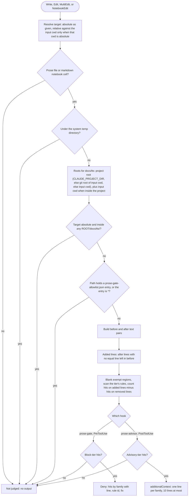
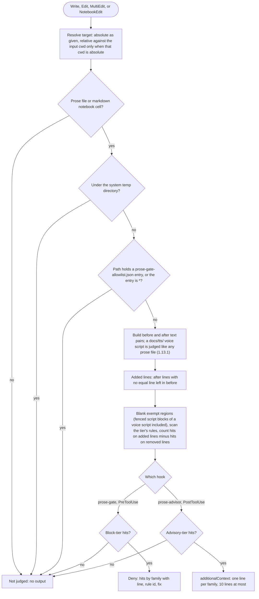

# spec-hooks-prose-hooks

## Metadata

| Field | Value |
|---|---|
| **Feature** | Prose hooks: `prose-gate` (block tier) and `prose-advisor` (advisory tier), with the `docs/tts/` exemption under the project root and the session directory |
| **Parent feature** | spec-hooks-platform.md |
| **Sub-features** | None |
| **Requirement refs** | BR-003, BR-008, UR-016, UR-058, FR-103, FR-104, FR-105, FR-106, FR-181 (removed 2026-10-23), FR-213, NFR-005, NFR-008, NFR-009, NFR-019 |
| **Feature type** | Functionality |
| **Status** | Review |

Status values: Draft, Review, Approved, Implemented.

## Description

Two hooks apply the writing standard (`rules/writing-standard.md`) to prose that agents and the main session write. `prose-gate` (PreToolUse) denies a write only when the text the call adds holds a block-tier tell: an em dash, chatbot residue, a curly quote, or a summary label. `prose-advisor` (PostToolUse) returns the advisory-tier tells in the added text as a short note and never blocks. Text already in the file is never judged, so files with old tells stay editable. Both share `lib/prose-diff.js` and `lib/prose-rules.js` and skip temp files, voice scripts under `docs/tts/`, and allowlisted paths.

Requirements marked **Built** describe assist-plugin 1.11.1 (commit 41034c1). FR-181 was built in 1.11.1: it exempts `docs/tts/` under the project root and, when the session's working directory lies inside the project, under that directory too, as `DECISIONS.md:73-75` (2026-10-16) decides, refining the 2026-10-12 entry. At 4803a0d the rule exempted only `<cwd>/docs/tts/`, which equals the project's `docs/tts/` only for a session whose `cwd` is the project root; the change log at the end records the requirement that changed. The voice-script skill that writes `docs/tts/voice-*.md` is FR-163 (Area C) and is unchanged by the decision.

## Triggered by

| Trigger type | Source | Condition |
|---|---|---|
| Event | PreToolUse, matcher `Write\|Edit\|MultiEdit\|NotebookEdit` (`hooks/hooks.json:39-48`) | `prose-gate`, before the write |
| Event | PostToolUse, same matcher (`hooks/hooks.json:71-80`) | `prose-advisor`, after the write; it also requires `hook_event_name` `PostToolUse` (`impl/prose-advisor.js:46`) |

## Required data

| Data | Source | Type | Notes |
|---|---|---|---|
| `tool_name`, `tool_input` | Hook input | string, object | `file_path`, `content`, `old_string`, `new_string`, `replace_all`, `edits`, `notebook_path`, `cell_id`, `cell_type`, `edit_mode`, `new_source` |
| `tool_response.originalFile`, `tool_response.type` | Hook input (PostToolUse) | string or null | File contents before the call |
| `cwd` | Hook input | string | Base for relative target paths when it is a non-empty absolute path; the session root and the start of the `.git` walk (FR-181) |
| Target file contents | Local file system (PreToolUse) | UTF-8 text | Not judged above 4,000,000 bytes |
| `prose-gate-allowlist.json` | `${CLAUDE_PLUGIN_DATA}` | JSON array of strings | At most 200 entries of 1 to 500 characters; missing or malformed means empty |
| `CLAUDE_PROJECT_DIR` | Hook process environment | path | First choice for the project root (FR-181) |
| `.git` entries | Local file system, through `findGitRoot` in `hooks/lib/git-root.js:27-36` | directory entries | Read only when `CLAUDE_PROJECT_DIR` is not a usable root; replaced by `options.findGitRoot` in tests |

## Preconditions

| Condition | Check | If not met |
|---|---|---|
| Target is a prose file or a markdown notebook cell | Requirement: Prose file selection | No judgment, no output |
| Target is not exempt | Requirement: Path exemptions as built, whose voice-script part Requirement: Voice-script exemption under the project root and the session directory states since 1.11.1 (Change Log 2026-10-16) | No judgment, no output |
| Platform preconditions | spec-hooks-platform.md | Fail open |

## Algorithmic steps

Start-to-end flow, with the roots for `docs/tts/` built in 1.11.1. Source: [spec-hooks-prose-hooks-flow.mmd](spec-hooks-prose-hooks-flow.mmd).

**Note:** PNG rendering requires mermaid-cli with its headless browser, which is missing on this machine (see spec-hooks-platform.md). Render with `mmdc -i specs/spec-hooks-prose-hooks-flow.mmd -o specs/spec-hooks-prose-hooks-flow.png` once it is installed.

### Requirement: Prose file selection

Both hooks SHALL judge a Write, Edit, MultiEdit, or NotebookEdit call only when its target is a prose file (extension `.md`, `.mdx`, `.txt`, `.rst`, or `.adoc`, compared without regard to case) whose base name does not start with `changelog`, `license`, or `notice` (any case) and whose path has no `node_modules` or `.git` directory, or a markdown cell of a notebook whose path would be a prose file with `.md` in place of `.ipynb`.

**Requirement refs:** FR-103, FR-106, UR-016
**Status:** Built
**Source:** `hooks/lib/prose-rules.js:36-38`, `:297-307`; `hooks/lib/prose-diff.js:152-164`, `:284-301`

Target resolution (1.11.1, `hooks/lib/prose-diff.js:152-159`): `file_path` (or `notebook_path`) as given when absolute or when the input `cwd` is not a non-empty absolute path; otherwise resolved against the input `cwd`. At 4803a0d a relative `cwd` resolved the target against the process directory. A notebook cell counts as markdown when `cell_type` says so or, without it, when the existing cell found by `cell_id` is markdown; `edit_mode: "delete"` is never judged. A file with any other extension is not judged and needs no exemption; for example the `/do` PR review files of FR-195 (Area C), the scratch file `.agent/pr-review/pr-<N>.diff` and the body file `.agent/pr-review/pr-<N>-review.body`, end in `.diff` and `.body`.

#### Scenario: Prose file

- **GIVEN** a Write of `notes.md` that adds a sentence with an em dash (U+2014)
- **WHEN** `prose-gate` evaluates it
- **THEN** the hook SHALL judge the added text and deny the write

#### Scenario: Changelog and code files

- **GIVEN** a Write of `CHANGELOG.md` and a Write of `a.js`, each adding an em dash
- **WHEN** `prose-gate` evaluates each
- **THEN** the hook SHALL allow both with no output

#### Scenario: Notebook code cell

- **GIVEN** a NotebookEdit on `a.ipynb` with `cell_type` `code` whose new source holds an em dash
- **WHEN** `prose-gate` evaluates it
- **THEN** the hook SHALL allow it with no output

### Requirement: Path exemptions as built

Both hooks SHALL NOT judge a target under the system temp directory (or its resolved real path), a target inside `<cwd>/docs/tts/` where `<cwd>` is the hook input's `cwd` and is a non-empty absolute path, or a target whose path contains an entry of `${CLAUDE_PLUGIN_DATA}/prose-gate-allowlist.json`, where the entry `*` exempts every path.

**Requirement refs:** FR-104, UR-016
**Status:** Built; the voice-script part changed in 1.11.1 (FR-181; Change Log 2026-10-16, MODIFIED)
**Source:** `docs/requirements/FR-NFR-assist-plugin.md:2230-2249` (FR-104 in v1.1); `hooks/lib/prose-diff.js:74-150`, `:290`; `DECISIONS.md:3-5` (2026-10-12, Prose hooks skip docs/tts) and `DECISIONS.md:73-75` (2026-10-16 refinement)

The statement below states the code at 4803a0d, which exempted `<cwd>/docs/tts/` only. Since 1.11.1 the voice-script part follows Requirement: Voice-script exemption under the project root and the session directory, as FR-104's statement (`:2232`) names; the change log gives the new statement.

Matching rules: both paths are resolved and compared at a path-separator boundary, without regard to case on Windows; dot segments are normalized first, so `docs/tts/../README.md` is outside; symlinks are not resolved. An allowlist entry matches when the path, as given or with backslashes turned into slashes, contains it. The allowlist is separate from `hooks-disabled.json`, so a self-test never changes it.

#### Scenario: Voice script from the project root

- **GIVEN** a session whose `cwd` is the project root and a Write to `docs/tts/voice-intro-20261012-0900.md` with em dashes as pause marks
- **WHEN** `prose-gate` evaluates it
- **THEN** the hook SHALL allow the write with no output

#### Scenario: Voice script from a session started in a subdirectory, as built

- **GIVEN** a session started in `<project>/src` and a Write to `<project>/docs/tts/voice-intro-20261012-0900.md` with an em dash
- **WHEN** `prose-gate` evaluates it at commit 4803a0d
- **THEN** the hook SHALL deny it, because the 4803a0d rule resolves `docs/tts/` against `<project>/src` only (replaced in 1.11.1 by FR-181; the change log gives the scenario that applies now)

#### Scenario: Other docs path

- **GIVEN** a Write to `docs/guide.md` with an em dash
- **WHEN** `prose-gate` evaluates it
- **THEN** the hook SHALL deny the write

#### Scenario: Path that climbs out

- **GIVEN** a session at the project root and a Write to `docs/tts/../README.md` with an em dash
- **WHEN** `prose-gate` evaluates it
- **THEN** the hook SHALL deny the write

#### Scenario: Allowlist entry star

- **GIVEN** `prose-gate-allowlist.json` holds `["*"]`
- **WHEN** a Write to any prose file adds an em dash
- **THEN** both hooks SHALL emit nothing

### Requirement: Voice-script exemption under the project root and the session directory

Both hooks SHALL exempt a target inside `docs/tts/` under each exempt root: the project root (`CLAUDE_PROJECT_DIR`, else the git root of the hook input's `cwd`, else that `cwd`), and the hook input's `cwd` when that directory is the project root or lies inside it.

**Requirement refs:** FR-181, FR-104, UR-016, BR-008
**Status:** Built (1.11.1)
**Source:** `DECISIONS.md:73-75` (2026-10-16, docs/tts exemption covers the project root and the session directory, refining the 2026-10-12 entry at `DECISIONS.md:3-5`); `docs/requirements/FR-NFR-assist-plugin.md:2718-2752` (FR-181 in v1.1, statement at `:2720`); built at `hooks/lib/prose-diff.js:98-137`, `hooks/lib/git-root.js:18-36`; `tests/hooks/prose-docs-tts.test.js`

Exempt roots, computed on every call:
1. **Project root.** (a) If the hook process's `CLAUDE_PROJECT_DIR` is a non-empty absolute path, the project root is that path, normalized. (b) Otherwise, if the hook input's `cwd` is a non-empty absolute path, the hook checks that directory and then each parent, up to the file-system root, for an entry named `.git` (a directory, or a file as in a linked worktree or a submodule); the first directory that holds one is the project root. (c) Otherwise, if the input `cwd` is a non-empty absolute path, the project root is that `cwd`. (d) Otherwise there is no project root.
2. **Session root.** The input `cwd`, when it is a non-empty absolute path and, after normalization, equals the project root or sits inside it (compared at a path-separator boundary, without regard to case on Windows). When the project root came from 1(b) or 1(c), the `cwd` is always inside it. A `cwd` outside the project root gives no session root.
3. A target is exempt when, after normalization, it sits inside `<project root>/docs/tts/` or `<session root>/docs/tts/`, compared as in Requirement: Path exemptions as built.

Further rules:
- "The hook's cwd" means the hook input's `cwd` field. The hook process's own working directory is the plugin root (`hooks/hooks.json:9`), which may sit inside the plugin's own git clone, so it is never used.
- Target resolution: an absolute target is used as given; a relative target is resolved against the input `cwd` only when that `cwd` is a usable root, a non-empty absolute path. A relative target with a missing, empty, or relative `cwd` is never exempt as a voice script, even when `CLAUDE_PROJECT_DIR` is set, because it cannot be placed in the project. (Built in 1.11.1: `targetPath` keeps such a target as written (`hooks/lib/prose-diff.js:152-159`), and `isVoiceScript` rejects a target that is not absolute (`:134-137`), so the process directory is never a root. At 4803a0d a relative `cwd` resolved the target against the process directory, the plugin root.)
- A `docs/tts/` directory under neither root is not exempt: with the session at `<project>`, `<project>/src/docs/tts/` is gated.
- The `.git` walk never throws: an error while checking one directory counts as "no `.git` here", and the walk continues upward. It does not run `git` (Business rules RULE-006).
- `/voice-script` is unchanged: it keeps saving under the session's working directory (`skills/voice-script/SKILL.md:162`), which the session root covers.
- One change in `lib/prose-diff.js` covers both hooks, because both call `changes()`.

Test option keys, accepted by `changes()` and forwarded by both hooks:

| Key | Value | When the key is absent |
|---|---|---|
| `projectDir` | A string, used as the value of `CLAUDE_PROJECT_DIR` under the same non-empty absolute rule, or `null` for "unset" | Read `process.env.CLAUDE_PROJECT_DIR` |
| `findGitRoot` | A function from an absolute directory to the directory that holds `.git`, or to `null` when there is none | Walk the file system as in step 1(b) |

A key is absent when the options object lacks it or holds `undefined` for it. The forwarding built at `prose-gate.js:58-66` and `prose-advisor.js:47-55` takes both keys from `options || {}` unconditionally, as it does for `readFile`, `allowlist`, and `tmpdir`, so a hook called with no options passes `undefined` for both, and `changes()` must then read the environment and walk the file system as in production. Only `null` for `projectDir` means "unset", and a `findGitRoot` value that is not a function counts as absent.

Code lines that build this requirement in 1.11.1 (the planned list of this spec, as built; read 2026-10-16):

| File and lines | Built behavior |
|---|---|
| `hooks/lib/prose-diff.js:98-137` (`usableDir`, `projectRoot`, `voiceRoots`, `isVoiceScript`), `:139-150` (`isExempt`), `:152-159` (`targetPath`), `:280-301` (`changes`, with `opts.cwd` at `:290`) | Both exempt roots; `projectDir` and `findGitRoot` read from the options |
| `hooks/lib/git-root.js:1-38` | Step 1(b), shared with `fsa-write-bar` for FR-186 (spec-hooks-fsa-write-bar.md, Requirement: Task-planner write scope in docs/task-plans/) |
| `hooks/impl/prose-gate.js:54-66` | Forwards `readFile`, `allowlist`, `tmpdir`, `projectDir`, and `findGitRoot` to `diff.changes()` |
| `hooks/impl/prose-advisor.js:39-55` | The same forwarding |
| `hooks/impl/health-check.js:157-218` (`NO_GIT_ROOT`, `withRoot`, `diskReader`, `gitRootAt`, `projectAt`) | Each case passes its `projectDir` and `findGitRoot`; see Requirement: Self-test isolation for the project root |
| Comments: `hooks/impl/prose-gate.js:8-11`, `hooks/impl/prose-advisor.js:7-9`, `:39-44`, `hooks/lib/prose-diff.js:18-20`, `:103-107`, `:122-123`, `:130-133`, `:139-142`, `:280-283`, `hooks/impl/health-check.js:32-36` | Describe the two exempt roots |

Documents that described the 4803a0d rule were in the 1.11.1 build scope. `CLAUDE.md` (prose-gate and prose-advisor bullets) and `skills/health/SKILL.md:17` state the two roots (read 2026-10-16); `plugins/assist-plugin/Claude.md`, `README.md`, `skills/voice-script/SKILL.md:162`, and `docs/SPECIFICATION.md` were not re-checked here. Area C tracks its files as OP-2 in `specs/spec-skills.md`.

#### Scenario: Subdirectory session, voice script at the project root

- **GIVEN** `CLAUDE_PROJECT_DIR` is `<project>` and the session `cwd` is `<project>/src`
- **WHEN** either hook evaluates a write to `<project>/docs/tts/voice-intro-20261012-0900.md` with em dashes
- **THEN** the hook SHALL treat the file as exempt and emit nothing

#### Scenario: Subdirectory session, voice script in the session directory

- **GIVEN** `CLAUDE_PROJECT_DIR` is `<project>` and the session `cwd` is `<project>/src`
- **WHEN** either hook evaluates a write to `<project>/src/docs/tts/voice-intro-20261016-0900.md`, where `/voice-script` saves, with em dashes
- **THEN** the hook SHALL treat the file as exempt and emit nothing

#### Scenario: Worktree session

- **GIVEN** `CLAUDE_PROJECT_DIR` is `<project>` and the session `cwd` is `<project>/.claude/worktrees/w`
- **WHEN** either hook evaluates a write to `<project>/.claude/worktrees/w/docs/tts/a.md` with em dashes
- **THEN** the hook SHALL treat the file as exempt and emit nothing

#### Scenario: No project directory variable

- **GIVEN** `CLAUDE_PROJECT_DIR` is unset and the input `cwd` is `<repo>/src`, inside a git repository whose root `<repo>` holds `.git`
- **WHEN** either hook evaluates a write under `<repo>/docs/tts/`
- **THEN** the hook SHALL take `<repo>` as the project root and emit nothing

#### Scenario: Linked worktree without the variable

- **GIVEN** `CLAUDE_PROJECT_DIR` is unset and the input `cwd` is `<worktree>/lib`, where `<worktree>` holds a `.git` file
- **WHEN** either hook evaluates a write to `<worktree>/docs/tts/a.md`
- **THEN** the hook SHALL take `<worktree>` as the project root and emit nothing

#### Scenario: Neither available

- **GIVEN** `CLAUDE_PROJECT_DIR` is unset and the input `cwd` is not inside a git repository
- **WHEN** either hook evaluates a write to `docs/tts/voice-x.md` relative to the `cwd`
- **THEN** the hook SHALL take the `cwd` as the project root and emit nothing

#### Scenario: Session directory outside the project

- **GIVEN** `CLAUDE_PROJECT_DIR` is `<project>` and the session `cwd` is `/work/other`, outside `<project>`
- **WHEN** `prose-gate` evaluates a write to `/work/other/docs/tts/a.md` with an em dash
- **THEN** the hook SHALL deny the write, because a `cwd` outside the project gives no second exempt root

#### Scenario: Other docs path stays gated

- **GIVEN** the subdirectory session of the first scenario
- **WHEN** `prose-gate` evaluates a write to `<project>/docs/guide.md` with an em dash
- **THEN** the hook SHALL deny the write

#### Scenario: docs/tts under neither root

- **GIVEN** `CLAUDE_PROJECT_DIR` is `<project>` and the session `cwd` is `<project>`
- **WHEN** `prose-gate` evaluates a write to `<project>/src/docs/tts/a.md` with an em dash
- **THEN** the hook SHALL deny the write

#### Scenario: Relative target without a usable cwd

- **GIVEN** `CLAUDE_PROJECT_DIR` is `<project>` and the hook input has no `cwd`
- **WHEN** `prose-gate` evaluates a write to the relative target `docs/tts/a.md` with an em dash
- **THEN** the hook SHALL deny the write, because a relative target without an absolute `cwd` is never exempt

#### Scenario: Relative project variable

- **GIVEN** `CLAUDE_PROJECT_DIR` is `app` (not absolute) and the input `cwd` is absolute and outside any git repository
- **WHEN** either hook evaluates a write to `<cwd>/docs/tts/a.md`
- **THEN** the hook SHALL ignore the variable, take the `cwd` as the project root, and emit nothing

#### Scenario: Hook called with no options honours CLAUDE_PROJECT_DIR

- **GIVEN** a unit test that sets `process.env.CLAUDE_PROJECT_DIR` to `/p`, and a Write input with `cwd` `/p/src` that adds an em dash to `/p/docs/tts/a.md`
- **WHEN** the test calls `prose-gate`'s `evaluate(input)` with no `options` argument, and `prose-advisor`'s `evaluate(input2)` with no `options` argument, where `input2` is a PostToolUse Write of the same target from the same `cwd` (`tool_response.type` `create`) whose added text holds an advisory tell
- **THEN** `prose-gate` SHALL return no deny and `prose-advisor` SHALL return `null`, because the forwarded `undefined` keys count as absent and `/p` becomes the project root

#### Scenario: Null project directory overrides the environment

- **GIVEN** the same environment and input
- **WHEN** the test calls `prose-gate`'s `evaluate(input, {projectDir: null, findGitRoot: () => null})`
- **THEN** `prose-gate` SHALL deny the write, because the project root falls back to `/p/src` and `/p/docs/tts/` sits under neither root

#### Scenario: Unreadable parent directory

- **GIVEN** `CLAUDE_PROJECT_DIR` is unset and checking one parent of the `cwd` raises a permission error
- **WHEN** either hook evaluates a write
- **THEN** the walk SHALL continue to the next parent, and the hook SHALL NOT take the failure path

### Requirement: Self-test isolation for the project root

Every prose self-test case in `impl/health-check.js` SHALL carry the two test option keys `projectDir` (a string, or null for unset) and `findGitRoot` (a function that returns a root or null), passed through `diskReader` to the hook, so neither the real `CLAUDE_PROJECT_DIR` nor the real file system changes a case's result.

**Requirement refs:** FR-181, FR-118, FR-091
**Status:** Built (1.11.1)
**Source:** `hooks/impl/health-check.js:148-345` (prose case builders, corpora, and `diskReader`); spec-hooks-health-check.md

Without this, the SessionStart self-test would run in a session whose real `CLAUDE_PROJECT_DIR` is the user's project. The built allow case `tts: em dash in docs/tts (relative path)` (input `cwd` `/assist-selftest/project`, outside the user's project) would then lose both exempt roots, be denied, count as a false deny, and auto-disable `prose-gate` (FR-091).

Code lines that build this requirement in 1.11.1 (read 2026-10-16):

| File and lines | Built behavior |
|---|---|
| `hooks/impl/health-check.js:179-190` (`diskReader`) | Returns `projectDir` and `findGitRoot` with the other options, and throws an `Error` naming the case label when the case lacks an own `projectDir` key or a function `findGitRoot`, so the case is recorded under "case threw" (`:949-951`) |
| `hooks/impl/health-check.js:157-165` (`NO_GIT_ROOT`, `withRoot`), `:167-173`, `:195-197`, `:206-218`, `:292-315` (`proseWrite`, `proseEdit`, `proseAt`, `proseIn`, `gitRootAt`, `projectAt`, `postWrite`, `postEdit`, `postIn`) | Set `projectDir: null` and `findGitRoot: NO_GIT_ROOT` unless the caller passes values |
| `hooks/impl/health-check.js:232`, `:246-247`, `:261`, `:286-289`, `:339-340`, `:344` (cases written as object literals or extended with `Object.assign`) | Carry both keys through `withRoot` or the builder they extend |
| `hooks/impl/prose-gate.js:59-66`, `hooks/impl/prose-advisor.js:48-55` | Forward both keys to `diff.changes()` |

With project directory null and a finder that returns null, every existing case keeps its built result: the project root falls back to the `cwd` (step 1(c)), and the session root is the same directory.

Cases added in 1.11.1, with the fixed root `TTS_ROOT` = `/assist-selftest/project` and the fixed temp directory `TTS_TMP` (`impl/health-check.js:200-203`); built at `:263-267` (cases 1 to 5), `:249-253` (cases 6 to 10), `:335` (case 11), and `:329-330` (cases 12 and 13). Gate content is `` `A ${EM} B.\n` `` (an em dash between two words, as in the existing `tts:` cases); advisor content is `This is very robust.\n` (an intensifier and an AI-vocabulary word):

| # | Hook | Expect | `projectDir` | `findGitRoot` returns | Input `cwd` | Target | Content |
|---|---|---|---|---|---|---|---|
| 1 | `prose-gate` | allow | `TTS_ROOT` | null | `TTS_ROOT/src` | `TTS_ROOT/docs/tts/a.md` | gate |
| 2 | `prose-gate` | allow | `TTS_ROOT` | null | `TTS_ROOT/src` | `../docs/tts/a.md` | gate |
| 3 | `prose-gate` | allow | `TTS_ROOT` | null | `TTS_ROOT/src` | `TTS_ROOT/src/docs/tts/a.md` | gate |
| 4 | `prose-gate` | allow | `TTS_ROOT` | null | `TTS_ROOT/.claude/worktrees/w` | `TTS_ROOT/.claude/worktrees/w/docs/tts/a.md` | gate |
| 5 | `prose-gate` | allow | null | `TTS_ROOT` | `TTS_ROOT/src` | `TTS_ROOT/docs/tts/a.md` | gate |
| 6 | `prose-gate` | deny | `TTS_ROOT` | null | `TTS_ROOT` | `TTS_ROOT/src/docs/tts/a.md` | gate |
| 7 | `prose-gate` | deny | `TTS_ROOT` | null | `/assist-selftest/other` | `/assist-selftest/other/docs/tts/a.md` | gate |
| 8 | `prose-gate` | deny | `TTS_ROOT` | null | `TTS_ROOT/src` | `TTS_ROOT/docs/guide.md` | gate |
| 9 | `prose-gate` | deny | `TTS_ROOT` | null | none | `docs/tts/a.md` | gate |
| 10 | `prose-gate` | deny | `app` | null | none | `docs/tts/a.md` | gate |
| 11 | `prose-advisor` | clean | `TTS_ROOT` | null | `TTS_ROOT/src` | `TTS_ROOT/src/docs/tts/a.md` | advisor |
| 12 | `prose-advisor` | flagged | `TTS_ROOT` | null | `TTS_ROOT` | `TTS_ROOT/src/docs/tts/a.md` | advisor |
| 13 | `prose-advisor` | flagged | `TTS_ROOT` | null | `/assist-selftest/other` | `/assist-selftest/other/docs/tts/a.md` | advisor |

Case 9 is the relative-target, no-`cwd` case: the project root is `TTS_ROOT`, there is no session root, and the target stays relative, so it is not exempt.

#### Scenario: Real project variable during SessionStart

- **GIVEN** SessionStart runs with `CLAUDE_PROJECT_DIR=/home/u/app`
- **WHEN** the `prose-gate` self-test runs the case `tts: em dash in docs/tts (relative path)`
- **THEN** the case SHALL pass and `prose-gate` SHALL stay out of `hooks-disabled.json`

#### Scenario: Every prose case carries both keys

- **GIVEN** the exported corpora `PROSE_GATE_ALLOW`, `PROSE_GATE_DENY`, `PROSE_ADVISOR_CLEAN`, and `PROSE_ADVISOR_FLAGGED` (`impl/health-check.js:1237`)
- **WHEN** a unit test iterates every case
- **THEN** every case SHALL have an own `projectDir` property whose value is a string or null, and an own `findGitRoot` property that is a function

#### Scenario: Case built without the keys

- **GIVEN** a prose case added without `findGitRoot`
- **WHEN** the self-test runs it
- **THEN** `diskReader` SHALL throw for that case, the report SHALL list it under "case threw", and the hook's self-test SHALL be FAIL

### Requirement: Added-text extraction

Both hooks SHALL judge only the text a call adds, counting per rule the hits on added lines minus the hits on removed lines and reporting a hit only when that count is above zero.

**Requirement refs:** FR-103, FR-106, UR-016
**Status:** Built
**Source:** `hooks/lib/prose-diff.js:3-16`, `:185-301`, `:303-411`

Steps:
1. Build (before, after) text pairs. When the whole file is known, the pair is the whole file before and after the call. `prose-gate` reads the file from disk (a missing file is empty for a Write); `prose-advisor` uses `tool_response.originalFile` (`null` or `type: "create"` means empty; a Write with neither is not judged). An Edit or MultiEdit is applied in order the way the Edit tool does (`replace_all` honored; an empty `old_string` only on an empty file). When an `old_string` is not found, each edit becomes its own `old_string`/`new_string` pair. A NotebookEdit pairs the old cell source (insert mode, or the advisor: empty) with `new_source`.
2. Added lines are lines of "after" with no equal line left in "before"; removed lines are the reverse (a multiset match, so moved lines count as unchanged).
3. The tier's rules run over the whole of each text with exempt regions blanked; only hits on added and removed lines count.
4. When only some hits of a rule are new, the reported ones are those whose surrounding 12 characters on each side do not appear in the removed lines, checked for rules with at most 100 hits.
5. A side longer than 1,000,000 characters, or a target file over 4,000,000 bytes, is not judged.

Hit locations: `line N` for a whole-file pair, `new_string line N` for one fragment, `edit K, line N` for several, `cell line N` for a notebook cell.

#### Scenario: Old text untouched

- **GIVEN** a file that already holds an em dash and an Edit that adds clean text elsewhere
- **WHEN** `prose-gate` evaluates it
- **THEN** the hook SHALL allow the write

#### Scenario: Reworded line keeps its tell

- **GIVEN** a file line with one em dash and a Write that rewords that line and keeps the one em dash
- **WHEN** `prose-gate` evaluates it
- **THEN** the hook SHALL allow the write

#### Scenario: Second em dash added to a line

- **GIVEN** an Edit whose `old_string` holds one em dash and whose `new_string` holds two
- **WHEN** `prose-gate` evaluates it
- **THEN** the hook SHALL deny the write and report one hit

### Requirement: Exempt text regions

Both hooks SHALL blank, before any rule runs, fenced code (any indentation, unclosed fences to the end), blockquote lines, inline code of 1 to 3 backticks up to 500 characters, traceability markers such as `[SPEC-003 -> FR-045]`, link and image targets, reference link definitions, autolinks and bare URLs, straight or curly double-quoted runs of 1 to 300 characters on one line (the quote marks themselves stay judged), and an en or em dash between a digit and a number or numbered id.

**Requirement refs:** FR-105, UR-016
**Status:** Built
**Source:** `hooks/lib/prose-rules.js:40`, `:207-291`; `rules/writing-standard.md` (Exemptions)

Blanking keeps the text length and line breaks, so offsets and line numbers still point into the original text.

#### Scenario: Verbatim quotation

- **GIVEN** a write that adds `The log says "retry` plus an em dash plus `giving up" twice.`
- **WHEN** `prose-gate` evaluates it
- **THEN** the hook SHALL allow the write

#### Scenario: Traceability marker

- **GIVEN** a write that adds `[SPEC-003 -> FR-045]`
- **WHEN** both hooks evaluate it
- **THEN** neither hook SHALL flag the arrow

#### Scenario: Long quotation

- **GIVEN** a write that adds a double-quoted run of 301 characters holding an em dash
- **WHEN** `prose-gate` evaluates it
- **THEN** the hook SHALL deny the write, because the run is longer than 300 characters

### Requirement: Block-tier judgment and deny reason

`prose-gate` SHALL deny a write whose added text holds a hit of a block-tier rule, with a reason that groups the hits by family and gives each hit's location, rule id, and surrounding text, and each rule's fix once.

**Requirement refs:** FR-103, NFR-019, UR-016, BR-008
**Status:** Built
**Source:** `hooks/impl/prose-gate.js:19-70`; `hooks/lib/prose-rules.js:66-99`

Block-tier rules: `em-dash/char` (U+2014 and U+2015); `chatbot-residue/` `hope-it-helps`, `let-me-know`, `feel-free`, `happy-to-help`, `great-question`, `as-an-ai`, `anything-else`, `exclaimed-opener`, `apology`; `curly-quote/char` (U+2018, U+2019, U+201C, U+201D); `summary-label/` `opener`, `takeaway`, `bottom-line`, `heading`.

Reason format:
1. `assist-plugin prose-gate denied this write to <base name>: the added text has tells that are not allowed in prose by the writing standard.`
2. Per family: `<family>, <N> hit[s]:`, then at most 6 lines `- <location> (<rule id>) at "<surrounding text>"`, with `: <fix>` after the first hit of each rule id, then `- <K> more <family> hit[s] in the added text.` when more remain. Surrounding text is up to 20 characters each side, one line, control characters removed.
3. `Rewrite only the flagged text; the standard is at <plugin root>/rules/writing-standard.md.`
4. `Text that must stay verbatim (a quotation, the user's own words, a title) passes inside double quotes, a blockquote, or a code span; or ask the user to add the path to prose-gate-allowlist.json.`

The hook never rewrites the write.

#### Scenario: Added em dash

- **GIVEN** an Edit that adds a sentence with an em dash to `notes.md`
- **WHEN** `prose-gate` evaluates it
- **THEN** the hook SHALL deny the write and list the hit with its line, rule id `em-dash/char`, and fix

#### Scenario: Advisory tells only

- **GIVEN** a Write whose added text holds only intensifiers and hedges
- **WHEN** `prose-gate` evaluates it
- **THEN** the hook SHALL allow the write

#### Scenario: Clean prose

- **GIVEN** an agent writes a report to `report.md` with no block-tier tell
- **WHEN** `prose-gate` evaluates the write
- **THEN** the hook SHALL allow it with no output

### Requirement: Advisory note

`prose-advisor` SHOULD, after a write to a prose file, return the advisory-tier tells in the added text as `additionalContext`, each family once with its count, one example, its location, and its fix, in at most 10 lines, without blocking or changing the write.

**Requirement refs:** FR-106, UR-016
**Status:** Built
**Source:** `hooks/impl/prose-advisor.js:17-67`; `hooks/lib/prose-rules.js:101-205`

Advisory families: `em-dash` (rule `spaced-double-hyphen`), `hedge`, `intensifier`, `ai-vocabulary`, `throat-clearing`, `binary-contrast`, `en-dash`, `unicode-arrow` (a single arrow on a line that is not a table row).

Note format: first line `assist-plugin prose-advisor: the text just written to <base name> has advisory writing-standard tells (the write was not blocked; see rules/writing-standard.md):`, then at most 9 lines `- <family> (<count>): "<example>" on <location>. <fix>`. The example is the matched phrase, or the surrounding text when the match is shorter than 4 characters, cut to 60 characters with `...`.

#### Scenario: Hedge added

- **GIVEN** a write that adds a sentence opening with the hedge rule `hedge/should-be-noted`
- **WHEN** the advisor runs
- **THEN** the advisor SHALL add a note naming the `hedge` family and its fix

#### Scenario: Clean text

- **GIVEN** a write that adds no advisory tell
- **WHEN** the advisor runs
- **THEN** the advisor SHALL emit nothing

#### Scenario: Unknown earlier contents

- **GIVEN** a PostToolUse Write whose `tool_response` has neither `originalFile` nor `type: "create"`
- **WHEN** the advisor runs
- **THEN** the advisor SHALL emit nothing, because the added text cannot be told apart

### Requirement: No output on clean writes

Neither prose hook SHALL return any text to the model when the added text holds no tell of its tier.

**Requirement refs:** NFR-005, BR-003
**Status:** Built
**Source:** `hooks/impl/prose-gate.js:67-69`; `hooks/impl/prose-advisor.js:56-58`

#### Scenario: Clean write adds no tokens

- **GIVEN** a write to a prose file whose added text has no tell
- **WHEN** `prose-gate` and `prose-advisor` run
- **THEN** both SHALL print nothing to stdout

#### Scenario: Hook failure on a clean write

- **GIVEN** `prose-advisor` throws on a clean write
- **WHEN** the runtime handles it
- **THEN** the only output SHALL be the platform `systemMessage` warning, and the write SHALL stand

## Business rules

| Rule ID | Rule | Traces to | Applied at step | Example |
|---|---|---|---|---|
| RULE-001 | Only text the call adds is judged | FR-103, FR-106 | Requirement: Added-text extraction | Old em dashes stay editable |
| RULE-002 | Block-tier tells deny; advisory tells only advise | FR-103, FR-106 | Requirement: Block-tier judgment and deny reason | Intensifiers never deny |
| RULE-003 | Quotations, code, markers, links, and numeric ranges are not prose | FR-105 | Requirement: Exempt text regions | `"retry ... giving up"` |
| RULE-004 | Voice scripts under the project's `docs/tts/`, or under the session directory's `docs/tts/` when that directory is inside the project, may use em dashes as pause marks | FR-104, FR-181 | Requirement: Path exemptions as built; Requirement: Voice-script exemption under the project root and the session directory | `docs/tts/voice-intro-20261012-0900.md` |
| RULE-005 | Changelogs, licenses, notices, `node_modules`, and `.git` are not judged | FR-103 | Requirement: Prose file selection | `CHANGELOG.md` |
| RULE-006 | The git root is found by looking for a `.git` entry from the input `cwd` upward, without starting a `git` process (as `DECISIONS.md:75` states; built in 1.11.1, `hooks/lib/git-root.js:18-36`) | FR-181, NFR-008 | Requirement: Voice-script exemption under the project root and the session directory | A process start costs more of the 110 ms budget than a few `stat` calls (estimate) and fails where `git` is not installed |

## Data transformations

| Input | Transformation | Output | Notes |
|---|---|---|---|
| Tool input and file contents | Build before and after pairs | `{file, pairs: [{before, after, where}]}` | `changes()` |
| Pair | Multiset line diff, blank exempt regions, scan, subtract removed hits | Findings `{id, family, tier, line, where, excerpt, snippet, fix}` | `addedFindings()` |
| Findings | Group by family | Deny reason or advisory note | Per hook format |
| Input `cwd`, `CLAUDE_PROJECT_DIR`, file system | Resolve the project root and the session root (built in 1.11.1) | Zero, one, or two absolute roots | Requirement: Voice-script exemption under the project root and the session directory |

## Output / Outcome

| Output | Type | Description |
|---|---|---|
| Deny decision | PreToolUse JSON | `prose-gate` only |
| `additionalContext` | PostToolUse JSON | `prose-advisor` only, `hookEventName` `PostToolUse` |
| Nothing | No stdout | Clean, exempt, or not prose |

## Error handling

| Error condition | Handling strategy | Outcome |
|---|---|---|
| Target file unreadable | Treated as missing (Write: empty before; Edit: fragment pairs) | Judgment on the call's own text |
| File over 4,000,000 bytes or text over 1,000,000 characters | Not judged | No output; the write proceeds |
| Allowlist malformed | Treated as empty | Normal judgment |
| Error while looking for `.git` (built in 1.11.1) | Count as not found, continue upward | Root falls back per the order |
| Thrown error, malformed input, timeout | Platform failure path | Warning; the write proceeds unchecked |
| Hook disabled | Platform disabled path | `prose-gate` warns on every call; `prose-advisor` warns once per disable event |

## Events emitted

| Event name | Payload | Consumer(s) | When emitted |
|---|---|---|---|
| PreToolUse deny | Reason listing hits | Claude Code; the writer retries with the flagged text rewritten | Block-tier hit in added text |
| PostToolUse note | `additionalContext` | The model | Advisory-tier hit in added text |

## Events consumed

| Event name | Producer | Payload used | Handling |
|---|---|---|---|
| PreToolUse (`Write`, `Edit`, `MultiEdit`, `NotebookEdit`) | Claude Code | `tool_name`, `tool_input`, `cwd` | `prose-gate` |
| PostToolUse (same tools) | Claude Code | `tool_name`, `tool_input`, `tool_response`, `cwd` | `prose-advisor` |

## Sub-feature breakdown

Not applicable: a leaf feature of spec-hooks-platform.md.

## Performance considerations

| Concern | Target | Approach |
|---|---|---|
| Per-write latency (NFR-008) | At most 110 ms, measured as the median wall-clock time of 20 runs of `node hooks/<hook>.js` on a `Write` that creates a 2 KB clean `.md` file at `notes/a.md` (method confirmed by the user, `DECISIONS.md:103-106`) | One file read, linear line diff, bounded regexes |
| Root lookup cost (built in 1.11.1) | Within the same 110 ms | One `stat` per directory from the input `cwd` to the first `.git` or the file-system root; skipped entirely when `CLAUDE_PROJECT_DIR` is a usable root |
| Self-test | 31 deny and 32 allow cases for `prose-gate`; 10 flagged and 11 clean cases for `prose-advisor` (`impl/health-check.js:221-345`), the 13 FR-181 cases included | Fixed inputs with stub file readers and stub project roots |

## Traceability

| Requirement | Spec section | Verified by |
|---|---|---|
| BR-003 | Requirement: No output on clean writes | Clean-write scenario |
| BR-008 | Requirement: Block-tier judgment and deny reason; Requirement: Voice-script exemption under the project root and the session directory | Self-test corpora |
| UR-016 | Requirement: Prose file selection | Self-test corpora |
| FR-103 | Requirement: Prose file selection; Requirement: Added-text extraction; Requirement: Block-tier judgment and deny reason | `prose-gate` deny and allow corpora (`impl/health-check.js:221-290`) |
| FR-104 | Requirement: Path exemptions as built (Change Log 2026-10-16) | `tts:` cases in the `prose-gate` corpora |
| FR-105 | Requirement: Exempt text regions | Quotation, marker, fence, range cases |
| FR-106 | Requirement: Advisory note; Requirement: Added-text extraction | `prose-advisor` corpora (`impl/health-check.js:319-345`) |
| FR-181 | Requirement: Voice-script exemption under the project root and the session directory; Requirement: Self-test isolation for the project root | Self-test cases 1 to 13 (`impl/health-check.js:249-253`, `:263-267`, `:329-330`, `:335`); subdirectory, worktree, and outside-session scenarios; the every-case key test; `tests/hooks/prose-docs-tts.test.js` |
| NFR-005 | Requirement: No output on clean writes | Clean-write scenario |
| NFR-008 | Performance considerations | Median of 20 timed runs per hook |
| NFR-009 | Error handling | Platform failure-path tests |
| NFR-019 | Requirement: Block-tier judgment and deny reason | 0 block-tier hits in added text, as `prose-gate` judges it |

## Change Log: 2026-10-16

**Source:** `docs/requirements/FR-NFR-assist-plugin.md` v1.1 (2026-10-16, final and approved; baseline assist-plugin 1.11.1, commit 41034c1): FR-103 (`:2214-2228`, unchanged), FR-104 (`:2230-2249`, statement `:2232`), and FR-181 Built (1.11.1) (`:2718-2752`); `DECISIONS.md:73-75` (2026-10-16, docs/tts exemption covers the project root and the session directory) and `DECISIONS.md:103-106` (NFR-008 method).

### Body edits without a behavior change

- Status: Draft -> Review, because Requirement: Path exemptions as built changes below.
- Description, Required data, Preconditions, RULE-006, Data transformations, Error handling, and Performance considerations: FR-181 is Built (1.11.1); the PLANNED labels are gone; NFR-008 method confirmed; 1.11.1 self-test counts.
- Requirement: Voice-script exemption under the project root and the session directory and Requirement: Self-test isolation for the project root: Status PLANNED (1.11.1) -> Built (1.11.1); the tables of code lines to change became tables of the code lines that build them; the self-test cases name their corpus lines.
- Requirement: Prose file selection: target resolution described as built in 1.11.1, and a note that a non-prose file such as the FR-195 PR scratch file `.agent/pr-review/pr-<N>.diff` or body file `.agent/pr-review/pr-<N>-review.body` is never judged (built behavior of `hooks/lib/prose-rules.js:36`, `:297-307`; no exemption is added).
- Flow diagram (`spec-hooks-prose-hooks-flow.mmd` and the copy in this file): one root step, as built. Rendering skipped (spec-hooks-platform.md, note under Data flow).
- Line cites refreshed against 1.11.1 (`lib/prose-diff.js`, `impl/prose-gate.js`, `impl/prose-advisor.js`, `impl/health-check.js`).

### ADDED Requirements

None.

### MODIFIED Requirements

#### Requirement: Path exemptions as built

**Was:** Both hooks SHALL NOT judge a target under the system temp directory (or its resolved real path), a target inside `<cwd>/docs/tts/` where `<cwd>` is the hook input's `cwd` and is a non-empty absolute path, or a target whose path contains an entry of `${CLAUDE_PLUGIN_DATA}/prose-gate-allowlist.json`, where the entry `*` exempts every path.

**Now:** Both hooks SHALL NOT judge a target under the system temp directory (or its resolved real path), a target inside `docs/tts/` under an exempt root that Requirement: Voice-script exemption under the project root and the session directory defines (the project root, and the session directory when it lies inside the project), or a target whose path contains an entry of `${CLAUDE_PLUGIN_DATA}/prose-gate-allowlist.json`, where the entry `*` exempts every path.

**Reason:** FR-181, built in 1.11.1, replaced the `<cwd>/docs/tts/` rule; FR-104 (v1.1 `:2232`) names both roots.

**Status:** Built (1.11.1) (`hooks/lib/prose-diff.js:98-150`)

##### Scenario: Voice script from a session started in a subdirectory

- **GIVEN** `CLAUDE_PROJECT_DIR` is `<project>`, a session started in `<project>/src`, and a Write to `<project>/docs/tts/voice-intro-20261012-0900.md` with an em dash
- **WHEN** `prose-gate` evaluates it
- **THEN** the hook SHALL allow the write with no output, through the project root

This scenario replaces Voice script from a session started in a subdirectory, as built, which described 4803a0d. The scenarios Voice script from the project root, Other docs path, Path that climbs out, and Allowlist entry star are unchanged.

### REMOVED Requirements

None.

## Change Log: 2026-10-23

**Source:** `docs/requirements/FR-NFR-assist-plugin.md` version 1.5 (2026-10-23, DRAFT), release 1.13.1, "voice scripts without em dashes": FR-104 (`:2245-2274`; statement `:2247`, Status `:2248`, Source `:2249`), FR-181 retired (`:2754-2790`; retirement note `:2756`, Status `:2759`), FR-213 (`:3854-3883`; statement `:3856`), FR-118 (`:2503-2543`; 1.13.1 scenarios `:2525-2533`), FR-105 (`:2276-2290`, unchanged), NFR-019 (`:5354`), and the section 9 build list (`:5581`); `docs/requirements/URD-assist-plugin.md:93` (UR-058); `DECISIONS.md:273-276`, `:278-281`, `:283-286`, and `:288-291` (2026-10-23), which supersede `DECISIONS.md:3-6` and `:73-75`. Every change in this entry is PLANNED (1.13.1). This spec received a delta, so its Status returns to `Review` (FR-154).

Read on 2026-10-23 at the 1.13.0 release (commit `50817b5`): `hooks/lib/prose-diff.js`, `hooks/impl/prose-gate.js`, `hooks/impl/prose-advisor.js`, `hooks/lib/git-root.js`, and the prose corpora of `hooks/impl/health-check.js:162-359`. The `prose-diff.js`, `prose-gate.js`, and `prose-advisor.js` lines that the main body cites hold at 1.13.0; the `health-check.js` lines of the body are 1.11.1 lines and sit about 14 lines lower at 1.13.0 (for example `diskReader` is `:193-204`).

### Direct edits in this pass (no behavior change)

- Status: Approved -> Review.
- Requirement refs: UR-058 and FR-213 added; FR-181 kept with the note "(removed 2026-10-23)".

### Body text this entry supersedes (applied at the next fold)

- Metadata, Feature: "Prose hooks: `prose-gate` (block tier) and `prose-advisor` (advisory tier)"; the clause on the `docs/tts/` exemption goes.
- Description: both hooks skip temp files and allowlisted paths, and a voice script under `docs/tts/` is judged like other prose (Requirement: Voice scripts judged like other prose files, below). The FR-181 paragraph becomes history: built in 1.11.1, retired in 1.13.1.
- Required data: the `cwd` row reads "Base for relative target paths when it is a non-empty absolute path"; the `CLAUDE_PROJECT_DIR` and `.git` entries rows go.
- Preconditions: the "Target is not exempt" row points at Requirement: Path exemptions as built only.
- Algorithmic steps: the inline flow takes the text of `specs/spec-hooks-prose-hooks-flow.mmd`, updated in this pass (Flow after the change, below). Node R2 and decision D go.
- Requirement: Path exemptions as built: the matching-rules paragraph keeps the temp-directory and allowlist rules; its `docs/tts/../README.md` example goes.
- Business rules: RULE-004 reads "A voice script under `docs/tts/` is judged like any prose file; its fenced script blocks are exempt as every fence is" (FR-213, FR-105). RULE-006 goes: the prose hooks no longer look for a git root, and the `.git` walk of `hooks/lib/git-root.js` stays with its other two consumers, `fsa-write-bar` (FR-186, spec-hooks-fsa-write-bar.md) and `sa-mermaid-only` (FR-093, `hooks/impl/sa-mermaid-only.js:22`).
- Data transformations: the root-resolution row goes.
- Error handling: the row "Error while looking for `.git`" goes.
- Performance considerations: the "Root lookup cost" row goes. The self-test row reads the 1.13.1 counts of spec-hooks-health-check.md (Change Log 2026-10-23): 24 allow and 38 deny cases for `prose-gate`, 10 clean and 12 flagged cases for `prose-advisor`.
- Traceability: the rows under Traceability added, below; the FR-181 row is marked removed.

### Flow after the change

Source: `specs/spec-hooks-prose-hooks-flow.mmd`, updated in this pass. The inline flow in Algorithmic steps keeps the 1.13.0 flow until the fold.

Rendering not attempted: `mmdc` is installed (`which mmdc` found it on 2026-10-23), but it needs chrome-headless-shell, which is not installed (the runs of 2026-10-14, 2026-10-16, and 2026-10-22 failed on it; see spec-hooks-platform.md, note under Data flow). Render with `mmdc -i specs/spec-hooks-prose-hooks-flow.mmd -o specs/spec-hooks-prose-hooks-flow.png` once it is installed.

### ADDED Requirements

#### Requirement: Voice scripts judged like other prose files

Both hooks SHALL judge a Write, Edit, MultiEdit, or NotebookEdit to a prose file under a `docs/tts/` directory like any other prose file, after blanking fenced blocks and the other exempt regions of Requirement: Exempt text regions.

**Requirement refs:** FR-213, FR-104, FR-105, UR-016, UR-058, BR-008, NFR-019 | **Status:** PLANNED (1.13.1) | **Source:** `docs/requirements/FR-NFR-assist-plugin.md:3856`, `:2251-2274`, `:3875-3883`; `DECISIONS.md:273-276`, `:278-281`

A voice script that `/voice-script` saves holds a header table, a Notes list, and one fenced `text` block per segment (`skills/voice-script/references/output-template.md:7-32`). The gate therefore judges the header and the notes. The fenced script text is blanked before any rule runs, so neither hook sees it, and the skill's rule that a saved voice script holds no U+2014, U+2015, or curly quote (FR-211, spec-skills-deslop-voice-clarify.md, Change Log 2026-10-23) is the only control on that text (`DECISIONS.md:278-281`). Inline code in the header, such as the model id in backticks, is exempt in the same way. Only added text is judged (Requirement: Added-text extraction), so a voice script saved by 1.11.1 to 1.13.0 with em dashes in its header stays editable: an Edit that adds no new tell passes. The allowlist still exempts any path a user lists in `prose-gate-allowlist.json` (FR-104); the plugin adds no `docs/tts/` entry.

##### Scenario: Voice script header with an em dash

- **GIVEN** a session whose `cwd` is the project root and a Write to `docs/tts/voice-intro-20261012-0900.md` whose header, outside the fenced block, adds an em dash
- **WHEN** `prose-gate` evaluates it
- **THEN** the hook SHALL deny the write and list the hit with its line, rule id `em-dash/char`, and fix, as for any prose file

##### Scenario: Voice script without a tell

- **GIVEN** a session started in `<project>/src` and a Write to `<project>/docs/tts/voice-intro-20261012-0900.md` whose added text holds no block-tier tell outside fences
- **WHEN** `prose-gate` evaluates it
- **THEN** the hook SHALL allow the write with no output

##### Scenario: Fenced script block stays exempt

- **GIVEN** a Write to `docs/tts/voice-intro-20261012-0900.md` whose only block-tier tell is an em dash inside the fenced `text` block
- **WHEN** `prose-gate` evaluates it
- **THEN** the hook SHALL allow the write with no output, under FR-105

##### Scenario: No built-in exemption from a subdirectory session

- **GIVEN** no entry for the path in `prose-gate-allowlist.json`, a project outside the system temp directory, and a session started in `<project>/src`
- **WHEN** `prose-gate` evaluates a Write to `<project>/src/docs/tts/voice-intro-20261012-0900.md` whose header holds an em dash
- **THEN** the hook SHALL deny the write

##### Scenario: Worktree session

- **GIVEN** a session running in `<project>/.claude/worktrees/feature-a` and a Write to its `docs/tts/voice-x.md` with an em dash in the header
- **WHEN** `prose-gate` evaluates it
- **THEN** the hook SHALL deny the write

##### Scenario: Advisor on a voice script header

- **GIVEN** a PostToolUse Write to `docs/tts/voice-intro-20261012-0900.md` (`tool_response.type` `create`) whose header adds an advisory-tier tell, such as the hedge rule `hedge/should-be-noted`
- **WHEN** `prose-advisor` runs
- **THEN** the advisor SHALL add its advisory note, as for any prose file

##### Scenario: Advisory tell only inside the fence

- **GIVEN** the same Write, whose only advisory-tier tell sits inside the fenced `text` block
- **WHEN** `prose-advisor` runs
- **THEN** the advisor SHALL emit nothing

### MODIFIED Requirements

#### Requirement: Path exemptions as built

**Was:** (Change Log 2026-10-16) Both hooks SHALL NOT judge a target under the system temp directory (or its resolved real path), a target inside `docs/tts/` under an exempt root that Requirement: Voice-script exemption under the project root and the session directory defines (the project root, and the session directory when it lies inside the project), or a target whose path contains an entry of `${CLAUDE_PLUGIN_DATA}/prose-gate-allowlist.json`, where the entry `*` exempts every path.

**Now:** Both hooks SHALL NOT judge a target under the system temp directory (or its resolved real path), or a target whose path contains an entry of `${CLAUDE_PLUGIN_DATA}/prose-gate-allowlist.json`, where the entry `*` exempts every path.

**Reason:** FR-104 drops its `docs/tts/` clause and FR-181 is retired (`docs/requirements/FR-NFR-assist-plugin.md:2248`, `:2756`; `DECISIONS.md:273-276`).

**Requirement refs:** FR-104, UR-016 | **Status:** PLANNED (1.13.1) | **Source:** `docs/requirements/FR-NFR-assist-plugin.md:2247-2249`; `hooks/lib/prose-diff.js:143-150` (the temp-directory test `:145` and the allowlist test `:147-149` stay; the voice-script test `:146` goes)

##### Scenario: Voice script from the project root

- **GIVEN** a session whose `cwd` is the project root and a Write to `docs/tts/voice-intro-20261012-0900.md` whose header adds an em dash
- **WHEN** `prose-gate` evaluates it
- **THEN** the hook SHALL deny the write

This scenario replaces the body scenario of the same name, which allowed the write.

##### Scenario: Voice script from a session started in a subdirectory

- **GIVEN** `CLAUDE_PROJECT_DIR` is `<project>`, no allowlist entry for the path, a session started in `<project>/src`, and a Write to `<project>/docs/tts/voice-intro-20261012-0900.md` whose header adds an em dash
- **WHEN** `prose-gate` evaluates it
- **THEN** the hook SHALL deny the write, because the project root no longer gives an exemption

This scenario replaces the scenario of the same name in the Change Log 2026-10-16, which allowed the write through the project root.

##### Scenario: Listed path stays exempt

- **GIVEN** `prose-gate-allowlist.json` holds `["docs/tts/"]`
- **WHEN** a Write to `<project>/docs/tts/a.md` adds an em dash to its header
- **THEN** both hooks SHALL emit nothing, because the allowlist test is unchanged

The scenarios Other docs path, Path that climbs out, and Allowlist entry star are unchanged.

#### Requirement: Self-test isolation for the project root

**Was:** Every prose self-test case in `impl/health-check.js` SHALL carry the two test option keys `projectDir` (a string, or null for unset) and `findGitRoot` (a function that returns a root or null), passed through `diskReader` to the hook, so neither the real `CLAUDE_PROJECT_DIR` nor the real file system changes a case's result.

**Now:** Every prose self-test case in `impl/health-check.js` SHALL give the same result whatever the session's `CLAUDE_PROJECT_DIR`, the `.git` entries above the check's working directory, the real temp directory, and the user's `prose-gate-allowlist.json`.

**Reason:** With FR-181 retired, neither hook reads `CLAUDE_PROJECT_DIR` or walks for `.git`, so the keys `projectDir` and `findGitRoot` have nothing left to replace; the explicit allowlist, stub reader, and temp directory per case still keep a user's setup out of the results, which FR-118 and FR-091 need (a false deny disables the hook).

**Requirement refs:** FR-118, FR-091, FR-104; FR-181 removed 2026-10-23 | **Status:** PLANNED (1.13.1) | **Source:** `hooks/impl/health-check.js:171-232`, `:262-267`, `:276-281`, `:326-329`, `:342-349` (read 2026-10-23)

How the build meets it: the prose cases stop carrying `projectDir` and `findGitRoot`; `diskReader` (`:193-204`) stops requiring and forwarding them and keeps `readFile`, `allowlist`, and `tmpdir`; `NO_GIT_ROOT`, `withRoot`, `gitRootAt`, and `projectAt` (`:171-179`, `:226-232`) go with their callers, and `proseIn` and `postIn` lose their `roots` argument. The fixed temp directory `TTS_TMP` (`:217`) stays: a relative target with no usable `cwd` stays relative, and the temp-directory test resolves it against the check's own working directory (`hooks/lib/prose-diff.js:79-85`, `:145`), which may sit under the real temp directory. The table of 13 FR-181 cases in the body goes; spec-hooks-health-check.md (Change Log 2026-10-23) owns the 1.13.1 case list and counts.

##### Scenario: Real project variable during SessionStart

- **GIVEN** SessionStart runs with `CLAUDE_PROJECT_DIR=/home/u/app`
- **WHEN** the self-test runs every `prose-gate` and `prose-advisor` case
- **THEN** every case SHALL give its expected result, and neither hook SHALL be added to `hooks-disabled.json`

##### Scenario: Case without the project-root keys

- **GIVEN** a prose case with neither a `projectDir` nor a `findGitRoot` key
- **WHEN** the self-test runs it
- **THEN** the case SHALL run and give its expected result, and the report SHALL NOT list it under "case threw"

This scenario replaces Case built without the keys. The scenario Every prose case carries both keys goes with the keys.

### REMOVED Requirements

#### Requirement: Voice-script exemption under the project root and the session directory

**Reason:** In 1.13.1 `prose-gate` and `prose-advisor` exempt no `docs/tts/` path (FR-104, FR-213), by `DECISIONS.md:273-276`, which supersedes `DECISIONS.md:3-6` and `:73-75`.

**Requirement ref:** FR-181, Status "Built (1.11.1); Retired (1.13.1)" in `docs/requirements/FR-NFR-assist-plugin.md` version 1.5 (`:2756`, `:2759`). The ID stays issued, and its text records the 1.11.1 to 1.13.0 behavior.

**Migration:**
- Code: the planned conformance table below. Both exempt roots, the project-root lookup, and the `.git` walk leave the prose hooks; `hooks/lib/git-root.js` stays for its other two consumers, `fsa-write-bar` (FR-186) and `sa-mermaid-only` (FR-093, `hooks/impl/sa-mermaid-only.js:22`).
- Callers: `/voice-script` keeps saving under the session's working directory (FR-163), and its header and notes are now gated; spec-skills-deslop-voice-clarify.md (Change Log 2026-10-23) specifies the skill side. The test option keys `projectDir` and `findGitRoot` leave `changes()` and both `evaluate()` functions; a caller that still passes them sees no effect, because `changes()` copies its options and reads only the keys it uses.
- Existing files: a voice script saved before 1.13.1 stays editable, because only added text is judged (Requirement: Added-text extraction).
- Tests:
  - `tests/hooks/prose-docs-tts.test.js:137-360`, `:360-370`, `:403-425`, and `:427-450` assert the exemption and change with it (cited from `docs/requirements/FR-NFR-assist-plugin.md:5581`; not read in this pass).
  - `tests/docs/self-hosted-layout.test.js:143-242` (read 2026-10-23) asserts that five hook descriptions and `skills/voice-script/SKILL.md` state the two-root exemption; its end state is the scenario Hook descriptions name no docs/tts skip in spec-skills.md, Change Log 2026-10-23.
  - `tests/hooks/git-root.test.js` keeps its assertions on the walk, which does not change. Its header traces (`:5-8`, `:18`) and the per-test trace comments (`:95-225`, read 2026-10-23) name this removed requirement, its scenarios (No project directory variable, Linked worktree without the variable, Neither available, Unreadable parent directory, Relative target without a usable cwd), RULE-006, FR-181, and FR-104. They move to FR-186 (spec-hooks-fsa-write-bar.md, Requirement: Task-planner write scope in docs/task-plans/, step 1, and its Scenario: Unreadable parent during the walk) and FR-093 (`sa-mermaid-only`, spec-hooks-bash-guards.md); NFR-008 stays on the no-`git`-process test (`:197-206`).
  - `tests/hooks/health-check-selftest.test.js` changes as spec-hooks-health-check.md (Change Log 2026-10-23) states.

### Planned conformance (files that change with this entry)

The build list at `docs/requirements/FR-NFR-assist-plugin.md:5581` names `prose-diff.js:146`, `:139-141`, `:282-283`, `:290`, and `:433`, and the header comments of both hooks. This table adds the dead code that FR-104's Source names (`:18-20`, `:26`, `:103-137`) and the `projectDir` and `findGitRoot` pass-through that only the skip used, under the settled rule that the code only the skip uses goes with it.

| File and lines (1.13.0, read 2026-10-23) | Change | Requirement |
|---|---|---|
| `hooks/lib/prose-diff.js:146` | The `isVoiceScript` call goes; `isExempt` (`:143-150`) keeps the temp-directory test `:145` and the allowlist test `:147-149` | FR-104, FR-213 |
| `hooks/lib/prose-diff.js:103-137` | `projectRoot`, `voiceRoots`, `isVoiceScript`, and their comments go; `usableDir` (`:98-101`) stays, because `targetPath` uses it (`:157`) | FR-104 |
| `hooks/lib/prose-diff.js:26` | `require("./git-root.js")` goes | FR-104 |
| `hooks/lib/prose-diff.js:18-20` | The header no longer names `CLAUDE_PROJECT_DIR` or the `.git` walk; the target file read is the one environment read left | FR-104 |
| `hooks/lib/prose-diff.js:139-142`, `:280-283` | The comments of `isExempt` and `changes()` drop the `docs/tts/` clause and the `projectDir` and `findGitRoot` options | FR-104 |
| `hooks/lib/prose-diff.js:290` | `opts.cwd = input.cwd` goes: once `:146` goes, no code reads `opts.cwd` (read through `:301-425`) | FR-104 |
| `hooks/lib/prose-diff.js:433` | The `isVoiceScript` export goes | FR-104 |
| `hooks/impl/prose-gate.js:8-11`, `:54-56`, `:64-65` | The header comment drops the `docs/tts/` skip; the `evaluate` comment and the options passed to `diff.changes()` drop `projectDir` and `findGitRoot` | FR-104, FR-213 |
| `hooks/impl/prose-advisor.js:7-9`, `:40-44`, `:53-54` | The same for the advisor | FR-213 |
| `hooks/lib/git-root.js:3-5` | The header comment drops the prose-hooks clause and the FR-181 tag and names the two consumers that stay, `fsa-write-bar` (FR-186) and `sa-mermaid-only` (FR-093) | FR-186, FR-093 (cross-reference) |
| `tests/hooks/git-root.test.js:5-8`, `:18`, `:95-225` | The header and per-test traces move from FR-181, RULE-006, and this spec's removed requirement to FR-186 (spec-hooks-fsa-write-bar.md, Requirement: Task-planner write scope in docs/task-plans/) and FR-093 | FR-186, FR-093 (cross-reference) |
| `hooks/impl/health-check.js` | As spec-hooks-health-check.md, Change Log 2026-10-23, states | FR-118 |

Every `hooks/` file in this table is on the LLM surface, so the change carries `✓ LLM Security Clear` (NFR-011).

### Traceability added

| Requirement | Spec section | Verified by |
|---|---|---|
| FR-213, UR-058 | Change Log 2026-10-23: Requirement: Voice scripts judged like other prose files | Hook tests: a header em dash denied, a fenced em dash allowed, a subdirectory and a worktree session denied, an advisor note on a header tell and none for a fenced one |
| FR-104 | Change Log 2026-10-23: Requirement: Path exemptions as built | Temp-directory and allowlist cases; the `docs/tts/` deny cases of spec-hooks-health-check.md (Change Log 2026-10-23) |
| FR-181 | Removed 2026-10-23 (retired in 1.13.1) | No test asserts a `docs/tts/` exemption after the build |
| FR-118, FR-091 | Change Log 2026-10-23: Requirement: Self-test isolation for the project root | HEALTH and HEALTH-PROJ runs (`tests/hooks/health-check-selftest.test.js:430-438`) pass with no "case threw" and the 1.13.1 counts |
| NFR-019 | Change Log 2026-10-23: Requirement: Voice scripts judged like other prose files | 0 block-tier hits in the added header and notes text of a saved voice script, as `prose-gate` judges it |

### Design choices for sign-off

1. The per-case keys `projectDir` and `findGitRoot` and the `diskReader` check that requires them go with the exemption, as code that only the skip used; a case without them runs normally (Requirement: Self-test isolation for the project root). The settled decision names this rule for `prose-diff.js`; this entry applies it to `health-check.js` too.
2. The `projectDir` and `findGitRoot` pass-through in `prose-gate.js` and `prose-advisor.js` goes too, though the FR-NFR build list names only the header comments of those files.

### Fix pass 1 (2026-10-23)

Review findings applied, with no change to the requirements above: `hooks/lib/git-root.js` keeps two consumers, `fsa-write-bar` (FR-186) and `sa-mermaid-only` (FR-093), named in the RULE-006 bullet, the Migration, and the conformance table; `tests/hooks/git-root.test.js` joins the Tests bullet and the table with its traces moved to FR-186 and FR-093; `tests/docs/self-hosted-layout.test.js:143-242` points at its end state in spec-skills.md; the `prose-gate` deny count is 38, after `/do` dropped the three self-test cases that duplicate others once the root arguments go (spec-hooks-health-check.md, Change Log 2026-10-23).

### Fix pass 2 (2026-10-23)

Review finding applied: the per-test trace comments of `tests/hooks/git-root.test.js` (`:95-225`) move to FR-186 and FR-093 with its header traces, as the Tests bullet and the conformance row now say.
