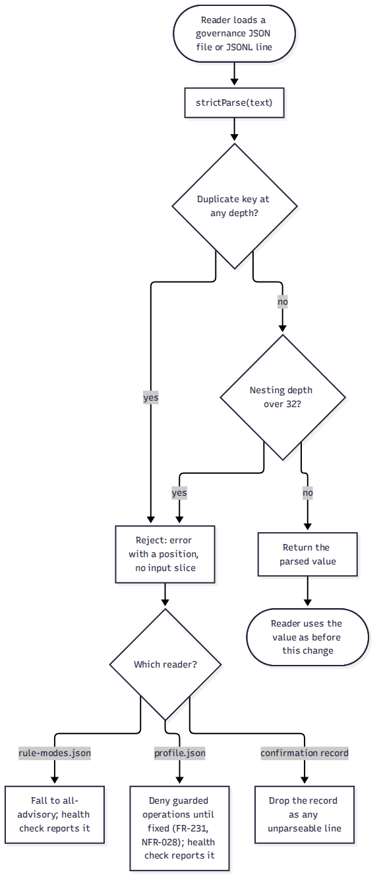
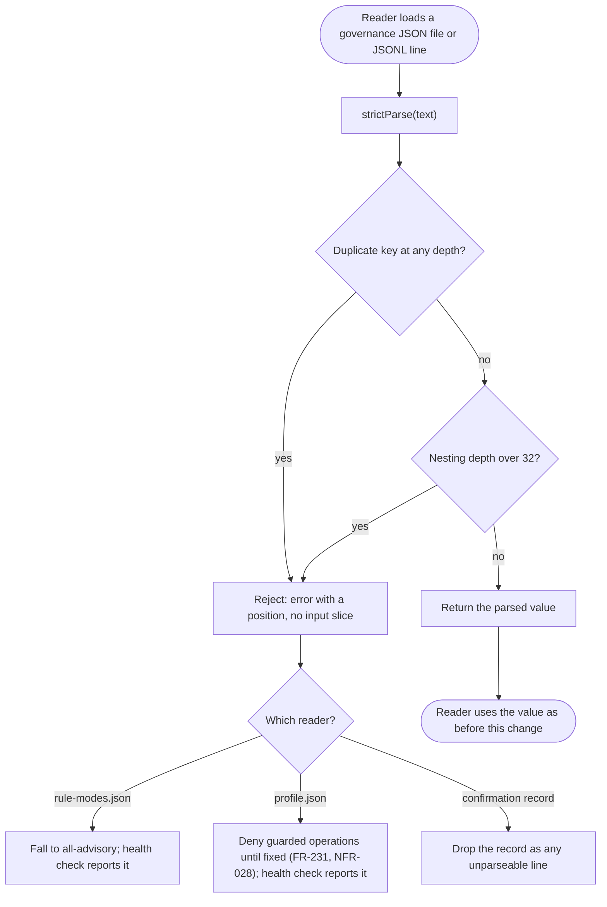

# spec-hooks-strict-json

## Metadata

| Field | Value |
|---|---|
| **Feature** | Dependency-free strict JSON parser and its wiring into three governance readers |
| **Parent feature** | spec-hooks-platform.md |
| **Sub-features** | None |
| **Requirement refs** | FR-248, FR-249, UR-059, UR-068, UR-069, UR-071, UR-075, NFR-016, NFR-028 |
| **Feature type** | Functionality |
| **Status** | Review |

Status values: Draft, Review, Approved, Implemented.

Paths are relative to `plugins/assist-plugin/` unless they start at the repository root. The malformed-file consequences this spec routes into (`rule-modes.json` to all-advisory, `profile.json` deny under FR-231 and NFR-028, a dropped confirmation line) are owned by the child specs named under each wiring Requirement; this spec states only the parser and the routing, not those settled consequences.

## Description

A dependency-free strict JSON parser rejects a governance-config file that holds a duplicate object key at any nesting depth or nests deeper than 32 levels, so a later value cannot silently override an earlier one in a file the plugin trusts. Its error carries a character position and never a slice of the input, matching the no-echo rule of NFR-016 (`specs/spec-hooks-platform.md:458`, `:548`) that keeps a parser message from quoting input that may hold a secret. This release wires the parser into exactly three readers (`parseRuleModes` in `hooks/lib/severity.js`, the `hooks/lib/data-class.js` profile reader, and the `hooks/lib/confirmation-store.js` record reader); a rejection routes through each reader's existing malformed-file path and adds no new state.

## Triggered by

| Trigger type | Source | Condition |
|---|---|---|
| Called by feature | `parseRuleModes` in `hooks/lib/severity.js` reading `.agent/governance/rule-modes.json` | A hook reads the rule-mode store |
| Called by feature | The profile reader in `hooks/lib/data-class.js` reading `.agent/governance/profile.json` | A hook classifies a path or loads PHI patterns, data-class globs, or BAA references |
| Called by feature | The record reader in `hooks/lib/confirmation-store.js` reading `confirmations.jsonl` | The PR-posting guard reads one confirmation record per line |

## Required data

| Data | Source | Type | Notes |
|---|---|---|---|
| JSON text | The governance file or one JSONL line passed by the caller | string | The parser reads text only; the caller owns file I/O and the malformed-file path |
| Depth limit | Parser constant | integer | 32 levels of nested object or array; depth 33 is rejected |

## Preconditions

| Condition | Check | If not met |
|---|---|---|
| The caller passes a text value | The reader has already read the file or line | The reader follows its own missing-file path, outside this parser |
| The parser has no runtime dependency | It imports no package and spawns no process | A build check confirms it; the parser is self-contained for the Node 6 floor (NFR-017) |

## Algorithmic steps

### Requirement 1: Reject a duplicate key at any depth

The strict parser SHALL reject a JSON text in which any object holds the same key twice, whatever the nesting depth of that object.

#### Scenario: Duplicate key at the top level

- **GIVEN** a JSON text whose top-level object holds the key `a` twice
- **WHEN** the strict parser reads it
- **THEN** the parser SHALL reject it
- **AND** the error SHALL carry a character position

#### Scenario: Duplicate key in a nested object

- **GIVEN** a JSON text with a duplicate key inside an object nested at depth 5
- **WHEN** the strict parser reads it
- **THEN** the parser SHALL reject it

### Requirement 2: Reject nesting deeper than 32 levels and accept depth 32

The strict parser SHALL reject a JSON text nested deeper than 32 levels and SHALL accept a duplicate-free text nested at exactly 32 levels.

#### Scenario: Depth over 32

- **GIVEN** a JSON text nested 33 levels deep
- **WHEN** the strict parser reads it
- **THEN** the parser SHALL reject it

#### Scenario: Depth at 32

- **GIVEN** a JSON text nested exactly 32 levels deep with no duplicate key
- **WHEN** the strict parser reads it
- **THEN** the parser SHALL accept it

### Requirement 3: The error carries a position and no slice of the input

The strict parser's rejection error SHALL carry a character position and SHALL NOT carry any slice of the input text.

#### Scenario: Error holds no input

- **GIVEN** a rejected JSON text that holds the string `secret-value`
- **WHEN** the error is read
- **THEN** the error SHALL NOT hold `secret-value` or any other slice of the input
- **AND** the error SHALL hold a character position

### Requirement 4: Valid duplicate-free JSON returns the JSON.parse value

The strict parser SHALL return the same value as `JSON.parse` for a valid text with no duplicate key and depth of 32 or less.

#### Scenario: Valid input unchanged

- **GIVEN** valid JSON with no duplicate key and depth of 32 or less
- **WHEN** the strict parser reads it
- **THEN** it SHALL return a value deep-equal to the `JSON.parse` result

### Requirement 5: The rule-mode reader routes a rejection to all-advisory

`parseRuleModes` in `hooks/lib/severity.js` SHALL parse `.agent/governance/rule-modes.json` with the strict parser and SHALL route a strict-parse rejection through its existing malformed-file path, which runs every rule in advisory mode (spec-hooks-goal-guard.md, spec-hooks-code-scan.md). The rejection SHALL NOT create a new state.

#### Scenario: Duplicate key in rule-modes.json

- **GIVEN** `.agent/governance/rule-modes.json` holds a duplicate key
- **WHEN** a hook reads the rule-mode store
- **THEN** every rule SHALL run in advisory mode
- **AND** the strict-parse failure SHALL be reported to the health check (Requirement 8)

#### Scenario: Valid rule-modes.json unchanged

- **GIVEN** valid, duplicate-free `rule-modes.json` of depth 32 or less
- **WHEN** a hook reads the rule-mode store
- **THEN** the result SHALL equal the result before this change

### Requirement 6: The profile reader denies guarded operations on a rejection

The profile reader in `hooks/lib/data-class.js` SHALL parse `.agent/governance/profile.json` with the strict parser and SHALL route a strict-parse rejection through the existing malformed-`profile.json` path of FR-231 and NFR-028, which denies the guarded operations until the file is fixed (spec-hooks-compliance.md). The rejection SHALL NOT create a new state.

#### Scenario: Duplicate key in profile.json

- **GIVEN** `.agent/governance/profile.json` holds a duplicate key and a profile is enforced
- **WHEN** a hook loads it
- **THEN** the guarded tagged-path operations SHALL be denied until the file is fixed (NFR-028)
- **AND** the strict-parse failure SHALL be reported to the health check (Requirement 8)

### Requirement 7: The confirmation-store reader drops a rejected record

The record reader in `hooks/lib/confirmation-store.js` SHALL parse each `confirmations.jsonl` line with the strict parser and SHALL drop a rejected record as it drops any unparseable line (spec-hooks-pr-post-ask.md). A rejected record SHALL NOT stop the reader from reading the other valid records.

#### Scenario: Rejected confirmation record

- **GIVEN** `confirmations.jsonl` holds one record with a duplicate key and one valid record
- **WHEN** the PR-posting guard reads the store
- **THEN** the guard SHALL ignore the rejected record
- **AND** the guard SHALL read the valid record as before

### Requirement 8: The health check reports a rejected rule-modes.json or profile.json

The health check SHALL report a strict-parse failure of `.agent/governance/rule-modes.json` or `.agent/governance/profile.json`, so the rejection is not silent.

#### Scenario: Health check surfaces a rejection

- **GIVEN** `rule-modes.json` or `profile.json` is rejected by the strict parser
- **WHEN** `/assist-plugin:health` runs
- **THEN** the report SHALL name the file and the strict-parse failure

#### Scenario: No rejection, no finding

- **GIVEN** both files parse cleanly under the strict parser
- **WHEN** `/assist-plugin:health` runs
- **THEN** the report SHALL show no strict-parse finding for either file

### Requirement 9: Other JSON.parse readers keep JSON.parse this release

A reader of any other JSON file that uses `JSON.parse` SHALL keep `JSON.parse` in this release; only the three readers of Requirements 5 to 7 use the strict parser.

#### Scenario: Other readers untouched

- **GIVEN** a reader of any JSON file other than `rule-modes.json`, `profile.json`, and the confirmation store
- **WHEN** this change is applied
- **THEN** that reader SHALL keep `JSON.parse` (follow-up in section 4 of `FR-NFR-harness-governance.md`)

## Business rules

| Rule ID | Rule | Traces to | Applied at step | Example |
|---|---|---|---|---|
| RULE-001 | An object with a repeated key is rejected, whatever its depth | FR-248 | Requirement 1 | `{"a":1,"a":2}` and a depth-5 object with a repeated key both reject |
| RULE-002 | Nesting is capped at 32 levels; depth 33 rejects, depth 32 accepts | FR-248 | Requirement 2 | 32 nested objects accept; 33 reject |
| RULE-003 | The rejection error carries a position and no input slice | FR-248, NFR-016 | Requirement 3 | The error names a position but not `secret-value` from the input |
| RULE-004 | A rejection reuses the reader's existing malformed-file path and adds no new state | FR-249, FR-231, NFR-028 | Requirements 5 to 7 | `rule-modes.json` to all-advisory; `profile.json` deny; a dropped confirmation line |

## Data transformations

| Input | Transformation | Output | Notes |
|---|---|---|---|
| JSON text | One scan that tracks object keys per scope and nesting depth, then `JSON.parse` | Parsed value, or a rejection error with a position | Deep-equal to `JSON.parse` on valid duplicate-free input of depth 32 or less |
| Rejection error | Routed by the calling reader | All-advisory, guarded-operation deny, or a dropped line | The reader selects the existing malformed-file path |

## Output / Outcome

| Output | Type | Description |
|---|---|---|
| Parsed value | Return value | The value for valid duplicate-free JSON of depth 32 or less, deep-equal to `JSON.parse` |
| Rejection error | Thrown or returned error | Carries a character position; holds no slice of the input |
| Reader outcome | State in the calling hook | All-advisory (`rule-modes.json`), guarded-operation deny (`profile.json`), or a dropped record (confirmation store) |
| Health finding | Report line | A named strict-parse failure of `rule-modes.json` or `profile.json` |

## Error handling

| Error condition | Handling strategy | Outcome |
|---|---|---|
| Duplicate key at any depth | Reject with a position-only error | The reader follows its existing malformed-file path |
| Depth over 32 | Reject with a position-only error | The reader follows its existing malformed-file path |
| Malformed JSON that `JSON.parse` would also reject | Reject with a position-only error | Same malformed-file path; behavior unchanged from before this change |
| Secret present in the rejected input | The error holds a position only | No input slice reaches a log (NFR-016) |

## Events emitted

Not applicable: the parser returns a value or an error and emits no event.

## Events consumed

Not applicable: the parser is called synchronously by its three readers.

## Sub-feature breakdown

Not applicable: the parser is one shared module.

## Performance considerations

| Concern | Target | Approach |
|---|---|---|
| Added read cost | Within the hook timeout of NFR-007 (5 s; 10 s for the SessionStart health check) | One scan then `JSON.parse` per file, no dependency load, no process spawn |
| Node floor | Parses and runs on Node 6 or newer (NFR-017) | ES5-compatible module with no external package |

The per-write budget of NFR-029 is a write-path metric and does not bind these read-path readers; the parser is noted here as doing one scan then `JSON.parse`, and as dependency-free, rather than measured against a read-path threshold that no NFR sets.

## Traceability

| Requirement | Spec section | Verified by |
|---|---|---|
| FR-248 | Requirements 1 to 4 | Unit test: duplicate key at top level and at depth 5 reject; depth 33 rejects, depth 32 accepts; error holds a position and no input slice; valid input deep-equals `JSON.parse` |
| FR-249 (wiring) | Requirements 5 to 7 | Integration test: `rule-modes.json` duplicate to all-advisory; `profile.json` duplicate denies guarded operations; one duplicate `confirmations.jsonl` line dropped, valid line read |
| FR-249 (health) | Requirement 8 | Health-check test: a rejected `rule-modes.json` or `profile.json` is named in the report |
| FR-249 (unchanged) | Requirements 5, 9 | Regression test: valid files give the pre-change result; other `JSON.parse` readers are not changed |
| NFR-016 | Requirement 3 | Unit test: the error carries no input slice |
| NFR-028 | Requirement 6 | Integration test: a malformed `profile.json` denies guarded operations until fixed |

## Data flow

Render source: [spec-hooks-strict-json-dataflow.mmd](spec-hooks-strict-json-dataflow.mmd).

## Change Log: 2026-11-20

**Source:** Backport follow-up items from the assist-pi backport task plan `docs/task-plans/task-plan-assist-pi-backport-20261120-0314.md` (Steps 3 to 5 for the health-report labels, Step 4 for the confirmation-store reader): FR-249, NFR-028 (the confirmation-store size cap and its fail-closed direction), and FR-249, UR-069 (the health-report label distinction). FR-248 is unchanged. This spec received a delta, so its Status is set to `Review` (delta rule 6, no same-turn approval).

### Direct edits in this pass (no behavior change)

- "single-pass" replaced by "one scan, then `JSON.parse`" wording in Data transformations (the `JSON text` row), Performance considerations (the Added read cost row), and the per-write-budget note below that table. The parser does one scan for duplicate keys and depth and then calls `JSON.parse` (task plan Step 1, "After the scan passes, return `JSON.parse(text)`"), so "single-pass" misdescribed it. No behavior changes; the three edits align the wording with the implementation.

### MODIFIED Requirements

#### Requirement 7: The confirmation-store reader drops a rejected record

**Was:** The record reader in `hooks/lib/confirmation-store.js` SHALL parse each `confirmations.jsonl` line with the strict parser and SHALL drop a rejected record as it drops any unparseable line (spec-hooks-pr-post-ask.md). A rejected record SHALL NOT stop the reader from reading the other valid records.

**Now:** The record reader in `hooks/lib/confirmation-store.js` SHALL parse each `confirmations.jsonl` line with the strict parser and SHALL drop a rejected record as it drops any unparseable line (spec-hooks-pr-post-ask.md). A rejected record SHALL NOT stop the reader from reading the other valid records. The `readRecords` read SHALL be capped at 1 MiB, the data-class `MAX_FILE_BYTES` (`hooks/lib/data-class.js:105`, `1024 * 1024`); a file over the cap SHALL yield no records, so the fail-closed PR-verdict guard reads no confirmation for the PR and verdict and denies the verdict post (the NFR-028 direction).

**Reason:** The original wiring changed `parseLines` only. The 1 MiB cap extends the same fail-closed posture to the `readRecords` path, matching the oversized-file handling of the profile reader (`data-class.js`, `MAX_FILE_BYTES`): an over-cap confirmation store yields no records, the guard finds no confirmation, and it denies (fail closed), rather than reading an unbounded file.

##### Scenario: Confirmation store over the size cap

- **GIVEN** `.agent/governance/confirmations/confirmations.jsonl` is larger than 1 MiB
- **WHEN** the PR-verdict guard reads the store
- **THEN** `readRecords` SHALL yield no records
- **AND** the guard SHALL find no confirmation for the PR and verdict and deny the verdict post (NFR-028 direction)

##### Scenario: Confirmation store at or under the cap unchanged

- **GIVEN** `confirmations.jsonl` is 1 MiB or smaller with one duplicate-key record and one valid record
- **WHEN** the PR-verdict guard reads the store
- **THEN** the guard SHALL ignore the rejected record
- **AND** the guard SHALL read the valid record as before

#### Requirement 8: The health check reports a rejected rule-modes.json or profile.json

**Was:** The health check SHALL report a strict-parse failure of `.agent/governance/rule-modes.json` or `.agent/governance/profile.json`, so the rejection is not silent.

**Now:** The health check SHALL report a strict-parse failure of `.agent/governance/rule-modes.json` or `.agent/governance/profile.json`, so the rejection is not silent, and SHALL distinguish a plain JSON syntax error, reported as "malformed JSON (syntax)", from a duplicate-key or depth rejection, reported as "strict-parse failure", so a reader of the health report can tell the two apart.

**Reason:** The strict-parse case already reads "strict-parse failure" today (the `profile-strict-parse` code, and the `rejected` state of the rule-mode store). The plain syntax case (one `JSON.parse` would also reject) still renders the raw `profile-malformed` token in the report (the profile line of `hooks/impl/health-check.js`), so the two cases do not read apart. This delta introduces the distinction: its code follow-up (task plan Steps 3, 5) relabels the plain syntax case as "malformed JSON (syntax)" while keeping the `profile-malformed` problem code for `profile.json`, so a reader of the report can tell a plain syntax error from a duplicate-key or depth rejection. The report still holds no parser message and no input slice (NFR-016).

##### Scenario: Syntax error labeled apart from a strict-parse failure

- **GIVEN** `.agent/governance/profile.json` holds a plain JSON syntax error that carries no duplicate key and nests 32 levels or less
- **WHEN** `/assist-plugin:health` runs
- **THEN** the report SHALL label it "malformed JSON (syntax)"
- **AND** the report SHALL NOT label it "strict-parse failure"

##### Scenario: Duplicate-key rejection labeled as a strict-parse failure

- **GIVEN** `.agent/governance/profile.json` or `.agent/governance/rule-modes.json` holds a duplicate key
- **WHEN** `/assist-plugin:health` runs
- **THEN** the report SHALL name the file and label it "strict-parse failure"

### REMOVED Requirements

None.

### Traceability added

| Requirement | Spec section | Verified by |
|---|---|---|
| FR-249, NFR-028 | Change Log 2026-11-20: MODIFIED Requirement 7 (size cap) | Integration test: a `confirmations.jsonl` over 1 MiB yields no records and the PR-verdict guard denies the verdict post; a store at or under the cap reads its valid records as before |
| FR-249, UR-069 | Change Log 2026-11-20: MODIFIED Requirement 8 (report labels) | Health-check test for the post-change labels the code follow-up introduces: a plain-syntax-error `profile.json` is labeled "malformed JSON (syntax)" and not "strict-parse failure"; a duplicate-key `profile.json` or `rule-modes.json` is labeled "strict-parse failure" |
