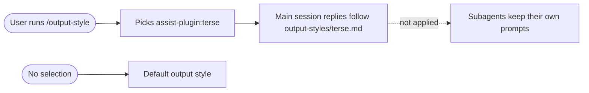

# spec-hooks-terse-output-style

## Metadata

| Field | Value |
|---|---|
| **Feature** | Opt-in `assist-plugin:terse` output style |
| **Parent feature** | spec-hooks-platform.md |
| **Sub-features** | None |
| **Requirement refs** | BR-008, UR-025, FR-125 |
| **Feature type** | Configuration |
| **Status** | Approved |

Status values: Draft, Review, Approved, Implemented.

## Description

The plugin ships one output style, `assist-plugin:terse`, in `output-styles/terse.md`: answer-first replies with no preamble, recap, or sign-off, following the writing standard. It is a configuration file that Claude Code reads; no hook runs for it. The user selects it with `/output-style`; the plugin never forces it, and it does not apply to subagents. This spec describes the file at commit 4803a0d.

## Triggered by

| Trigger type | Source | Condition |
|---|---|---|
| User action | `/output-style` in Claude Code | The user picks `assist-plugin:terse` |

## Required data

| Data | Source | Type | Notes |
|---|---|---|---|
| `name` | `output-styles/terse.md` frontmatter | string | `terse`; Claude Code lists it under the plugin as `assist-plugin:terse` |
| `keep-coding-instructions` | Frontmatter | boolean | `true`: coding behavior stays |
| `force-for-plugin` | Frontmatter | boolean | `false`: the plugin does not apply the style on its own |
| Style body | `output-styles/terse.md` | markdown | Sections "Shape of a reply", "Content that stays", "Wording" |

## Behavior

### Requirement: Opt-in selection

The plugin MAY provide the output style `assist-plugin:terse`, selected only by the user with `/output-style`.

**Requirement refs:** FR-125, UR-025
**Status:** Built
**Source:** `output-styles/terse.md:1-6`; `README.md:295`

#### Scenario: Not selected

- **GIVEN** the user has not selected the style
- **WHEN** a session runs
- **THEN** replies SHALL follow the default style

#### Scenario: Forced by the plugin

- **GIVEN** a change that sets `force-for-plugin: true` in `output-styles/terse.md`
- **WHEN** the change is reviewed against FR-125
- **THEN** the reviewer SHALL reject it, because the style must stay opt-in

### Requirement: Main session only

The `assist-plugin:terse` style SHALL NOT apply to subagents.

**Requirement refs:** FR-125, UR-025
**Status:** Built
**Source:** `README.md:295`; `CLAUDE.md` (Output style bullet)

#### Scenario: Subagent

- **GIVEN** the user selected the style
- **WHEN** `/do` dispatches a subagent
- **THEN** the subagent SHALL run with its own agent prompt and SHALL NOT receive the style's instructions

### Requirement: Style content

The style file SHALL tell the model to open with the answer, skip preamble, recap, and sign-off, keep evidence and caveats that change what the user does, and follow `rules/writing-standard.md`, while keeping coding behavior, tool use, and safety rules unchanged.

**Requirement refs:** FR-125, BR-008
**Status:** Built
**Source:** `output-styles/terse.md:8-30`

#### Scenario: Coding instructions kept

- **GIVEN** the style file
- **WHEN** a test reads its frontmatter
- **THEN** `keep-coding-instructions` SHALL be `true`

#### Scenario: Missing writing-standard reference

- **GIVEN** a change that removes the "Wording" section's reference to `rules/writing-standard.md`
- **WHEN** the change is reviewed
- **THEN** the reviewer SHALL reject it

## Algorithmic steps

Start-to-end flow. Source: [spec-hooks-terse-output-style-flow.mmd](spec-hooks-terse-output-style-flow.mmd).

**Note:** PNG rendering requires mermaid-cli with its headless browser, which is missing on this machine (see spec-hooks-platform.md). Render with `mmdc -i specs/spec-hooks-terse-output-style-flow.mmd -o specs/spec-hooks-terse-output-style-flow.png` once it is installed.

1. Claude Code loads `output-styles/terse.md` from the installed plugin and lists it.
2. The user selects it with `/output-style`.
3. Claude Code applies the style to the main session's replies only.

## Output / Outcome

| Output | Type | Description |
|---|---|---|
| Main-session replies in the terse shape | Behavior of the main session | Answer first, no preamble, recap, or sign-off |

## Error handling

| Error condition | Handling strategy | Outcome |
|---|---|---|
| Style file missing from the install | Claude Code does not list it | The user cannot select it; replies keep the default style |
| Frontmatter malformed | Claude Code's own handling | Not specified by the plugin |

## Events emitted (if applicable)

Not applicable: the style emits no events.

## Dependencies

| Dependency | Type | Required | Notes |
|---|---|---|---|
| Claude Code output styles | Runtime | yes | Selection through `/output-style` |
| `rules/writing-standard.md` | Runtime (referenced text) | no | The style names it as the wording source |

## Sub-feature breakdown (if applicable)

Not applicable.

## Submodule scope (if applicable)

Not applicable.

## Traceability

| Requirement | Spec section | Verified by |
|---|---|---|
| BR-008 | Requirement: Style content | Review of `output-styles/terse.md` |
| UR-025 | Requirement: Opt-in selection | Session without selection |
| FR-125 | Requirement: Opt-in selection; Requirement: Main session only; Requirement: Style content | Frontmatter test (`force-for-plugin: false`, `keep-coding-instructions: true`); subagent run |
