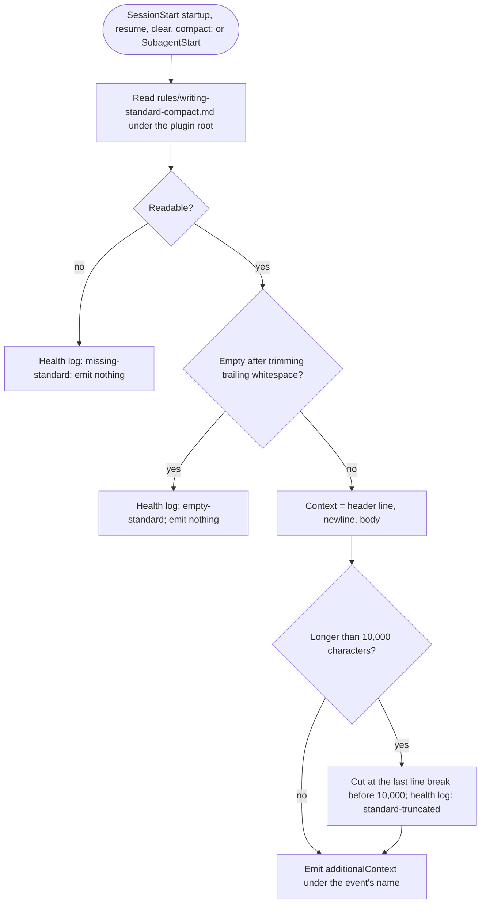

# spec-hooks-writing-context

## Metadata

| Field | Value |
|---|---|
| **Feature** | Writing context: inject the compact writing standard at session and subagent start |
| **Parent feature** | spec-hooks-platform.md |
| **Sub-features** | None |
| **Requirement refs** | BR-003, BR-008, UR-024, FR-107, NFR-001, NFR-002, NFR-009 |
| **Feature type** | Functionality |
| **Status** | Draft |

Status values: Draft, Review, Approved, Implemented.

## Description

`writing-context` adds the compact writing standard (`rules/writing-standard-compact.md`) under a one-sentence header to the context of the main session and of every subagent, so all prose follows the standard without the user loading it (UR-024). It reads the file at run time, so an edit to the file changes the next session. It never blocks, has no self-test, and reports its own problems only in the health log. This spec describes the behavior at commit 4803a0d.

## Triggered by

| Trigger type | Source | Condition |
|---|---|---|
| Event | SessionStart, matcher `startup\|resume\|clear\|compact` (`hooks/hooks.json:124-133`) | Session start, resume, `/clear`, and compaction |
| Event | SubagentStart, matcher `.*` (`hooks/hooks.json:135-146`) | Every subagent start, including a restart after the subagent compacts |

## Required data

| Data | Source | Type | Notes |
|---|---|---|---|
| `hook_event_name` | Hook input | string | `SessionStart` or `SubagentStart`; any other value emits nothing |
| `rules/writing-standard-compact.md` | `${CLAUDE_PLUGIN_ROOT}`, else the directory two levels above `impl/writing-context.js` | UTF-8 text | Read on every call |

## Preconditions

| Condition | Check | If not met |
|---|---|---|
| Event is SessionStart or SubagentStart | `EVENTS` (`impl/writing-context.js:19`, `:43`) | Emit nothing |
| Platform preconditions | spec-hooks-platform.md | Fail open |

## Algorithmic steps

Start-to-end flow. Source: [spec-hooks-writing-context-flow.mmd](spec-hooks-writing-context-flow.mmd).

**Note:** PNG rendering requires mermaid-cli with its headless browser, which is missing on this machine (see spec-hooks-platform.md). Render with `mmdc -i specs/spec-hooks-writing-context-flow.mmd -o specs/spec-hooks-writing-context-flow.png` once it is installed.

### Requirement: Injected context

The `writing-context` hook SHOULD, on SessionStart and SubagentStart, emit `{"hookSpecificOutput": {"hookEventName": <event>, "additionalContext": <header> + "\n" + <body>}}`, where `<body>` is the compact file with trailing whitespace removed.

**Requirement refs:** FR-107, UR-024, BR-008
**Status:** Built
**Source:** `hooks/impl/writing-context.js:14-23`, `:41-62`

The header is the fixed text: "assist-plugin writing standard for prose you write (reports, docs, replies, comments). It does not apply to code, data, or quoted text; project and user instructions take precedence:"

#### Scenario: Session start

- **GIVEN** a new session and a readable compact file
- **WHEN** SessionStart fires with source `startup`
- **THEN** the hook SHALL emit the header and the compact standard as `additionalContext` under `hookEventName` `SessionStart`

#### Scenario: Subagent start

- **GIVEN** `/do` dispatches a subagent
- **WHEN** SubagentStart fires
- **THEN** the hook SHALL emit the same context under `hookEventName` `SubagentStart`

#### Scenario: Other event

- **GIVEN** a hook input with `hook_event_name` `PostToolUse`
- **WHEN** the module evaluates it
- **THEN** the module SHALL emit nothing

### Requirement: Missing or empty standard

The `writing-context` hook SHALL emit nothing and append a health-log record of kind `missing-standard` when the compact file cannot be read, or `empty-standard` when it is empty after trimming.

**Requirement refs:** FR-107, NFR-009
**Status:** Built
**Source:** `hooks/impl/writing-context.js:44-52`; `hooks/lib/health.js:508-510`

Log messages: `rules/writing-standard-compact.md could not be read; no writing context added` and `rules/writing-standard-compact.md is empty; no writing context added`.

#### Scenario: Missing file

- **GIVEN** `rules/writing-standard-compact.md` is missing
- **WHEN** the hook runs
- **THEN** the hook SHALL emit nothing and write a `missing-standard` record to `hook-health.jsonl`

#### Scenario: Empty file

- **GIVEN** the compact file holds only blank lines
- **WHEN** the hook runs
- **THEN** the hook SHALL emit nothing and write an `empty-standard` record

### Requirement: Context size cap

The `writing-context` hook SHALL inject at most 10,000 characters, cutting the context at its last line break at or before character 10,000 (or at 10,000 when there is none) and appending a health-log record of kind `standard-truncated`.

**Requirement refs:** NFR-001, BR-003
**Status:** Built
**Source:** `hooks/impl/writing-context.js:18`, `:33-38`, `:53-61`

#### Scenario: Context cap

- **GIVEN** a compact file that grows past 10,000 characters with its header
- **WHEN** `writing-context` runs
- **THEN** the hook SHALL emit only whole lines totalling at most 10,000 characters
- **AND** `hook-health.jsonl` SHALL gain a `standard-truncated` record

#### Scenario: Under the cap

- **GIVEN** the compact file at commit 4803a0d (12 bullet lines)
- **WHEN** the hook runs
- **THEN** the hook SHALL emit the whole file and log nothing

### Requirement: Compact standard size

The compact writing standard SHOULD stay at or under 1,195 characters, counted as the character count of `rules/writing-standard-compact.md` (`wc -m`).

**Requirement refs:** NFR-002, BR-003
**Status:** Built (the count was not measured for this spec; a hand count of the 12 bullets at commit 4803a0d gives about 1,140 characters, an estimate)
**Source:** `README.md:291`; `CLAUDE.md` (writing-context bullet); `scripts/sync-writing-standard.js:27` (hard limit 1,400)

The sync script enforces a separate hard limit of 1,400 characters (spec-hooks-writing-standard-sync.md); this requirement is the documented target below it.

#### Scenario: Within the target

- **GIVEN** the compact file
- **WHEN** a maintainer runs `wc -m plugins/assist-plugin/rules/writing-standard-compact.md`
- **THEN** the count SHALL be at most 1,195

#### Scenario: Over the target

- **GIVEN** a change that grows the compact file to 1,300 characters
- **WHEN** the change is reviewed
- **THEN** the reviewer SHALL flag NFR-002, although the sync script still accepts the file

## Business rules

| Rule ID | Rule | Traces to | Applied at step | Example |
|---|---|---|---|---|
| RULE-001 | The file is read at run time, never cached | FR-107 | Requirement: Injected context | An edit reaches the next session |
| RULE-002 | The hook never blocks and has no self-test; its problems show only in the health log | FR-107, FR-118 | Requirement: Missing or empty standard | `missing-standard` |

## Data transformations

| Input | Transformation | Output | Notes |
|---|---|---|---|
| Compact file text | Trim trailing whitespace, prefix header and newline, cut to 10,000 characters at a line break | `additionalContext` string | Whole lines only |

## Output / Outcome

| Output | Type | Description |
|---|---|---|
| `additionalContext` | SessionStart or SubagentStart JSON | Header plus standard |
| Health-log record | `hook-health.jsonl` line | `missing-standard`, `empty-standard`, or `standard-truncated` |

## Error handling

| Error condition | Handling strategy | Outcome |
|---|---|---|
| File missing or unreadable | Log `missing-standard` | No context; the session starts normally |
| File empty | Log `empty-standard` | No context |
| File too long | Cut and log `standard-truncated` | Partial context |
| Thrown error, malformed input, timeout, old Node | Platform failure path, suffix `the writing standard was not loaded` | Warning; the session starts without the context |

## Events emitted

| Event name | Payload | Consumer(s) | When emitted |
|---|---|---|---|
| SessionStart or SubagentStart context | `additionalContext` | The model in the main session or the subagent | Every matching event with a readable, non-empty file |

## Events consumed

| Event name | Producer | Payload used | Handling |
|---|---|---|---|
| SessionStart, SubagentStart | Claude Code | `hook_event_name` | Requirement: Injected context |

## Sub-feature breakdown

Not applicable: a leaf feature of spec-hooks-platform.md.

## Performance considerations

| Concern | Target | Approach |
|---|---|---|
| Context cost | At most 10,000 characters per start (NFR-001); file at most 1,195 characters (NFR-002) | Compact bullets only; hard cut at 10,000 |
| Latency | Within the 5 s registration (NFR-007) | One small file read |

## Traceability

| Requirement | Spec section | Verified by |
|---|---|---|
| BR-003 | Requirement: Context size cap; Requirement: Compact standard size | Cap test; `wc -m` |
| BR-008 | Requirement: Injected context | Session start scenario |
| UR-024 | Requirement: Injected context | SessionStart and SubagentStart runs |
| FR-107 | Requirement: Injected context; Requirement: Missing or empty standard | Session start, subagent start, missing file scenarios |
| NFR-001 | Requirement: Context size cap | Oversized file test |
| NFR-002 | Requirement: Compact standard size | `wc -m` on the compact file |
| NFR-009 | Requirement: Missing or empty standard; Error handling | Platform failure-path tests |
