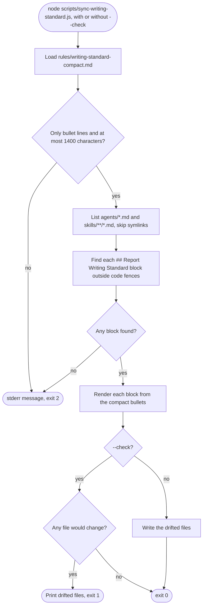

# spec-hooks-writing-standard-sync

## Metadata

| Field | Value |
|---|---|
| **Feature** | Writing standard sync: rewrite and check every `## Report Writing Standard` block from the compact standard |
| **Parent feature** | spec-hooks-platform.md |
| **Sub-features** | None |
| **Requirement refs** | BR-008, UR-043, FR-123, FR-124, NFR-018 |
| **Feature type** | Tooling |
| **Status** | Approved |

Status values: Draft, Review, Approved, Implemented.

## Description

`scripts/sync-writing-standard.js` keeps one copy of the always-on writing rules. It rewrites every `## Report Writing Standard` block in `agents/` and `skills/` from `rules/writing-standard-compact.md`, or, with `--check`, changes nothing and exits 1 while any block differs. A maintainer changes a rule in `rules/writing-standard.md` first, then in the compact file and `hooks/lib/prose-rules.js` when the rule appears there, then runs this script (`CLAUDE.md`, Hooks and writing standard). This spec describes the behavior at commit 4803a0d. Paths are relative to `plugins/assist-plugin/`.

## Triggered by

| Trigger type | Source | Condition |
|---|---|---|
| Manual process | Maintainer runs `node plugins/assist-plugin/scripts/sync-writing-standard.js [--check]` from any directory | After a change to the compact standard, or after adding an agent or skill |
| Release | Release checklist (UC-005 in `docs/requirements/URD-assist-plugin.md`; `CLAUDE.md`, Keeping counts in sync) | `--check` must exit 0 (SC-009) |

## Required data

| Data | Source | Type | Notes |
|---|---|---|---|
| Compact standard | `rules/writing-standard-compact.md` | UTF-8 text | Bullet lines only; the whole file, with CRLF turned into LF and trailing whitespace trimmed, at most 1,400 characters, line breaks counted |
| Target files | `agents/*.md` (top level), `skills/**/*.md` (recursive) | UTF-8 text | `.md` compared without regard to case; symlinks skipped; sorted by name |
| `--check` | Command line | flag | Check mode |

## Behavior

### Requirement: Compact standard validation

The script SHALL refuse to run, printing `sync-writing-standard: <message>` to stderr and exiting 2, when the compact file, with CRLF turned into LF and trailing whitespace removed from its end, has a line that does not start with `- `, or when that whole text is longer than 1,400 characters, line breaks counted (`scripts/sync-writing-standard.js:35`, `:41`).

**Requirement refs:** FR-123, UR-043
**Status:** Built
**Source:** `scripts/sync-writing-standard.js:21`, `:27`, `:33-45`, `:150-157`

Messages: `rules/writing-standard-compact.md must contain only "- " bullet lines; found: <first stray line as JSON>` and `rules/writing-standard-compact.md is <N> characters; the limit is 1400`. The 1,400 limit is a hard stop above the 1,195-character documented size (NFR-002, spec-hooks-writing-context.md).

#### Scenario: Stray heading line

- **GIVEN** the compact file starts with a `# Standard` line
- **WHEN** the script runs
- **THEN** it SHALL write nothing, print the stray-line message, and exit 2

#### Scenario: Valid file

- **GIVEN** the compact file at commit 4803a0d (12 bullet lines)
- **WHEN** the script runs
- **THEN** it SHALL accept the file

### Requirement: Block boundaries

The script SHALL treat as a block each line that starts `## Report Writing Standard` outside a code fence, plus every following line up to the next line that starts `# ` or `## ` outside a code fence, or the end of the file.

**Requirement refs:** FR-123, UR-043
**Status:** Built
**Source:** `scripts/sync-writing-standard.js:11-13`, `:22-25`, `:67-92`

A code fence opens on a line of up to 3 spaces and 3 to 40 backticks or tildes and closes on a line of the same character, at least as long, with only spaces or tabs after it. A `### ` heading does not end a block.

#### Scenario: Block followed by a section

- **GIVEN** an agent file whose `## Report Writing Standard` block is followed by `## Traceability Markers`
- **WHEN** the script finds blocks
- **THEN** the block SHALL end on the line before `## Traceability Markers`

#### Scenario: Heading inside a fence

- **GIVEN** a skill file that shows `## Report Writing Standard` inside a fenced example
- **WHEN** the script finds blocks
- **THEN** that fenced line SHALL NOT start a block

### Requirement: Block rendering

The script SHALL render each block as its heading line as written, a blank line, the compact bullets, and, when the block does not end the file, a blank line, followed by the block's trailing horizontal rule (`---`, `***`, or `___`) and another blank line when the old block ended with one, keeping the file's line-ending style and final newline.

**Requirement refs:** FR-123, NFR-018
**Status:** Built
**Source:** `scripts/sync-writing-standard.js:26`, `:94-122`

#### Scenario: Changed rule

- **GIVEN** a bullet changed in the compact file
- **WHEN** the script runs without `--check`
- **THEN** every block in `agents/` and `skills/` SHALL equal the compact bullets under its heading

#### Scenario: Hand edit

- **GIVEN** someone edited one block by hand
- **WHEN** the script runs without `--check`
- **THEN** it SHALL overwrite that block

#### Scenario: Windows line endings

- **GIVEN** a target file with CRLF line endings
- **WHEN** the script rewrites its block
- **THEN** the file SHALL keep CRLF line endings

### Requirement: Rewrite mode

Without `--check`, the script SHALL write each target file whose rendered text differs, print `<B> block(s) in <F> file(s); <D> rewritten from rules/writing-standard-compact.md.` followed by each rewritten path, and exit 0.

**Requirement refs:** FR-123, UR-043
**Status:** Built
**Source:** `scripts/sync-writing-standard.js:124-148`

#### Scenario: Nothing to change

- **GIVEN** every block equals the compact file
- **WHEN** the script runs without `--check`
- **THEN** it SHALL write no file, report 0 rewritten, and exit 0

#### Scenario: No blocks anywhere

- **GIVEN** no file under `agents/` or `skills/` holds a block
- **WHEN** the script runs
- **THEN** it SHALL print `sync-writing-standard: no "## Report Writing Standard" blocks found under agents/ or skills/` to stderr and exit 2

### Requirement: Check mode

The script `scripts/sync-writing-standard.js --check` SHALL exit 1 while any `## Report Writing Standard` block differs from `rules/writing-standard-compact.md`, writing no file and listing the files that differ.

**Requirement refs:** FR-124, NFR-018, UR-043
**Status:** Built
**Source:** `scripts/sync-writing-standard.js:7-9`, `:124-148`; `CLAUDE.md` (Keeping counts in sync)

Output: `<B> block(s) in <F> file(s); <D> differ from rules/writing-standard-compact.md.` and one indented path per differing file.

#### Scenario: Drifted block

- **GIVEN** one block differs from the compact file
- **WHEN** the script runs with `--check`
- **THEN** it SHALL list that file, change no file, and exit 1

#### Scenario: All equal

- **GIVEN** every block equals the compact file
- **WHEN** the script runs with `--check`
- **THEN** it SHALL exit 0

## Algorithmic steps

Start-to-end flow. Source: [spec-hooks-writing-standard-sync-flow.mmd](spec-hooks-writing-standard-sync-flow.mmd).

**Note:** PNG rendering requires mermaid-cli with its headless browser, which is missing on this machine (see spec-hooks-platform.md). Render with `mmdc -i specs/spec-hooks-writing-standard-sync-flow.mmd -o specs/spec-hooks-writing-standard-sync-flow.png` once it is installed.

1. Load and validate the compact file.
2. List target files: `agents/` without recursion, `skills/` with recursion, skipping symlinks.
3. For each file, find the blocks and render them from the last block back, so earlier line numbers stay valid.
4. Count blocks and files; collect the files whose text changed.
5. Write the changed files (rewrite mode) or report them (check mode); choose the exit code.

## Output / Outcome

| Output | Type | Description |
|---|---|---|
| Rewritten agent and skill files | Files | Rewrite mode only |
| Summary and file list | stdout | Both modes |
| Exit code | Process status | 0, 1 (check mode with drift), or 2 (operational error) |

## Error handling

| Error condition | Handling strategy | Outcome |
|---|---|---|
| Compact file invalid or unreadable | Throw, caught at the top level | stderr message, exit 2, no file written |
| No block found | Throw | stderr message, exit 2 |
| A target file unreadable or unwritable | Throw | stderr message, exit 2; files written before the error stay written |

## Events emitted (if applicable)

Not applicable: the script prints and exits.

## Dependencies

| Dependency | Type | Required | Notes |
|---|---|---|---|
| Node.js | Runtime | yes | ES2015 syntax, no packages |
| `rules/writing-standard-compact.md` | Runtime | yes | Also injected by `writing-context` (spec-hooks-writing-context.md) |
| `rules/writing-standard.md`, `hooks/lib/prose-rules.js` | Process | no | Edited first when a rule changes (`CLAUDE.md`, Hooks and writing standard) |
| `✓ LLM Security Clear` | Process | yes | A sync rewrites `agents/` and `skills/` files (NFR-011) |

## Sub-feature breakdown (if applicable)

Not applicable.

## Submodule scope (if applicable)

Not applicable.

## Traceability

| Requirement | Spec section | Verified by |
|---|---|---|
| BR-008 | Requirement: Check mode | SC-009: `--check` exits 0 at release |
| UR-043 | Requirement: Rewrite mode; Requirement: Block rendering | Changed-rule scenario |
| FR-123 | Requirement: Compact standard validation; Requirement: Block boundaries; Requirement: Block rendering; Requirement: Rewrite mode | Changed-rule, hand-edit, fence scenarios |
| FR-124 | Requirement: Check mode | Drifted-block and all-equal scenarios |
| NFR-018 | Requirement: Check mode; Requirement: Block rendering | `node plugins/assist-plugin/scripts/sync-writing-standard.js --check` exits 0 |
