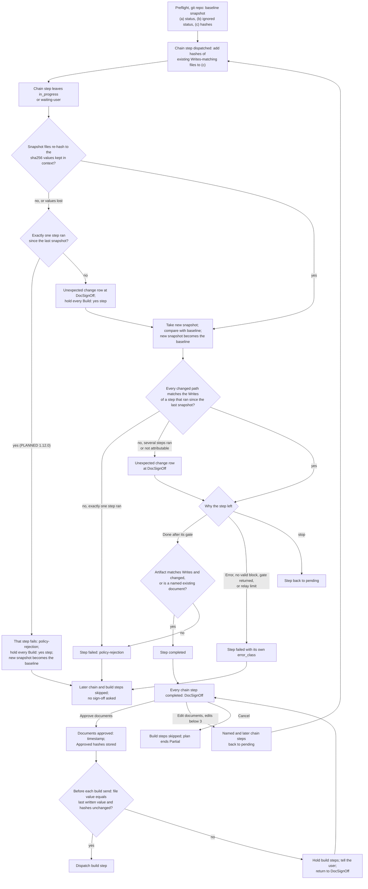

# spec-orchestration-chain-signoff

## Metadata

| Field | Value |
|---|---|
| **Feature** | `/do` change check, chain artifact validation, and document sign-off |
| **Parent feature** | spec-orchestration-spec-first.md |
| **Sub-features** | None |
| **Requirement refs** | BR-004, BR-006, BR-012, BR-013, UR-005, UR-006, UR-009, UR-019, FR-032, FR-033, FR-034, FR-035, FR-036, FR-037, FR-038, FR-039, FR-040, FR-064, FR-190, FR-192 |
| **Feature type** | Functionality |
| **Status** | Approved |

Status values: Draft, Review, Approved, Implemented.

Baseline: assist-plugin 1.11.1 at commit 41034c1; `skills/do/SKILL.md` line cites were refreshed against that file on 2026-10-16. Requirements 1 to 14 and 1a are Built: Requirement 1a (FR-192), Requirement 14 (FR-190), and the "Built change (1.11.1)" notes under Requirements 1, 6, and 8 were built in 1.11.1 (`docs/requirements/FR-NFR-assist-plugin.md`, FR-192 `:654-673`; FR-190 `:993-1027`). The Change Log at the end of this file records the PLANNED (1.12.0) changes and holds where it differs from the main body. Paths are relative to `plugins/assist-plugin/` unless they start at the repository root.

## Description

The document chain runs agents that read untrusted documents before the user has signed anything, and fsa-write-bar does not cover Bash writes (FR-108 to FR-113, Area B). This feature is the orchestrator-side guard around that chain: `/do` snapshots git status and the content hashes of the files that steer agents, compares them whenever a chain step leaves `in_progress` or `waiting-user`, validates each chain artifact against the step's Writes, asks the user to approve, edit, or cancel the three documents at DocSignOff, and rechecks the sign-off value and the approved documents' hashes before every build send. It never reverts anything; the user decides (`skills/do/SKILL.md:427`).

## Triggered by

| Trigger type | Source | Condition |
|---|---|---|
| Called by feature | Preflight | Baseline snapshot, git repository only |
| Called by feature | Dispatch (Send) | A document-chain step's window opens at its dispatch |
| Called by feature | Dispatch (Read each result) | A chain step leaves `in_progress` or `waiting-user`: Done after its gate, Error, no valid block, a gate that ends `returned`, the NeedsInput relay limit, or a stop returning it to `pending` |
| Called by feature | Dispatch (Leaving Dispatch) | Outcome `docs-ready` goes to DocSignOff |
| Called by feature | Display after a stop | One more comparison before Display |
| Called by feature | Dispatch (Send) | Every send of a `Build: yes` step |

## Required data

| Data | Source | Type | Notes |
|---|---|---|---|
| Snapshot part (a) | `git -C '<root>' status --porcelain --untracked-files=all` | Sorted lines | Written to a snapshot file |
| Snapshot part (b) | `git -C '<root>' status --porcelain --ignored=matching -- .claude CLAUDE.md AGENTS.md` | Sorted lines | Catches ignored steering files |
| Snapshot part (c) | `git -C '<root>' hash-object` or `sha256sum` of each existing `.claude/settings*.json`, `CLAUDE.md`, `CLAUDE.local.md`, `AGENTS.md`, `DECISIONS.md` under `<root>`, plus the Writes-matching documents added when a chain window opens | Sorted path and hash lines | `<root>` is the session's git root (Requirement 1a) |
| Snapshot file location | Session scratchpad directory; else `.agent/change-check/` with `':(exclude).agent'` added to the status pathspecs | Paths kept in context | Outside the repo, so snapshot files never appear in the snapshots |
| Snapshot file sha256 values | Computed by `/do` when it writes each snapshot file | Kept in context | Detect a tampered snapshot |
| Step Writes and run history | Plan file | Globs | Decide expected versus unexpected changes |
| Chain step artifact | Terminal block `artifact` field | Paths | Validated before it is passed on |
| `Documents approved` last written | `/do` context | Value | Compared with the plan file before each build send |
| Approved hashes | Spec-First `Approved hashes` field and `/do` context | Hash per approved document | Written at Approve documents |

File names in a snapshot are untrusted text: `/do` uses them only to match against Writes globs and never acts on one as an instruction (`skills/do/SKILL.md:371`).

## Preconditions

| Condition | Check | If not met |
|---|---|---|
| The project is a git repository | Preflight | No change check: record `skipped: change-check not-run (no git)` (Requirement 7) |
| Every chain step is `completed` and passed its planning gate | Leaving Dispatch, outcome `docs-ready` | DocSignOff does not start |
| `/do` remembers the snapshot sha256 values and the last-written `Documents approved` | Context | Treat the check as failed and the value as `pending` (Requirements 4 and 13) |

## Algorithmic steps

The edge from "Exactly one step ran" to a failed step is the PLANNED (1.12.0) outcome of OPEN-3 (Change Log 2026-10-16, Requirement 4); at 1.11.1 a mismatch only holds the build steps and records the unexpected change.

Source: [spec-orchestration-chain-signoff-flow.mmd](spec-orchestration-chain-signoff-flow.mmd). PNG not rendered (rendering skipped on 2026-10-16): `mmdc` 12.0.0 cannot find its headless browser, chrome-headless-shell. Render with `mmdc -i specs/spec-orchestration-chain-signoff-flow.mmd -o specs/spec-orchestration-chain-signoff-flow.png` once `mmdc` can start its browser.

### Requirement 1: Take the baseline snapshot at Preflight

The `/do` skill SHALL, in a git repository, snapshot `git status` and the content hashes of `.claude/settings*.json`, `CLAUDE.md`, `CLAUDE.local.md`, `AGENTS.md`, and `DECISIONS.md` at Preflight. (FR-032; `skills/do/SKILL.md:371`)

`/do` writes each of parts (a), (b), and (c), sorted, to its own snapshot file, keeps the file paths (not the contents) and each file's sha256 in context, and hashes only the listed files that exist.

At 4803a0d (`skills/do/SKILL.md:356` at that commit): part (a), `git status --porcelain --untracked-files=all`, had no pathspec, covered the whole repository, and printed paths relative to the repository root. Part (b)'s pathspecs (`.claude`, `CLAUDE.md`, `AGENTS.md`) and part (c)'s hashed files were relative paths, so they resolved against the working directory. Built change (1.11.1): FR-192 takes parts (b) and (c) against the session's git root as well (Requirement 1a; `skills/do/SKILL.md:371`; `DECISIONS.md` 2026-10-16, 1.11.1 design points for root notes, change check, and grants). The Scenarios below use a session started at the git root, where both rules name the same files.

#### Scenario: Git project

- **GIVEN** a build plan in a git repository that has `CLAUDE.md` and no `AGENTS.md`, in a session started at the repository's root
- **WHEN** Preflight runs
- **THEN** `/do` SHALL write three sorted snapshot files under the session scratchpad and part (c) SHALL list a hash for `CLAUDE.md` and none for `AGENTS.md`

#### Scenario: No scratchpad directory

- **GIVEN** a session with no scratchpad directory, started at the repository's root
- **WHEN** Preflight takes the snapshot
- **THEN** `/do` SHALL write the snapshot files under `.agent/change-check/` and add `':(exclude).agent'` to both status pathspecs

### Requirement 1a: Take the change-check snapshots against the session's git root (Built 1.11.1)

The `/do` skill SHALL take the change-check snapshots, `git status` output and the content hashes of `.claude/settings*.json`, `CLAUDE.md`, `CLAUDE.local.md`, `AGENTS.md`, and `DECISIONS.md`, against the git root of the session's working directory (a worktree uses its own root). (FR-192, Built 1.11.1; `docs/requirements/FR-NFR-assist-plugin.md:654-673`; `skills/do/SKILL.md:82`, `:371`; `DECISIONS.md` 2026-10-16, 1.11.1 design points for root notes, change check, and grants)

At 4803a0d part (a) already covers the whole repository with repository-root-relative paths; parts (b) and (c) resolve against the working directory (Requirement 1). FR-192 makes parts (b) and (c) resolve against the git root too, so the steering files the check hashes, `DECISIONS.md` included, are the ones at the same root where `/do` lists and appends to `DECISIONS.md` (FR-187, FR-188; spec-orchestration-spec-first.md, Requirements 14 and 15). The same root applies to every comparison (Requirement 3) and to the refresh after `/do`'s own writes (Requirement 6). Outside a git repository the check does not run (Requirement 7).

#### Scenario: Subdirectory session

- **GIVEN** a session started in `<repo>/src`, and a chain step changes `<repo>/CLAUDE.md`
- **WHEN** the change check compares the snapshots
- **THEN** `/do` SHALL hash `<repo>/CLAUDE.md`, find the change, and report it as an unexpected change, and SHALL NOT look for `<repo>/src/CLAUDE.md`

#### Scenario: Worktree session

- **GIVEN** a session in the worktree `<repo>/.claude/worktrees/feature-a`, and a chain step changes the worktree's `DECISIONS.md`
- **WHEN** the change check compares the snapshots
- **THEN** `/do` SHALL take the snapshot against the worktree's own root and report the change, and the main checkout's `<repo>/DECISIONS.md` SHALL NOT be part of that snapshot

#### Scenario: Session at the git root

- **GIVEN** a session started at the git root
- **WHEN** the change check takes its snapshot
- **THEN** the paths SHALL be the same as before FR-192

### Requirement 2: Open a chain step's window at dispatch

The `/do` skill SHALL, when it dispatches a document-chain step, first add a content hash of each existing file that matches the step's Writes to part (c) of the baseline. (FR-032, FR-035; `skills/do/SKILL.md:398`)

#### Scenario: Re-run rewrites an existing document

- **GIVEN** `specs/spec-auth.md` exists and the spec step re-runs after Edit documents
- **WHEN** the step is dispatched and later rewrites the file
- **THEN** the comparison SHALL show a changed hash for `specs/spec-auth.md`

#### Scenario: Untouched existing document

- **GIVEN** `FR-NFR-auth.md` exists and the requirements step reports it as its artifact without writing it
- **WHEN** the comparison runs
- **THEN** `FR-NFR-auth.md` SHALL read as unchanged

### Requirement 3: Compare at every chain-step exit and before DocSignOff

The `/do` skill SHALL compare a new snapshot with the baseline whenever a document-chain step leaves `in_progress` or `waiting-user` and before DocSignOff, and then make the new snapshot the baseline. (FR-032; `skills/do/SKILL.md:420`)

The new snapshot goes to new scratchpad files and hashes the same files as the window's baseline. `/do` compares the sorted files with `diff` or `comm`, brings at most 50 changed lines into context plus a count of the rest, and treats a larger set as an unexpected change listed by count. The new snapshot becomes the baseline after every comparison, whatever it found. It compares once more before Display after a stop.

After the comparison and the unexpected-change handling of Requirement 5, the reason the step left decides what follows (`skills/do/SKILL.md:404`, `:412-413`, `:106-109`):

| Exit reason | Next |
|---|---|
| `Done` after its gate | Artifact validation (Requirement 8), then `completed` or `failed` |
| `Error`, no valid block after the retry, a gate that ends `returned`, or the NeedsInput relay limit | The step stays `failed` with its own `error_class`; later chain and build steps are `skipped` |
| A stop | The step returns to `pending`; no artifact validation runs |

#### Scenario: Step ends Done

- **GIVEN** a chain step finished its gate in a git repo
- **WHEN** `/do` runs the change check
- **THEN** `/do` SHALL compare a new snapshot with the baseline and then make the new snapshot the baseline

#### Scenario: Step ends in Error

- **GIVEN** a chain step ends in `Error` with class `tool-failed`
- **WHEN** `/do` records the failure
- **THEN** `/do` SHALL run the change check before it marks the dependents `skipped`
- **AND** `/do` SHALL run no artifact validation for the step and SHALL make the new snapshot the baseline

#### Scenario: Stop during a chain step

- **GIVEN** a stop arrives while the spec step runs, and the step then reports `Done` before its gate starts
- **WHEN** `/do` runs the change check
- **THEN** `/do` SHALL make the new snapshot the baseline and return the step to `pending` without artifact validation

#### Scenario: Large change set

- **GIVEN** a comparison that finds 120 changed status lines
- **WHEN** `/do` reads the difference
- **THEN** `/do` SHALL bring at most 50 lines into context, keep a count of the other 70, and report the set as an unexpected change by count

### Requirement 4: Treat a tampered or lost baseline as an unexpected change

The `/do` skill SHALL re-hash the snapshot files before each comparison and, on a mismatch with the sha256 values kept in context or when those values are lost, record an unexpected change against the steps that ran since the last snapshot and hold every `Build: yes` step. (FR-032; `skills/do/SKILL.md:420`)

`skills/do/SKILL.md:420` states the attribution and the hold at 1.11.1. OPEN-3 is closed: under the one-step rule of Requirement 5 (`skills/do/SKILL.md:425`) the attributed step also fails, and with several steps none is blamed (PLANNED 1.12.0; Change Log 2026-10-16, Requirement 4). The Scenarios below assert the 1.11.1 part.

#### Scenario: Snapshot file tampered

- **GIVEN** a subagent overwrote a snapshot file
- **WHEN** `/do` re-hashes the baseline files before comparing
- **THEN** `/do` SHALL record an unexpected change against the steps that ran since the last snapshot and hold every `Build: yes` step
- **AND** the attributed step's Status after this check is specified in the Change Log 2026-10-16 (PLANNED 1.12.0)

#### Scenario: Hashes lost after compaction

- **GIVEN** `/do` cannot recall the snapshot sha256 values
- **WHEN** a chain step leaves `in_progress`
- **THEN** `/do` SHALL treat the check as failed and hold every `Build: yes` step
- **AND** the step's Status after this check is specified in the Change Log 2026-10-16 (PLANNED 1.12.0)

### Requirement 5: Report a change outside the Writes of the steps that ran

The `/do` skill SHALL report a changed path that matches no Writes glob of a step that ran since the last snapshot as an unexpected change and leave the path in place. (FR-033; `skills/do/SKILL.md:424-427`)

| Steps that ran since the last snapshot | Handling of an unexpected change |
|---|---|
| Exactly one | That step fails (or stays failed) with `error_class` `policy-rejection` and the path in its Done field; the Failed steps rule skips later chain steps and build steps, so no sign-off is asked |
| Several, or the change cannot be tied to one step | An "unexpected change" row with the path in the DocSignOff table, and in Display if the run ends without sign-off |

#### Scenario: One step ran

- **GIVEN** exactly one chain step ran since the last snapshot and `.claude/settings.local.json` changed
- **WHEN** the change check compares
- **THEN** `/do` SHALL fail that step with `error_class` `policy-rejection`, name the path in its Done field, and skip later chain and build steps

#### Scenario: Several steps ran

- **GIVEN** several steps ran since the last snapshot and an unexpected path changed
- **WHEN** DocSignOff builds its table
- **THEN** `/do` SHALL add an "unexpected change" row with the path and revert nothing

### Requirement 6: Refresh the baseline after the orchestrator's own writes

The `/do` skill SHALL compare `DECISIONS.md`'s hash with the baseline just before each of its own writes to it, and refresh the plan file's status line and `DECISIONS.md`'s hash in the baseline after each of its own writes during Dispatch. (FR-032, FR-033; `skills/do/SKILL.md:422`)

A mismatch before the write is an unexpected change, reported and not absorbed. The refresh keeps `/do`'s own writes (a Status update, a NeedsInput answer recorded in `DECISIONS.md`, a sign-off timestamp) from being attributed to a step.

At 4803a0d the `DECISIONS.md` hash in part (c) and the status lines for `.claude`, `CLAUDE.md`, and `AGENTS.md` in part (b) were taken against the working directory, while part (a) covered the whole repository with repository-root-relative paths (`skills/do/SKILL.md:356`, `:407` at that commit). Built change (1.11.1): the `DECISIONS.md` that `/do` compares, writes, and refreshes is the one at the session's git root (`skills/do/SKILL.md:422`), because FR-188 appends to that file and FR-192 takes parts (b) and (c) against that root (Requirement 1a). The Scenarios below use a session started at the repository's root, where both rules name the same file.

#### Scenario: Own write not attributed

- **GIVEN** a session started at the repository's root, and `/do` sets a step `completed` in the plan file while a chain step runs
- **WHEN** that chain step later leaves `in_progress` and the check compares
- **THEN** the plan file change SHALL NOT count as an unexpected change

#### Scenario: DECISIONS.md changed by someone else

- **GIVEN** a session started at the repository's root, and `DECISIONS.md`'s hash differs from the baseline before `/do` appends a NeedsInput decision
- **WHEN** `/do` prepares the write
- **THEN** `/do` SHALL report an unexpected change for `DECISIONS.md` and SHALL NOT fold the other change into the new baseline

#### Scenario: Subdirectory session (Built 1.11.1)

- **GIVEN** FR-192 is built, a session started in `<repo>/src`, and `<repo>/DECISIONS.md` changed since the baseline
- **WHEN** `/do` prepares to append a decision
- **THEN** `/do` SHALL compare and report the change for `<repo>/DECISIONS.md` and SHALL NOT look for `<repo>/src/DECISIONS.md`

### Requirement 7: Record the change check as skipped outside git

The `/do` skill SHALL, at Preflight in a non-git project, record `skipped: change-check not-run (no git)` in the Change check field of a build plan's Spec-First section. (FR-034; `skills/do/SKILL.md:241`, `:371`, `:429`)

#### Scenario: Non-git project

- **GIVEN** a build plan in a directory that is not a git repo
- **WHEN** Preflight runs
- **THEN** `/do` SHALL write the skipped marker and show it among the Display skipped markers

#### Scenario: Git project

- **GIVEN** a build plan in a git repo
- **WHEN** Branch writes the Spec-First section
- **THEN** the Change check field SHALL read `git`, and Preflight SHALL write no skipped marker

### Requirement 8: Validate each chain artifact before passing it on

The `/do` skill SHALL accept a chain step's artifact path only when it matches the step's Writes and shows as changed in the step's change-check window, or is an existing document the step's prompt named for update. (FR-035; `skills/do/SKILL.md:404`)

"Changed" means a changed status line or a changed content hash; in a non-git project a Writes match alone is enough. An accepted unchanged artifact shows as "unchanged" at DocSignOff and withholds the Recommended mark. Any other artifact fails the step with `policy-rejection`, and an artifact is passed to a later step only after it passes.

Built change (1.11.1): FR-190 adds every existing document a chain step's prompt names for update to that step's Writes, and moves the requirements and task-plan Writes to `docs/requirements/` and `docs/task-plans/` (Requirement 14; spec-orchestration-spec-first.md, Requirement 17). The Scenario "Matching changed artifact" below describes 4803a0d, where the requirements Writes were root-level; the Change Log 2026-10-16 gives its 1.11.1 form.

#### Scenario: Matching changed artifact (4803a0d, replaced in 1.11.1)

- **GIVEN** a requirements step reports `FR-NFR-auth.md`, a Writes match that changed
- **WHEN** `/do` validates the artifact
- **THEN** `/do` SHALL accept it and set the step `completed`

#### Scenario: Unnamed unchanged artifact

- **GIVEN** a step reports an unchanged path its prompt did not name for update
- **WHEN** `/do` validates the artifact
- **THEN** `/do` SHALL fail the step with `error_class` `policy-rejection`

#### Scenario: Artifact outside the Writes

- **GIVEN** the spec step reports `docs/spec-auth.md`, which matches none of its Writes globs
- **WHEN** `/do` validates the artifact
- **THEN** `/do` SHALL fail the step with `policy-rejection` and skip the task-plan step

### Requirement 9: Show the sign-off table

The `/do` skill SHALL, once every chain step is `completed`, show a table of document, path, and one-line summary and list reported instruction-like citations as `FILE:LINE` grouped by document. (FR-036; `skills/do/SKILL.md:462-482`)

DocSignOff runs the change check once more first (in a non-git project it says the check did not run). The path comes from the step's artifact and the summary from its Done field. Extra rows: "unexpected change" per unattributable change; "changed since approval" per document whose hash differs from the one stored at the last Approve; "unchanged" in the summary of an accepted unchanged artifact; "reused" for a reused document. The citations come from the chain steps' and planning-gate reviewers' Out of scope fields, never with quotes. The question is "Approve the requirements, spec, and task plan?":

| Option | Description |
|---|---|
| Approve documents | Build steps become ready. Marked (Recommended) only when the flagged-citation list, the "unexpected change" rows, the "changed since approval" rows, and the accepted-unchanged rows are all empty |
| Edit documents | Type the change and name the document; offered only for documents a chain step produced |
| Cancel | Skip every build step; the plan ends `Partial` |

#### Scenario: Clean chain

- **GIVEN** all three chain steps are `completed` and nothing was flagged
- **WHEN** DocSignOff runs
- **THEN** `/do` SHALL show three rows and mark "Approve documents" Recommended

#### Scenario: Flagged chain

- **GIVEN** a planning-gate reviewer cited instruction-like text at `specs/spec-auth.md:12`
- **WHEN** DocSignOff runs
- **THEN** `/do` SHALL list the citation under the spec, show no quote, and withhold the Recommended mark

### Requirement 10: Record Approve documents

The `/do` skill SHALL, on Approve documents, write the timestamp to `Documents approved`, store a content hash of each approved document, and go to Dispatch in full mode. (FR-037; `skills/do/SKILL.md:484`)

`/do` writes with the Edit tool, keeps the timestamp as the value it last wrote, and stores the hashes, reused documents included, in the `Approved hashes` field and in its context.

#### Scenario: Approval

- **GIVEN** the user picks Approve documents
- **WHEN** `/do` records it
- **THEN** `/do` SHALL write "YYYY-MM-DD HH:mm" to `Documents approved` and the hashes to `Approved hashes`, reused documents included

#### Scenario: Build steps start

- **GIVEN** documents were approved
- **WHEN** Dispatch runs in full mode
- **THEN** `/do` SHALL treat the held `Build: yes` steps as ready when their dependencies are `completed`

#### Scenario: Document changed after an earlier approval

- **GIVEN** an approved document changed and DocSignOff runs again
- **WHEN** the user picks Approve documents
- **THEN** `/do` SHALL rewrite the timestamp and the stored hashes

### Requirement 11: Re-run edited documents, at most 3 times

The `/do` skill SHALL, on Edit documents, set the named chain step and every later chain step back to `pending` with the change in their prompts, and withdraw the Edit option after 3 edits. (FR-038; `skills/do/SKILL.md:485`)

Each edit adds 1 to the document-edits counter and is recorded under `## User Decisions` (and in `DECISIONS.md` when architectural). A change to the requirements re-runs all three steps. A change that names no document gets a follow-up question. A change to a reused document is not made here: `/do` tells the user to Cancel and start a new request. The re-run steps pass their planning gate again before the flow returns to DocSignOff.

#### Scenario: Spec edit

- **GIVEN** the user names the spec and types a change
- **WHEN** `/do` applies it
- **THEN** `/do` SHALL re-run the spec and task plan steps through the planning gate before asking again

#### Scenario: Third edit used

- **GIVEN** the document edits counter is 3
- **WHEN** DocSignOff asks again
- **THEN** `/do` SHALL offer only Approve documents and Cancel and answer a typed change with the limit

### Requirement 12: Skip build steps on Cancel at sign-off

The `/do` skill SHALL, on Cancel at DocSignOff, set every held `Build: yes` step and its dependents to `skipped` with "Skipped: documents not approved" and end the plan `Partial`. (FR-039; `skills/do/SKILL.md:486`, decision S3)

#### Scenario: Cancel

- **GIVEN** the chain finished and the user picks Cancel
- **WHEN** `/do` records it
- **THEN** `/do` SHALL skip the build steps and go to Display with the documents left on disk

#### Scenario: Terminal state

- **GIVEN** build steps were skipped at sign-off
- **WHEN** the run reaches its terminal state
- **THEN** `/do` SHALL end `Partial` and SHALL NOT end `Cancelled`

### Requirement 13: Recheck the sign-off before every build send

The `/do` skill SHALL, before every build send, compare the plan file's `Documents approved` with the value it last wrote and recompute each approved document's hash, and hold every `Build: yes` step on a mismatch. (FR-040; `skills/do/SKILL.md:379`; `docs/ARCHITECTURE.md:206`)

| Mismatch | Handling |
|---|---|
| The file value differs from the value `/do` last wrote, or `/do` cannot recall that value | Treat the value as `pending`; hold every `Build: yes` step; tell the user; do not repair the file |
| An approved document's hash differs from the stored hash | Write `Documents approved: pending` to the file and keep `pending` as the last-written value; hold every `Build: yes` step; name the changed document |

The flow then reaches DocSignOff, whose Approve rewrites the value and the hashes. This loop has no counter: only the user's Approve documents or Cancel exits it (`skills/do/SKILL.md:62`).

#### Scenario: File edited by hand

- **GIVEN** the plan file reads a timestamp that `/do` did not write
- **WHEN** `/do` is about to send a build step
- **THEN** `/do` SHALL treat the value as `pending`, hold the build steps, tell the user, and not repair the file

#### Scenario: Document changed after approval

- **GIVEN** an approved document's hash differs from the stored hash
- **WHEN** `/do` is about to send a build step
- **THEN** `/do` SHALL write `Documents approved: pending`, hold the build steps, and name the changed document

### Requirement 14: Treat named existing documents as Writes in validation and the change check (Built 1.11.1)

The `/do` skill SHALL include in a chain step's Writes every existing document that the step's prompt names for update, so that artifact validation accepts an in-place update of that document and the change check counts it as expected. (FR-190, Built 1.11.1; `docs/requirements/FR-NFR-assist-plugin.md:993-1027`; `skills/do/SKILL.md:179`)

Because the named document is in the Writes when the step's window opens, its hash enters part (c) of the baseline (Requirement 2), so an in-place update shows as changed. The Writes `docs/requirements/` and `docs/task-plans/` resolve against the git root of the session's working directory (a worktree uses its own root; outside a git repository, the working directory), per `DECISIONS.md` 2026-10-16 (`docs/requirements/FR-NFR-assist-plugin.md:4539`), and a root-level document named for update is the one at that git root (`:1019-1022`). A new file at an old root path that the prompt did not name stays outside the Writes and fails validation. The in-place update of a root-level requirements file still asks the user first, because the `gather-requirements` grant stays scoped to `docs/requirements/` (FR-183, Area C; `:3956-3959`).

#### Scenario: Artifact outside the Writes

- **GIVEN** a requirements step reports a new `BRD-x.md` at the repository root, a path its prompt did not name for update
- **WHEN** `/do` validates the artifact
- **THEN** `/do` SHALL fail the step with `error_class` `policy-rejection`

#### Scenario: Legacy document named for update

- **GIVEN** the prompt names the root-level `./FR-NFR-auth.md` at the git root as an existing document to update
- **WHEN** the step reports that path as its artifact and the file changed
- **THEN** `/do` SHALL accept it as a named existing document, the step's Writes SHALL include `./FR-NFR-auth.md`, and the change check SHALL NOT report the in-place update as an unexpected change

## Business rules

| Rule ID | Rule | Traces to | Applied at step | Example |
|---|---|---|---|---|
| RULE-001 | The steering files hashed in every snapshot are `.claude/settings*.json`, `CLAUDE.md`, `CLAUDE.local.md`, `AGENTS.md`, and `DECISIONS.md` | FR-032 | Requirement 1 | An edit to an ignored `.claude/settings.local.json` shows as a hash change |
| RULE-002 | A changed path is expected only when it matches the Writes of a step that ran since the last snapshot | FR-033 | Requirement 5 | `CLAUDE.md` matches no chain Writes |
| RULE-003 | `/do` never reverts, deletes, or restores a flagged path | FR-033 | Requirement 5 | The user decides |
| RULE-004 | A chain artifact passes only on a Writes match plus a change in its window, or as an existing document its prompt named for update | FR-035 | Requirement 8 | |
| RULE-005 | Approve documents is Recommended only when nothing is flagged, unexpected, changed since approval, or accepted unchanged | FR-036 | Requirement 9 | |
| RULE-006 | At most 3 document edits per plan | FR-038, NFR-010 | Requirement 11 | The fourth typed change gets the limit |
| RULE-007 | Cancel at sign-off ends `Partial`, because documents exist on disk | FR-039 | Requirement 12 | |
| RULE-008 | The plan file's `Documents approved` counts only when it equals the value `/do` last wrote | FR-040 | Requirement 13 | A hand-typed timestamp holds the build |

## Data transformations

| Input | Transformation | Output | Notes |
|---|---|---|---|
| Git status and file contents | Sort; hash; write to snapshot files | Baseline and window snapshots | Paths and sha256 kept in context |
| Two snapshots | `diff` or `comm` | Changed lines (at most 50 in context) and a count | Classified by RULE-002 |
| Approved documents | Content hash | `Approved hashes` field | Recomputed before each build send |

## Output / Outcome

| Output | Type | Description |
|---|---|---|
| Change-check result | Step Done field, DocSignOff rows, Display failures | `policy-rejection` with the path, or an "unexpected change" row |
| Spec-First fields | Plan file | `Change check`, `Approved hashes`, `Documents approved` |
| DocSignOff table | Chat | Columns Document, Path, and a one-line summary; flagged `FILE:LINE` citations below it |
| Skipped build steps | Plan file | "Skipped: documents not approved" on Cancel |

Known limits of the check (`skills/do/SKILL.md:428`): a file already modified at the baseline shows no further status change (only the hashed groups catch content edits); an ignored file outside `.claude`, `CLAUDE.md`, and `AGENTS.md` is not seen; an ignored directory collapses to one line; a step that commits or stashes hides its changes; a submodule shows as one line; Bash writes are caught only when they change the snapshots.

## Error handling

| Error condition | Handling strategy | Outcome |
|---|---|---|
| Snapshot file hash mismatch or lost hashes | Record an unexpected change against the steps since the last snapshot; hold every `Build: yes` step | Build steps held; PLANNED (1.12.0, OPEN-3 closed): with exactly one step since the last snapshot that step fails with `policy-rejection`, and with several none is blamed and DocSignOff shows an "unexpected change" row (Change Log 2026-10-16) |
| Attributable unexpected change | Fail the step | `policy-rejection`; later chain and build steps `skipped` |
| Unattributable unexpected change | Table row | Recommended mark withheld |
| Artifact fails validation | Fail the step | `policy-rejection` |
| More than 50 changed lines | Count the rest | Listed as an unexpected change by count |
| Plan file value differs from `/do`'s value | Treat as `pending`; never repair | Build held; user told |
| Approved document changed | Reset to `pending` | Build held; DocSignOff again |
| Edit names no document | Follow-up question | Edit applied once named |
| Edit names a reused document | Refuse here | User told to Cancel and start a new request |

## Events emitted

| Event name | Payload | Consumer(s) | When emitted |
|---|---|---|---|
| Chain step re-dispatch | The user's change in `/do`'s words, document paths in wrappers | The named chain step's agent and every later chain agent | Edit documents |

## Events consumed

| Event name | Producer | Payload used | Handling |
|---|---|---|---|
| Chain step terminal block | requirements-gatherer, solutions-architect, task-planner | `state`, `artifact`, `out_of_scope` (`FILE:LINE` citations) | Change check, artifact validation, citation list for DocSignOff |
| Planning-gate reviewer findings | reviewer or code-reviewer | `FILE:LINE` citations of instruction-like text | Listed under the document at DocSignOff and in build prompts |

## Sub-feature breakdown

Not applicable: no smaller unit has its own spec.

## Performance considerations

| Concern | Target | Approach |
|---|---|---|
| Context used by a comparison | At most 50 changed lines plus a count | `skills/do/SKILL.md:420` |
| Sign-off edits | 3 (NFR-010) | RULE-006 |

## Traceability

| Requirement | Spec section | Verified by |
|---|---|---|
| FR-032 | Requirements 1 to 4 and 6 | Snapshot files and Bash log; tamper fixture; compaction fixture |
| FR-033 | Requirements 5 and 6 | `.claude/settings.local.json` change fixture with one and with several steps |
| FR-034 | Requirement 7: Record the change check as skipped outside git | Non-git fixture; plan file Change check field |
| FR-035 | Requirement 8: Validate each chain artifact before passing it on | Artifact fixtures: changed, unchanged unnamed, outside Writes |
| FR-036 | Requirement 9: Show the sign-off table | DocSignOff chat output; option marks |
| FR-037 | Requirement 10: Record Approve documents | Plan file `Documents approved` and `Approved hashes` |
| FR-038 | Requirement 11: Re-run edited documents, at most 3 times | Edit counter fixture |
| FR-039 | Requirement 12: Skip build steps on Cancel at sign-off | Plan Status `Partial`; step Done text |
| FR-040 | Requirement 13: Recheck the sign-off before every build send | Hand-edited plan file fixture; changed-document fixture |
| FR-190 (Built 1.11.1) | Requirement 14: Treat named existing documents as Writes in validation and the change check | Root-level new-file fixture; named legacy document fixture |
| FR-192 (Built 1.11.1) | Requirement 1a: Take the change-check snapshots against the session's git root; Built change notes under Requirements 1 and 6 | Snapshot files and hashed paths in root, subdirectory, and worktree sessions |
| UR-006, UR-009, UR-019, BR-004, BR-006, BR-012, BR-013 | Description and Requirements 1 to 14 and 1a | Parent traceability (spec-orchestration-spec-first.md) |

## Change Log: 2026-10-16

**Source:** `docs/requirements/FR-NFR-assist-plugin.md` v1.1 (2026-10-16): FR-032 (the snapshot-file outcome and the Dispatch-only compare-before-write rule, `:591-620`), FR-064 (Cleanup chooses the terminal), and FR-190 (the Spec step's `<root>/specs/` Writes), PLANNED (1.12.0); FR-190 and FR-192 set to Built (1.11.1); FR-032 gains a Built Scenario for the `(git failed)` marker (`:597-600`). The user's answers to OPEN-2 and OPEN-3 and the compare-before-write plain fix (`.agent/main-plan/plan-deferred-decisions-20261016-1059.md`, User Decisions); `DECISIONS.md:113-116`.

Body edits made in place in this pass, none a behavior change on its own: the Baseline line moves to 1.11.1; `skills/do/SKILL.md` and `docs/requirements/FR-NFR-assist-plugin.md` line cites point at the current files; the snapshot commands in Required data show `git -C '<root>'`; Requirements 1a and 14 and their notes read Built (1.11.1); the notes and Scenario clauses that said "pending OPEN-3" now point here; the Algorithmic steps diagram splits the snapshot-mismatch edge by the number of steps, marking the failed-step edge PLANNED (1.12.0). Diagram rendering was skipped: `mmdc` cannot start its headless browser.

### MODIFIED Requirements

#### Requirement 1: Take the baseline snapshot at Preflight

**Was:** The statement as in the main body, with the Scenarios Git project and No scratchpad directory.
**Now:** The statement is unchanged. The Scenario below is added; it states 1.11.1 behavior that the main body did not cover.
**Reason:** FR-032 v1.1 gains the "Snapshot command fails at Preflight" Scenario, Built in 1.11.1 (`docs/requirements/FR-NFR-assist-plugin.md:597-600`; `skills/do/SKILL.md:371`, `:398`, `:429`).

##### Scenario: Snapshot command fails at Preflight (Built 1.11.1)

- **GIVEN** a git repository where the Preflight snapshot command fails, for example because git refuses the directory as unsafe
- **WHEN** Preflight records the failure
- **THEN** `/do` SHALL record `skipped: change-check not-run (git failed)` in the build plan's Change check field, add no Writes hashes when a chain window opens, run no later comparison, and show the marker among the Display skipped markers
- **AND** artifact validation SHALL use a Writes match only, as in a non-git project (`skills/do/SKILL.md:404`)

#### Requirement 4: Treat a tampered or lost baseline as an unexpected change

**Was:** The `/do` skill SHALL re-hash the snapshot files before each comparison and, on a mismatch with the sha256 values kept in context or when those values are lost, record an unexpected change against the steps that ran since the last snapshot and hold every `Build: yes` step.
**Now:** The `/do` skill SHALL re-hash the snapshot files before each comparison and, on a mismatch with the sha256 values kept in context or when those values are lost, hold every `Build: yes` step and treat the mismatch as an unexpected change under Requirement 5, so that a single step that ran since the last snapshot fails with `policy-rejection` and, when several steps ran, no step is blamed and DocSignOff shows an "unexpected change" row.
**Reason:** OPEN-3 closed on 2026-10-16: fail the attributed step and hold the build steps (FR-032, PLANNED 1.12.0). At 1.11.1 `skills/do/SKILL.md:420` states only the attribution and the hold.

##### Scenario: Snapshot file tampered, one step ran (PLANNED, 1.12.0)

- **GIVEN** a subagent overwrote a snapshot file, and only the spec step ran since the last snapshot
- **WHEN** `/do` re-hashes the baseline files before comparing
- **THEN** `/do` SHALL fail the spec step with `error_class` `policy-rejection`, name the snapshot mismatch in its Done field, and hold every `Build: yes` step
- **AND** the task plan step and every `Build: yes` step SHALL read `skipped` by the Failed steps rule, so no sign-off is asked

##### Scenario: Hashes lost, one step ran (PLANNED, 1.12.0)

- **GIVEN** `/do` cannot recall the snapshot sha256 values, and only the requirements step ran since the last snapshot
- **WHEN** that step leaves `in_progress`
- **THEN** `/do` SHALL fail the requirements step with `error_class` `policy-rejection` and hold every `Build: yes` step

##### Scenario: Snapshot file tampered, several steps ran (PLANNED, 1.12.0)

- **GIVEN** a snapshot file mismatch, and both a chain step and a non-chain write step beside it ran since the last snapshot
- **WHEN** `/do` re-hashes the baseline files before comparing
- **THEN** `/do` SHALL hold every `Build: yes` step, fail neither step because of the mismatch, and add an "unexpected change" row at DocSignOff

#### Requirement 6: Refresh the baseline after the orchestrator's own writes

**Was:** The `/do` skill SHALL compare `DECISIONS.md`'s hash with the baseline just before each of its own writes to it, and refresh the plan file's status line and `DECISIONS.md`'s hash in the baseline after each of its own writes during Dispatch.
**Now:** The `/do` skill SHALL compare `DECISIONS.md`'s hash with the baseline just before each of its own writes to it during Dispatch, and refresh the plan file's status line and `DECISIONS.md`'s hash in the baseline after each of its own writes during Dispatch.
**Reason:** FR-032 gains the Dispatch-only compare-before-write rule as a plain fix, PLANNED (1.12.0): the appends at Approve (decisions, the waiver, the root note) come before Preflight takes the baseline, so there is nothing to compare with. "During Dispatch" reads here, as a spec choice for the user to confirm at sign-off, as from the Preflight baseline to the end of the run, DocSignOff included, because `skills/do/SKILL.md:422` already counts the sign-off timestamp among the writes during Dispatch. The three Scenarios in the main body stay.

##### Scenario: Append at Approve is not compared (PLANNED, 1.12.0)

- **GIVEN** a git repository, a plan whose user approves it with one architectural decision, and no baseline yet because Preflight has not run
- **WHEN** `/do` appends the decision to `DECISIONS.md`
- **THEN** `/do` SHALL compare no hash before the write and SHALL report no unexpected change for `DECISIONS.md`

##### Scenario: Architectural edit at DocSignOff is compared (Built 1.11.1)

- **GIVEN** a run at DocSignOff whose baseline exists, an Edit documents answer that is architectural, and a `DECISIONS.md` that someone else changed since the baseline
- **WHEN** `/do` prepares to append the decision
- **THEN** `/do` SHALL report an unexpected change for `DECISIONS.md` and SHALL NOT fold the other change into the new baseline

#### Requirement 8: Validate each chain artifact before passing it on

**Was:** The statement as in the main body. Scenario "Matching changed artifact": a requirements step reports the root-level `FR-NFR-auth.md`, a Writes match that changed (the 4803a0d Writes).
**Now:** The statement is unchanged. Scenario "Matching changed artifact" uses the 1.11.1 Writes, and two Scenarios for the Spec step's `<root>/specs/` Writes are added. In the Spec Writes, `<submodule>` is one folder directly under `<root>`, the level SpecGate's `./*/specs/spec-*.md` pattern searches; a deeper `specs/` folder matches no Spec Writes glob.
**Reason:** FR-190 moved the requirements Writes to `docs/requirements/` in 1.11.1 (Built) and moves the Spec Writes under `<root>/specs/` in 1.12.0 (PLANNED; `DECISIONS.md:113-116`). The other two Scenarios in the main body stay.

##### Scenario: Matching changed artifact (Built 1.11.1)

- **GIVEN** a requirements step reports `docs/requirements/FR-NFR-auth.md` under the git root, a Writes match that changed in its window
- **WHEN** `/do` validates the artifact
- **THEN** `/do` SHALL accept it and set the step `completed`

##### Scenario: Spec artifact at the git root from a subdirectory session (PLANNED, 1.12.0)

- **GIVEN** a session started in `<repo>/src`, and the spec step reports `<repo>/specs/spec-auth.md`, which changed in its window
- **WHEN** `/do` validates the artifact
- **THEN** `/do` SHALL accept it, because it matches the Spec Writes under `<repo>/specs/`

##### Scenario: Spec artifact under the session directory (PLANNED, 1.12.0)

- **GIVEN** a session started in `<repo>/apps/web`, two folders below the git root, and the spec step reports a new `<repo>/apps/web/specs/spec-auth.md`
- **WHEN** `/do` validates the artifact
- **THEN** `/do` SHALL fail the step with `error_class` `policy-rejection` and skip the task plan step and every `Build: yes` step, because the path matches neither `<repo>/specs/spec-*.md` nor `<repo>/<submodule>/specs/spec-*.md`

#### Requirement 12: Skip build steps on Cancel at sign-off

**Was:** The statement as in the main body. Scenario "Terminal state": WHEN the run reaches its terminal state, THEN `/do` SHALL end `Partial` and SHALL NOT end `Cancelled`.
**Now:** The statement is unchanged. Scenario "Terminal state" names Cleanup as the state that chooses it.
**Reason:** OPEN-2 closed on 2026-10-16: Cleanup, not Display, chooses the terminal (FR-064, PLANNED 1.12.0).

##### Scenario: Terminal state chosen by Cleanup (PLANNED, 1.12.0)

- **GIVEN** build steps were skipped at sign-off
- **WHEN** Cleanup chooses the terminal state after the Display reply
- **THEN** `/do` SHALL end `Partial` and SHALL NOT end `Cancelled`

### Traceability for this change

| Requirement | Spec section | Verified by |
|---|---|---|
| FR-032 (Built 1.11.1) | MODIFIED Requirement 1 | Preflight fixture with an unsafe-directory git refusal; plan file Change check field; Display skipped markers |
| FR-032 (PLANNED) | MODIFIED Requirements 4 and 6 | Tamper and compaction fixtures with one and with several steps; Bash log at Approve and at DocSignOff |
| FR-035, FR-190 | MODIFIED Requirement 8 | Artifact fixtures under `docs/requirements/`, `<repo>/specs/`, and `<repo>/apps/web/specs/` |
| FR-039, FR-064 (PLANNED) | MODIFIED Requirement 12 | Plan Status after Cancel at DocSignOff; Status written after the Display reply |
| UR-005 | MODIFIED Requirement 12 | Parent traceability (spec-orchestration.md) |
