# spec-orchestration-planning

## Metadata

| Field | Value |
|---|---|
| **Feature** | `/do` ingest, decomposition, and agent routing |
| **Parent feature** | spec-orchestration.md |
| **Sub-features** | None |
| **Requirement refs** | BR-001, BR-002, BR-004, BR-005, UR-001, UR-002, UR-003, UR-004, UR-014, FR-001, FR-002, FR-003, FR-004, FR-005, FR-006, FR-007, FR-008, FR-009, FR-010, FR-011, FR-053 |
| **Feature type** | Functionality |
| **Status** | Draft |

Status values: Draft, Review, Approved, Implemented.

Baseline: assist-plugin 1.11.0 at commit 4803a0d; every behavior here is Built. Paths are relative to `plugins/assist-plugin/`.

## Description

This feature covers the `/do` states that turn a prompt into a routed step list: Ingest (control words, resume, stop), Decompose, Clarify for `non-build` requests, DependencyAnalysis, and AgentSelection with model routing and discovery. It exists so the user sees every step's agent, model, effort, order, build flag, and files before anything runs (UR-001), is asked instead of guessed at (UR-004), and can stop and resume a plan (UR-003). The spec-first parts of Decompose and Clarify for `build` requests are in spec-orchestration-spec-first.md.

## Triggered by

| Trigger type | Source | Condition |
|---|---|---|
| Called by feature | The user runs `/do <prompt>` | Every invocation; Ingest runs first |
| Called by feature | SpecGate | Outcome `non-build`, `build-empty`, or (after the conflict check) `conflict-done` goes to Decompose |
| Called by feature | Clarify | Outcome `answered` returns to Decompose with clarify rounds + 1 |
| Called by feature | PlanApproval | Outcome `edit` (Edit steps, Change models, or an Other answer that describes a change) returns to Decompose with clarify rounds reset to 0 |

## Required data

| Data | Source | Type | Notes |
|---|---|---|---|
| Prompt text | The user | Text | May hold `resume <plan>` or `stop` |
| Named files | The prompt | Paths | Specs, requirements, instructions, source files the user names |
| Plan file (resume only) | `.agent/main-plan/plan-[slug]-[timestamp].md` | Markdown | Status, `## User Decisions`, Spec-First section, step Status values |
| Agent registry | `skills/do/references/agent-registry.md` | Table | 16 agents with responsibilities, default model, tools, intent matches |
| Model routing | `skills/do/references/model-routing.md` | Tables | Default model, Can Override, effort per agent |
| Installed plugin frontmatter | `plugins/*/skills/*/SKILL.md`, `plugins/*/agents/*.md` | `name`, `description`, `tools`, `argument-hint` | Read-only discovery scan (`skills/do/references/routing-with-discovery.md:16-28`) |
| Clarify answers | The user | Option or typed text | Recorded for `## User Decisions` |

## Preconditions

| Condition | Check | If not met |
|---|---|---|
| `resume <plan>`: the plan file exists | Read the path | Outcome `refused`: name the check, change nothing, Error(plan-invalid) |
| `resume <plan>`: Status is `Paused` or `In Progress` | Read the `**Status:**` line | Same as above |
| `resume <plan>`: `## User Decisions` records an approval | A line starting "Approved:" or the line "None (single read-only step, approval skipped)" | Same as above |

## Algorithmic steps

```mermaid
flowchart TD
  P(["Prompt"]) --> I{"Ingest: control word?"}
  I -->|"stop"| S["Stop mode: start nothing new"]
  I -->|"resume plan"| R{"Plan exists, Status Paused<br/>or In Progress, approval line?"}
  R -->|"no"| E(["Error: plan-invalid"])
  R -->|"yes"| RS["Reset in_progress and<br/>waiting-user steps to pending"]
  RS --> PA["PlanApproval: steps not completed"]
  I -->|"none"| SG["SpecGate"]
  SG --> D["Decompose: step fields, build flag"]
  D -->|"ambiguous, rounds below limit"| C["Clarify: at most 4 questions per call"]
  C -->|"answered"| D
  D -->|"ambiguous at limit, non-build:<br/>record assumptions"| DA
  D -->|"ok"| DA["DependencyAnalysis: edges, waves, Runs"]
  DA -->|"cycle"| E
  DA -->|"ok"| AS{"AgentSelection: question intent?"}
  AS -->|"yes"| Ask["ask"]
  AS -->|"no"| Reg{"First registry agent that matches,<br/>or a discovered agent"}
  Reg -->|"no match, rounds below limit"| C
  Reg -->|"no match at limit"| E
  Ask --> M["Model and effort from model-routing.md;<br/>ask per Requirement 10 (OPEN-4)"]
  Reg -->|"matched"| M
  M --> B["Branch"]
```

Source: [spec-orchestration-planning-flow.mmd](spec-orchestration-planning-flow.mmd). Render with `mmdc -i specs/spec-orchestration-planning-flow.mmd -o specs/spec-orchestration-planning-flow.png` once `mmdc` can start its browser.

### Requirement 1: Detect control words and named files

The `/do` skill SHALL detect the control words `resume <plan>` and `stop` in the prompt and record every file the user names before it leaves Ingest. (FR-001; `skills/do/SKILL.md:38`, `:70-78`)

#### Scenario: Ordinary request

- **GIVEN** a prompt with no control word that names `docs/auth.md`
- **WHEN** `/do` ingests the prompt
- **THEN** `/do` SHALL record `docs/auth.md` as a named file and go to SpecGate with outcome `new`

#### Scenario: Stop word

- **GIVEN** a prompt that reads `stop`
- **WHEN** `/do` ingests the prompt
- **THEN** `/do` SHALL enter Dispatch in stop mode and start no new step

#### Scenario: Resume word

- **GIVEN** a prompt that reads `resume .agent/main-plan/plan-auth-20261012.md`
- **WHEN** `/do` ingests the prompt
- **THEN** `/do` SHALL run the resume checks of Requirement 2 and skip SpecGate

### Requirement 2: Check resume preconditions

The `/do` skill SHALL resume a plan only when the plan file exists, its Status is `Paused` or `In Progress`, and `## User Decisions` holds a line starting "Approved:" or the line "None (single read-only step, approval skipped)". (FR-002; `skills/do/SKILL.md:80-88`)

#### Scenario: Paused plan with approval

- **GIVEN** a plan file with Status `Paused` and a line starting "Approved:"
- **WHEN** the user sends `resume <plan>`
- **THEN** `/do` SHALL go to PlanApproval with the steps not yet `completed`

#### Scenario: Completed plan

- **GIVEN** a plan file with Status `Complete`
- **WHEN** the user sends `resume <plan>`
- **THEN** `/do` SHALL name the failed check, leave the plan file unchanged, and end in `Error` with class `plan-invalid`

#### Scenario: Plan never approved

- **GIVEN** a plan file with Status `PENDING_APPROVAL`
- **WHEN** the user sends `resume <plan>`
- **THEN** `/do` SHALL refuse with Error(plan-invalid) and tell the user to start a new request

#### Scenario: Missing plan file

- **GIVEN** a `resume` path that does not exist
- **WHEN** Ingest checks it
- **THEN** `/do` SHALL name the missing file and end in Error(plan-invalid) without creating a file

### Requirement 3: Reset interrupted steps and ask for approval again

The `/do` skill SHALL, on a resume that passed its checks, set every step still `in_progress` or `waiting-user` back to `pending` and ask for approval again before dispatching any step. (FR-003; `skills/do/SKILL.md:90-94`)

A resumed plan skips SpecGate: a Spec-First section in the plan file means `build`, no section means `non-build`. At PlanApproval `/do` prints the file's `Documents approved`, `Documents found`, `Conflict findings`, and `Change check` values and the approval line, and says the file is the only source for them. The Approve answer confirms them as the value `/do` last wrote. The only correction is a reset: the user picks Edit steps and asks for it, Branch writes `Documents approved: pending`, the Spec-first question returns, and DocSignOff runs before any build step. A typed edit never sets a timestamp or `waived`.

#### Scenario: Interrupted run

- **GIVEN** a resumable plan with one step `in_progress` and one `waiting-user`
- **WHEN** the user resumes it
- **THEN** `/do` SHALL mark both steps `pending` and show the approval question again

#### Scenario: Earlier approval does not carry over

- **GIVEN** a resumable plan whose earlier approval is recorded
- **WHEN** the user resumes it
- **THEN** `/do` SHALL NOT dispatch any step before the user answers the new approval question

#### Scenario: Resumed build plan shows its Spec-First values

- **GIVEN** a resumable plan whose Spec-First section reads `Documents approved: 2026-10-12 10:15`
- **WHEN** PlanApproval runs
- **THEN** `/do` SHALL print the four Spec-First values and the approval line and say the file is their only source
- **AND** every `Build: yes` step SHALL stay held until the user answers

#### Scenario: Typed edit tries to set sign-off

- **GIVEN** a resumed build plan and an Edit steps answer that asks to mark the documents approved
- **WHEN** Branch applies the edit
- **THEN** `/do` SHALL NOT write a timestamp or `waived`; it MAY only write `Documents approved: pending` when the user asks for a reset

### Requirement 4: Stop without starting new work

The `/do` skill SHALL, on `stop`, let running steps finish and report, parse their blocks, start no review gate, and start no new step. (FR-004; `skills/do/SKILL.md:96-105`)

| Step state when `stop` arrives | Result |
|---|---|
| Running | Finishes and reports; block parsed; no gate starts. A `Done` step whose gate has not run returns to `pending` |
| `waiting-user` | Returns to `pending`; its questions are asked again after a resume |
| Inside a review gate | Stops after the current reviewer or fixer pass; returns to `pending` with Review "gate interrupted by stop" |
| Never started, including a held `Build: yes` step | Stays `pending` |

#### Scenario: Stop with a running step

- **GIVEN** one step is running and two are pending
- **WHEN** the user sends `stop`
- **THEN** `/do` SHALL let the running step report, return a `Done` step whose gate has not run to `pending`, and end the plan `Paused`

#### Scenario: Stop with nothing running

- **GIVEN** no step is running
- **WHEN** the user sends `stop`
- **THEN** `/do` SHALL settle at once without dispatching anything

#### Scenario: Stop during a review gate

- **GIVEN** a step whose code gate is in its third iteration with a fixer pass running
- **WHEN** the user sends `stop`
- **THEN** `/do` SHALL wait for that fixer pass to end, dispatch no further reviewer, and set the step `pending` with Review "gate interrupted by stop"

### Requirement 5: Decompose the prompt into steps with fixed fields

The `/do` skill SHALL break each prompt into steps that record id, goal, agent (left blank for AgentSelection), depends_on, effect, build flag, writes, reads, input files, active tests, and design choices. (FR-005; `skills/do/SKILL.md:135-155`)

| Field | Content |
|---|---|
| id | `1`, `2`, `3a`, `3b`; steps in the same wave share a number with letter suffixes |
| goal | One or two sentences |
| depends_on | Ids of steps whose output this step needs |
| effect | `read` when the step changes no file; `write` otherwise |
| build | `yes` or `no` per RULE-002 |
| writes | Paths, globs, or `project` for work that can touch anything |
| reads | Paths and globs the step reads |
| input files | Files the agent needs in its prompt |
| active tests | For a qa step that runs active pentest tests: exact commands and the authorized target; blank otherwise |
| design choices | Open trade-offs the user may want to decide |

#### Scenario: Two tasks in one prompt

- **GIVEN** a prompt that asks for a bug fix and a README update
- **WHEN** `/do` decomposes it
- **THEN** `/do` SHALL produce two non-chain steps, each with effect, build flag, and writes filled in
- **AND** the README step SHALL read `Build: no` and the bug-fix step `Build: yes`; the chain steps a `build` plan adds ahead of the bug-fix step are specified in spec-orchestration-spec-first.md

#### Scenario: Ambiguous scope

- **GIVEN** a prompt whose target files are unclear
- **WHEN** `/do` decomposes it
- **THEN** `/do` SHALL set the outcome `ambiguous` and go to Clarify while the round limit allows

#### Scenario: Mixed step

- **GIVEN** one step that edits `docs/api.md` and `src/api.ts`
- **WHEN** Decompose sets its build flag
- **THEN** the step SHALL read `Build: yes`

### Requirement 6: Bound Clarify for non-build requests

The `/do` skill SHALL ask up to 2 Clarify rounds of at most 4 questions each for a `non-build` request and record any point still open as an assumption. (FR-006; `skills/do/SKILL.md:41`, `:57`, `:155`)

Each open point gets its own question with concrete options; the option `/do` would pick is listed first with "(Recommended)". The assumptions appear under the Order line at PlanApproval.

#### Scenario: Open point after round 2

- **GIVEN** a `non-build` request with a point still open after round 2
- **WHEN** Decompose runs again
- **THEN** `/do` SHALL list the point as an assumption in the plan and continue to DependencyAnalysis

#### Scenario: Question batch size

- **GIVEN** a `non-build` request with six open points
- **WHEN** `/do` asks in one round
- **THEN** `/do` SHALL put at most 4 questions in one AskUserQuestion call

### Requirement 7: Order steps by dependencies and overlaps

The `/do` skill SHALL order steps topologically and add an edge from the earlier step to the later one wherever writes overlap writes or reads overlap writes, unless both steps run in worktrees. (FR-008; `skills/do/SKILL.md:194-199`)

Then it assigns waves (a step with no unfinished predecessor and no write overlap with another step in its wave joins that wave) and a Runs value per step (spec-orchestration-plan-approval.md, Output).

#### Scenario: Overlapping writes

- **GIVEN** two steps that both write `src/auth.ts`
- **WHEN** DependencyAnalysis runs
- **THEN** `/do` SHALL place them in different waves with an edge from the earlier to the later

#### Scenario: Project write

- **GIVEN** one step whose writes read `project` and another that reads `docs/`
- **WHEN** DependencyAnalysis runs
- **THEN** `/do` SHALL add an edge between them

#### Scenario: Both steps in worktrees

- **GIVEN** two steps that write `src/auth.ts`, each with `isolation: "worktree"`
- **WHEN** DependencyAnalysis runs
- **THEN** `/do` SHALL add no overlap edge between them

#### Scenario: Dependency cycle

- **GIVEN** steps whose depends_on and overlap edges form a cycle
- **WHEN** DependencyAnalysis runs
- **THEN** `/do` SHALL name the steps in the cycle and end in `Error` with class `plan-invalid`

### Requirement 8: Select one agent per step and dispatch it by qualified name

The `/do` skill SHALL route question-answering intent to `ask`, otherwise use the first registry agent whose responsibilities match, and dispatch it as `assist-plugin:<name>`. (FR-009; `skills/do/SKILL.md:201-205`, `:224-229`; `DECISIONS.md` 2026-10-13)

- Question-answering, repo research, or documentation lookup (not implementation, review, or planning) goes to `ask`, checked before the registry table.
- Debug and technical-writing steps go to `developer`; the Send prompt names the skill (`debug` or `technical-writing`), the subcommand, the target files, and the absolute skill path `<base>/../debug/SKILL.md` or `<base>/../technical-writing/SKILL.md`, computed from the `/do` skill's base directory.
- The Task plan step of the document chain goes to `task-planner`.
- `intake-reviewer` is inserted by Branch or dispatched by SpecGate; AgentSelection does not match it from user intent (`skills/do/references/agent-registry.md:17`).

#### Scenario: Question

- **GIVEN** a step asking "where is X documented"
- **WHEN** AgentSelection runs
- **THEN** `/do` SHALL assign the `ask` agent and dispatch `assist-plugin:ask`

#### Scenario: Debug step

- **GIVEN** a step that diagnoses a bug
- **WHEN** AgentSelection runs
- **THEN** `/do` SHALL assign `developer` and name the `debug` skill, the subcommand, and the target files in the prompt

#### Scenario: Mixed research and implementation

- **GIVEN** the prompt "research library Y and then implement it"
- **WHEN** Decompose and AgentSelection run
- **THEN** `/do` SHALL produce an `ask` step and a later `developer` step that depends on it

### Requirement 9: Send unmatched work to Clarify

The `/do` skill SHALL send a step that matches no agent to Clarify and never assign it to `general-purpose` as a fallback or take it in the main agent. (FR-007; `skills/do/SKILL.md:43`, `:192`, `:203`)

Source difference, recorded and not settled here: the body of `agents/general-purpose.md` at lines 15, 27, and 38 still describes the agent as the one to use when no other agent matches, which disagrees with FR-007, with that file's own `description`, and with `skills/do/references/agent-registry.md:23`. This Requirement follows FR-007. Whether the agent body is corrected is pending the user (OPEN-5 in spec-orchestration.md).

#### Scenario: No agent fits

- **GIVEN** a step whose goal matches no registry agent
- **WHEN** AgentSelection runs
- **THEN** `/do` SHALL ask which of the closest agents fits or what the task is

#### Scenario: Still unmatched at the limit

- **GIVEN** a step still unmatched when clarify rounds equal the limit
- **WHEN** AgentSelection runs
- **THEN** `/do` SHALL end in `Error` with class `plan-invalid`

#### Scenario: General-purpose by name

- **GIVEN** a step "do an ad-hoc analysis of the cache hit rate" whose goal matches the `general-purpose` responsibilities and no earlier registry row
- **WHEN** AgentSelection runs
- **THEN** `/do` SHALL assign `general-purpose`, because the match is on responsibilities and not a fallback

### Requirement 10: Assign model and effort

The `/do` skill SHALL set the model and effort of each step whose agent has a row in `model-routing.md` from that row, and keep the default model of an agent whose Can Override value is `No`. (FR-010; `skills/do/references/model-routing.md:7-25`, `:51-71`; `skills/do/SKILL.md:317`)

`ask` has no row in either table of `model-routing.md` (lines 7-25 and 53-71). For an `ask` step this Requirement states only the current sources: Sonnet per `skills/do/SKILL.md:211` and effort medium per `agents/ask.md:6`. Its Can Override value is undefined, so whether a user override of an `ask` step is applied or refused is pending the user (OPEN-4 in spec-orchestration.md).

| Agent | Default model | Effort | Can Override |
|---|---|---|---|
| orchestrator (`/do`) | Opus | xhigh | No |
| ask | Sonnet (`skills/do/SKILL.md:211`) | medium (`agents/ask.md:6`) | Undefined: no row in `model-routing.md`; pending OPEN-4 |
| developer | Sonnet | high | Yes |
| developer-tester | Sonnet | high | Yes |
| reviewer | Opus | xhigh | No |
| planner | Sonnet | xhigh | Yes |
| qa | Sonnet | high | Yes |
| solutions-architect | Opus | xhigh | Yes |
| requirements-gatherer | Sonnet | medium | No |
| intake-reviewer | Sonnet | medium | No |
| task-planner | Sonnet | high | Yes |
| devops | Sonnet | high | Yes |
| researcher | Opus | xhigh | No |
| code-reviewer | Opus | xhigh | No |
| explore | Haiku | low | No |
| general-purpose | Sonnet | medium | Yes |
| worker | Sonnet | high | Yes |

Every fix-phase dispatch runs on Sonnet whatever the table says (spec-orchestration-review-gates.md).

#### Scenario: Default assignment

- **GIVEN** a step assigned to `solutions-architect`
- **WHEN** the plan is built
- **THEN** `/do` SHALL show model Opus and effort xhigh unless the user overrides it

#### Scenario: Refused override

- **GIVEN** the user asks to run `reviewer` on Sonnet
- **WHEN** `/do` processes the override
- **THEN** `/do` SHALL keep Opus and tell the user the agent cannot be overridden

#### Scenario: Allowed override

- **GIVEN** the user picks Change models and asks for `task-planner` on Opus
- **WHEN** `/do` applies the edit
- **THEN** the task-plan step SHALL show Opus and the table SHALL be shown again for approval

### Requirement 11: Route discovered agents and skills through approval

The `/do` skill SHALL send any agent or skill it discovers at runtime through PlanApproval before the step runs. (FR-011; `skills/do/SKILL.md:214-222`; `skills/do/references/routing-with-discovery.md`)

Discovery reads frontmatter only, runs once per `/do` invocation, and adds `**Discovered:** [name]: [why it matches]` to the plan step. The sources describe discovery as additive to the registry (`skills/do/references/routing-with-discovery.md:12`), rank an exact registry match first (`:22-24`), and fall back to the registry when discovery finds no better match (`:99`); `skills/do/SKILL.md:43` lets AgentSelection match from the registry or the discovered list. Which agent a step gets when a registry agent and a discovered agent both match is pending the user (OPEN-7 in spec-orchestration.md); the Scenarios below do not depend on that answer.

#### Scenario: Discovered agent

- **GIVEN** an installed plugin whose agent description matches a step
- **WHEN** AgentSelection picks that agent
- **THEN** `/do` SHALL list it in the plan table and wait for approval before dispatch

#### Scenario: No approval

- **GIVEN** the user cancels at PlanApproval
- **WHEN** the plan ends
- **THEN** `/do` SHALL NOT dispatch the discovered agent

### Requirement 12: Name every active pentest command and target

The `/do` skill SHALL list in the plan every command and the authorized target for a qa step that runs active pentest tests and send the agent that list with the instruction to run no other command. (FR-053; `skills/do/SKILL.md:150`, `:153`, `:283`, `:378`)

#### Scenario: Named commands

- **GIVEN** a qa step with active tests
- **WHEN** PlanApproval shows the plan
- **THEN** `/do` SHALL show the exact commands and the target and say that Approve covers those only

#### Scenario: Commands cannot be named

- **GIVEN** Decompose cannot name an active test command exactly
- **WHEN** it finishes
- **THEN** `/do` SHALL take outcome `ambiguous`

#### Scenario: Agent finds an unlisted command

- **GIVEN** an approved qa step whose agent reports an unlisted pentest command in `out_of_scope`
- **WHEN** `/do` reads the block
- **THEN** `/do` SHALL record the command in the step's Out of scope field and SHALL NOT dispatch it (FR-051, FR-081)

## Business rules

| Rule ID | Rule | Traces to | Applied at step | Example |
|---|---|---|---|---|
| RULE-001 | The control words are exactly `resume <plan>` and `stop` | FR-001 | Requirement 1 | A prompt that reads `stop` enters stop mode; a prompt that reads `resume <plan>` runs the resume checks |
| RULE-002 | `Build: yes` when writes include code, config, pipelines, infrastructure, tests, or `project`; a mixed step is `yes`; a read step, a docs-only step, and a document-chain step are `no` | FR-005, FR-019 | Requirement 5 | `src/api.ts` plus `docs/api.md` gives `yes` |
| RULE-003 | An overlap edge joins two steps when writes overlap writes or either step's writes overlap the other's reads; `project` overlaps everything; no edge when both run in worktrees | FR-008 | Requirement 7 | Two `src/auth.ts` writers run in different waves |
| RULE-004 | One clarify-rounds counter serves Decompose, Clarify, and AgentSelection; the limit is 5 for `build` and 2 for `non-build`; a PlanApproval edit resets it to 0 | FR-006, FR-007, FR-015, FR-025 | Requirements 6 and 9 | A third non-build round is not asked |
| RULE-005 | Routing order: question intent to `ask`; otherwise the first registry agent that matches, or a discovered agent (with approval); no match goes to Clarify. Precedence between a matching registry agent and a matching discovered agent is open (OPEN-7 in spec-orchestration.md) | FR-007, FR-009, FR-011 | Requirements 8, 9, 11 | "where is X documented" goes to `ask` |
| RULE-006 | An agent with Can Override `No` keeps its default model | FR-010 | Requirement 10 | `reviewer` stays on Opus |
| RULE-007 | At most 4 questions per AskUserQuestion call | FR-006, NFR-014 | Requirement 6 | Six open points take two calls |
| RULE-008 | Active pentest work is approved command by command and against one named target | FR-053 | Requirement 12 | An unnamed host is out of scope |

## Data transformations

| Input | Transformation | Output | Notes |
|---|---|---|---|
| Prompt text and named files | Decompose | Step list with the fields of Requirement 5 | Agent left blank |
| Step list | DependencyAnalysis | Directed acyclic graph, waves, Runs values | Runs vocabulary in spec-orchestration-plan-approval.md |
| Step list | AgentSelection and model routing | Each step with agent, qualified name, model, effort | Discovered agents carry a `**Discovered:**` note |
| Open points at the `non-build` limit | Record as assumptions | Assumption list for PlanApproval | `build` open points never become assumptions (spec-orchestration-spec-first.md) |

## Output / Outcome

| Output | Type | Description |
|---|---|---|
| Routed step list | In-context structure | Handed to Branch, which writes the plan file |
| Clarify questions | AskUserQuestion call | At most 4 questions; answers recorded for `## User Decisions` |
| Error(plan-invalid) | Terminal state | Refused resume, dependency cycle, or step unmatched at the limit |

## Error handling

| Error condition | Handling strategy | Outcome |
|---|---|---|
| Resume check fails | Name the failed check; change nothing in the plan file | Error(plan-invalid); a resumed plan's Status unchanged |
| Ambiguous `non-build` request at the limit | Record open points as assumptions | Run continues to DependencyAnalysis |
| Dependency cycle | Name the steps in the cycle | Error(plan-invalid) |
| Step unmatched at the limit | No fallback agent, no main-agent delivery | Error(plan-invalid) |
| Override refused by Can Override `No` | Keep the default model; tell the user | Plan shown again for approval |
| Active test command cannot be named | Outcome `ambiguous` | Clarify asks for the command |

## Events emitted

Not applicable: these states change only `/do`'s in-context step list; Branch writes the first file.

## Events consumed

Not applicable: the trigger is the user's prompt or an internal state outcome, not an event.

## Sub-feature breakdown

Not applicable: no smaller unit has its own spec.

## Performance considerations

| Concern | Target | Approach |
|---|---|---|
| Questions per call | 4 (NFR-014) | RULE-007 |
| Clarify rounds | 2 for `non-build`, 5 for `build` (NFR-010) | RULE-004 |
| Discovery scan | Once per `/do` invocation | `skills/do/references/routing-with-discovery.md:28` |

## Traceability

| Requirement | Spec section | Verified by |
|---|---|---|
| FR-001 | Requirement 1: Detect control words and named files | Prompt fixtures with and without `stop` and `resume` |
| FR-002 | Requirement 2: Check resume preconditions | Plan files with Status `Paused`, `Complete`, `PENDING_APPROVAL`, and a missing path |
| FR-003 | Requirement 3: Reset interrupted steps and ask for approval again | Plan file step Status before and after resume |
| FR-004 | Requirement 4: Stop without starting new work | `stop` with a running step, with none, and during a gate |
| FR-005 | Requirement 5: Decompose the prompt into steps with fixed fields | Plan file step fields |
| FR-006 | Requirement 6: Bound Clarify for non-build requests | Count of Clarify rounds and questions per call |
| FR-007 | Requirement 9: Send unmatched work to Clarify | Unmatched-step fixture |
| FR-008 | Requirement 7: Order steps by dependencies and overlaps | Runs values and Order line |
| FR-009 | Requirement 8: Select one agent per step and dispatch it by qualified name | Agent call `subagent_type` |
| FR-010 | Requirement 10: Assign model and effort | Plan table Model and Effort columns |
| FR-011 | Requirement 11: Route discovered agents and skills through approval | Plan step `**Discovered:**` note; no dispatch after Cancel |
| FR-053 | Requirement 12: Name every active pentest command and target | Plan step Active tests field; qa prompt text |
| UR-001, UR-002, UR-003, UR-004, UR-014 | Requirements 1 to 12 | Parent traceability (spec-orchestration.md) |
| BR-001, BR-002, BR-004, BR-005 | Description | Design review |
