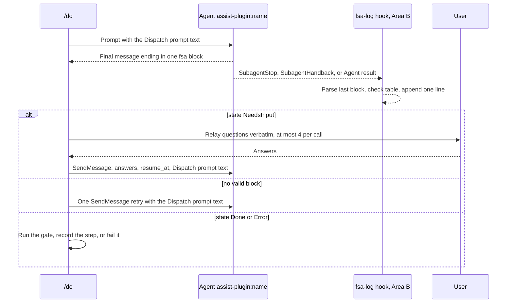

# spec-orchestration-terminal-block

## Metadata

| Field | Value |
|---|---|
| **Feature** | Terminal-block contract, agent `## States` tables, and the NeedsInput protocol |
| **Parent feature** | spec-orchestration.md |
| **Sub-features** | None |
| **Requirement refs** | BR-001, BR-007, UR-004, UR-022, UR-023, FR-068, FR-069, FR-070, NFR-010, NFR-021 |
| **Feature type** | Integration |
| **Status** | Draft |

Status values: Draft, Review, Approved, Implemented.

Baseline: assist-plugin 1.11.0 at commit 4803a0d; every behavior here is Built. Paths are relative to `plugins/assist-plugin/`. The fsa-log hook and the drift check that consume these tables belong to Area B (FR-115 to FR-117, FR-121, FR-122) and are cited by ID only.

## Description

Every agent `/do` dispatches ends its final message with one fenced `fsa` block of ten fields. The block is the only channel through which `/do` learns a step's state, artifact, verdict, skips, out-of-scope work, error class, and questions, and the fsa-log hook checks the same block against the agent's `## States` table. Six agents follow a `## States` table with bounded loops; every subagent asks the user only by ending in `NeedsInput`, because Claude Code removes `AskUserQuestion` from subagents (`docs/requirements/FR-NFR-assist-plugin.md:3718`, section 7). The block format and rules T1 to T9 live in `skills/do/references/fsa-template.md`.

## Triggered by

| Trigger type | Source | Condition |
|---|---|---|
| System event | A dispatched agent finishes its run | Every final message, including each report after a follow-up message or a resumed run (`agents/task-planner.md:59`, `agents/developer-tester.md:143`) |
| System event | A dispatched agent cannot continue without the user | The agent ends in `NeedsInput` |
| Configuration change | An agent's `## States` table is edited | The table, its version in `fsa`, and the code mirror in `hooks/lib/fsa-tables.js` must agree |

## Required data

| Data | Source | Type | Notes |
|---|---|---|---|
| Block template | "Dispatch prompt text" in `skills/do/references/fsa-template.md:84-103` | Fixed text | `/do` pastes it into every prompt, resume, and retry; agents cannot open the reference file |
| Agent `## States` table | The agent file or the skill that carries the method | Markdown table: State, Kind, Does, Outcome -> next state | Present for six agents (Requirement 3) |
| Closed error-class list | `skills/do/references/fsa-template.md:58` | Enum | `missing-input`, `precondition-failed`, `policy-rejection`, `budget-exhausted`, `tool-missing`, `tool-failed`, `out-of-scope`, plus `none` |
| Per-agent verdict enum | The agent file | Pattern | Requirement 2 |

## Behavior

### Requirement: Ten-field block at the end of every final message

Each dispatched agent SHALL end its final message with one fenced `fsa` block that holds the fields `fsa`, `state`, `trace`, `artifact`, `verdict`, `skipped`, `out_of_scope`, `error_class`, `questions`, and `resume_at`. (FR-068; `skills/do/references/fsa-template.md:46-76`)

````text
```fsa
fsa: <agent>/<version>
state: Done | NeedsInput | Error
trace: Intake > ... > <terminal>
artifact: <path, comma-separated> | inline | none
verdict: <closed enum for this agent> | none
skipped: <marker list> | none
out_of_scope: <comma-separated items> | none
error_class: missing-input | precondition-failed | policy-rejection | budget-exhausted | tool-missing | tool-failed | out-of-scope | none
questions: <numbered list> | none
resume_at: <state> | none
```
````

| Field | Content |
|---|---|
| `fsa` | Agent name and the version of its `## States` table, for example `reviewer/1` |
| `state` | The terminal state reached: `Done`, `NeedsInput`, or `Error` |
| `trace` | The states visited, in order, joined with `>`, starting at `Intake` |
| `artifact` | Paths written (comma-separated), `inline` when the reply is the artifact, or `none` |
| `verdict` | A value from the closed enum the agent's file defines, or `none` |
| `skipped` | Markers for work not done, such as `compile not-run (skipped)`, or `none` |
| `out_of_scope` | Work found but not allowed, one item per entry, or `none` |
| `error_class` | One value from the closed list; `none` unless `state` is `Error` |
| `questions` | Numbered questions when `state` is `NeedsInput`, else `none` |
| `resume_at` | The state to resume at when `state` is `NeedsInput`, else `none` |

#### Scenario: Done run

- **GIVEN** `task-planner` finishes a plan file
- **WHEN** it sends its final message
- **THEN** the message SHALL end with a block that has state `Done`, the plan path in `artifact`, and `error_class: none`

#### Scenario: Error run

- **GIVEN** an agent cannot read its input
- **WHEN** it sends its final message
- **THEN** the block SHALL have state `Error` and an `error_class` from the closed list

#### Scenario: Error class outside the list

- **GIVEN** an agent ends with `state: Error` and `error_class: timeout`
- **WHEN** `fsa-log` checks the block (FR-115, Area B)
- **THEN** the log line SHALL hold a problem that starts with `bad-error-class:` and SHALL NOT hold the text `timeout`, because `hooks/lib/fsa-tables.js:194-196` replaces an unknown value with `<invalid>`

### Requirement: Field values follow the template rules

Each dispatched agent SHALL fill the block per rules T6 to T9 of `skills/do/references/fsa-template.md:9-19`: it never names the next agent to run, an `Error` block carries a class from the closed list and no recap, a skip is a `skipped` marker and never a pass, and a `Done` block names its artifact. (FR-068, FR-069)

`/do` reads `no-terminal-block` itself when a block is missing (spec-orchestration-dispatch.md, Requirement 4); no agent emits that class. The error class `out-of-scope` is for a run that cannot continue because the only work left is work the agent may not do (`skills/do/references/fsa-template.md:76`).

| Agent | `verdict` on `Done` | Source |
|---|---|---|
| developer-tester | `covered=N uncovered=M` | `agents/developer-tester.md:136` |
| reviewer, code-reviewer | `approved` or `returned` | `agents/reviewer.md:63`, `agents/code-reviewer.md:64` |
| intake-reviewer | `accepted` or `needs-changes` after Decide; `clear` or `needs-clarification` after Verify | `agents/intake-reviewer.md:77`, `:83` |
| developer | `self-check=pass`, `self-check=fail`, or `self-check=not-run` | `agents/developer.md:74` |
| task-planner | `steps=N` | `agents/task-planner.md:53` |
| qa | `approved` or `returned` for a Testing Gate run; `none` for any other qa task | `agents/qa.md:54` |
| Other agents | A value from the enum the agent's file defines, or `none` | `skills/do/references/fsa-template.md:69` |

#### Scenario: Skip reported

- **GIVEN** `developer-tester` writes tests and cannot compile them because it has no Bash
- **WHEN** it ends `Done`
- **THEN** `skipped` SHALL read `compile not-run (skipped)` and `verdict` SHALL still read `covered=N uncovered=M`

#### Scenario: Agent suggests the next agent

- **GIVEN** `ask` cannot answer from the repository and the web
- **WHEN** it ends
- **THEN** the block SHALL read `state: Done` and list the agent that would help in `out_of_scope`, and SHALL NOT dispatch it (`agents/ask.md:17`)

#### Scenario: Wrong verdict pairing

- **GIVEN** an `intake-reviewer` block whose trace ends `Verify > Done` with `verdict: accepted`
- **WHEN** `fsa-log` checks the block (FR-115, Area B)
- **THEN** the log line SHALL hold the problem `bad-verdict`

### Requirement: Six agents follow a bounded States table

The agents `developer-tester`, `reviewer`, `code-reviewer`, `intake-reviewer`, `developer`, and `task-planner` SHALL follow a `## States` table that starts at `Intake`, ends in `Done`, `NeedsInput`, or `Error`, and names a counter, a maximum, and an exhausted target for every loop. (FR-069, NFR-010; `skills/do/references/fsa-template.md:9-44`; `hooks/lib/fsa-tables.js:30-124`)

`Intake` is a `check` state. Every `model` state ends with one line `Outcome: <value>`, and the next state comes only from that state's outcome list (rules T1 to T4).

| Agent (`fsa`) | Table home | Transitions (state: allowed next states) | Loop bound | NeedsInput exits | Error classes |
|---|---|---|---|---|---|
| developer-tester (`developer-tester/1`) | `skills/create-test/SKILL.md` (States) | Intake: AssembleContext, NeedsInput, Error. AssembleContext: PlanCoverage, NeedsInput. PlanCoverage: CheckCoverage. CheckCoverage: WriteTests, PlanCoverage, Error. WriteTests: SelfCheck, Error. SelfCheck: Done, WriteTests, Error | CheckCoverage `rounds` 2, then Error(budget-exhausted); SelfCheck `fixes` 2, then Error(budget-exhausted) | `no-spec` (Intake); `interface-undocumented`, `framework-unknown` (AssembleContext) | `precondition-failed`, `budget-exhausted`, `policy-rejection` |
| reviewer (`reviewer/1`) | `agents/reviewer.md:42-59` | Intake: AssembleContext, Error, NeedsInput. AssembleContext: Review, Error. Review: Decide. Decide: Done | No loop | `type-unknown` (Intake), `resume_at: Intake` | `missing-input`, `out-of-scope`, `tool-failed` |
| code-reviewer (`code-reviewer/1`) | `agents/code-reviewer.md:43-60` | Same as reviewer | No loop | `type-unknown` (Intake), `resume_at: Intake` | `missing-input`, `out-of-scope`, `tool-failed` |
| intake-reviewer (`intake-reviewer/1`) | `agents/intake-reviewer.md:59-79` | Intake: Review, AssembleContext, Error, NeedsInput. AssembleContext: Compare, Error. Review: Decide. Compare: Verify. Decide: Done. Verify: Done, Compare, Error | Verify `incomplete`: `rounds` 2, then Error(budget-exhausted) | `type-unknown`, `no-request` (Intake), `resume_at: Intake` | `missing-input`, `tool-failed`, `budget-exhausted` |
| developer (`developer/1`) | `agents/developer.md:45-60` | Intake: AssembleContext, Error, NeedsInput. AssembleContext: Plan, Error, NeedsInput. Plan: ProduceEdit, NeedsInput. ProduceEdit: SelfCheck. SelfCheck: Done, ProduceEdit | SelfCheck `fail`: `fixes` 2, then Done with `self-check=fail` | `no-input` (`resume_at: Intake`), `stack-unknown` (`AssembleContext`), `ambiguous` (`Plan`) | `precondition-failed`, `missing-input` |
| task-planner (`task-planner/1`) | `skills/task-plan/SKILL.md:28-42` | Intake: ClassifyContext, NeedsInput, Error. ClassifyContext: ExtractRequirements, NeedsInput. ExtractRequirements: PlanSteps. PlanSteps: CheckPlan. CheckPlan: WritePlan, PlanSteps, Error. WritePlan: Done, Error | CheckPlan `gaps`: `rounds` 2, then Error(budget-exhausted) | `no-spec` (`resume_at: Intake`), `undetected` (`ClassifyContext`) | `precondition-failed`, `budget-exhausted`, `policy-rejection` |

The other ten agents (qa, planner, ask, explore, researcher, devops, general-purpose, worker, requirements-gatherer, solutions-architect) have no `## States` table: `/do` accepts any `trace` from them, and a table for them is out of scope and not scheduled (`docs/requirements/FR-NFR-assist-plugin.md:3713`, section 6). qa is listed in `hooks/lib/fsa-tables.js` as `tableless`, so fsa-log checks its block but not its trace.

#### Scenario: Legal trace

- **GIVEN** `reviewer` runs Intake, AssembleContext, Review, Decide, Done
- **WHEN** `fsa-log` checks the trace
- **THEN** it SHALL log no problem

#### Scenario: Loop exhausted

- **GIVEN** `task-planner` CheckPlan finds gaps a third time, after two rework passes (rounds = 2)
- **WHEN** the loop bound is reached
- **THEN** the agent SHALL end `Error` with class `budget-exhausted`

#### Scenario: Skipped state

- **GIVEN** a `reviewer` block with trace `Intake > Review > Done`
- **WHEN** `fsa-log` checks it
- **THEN** the log line SHALL hold `illegal-transition: Intake>Review`

#### Scenario: Developer stops fixing

- **GIVEN** `developer` SelfCheck fails after two ProduceEdit fix passes
- **WHEN** the agent ends
- **THEN** the block SHALL read `state: Done` and `verdict: self-check=fail`

### Requirement: Subagents ask only through NeedsInput

A subagent SHALL ask the user only by ending in `NeedsInput` with numbered `questions` and a `resume_at` state. (FR-070; `skills/do/references/fsa-template.md:15`, `:28`)

`/do` relays the questions, resumes the same agent ID with SendMessage, and carries the answers, `resume_at`, and the "Dispatch prompt text" (spec-orchestration-dispatch.md, Requirements 6 and 7). For an agent with a `## States` table, `resume_at` names a state of that table; requirements-gatherer names a phase heading (spec-orchestration-agents.md). qa never ends in `NeedsInput` for an unlisted pentest command, and ask never ends in `NeedsInput` for routing.

#### Scenario: Missing input

- **GIVEN** `task-planner` receives no spec path
- **WHEN** Intake fails
- **THEN** it SHALL end `NeedsInput` with `resume_at: Intake` and one question

#### Scenario: Answer resumes the same agent

- **GIVEN** `/do` has the user's answer
- **WHEN** it resumes the agent with SendMessage
- **THEN** the message SHALL carry the answers, `resume_at`, and the dispatch prompt text

#### Scenario: Resume state outside the table

- **GIVEN** a `developer` block with `state: NeedsInput` and `resume_at: Review`
- **WHEN** `fsa-log` checks it (FR-115, Area B)
- **THEN** the log line SHALL hold the problem `bad-resume-at`

### Requirement: The markdown tables govern the code tables

The `## States` tables in the markdown SHALL be the source of truth for `hooks/lib/fsa-tables.js`, so a drift is fixed by editing the JavaScript to match the markdown. (NFR-021; `docs/requirements/FR-NFR-assist-plugin.md:3724`, section 7, Process; `CLAUDE.md`, Keeping counts in sync)

The check is `node plugins/assist-plugin/scripts/check-fsa-tables.js --check` (FR-121, FR-122, Area B). The pairing check of `verdictByStep` against the intake-reviewer Outcome cells is PLANNED (1.11.1), FR-126.

#### Scenario: Table edited

- **GIVEN** a maintainer adds a state to the `reviewer` `## States` table
- **WHEN** `check-fsa-tables.js --check` runs before release
- **THEN** it SHALL exit 1 until `hooks/lib/fsa-tables.js` lists the same transitions

#### Scenario: Example block outside its table

- **GIVEN** an example `fsa` block in `agents/task-planner.md` whose trace skips a state of the `task-plan` table
- **WHEN** `check-fsa-tables.js --check` runs
- **THEN** it SHALL report the illegal transition and exit 1

## Algorithmic steps



Source: [spec-orchestration-terminal-block-sequence.mmd](spec-orchestration-terminal-block-sequence.mmd). Render with `mmdc -i specs/spec-orchestration-terminal-block-sequence.mmd -o specs/spec-orchestration-terminal-block-sequence.png` once `mmdc` can start its browser.

1. `/do` pastes the "Dispatch prompt text" into the dispatch prompt.
2. The agent runs its table from `Intake` (or works freely when it has no table).
3. The agent ends its final message with the block; prose above the block may explain findings, citations, and out-of-scope items.
4. `/do` parses the last fenced `fsa` block and acts on `state`; fsa-log parses the same block and logs it.
5. On `NeedsInput`, `/do` relays and resumes the same agent; the agent continues at `resume_at` and ends with a new block.

## Output / Outcome

| Output | Type | Description |
|---|---|---|
| Terminal block | Fenced text in the final message | Ten fields, one block per final message |
| Questions for the user | `questions` field | Numbered; relayed verbatim by `/do` |
| `fsa-log.jsonl` line | Log record (Area B) | Checked fields and problem codes; no message text (NFR-016) |

## Error handling

| Error condition | Handling strategy | Outcome |
|---|---|---|
| No block, an unclosed block, a missing field, or a state outside `Done`, `NeedsInput`, `Error` | `/do` reads `no-terminal-block`, retries once | Step `failed` if still invalid |
| Illegal transition, unknown state, bad verdict, bad error class, or bad `resume_at` | fsa-log records the problem codes and warns once (FR-115, FR-116, Area B) | Warn only; `/do` still acts on a valid block |
| Agent loop reaches its maximum | The table's exhausted target | Usually Error(budget-exhausted); developer ends `Done` with `self-check=fail` |
| Ambiguous input | End in `NeedsInput` (rule T5) | `/do` asks the user |

## Events emitted (if applicable)

| Event name | Payload | Consumer(s) | When emitted |
|---|---|---|---|
| Terminal block | Ten fields | `/do` (Read each result), fsa-log hook (FR-115 to FR-117, Area B) | End of every final message of a dispatched agent |

Consumer contracts:

| Consumer | Valid when | Checks `trace` | On invalid |
|---|---|---|---|
| `/do` | Closed, ten fields, `state` in `Done`, `NeedsInput`, `Error` | No; an agent with a table is expected to follow it | One SendMessage retry, then `no-terminal-block` |
| fsa-log | The seven agents in `hooks/lib/fsa-tables.js` (the six above plus qa) | Yes, except for qa | Problem codes logged; one `systemMessage` on SubagentStop or SubagentHandback |

## Dependencies

| Dependency | Type | Required | Notes |
|---|---|---|---|
| `skills/do/references/fsa-template.md` | Build-time | yes | Block format, rules T1 to T9, "Dispatch prompt text" |
| `hooks/lib/fsa-tables.js` | Runtime | no | Code mirror of the tables for fsa-log (Area B); the hook fails open |
| `scripts/check-fsa-tables.js` | Build-time | yes at release | Drift check (FR-121, Area B) |
| Claude Code subagent runtime | External | yes | Removes `AskUserQuestion` from subagents; delivers SubagentStop and SubagentHandback |

## Sub-feature breakdown (if applicable)

Not applicable: no smaller unit has its own spec.

## Submodule scope (if applicable)

Not applicable: the plugin has no submodules.

## Traceability

| Requirement | Spec section | Verified by |
|---|---|---|
| FR-068 | Requirement: Ten-field block at the end of every final message; Requirement: Field values follow the template rules | Final-message fixtures per agent; fsa-log problem codes |
| FR-069, NFR-010 | Requirement: Six agents follow a bounded States table | Review of the six tables; fsa-log trace checks |
| FR-070 | Requirement: Subagents ask only through NeedsInput | NeedsInput fixtures; SendMessage content |
| NFR-021 | Requirement: The markdown tables govern the code tables | `check-fsa-tables.js --check` exit status at release |
| UR-004, UR-022, UR-023, BR-001, BR-007 | Description and all Requirements | Parent traceability (spec-orchestration.md) |
