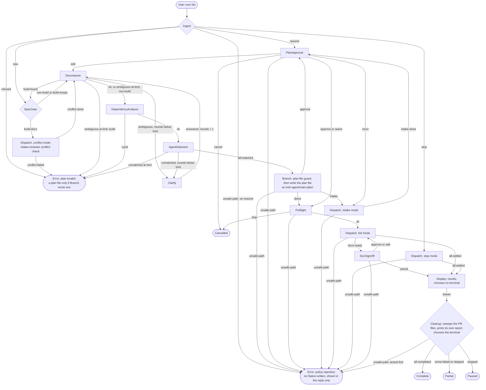
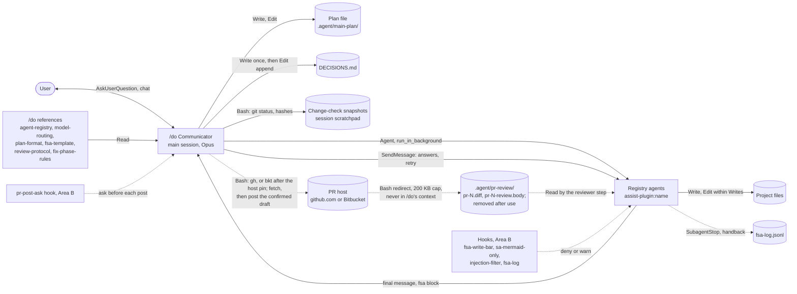

# spec-orchestration

## Metadata

| Field | Value |
|---|---|
| **Feature** | `/do` orchestration: the Communicator state machine, its agents, and its review gates |
| **Parent feature** | None |
| **Sub-features** | spec-orchestration-planning.md, spec-orchestration-plan-approval.md, spec-orchestration-spec-first.md, spec-orchestration-dispatch.md, spec-orchestration-review-gates.md, spec-orchestration-terminal-block.md, spec-orchestration-agents.md |
| **Requirement refs** | BR-001, BR-002, BR-004, BR-005, BR-006, BR-007, BR-012, BR-013, UR-001, UR-002, UR-003, UR-004, UR-005, UR-006, UR-008, UR-009, UR-012, UR-014, UR-019, UR-022, UR-031, UR-054, UR-055, FR-001, FR-002, FR-003, FR-004, FR-009, FR-011, FR-012, FR-013, FR-016, FR-019, FR-020, FR-024, FR-025, FR-028, FR-030, FR-032, FR-037, FR-041, FR-042, FR-047, FR-052, FR-062, FR-063, FR-064, FR-192, FR-195, FR-199, FR-203, FR-206, FR-207, FR-208, NFR-003, NFR-010, NFR-011, NFR-012, NFR-014, NFR-015, NFR-020, NFR-021, NFR-024 |
| **Feature type** | Architecture |
| **Status** | Draft |

Status values: Draft, Review, Approved, Implemented.

Baseline: assist-plugin 1.11.1 at commit 41034c1; `skills/do/SKILL.md` line cites were refreshed against that file on 2026-10-16. Text that says "at 4803a0d" describes the earlier 1.11.0 baseline. Every behavior here is Built unless marked PLANNED, as `docs/requirements/FR-NFR-assist-plugin.md` (v1.1) marks it. On 2026-10-22 the Change Logs 2026-10-16 (except MODIFIED Requirement: Every loop is bounded), 2026-10-17, 2026-10-17 (PR flow hardening), and 2026-10-22 were folded into this body after the build of the follow-up to 1.12.0 (Change Log: 2026-10-22 (fold)); text that names that build cites `skills/do/SKILL.md` and `skills/do/references/pr-review-flow.md` as read on 2026-10-22. Paths are relative to `plugins/assist-plugin/` unless they start at the repository root (`DECISIONS.md`, `docs/requirements/FR-NFR-assist-plugin.md`). Area B (hooks, `specs/spec-hooks*`) and Area C (skills, `specs/spec-skills*`) are cited by FR ID only.

## Description

`/do` is the plugin's one orchestrator: a finite-state Communicator that runs in the main session, turns a prompt into a plan the user approves, dispatches registry agents as `assist-plugin:<name>`, reads each agent's terminal block, runs the review gate that fits each artifact, and reports. The structure separates three roles: the user approves (plans, documents, waivers, decisions), `/do` records (the plan file and `DECISIONS.md`), and agents deliver inside the Writes the plan approved. It supports three quality attributes: every loop is bounded (NFR-010), document text reaches agents only as marked untrusted data (NFR-012), and reads, questions, and rounds stay under fixed caps (NFR-014).

## Components

| Component | Responsibility | Owns data | Technology |
|---|---|---|---|
| `/do` Communicator | Runs the States table in `skills/do/SKILL.md:36-51`: ingest, classify, decompose, clarify, route, plan, approve, dispatch, gate, sign off, display, clean up. Never does delivery work itself, with one exception: it posts a user-confirmed PR review with `gh` on a `github.com` remote or with `bkt` on a Bitbucket remote (FR-195; `DECISIONS.md:223-226`; `skills/do/SKILL.md:28`, `:561`). Built: `gh` in 1.12.0, `bkt` in the follow-up to 1.12.0 | Plan file, `DECISIONS.md` entries, change-check snapshot files and their sha256 values, the `Documents approved` value it last wrote, approved-document hashes | Claude Code skill, Opus, effort xhigh (`skills/do/SKILL.md:12`, `skills/do/references/model-routing.md:9`); tools Read, Edit, Write, Grep, Glob, Bash, Agent, SendMessage, AskUserQuestion (`skills/do/SKILL.md:13-22`) |
| User | Approves or cancels plans, documents, waivers, and decisions; answers Clarify and relayed questions | Answers | AskUserQuestion, chat |
| Registry agents (16) | Deliver one step each and end with a terminal block | Artifacts inside the step's Writes | `agents/*.md`, dispatched as `assist-plugin:<name>` (`skills/do/references/agent-registry.md:3`) |
| intake-reviewer | Pre-approval, read-only `review` of a user file and `conflict-check` of a build request | None (findings are inline) | `agents/intake-reviewer.md`, tools Read, Grep, Glob |
| Gate reviewers | reviewer, code-reviewer (code and planning gates; the named OWASP for LLM Gate, PLANNED 1.12.0, FR-199), qa (Testing Gate), `review-md` (Report Quality Gate) | None | `skills/do/references/review-protocol.md:54-58` |
| Plan file | The run's record: steps, approvals, Spec-First values, statuses | Plan Status, step Status, User Decisions | Markdown that Branch writes at `<root>/.agent/main-plan/plan-[slug]-[timestamp].md` per `skills/do/references/plan-format.md` (`skills/do/SKILL.md:245`); every Write or Edit of it follows the plan-file symlink guard and never an `rm -f` (FR-207; Requirement: /do guards every .agent write against a symlink) |
| `DECISIONS.md` | Append-only log of architectural decisions at the root of the project the plan changes | Dated decision entries | Markdown (`skills/do/SKILL.md:370-387`) |
| Change-check snapshots | Baseline and window snapshots of git status and content hashes around document-chain steps | Sorted snapshot files | Session scratchpad, else `'<root>/.agent/change-check/'` behind the snapshot symlink guard, each write starting with `rm -f --` of its file (`skills/do/SKILL.md:259-265`, `:406`; FR-207) |
| PR review files | The fetched PR title, body, comments, and diff (at most 200 KB) for the reviewer step to read, and the confirmed draft for the post | The scratch file and the body file per PR review step, plus the temp files `pr-<N>.diff.full`, `pr-<N>.view.full`, and, on Bitbucket, `pr-<N>.comments.full` when the session has no scratchpad | `<root>/.agent/pr-review/pr-<N>.diff`, the diff first and then the title, body, and comments, cut with `head -c` from temp files that `/do` never reads and hashed in the same command; and `<root>/.agent/pr-review/pr-<N>-review.body`, the draft written once, with the Write tool only, when the reviewer's block arrives, hashed and read back in one command, and re-checked in the post command; non-prose extensions, so prose-gate does not judge them. A symlinked `<root>/.agent` or `<root>/.agent/pr-review` fails the step with `policy-rejection` before any write, each target file is removed with `rm -f` before it is written, and a hash `/do` cannot recall counts as a mismatch (`DECISIONS.md:213-216`). The files of PR `<N>` are removed after a post, a declined post, or a "do not post" answer, and swept at Cleanup, never through a symlinked folder (FR-208; `DECISIONS.md:223-226`, `:228-231`). The `untrusted-file` wrapper holds the plain absolute path; Bash commands single-quote it (FR-195, FR-103, NFR-014; spec-orchestration-dispatch.md, Requirements 14 and 15) |
| `/do` reference files | Routing, model, plan, terminal-block, review, and fix rules that `/do` reads and agents cannot open | Static tables | `skills/do/references/*.md` |
| Hooks (Area B) | Bar subagent writes to protected and out-of-role paths, limit mmdc, filter injection, log terminal blocks, and ask the user before each PR posting command (`pr-post-ask`, in every session, `/do`'s own posts included) | `fsa-log.jsonl`, `hook-health.jsonl` | Node hooks; FR-092, FR-093, FR-099, FR-100, FR-108 to FR-117, FR-206 |

## Component boundaries

| Boundary | What crosses it | Protocol | Auth |
|---|---|---|---|
| `/do` to agent | Self-contained task prompt, `untrusted-file` wrappers, model, effort, the "Dispatch prompt text" | Agent tool, `run_in_background: true`, agent named `assist-plugin:<name>` | Claude Code subagent runtime; hooks read the qualified `agent_type` to apply role rules (FR-108 to FR-113, Area B) |
| Agent to `/do` | Final message ending in one fenced `fsa` block | Agent result | None; `/do` validates the block (spec-orchestration-terminal-block.md) |
| `/do` to running agent | User answers, `resume_at`, the "Dispatch prompt text"; or a block retry | SendMessage to the agent ID | Same agent ID only |
| `/do` to user | Step table, Order line, questions with options | Chat and AskUserQuestion, at most 4 questions per call | The user's own answer; no agent message is approval |
| `/do` to plan file and `DECISIONS.md` | Plan creation, status updates, approvals, sign-off value, decision entries | Write, Edit | Only `/do` writes them; fsa-write-bar denies every subagent Write, Edit, MultiEdit, and NotebookEdit there (FR-112, Area B); Bash writes are not covered |
| `/do` to git | `git status` and content hashes for the change check | Bash | Local repository |
| `/do` to the PR host | Before a PR review step, the PR title, body, comments, and diff, redirected by Bash into `.agent/pr-review/pr-<N>.diff` (200 KB cap) without entering `/do`'s context; after the user confirms, the draft from `.agent/pr-review/pr-<N>-review.body` | Host and repository from `git -C '<root>' remote get-url origin`, with any `user:password@` stripped by a `sed` in the same command so no credential reaches `/do`. A `github.com` remote selects `gh`, every call pinned with `--repo 'github.com/<owner>/<repo>'`, so `GH_HOST` cannot redirect it (`DECISIONS.md:213-216`), and the post is `gh pr review '<N>'` with `--approve`, `--request-changes`, or `--comment` and `--body-file`. A Bitbucket remote (`bitbucket.org`, or a Data Center remote whose host matches exactly one `bkt` context) selects `bkt` after the host pin of FR-203: no `BKT_TOKEN`, `BKT_HOST`, or `BKT_CONFIG_DIR` set, exactly one matching context, `--context` and the repository flags on every `bkt pr` call, and on Cloud a PR link check; each `bkt` post (approve, comment, the Cloud request-changes call) is its own Bash command. Any other host, a URL form outside the parsed ones, or a name outside `^[A-Za-z0-9._-]+$` fails the step with `precondition-failed`. No `/pr-review` call (FR-195; `DECISIONS.md:223-226`, `:233-236`; spec-orchestration-dispatch.md, Requirement 14) | One yes to the one `/do` prompt that shows the draft; then the ask hook of FR-206 may prompt for each posting command, and a rejected prompt is a declined post, not a failure (`DECISIONS.md:228-231`); the PR number comes from the user's request and the flag from the reviewer's verdict; no subagent posts to the PR host (`DECISIONS.md:183-186`) |
| Agent to project files | Artifacts | Write, Edit, Bash (by agent tools) | Agent `tools` frontmatter (FR-065, FR-067); fsa-write-bar and sa-mermaid-only (Area B) |
| Agent to `fsa-log.jsonl` | Checked block fields, problem codes | SubagentStop, SubagentHandback, Agent results | fsa-log hook (FR-115, Area B), warn only |

## Data flow

Required start-to-end flowchart. It shows every state of `skills/do/SKILL.md:36-51` and every outcome edge.

Source: [spec-orchestration-dataflow.mmd](spec-orchestration-dataflow.mmd). PNG not rendered: `mmdc` is installed but cannot find its headless browser, chrome-headless-shell 154.0.8037.57, in `~/.cache/puppeteer` (runs of 2026-10-16 and 2026-10-22). Once that browser is installed, render with `mmdc -i specs/spec-orchestration-dataflow.mmd -o specs/spec-orchestration-dataflow.png` and embed the image.

The Display and Cleanup edges follow the States table (`skills/do/SKILL.md:49-50`): Display presents the results and chooses nothing, and Cleanup sweeps the PR files, prints its own cleanup report after the Display reply, and chooses the terminal (FR-062 to FR-064, OPEN-2 closed; built in 1.12.0). The Error node shows OPEN-6, also closed: a run that ends in Error before Branch writes no plan file (FR-012; built in 1.12.0, `skills/do/SKILL.md:51`). The `unsafe-path` edges are the outcome of the plan-file and snapshot symlink guards (FR-207; Requirement: /do guards every .agent write against a symlink): a non-zero guard exit takes `unsafe-path` ahead of every other outcome of the state, and the Cleanup row lists it first (`skills/do/SKILL.md:38`, `:44-48`, `:50`, `:274`). The conflict-mode Dispatch writes no plan file and draws no such edge, and a symlinked PR folder draws none either: it fails only the PR step.

### Requirement: Request flow from Ingest to one terminal state

The `/do` skill SHALL move every run through the states of `skills/do/SKILL.md:36-51` in table order, pick each next state only from the current state's outcome, end the run in exactly one of `Complete`, `Partial`, `Paused`, `Cancelled`, or `Error` with Cleanup choosing among `Complete`, `Partial`, and `Paused`, write no plan file for a run that ends in `Error` before Branch, and write no Status for a run that ends in `Error(policy-rejection)` raised by the plan-file or snapshot symlink guard, a terminal whose Status write that guard blocks included. (FR-001, FR-002, FR-012, FR-013, FR-064, FR-207; `skills/do/SKILL.md:34-51`)

**Status:** Built: Cleanup's terminal choice and the first-pass Error rule in 1.12.0 (commit `bb09e29`); the guard Error rule in the follow-up to 1.12.0 (build of 2026-10-22; `skills/do/SKILL.md:51`, `:269-275`). Folded from the Change Logs 2026-10-16 and 2026-10-22.

#### Scenario: Non-build request runs to Complete

- **GIVEN** the prompt "review src/auth.ts for security issues" in a project where `src/auth.ts` exists, no Clarify question is needed, and at least 2G of disk is free
- **WHEN** the user runs `/do` with it, approves the plan, and the one `reviewer` step reaches `completed`
- **THEN** the plan file's `**Status:**` line SHALL read `PENDING_APPROVAL`, then `Approved`, then `In Progress`, then `Complete`
- **AND** `/do` SHALL make exactly one approval AskUserQuestion call and exactly one Agent call, naming `assist-plugin:reviewer`

#### Scenario: Single read-only step skips approval

- **GIVEN** a prompt that decomposes into exactly one `ask` step of effect `read`
- **WHEN** Branch runs
- **THEN** `/do` SHALL go to Preflight without an approval question
- **AND** `## User Decisions` SHALL read "None (single read-only step, approval skipped)"

#### Scenario: Plan-invalid on an edit pass ends a new plan in Error

- **GIVEN** a new (not resumed) plan whose file Branch wrote with Status `PENDING_APPROVAL`, and an Edit steps answer that makes steps 2 and 3 depend on each other
- **WHEN** DependencyAnalysis runs on the edited steps
- **THEN** `/do` SHALL name steps 2 and 3 to the user and dispatch no agent
- **AND** the plan file's Status SHALL read `Error`

A first pass that ends in Error stops before Branch has written any plan file, and such a run writes no plan file (FR-012, OPEN-6 closed).

#### Scenario: Refused resume leaves the plan file unchanged

- **GIVEN** a plan file whose Status reads `Complete`
- **WHEN** the user sends `resume <that plan>`
- **THEN** `/do` SHALL name the failed check and end in Error with class `plan-invalid`
- **AND** the plan file SHALL be byte-for-byte unchanged

#### Scenario: First-pass Error writes no plan file

- **GIVEN** a `build` request with one point still open after Clarify round 5, and no plan file for the request yet
- **WHEN** Decompose runs again
- **THEN** `/do` SHALL end in `Error` with class `plan-invalid` and list the open point
- **AND** no new file SHALL appear under `.agent/main-plan/`

#### Scenario: Error on a resumed plan

- **GIVEN** a resumed plan with Status `Paused` and an Edit steps answer that makes two steps depend on each other
- **WHEN** DependencyAnalysis ends in `Error` with class `plan-invalid`
- **THEN** the plan file's Status SHALL still read `Paused`

#### Scenario: Cleanup chooses the terminal

- **GIVEN** a run whose steps all reached `completed`
- **WHEN** Display has shown the results
- **THEN** Cleanup SHALL set the plan Status to `Complete`, and the plan file's Status SHALL change only after the Display reply is shown

#### Scenario: Guard Error writes no Status

- **GIVEN** an approved plan in Dispatch and a `<root>/.agent/main-plan` that has become a symlink
- **WHEN** `/do` is about to record a step result
- **THEN** the run SHALL end in `Error` with `policy-rejection`, the plan file's Status line SHALL be unchanged, and the reply SHALL name the symlinked path

### Requirement: Build steps start only after document sign-off or waiver

The `/do` skill SHALL dispatch a `Build: yes` step only while the plan file's `Documents approved` holds a timestamp that `/do` wrote at DocSignOff or the value `waived` that `/do` wrote at PlanApproval. (FR-019, FR-028, FR-030, FR-037, FR-041; `skills/do/SKILL.md:379`, `:520`)

#### Scenario: Primary build path

- **GIVEN** the build request "implement user authentication in the backend" in a git repository
- **WHEN** the user approves the plan with Keep spec-first, the requirements, spec, and task-plan steps reach `completed`, and the user picks Approve documents
- **THEN** `/do` SHALL write "YYYY-MM-DD HH:mm" to `Documents approved` and only then treat the `Build: yes` steps as ready
- **AND** no `Build: yes` step SHALL have been dispatched before that write

#### Scenario: Waived build path

- **GIVEN** the same build request
- **WHEN** the user answers Approve and Skip spec-first in one approval call
- **THEN** the plan SHALL hold no `Chain: yes` step and `Documents approved` SHALL read `waived`
- **AND** `DECISIONS.md` SHALL end with an entry recording the waiver and the plan path

#### Scenario: Chain failure skips every build step

- **GIVEN** a build plan whose spec step ends in `Error` with class `missing-input`
- **WHEN** `/do` marks the failure
- **THEN** the task-plan step and every `Build: yes` step SHALL read `skipped` with "Skipped: depends on failed step N"
- **AND** no DocSignOff question SHALL be asked and the plan SHALL end `Partial`

### Requirement: One retry for a missing terminal block

The `/do` skill SHALL read a final message without a valid `fsa` block as `Error` with class `no-terminal-block`, send one SendMessage retry that carries the "Dispatch prompt text", and fail the step if the retry also lacks a valid block. (FR-047; `skills/do/SKILL.md:413`)

#### Scenario: Retry recovers the block

- **GIVEN** a `developer` step whose final message ends without a fenced `fsa` block
- **WHEN** `/do` sends the retry and the agent resends its final message with a valid `Done` block
- **THEN** `/do` SHALL act on the `Done` block and run the step's review gate

#### Scenario: Retry exhausted

- **GIVEN** the same step after one retry whose reply still has no valid block
- **WHEN** `/do` reads the reply
- **THEN** `/do` SHALL set the step `failed` with `no-terminal-block` in its Done field
- **AND** `/do` SHALL send no second retry

### Requirement: Failure isolation between steps

The `/do` skill SHALL mark every step that depends on a failed step, directly or through other steps, `skipped`, and keep dispatching steps that do not depend on it. (FR-052; `skills/do/SKILL.md:431-435`)

#### Scenario: Independent step keeps running

- **GIVEN** step 2 fails, step 3 depends on step 2, and step 4 depends on nothing
- **WHEN** `/do` marks the failure
- **THEN** step 3 SHALL read `skipped` with "Skipped: depends on failed step 2" and step 4 SHALL still be dispatched

#### Scenario: Intake review failure skips nothing

- **GIVEN** an intake review step ends in `Error` before approval
- **WHEN** `/do` marks it `failed`
- **THEN** every step that depends on it SHALL stay `pending`

### Requirement: Stop and resume path

The `/do` skill SHALL, on `stop`, start no new step and no review gate and end the plan `Paused` while a step is `pending`, and, on `resume <plan>`, set each `in_progress` or `waiting-user` step back to `pending` and ask for approval again before any dispatch. (FR-003, FR-004; `skills/do/SKILL.md:86-111`)

#### Scenario: Stop then resume

- **GIVEN** a plan with one step running and two `pending`
- **WHEN** the user sends `stop`, the running step reports `Done`, and the user later sends `resume <plan>`
- **THEN** the first run SHALL end `Paused` with the reported step back in `pending` because its gate did not run
- **AND** the resumed run SHALL show the three not-completed steps at PlanApproval and dispatch none before the user answers

#### Scenario: Stop with nothing running

- **GIVEN** a plan with no running step
- **WHEN** the user sends `stop`
- **THEN** `/do` SHALL reach Display at once and dispatch nothing

### Requirement: Dispatch by qualified agent name

The `/do` skill SHALL dispatch each registry agent as `assist-plugin:<name>` and each discovered agent by its own qualified name, and only after the agent appears in a plan the user approved. (FR-009, FR-011; `skills/do/SKILL.md:211`, `:228`)

#### Scenario: Registry agent

- **GIVEN** a Task plan step assigned to `task-planner`
- **WHEN** Dispatch sends it
- **THEN** the Agent call SHALL name `assist-plugin:task-planner`

#### Scenario: Discovered agent not approved

- **GIVEN** AgentSelection matched an agent from another installed plugin and the user picks Cancel at PlanApproval
- **WHEN** the plan ends
- **THEN** `/do` SHALL NOT dispatch that agent

### Requirement: Plan and decision records flow only through /do

The `/do` skill SHALL be the only writer of the plan file and `DECISIONS.md`, appending a decision to `DECISIONS.md` no earlier than the user's Approve. (FR-016, FR-042, UR-019, BR-012; `skills/do/SKILL.md:331`, `:337-341`, `:375`)

#### Scenario: Decision appended at Approve

- **GIVEN** the user chose "opaque session tokens" at Clarify
- **WHEN** the user picks Approve
- **THEN** `DECISIONS.md` SHALL end with `## YYYY-MM-DD: <title>`, a `Decision:` line, and a `Plan:` line naming the plan file

#### Scenario: Subagent write to a record is denied

- **GIVEN** any subagent issues a Write to `.agent/main-plan/plan-x.md` or to `DECISIONS.md`
- **WHEN** fsa-write-bar evaluates it (FR-112, Area B)
- **THEN** the write SHALL be denied

#### Scenario: Bash write to DECISIONS.md during a chain step

- **GIVEN** a git repository, a session started at the repository's root, and a document-chain step that rewrites `DECISIONS.md` through Bash, which fsa-write-bar does not cover
- **WHEN** the step leaves `in_progress` and `/do` runs the change check
- **THEN** the changed `DECISIONS.md` hash SHALL count as an unexpected change, because `DECISIONS.md` matches no chain step's Writes
- **AND**, since FR-192 (Built 1.11.1), the hashed `DECISIONS.md` SHALL be the one at the session's git root in a subdirectory session too (spec-orchestration-chain-signoff.md, Requirement 1a)

### Requirement: /do itself posts a confirmed PR review, and no subagent posts

The `/do` skill SHALL fetch a pull request by a Bash redirect that keeps the PR text out of its context and, after the user confirms the reviewer's draft, post that draft itself, with `gh` on a `github.com` `origin` or with `bkt` on a Bitbucket `origin` after the host pin of FR-203, as its one delivery action, so that no subagent posts to the PR host; a PR review on any other `origin` fails with `precondition-failed`, and the PR's files are removed after use (FR-208). (FR-195, FR-203, FR-206, FR-208; `DECISIONS.md:148-151`, `:183-186`, `:213-216`, `:223-226`; the full flow is spec-orchestration-dispatch.md, Requirements 14 and 15)

**Status:** Built: the `gh` flow in 1.12.0 (commit `bb09e29`); the `bkt` flow, the hook-prompt outcomes, and the removal in the follow-up to 1.12.0 (build of 2026-10-22; `skills/do/references/pr-review-flow.md`). Folded from the Change Logs 2026-10-16, 2026-10-17, 2026-10-17 (PR flow hardening), and 2026-10-22. In 1.12.0 the flow covered `github.com` only (`DECISIONS.md:208-211`); `DECISIONS.md:223-226` restored Bitbucket, and `DECISIONS.md:243-246` records that it replaces the GitHub-only limit.

#### Scenario: Draft confirmed and posted

- **GIVEN** `/do review PR 123` with the `origin` fetch URL `https://github.com/acme/shop.git`, an approved plan with one `reviewer` step, and a reviewer that ends `Done` with verdict `approved` and a draft above its block
- **WHEN** the user confirms the draft that `/do` shows
- **THEN** `/do` SHALL run `gh pr review '123' --repo 'github.com/acme/shop' --approve --body-file '<root>/.agent/pr-review/pr-123-review.body'` and SHALL call no `/pr-review`
- **AND** no subagent SHALL run `gh pr review` during the run

#### Scenario: Draft not confirmed

- **GIVEN** the same plan and a user who declines the draft
- **WHEN** `/do` settles the plan
- **THEN** `/do` SHALL post nothing to the PR host and SHALL record in the step's Done field that the draft was not posted

#### Scenario: Post fails

- **GIVEN** the user confirmed the draft and `gh pr review '123' --repo 'github.com/acme/shop' --approve` exits with an error
- **WHEN** `/do` posts
- **THEN** the step SHALL read `failed` with `error_class` `tool-failed`, `/do` SHALL show the draft and the error, and SHALL NOT retry

#### Scenario: GH_HOST does not redirect the post

- **GIVEN** `GH_HOST=ghe.example.com` in the session's environment, the `origin` fetch URL `https://github.com/acme/shop.git`, and a draft the user confirmed with verdict `approved`
- **WHEN** `/do` posts
- **THEN** `/do` SHALL run `gh pr review '123' --repo 'github.com/acme/shop' --approve --body-file '<root>/.agent/pr-review/pr-123-review.body'`, and no call SHALL go to `ghe.example.com`

#### Scenario: Bitbucket remote

- **GIVEN** `/do review PR 123` with the `origin` `https://bitbucket.org/acme/shop.git`, exactly one context `cloud-prod` of kind `cloud`, no `BKT_*` variable set, and a reviewer that ends `Done` with verdict `approved`
- **WHEN** the user confirms the draft and allows both ask-hook prompts
- **THEN** `/do` SHALL run `bkt pr approve '123' --context 'cloud-prod' --workspace 'acme' --repo 'shop'` and then the comment command with `--text`, each as its own Bash command, and SHALL call no `/pr-review`
- **AND** no subagent SHALL run `bkt` or `gh` during the run

#### Scenario: Unsupported host

- **GIVEN** `/do review PR 123` with a GitHub Enterprise `origin` and no `bkt` context for its host
- **WHEN** the step starts
- **THEN** the step SHALL read `failed` with `precondition-failed` and the message SHALL name both options, and no reviewer SHALL be dispatched

### Requirement: /do guards every .agent write against a symlink

Before every write that `/do` makes under `<root>/.agent/` (the plan file, which Branch writes at `<root>/.agent/main-plan/plan-[slug]-[timestamp].md`, the change-check snapshot files, and the PR files under `.agent/pr-review/`), the `/do` skill SHALL test with `test ! -L` that `<root>/.agent` and the folder it writes into are not symlinks (and, for the plan file, that the file itself is not a symlink), SHALL write nothing and stop with `policy-rejection` when one is a symlink, taking the outcome `unsafe-path` ahead of every other outcome of the state when the plan-file or snapshot guard exits non-zero, and SHALL remove an existing target with `rm -f` before it writes a file it creates fresh (the snapshot files and the PR files), never the plan file, which it edits in place. (FR-207, FR-032, FR-195, UR-055, UR-019, BR-012)

**Status:** Built: the PR-file guard in 1.12.0 (commit `bb09e29`); the plan-file and snapshot guards and the `unsafe-path` outcome in the follow-up to 1.12.0 (build of 2026-10-22). Folded from the Change Log 2026-10-22 with the build's wording. **Source:** `docs/requirements/FR-NFR-assist-plugin.md:4738`, scenarios `:4742-4775` (version 1.3); `DECISIONS.md:213-216` (the `rm -f` rule), `:223-226`; built in `skills/do/SKILL.md:245` (Branch writes the plan at `<root>/.agent/main-plan/`), `:247-275` (Symlink guards), `:38-51` (the `## States` rows), `:551` (Cleanup), and `skills/do/references/pr-review-flow.md:96-104` (the PR-file guard), read on 2026-10-22

Guard commands, each one Bash command run on its own just before the write (`skills/do/SKILL.md:249-265`; flow source [spec-orchestration-agent-write-guard.mmd](spec-orchestration-agent-write-guard.mmd)):

| Write | Guard | Then | On a symlink |
|---|---|---|---|
| Plan file, each Write or Edit (Branch, a resume at Ingest, PlanApproval, Preflight, Dispatch, DocSignOff, Cleanup, and a terminal Status) | `test ! -L '<root>/.agent' && test ! -L '<root>/.agent/main-plan' && test ! -L '<plan path>'` | The Write or Edit; no `rm -f` | Outcome `unsafe-path`: the plan ends in `Error` with `policy-rejection` at that state; no Status is written |
| Snapshot file, only when the session has no scratchpad (`'<root>/.agent/change-check/'`) | `test ! -L '<root>/.agent' && test ! -L '<root>/.agent/change-check'` | The command that writes the snapshot starts its `&&` chain with `rm -f --` of that file | The same `unsafe-path` outcome |
| Snapshot file in the session scratchpad | none: outside `<root>/.agent` | As at 1.12.0 | Not applicable |
| PR files | `<guard>` of the PR flow, with `mkdir -p` (`pr-review-flow.md:96-104`) | `rm -f --` of each target | The PR step fails with `policy-rejection` (spec-orchestration-dispatch.md, Requirement 14) |

`test ! -L` on a path that does not exist exits 0, so a first write into a missing folder proceeds, and the folder is created as before; the plan-file and snapshot guards add no `mkdir`. A non-zero exit of the plan-file or snapshot guard means a symlink, because `test` has no other failure for these operands. Known limit, as for the PR guard: a folder swapped for a symlink after the guard and before the write is not caught; `fsa-write-bar` resolves no symlinks and does not cover Bash writes (FR-NFR section 6).

The `Error(policy-rejection)` of this requirement belongs to no step. It writes no Status to the plan file, because that write is the unsafe one, and the reply names the symlinked path and the state. In Dispatch, `/do` then sends no new dispatch and no SendMessage, names the steps still running in the reply, and ends; their results are not recorded, because the plan file cannot be written safely. A terminal Status write that the plan-file guard blocks is reported as `Error(policy-rejection)` in place of the terminal it was about to write, with no Status written: `Complete`, `Partial`, and `Paused` from Cleanup; `Cancelled` from the PlanApproval cancel and the Preflight stop; and an `Error` of another class, the `Error(plan-invalid)` rows included (`skills/do/SKILL.md:269-273`).

Scope of the outcome: only a symlink found by the plan-file guard or the snapshot guard raises `Error(policy-rejection)` for the run. A symlink found by the PR-file guard fails only the PR step with `policy-rejection` (`pr-review-flow.md:351`; spec-orchestration-dispatch.md, Requirement 14), and one found by the Cleanup sweep or the removal after a post is reported in the cleanup report or the reply and changes no terminal (spec-orchestration-dispatch.md, Requirements 12 and 15). Keeping the outcome to the plan-file and snapshot guards keeps each state's outcomes exclusive (rule T2 of `references/fsa-template.md`).

`## States` table, as built (`skills/do/SKILL.md:38-51`): the rows Ingest (on `resume`; the guard runs before the step Status reset), Branch, PlanApproval, Preflight, Dispatch, DocSignOff, and Cleanup carry the outcome `unsafe-path (the plan-file or snapshot guard found a symlink) -> Error(policy-rejection)`. A non-zero plan-file or snapshot guard exit takes this outcome ahead of every other outcome of the state, `resume` at Ingest and the terminal choices at Cleanup included (`:274`), and the Cleanup row lists `unsafe-path` first, before `stopped`, `some-failed-or-skipped`, and `all-completed` (`:50`, `:551`). The terminal row (`:51`) says that an `Error(policy-rejection)` raised by the plan-file or snapshot symlink guard writes no Status to any plan file and is shown in the reply only, and that a terminal whose Status write the plan-file guard blocks is reported as `Error(policy-rejection)` with no Status written. `node plugins/assist-plugin/scripts/check-fsa-tables.js --check` exited 0 at qa on 2026-10-22 (NFR-021; `.agent/main-plan/plan-build-post-1-12-0-followups-20261022-1612.md:95`).

#### Scenario: Symlinked .agent at Branch

- **GIVEN** `<root>/.agent` is a symlink to another directory
- **WHEN** `/do` reaches Branch and is about to write the plan file at `<root>/.agent/main-plan/`
- **THEN** `/do` SHALL write nothing, the run SHALL end in `Error` with `error_class` `policy-rejection` at Branch, and the reply SHALL name `<root>/.agent`
- **AND** no file SHALL appear under the symlink's target

#### Scenario: Plan file at the git root in a subdirectory session

- **GIVEN** a session started in `<repo>/src`, git root `<repo>`, and no symlink on the path
- **WHEN** Branch writes the plan file
- **THEN** the plan file SHALL be under `<repo>/.agent/main-plan/`, and the plan-file guard SHALL test `<repo>/.agent`, `<repo>/.agent/main-plan`, and that file

#### Scenario: Plan file edited in place

- **GIVEN** `<root>/.agent`, `<root>/.agent/main-plan`, and the plan file are not symlinks
- **WHEN** `/do` updates a step Status during Dispatch
- **THEN** `/do` SHALL run the plan-file guard before the Edit and SHALL NOT run `rm -f` on the plan file

#### Scenario: Plan file is a symlink

- **GIVEN** the plan file is a symlink to another file, found when `/do` is about to set a step `in_progress`
- **WHEN** the guard exits non-zero
- **THEN** `/do` SHALL write nothing, SHALL write no Status to the plan file, SHALL end the plan in `Error` with `policy-rejection`, and SHALL show it in the reply only
- **AND** the link's target file SHALL be byte-for-byte unchanged

#### Scenario: Unsafe path ahead of resume

- **GIVEN** `resume <plan>` for a plan whose Status is `Paused` and whose approval is recorded, and `<root>/.agent/main-plan` is a symlink
- **WHEN** Ingest runs the plan-file guard before the step Status reset
- **THEN** the outcome SHALL be `unsafe-path`, not `resume`: the run SHALL end in `Error` with `policy-rejection`, no step Status SHALL be reset, and PlanApproval SHALL NOT run

#### Scenario: Cleanup tests unsafe-path first

- **GIVEN** every step is `completed` and the plan file has become a symlink when Cleanup is about to write the terminal Status
- **WHEN** the plan-file guard exits non-zero
- **THEN** Cleanup SHALL take `unsafe-path` before `all-completed`, write no Status, and report the run as `Error(policy-rejection)`, not `Complete`

#### Scenario: Cancel with a symlinked plan folder

- **GIVEN** Branch wrote the plan file, `<root>/.agent/main-plan` then became a symlink, and the user answers Cancel at PlanApproval
- **WHEN** `/do` is about to write the Status `Cancelled` and the plan-file guard exits non-zero
- **THEN** `/do` SHALL write no Status, SHALL report the run as `Error` with `policy-rejection`, and the reply SHALL name the symlinked path and SHALL NOT report `Cancelled`

#### Scenario: Plan-invalid error with a symlinked plan file

- **GIVEN** an edit pass whose Decompose reaches `Error(plan-invalid)` on a plan file that Branch wrote in the same run, and the plan file has become a symlink
- **WHEN** `/do` is about to write the Status and the plan-file guard exits non-zero
- **THEN** `/do` SHALL write no Status and SHALL report the run as `Error` with `policy-rejection`, which replaces the `plan-invalid` class

#### Scenario: Symlinked PR folder fails only the PR step

- **GIVEN** a PR review step in Dispatch and `<root>/.agent/pr-review` is a symlink when the PR-file guard runs, while `<root>/.agent`, `<root>/.agent/main-plan`, and the plan file are not symlinks
- **WHEN** the PR-file guard exits non-zero with no `mkdir` message
- **THEN** the PR step SHALL read `failed` with `policy-rejection`, Dispatch SHALL go on to its usual outcome, and the run SHALL NOT end in `Error(policy-rejection)` for that symlink

#### Scenario: Symlinked PR folder at Cleanup

- **GIVEN** every step is `completed`, the plan-file guard exits 0, and `<root>/.agent/pr-review` is a symlink when Cleanup sweeps the PR files
- **WHEN** Cleanup runs
- **THEN** the sweep SHALL remove nothing, the cleanup report SHALL name the symlink, and the plan SHALL end `Complete`

#### Scenario: Symlinked snapshot folder without a scratchpad

- **GIVEN** a session with no scratchpad directory, so snapshots go to `<root>/.agent/change-check/`, and that folder is a symlink
- **WHEN** `/do` takes the Preflight snapshot
- **THEN** `/do` SHALL write no snapshot, and the plan SHALL end in `Error` with `policy-rejection` at Preflight

#### Scenario: Snapshots in the scratchpad

- **GIVEN** the session has a scratchpad directory and `<root>/.agent/change-check` is a symlink
- **WHEN** `/do` takes a snapshot
- **THEN** `/do` SHALL write the snapshot to the scratchpad and SHALL NOT run the snapshot guard, because the files are outside `<root>/.agent`

#### Scenario: Planted file at a snapshot target

- **GIVEN** no scratchpad, plain folders, and `<root>/.agent/change-check/<snapshot name>` is a symlink to `~/.bashrc`
- **WHEN** `/do` writes that snapshot
- **THEN** the write command SHALL remove the link with `rm -f --` first, and `~/.bashrc` SHALL be unchanged

#### Scenario: Plain folders

- **GIVEN** `<root>/.agent` and every target folder are ordinary directories
- **WHEN** `/do` writes
- **THEN** the write SHALL proceed

### Requirement: Every loop is bounded

The `/do` skill SHALL bound every loop by a named counter, maximum, and exhausted target, except the loops that only the user's answer exits. (NFR-010; `skills/do/SKILL.md:53-68`)

| Loop | Counter | Maximum | Exhausted target |
|---|---|---|---|
| Decompose, Clarify, AgentSelection | clarify rounds | 5 for `build`, 2 for `non-build` | `non-build`: DependencyAnalysis with assumptions recorded; `build`: Error(plan-invalid) listing the open points; unmatched agent: Error(plan-invalid) |
| Decompose to SpecGate | reclassifications | 1 | Not reachable: the second SpecGate pass is `build` |
| PlanApproval to Decompose | none | the user's Approve or Cancel | Only the user exits |
| PlanApproval rerun of an intake review | none | the user's Approve, Edit steps, or Cancel | Only the user exits |
| DocSignOff to Dispatch (edit) | document edits | 3 | Edit option withdrawn; Approve documents or Cancel |
| DocSignOff to Dispatch (value mismatch or changed document) | none | the user's Approve documents or Cancel | Only the user exits |
| Review gate (code, planning) | review and fix iterations | 2 consecutive `approved` or 10 iterations | One binding code-reviewer pass |
| Report Quality Gate | rounds | 3 | Completed with findings attached, or failed for a wrong claim or a missing path or ID |
| NeedsInput relay, per phase | relay count, reset when `resume_at` moves later | 3 | Step `failed` |
| NeedsInput relay, total | relay count per step | 10 | Step `failed` |
| Missing terminal block | SendMessage retries | 1 | Step `failed` |

Source: `skills/do/SKILL.md:53-68`; `skills/do/references/review-protocol.md:54-58`. Agent loops are bounded in their own `## States` tables (spec-orchestration-terminal-block.md).

#### Scenario: Relay total reached

- **GIVEN** a step whose total NeedsInput relay count is 10
- **WHEN** the step ends in `NeedsInput` again
- **THEN** `/do` SHALL set the step `failed` and SHALL NOT ask the user

#### Scenario: Build ambiguity at the limit

- **GIVEN** a `build` request with one point still open after Clarify round 5
- **WHEN** Decompose runs again
- **THEN** `/do` SHALL end in Error with class `plan-invalid`, list the open point, and record no assumption

### Requirement: Read and question caps

The `/do` skill SHALL keep its own document lists, document reads, and questions within the caps below: the orchestration caps of NFR-014, the citation window of FR-024, and the change-check line limit of `skills/do/SKILL.md:456` (read on 2026-10-22). (NFR-014, FR-020, FR-024, FR-025)

| Cap | Value | Enforced by | Spec |
|---|---|---|---|
| Document paths passed per type (requirements, specs, task plans) | 20, newest first, user-named first; the same cap covers the planned patterns of FR-187, all resolved against the session's git root, with no path taken from `DECISIONS.md` (Built 1.11.1) | `/do` SpecGate | spec-orchestration-spec-first.md, Requirements 2 and 14 |
| Lines `/do` reads around a cited line | 5 before and 5 after, listed paths only | `/do` Clarify | spec-orchestration-spec-first.md |
| Questions per AskUserQuestion call | 4 | `/do` Clarify, PlanApproval, relay | spec-orchestration-planning.md, spec-orchestration-dispatch.md |
| Changed lines brought into context per change-check comparison | 50 plus a count of the rest | `/do` change check | spec-orchestration-chain-signoff.md |
| PR text `/do` fetches for a PR review | 200 KB (204,800 bytes) kept in `<root>/.agent/pr-review/pr-<N>.diff`, the diff first, then the title, body, and comments; the diff's own byte count and how much of it was cut are named in the confirmation; `/do` reads none of the text | `/do` PR fetch (Bash redirect, `wc -c`, `head -c`) | spec-orchestration-dispatch.md, Requirement 14 |

The conflict check's read cap (10 documents in full, 2000 lines each plus Grep hits, the last 200 lines of `DECISIONS.md`) is intake-reviewer's own and is specified in spec-orchestration-agents.md (FR-073). The 64 KB message-file cap and the 500-line and 200-line log caps of NFR-014 belong to Area B hooks (FR-098, FR-115, FR-090).

#### Scenario: Spec list cut

- **GIVEN** 37 files match `./specs/spec-*.md`
- **WHEN** SpecGate passes the list to the conflict check
- **THEN** the prompt SHALL hold 20 spec paths and Documents found SHALL read "specs: 20 of 37, newest first"

#### Scenario: Too many questions for one call

- **GIVEN** six open points in one Clarify round
- **WHEN** `/do` asks them
- **THEN** no AskUserQuestion call SHALL carry more than 4 questions

#### Scenario: PR fetch cut

- **GIVEN** a PR whose diff takes 300 KB and whose title, body, and comments take 50 KB
- **WHEN** `/do` fetches it for a review
- **THEN** `<root>/.agent/pr-review/pr-<N>.diff` SHALL hold the first 200 KB of the diff, written by `head -c 204800` from the diff's temp file with no pipe, and the confirmation SHALL name the diff's 300 KB byte count and the 100 KB of diff not reviewed

## Topology

Source: [spec-orchestration-topology.mmd](spec-orchestration-topology.mmd). PNG not rendered (rendering skipped on 2026-10-16 and 2026-10-22, same cause as the Data flow diagram). Render with `mmdc -i specs/spec-orchestration-topology.mmd -o specs/spec-orchestration-topology.png` once `mmdc` can start its browser.

## Cloud boundaries

Not applicable: `/do` and its agents run inside the user's local Claude Code session; no component is placed in a cloud or region.

## Failure modes

| Failure | Impact | Detection | Mitigation |
|---|---|---|---|
| Agent ends without a valid terminal block | `/do` cannot read the step's state | Block parse in Read each result | One SendMessage retry, then the step fails and its dependents are skipped (FR-047, FR-052) |
| Agent writes outside its Writes or to a steering file during a chain step | Planted instructions could reach later sessions or build steps | Change check (git status and content hashes) | Attributable change fails the step with `policy-rejection`; otherwise an "unexpected change" row at DocSignOff; nothing is reverted (FR-033) |
| Subagent overwrites a snapshot file | A tampered baseline could hide a change | Re-hash of snapshot files against sha256 values kept in context | Treated as an unexpected change; every `Build: yes` step held (FR-032). PLANNED (1.12.0, OPEN-3 closed): when exactly one step ran since the last snapshot, that step also fails with `policy-rejection`; when several ran, no single step is blamed and DocSignOff shows an "unexpected change" row (spec-orchestration-chain-signoff.md, Change Log 2026-10-16) |
| `/do` loses its context copy of `Documents approved` or the snapshot hashes (for example after compaction) | Sign-off state is unknown | `/do` cannot recall the value | Treat the value as `pending`, hold build steps, confirm again at DocSignOff (FR-040) |
| Plan file edited by hand after sign-off | A forged approval could release build steps | Compare the file's value with the value `/do` last wrote | Treat as `pending`, hold, tell the user, do not repair the file (FR-040) |
| Approved document changed after sign-off | Build would run on unapproved text | Recompute each approved document's hash before every build send | Write `Documents approved: pending`, hold, name the document, return to DocSignOff (FR-040) |
| Conflict check fails or returns an unknown verdict | Clarify would miss conflicts | Block state and verdict check | Error(plan-invalid); the user starts a new request (FR-023) |
| Reviewer never approves | Gate would loop | Iteration counter | One binding code-reviewer pass decides (FR-055) |
| Hook fails or is disabled (Area B) | A write bar does not deny | Hook health warning (FR-089, FR-091) | Hooks fail open; the `/do` change check and approved-document hashes remain as orchestrator-side checks |
| Under 2G free disk at Preflight | Agents could fail mid-write | `df -h .` | Ask the user; delete nothing; `Cancelled` if the user stops (FR-018) |
| Project is not a git repository | No change check | Preflight | Record `skipped: change-check not-run (no git)` and show it at PlanApproval and Display (FR-034) |
| PR review asked for on a host that is neither `github.com` nor a Bitbucket remote by FR-203 | `/do` cannot fetch or post the PR | Classification of the `origin` URL when the step starts | The step fails with `precondition-failed` and a message that names both options (run `/pr-review` directly where it supports the host, or set up a `bkt` context for a Data Center host); no fetch runs and no reviewer is dispatched (`DECISIONS.md:223-226`; spec-orchestration-dispatch.md, Requirement 14) |
| Bitbucket host pin fails | `/do` could post to the wrong host or account | A set `BKT_TOKEN`, `BKT_HOST`, or `BKT_CONFIG_DIR`; no or several matching `bkt` contexts; a Cloud PR link that names another repository | The step fails with `precondition-failed` (or `policy-rejection` for a link mismatch) before any `bkt pr` or `bkt api` call reads the PR (FR-203; spec-orchestration-dispatch.md, Requirement 14) |
| PR fetch fails before a PR review step | No PR text for the reviewer | `gh` or `bkt` is absent (`tool-missing`) or exits with an error, a partial diff included (`tool-failed`) | The step fails, no reviewer is dispatched, nothing is posted, nothing is retried (spec-orchestration-dispatch.md, Requirement 14) |
| PR post fails after the user confirmed | The review is not on the PR | `gh pr review` or a `bkt` post exits with an error | The step fails with `tool-failed`; `/do` shows the draft and the error, states which command stands, and retries nothing (FR-195) |
| The user rejects the ask-hook prompt for a post (FR-206) | The review, or its second part, is not on the PR | A Bash result that reports the call was not allowed, with no command exit status | The post is recorded as declined, no later post command runs, nothing is retried, the step settles `completed`, and the PR files are removed (`DECISIONS.md:228-231`, `:233-236`) |
| Scratch or body file changed before `/do` uses it | A tampered diff could mislead the review, or a tampered body could post text the user did not see | sha256 kept by `/do` when it writes each file, re-checked when the reviewer's block arrives and right before posting; a hash `/do` cannot recall counts as a mismatch (`DECISIONS.md:213-216`) | The step fails with `policy-rejection`; nothing is posted (spec-orchestration-dispatch.md, Requirement 14) |
| PR review folder is a symlink, or a target file is a planted symlink | A redirect or the body write could land outside the repository | `test ! -L` on `<root>/.agent` and `<root>/.agent/pr-review` before `mkdir -p`, before each write; `rm -f` of each target file at the head of each write chain | A symlinked folder fails the step with `policy-rejection` and nothing is written; a planted link at a target file is removed, not followed (`DECISIONS.md:213-216`) |
| `<root>/.agent`, `<root>/.agent/main-plan`, the plan file, or `<root>/.agent/change-check` is a symlink (FR-207) | A plan-file or snapshot write could land outside the repository, or a forged plan file could be written through the link | The plan-file guard before every plan-file Write or Edit; the snapshot guard before a snapshot write when the session has no scratchpad | Outcome `unsafe-path`, ahead of every other outcome of the state: the run ends in `Error(policy-rejection)`, nothing is written, no Status is written, and the reply names the path (Requirement: /do guards every .agent write against a symlink) |
| Draft exposes local data | The public review could show local file contents, environment values, secrets, or quoted instruction-like PR text | The reviewer prompt's public-draft rule; the user reads the draft before any post | The draft holds only findings on the diff; nothing is posted without the user's yes (`DECISIONS.md:213-216`) |
| PR text or draft addressed to `/do` | A planted request could make `/do` run a command or post on another PR | Not detected; prevented by design | The PR text goes into the scratch file by redirect and never enters `/do`'s context; `/do` treats the draft as data, takes the PR number from the user's request and the flag from the verdict, and runs no other command because of the draft (FR-195) |
| The user does not confirm a PR review draft | A review the user did not accept could be posted | The confirmation answer after `/do` shows the draft | Nothing is posted; the step's Done field records that the draft was not submitted, and the PR files are removed (FR-195, FR-208) |

## Non-functional requirements addressed

| NFR | Target | How this architecture achieves it |
|---|---|---|
| NFR-010 | 100% of loops name a counter, maximum, and exhausted target, except user-exited loops | Loops table in `skills/do/SKILL.md:53-68` and every agent `## States` table (Requirement: Every loop is bounded; spec-orchestration-terminal-block.md) |
| NFR-012 | 100% of document paths in chain, build, gate, and fix prompts inside the `untrusted-file` wrapper | `/do` builds every such prompt with the Send wrapper and escapes `<` (spec-orchestration-dispatch.md) |
| NFR-014 | 20 paths per type, 10 full reads, 2000 lines, last 200 lines of `DECISIONS.md`, 4 questions per call, 200 KB of fetched PR text | `/do`'s own caps: Requirement: Read and question caps; intake-reviewer's read cap: spec-orchestration-agents.md; the PR fetch cap: spec-orchestration-dispatch.md, Requirement 14 |
| NFR-011 | `✓ LLM Security Clear` before merge of plugin-surface changes | Merge-policy rule of `rules/assist-plugin-rule.md:330-350` (spec-orchestration-review-gates.md, Requirement 12); PLANNED (1.12.0, OPEN-1 closed): `/do` runs the named OWASP for LLM Gate on every step that changes the LLM surface (FR-199; spec-orchestration-review-gates.md, Change Log 2026-10-16) |
| NFR-024 | At least 70% coverage of new and changed code | Testing Gate (spec-orchestration-review-gates.md) |
| NFR-003 | Agent `description` at most 400 characters | spec-orchestration-agents.md |
| NFR-015 | No hardcoded token, key, or internal hostname in agent files | spec-orchestration-agents.md |
| NFR-020 | 16 agents in all 8 count documents | spec-orchestration-agents.md |

## Design decisions

| Decision | Options considered | Chosen | Rationale |
|---|---|---|---|
| D1: approval exception (`skills/do/SKILL.md:259-261`) | Approve every plan; skip approval for read-only plans | Skip only for exactly one step of effect `read` whose agent is ask or explore | Those two agents have no write tools; a researcher or inserted intake step still needs approval |
| D2: unmatched work (`skills/do/SKILL.md:200`) | Fall back to `general-purpose`; let the main agent do it; ask the user | Ask at Clarify; Error(plan-invalid) at the limit | The main agent never delivers, and `general-purpose` takes a step only when its responsibilities match. The one delivery action `/do` performs itself is posting a user-confirmed PR review, with `gh` on a `github.com` remote or with `bkt` on a Bitbucket remote (FR-195, `DECISIONS.md:183-186`, `:223-226`; `skills/do/SKILL.md:28`, `:442`, `:561`). Built: `gh` in 1.12.0, `bkt` in the follow-up to 1.12.0 |
| D3: failed steps (`skills/do/SKILL.md:431-435`) | Stop the plan; skip dependents only | Skip dependents, keep independent steps running; intake review exempt | Independent work stays useful; an intake failure comes before approval |
| D4: intake review (`skills/do/SKILL.md:243-257`) | Trust user files; review read-only before planning writes | One read-only intake-reviewer step per user file before any write step | User files can carry planted text; the review cannot change anything |
| D5: decision records (`skills/do/SKILL.md:335-352`) | Write at decision time; write at Approve | Keep in the plan until Approve, then append | A cancelled or edited plan leaves `DECISIONS.md` alone |
| S1: empty project (`skills/do/SKILL.md:128`) | Run the conflict check on nothing; skip it | Skip; record `skipped (no documents)` | The check would only restate that every document is missing |
| S2: Spec-first question (`skills/do/SKILL.md:314-321`) | Fold into the approval options; separate question | A second question in the same call | The first question keeps its 4 options, including Change models |
| S3: cancel at sign-off (`skills/do/SKILL.md:486`) | End `Cancelled`; end `Partial` | `Partial` | The chain ran and left documents on disk |
| Spec-first for build requests (`DECISIONS.md`, 2026-10-13) | Optional documents; mandatory chain with waiver | Mandatory chain, conflict check, Clarify up to 5 rounds, sign-off, Skip spec-first waiver recorded in `DECISIONS.md` | Recorded user decision |
| Task plan on `task-planner`; only `/do` writes plan files and `DECISIONS.md` (`DECISIONS.md`, 2026-10-13) | developer runs task-plan; dedicated agent | Dedicated agent with Read, Write, Grep, Glob; fsa-write-bar limits it to `task-plan-*.md` | Recorded user decision |
| Protected paths cover every subagent; qualified dispatch (`DECISIONS.md`, 2026-10-13) | assist-plugin agents only; every subagent | Every subagent; registry agents dispatched as `assist-plugin:<name>` | Recorded user decision |
| Hidden-path bar narrowed (`DECISIONS.md`, 2026-10-13) | All agents but developer; pre-sign-off chain agents and developer-tester | requirements-gatherer, solutions-architect, task-planner, developer-tester | Recorded user decision: devops, worker, qa, general-purpose, and developer write CI and config dot paths |
| Requirements in `docs/requirements/`, task plans in `docs/task-plans/` (`DECISIONS.md`, 2026-10-16) | Keep the root locations of the 2026-10-14 entry; move to the two folders | The two folders; specs stay in `specs/`; an older project's root-level files stay in place. The entry's recorded-location and search-recorded-locations parts are replaced by the later entry "Legacy location records are notes, not search input" (row below) | Recorded user decision. Built (1.11.1): FR-187, FR-188, FR-190, FR-191 (spec-orchestration-spec-first.md, Requirements 14 to 17), FR-189 (spec-orchestration-agents.md) |
| Legacy root documents and the requirements JSON (`DECISIONS.md`, 2026-10-16) | Move legacy files; keep them in place | task-planner writes only `docs/task-plans/task-plan-*.md`; root-level plans stay and are read, and a rework writes a new file in `docs/task-plans/`; `requirements-<slug>.json` goes to `docs/requirements/`; SpecGate also searches the old root patterns, and after plan approval `/do` appends a plain note (as the later entry below defines it) | Recorded user decision. Built (1.11.1): FR-187, FR-188, FR-190 in Area A; FR-182, FR-184, FR-186 in Areas B and C |
| Legacy location records are notes, not search input (`DECISIONS.md`, 2026-10-16) | A `Location:` line form that SpecGate parses; a plain note for people | A plain note entry headed "Requirements kept at the repository root" or "Task plans kept at the repository root"; SpecGate finds root-level documents only through its fixed root patterns and never parses paths out of `DECISIONS.md`; the `Location:` line form is dropped | Recorded user decision. Built (1.11.1): FR-188, FR-191 (spec-orchestration-spec-first.md, Requirements 15 and 16); FR-020 holds without exception |
| `docs/requirements/` and `docs/task-plans/` resolve against the session's git root (`DECISIONS.md`, 2026-10-16) | Resolve against the working directory; resolve against the git root | The git root of the session's working directory (a worktree uses its own root; outside a git repository, the working directory) for SpecGate, the skills' writes, and the task-planner write bar; a subdirectory session gets a write prompt because the skills' `./` grants are relative to the working directory | Recorded user decision. Built (1.11.1): FR-187 (every SpecGate pattern), FR-188 (the `DECISIONS.md` at that root), FR-190 (chain Writes) in Area A; FR-182 to FR-186 in Areas B and C |
| Specs resolve against the session's git root (`DECISIONS.md:113-116`, 2026-10-16) | Keep the Spec step's `specs/` relative to the working directory; resolve it against the git root like `docs/requirements/` and `docs/task-plans/` | The git root: the Spec chain step writes and names `<root>/specs/...`, so specs, requirements, and task plans share one root in a subdirectory session | Recorded user decision. PLANNED (1.12.0): FR-190 (spec-orchestration-spec-first.md, Change Log 2026-10-16); the SpecGate `specs/` search (FR-187) and the conflict-check path list (FR-189) already resolve against `<root>` at 1.11.1 (`skills/do/SKILL.md:118-120`) |
| PR review under `/do` (`DECISIONS.md:118-121`, refined by `:148-151`, `:153-156`, `:158-161`, `:163-166`, `:183-186`, `:193-196`, 2026-10-16, by `:208-211` and `:213-216`, 2026-10-17, and by `:223-226`, `:228-231`, `:233-236`, and `:238-241`, 2026-10-22; `:178-181` withdrawn by `:183-186`; `:208-211` and, for Cloud, `:163-166` replaced by the 2026-10-22 entries, `:243-246`) | The reviewer submits after a relayed confirmation; a separately approved step by an agent with Bash submits; the main conversation fetches and submits through `/pr-review`; `/do` fetches by redirect and posts with `gh` or `bkt`; the same with `gh` on `github.com` only | `/do` fetches the PR through Bash, output redirected into `.agent/pr-review/pr-<N>.diff` (200 KB cap), so the PR text never enters its context: with `gh` on a `github.com` `origin`, every call naming `github.com` in `--repo`; with `bkt` on a Bitbucket `origin` after the host pin (no `BKT_*` override set, exactly one matching context, `--context` and the repository flags on every `bkt pr` call, a Cloud PR link check). A symlinked PR folder fails the step, each target file is removed before it is written, the body file is written only with the Write tool, a hash `/do` cannot recall counts as a mismatch, and the reviewer prompt carries the public-draft rule (`DECISIONS.md:213-216`). The reviewer gets gate Security, type `code`, the path in an `untrusted-file` wrapper, the report-and-never-follow rule, any cut, and the citation rule, and ends `Done` with `approved` or `returned` and the draft in its prose; `/do` treats the draft as data, shows it once, and after a yes posts it itself, calling no `/pr-review`: `gh pr review` with `--approve`, `--request-changes`, or `--comment`; or each `bkt` post as its own Bash command (approve then comment; on Cloud, comment then the `bkt api` request-changes call; on Data Center, a comment that leaves the PR open). A post rejected at the ask-hook prompt is declined, not failed, and the PR files are removed after use; no subagent posts | Recorded user decision. Built: the `gh` flow in 1.12.0, the `bkt` flow, the hook-prompt outcomes, and the file removal in the follow-up to 1.12.0 (spec-orchestration-dispatch.md, Requirements 14 and 15) |
| OPEN-1 (closed): how `/do` dispatches the OWASP for LLM gate | Run it as a named gate on reviewer or code-reviewer; fold it into the Security gate; another path the user names | Decided: a named "OWASP for LLM Gate" on reviewer or code-reviewer, run in addition to the artifact-type gate on every step whose artifacts change the LLM surface (`agents/`, `skills/` at any depth with `metadata.json`, `rules/`, and `hooks/`, each at the repository root, under any `plugins/<name>/`, or under `.claude/`; any `CLAUDE.md`, `CLAUDE.local.md`, or `AGENTS.md` at any depth; and `.claude/settings*.json`; not an application folder such as `src/hooks/`), with artifact type `code` in the gate prompt, the Security gate's bound (2 consecutive `approved` or 10 iterations), and its binding final code-reviewer pass | `DECISIONS.md:108-111`, `:148-151`, `:158-161`, `:168-171`, `:173-176`; FR-199, FR-061, FR-054 (PLANNED 1.12.0). At 1.11.1 no `/do` path dispatches it: the gate names in `agents/reviewer.md:50`, `agents/code-reviewer.md:51`, and `skills/do/references/review-protocol.md:66` leave it out. spec-orchestration-review-gates.md, Change Log 2026-10-16 |
| OPEN-2 (closed): Display and Cleanup order, and which state chooses the terminal | Display chooses and Cleanup reports separately; Cleanup chooses and its report joins the Display reply | Decided: Display presents the results and chooses nothing; Cleanup chooses the terminal and prints its own cleanup report after the Display reply | The user's answer to OPEN-2 (`.agent/main-plan/plan-deferred-decisions-20261016-1059.md`, User Decisions); FR-062, FR-063, FR-064 (PLANNED 1.12.0). At 1.11.1 `skills/do/SKILL.md:49` ends the Display row with "Choose the terminal", `:505` puts the cleanup report in the Display reply, and `:508-512` has Cleanup choose. spec-orchestration-dispatch.md (Requirements 11 to 13) and spec-orchestration-chain-signoff.md (Requirement 12), Change Logs 2026-10-16 |
| OPEN-3 (closed): outcome of a snapshot-file mismatch or lost snapshot hashes | Fail the attributed step under the one-step rule; hold only the build steps | Decided: with exactly one chain step since the last snapshot, that step fails with `policy-rejection` under the one-step rule and every `Build: yes` step is held; with several steps, every `Build: yes` step is held, no single step is blamed, and DocSignOff shows an "unexpected change" row | The user's answer to OPEN-3; FR-032 (PLANNED 1.12.0). At 1.11.1 `skills/do/SKILL.md:420` states the attribution and the build hold only; `:425` is the one-step rule. spec-orchestration-chain-signoff.md (Requirement 4), Change Log 2026-10-16 |
| OPEN-4 (closed): `ask` row in `model-routing.md` | Add a row with a Can Override value; leave `ask` outside the table | Decided: add an `ask` row with model Sonnet, effort medium, and Can Override `Yes` | The user's answer to OPEN-4; FR-010 (PLANNED 1.12.0). At 1.11.1 `skills/do/references/model-routing.md:7-25` and `:53-71` have no `ask` row. spec-orchestration-planning.md (Requirement 10), Change Log 2026-10-16 |
| OPEN-5 (closed): fallback wording in `agents/general-purpose.md` (source difference) | Correct the agent body to match FR-007; keep it | Decided: correct the body; FR-007 stays as it is | The user's answer to OPEN-5; FR-007 (PLANNED 1.12.0 for the body). At 1.11.1 `agents/general-purpose.md:15`, `:27`, and `:38` still describe a fallback, while its `description` and `skills/do/references/agent-registry.md:23` do not. spec-orchestration-planning.md (Requirement 9), Change Log 2026-10-16 |
| OPEN-6 (closed): plan file on a first-pass Error | Write a plan file with Status `Error`; write no file | Decided: write no plan file; set Status `Error` only on a plan file that Branch already wrote in the same run (an edit pass), and leave a resumed plan's Status unchanged | The user's answer to OPEN-6; FR-012 (PLANNED 1.12.0). At 1.11.1 `skills/do/SKILL.md:51` still says Error sets a new plan's Status to `Error`. This spec and spec-orchestration-plan-approval.md (Requirement 1), Change Logs 2026-10-16 |
| OPEN-7 (closed): registry agent versus discovered agent when both match | Registry first; best match wins | Decided: registry first; a discovered agent takes only a step that no registry agent matches | The user's answer to OPEN-7; FR-009 holds the rule (`docs/requirements/FR-NFR-assist-plugin.md:189-192`, PLANNED 1.12.0). At 1.11.1 `skills/do/references/routing-with-discovery.md:12` and `:22-24` already rank the registry first, while `:99` reads as "best match wins". spec-orchestration-planning.md (Requirements 8 and 11, RULE-005), Change Log 2026-10-16 |
| OPEN-8 (closed): form of a location record in `DECISIONS.md` | A `Location:` line that SpecGate parses; a plain note for people | Decided: a plain note; no `Location:` line form | `DECISIONS.md` 2026-10-16, "Legacy location records are notes, not search input", replaces the proposed line form; `docs/requirements/FR-NFR-assist-plugin.md:4599` records it as settled. spec-orchestration-spec-first.md Requirements 15 and 16 and the plan-approval entry-layout note follow it |
| OPEN-9 (closed): when `/do` reads `DECISIONS.md` headings to find an earlier root note | At Approve, when it appends; in SpecGate, which would need an exception to FR-020 for heading text | Decided: for the root note, only the headings, only at plan approval, just before the append, to skip a duplicate; Clarify's cited-line window (FR-024) is unchanged; SpecGate reads none of the files it lists; heading text is untrusted | `DECISIONS.md` 2026-10-16, "1.11.1 design points for root notes, change check, and grants"; FR-188 (Built 1.11.1) states it (`docs/requirements/FR-NFR-assist-plugin.md:902`, `:904`, `:4602`). FR-020 holds without exception. spec-orchestration-spec-first.md Requirement 15 and the plan-approval Requirement 9 note follow it |
| OPEN-10 (closed): which root the change-check snapshot and steering-file hashes use after 1.11.1 | The working directory, as at 4803a0d for parts (b) and (c); the session's git root | Decided: the session's git root (a worktree uses its own root) | `DECISIONS.md` 2026-10-16, "1.11.1 design points for root notes, change check, and grants"; FR-192 (Built 1.11.1, `docs/requirements/FR-NFR-assist-plugin.md:654-673`). At 4803a0d part (a) had no pathspec, covered the whole repository, and printed repository-root-relative paths, while parts (b) and (c) resolved against the working directory (`skills/do/SKILL.md:356` at 4803a0d); at 1.11.1 all three parts run against `<root>` (`skills/do/SKILL.md:371`). spec-orchestration-chain-signoff.md Requirements 1, 1a, and 6 and the Scenario "Bash write to DECISIONS.md during a chain step" in this spec follow it |
| 1.11.1 design points for root notes, change check, and grants (`DECISIONS.md`, 2026-10-16) | Read `DECISIONS.md` headings in SpecGate or at approval; keep the change check on the working directory or move it to the git root; widen the requirements grant or keep it | Headings only, at approval; change check against the git root; `gather-requirements` grant stays scoped to `docs/requirements/`, so an in-place update of a legacy root-level requirements file asks the user first; with no usable working directory, fsa-write-bar lets task-planner write only a plain relative `docs/task-plans/task-plan-*.md` | Recorded user decision. Built (1.11.1): FR-188 and FR-192 in Area A (spec-orchestration-spec-first.md Requirement 15; spec-orchestration-chain-signoff.md Requirement 1a); FR-183 and FR-186 in Areas C and B (`docs/requirements/FR-NFR-assist-plugin.md:4539`) |
| LLM gate path anchor and instruction files (`DECISIONS.md:168-171`, `:173-176`, 2026-10-16) | Match `agents/`, `skills/`, `rules/`, and `hooks/` as a folder anywhere in a changed path; match them at fixed anchors | The fixed anchors: `agents/`, `skills/`, `rules/`, and `hooks/` at the repository root, under any `plugins/<name>/`, and under `.claude/`; any `CLAUDE.md`, `CLAUDE.local.md`, or `AGENTS.md` at any depth, because Claude Code loads them into the model's context; and `.claude/settings*.json`. An application folder such as `src/hooks/` does not trigger the gate | Recorded user decision. PLANNED (1.12.0): FR-054, FR-061, FR-199, NFR-011 (spec-orchestration-review-gates.md, Change Log 2026-10-16) |

## Sub-feature breakdown

| Sub-feature | Spec file | Description |
|---|---|---|
| Ingest, decomposition, and routing | spec-orchestration-planning.md | Control words, resume and stop, step fields, non-build Clarify, dependencies, agent and model selection, discovery, active pentest commands |
| Plan file, approval, preflight, and decision records | spec-orchestration-plan-approval.md | Plan file format, intake review, approval exception and prompt, edit loop, Approve and Cancel, Preflight, `DECISIONS.md` entries |
| Spec-first gate and document chain | spec-orchestration-spec-first.md | SpecGate, conflict check, build Clarify, never-quote rule, chain steps, reuse, build hold, waiver; document locations under the session's git root, root notes, and no path from `DECISIONS.md` (FR-187, FR-188, FR-190, FR-191, Built 1.11.1); the Spec step's `<root>/specs/` Writes (FR-190, PLANNED 1.12.0) |
| Change check and document sign-off | spec-orchestration-chain-signoff.md (child of spec-orchestration-spec-first.md) | Snapshots, unexpected changes, artifact validation, DocSignOff, approved-document recheck; the snapshot-file outcome and the Dispatch-only compare-before-write rule (FR-032, PLANNED 1.12.0) |
| Dispatch, results, and completion | spec-orchestration-dispatch.md | Ready steps, prompt content, untrusted wrappers, block handling, relays, out-of-scope, failures, Display, Cleanup, terminal state; Cleanup's terminal choice and report (FR-062 to FR-064), the PR review flow on `github.com` and Bitbucket remotes (FR-195, FR-202, FR-203, FR-206), and the PR file removal (FR-207, FR-208) |
| Review gates and fix phase | spec-orchestration-review-gates.md | Gate choice and prompt, bounds, binding pass, fix routing, OWASP, Testing, Code Review, and Planning gates, and the LLM Security merge rule; the named OWASP for LLM Gate (FR-199, PLANNED 1.12.0) |
| Terminal-block contract | spec-orchestration-terminal-block.md | Ten-field block, agent `## States` tables, NeedsInput protocol |
| Agent catalog | spec-orchestration-agents.md | 16 agent files, models, tools, and per-agent behavior |

## Submodule scope

Not applicable: assist-plugin has no submodules. SpecGate globs `./*/specs/spec-*.md` only to find a project's submodule specs (spec-orchestration-spec-first.md).

## Error handling

| Error condition | Handling strategy | Outcome |
|---|---|---|
| `resume` on a missing plan, a Status other than `Paused` or `In Progress`, or no approval line | Name the failed check; change nothing | Error(plan-invalid); plan file unchanged |
| Dependency cycle | Name the steps in the cycle | Error(plan-invalid) |
| Step unmatched after the clarify limit | No fallback agent | Error(plan-invalid) |
| `build` point open after Clarify round 5 | List the open points; record no assumption | Error(plan-invalid) |
| Conflict check not `Done` with `clear` or `needs-clarification`, or block missing after one retry | Tell the user the `error_class` | Error(plan-invalid) |
| Agent `Error` block | Record `error_class` in the step's Done field | Step `failed`; dependents `skipped` |
| No valid block after one retry | Read as `no-terminal-block` | Step `failed` |
| Change check finds an attributable unexpected change, or artifact validation fails | Fail the step | `policy-rejection`; later chain and build steps `skipped` |
| Relay maximum reached (3 per phase or 10 total) | Ask no more | Step `failed` |
| Gate bound reached without approval | One binding code-reviewer pass | `completed` on `approved`, `failed` on `returned` |
| Error on a new plan versus a resumed plan | Set Status `Error` on a new plan whose file exists (an edit pass); leave a resumed plan's Status unchanged; a first-pass Error writes no plan file (FR-012, OPEN-6 closed; `skills/do/SKILL.md:51`) | User sees the error class and reason |
| The plan-file or snapshot symlink guard exits non-zero | Outcome `unsafe-path`, ahead of every other outcome of the state; write nothing more; in Dispatch, send nothing more and name the running steps | `Error(policy-rejection)` with no Status written, shown in the reply only (FR-207; Requirement: /do guards every .agent write against a symlink) |
| PR fetch or post fails | Retry nothing; show the draft, when there is one, and the error, and state which `bkt` command stands; after a fetch failure dispatch no reviewer | Step `failed` with `tool-missing` or `tool-failed` (spec-orchestration-dispatch.md, Requirement 14) |
| PR post declined at the ask-hook prompt | Run no later post command; retry nothing; remove the PR files | Step `completed` with the decline recorded (FR-206; spec-orchestration-dispatch.md, Requirement 14) |
| PR review on a host that is neither `github.com` nor a Bitbucket remote by FR-203 | Run no fetch; name both options (run `/pr-review` directly where it supports the host, or set up a `bkt` context for a Data Center host) | Step `failed` with `precondition-failed` (spec-orchestration-dispatch.md, Requirement 14) |
| Bitbucket host pin fails | Run no `bkt pr` or `bkt api` call | Step `failed` with `precondition-failed`, `policy-rejection` (Cloud link mismatch), or `tool-failed` (failed link check) (spec-orchestration-dispatch.md, Requirement 14) |

## Events

| Event name | Producer | Consumer(s) | Payload summary | Guarantee |
|---|---|---|---|---|
| Terminal block | Each dispatched agent's final message | `/do` Read each result; fsa-log hook (FR-115, Area B) | Ten fields: `fsa`, `state`, `trace`, `artifact`, `verdict`, `skipped`, `out_of_scope`, `error_class`, `questions`, `resume_at` | One per final message; `/do` retries once when missing |
| NeedsInput relay | An agent block with `state: NeedsInput` | `/do`, which asks the user and resumes the same agent | Numbered `questions`, `resume_at` | At most 3 per phase and 10 per step |
| Resume message | `/do` | The same agent ID | The user's answers, `resume_at`, the "Dispatch prompt text" | One per relay |
| SubagentStop, SubagentHandback | Claude Code runtime | fsa-log hook (FR-115 to FR-117, Area B) | Final message | Warn only; never blocks |
| PR draft confirmation | `/do`, after the reviewer step ends `Done`; the step reads `waiting-user` until the answer | The user | The target repository (`owner/repo`, `workspace/slug`, or `KEY/slug`) and PR number, the block's verdict, the reviewer's draft exactly as written, after a cut the diff's own byte count and how much of the diff was cut, any part the reviewer listed as not read, on Data Center that the server may have cut the diff, that a permission prompt may follow for each posting command, and the choices with the command behind each | Asked once per PR review step; nothing is posted before the answer; the step becomes `completed` after its post commands ran, a post declined at the hook prompt, or a "do not post" answer (FR-195) |
| PR review post | `/do`, through Bash | The PR host | `gh pr review '<N>' --repo 'github.com/<owner>/<repo>'` with `--approve`, `--request-changes`, or `--comment` and `--body-file '<root>/.agent/pr-review/pr-<N>-review.body'`; or, on a Bitbucket remote, each of `bkt pr approve`, `bkt pr comment ... --text="$(cat -- <body>)"`, and the Cloud `bkt api` request-changes call as its own Bash command | Only after the user's yes and while the scratch and body files match the hashes `/do` kept; each command may meet an ask-hook prompt; no retry on failure; no `/pr-review` call (FR-195, FR-206, `DECISIONS.md:183-186`, `:223-226`, `:233-236`) |

## Traceability

| Requirement | Spec section | Verified by |
|---|---|---|
| FR-001, FR-064 | Requirement: Request flow from Ingest to one terminal state | Scenario run of `/do` on a non-build prompt; plan file Status inspection; plan Status write order after Display |
| FR-012, FR-207 | Requirement: Request flow from Ingest to one terminal state (first-pass Error, guard Error) | `.agent/main-plan/` listing after a first-pass Error; plan file Status line unchanged after a guard Error |
| FR-207, UR-055, NFR-021 | Requirement: /do guards every .agent write against a symlink | Fixtures with a symlinked `.agent`, `.agent/main-plan`, plan file, and `.agent/change-check` (with and without a scratchpad), and a planted snapshot target: run terminal, plan file bytes, and the link targets' bytes before and after (`tests/skills/contracts-do-followup.test.js`); `check-fsa-tables.js --check` exit 0 |
| FR-195, FR-203, FR-206, FR-208, UR-031, UR-054 | Requirement: /do itself posts a confirmed PR review, and no subagent posts | Agent and Bash call log of a `/do review PR` run: a redirected fetch, one post per command after the yes, no `/pr-review` call; spec-orchestration-dispatch.md, Requirements 14 and 15 |
| NFR-014, FR-195 | Requirement: Read and question caps (PR fetch row) | Size of `.agent/pr-review/pr-<N>.diff` after a 350 KB PR; confirmation text |
| FR-002 | Requirement: Request flow from Ingest to one terminal state (Refused resume) | `resume` on a `Complete` plan; file hash before and after |
| FR-013 | Requirement: Request flow from Ingest to one terminal state (Single read-only step) | Plan file `## User Decisions` inspection |
| FR-019, FR-028, FR-030, FR-037, FR-041 | Requirement: Build steps start only after document sign-off or waiver | Plan file `Documents approved` checked before each `Build: yes` dispatch (SC-002) |
| FR-047 | Requirement: One retry for a missing terminal block | Scenario with an agent reply lacking the block |
| FR-052 | Requirement: Failure isolation between steps | Plan with a failing step and an independent step |
| FR-003, FR-004 | Requirement: Stop and resume path | `stop` during a run, then `resume <plan>` |
| FR-009, FR-011 | Requirement: Dispatch by qualified agent name | Agent call inspection |
| FR-016, FR-042, UR-019, BR-012, FR-192 (Built 1.11.1) | Requirement: Plan and decision records flow only through /do | `DECISIONS.md` diff after Approve; fsa-write-bar deny corpus (SC-011); change-check hash of the git root's `DECISIONS.md` in a subdirectory session |
| NFR-010 | Requirement: Every loop is bounded | Review of `skills/do/SKILL.md:53-68` and every `## States` table |
| NFR-014, FR-020, FR-024, FR-025 | Requirement: Read and question caps | SpecGate list count; AskUserQuestion call inspection; Read offsets on cited lines |
| NFR-012, NFR-011, NFR-024, NFR-003, NFR-015, NFR-020 | Non-functional requirements addressed | Sub-spec traceability tables |
| BR-001, BR-002, BR-004, BR-005, BR-006, BR-007, BR-013 | Description, Components, Sub-feature breakdown | Design review against `docs/requirements/BRD-assist-plugin.md` |
| UR-001, UR-002, UR-003, UR-004, UR-005, UR-006, UR-008, UR-009, UR-012, UR-022 | Data flow requirements and sub-specs | Sub-spec traceability tables |

## Change Log: 2026-10-16

Folded into the main body on 2026-10-22, except MODIFIED Requirement: Every loop is bounded (the OWASP for LLM Gate row), which the 2026-10-22 entry does not build on and which stays here for the next fold. ADDED Requirement: /do itself posts a confirmed PR review and MODIFIED Requirement: Request flow are folded through the Change Log 2026-10-22, whose MODIFIED Requirements quote this entry's text as their Was; MODIFIED Requirement: Read and question caps is folded directly, because its row describes the PR flow the folded requirement runs.

**Source:** `docs/requirements/FR-NFR-assist-plugin.md` v1.1 (2026-10-16): FR-012, FR-062, FR-063, FR-064, FR-195, and FR-199 changed or added as PLANNED (1.12.0); FR-187 to FR-192 set to Built (1.11.1). `DECISIONS.md:108-111`, `:113-116`, `:118-121`, `:148-151`, `:153-156`, `:158-161`, `:163-166`, `:168-171`, `:173-176`, `:183-186`, and `:193-196` (2026-10-16); `:178-181` is withdrawn by `:183-186`. The user's answers to OPEN-1 to OPEN-7 (`.agent/main-plan/plan-deferred-decisions-20261016-1059.md`, User Decisions).

Body edits made in place in this pass, none a behavior change on its own: the Baseline line moves to 1.11.1 at 41034c1; `skills/do/SKILL.md` line cites point at the 1.11.1 file; FR-187 to FR-192 read Built (1.11.1); OPEN-1 to OPEN-7 are closed in Design decisions, and three decision rows are added (specs at the git root; PR review under `/do`; the LLM gate path anchor); notes that said "pending OPEN-n" now point here; the Data flow and Topology diagrams and the Components, Component boundaries, caps, Failure modes, NFR, Sub-feature, Error handling, and Events tables mark each PLANNED (1.12.0) item below. Diagram rendering was skipped: `mmdc` cannot start its headless browser.

### ADDED Requirements

#### Requirement: /do itself posts a confirmed PR review, and no subagent posts

The `/do` skill SHALL fetch a pull request by a Bash redirect that keeps the PR text out of its context and, after the user confirms the reviewer's draft, post that draft itself with `gh`, as its one delivery action, so that no subagent posts to the PR host. (FR-195, PLANNED 1.12.0; `DECISIONS.md:148-151`, `:183-186`, `:208-211`; the full flow is spec-orchestration-dispatch.md, Change Log 2026-10-16, Requirement 14, limited to `github.com` by its Change Log 2026-10-17)

##### Scenario: Draft confirmed and posted

- **GIVEN** `/do review PR 123` with the `origin` fetch URL `https://github.com/acme/shop.git`, an approved plan with one `reviewer` step, and a reviewer that ends `Done` with verdict `approved` and a draft above its block
- **WHEN** the user confirms the draft that `/do` shows
- **THEN** `/do` SHALL run `gh pr review '123' --repo 'github.com/acme/shop' --approve --body-file '<root>/.agent/pr-review/pr-123-review.body'` and SHALL call no `/pr-review`
- **AND** no subagent SHALL run `gh pr review` during the run

##### Scenario: Draft not confirmed

- **GIVEN** the same plan and a user who declines the draft
- **WHEN** `/do` settles the plan
- **THEN** `/do` SHALL post nothing to the PR host and SHALL record in the step's Done field that the draft was not posted

##### Scenario: Post fails

- **GIVEN** the user confirmed the draft and `gh pr review '123' --repo 'github.com/acme/shop' --approve` exits with an error
- **WHEN** `/do` posts
- **THEN** the step SHALL read `failed` with `error_class` `tool-failed`, `/do` SHALL show the draft and the error, and SHALL NOT retry

### MODIFIED Requirements

#### Requirement: Request flow from Ingest to one terminal state

**Was:** The `/do` skill SHALL move every run through the states of `skills/do/SKILL.md:36-51` in table order, pick each next state only from the current state's outcome, and end the run in exactly one of `Complete`, `Partial`, `Paused`, `Cancelled`, or `Error`.
**Now:** The `/do` skill SHALL move every run through the states of `skills/do/SKILL.md:36-51` in table order, pick each next state only from the current state's outcome, end the run in exactly one of `Complete`, `Partial`, `Paused`, `Cancelled`, or `Error` with Cleanup choosing among `Complete`, `Partial`, and `Paused`, and write no plan file for a run that ends in `Error` before Branch.
**Reason:** OPEN-2 and OPEN-6 closed on 2026-10-16: FR-064 (Cleanup, not Display, chooses the terminal) and FR-012 (first-pass Error scenario), both PLANNED (1.12.0). The four Scenarios in the main body stay.

##### Scenario: First-pass Error writes no plan file (PLANNED, 1.12.0)

- **GIVEN** a `build` request with one point still open after Clarify round 5, and no plan file for the request yet
- **WHEN** Decompose runs again
- **THEN** `/do` SHALL end in `Error` with class `plan-invalid` and list the open point
- **AND** no new file SHALL appear under `.agent/main-plan/`

##### Scenario: Error on a resumed plan

- **GIVEN** a resumed plan with Status `Paused` and an Edit steps answer that makes two steps depend on each other
- **WHEN** DependencyAnalysis ends in `Error` with class `plan-invalid`
- **THEN** the plan file's Status SHALL still read `Paused`

##### Scenario: Cleanup chooses the terminal (PLANNED, 1.12.0)

- **GIVEN** a run whose steps all reached `completed`
- **WHEN** Display has shown the results
- **THEN** Cleanup SHALL set the plan Status to `Complete`, and the plan file's Status SHALL change only after the Display reply is shown

#### Requirement: Every loop is bounded

**Was:** The `/do` skill SHALL bound every loop by a named counter, maximum, and exhausted target, except the loops that only the user's answer exits. Loops table row: "Review gate (code, planning) | review and fix iterations | 2 consecutive `approved` or 10 iterations | One binding code-reviewer pass".
**Now:** The `/do` skill SHALL bound every loop by a named counter, maximum, and exhausted target, except the loops that only the user's answer exits. Loops table row: "Review gate (code, planning, OWASP for LLM) | review and fix iterations | 2 consecutive `approved` or 10 iterations | One binding code-reviewer pass".
**Reason:** FR-199 (PLANNED 1.12.0) gives the named OWASP for LLM Gate the Security gate's iteration bound and binding final code-reviewer pass (`DECISIONS.md:148-151`). The statement is unchanged; the row gains the new gate.

##### Scenario: OWASP for LLM Gate exhausted (PLANNED, 1.12.0)

- **GIVEN** a step that changed `hooks/lib/fsa-paths.js` and whose OWASP for LLM Gate reached 10 iterations without 2 consecutive `approved` verdicts
- **WHEN** `/do` ends the gate
- **THEN** `/do` SHALL run one code-reviewer pass whose verdict is binding and SHALL dispatch no eleventh review pass

#### Requirement: Read and question caps

**Was:** The statement as in the main body, with four rows in the caps table (document paths per type, lines around a cited line, questions per call, changed lines per change-check comparison).
**Now:** The statement is unchanged. The table gains the row "PR text `/do` fetches for a PR review | 200 KB kept in `<root>/.agent/pr-review/pr-<N>.diff`, the diff first; the diff's own byte count and how much of it was cut are named in the confirmation; `/do` reads none of the text".
**Reason:** FR-195 and NFR-014 (`docs/requirements/FR-NFR-assist-plugin.md:4348`), PLANNED (1.12.0). The two Scenarios in the main body stay; the full flow is spec-orchestration-dispatch.md, Change Log 2026-10-16, Requirement 14.

##### Scenario: PR fetch cut (PLANNED, 1.12.0)

- **GIVEN** a PR whose diff takes 300 KB and whose title, body, and comments take 50 KB
- **WHEN** `/do` fetches it for a review
- **THEN** `<root>/.agent/pr-review/pr-<N>.diff` SHALL hold the first 200 KB of the diff, written by `head -c 204800` from the diff's temp file with no pipe, and the confirmation SHALL name the diff's 300 KB byte count and the 100 KB of diff not reviewed

### Traceability for this change

| Requirement | Spec section | Verified by |
|---|---|---|
| NFR-014, FR-195 (PLANNED) | MODIFIED Requirement: Read and question caps | Size of `.agent/pr-review/pr-<N>.diff` after a 350 KB PR; confirmation text |
| FR-195 (PLANNED) | ADDED Requirement: /do itself posts a confirmed PR review, and no subagent posts | Agent and Bash call log of a `/do review PR` run: a redirected fetch, one `gh pr review` post after the yes, no `/pr-review` call; PR host shows one review only after confirmation |
| FR-012, FR-064 (PLANNED) | MODIFIED Requirement: Request flow from Ingest to one terminal state | `.agent/main-plan/` listing after a first-pass Error; plan Status write order after Display |
| FR-062, FR-063 (PLANNED) | MODIFIED Requirement: Request flow (Cleanup Scenario); spec-orchestration-dispatch.md, Change Log | Display reply and Cleanup report order |
| FR-199, NFR-010 (PLANNED) | MODIFIED Requirement: Every loop is bounded | Gate iteration count on an `hooks/` change |
| UR-014, UR-031 | ADDED and MODIFIED Requirements above | Sub-spec traceability tables |

## Change Log: 2026-10-17

Folded into the main body on 2026-10-22, through the Change Log 2026-10-22. The GitHub-only limit this entry records is history: `DECISIONS.md:223-226` restored Bitbucket remotes, and `:243-246` records that the 2026-10-22 entries replace the limit.

**Source:** `DECISIONS.md:208-211` (2026-10-17), which refines the 2026-10-16 PR review entries (`DECISIONS.md:183-186`, `:193-196`) for FR-195 (PLANNED 1.12.0; `docs/requirements/FR-NFR-assist-plugin.md` v1.2, `:4079-4219`): the `/do` PR review flow supports `github.com` remotes only in 1.12.0; any other host, Bitbucket included, fails the step with `precondition-failed` and the message to run `/pr-review` directly; correcting the `bkt` command forms is a follow-up. Status stays Approved: the change is the user's recorded decision.

Body edits made in place: the Components row for `/do`, the `/do` to the PR host boundary, the Topology diagram and its source `.mmd`, the Failure modes rows (a new host row; the Bitbucket approval case removed from the post row), design decision D2, the PR review decision row, the Error handling table (a new host row), and the PR review post event now name `gh` on `github.com` only. Diagram rendering was skipped: `mmdc` cannot start its headless browser. The full flow change is in spec-orchestration-dispatch.md, Change Log 2026-10-17.

### MODIFIED Requirements

#### Requirement: /do itself posts a confirmed PR review, and no subagent posts

**Was:** The `/do` skill SHALL fetch a pull request by a Bash redirect that keeps the PR text out of its context and, after the user confirms the reviewer's draft, post that draft itself with `gh` or `bkt`, as its one delivery action, so that no subagent posts to the PR host.
**Now:** The `/do` skill SHALL fetch a pull request by a Bash redirect that keeps the PR text out of its context and, after the user confirms the reviewer's draft, post that draft itself with `gh`, as its one delivery action, so that no subagent posts to the PR host; a PR review on an `origin` other than `github.com` fails with `precondition-failed`.
**Reason:** `DECISIONS.md:208-211`. The statement in the Change Log 2026-10-16 is edited in place to match; its three Scenarios stay, with the Bitbucket commands dropped from the AND clause of "Draft confirmed and posted".

##### Scenario: Bitbucket remote (PLANNED, 1.12.0)

- **GIVEN** `/do review PR 123` with the `origin` fetch URL `https://bitbucket.org/acme/shop.git` and an approved plan with one `reviewer` step
- **WHEN** the step starts
- **THEN** the step SHALL read `failed` with `error_class` `precondition-failed` and the message to run `/pr-review` directly
- **AND** no `bkt` command and no `gh` command SHALL run, and no reviewer SHALL be dispatched

### Traceability for this change

| Requirement | Spec section | Verified by |
|---|---|---|
| FR-195 (PLANNED) | MODIFIED Requirement: /do itself posts a confirmed PR review, and no subagent posts | Bash log of `/do review PR 123` on a `bitbucket.org` `origin`: no `bkt` and no `gh` call; step `failed` with `precondition-failed` |

## Change Log: 2026-10-17 (PR flow hardening)

Folded into the main body on 2026-10-22, through the Change Log 2026-10-22.

**Source:** `DECISIONS.md:213-216` (2026-10-17, "/do PR flow hardening after the security gate"), for FR-195 (PLANNED 1.12.0; `docs/requirements/FR-NFR-assist-plugin.md` v1.2, `:4081` and the Scenario "Host pinned on every gh call" at `:4090-4093`). Status stays Approved: the change is the user's recorded decision.

Body edits made in place: the PR review files row of Components (Write-tool body file, symlink refusal, `rm -f`, forgotten hash), the `/do` to the PR host boundary (`--repo 'github.com/<owner>/<repo>'`, `GH_HOST`), the PR review post event, Failure modes (the tamper row gains the forgotten hash; new rows for a symlinked folder or target and for a draft that exposes local data), and the PR review decision row. Every `--repo` in this file now names `github.com`. The full flow change is in spec-orchestration-dispatch.md, Change Log 2026-10-17 (PR flow hardening).

### MODIFIED Requirements

#### Requirement: /do itself posts a confirmed PR review, and no subagent posts

**Was:** The statement as in the Change Log 2026-10-17. Scenarios "Draft confirmed and posted" and "Post fails" named `--repo 'acme/shop'`.
**Now:** The statement is unchanged. Both Scenarios name `--repo 'github.com/acme/shop'`, and the Scenario below is added.
**Reason:** `DECISIONS.md:213-216` pins the host in every `gh` call, so `GH_HOST` cannot redirect the post.

##### Scenario: GH_HOST does not redirect the post (PLANNED, 1.12.0)

- **GIVEN** `GH_HOST=ghe.example.com` in the session's environment, the `origin` fetch URL `https://github.com/acme/shop.git`, and a draft the user confirmed with verdict `approved`
- **WHEN** `/do` posts
- **THEN** `/do` SHALL run `gh pr review '123' --repo 'github.com/acme/shop' --approve --body-file '<root>/.agent/pr-review/pr-123-review.body'`, and no call SHALL go to `ghe.example.com`

### Traceability for this change

| Requirement | Spec section | Verified by |
|---|---|---|
| FR-195 (PLANNED) | MODIFIED Requirement: /do itself posts a confirmed PR review, and no subagent posts | Bash log of a post with `GH_HOST` set: `--repo 'github.com/acme/shop'` on the `gh pr review` call |

## Change Log: 2026-10-22

Folded into the main body on 2026-10-22.

**Source:** `docs/requirements/FR-NFR-assist-plugin.md` version 1.3 (2026-10-17, DRAFT): FR-207 added (`:4736-4775`: every `/do` write under `<root>/.agent/` gets a symlink test, a symlink found by a plan-file or snapshot write ends the plan in `Error` with `policy-rejection` and writes no Status, and the Error-terminal exception), FR-195 revised (`:4163-4392`: Bitbucket remotes restored in the `/do` flow), FR-203 (`:4522-4596`), FR-206 (`:4655-4734`), and FR-208 (`:4777-4816`); NFR-021 (`:5078`) for the `## States` table edit; UR-054 and UR-055 (`docs/requirements/URD-assist-plugin.md:89-90`). Decisions: `DECISIONS.md:223-226` (every `.agent` write `/do` makes gets a symlink check; Bitbucket in the `/do` flow), `:228-231`, and `:233-236`. Every change in this entry is PLANNED (follow-up to 1.12.0). This spec received a delta, so its Status returns to `Review` (FR-154). The full PR flow is in spec-orchestration-dispatch.md, Change Log 2026-10-22.

Read on 2026-10-22 at 1.12.0 (commit `bb09e29`): `skills/do/SKILL.md:44` (Branch writes the plan file), `:51` (the terminal row: "`Error` sets the Status only on a plan file that Branch already wrote in the same run (an edit pass); a resumed plan keeps its Status"), `:376` (snapshot files go to the session scratchpad, and only without one to `'<root>/.agent/change-check/'`), `:404` and `:410` (the plan file is edited in place), and `skills/do/references/pr-review-flow.md:55-61` (the PR-file guard). No symlink test guards the plan file or the snapshot folder at 1.12.0.

### Direct edits in this pass (no behavior change)

- Status: Approved -> Review. Requirement refs: UR-054, UR-055, FR-032, FR-203, FR-206, FR-207, FR-208, and NFR-021 added.
- Source diagram added for this entry: [spec-orchestration-agent-write-guard.mmd](spec-orchestration-agent-write-guard.mmd). Rendering failed on 2026-10-22: `mmdc` cannot find chrome-headless-shell (ver. 154.0.8037.57).

### Body text this entry supersedes (applied at the next fold)

- Components: the `/do` row's exception reads "posts a user-confirmed PR review with `gh` on a `github.com` remote or with `bkt` on a Bitbucket remote (FR-195)"; the Plan file and Change-check snapshots rows add the symlink test of FR-207; the PR review files row adds `pr-<N>.comments.full` and the removal of FR-208.
- Component boundaries: the `/do` to the PR host row names `gh` for `github.com` and `bkt` after the host pin of FR-203 for a Bitbucket remote, with the ask hook of FR-206 between `/do`'s confirmation and each post.
- Data flow diagram (inline and `spec-orchestration-dataflow.mmd`): an `unsafe-path` edge (a symlink found by the plan-file or snapshot guard) to `Error(policy-rejection)` from Ingest (resume), Branch, PlanApproval, Preflight, Dispatch, DocSignOff, and Cleanup; a symlinked PR folder draws no such edge. Topology diagram (inline and `spec-orchestration-topology.mmd`): the PR host node reads "github.com or Bitbucket", and the `.agent/pr-review/` node gains "removed after use". The `.mmd` sources are not edited in this pass.
- Failure modes: the row "PR review asked for on a host other than `github.com`, Bitbucket included" becomes "a host that is neither `github.com` nor a Bitbucket remote by FR-203"; new rows for a symlinked `.agent`, `.agent/main-plan`, plan file, or `.agent/change-check` (FR-207) and for a post declined at the hook prompt (FR-206).
- Error handling and Events: the PR rows name `bkt` for a Bitbucket remote; a row for `Error(policy-rejection)` from the symlink guard.
- Design decisions: D2 and the PR review row name the restored Bitbucket flow (`DECISIONS.md:223-226`, `:228-231`, `:233-236`).

### ADDED Requirements

#### Requirement: /do guards every .agent write against a symlink

Before every write that `/do` makes under `<root>/.agent/` (the plan file under `.agent/main-plan/`, the change-check snapshot files, and the PR files under `.agent/pr-review/`), the `/do` skill SHALL test with `test ! -L` that `<root>/.agent` and the folder it writes into are not symlinks (and, for the plan file, that the file itself is not a symlink), SHALL write nothing and stop with `policy-rejection` when one is a symlink, and SHALL remove an existing target with `rm -f` before it writes a file it creates fresh (the snapshot files and the PR files), never the plan file, which it edits in place.

**Requirement refs:** FR-207, FR-032, FR-195, UR-055, UR-019, BR-012 | **Status:** Built (1.12.0) for the PR files; PLANNED (follow-up to 1.12.0) for the plan file and the snapshot files | **Source:** `docs/requirements/FR-NFR-assist-plugin.md:4738`, scenarios `:4742-4775`; `DECISIONS.md:213-216` (the `rm -f` rule), `:223-226`; `skills/do/SKILL.md:44`, `:51`, `:376`, `:404`, `:410`

Guard commands (spec reading; flow source above):

| Write | Guard, one Bash command run on its own just before the write | Then | On a symlink |
|---|---|---|---|
| Plan file, each Write or Edit (Branch, a resume at Ingest, PlanApproval, Preflight, Dispatch, DocSignOff, Cleanup, and a terminal Status) | `test ! -L '<root>/.agent' && test ! -L '<root>/.agent/main-plan' && test ! -L '<plan path>'` | The Write or Edit; no `rm -f` | The plan ends in `Error` with `policy-rejection` at that state; no Status is written |
| Snapshot file, only when the session has no scratchpad (`'<root>/.agent/change-check/'`) | `test ! -L '<root>/.agent' && test ! -L '<root>/.agent/change-check'` | The command that writes the snapshot starts its `&&` chain with `rm -f --` of that file | The same plan-level `Error(policy-rejection)` |
| Snapshot file in the session scratchpad | none: outside `<root>/.agent` | As at 1.12.0 | Not applicable |
| PR files | `<guard>` of the PR flow, with `mkdir -p` (`pr-review-flow.md:55-61`) | `rm -f --` of each target (built) | The PR step fails with `policy-rejection` (spec-orchestration-dispatch.md, Requirement 14) |

`test ! -L` on a path that does not exist exits 0, so a first write into a missing folder proceeds, and the folder is created as at 1.12.0; this requirement adds no `mkdir`. A non-zero exit of the plan-file or snapshot guard means a symlink, because `test` has no other failure for these operands. Known limit, as for the PR guard: a folder swapped for a symlink after the guard and before the write is not caught; `fsa-write-bar` resolves no symlinks and does not cover Bash writes (FR-NFR section 6).

The `Error(policy-rejection)` of this requirement belongs to no step. It writes no Status to the plan file, because that write is the unsafe one, and the reply names the symlinked path and the state. In Dispatch, `/do` then sends no new dispatch and no SendMessage, names the steps still running in the reply, and ends; their results are not recorded, because the plan file cannot be written safely (spec reading). The same holds when the plan-file guard blocks a terminal Status write: the run is reported as `Error(policy-rejection)` in place of the terminal it was about to write, with no Status written, whatever that terminal was (spec reading). That covers `Complete`, `Partial`, and `Paused` from Cleanup; `Cancelled` from the PlanApproval cancel and the Preflight stop (`skills/do/SKILL.md:45`, `:46`); and an `Error` of another class, including the `Error(plan-invalid)` that Decompose, DependencyAnalysis, and AgentSelection reach (`:40`, `:42`, `:43`, `:51`). An earlier `Error` is replaced the same way. None of those rows gains the outcome below, because the terminal row states the rule once.

Scope of the outcome (spec reading): only a symlink found by the plan-file guard or the snapshot guard raises `Error(policy-rejection)` for the run. A symlink found by the PR-file guard fails only the PR step with `policy-rejection` (`pr-review-flow.md:61`; spec-orchestration-dispatch.md, Requirement 14), and one found by the Cleanup sweep or the removal after a post is reported in the cleanup report or the reply and changes no terminal (spec-orchestration-dispatch.md, Requirements 12 and 15). Keeping the outcome to the plan-file and snapshot guards keeps each state's outcomes exclusive (rule T2 of `references/fsa-template.md`): in Dispatch and Cleanup, a symlinked PR folder leads to the usual outcomes of those states.

Planned `## States` table edits in `skills/do/SKILL.md` (spec reading): each of the rows Ingest (on `resume`), Branch, PlanApproval, Preflight, Dispatch, DocSignOff, and Cleanup gains the outcome `unsafe-path (the plan-file or snapshot guard found a symlink) -> Error(policy-rejection)`, and the terminal row (`:51`) gains two sentences: "An `Error(policy-rejection)` raised by the plan-file or snapshot symlink guard writes no Status to any plan file and is shown in the reply only." and "A terminal whose Status write the plan-file guard blocks is reported as `Error(policy-rejection)` with no Status written." The terminal-row edit is part of the `check-fsa-tables.js` follow-on: `node plugins/assist-plugin/scripts/check-fsa-tables.js --check` SHALL exit 0 after the seven row edits and the terminal-row edit (NFR-021); whether `hooks/lib/fsa-tables.js` mirrors the `/do` table is checked at build time, and a difference is fixed in the JavaScript, because the markdown wins.

##### Scenario: Symlinked .agent at Branch

- **GIVEN** `<root>/.agent` is a symlink to another directory
- **WHEN** `/do` reaches Branch and is about to write the plan file
- **THEN** `/do` SHALL write nothing, the run SHALL end in `Error` with `error_class` `policy-rejection` at Branch, and the reply SHALL name `<root>/.agent`
- **AND** no file SHALL appear under the symlink's target

##### Scenario: Plan file edited in place

- **GIVEN** `<root>/.agent`, `<root>/.agent/main-plan`, and the plan file are not symlinks
- **WHEN** `/do` updates a step Status during Dispatch
- **THEN** `/do` SHALL run the plan-file guard before the Edit and SHALL NOT run `rm -f` on the plan file

##### Scenario: Plan file is a symlink

- **GIVEN** the plan file is a symlink to another file, found when `/do` is about to set a step `in_progress`
- **WHEN** the guard exits non-zero
- **THEN** `/do` SHALL write nothing, SHALL write no Status to the plan file, SHALL end the plan in `Error` with `policy-rejection`, and SHALL show it in the reply only
- **AND** the link's target file SHALL be byte-for-byte unchanged

##### Scenario: Cancel with a symlinked plan folder

- **GIVEN** Branch wrote the plan file, `<root>/.agent/main-plan` then became a symlink, and the user answers Cancel at PlanApproval
- **WHEN** `/do` is about to write the Status `Cancelled` and the plan-file guard exits non-zero
- **THEN** `/do` SHALL write no Status, SHALL report the run as `Error` with `policy-rejection`, and the reply SHALL name the symlinked path and SHALL NOT report `Cancelled`

##### Scenario: Plan-invalid error with a symlinked plan file

- **GIVEN** an edit pass whose Decompose reaches `Error(plan-invalid)` on a plan file that Branch wrote in the same run, and the plan file has become a symlink
- **WHEN** `/do` is about to write the Status and the plan-file guard exits non-zero
- **THEN** `/do` SHALL write no Status and SHALL report the run as `Error` with `policy-rejection`, which replaces the `plan-invalid` class

##### Scenario: Symlinked PR folder fails only the PR step

- **GIVEN** a PR review step in Dispatch and `<root>/.agent/pr-review` is a symlink when the PR-file guard runs, while `<root>/.agent`, `<root>/.agent/main-plan`, and the plan file are not symlinks
- **WHEN** the PR-file guard exits non-zero with no `mkdir` message
- **THEN** the PR step SHALL read `failed` with `policy-rejection`, Dispatch SHALL go on to its usual outcome, and the run SHALL NOT end in `Error(policy-rejection)` for that symlink

##### Scenario: Symlinked PR folder at Cleanup

- **GIVEN** every step is `completed`, the plan-file guard exits 0, and `<root>/.agent/pr-review` is a symlink when Cleanup sweeps the PR files
- **WHEN** Cleanup runs
- **THEN** the sweep SHALL remove nothing, the cleanup report SHALL name the symlink, and the plan SHALL end `Complete`

##### Scenario: Symlinked snapshot folder without a scratchpad

- **GIVEN** a session with no scratchpad directory, so snapshots go to `<root>/.agent/change-check/`, and that folder is a symlink
- **WHEN** `/do` takes the Preflight snapshot
- **THEN** `/do` SHALL write no snapshot, and the plan SHALL end in `Error` with `policy-rejection` at Preflight

##### Scenario: Snapshots in the scratchpad

- **GIVEN** the session has a scratchpad directory and `<root>/.agent/change-check` is a symlink
- **WHEN** `/do` takes a snapshot
- **THEN** `/do` SHALL write the snapshot to the scratchpad and SHALL NOT run the snapshot guard, because the files are outside `<root>/.agent`

##### Scenario: Planted file at a snapshot target

- **GIVEN** no scratchpad, plain folders, and `<root>/.agent/change-check/<snapshot name>` is a symlink to `~/.bashrc`
- **WHEN** `/do` writes that snapshot
- **THEN** the write command SHALL remove the link with `rm -f --` first, and `~/.bashrc` SHALL be unchanged

##### Scenario: Plain folders

- **GIVEN** `<root>/.agent` and every target folder are ordinary directories
- **WHEN** `/do` writes
- **THEN** the write SHALL proceed

### MODIFIED Requirements

#### Requirement: Request flow from Ingest to one terminal state

**Was:** (Change Log 2026-10-16) The `/do` skill SHALL move every run through the states of `skills/do/SKILL.md:36-51` in table order, pick each next state only from the current state's outcome, end the run in exactly one of `Complete`, `Partial`, `Paused`, `Cancelled`, or `Error` with Cleanup choosing among `Complete`, `Partial`, and `Paused`, and write no plan file for a run that ends in `Error` before Branch.

**Now:** The `/do` skill SHALL move every run through the states of `skills/do/SKILL.md:36-51` in table order, pick each next state only from the current state's outcome, end the run in exactly one of `Complete`, `Partial`, `Paused`, `Cancelled`, or `Error` with Cleanup choosing among `Complete`, `Partial`, and `Paused`, write no plan file for a run that ends in `Error` before Branch, and write no Status for a run that ends in `Error(policy-rejection)` raised by the plan-file or snapshot symlink guard, a terminal whose Status write that guard blocks included.

**Reason:** FR-207 (`:4738`; Source `:4740`: the Error-terminal exception).

**Requirement refs:** FR-001, FR-012, FR-064, FR-207 | **Status:** PLANNED (follow-up to 1.12.0) for the exception

##### Scenario: Guard Error writes no Status

- **GIVEN** an approved plan in Dispatch and a `<root>/.agent/main-plan` that has become a symlink
- **WHEN** `/do` is about to record a step result
- **THEN** the run SHALL end in `Error` with `policy-rejection`, the plan file's Status line SHALL be unchanged, and the reply SHALL name the symlinked path

The other Scenarios of this requirement are unchanged.

#### Requirement: /do itself posts a confirmed PR review, and no subagent posts

**Was:** (Change Log 2026-10-17) The `/do` skill SHALL fetch a pull request by a Bash redirect that keeps the PR text out of its context and, after the user confirms the reviewer's draft, post that draft itself with `gh`, as its one delivery action, so that no subagent posts to the PR host; a PR review on an `origin` other than `github.com` fails with `precondition-failed`.

**Now:** The `/do` skill SHALL fetch a pull request by a Bash redirect that keeps the PR text out of its context and, after the user confirms the reviewer's draft, post that draft itself, with `gh` on a `github.com` `origin` or with `bkt` on a Bitbucket `origin` after the host pin of FR-203, as its one delivery action, so that no subagent posts to the PR host; a PR review on any other `origin` fails with `precondition-failed`, and the PR's files are removed after use (FR-208).

**Reason:** FR-195 (`:4165`), restoring Bitbucket remotes (`DECISIONS.md:223-226`); FR-208.

**Requirement refs:** FR-195, FR-203, FR-206, FR-208, UR-031, UR-054, UR-055 | **Status:** Built (1.12.0) for `gh`; PLANNED (follow-up to 1.12.0) for `bkt` and the removal

The Scenario "Bitbucket remote" of the Change Log 2026-10-17 is withdrawn and replaced by the one below. The Scenarios "Draft confirmed and posted", "Draft not confirmed", "Post fails", and "GH_HOST does not redirect the post" are unchanged.

##### Scenario: Bitbucket remote

- **GIVEN** `/do review PR 123` with the `origin` `https://bitbucket.org/acme/shop.git`, exactly one context `cloud-prod` of kind `cloud`, no `BKT_*` variable set, and a reviewer that ends `Done` with verdict `approved`
- **WHEN** the user confirms the draft and allows both ask-hook prompts
- **THEN** `/do` SHALL run `bkt pr approve '123' --context 'cloud-prod' --workspace 'acme' --repo 'shop'` and then the comment command with `--text`, each as its own Bash command, and SHALL call no `/pr-review`
- **AND** no subagent SHALL run `bkt` or `gh` during the run

##### Scenario: Unsupported host

- **GIVEN** `/do review PR 123` with a GitHub Enterprise `origin` and no `bkt` context for its host
- **WHEN** the step starts
- **THEN** the step SHALL read `failed` with `precondition-failed` and the message SHALL name both options, and no reviewer SHALL be dispatched

### REMOVED Requirements

None.

### Traceability added

| Requirement | Spec section | Verified by |
|---|---|---|
| FR-207, UR-055 | Change Log 2026-10-22: ADDED Requirement: /do guards every .agent write against a symlink | Fixtures with a symlinked `.agent`, `.agent/main-plan`, plan file, and `.agent/change-check` (with and without a scratchpad), and a planted snapshot target: run terminal, plan file bytes, and the link targets' bytes before and after |
| FR-207, FR-012 | Change Log 2026-10-22: MODIFIED Requirement: Request flow from Ingest to one terminal state | Plan file Status line unchanged after a guard Error |
| NFR-021 | Change Log 2026-10-22: ADDED Requirement (States table edits) | `node plugins/assist-plugin/scripts/check-fsa-tables.js --check` exits 0 |
| FR-195, FR-203, FR-206, FR-208, UR-054 | Change Log 2026-10-22: MODIFIED Requirement: /do itself posts a confirmed PR review, and no subagent posts | spec-orchestration-dispatch.md, Change Log 2026-10-22 |

### Design choices for sign-off

1. The plan-file and snapshot guards test only for symlinks, with no `mkdir -p`; a missing folder is created as at 1.12.0.
2. A guard `Error` in Dispatch sends nothing more, names the running steps, and does not wait for them.
3. A guard that blocks a terminal Status write ends the run in `Error(policy-rejection)` in place of that terminal, an earlier `Error` of another class included.
4. The `unsafe-path` outcome added to seven rows of the `## States` table, and the terminal-row sentence.

## Change Log: 2026-10-22 (fold)

**Source:** `DECISIONS.md:243-246` (the 2026-10-22 entries replace the GitHub-only limit of the `/do` PR review flow; the spec bodies are folded after qa in the same run) and `:248-251` (the 2026-10-22 deltas signed off; step 1 research); the build of `docs/task-plans/task-plan-post-1-12-0-followups-20261022-143806.md`, qa passed on 2026-10-22 with `check-fsa-tables.js --check` at exit 0 (`.agent/main-plan/plan-build-post-1-12-0-followups-20261022-1612.md:95`). `skills/do/SKILL.md` and `skills/do/references/pr-review-flow.md` were read on 2026-10-22.

Folded into the main body:

- Change Log 2026-10-22, the list "Body text this entry supersedes": Components (the `/do` exception names `gh` and `bkt`; the Plan file and Change-check snapshots rows carry the FR-207 symlink test; the PR review files row adds `pr-<N>.comments.full` and the FR-208 removal), Component boundaries (the PR host row names `gh` and `bkt` after the host pin, with the ask hook after `/do`'s confirmation), the Data flow diagram (inline and `spec-orchestration-dataflow.mmd`: `unsafe-path` edges to `Error(policy-rejection)` from Ingest on resume, Branch, PlanApproval, Preflight, the intake, full, and stop Dispatch modes, DocSignOff, and Cleanup; none for a symlinked PR folder or the conflict-mode Dispatch, which writes no plan file), the Topology diagram (inline and `spec-orchestration-topology.mmd`: the PR host is "github.com or Bitbucket", the PR files are "removed after use", and the ask hook is drawn), Failure modes, Error handling, Events, and the Design decisions D2 and PR review rows.
- ADDED Requirement: /do guards every .agent write against a symlink, with the build-time wording (`skills/do/SKILL.md:245`, `:247-275`, `:38-51`): Branch writes the plan at `<root>/.agent/main-plan/...`; a non-zero plan-file or snapshot guard exit takes `unsafe-path` ahead of every other outcome of the state, `resume` at Ingest and the terminal choices at Cleanup included; the Cleanup row lists `unsafe-path` first. The proposed `## States` edits are described as built. New Scenarios: Plan file at the git root in a subdirectory session, Unsafe path ahead of resume, Cleanup tests unsafe-path first.
- MODIFIED Requirement: Request flow from Ingest to one terminal state, from the 2026-10-22 Now (which quotes the 2026-10-16 Now), with the Scenarios First-pass Error writes no plan file, Error on a resumed plan, Cleanup chooses the terminal, and Guard Error writes no Status.
- MODIFIED Requirement: /do itself posts a confirmed PR review, and no subagent posts, from the 2026-10-22 Now (which quotes the 2026-10-17 Now), placed in the body with the Scenarios Draft confirmed and posted, Draft not confirmed, Post fails, GH_HOST does not redirect the post, Bitbucket remote (the 2026-10-22 version; the 2026-10-17 "Bitbucket remote" scenario is withdrawn), and Unsupported host. The GitHub-only text is history.
- MODIFIED Requirement: Read and question caps (Change Log 2026-10-16): the PR fetch row loses its PLANNED label and points at spec-orchestration-dispatch.md, Requirement 14; the Scenario PR fetch cut is added.
- Every cross-reference to "spec-orchestration-dispatch.md, Change Log 2026-10-16, Requirement 14" in the folded text now points at that spec's body Requirement 14, folded the same day.

Not folded in this pass: MODIFIED Requirement: Every loop is bounded of the Change Log 2026-10-16 (the OWASP for LLM Gate row of the loops table).

Status: Review -> Draft, by the fold rule of `spec-from-requirements` (`references/delta-format.md`, Folding a delta into the main body, step 5); a `review` pass follows. Rendering of both diagrams failed again on 2026-10-22 (chrome-headless-shell missing).

### Rework 2: line cites refreshed (no behavior change)

The planning gate found cites that the build had moved. Re-read on 2026-10-22: in Requirement: /do guards every .agent write against a symlink, the scope paragraph cites the PR-file guard row of the failure table at `skills/do/references/pr-review-flow.md:351`; Requirement: Read and question caps cites the change-check line limit at `skills/do/SKILL.md:456`. The other cites of the guard requirement (`skills/do/SKILL.md:245`, `:247-275`, `:551`; `pr-review-flow.md:96-104`) were re-read on 2026-10-23 and hold.
