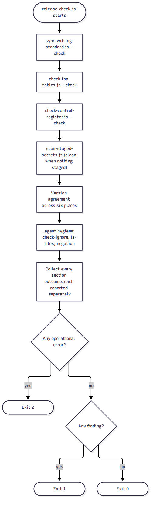
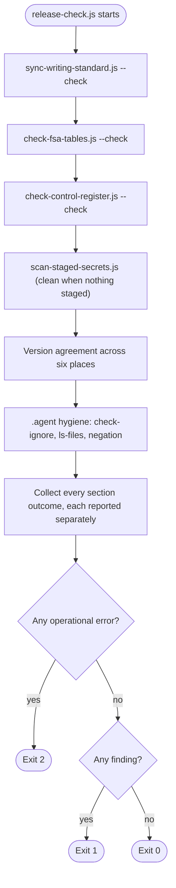

# spec-release-check

## Metadata

| Field | Value |
|---|---|
| **Feature** | Unified release-check runner: independent sections, six-place version agreement, staged-secret scan, and `.agent` hygiene |
| **Parent feature** | spec-skills-manifests-docs.md |
| **Sub-features** | None |
| **Requirement refs** | FR-250, FR-251, FR-252, FR-253, UR-044, UR-046, UR-051 |
| **Feature type** | Functionality |
| **Status** | Review |

Status values: Draft, Review, Approved, Implemented.

Paths are relative to the repository root unless they start with `plugins/assist-plugin/`. This spec owns the runner `plugins/assist-plugin/scripts/release-check.js`. The six-place version policy it checks is owned by FR-173 and FR-194 in `spec-skills-manifests-docs.md`; the staged-secret scanner it calls is owned by FR-217 (`FR-NFR-harness-governance.md`); the write protection of `.agent` paths is owned by FR-245 and is distinct from the ignore-and-track hygiene checked here. This spec states the runner behavior, not those settled points.

## Description

The command `plugins/assist-plugin/scripts/release-check.js` runs the plugin's existing release checks as independent, ordered sections and adds a version-agreement section and a `.agent` hygiene section, so one command replaces the separate manual steps listed in `CLAUDE.md` (Keeping counts in sync). Every section runs even when an earlier section reports a finding or an operational error, and each section's outcome is reported separately, so one failing section never hides another. The command exits 0 when every section is clean, 1 when at least one section reports a finding, and 2 when at least one section hits an operational error; an operational error wins over a finding because a section that could not complete leaves the run unable to assert a clean-or-only-findings result.

## Triggered by

| Trigger type | Source | Condition |
|---|---|---|
| Called by maintainer | A release candidate or a pre-commit check (`CLAUDE.md`, Keeping counts in sync and Releasing) | The maintainer runs `node plugins/assist-plugin/scripts/release-check.js` |

## Required data

| Data | Source | Type | Notes |
|---|---|---|---|
| Section scripts | `plugins/assist-plugin/scripts/sync-writing-standard.js --check`, `check-fsa-tables.js --check`, `check-control-register.js --check`, `scan-staged-secrets.js` | Node scripts | Run as independent sections; each contributes its own outcome |
| Six version places | `plugins/assist-plugin/.claude-plugin/plugin.json`, the plugin entry in `.claude-plugin/marketplace.json`, the `CLAUDE.md` Plugin line, the `README.md` `### assist-plugin v` heading, the `MARKETPLACE.md` heading and Versioning sentence, the newest heading of the root `CHANGELOG.md` | JSON, Markdown | The six-place set of FR-173, FR-194, and FR-251 |
| Staged index | `git` staged changes | Git state | Empty index is a clean secret-scan outcome |
| `.agent` ignore and track state | `git check-ignore`, `git ls-files`, and the `.gitignore` rules | Git state | Both git commands exit 2 outside a git repository |

## Preconditions

| Condition | Check | If not met |
|---|---|---|
| A supported Node runtime | The runner starts under the plugin's Node floor (NFR-017) | The runner cannot start; the caller sees the Node error |
| Inside a git repository | `git check-ignore` and `git ls-files` resolve | The `.agent` hygiene section reports an operational error (exit code 2); see Requirement 8 |
| Each section script is present | The runner resolves the four section scripts | A section that cannot start is an operational error, and the run still runs the remaining sections (Requirement 2) |

## Algorithmic steps

### Requirement 1: Run the ordered list of independent sections

The runner SHALL run an ordered list of independent sections: `sync-writing-standard.js --check`, `check-fsa-tables.js --check`, `check-control-register.js --check`, `scan-staged-secrets.js`, then the version-agreement section (Requirement 4) and the `.agent` hygiene section (Requirements 7 to 8).

#### Scenario: All sections clean

- **GIVEN** a tree where every section passes
- **WHEN** `release-check.js` runs
- **THEN** it SHALL report each section as clean
- **AND** it SHALL exit 0

### Requirement 2: Each section runs regardless of an earlier outcome

The runner SHALL run every section even when an earlier section reports a finding or an operational error, and SHALL report each section's outcome separately.

#### Scenario: One failing section does not hide another

- **GIVEN** `check-fsa-tables.js --check` exits 1 and the version-agreement section also finds a mismatch
- **WHEN** `release-check.js` runs
- **THEN** it SHALL report both findings
- **AND** it SHALL exit 1

#### Scenario: A section that cannot start does not stop the run

- **GIVEN** a section whose script cannot start
- **WHEN** `release-check.js` runs
- **THEN** it SHALL still run the remaining sections
- **AND** it SHALL exit 2

### Requirement 3: Exit code and the finding-plus-error precedence

The runner SHALL exit 0 when every section is clean, 1 when at least one section reports a finding and no section hits an operational error, and 2 when at least one section hits an operational error. When a single run holds both a finding and an operational error, the runner SHALL exit 2, because an operational error means a section could not complete and the run cannot assert a clean-or-only-findings result.

#### Scenario: Findings only

- **GIVEN** at least one section reports a finding and no section hits an operational error
- **WHEN** `release-check.js` runs
- **THEN** it SHALL exit 1

#### Scenario: Operational error only

- **GIVEN** at least one section hits an operational error and no section reports a finding
- **WHEN** `release-check.js` runs
- **THEN** it SHALL exit 2

#### Scenario: Finding and operational error together

- **GIVEN** one section reports a finding and another section hits an operational error in the same run
- **WHEN** `release-check.js` runs
- **THEN** it SHALL report both outcomes
- **AND** it SHALL exit 2, because the operational error outranks the finding

### Requirement 4: Version agreement across six places

The version-agreement section SHALL compare the version in `plugins/assist-plugin/.claude-plugin/plugin.json`, the plugin entry in `.claude-plugin/marketplace.json`, the `CLAUDE.md` Plugin line, the `README.md` `### assist-plugin v` heading, the `MARKETPLACE.md` heading and Versioning sentence, and the newest heading of the root `CHANGELOG.md`.

#### Scenario: Six places agree

- **GIVEN** all six places read the same version
- **WHEN** the version-agreement section runs
- **THEN** it SHALL report clean

#### Scenario: Manifest mismatch

- **GIVEN** `plugin.json` and `marketplace.json` read different versions
- **WHEN** the version-agreement section runs
- **THEN** it SHALL report a finding

### Requirement 5: The changelog heading is optional when no release is requested

A release is requested by a `--release` flag on `release-check.js`. An absent newest `CHANGELOG.md` heading means no versioned heading exists in the root `CHANGELOG.md` at all. When no release is requested, the version-agreement section SHALL NOT report a finding for `CHANGELOG.md`, whether its newest heading is absent, older than the manifest version, or in agreement. When a release is requested, the section SHALL report a finding for `CHANGELOG.md` when its newest heading is absent or differs from the manifest version.

#### Scenario: Absent heading, no release requested

- **GIVEN** the root `CHANGELOG.md` holds no versioned heading at all and no release is requested
- **WHEN** the version-agreement section runs
- **THEN** it SHALL NOT report a finding for `CHANGELOG.md`

#### Scenario: Only older headings, no release requested

- **GIVEN** the manifests read 1.14.4, the newest root `CHANGELOG.md` heading reads 1.14.3, and no release is requested
- **WHEN** the version-agreement section runs
- **THEN** it SHALL NOT report a finding for `CHANGELOG.md`

#### Scenario: Newest heading differs, release requested

- **GIVEN** the manifests read 1.14.4, the newest root `CHANGELOG.md` heading reads 1.14.3, and a release is requested with `--release`
- **WHEN** the version-agreement section runs
- **THEN** it SHALL report a finding that names `CHANGELOG.md`

#### Scenario: Absent heading, release requested

- **GIVEN** the root `CHANGELOG.md` holds no versioned heading at all and a release is requested with `--release`
- **WHEN** the version-agreement section runs
- **THEN** it SHALL report a finding that names `CHANGELOG.md`

### Requirement 6: The secret-scan section is clean when nothing is staged

The `scan-staged-secrets.js` section SHALL report clean when no change is staged, and SHALL report a finding when a staged change holds a secret pattern the scanner detects.

#### Scenario: Nothing staged

- **GIVEN** an empty index
- **WHEN** the secret-scan section runs
- **THEN** it SHALL report clean

#### Scenario: Secret staged

- **GIVEN** a staged change that holds a secret pattern the scanner detects
- **WHEN** the secret-scan section runs
- **THEN** it SHALL report a finding

### Requirement 7: `.agent` is ignored as a whole and nothing under it is tracked

The `.agent` hygiene section SHALL report a finding when `git check-ignore` shows `.agent/` is not git-ignored as a whole, SHALL report a finding for each path under `.agent/` that `git ls-files` lists as tracked, and SHALL report a finding for each negated gitignore rule whose pattern targets `.agent` or a path under it and reopens any part of it.

#### Scenario: Clean

- **GIVEN** `.gitignore` ignores `.agent/`, no path under it is tracked, and no negated rule targets it
- **WHEN** the hygiene section runs
- **THEN** it SHALL report clean

#### Scenario: Not ignored

- **GIVEN** no rule ignores `.agent/`
- **WHEN** the hygiene section runs
- **THEN** it SHALL report a finding

#### Scenario: Tracked file

- **GIVEN** `.agent/logs/notes.md` is tracked
- **WHEN** the hygiene section runs
- **THEN** it SHALL report a finding that names the path

#### Scenario: Negated rule reopens a path

- **GIVEN** `.gitignore` holds `.agent/*` and then `!.agent/governance/`
- **WHEN** the hygiene section runs
- **THEN** it SHALL report a finding for the negated rule

### Requirement 8: Outside a git repository is an operational error

The `.agent` hygiene section SHALL report an operational error when it runs outside a git repository, because both `git check-ignore` and `git ls-files` fail there.

#### Scenario: Outside a git repository

- **GIVEN** the working directory is not inside a git repository
- **WHEN** the hygiene section runs
- **THEN** it SHALL report an operational error
- **AND** the command SHALL exit 2, because the operational error outranks any finding

## Business rules

| Rule ID | Rule | Traces to | Applied at step | Example |
|---|---|---|---|---|
| RULE-001 | Every section runs; outcomes are reported per section | FR-250 | Requirements 1, 2 | An FSA-table finding and a version mismatch are both reported |
| RULE-002 | Exit 0 clean, 1 finding, 2 operational error; an operational error outranks a finding | FR-250 | Requirement 3 | A finding plus an unstartable section exits 2 |
| RULE-003 | Six version places must agree | FR-251, FR-173, FR-194 | Requirement 4 | A `README.md` heading that disagrees with the manifests is a finding |
| RULE-004 | With no `--release`, the newest `CHANGELOG.md` heading is never a finding, whether absent, older, or in agreement; with `--release`, an absent or disagreeing newest heading is a finding | FR-251 | Requirement 5 | Only older headings and no release requested passes; with `--release`, an absent or disagreeing heading fails |
| RULE-005 | An empty index is a clean secret-scan outcome | FR-252 | Requirement 6 | Nothing staged reports clean |
| RULE-006 | `.agent/` must be ignored as a whole, untracked, and not reopened by a negated rule | FR-253 | Requirement 7 | `!.agent/governance/` after `.agent/*` is a finding |
| RULE-007 | Running outside a git repository is an operational error | FR-253 | Requirement 8 | `git check-ignore` exits 2; the section reports an operational error |

## Data transformations

| Input | Transformation | Output | Notes |
|---|---|---|---|
| Four section scripts plus two added sections | Run each in order; capture each outcome as clean, finding, or operational error | A per-section outcome list | Independence is preserved; no section short-circuits another |
| Six version strings | Compare for equality; with no `--release`, report no `CHANGELOG.md` finding whether its newest heading is absent, older, or in agreement; with `--release`, an absent or disagreeing newest heading is a finding | Clean or a named finding | FR-251 |
| `git check-ignore`, `git ls-files`, `.gitignore` rules | Check whole-ignore, tracked paths, and reopening negations | Clean, findings, or an operational error outside a repository | FR-253 |
| Per-section outcomes | Reduce to an exit code with operational error outranking a finding | Exit 0, 1, or 2 | FR-250 Requirement 3 |

## Output / Outcome

| Output | Type | Description |
|---|---|---|
| Per-section report | Console output | Each section's outcome, reported separately |
| Exit code | Process exit status | 0 clean, 1 finding, 2 operational error, with 2 outranking 1 |

## Error handling

| Error condition | Handling strategy | Outcome |
|---|---|---|
| A section reports a finding | Record the finding, continue to the next section | Exit 1 when no operational error occurs |
| A section script cannot start | Record an operational error, continue to the next section | Exit 2 |
| Finding and operational error in one run | Record both outcomes | Exit 2; the operational error outranks the finding |
| Run outside a git repository | The hygiene section reports an operational error | Exit 2 when any section reports an operational error (it outranks findings); exit 1 for a finding and no operational error; exit 0 when neither |
| Absent newest `CHANGELOG.md` heading, no release requested | The version section passes `CHANGELOG.md` | No finding for `CHANGELOG.md` |

## Events emitted

Not applicable: the runner writes a report and sets an exit code; it emits no event.

## Events consumed

Not applicable: the runner is invoked directly and consumes no event.

## Sub-feature breakdown

Not applicable: the runner is one script that calls existing section scripts.

## Performance considerations

| Concern | Target | Approach |
|---|---|---|
| Total runtime | No NFR sets a release-check runtime target | Sections run sequentially; each is an existing check or a git query |

## Traceability

| Requirement | Spec section | Verified by |
|---|---|---|
| FR-250 | Requirements 1 to 3 | Test: all sections clean exits 0; two findings exit 1; an unstartable section exits 2; a finding plus an operational error exits 2 |
| FR-251 | Requirements 4, 5 | Test: six agreeing places pass; a manifest mismatch is a finding; a stale `CHANGELOG.md` heading is a finding when a release is requested (`--release`); an absent heading with no release requested passes |
| FR-252 | Requirement 6 | Test: empty index reports clean; a staged secret pattern is a finding |
| FR-253 | Requirements 7, 8 | Test: clean tree passes; not-ignored, tracked, and negated-rule cases are findings; outside a git repository is an operational error and exits 2 |
| UR-046 | Requirement 4 | The six-place version agreement of FR-173 and FR-194 |

## Data flow

Render source: [spec-release-check-dataflow.mmd](spec-release-check-dataflow.mmd).

## Change Log: 2026-11-20

**Source:** Backport follow-up item from the assist-pi backport task plan `docs/task-plans/task-plan-assist-pi-backport-20261120-0314.md` (the hygiene section, Step 15): FR-253. FR-253 is unchanged; it already reads "each negated rule whose pattern targets `.agent`" without limiting the source, so broadening the scanned sources satisfies the same requirement more fully. This spec received a delta, so its Status is set to `Review` (delta rule 6, no same-turn approval).

### Body text this entry supersedes (applied at the next fold)

- Required data table, the `.agent` ignore and track state row (currently `:35`), becomes: "| `.agent` ignore and track state | `git check-ignore`, `git ls-files`, and the negation sources: the root `.gitignore`, every nested `.gitignore` under the repository, `.git/info/exclude`, and the global `core.excludesFile` (resolved via `git config core.excludesFile`) | Git state | Both git commands exit 2 outside a git repository; reading the global `core.excludesFile` makes the result machine-dependent (accepted trade-off) |".
- Data transformations table, the git-queries row (currently `:216`), becomes: "| `git check-ignore`, `git ls-files`, and the negation sources (root and nested `.gitignore`, `.git/info/exclude`, global `core.excludesFile`) | Check whole-ignore, tracked paths, and reopening negations across every source, each finding naming its source | Clean, findings, or an operational error outside a repository | FR-253 |".

### MODIFIED Requirements

#### Requirement 7: `.agent` is ignored as a whole and nothing under it is tracked

**Was:** The `.agent` hygiene section SHALL report a finding when `git check-ignore` shows `.agent/` is not git-ignored as a whole, SHALL report a finding for each path under `.agent/` that `git ls-files` lists as tracked, and SHALL report a finding for each negated gitignore rule whose pattern targets `.agent` or a path under it and reopens any part of it. (As built the negation check reads only the root `.gitignore`, task plan Step 15.)

**Now:** The `.agent` hygiene section SHALL report a finding when `git check-ignore` shows `.agent/` is not git-ignored as a whole, SHALL report a finding for each path under `.agent/` that `git ls-files` lists as tracked, and SHALL report a finding for each negated rule whose pattern targets `.agent` or a path under it and reopens any part of it, scanning every negation source: the root `.gitignore`, every nested `.gitignore` under the repository, `.git/info/exclude`, and the global `core.excludesFile` (resolved via `git config core.excludesFile`). A negated rule from any of these sources SHALL be a finding that names the source and the rule.

**Reason:** FR-253 does not limit the negation source, but the as-built check read only the root `.gitignore`, so a negated rule in a nested `.gitignore`, in `.git/info/exclude`, or in the global excludes file could reopen part of `.agent` and go unreported. Broadening the scanned sources closes that gap.

**Note (machine-dependence, accepted trade-off):** Including the global `core.excludesFile` makes release-check results machine-dependent: the same commit can pass on a machine whose global excludes file holds no `.agent` negation and fail on a machine whose global excludes file holds one, because the global excludes file is not part of the repository. This is an accepted trade-off: the check reports an `.agent` reopening wherever it is configured, at the cost of a result that depends on the local git configuration.

##### Scenario: Negated rule in a nested .gitignore

- **GIVEN** a nested `.gitignore` under the repository holds a negated rule whose pattern targets `.agent` or a path under it
- **WHEN** the hygiene section runs
- **THEN** it SHALL report a finding that names the nested `.gitignore` and the rule

##### Scenario: Negated rule in .git/info/exclude

- **GIVEN** `.git/info/exclude` holds `!.agent/governance/`
- **WHEN** the hygiene section runs
- **THEN** it SHALL report a finding that names `.git/info/exclude` and the rule

##### Scenario: Negated rule in the global excludes file

- **GIVEN** the global `core.excludesFile` (resolved via `git config core.excludesFile`) holds `!.agent/governance/`
- **WHEN** the hygiene section runs
- **THEN** it SHALL report a finding that names the global excludes file and the rule
- **AND** the result is machine-dependent, since the global excludes file is not part of the repository

The scenarios Clean, Not ignored, Tracked file, and Negated rule reopens a path (the root `.gitignore` case) are unchanged.

### REMOVED Requirements

None.

### Traceability added

| Requirement | Spec section | Verified by |
|---|---|---|
| FR-253 | Change Log 2026-11-20: MODIFIED Requirement 7 (broadened negation sources) | Test: a negated `.agent` rule in a nested `.gitignore`, in `.git/info/exclude`, and in the global `core.excludesFile` each reports a finding that names its source and the rule; the root `.gitignore` negation case still reports a finding |

## Change Log: 2026-11-25

**Source:** FR-250 in `docs/requirements/FR-NFR-assist-plugin.md` gained its benchmark-scoreboard statement (the D-15 delta that `FR-NFR-harness-governance.md` records, FR-273 and FR-274), which lists a benchmark scoreboard section among the ordered sections of `release-check.js`. This spec owns the runner, so its section list (Requirement 1) adds that section. The section's scoring, release-over-release comparison, and regression-finding behavior stay owned by `specs/spec-evaluation-harness.md`; this entry wires the section into the runner only. This spec received a delta, so its Status stays `Review` (delta rule 6, no same-turn approval).

### Body text this entry supersedes (applied at the next fold)

- Description (currently `:19-20`): the sentence "adds a version-agreement section and a `.agent` hygiene section" becomes "adds a version-agreement section, a `.agent` hygiene section, and a benchmark scoreboard section".
- Business rules RULE-001 (currently `:202`): its "Applied at step" becomes "Requirements 1, 2, 9" and its rule text notes the benchmark scoreboard section as the seventh section.

### ADDED Requirements

#### Requirement 9: Benchmark scoreboard section

The benchmark scoreboard section SHALL report the last stored evaluation scoreboard and SHALL NOT run the evaluation suite on a default release-check run. WHEN the user requests a suite run, the section SHALL start the Group A evaluation harness (`spec-evaluation-harness.md`; FR-273, FR-274) and SHALL NOT start a second runner. The section's scoring, release-over-release comparison, and regression-finding behavior is owned by `spec-evaluation-harness.md`; on a default run the section is informational and reports no finding, so the exit-code precedence of Requirement 3 is unchanged.

##### Scenario: Default run reports the stored scoreboard

- **GIVEN** a stored evaluation scoreboard and a default `release-check.js` run with no suite request
- **WHEN** the benchmark scoreboard section runs
- **THEN** it SHALL report the stored scoreboard values
- **AND** it SHALL NOT start the evaluation suite

##### Scenario: No stored scoreboard

- **GIVEN** no stored evaluation scoreboard and a default run
- **WHEN** the benchmark scoreboard section runs
- **THEN** it SHALL report that no scoreboard is stored
- **AND** it SHALL NOT start the evaluation suite

##### Scenario: Suite run requested

- **GIVEN** the user requests an evaluation suite run through `release-check.js`
- **WHEN** the benchmark scoreboard section runs
- **THEN** it SHALL start the Group A evaluation harness (FR-273, FR-274)
- **AND** it SHALL NOT start a second runner

### MODIFIED Requirements

#### Requirement 1: Run the ordered list of independent sections

**Was:** The runner SHALL run an ordered list of independent sections: `sync-writing-standard.js --check`, `check-fsa-tables.js --check`, `check-control-register.js --check`, `scan-staged-secrets.js`, then the version-agreement section (Requirement 4) and the `.agent` hygiene section (Requirements 7 to 8).

**Now:** The runner SHALL run an ordered list of independent sections: `sync-writing-standard.js --check`, `check-fsa-tables.js --check`, `check-control-register.js --check`, `scan-staged-secrets.js`, then the version-agreement section (Requirement 4), the `.agent` hygiene section (Requirements 7 to 8), and the benchmark scoreboard section (Requirement 9).

**Reason:** FR-250 now lists a benchmark scoreboard section among the ordered sections of `release-check.js` (D-15, FR-273, FR-274). The runner spec owns the section list, so the section joins it; the section's behavior is owned by `spec-evaluation-harness.md`.

The scenario All sections clean is unchanged: a default benchmark scoreboard section is informational and does not affect the clean outcome.

### REMOVED Requirements

None.

### Traceability added

| Requirement | Spec section | Verified by |
|---|---|---|
| FR-250 | Change Log 2026-11-25: ADDED Requirement 9 (benchmark scoreboard section) and MODIFIED Requirement 1 (section list) | Test: a default run reports the stored scoreboard and starts no suite; no stored scoreboard reports that none is stored and starts no suite; a requested run starts the Group A harness and starts no second runner |
