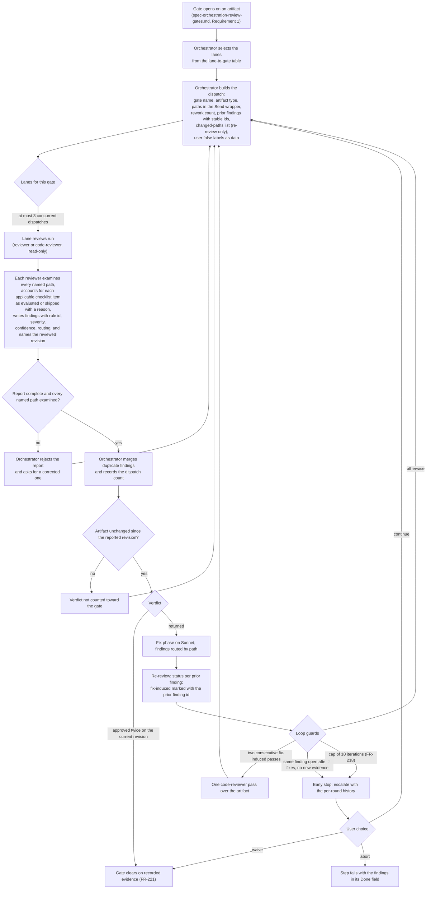
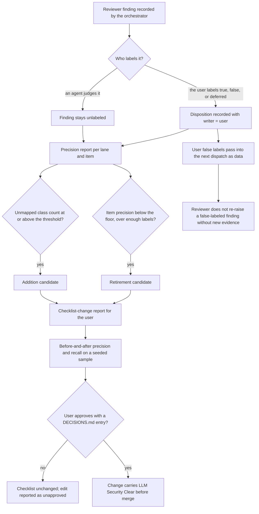

# spec-reviewer-machinery

## Metadata

| Field | Value |
|---|---|
| **Feature** | Reviewer lanes, iteration record, posting and approval guards, and the reviewer-improvement loop |
| **Parent feature** | spec-orchestration-review-gates.md |
| **Sub-features** | None |
| **Requirement refs** | BR-018, BR-019, BR-022, BR-024, UR-081, UR-082, UR-083, UR-084, UR-085, UR-086, FR-288, FR-289, FR-290, FR-291, FR-292, FR-293, FR-294, FR-295, FR-296, FR-297, FR-298, FR-299, FR-300, FR-301, FR-302, FR-303, FR-304, FR-305, FR-306, FR-307, FR-308, FR-309, FR-310, FR-311, FR-312, FR-313, FR-314, FR-315, FR-316, NFR-040, NFR-041, NFR-042, SC-026, SC-027, SC-028 |
| **Feature type** | Functionality |
| **Status** | Approved |

Status values: Draft, Review, Approved, Implemented.

Baseline: Group B (Theme 6) of `docs/requirements/FR-NFR-harness-governance.md` v1.4 (2026-11-24), FR-288 to FR-316 and NFR-040 to NFR-042, Approved (2026-11-26). This spec extends `specs/spec-orchestration-review-gates.md` (Requirements 2, 4, 6, 7, and the Change Log 2026-11-06 Requirement 14) and does not restate or replace it; it adds no gate, no cap, and no reviewer tool. Paths are relative to `plugins/assist-plugin/` unless stated otherwise. Catalog-fixed severity (Requirement 18, FR-306 and FR-307) is implemented and active: the user re-approved the severity policy with the catalog added (D-14; `DECISIONS.md`, 2026-11-25) and commit a1582f0 shipped it. The other Group B behaviors below are implemented per the Group B build (commit a1582f0) and held on `feat/eval-reviewer-harness` for merge.

## Description

The review machinery of `/do` extends the existing review gates with named reviewer checklists by lane, a finding-level iteration record that survives across rounds, guards that keep an approval tied to the artifact and the posting tied to the current head, and a feedback loop that turns the user's own labels into checklist changes the user approves. Reviewers (`reviewer`, `code-reviewer`) stay read-only; the `/do` orchestrator reads their evidence and writes every finding, status, label, and gate record (FR-222, NFR-040). The machinery closes four gaps in the current review controls: a clean review that never states which recurring defect classes it checked, a re-review that cannot name which earlier finding a later one is, an approval that may name a stale revision or an unexamined path, and a noisy checklist that no measured signal retires.

One capability in this spec, catalog-fixed severity (Requirement 18, FR-306 and FR-307), is implemented and active. The user re-approved the severity policy under FR-237 with the severity catalog added (dependency D-14; `DECISIONS.md`, 2026-11-25), which authorized the capability, and commit a1582f0 shipped it. `rules/severity-catalog.yaml` holds the maintainer-editable map of each rule identifier to a fixed severity with a recorded basis per entry, and `hooks/lib/severity.js` reads it through pure functions (`parseCatalog`, `catalogEntry`, `resolveSeverity`, `routeWithCatalog`), with the caller passing the file text so the module does no I/O. The orchestrator records a finding's severity from its catalog entry and notes any difference from the reviewer's written severity; a finding with no catalog entry and no CWE identifier reads `unmapped` and routes no higher than `inline-comment`. A catalog the strict reader discards as malformed, or an absent catalog, falls back to each reviewer's `severity` set from the approved severity-policy text.

## Triggered by

| Trigger type | Source | Condition |
|---|---|---|
| Called by feature | Review gate (spec-orchestration-review-gates.md, Requirement 1) | A gate opens on an artifact whose type maps a lane in the lane-to-gate table |
| Called by feature | Gate loop | A `returned` verdict starts the fix phase; a re-review follows each fix pass |
| Called by feature | PR-review workflow | A drafted PR verdict reaches the post step (FR-304, FR-305) |
| Called by feature | Labelling and reporting step | The user labels a finding, or the user requests the precision report or the checklist-change report |
| Event | A proposed checklist, severity-catalog, or screening-rule change | Before the change ships (FR-315, FR-316) |

## Required data

| Data | Source | Type | Notes |
|---|---|---|---|
| Lane checklists | The reviewer checklist register (this spec, Requirement 1) | Table of id, lane, check, evidence, applies-to | DRAFT content; changes only by a user-approved edit (FR-315) |
| Lane-to-gate map | This spec, Requirement 1 | Table | Fixed mapping of each lane to the existing gates that apply it |
| Artifact paths and type | The producing step's block and Writes | Paths; one of code, config, test, pipeline, planning document | Paths travel in the Send `untrusted-file` wrapper (spec-orchestration-dispatch.md, Requirement 3) |
| Rework count | `/do` gate counter | Integer | 0 the first time, then the number of fix passes |
| Prior findings with stable ids | The previous reviewer report, held by the orchestrator | Id, location, rule id, severity, confidence, routing, status | Passed as data in `<review-findings>` |
| Changed-paths list | The fix pass diff | Paths | Present only on a re-review (FR-298) |
| Reviewed revision | The reviewer report | Content digest or commit identifier | Tied to the artifact at the gate (FR-296, FR-297) |
| User finding labels | The labelling step record | true, false, deferred, or unlabeled, with writer | Only the user's label counts (FR-309) |
| Severity catalog | `rules/severity-catalog.yaml`, governed by `rules/severity-policy.md` (D-14) | Rule id to fixed severity with a recorded basis | Implemented and active, read by `hooks/lib/severity.js` (Requirement 18) |
| Current PR head revision | The GitHub PR, read with the `gh` CLI at the post step | Revision identifier | Read immediately before posting on the GitHub path (FR-304, U-9) |

## Preconditions

| Condition | Check | If not met |
|---|---|---|
| The gate maps at least one lane | Lane-to-gate table | The gate runs as spec-orchestration-review-gates.md defines it, with no lane checklist |
| Each lane is assigned to an existing gate | Lane-to-gate table | Checklist validation fails and names the lane (FR-291) |
| Each checklist item has an id, a check, and an evidence entry | Checklist validation | Validation fails and names the item (FR-288) |
| Reviewers hold only `Read, Grep, Glob, LSP` | `tools:` frontmatter of both agents | The change is rejected on the LLM surface (NFR-040) |
| A reviewed revision is current | Digest or commit comparison at the gate | The verdict is not counted (FR-297) |

## Algorithmic steps

Source: [spec-reviewer-machinery-flow.mmd](spec-reviewer-machinery-flow.mmd), rendered to [spec-reviewer-machinery-flow.png](spec-reviewer-machinery-flow.png) with `mmdc` 12.0.0. The reviewer-improvement loop is the second diagram, [spec-reviewer-feedback-loop.mmd](spec-reviewer-feedback-loop.mmd) / [spec-reviewer-feedback-loop.png](spec-reviewer-feedback-loop.png), shown under Requirement 21.

### Requirement 1: Keep one reviewer checklist per lane within the existing gates

The plugin SHALL keep one reviewer checklist for each of the three review lanes (defect-depth, test-integrity, architecture-safety), each item SHALL carry an identifier, a check, and the evidence that clears it, and each lane SHALL be applied within the gates the lane-to-gate table assigns. (FR-288, FR-291; extends `agents/reviewer.md`, `agents/code-reviewer.md`, `skills/do/references/review-protocol.md` gate list, and spec-orchestration-review-gates.md Requirement 1)

Reviewer checklist register (initial DRAFT content):

| ID | Lane | Check | Evidence that clears it | Applies to |
|----|------|-------|-------------------------|------------|
| DD-01 | defect-depth | Each loop, repeated pattern, or parse step over external text has an upper bound on input size or repeat count | The bound at file:line, or a finding that names the unbounded step | code |
| DD-02 | defect-depth | Parsed external data has an overall size bound in addition to any per-field or per-level cap | The bound at file:line | code |
| DD-03 | defect-depth | A cap that drops or cuts data rejects the input or marks the cut for the caller | The rejection or marker at file:line | code |
| DD-04 | defect-depth | Sanitizing runs on bounded input, and a cut cannot leave a split token that survives it | The order of bound and sanitize at file:line | code |
| DD-05 | defect-depth | Identifiers match ASCII-only classes, and URLs pass the project's existing safe-URL check, including userinfo and look-alike host forms | The check at file:line | code |
| DD-06 | defect-depth | A normalizer returns the same value when applied twice, and one input class has one error outcome | The code path or a test | code |
| DD-07 | defect-depth | Values that are compared or ordered share one time-zone treatment | The conversion at file:line | code |
| DD-08 | defect-depth | A schema change declares its lock limit and does not collide with another open change to the same revision sequence | The declaration at file:line | code, config |
| DD-09 | defect-depth | Pinned versions match the runtime the build targets and the declared ranges of sibling packages | The manifest lines | config |
| TI-01 | test-integrity | Each assertion fails when the behavior it guards is reverted | The reverted case, or a test that fails on it | test |
| TI-02 | test-integrity | The boundary value and the value on each side of it have a case | The cases at file:line | test |
| TI-03 | test-integrity | No assertion passes when the guarded value is empty or removed | The assertion text | test |
| TI-04 | test-integrity | Each test reaches the branch or option it names, and no default setup hides it | The setup at file:line | test |
| TI-05 | test-integrity | Each behavior a docstring, comment, or document claims matches the code and has a test | The claim and the test or code line | code, test, planning document |
| TI-06 | test-integrity | A count or list stated in prose is derived or checked, not hand-written | The check or the matching count | planning document |
| TI-07 | test-integrity | Validators and constraints agree with the contract the code states for them | The two lines compared | code |
| TI-08 | test-integrity | A test that replaces a boundary with a recorder is not the only proof of that boundary's behavior | A test against the real boundary | test |
| AS-01 | architecture-safety | In a multi-owner data model, every table, unique key, and relation carries the owner key | The schema lines | code, config |
| AS-02 | architecture-safety | An access policy is scoped to the account and resource it serves | The policy lines | config |
| AS-03 | architecture-safety | A credential is not written to a location that outlives the job | The write at file:line | config, pipeline |
| AS-04 | architecture-safety | The author of a control change is not its only approver | The change record | config, planning document |
| AS-05 | architecture-safety | A failed privacy or permission check denies the operation | The failure path at file:line | code |
| AS-06 | architecture-safety | Untrusted text that reaches rendered output cannot create a live control or link | The escaping at file:line | code |

Lane-to-gate table:

| Lane | Existing gates that apply it |
|------|------------------------------|
| defect-depth | Pre-Test Code Review Gate; Security Gate |
| test-integrity | Testing Gate (applied by `qa`, D-17); Code Review Gate |
| architecture-safety | Code Review Gate |

No new gate is added, so the cap of FR-218 and every gate bound stay unchanged. The `qa` agent owns applying the test-integrity lane in the Testing Gate (D-17 settled; `DECISIONS.md`, 2026-11-25).

#### Scenario: Checklist valid

- **GIVEN** three lane checklists whose every item has an identifier, a check, and an evidence entry
- **WHEN** the checklist validation runs
- **THEN** the validation SHALL pass

#### Scenario: Item without evidence

- **GIVEN** a checklist item with no evidence entry
- **WHEN** the checklist validation runs
- **THEN** the validation SHALL fail and SHALL name the item

#### Scenario: Lane assigned to no gate

- **GIVEN** a lane that the lane-to-gate table assigns to no existing gate
- **WHEN** the checklist validation runs
- **THEN** the validation SHALL fail and SHALL name the lane

#### Scenario: Lane applied in its gate

- **GIVEN** the Security Gate runs on a code change
- **WHEN** the reviewer audits it
- **THEN** the reviewer SHALL evaluate the defect-depth items that apply to a code artifact

### Requirement 2: Account for every applicable checklist item

The `reviewer` and `code-reviewer` agents SHALL list each checklist item that applies to the artifact type as evaluated or as skipped with a reason, and the `/do` orchestrator SHALL reject a report that omits any applicable item and ask for a corrected one. (FR-289; extends the Review Output Rule "Reject an incomplete report", `skills/do/references/review-protocol.md:142`, and the `skipped:` field of the terminal block)

#### Scenario: All items accounted for

- **GIVEN** a code artifact for which five checklist items apply
- **WHEN** the reviewer reports
- **THEN** the report SHALL list five items, each as evaluated or as skipped with a reason

#### Scenario: Item missing from the report

- **GIVEN** a report that lists four of the five applicable items
- **WHEN** the orchestrator reads it
- **THEN** the orchestrator SHALL reject the report and ask for a corrected one, and SHALL record no gate outcome from it

### Requirement 3: Carry the checklist item identifier on each finding

A finding raised from a checklist item SHALL carry that item's identifier as its rule identifier. (FR-290; extends the Finding Format of `agents/reviewer.md`: location, problem, fix, `severity`, `confidence`, `routing`)

The rule identifier is what lets Requirement 18 (catalog severity), Requirement 21 (precision per item), and Requirement 23 (no re-raise) act on a finding.

#### Scenario: Item cited

- **GIVEN** a reviewer finds an unbounded repeated pattern at `src/parse.js:12`
- **WHEN** the reviewer writes the finding
- **THEN** the finding SHALL carry `DD-01` as its rule identifier

#### Scenario: Item not cited

- **GIVEN** a finding raised from checklist item DD-01 with no rule identifier
- **WHEN** the orchestrator reads the report
- **THEN** the orchestrator SHALL reject the report and ask for a corrected one

### Requirement 4: Dispatch lane reviews concurrently and record the dispatch count

The orchestrator MAY dispatch the lane reviews of one gate concurrently with at most three reviewer dispatches running at once, and the gate outcome SHALL record the number of reviewer dispatches used. (FR-292, NFR-041; extends the gate dispatch of spec-orchestration-review-gates.md Requirement 2 and the parallel-agent cap of `rules/llm-security-checklist.md:321-345`)

The cap equals the number of lanes (three). The token cost of concurrent lanes is an estimate of about three times one pass, to confirm by measurement (NFR-041, assumption A-15).

#### Scenario: Three lanes at once

- **GIVEN** a gate with three lane reviews ready
- **WHEN** the orchestrator dispatches them
- **THEN** the orchestrator MAY run all three at once
- **AND** the gate outcome SHALL state three reviewer dispatches

#### Scenario: Fourth dispatch held

- **GIVEN** three reviewer dispatches running
- **WHEN** a fourth reviewer dispatch is ready
- **THEN** the orchestrator SHALL hold it until one dispatch ends

### Requirement 5: Merge duplicate findings from concurrent lanes

When lane reviews ran concurrently, the orchestrator SHALL merge findings that share a file, a line, and a rule identifier into one finding that keeps the highest severity among them. (FR-293; extends the "no padding" Review Output Rule, `skills/do/references/review-protocol.md:143`)

The orchestrator does the merge, so every reviewer stays read-only (NFR-040).

#### Scenario: Same finding from two lanes

- **GIVEN** two lanes report DD-01 at `src/parse.js:12`, one as HIGH and one as MEDIUM
- **WHEN** the orchestrator merges the reports
- **THEN** the merged report SHALL hold one finding at `src/parse.js:12` with severity HIGH

#### Scenario: Different lines

- **GIVEN** two lanes report DD-01 at `src/parse.js:12` and `src/parse.js:40`
- **WHEN** the orchestrator merges the reports
- **THEN** the merged report SHALL hold both findings

### Requirement 6: Keep a stable identifier on each finding across rounds

Each finding SHALL carry an identifier that stays the same in every round of one gate. (FR-294; extends the prior-findings hand-off of spec-orchestration-review-gates.md Requirement 2, the `<review-findings>` wrapper)

#### Scenario: Identifier carried across rounds

- **GIVEN** finding F-3 in round 1 that is still open in round 2
- **WHEN** the reviewer writes the round-2 report
- **THEN** the report SHALL list that finding as F-3

#### Scenario: Finding without an identifier

- **GIVEN** a report whose finding holds no identifier
- **WHEN** the orchestrator reads it
- **THEN** the orchestrator SHALL reject the report and ask for a corrected one

### Requirement 7: Give every prior finding a status on a re-review

On a re-review the reviewer SHALL give each prior finding exactly one status of fixed, open, or withdrawn with a one-line reason, and SHALL mark every other finding as new. (FR-295; extends the Review Output Rule "Report only what changed on a re-review", `skills/do/references/review-protocol.md:140`, which has no status vocabulary or withdrawn state)

#### Scenario: Statuses given

- **GIVEN** three prior findings and one new defect
- **WHEN** the reviewer writes the re-review report
- **THEN** each prior finding SHALL hold one of fixed, open, or withdrawn with a reason
- **AND** the new defect SHALL read new

#### Scenario: Prior finding without a status

- **GIVEN** a re-review report that omits the status of prior finding F-2
- **WHEN** the orchestrator reads it
- **THEN** the orchestrator SHALL reject the report and ask for a corrected one

### Requirement 8: Name the reviewed revision in each report

Each review report SHALL name the revision of the artifact it reviewed, as a content digest or a commit identifier. (FR-296; extends FR-221, which clears a gate only on evidence)

#### Scenario: Revision named

- **GIVEN** a reviewer report for a task whose artifact has a known digest
- **WHEN** the reviewer writes the report
- **THEN** the report SHALL hold that digest or a commit identifier

#### Scenario: Revision missing

- **GIVEN** a report with no revision
- **WHEN** the orchestrator reads it
- **THEN** the orchestrator SHALL reject the report and ask for a corrected one

### Requirement 9: Do not count a verdict against a changed artifact

The orchestrator SHALL NOT count a reviewer verdict toward a gate when the artifact has changed since the revision the report names. (FR-297; extends FR-218 and spec-orchestration-review-gates.md Requirement 4, where two consecutive `approved` verdicts end a gate)

Two consecutive approvals end a gate only when both name the same revision and that revision is still current.

#### Scenario: Both approvals on one revision

- **GIVEN** two consecutive `approved` reports that name the same revision, which is still current
- **WHEN** the orchestrator counts the gate
- **THEN** the gate SHALL end approved

#### Scenario: Artifact changed between approvals

- **GIVEN** an `approved` report on revision A and a later artifact change to revision B
- **WHEN** the orchestrator counts the gate
- **THEN** the report on revision A SHALL NOT count toward the gate

### Requirement 10: List the changed paths on a re-review dispatch

On a re-review the dispatch SHALL list the paths changed since the previous pass, and a first review (rework count 0) SHALL carry no changed-path list. (FR-298; extends the gate prompt of spec-orchestration-review-gates.md Requirement 2)

The list lets the reviewer check each fix for a side effect (Requirement 11).

#### Scenario: Paths listed

- **GIVEN** a fix pass that changed `src/a.js` and `src/b.js`
- **WHEN** the orchestrator dispatches the re-review
- **THEN** the dispatch SHALL list `src/a.js` and `src/b.js`

#### Scenario: First review

- **GIVEN** a gate at rework count 0
- **WHEN** the orchestrator dispatches the review
- **THEN** the dispatch SHALL hold no changed-path list

### Requirement 11: Mark a fix-induced finding

On a re-review the reviewer SHALL mark a finding as `fix-induced`, with the identifier of the prior finding, when a change made since the previous pass causes it; an unrelated new defect SHALL read new. (FR-299; extends the fix-phase scope rules of spec-orchestration-review-gates.md Requirement 7, which keep a fix to the listed findings but do not test a fix for side effects)

#### Scenario: Fix causes a new defect

- **GIVEN** a fix for F-2 that makes a previously correct path reject valid input
- **WHEN** the reviewer re-reviews
- **THEN** the new finding SHALL read `fix-induced` with the identifier F-2

#### Scenario: Unrelated new defect

- **GIVEN** a new defect in code that no change since the previous pass touched
- **WHEN** the reviewer re-reviews
- **THEN** the finding SHALL read new and SHALL NOT read `fix-induced`

### Requirement 12: Run a design pass after repeated fix-induced findings

When two consecutive re-reviews of one gate each return a fix-induced finding, the orchestrator SHOULD run one code-reviewer pass over the whole artifact before it dispatches another fix pass. (FR-300; parallels the escalation to `code-reviewer` after two scope violations, spec-orchestration-review-gates.md Requirement 7. The count of two is a provisional value, still overridable (OQ-17; `FR-NFR-harness-governance.md` section 5))

#### Scenario: Two fix-induced passes

- **GIVEN** pass 2 and pass 3 of one gate each return a fix-induced finding
- **WHEN** the orchestrator plans the next step
- **THEN** the orchestrator SHOULD dispatch one code-reviewer pass over the whole artifact

#### Scenario: One fix-induced pass

- **GIVEN** only pass 2 returns a fix-induced finding
- **WHEN** the orchestrator plans the next step
- **THEN** the orchestrator SHOULD dispatch the normal fix pass

### Requirement 13: Stop early on a finding that stays open

When two consecutive re-reviews of one gate report the same finding as open and the reviewer cites no new evidence, the orchestrator SHOULD stop that loop and offer the choices continue, waive, or abort. (FR-301; extends FR-218, which escalates only at iteration 10. The count of two is a provisional value, still overridable (OQ-17; `FR-NFR-harness-governance.md` section 5); the choices are those of FR-218)

#### Scenario: Finding open after two fixes

- **GIVEN** finding F-4 open after fix passes 1 and 2, with no new evidence in the re-review
- **WHEN** the orchestrator plans the next step
- **THEN** the orchestrator SHOULD stop the loop and offer continue, waive, or abort

#### Scenario: New evidence cited

- **GIVEN** finding F-4 open after two fix passes and the re-review cites new evidence
- **WHEN** the orchestrator plans the next step
- **THEN** the orchestrator SHOULD continue the loop

### Requirement 14: Show the per-round history at an escalation

At an escalation under FR-218 or Requirement 13, the orchestrator SHALL show, for each round, the number of new, fixed, open, and withdrawn findings; a round whose report held no statuses SHALL be marked as having no status data. (FR-302; extends FR-218, which shows the unresolved findings at the cap and no per-round history)

#### Scenario: History shown

- **GIVEN** an escalation after four rounds
- **WHEN** the orchestrator presents the choices
- **THEN** the presentation SHALL list four rows with counts of new, fixed, open, and withdrawn findings

#### Scenario: Statuses missing

- **GIVEN** a round whose report held no statuses
- **WHEN** the orchestrator builds the history
- **THEN** the orchestrator SHALL mark that round as having no status data

### Requirement 15: Refuse approval over an unexamined path

A reviewer SHALL NOT return verdict `approved` when it did not examine every artifact path the dispatch names, and the unexamined paths SHALL go in the `skipped:` field. (FR-303; extends the `Decide` state of `agents/reviewer.md` and `agents/code-reviewer.md`, where `none-left` leads to `approved`)

#### Scenario: All paths examined

- **GIVEN** a dispatch that names three paths and a reviewer that read all three
- **WHEN** the reviewer finds no defect
- **THEN** the verdict MAY read `approved`

#### Scenario: One path not examined

- **GIVEN** a dispatch that names three paths and a reviewer that read two
- **WHEN** the reviewer finds no defect in those two
- **THEN** the verdict SHALL NOT read `approved`
- **AND** the `skipped:` field SHALL name the unexamined path

### Requirement 16: Post a GitHub PR review only against the current head

On a GitHub PR, the PR-review workflow SHALL read the PR's current head revision with the `gh` CLI immediately before it posts and SHALL NOT post a review drafted against a different head revision; a stale draft SHALL be reported to the user. Bitbucket is out of scope for this head-check: U-9 leaves the Bitbucket head-revision read command unnamed, so the requirement binds the GitHub path only (U-9, unset). (FR-304; extends FR-195 and FR-214, the confirmation per PR and verdict. This requirement adds to FR-214 and does not replace it)

A post against the current head stays subject to the FR-214 confirmation and the `pr-post-ask` prompt (spec-orchestration-dispatch.md, FR-214).

#### Scenario: Head unchanged

- **GIVEN** a review drafted against head revision H and a GitHub PR whose head the `gh` CLI reports is still H
- **WHEN** the workflow reaches the post step
- **THEN** the workflow MAY post, subject to the FR-214 confirmation

#### Scenario: Head moved

- **GIVEN** a review drafted against head revision H and a GitHub PR whose head the `gh` CLI reports is now H2
- **WHEN** the workflow reaches the post step
- **THEN** the workflow SHALL NOT post
- **AND** the workflow SHALL tell the user the draft is stale

### Requirement 17: Read back the GitHub PR reviews after an unknown posting outcome

When a GitHub posting command ends with an unknown outcome, the PR-review workflow SHALL read back the PR's reviews with the `gh` CLI before any retry. Bitbucket is out of scope for this read-back: U-9 leaves the Bitbucket review read-back command unnamed, so the requirement binds the GitHub path only (U-9, unset). (FR-305; extends FR-214 and FR-195. A server error during a post may or may not have created the review, and a blind retry can post twice)

#### Scenario: Review exists after the error

- **GIVEN** a GitHub posting command that ended with a server error and a PR whose `gh` review list now holds the review
- **WHEN** the workflow handles the error
- **THEN** the workflow SHALL NOT post again

#### Scenario: Review absent after the error

- **GIVEN** a GitHub posting command that ended with a server error and a PR whose `gh` review list holds no such review
- **WHEN** the workflow handles the error
- **THEN** the workflow MAY retry, subject to the FR-214 confirmation

### Requirement 18: Take severity from the catalog

Status: implemented and active. The user re-approved the severity policy under FR-237 with the severity catalog added (dependency D-14; `DECISIONS.md`, 2026-11-25), and commit a1582f0 shipped it. The catalog `rules/severity-catalog.yaml` maps each rule identifier to a fixed severity with a recorded basis (a CWE identifier or a short token), and `hooks/lib/severity.js` reads it through pure functions (`parseCatalog`, `catalogEntry`, `resolveSeverity`, `routeWithCatalog`): the caller passes the file text, so the module does no I/O. When the catalog is absent or the strict reader discards it as malformed, the orchestrator keeps each reviewer's `severity` set from the approved severity-policy text (`rules/severity-policy.md`) as in FR-240.

A finding whose rule identifier is in the severity catalog SHALL take its severity from that catalog entry, and a finding with no catalog rule identifier and no CWE identifier SHALL be marked `unmapped` and SHALL route no higher than `inline-comment`. (FR-306, FR-307; extends FR-237, FR-239, FR-240. The severity catalog is a table held with the severity policy that maps each rule identifier, every checklist item and in-plugin scanner rule included, to a fixed severity, D-14)

Adding the catalog changed the severity policy, so it took the re-approval FR-237 requires; the user granted that re-approval (D-14). The orchestrator records the catalog severity and notes any difference from the reviewer's written severity; it drops no finding and raises no severity on a model score (Requirement 19).

#### Scenario: Catalog severity applied

- **GIVEN** catalog entry DD-01 has severity MEDIUM and a finding with rule identifier DD-01 that the reviewer wrote as HIGH
- **WHEN** the orchestrator reads the report
- **THEN** the recorded severity SHALL read MEDIUM
- **AND** the report SHALL note the difference

#### Scenario: Unmapped high finding

- **GIVEN** a finding with severity HIGH, confidence High, and no catalog rule or CWE identifier
- **WHEN** routing runs
- **THEN** the finding SHALL read `unmapped`
- **AND** the routing SHALL NOT read `block-merge`

#### Scenario: Catalog discarded as malformed

- **GIVEN** a severity catalog the strict reader discards as malformed
- **WHEN** the orchestrator reads a report whose finding rule identifier would otherwise map a catalog entry
- **THEN** the orchestrator SHALL keep the reviewer's severity from the approved policy text
- **AND** the orchestrator SHALL NOT override it from the catalog

### Requirement 19: Keep a critic or filtering score out of severity and inclusion

No score from a critic or filtering model SHALL set a finding's severity or remove a finding from the report. (FR-308; extends the reviewer rule that a model-emitted claim never raises confidence, `agents/reviewer.md` Finding Format, and the control that a gate not rest on a model-emitted string, `rules/llm-security-checklist.md:286-317`)

This guard is active now; it does not depend on the catalog of Requirement 18.

#### Scenario: Critic marks a finding as likely false

- **GIVEN** a critic score that rates finding F-1 as likely false
- **WHEN** the orchestrator builds the report
- **THEN** F-1 SHALL stay in the report
- **AND** its severity SHALL NOT change

#### Scenario: Critic raises a severity

- **GIVEN** a critic score that rates finding F-2 as critical while its recorded severity is MEDIUM
- **WHEN** the orchestrator builds the report
- **THEN** F-2 SHALL keep severity MEDIUM

### Requirement 20: Record a disposition only from the user's label

The plugin SHALL record a disposition of true, false, or deferred for a reviewer finding only from the user's own label; an agent's judgment SHALL leave the finding unlabeled, and the disposition record SHALL hold identifiers, locations, rule identifiers, severity, confidence, and the user's label only. (FR-309, NFR-042; extends NFR-034, the user labels each baseline advisory finding, from the blocking-check baseline to every reviewer finding)

The record holds no file contents, secret values, or matched text (NFR-042, following NFR-031).

#### Scenario: User label recorded

- **GIVEN** the user labels finding F-5 true through the labelling step
- **WHEN** the record is read
- **THEN** F-5 SHALL hold disposition true with the writer marked as the user

#### Scenario: Agent judgment

- **GIVEN** an agent judges finding F-6 false and the user has not labeled it
- **WHEN** the record is read
- **THEN** F-6 SHALL read unlabeled

#### Scenario: Secret kept out of the record

- **GIVEN** a finding whose text quotes a secret value from the reviewed file
- **WHEN** the finding record is written
- **THEN** the record SHALL hold the path, line, and rule identifier
- **AND** the record SHALL NOT hold the secret value

### Requirement 21: Report precision per lane and item, and drive checklist changes

The plugin SHALL report, for each lane and each checklist item, the counts of findings labeled true, labeled false, deferred, and unlabeled and the precision over the labeled findings, SHALL list each item below a configured precision floor as a retirement candidate and each unmapped finding class at or above a configured count as an addition candidate in a checklist-change report, and SHOULD report finding precision and recall on a seeded-defect sample before and after a proposed change. (FR-310, FR-313, FR-314, FR-316; extends NFR-034 and FR-238, the advisory baseline with finding counts and precision)

Precision is true divided by the sum of true and false. An item whose findings are all unlabeled reports precision not available, never 0. The floor, the minimum number of labeled findings, and the unmapped-class count are provisional values, still overridable (OQ-17; `FR-NFR-harness-governance.md` section 5): a retirement floor of 0.5, a minimum of 10 labeled findings, and an addition count of 3; the seeded-defect sample size (FR-316) is provisionally 20. A seeded-defect sample MAY reuse the review tasks of the Group A seeded sample; the reuse is optional.

Source: [spec-reviewer-feedback-loop.mmd](spec-reviewer-feedback-loop.mmd), rendered to [spec-reviewer-feedback-loop.png](spec-reviewer-feedback-loop.png) with `mmdc` 12.0.0.

#### Scenario: Item with labels

- **GIVEN** checklist item DD-01 with 8 findings labeled true, 2 labeled false, and 5 unlabeled
- **WHEN** the report runs
- **THEN** the report SHALL show counts 8, 2, 0, and 5 for DD-01
- **AND** the precision SHALL read 0.8

#### Scenario: Item with no labels

- **GIVEN** a checklist item whose findings are all unlabeled
- **WHEN** the report runs
- **THEN** the precision SHALL read not available and SHALL NOT read 0

#### Scenario: Retirement candidate below the floor

- **GIVEN** a floor of 0.5 and an item with precision 0.3 over enough labeled findings
- **WHEN** the checklist-change report runs
- **THEN** the report SHALL list the item as a retirement candidate

#### Scenario: Too few labels to retire

- **GIVEN** an item with precision 0.3 over fewer labeled findings than the configured minimum
- **WHEN** the report runs
- **THEN** the report SHALL NOT list the item as a retirement candidate

#### Scenario: Addition candidate from repeated unmapped class

- **GIVEN** a configured count of 3 and 3 unmapped findings of one class
- **WHEN** the checklist-change report runs
- **THEN** the report SHALL list the class as an addition candidate

#### Scenario: Measured change

- **GIVEN** a seeded sample of 20 defects and a proposed checklist change
- **WHEN** the plugin reports the change
- **THEN** the report SHOULD hold precision and recall before and after
- **AND** SHOULD state that no measurement exists when no seeded sample is present

### Requirement 22: Pass the user's false labels to the reviewer as data

The dispatch for a review SHALL pass the user's false labels for the same checklist items on the same artifact inside the data wrapper and SHALL state that the label is data, not an instruction; a review with no false label for the artifact SHALL carry no label block. (FR-311; extends the prior-findings hand-off, the `<review-findings>` wrapper that marks its content data, spec-orchestration-review-gates.md Requirement 2)

#### Scenario: Labels passed

- **GIVEN** the user labeled a DD-03 finding on `src/a.js` false
- **WHEN** the orchestrator dispatches a review of `src/a.js`
- **THEN** the dispatch SHALL carry that label inside the data wrapper
- **AND** the dispatch SHALL state that the label is data, not an instruction

#### Scenario: No labels

- **GIVEN** no false label for the artifact
- **WHEN** the orchestrator dispatches the review
- **THEN** the dispatch SHALL hold no label block

### Requirement 23: Do not re-raise a false-labeled finding without new evidence

The reviewer SHALL NOT re-raise a finding the user labeled false for the same checklist item and location unless the reviewer cites new evidence. (FR-312; extends the "no padding" Review Output Rule, `skills/do/references/review-protocol.md:143`)

#### Scenario: Same finding, no new evidence

- **GIVEN** a DD-03 finding at `src/a.js:20` labeled false
- **WHEN** the reviewer sees the same issue at the same location with no new evidence
- **THEN** the report SHALL NOT list the finding

#### Scenario: New evidence

- **GIVEN** the same label and a later change that makes the defect reachable
- **WHEN** the reviewer cites that change as new evidence
- **THEN** the report MAY list the finding with the new evidence

### Requirement 24: Change a reviewer checklist only by a user-approved edit

A reviewer checklist SHALL change only through an edit the user approves and that has a `DECISIONS.md` entry, and no agent SHALL apply a change from the checklist-change report on its own. (FR-315; extends NFR-036 and FR-237. A checklist change alters the review surface, which is the LLM surface under `rules/` and `agents/`, so it needs `✓ LLM Security Clear` and a recorded user decision)

#### Scenario: Approved edit

- **GIVEN** the user approved retiring item TI-06 and `DECISIONS.md` holds the entry
- **WHEN** the merge policy review runs
- **THEN** the checklist edit SHALL be accepted

#### Scenario: Edit without approval

- **GIVEN** a diff that retires item TI-06 and no `DECISIONS.md` entry
- **WHEN** the merge policy review runs
- **THEN** the review SHALL report the checklist edit as unapproved

### Requirement 25: Keep reviewer tools read-only

A Group B capability SHALL NOT add a write or shell tool to `reviewer` or `code-reviewer`; the `tools:` of each SHALL stay `Read, Grep, Glob, LSP`. (NFR-040; extends NFR-027, fewest tools, and the read-only evidence note of `agents/reviewer.md:38` and `agents/code-reviewer.md:39`)

Every finding, status, label, merge, and gate record is written by the orchestrator, not a reviewer (FR-222).

#### Scenario: Reviewer tools unchanged

- **GIVEN** the `reviewer` and `code-reviewer` agent files after a Group B change
- **WHEN** the `tools:` frontmatter is read
- **THEN** each SHALL list only `Read, Grep, Glob, LSP`

#### Scenario: Write path attempted

- **GIVEN** a proposed Group B change that gives `reviewer` a write or shell tool
- **WHEN** the change reaches the LLM surface review
- **THEN** the change SHALL be rejected and SHALL NOT merge

## Business rules

| Rule ID | Rule | Traces to | Applied at step | Example |
|---|---|---|---|---|
| RULE-001 | Each lane has one checklist; each item has an id, a check, and an evidence entry; each lane maps to an existing gate | FR-288, FR-291 | Requirement 1 | DD-01 maps the defect-depth lane, applied in the Pre-Test and Security gates |
| RULE-002 | A reviewer report that omits an applicable item, a rule id, a finding id, a prior-finding status, or the reviewed revision is a protocol error the orchestrator sends back | FR-289, FR-290, FR-294, FR-295, FR-296 | Requirements 2, 3, 6, 7, 8 | A report listing four of five applicable items is rejected |
| RULE-003 | At most three reviewer dispatches run at once; the gate outcome records the count | FR-292, NFR-041 | Requirement 4 | A fourth dispatch waits for one to end |
| RULE-004 | The orchestrator merges findings that share file, line, and rule id, keeping the highest severity | FR-293 | Requirement 5 | HIGH and MEDIUM for DD-01 at one line merge to HIGH |
| RULE-005 | A verdict counts only against the revision the report names, and only when that revision is current | FR-296, FR-297 | Requirements 8, 9 | An approval on revision A does not count after a change to B |
| RULE-006 | A re-review marks a fix-induced finding; two in a row trigger a code-reviewer design pass; a finding open after two fixes with no new evidence stops the loop | FR-299, FR-300, FR-301 | Requirements 11, 12, 13 | Two fix-induced passes trigger a whole-artifact code-reviewer pass |
| RULE-007 | An escalation shows the per-round counts of new, fixed, open, and withdrawn findings | FR-302 | Requirement 14 | A four-round escalation lists four rows |
| RULE-008 | A reviewer does not approve over an unexamined path; the unexamined path goes in `skipped:` | FR-303 | Requirement 15 | Two of three paths read yields no `approved` |
| RULE-009 | A GitHub PR review posts only against the current head, read with the `gh` CLI immediately before the post; an unknown outcome forces a read-back before retry; Bitbucket is out of scope (U-9) | FR-304, FR-305 | Requirements 16, 17 | A moved GitHub head blocks the post and reports a stale draft |
| RULE-010 | The severity catalog is implemented and active under the FR-237 re-approval (D-14); the orchestrator takes a finding's severity from its catalog entry and notes any difference, and falls back to the reviewer's policy-set severity when the catalog is absent or malformed | FR-306, FR-307 | Requirement 18 | DD-01 at MEDIUM overrides a reviewer's HIGH and notes the difference |
| RULE-011 | A critic or filtering model score never sets severity or removes a finding | FR-308 | Requirement 19 | A likely-false score leaves the finding in the report |
| RULE-012 | Only the user's label sets a disposition; an agent judgment leaves the finding unlabeled | FR-309 | Requirement 20 | Precision counts no agent-set label |
| RULE-013 | Precision is true / (true + false); all-unlabeled reads not available, never 0 | FR-310 | Requirement 21 | 8 true, 2 false reads 0.8 |
| RULE-014 | A checklist, catalog, or screening-rule change ships only with user approval, a `DECISIONS.md` entry, and `✓ LLM Security Clear` | FR-315, NFR-036 | Requirement 24 | A retirement with no entry reads unapproved |
| RULE-015 | No Group B capability adds a write or shell tool to a reviewer | NFR-040 | Requirement 25 | Reviewer `tools:` stay `Read, Grep, Glob, LSP` |

## Data transformations

| Input | Transformation | Output | Notes |
|---|---|---|---|
| Lane checklists and artifact type | Select applicable items by the applies-to column | The set of items each reviewer must account for | Requirement 2 |
| Concurrent lane reports | Merge by file, line, rule id; keep highest severity | One merged finding set with the dispatch count | Requirement 5 |
| Prior findings and the current report | Match by stable id; assign fixed, open, withdrawn, or new; mark fix-induced | The iteration record for the gate | Requirements 6, 7, 11 |
| Round reports | Count new, fixed, open, withdrawn per round | The per-round history shown at escalation | Requirement 14 |
| User labels over findings | Count true, false, deferred, unlabeled per lane and item; precision = true / (true + false) | The precision report | Requirement 21 |
| Precision and unmapped-class counts | Compare to the configured floor and count | Retirement and addition candidates in the checklist-change report | Requirement 21 |

## Output / Outcome

| Output | Type | Description |
|---|---|---|
| Lane checklist account | Reviewer report | Each applicable item evaluated or skipped with a reason |
| Findings with rule ids and stable ids | Reviewer report, orchestrator record | Location, problem, fix, severity, confidence, routing, rule id, stable id, reviewed revision |
| Iteration record | Orchestrator gate record | Per-finding status per round, fix-induced marks, dispatch count |
| Escalation view | User-facing presentation | Per-round counts and the choices continue, waive, or abort |
| Precision and checklist-change report | User-facing report | Counts and precision per lane and item, retirement and addition candidates, before-and-after measurement |
| Disposition record | Orchestrator record | Finding id, location, rule id, severity, confidence, user label; no file content or secret |

## Error handling

| Error condition | Handling strategy | Outcome |
|---|---|---|
| Report omits an applicable item, a rule id, a finding id, a prior-finding status, or the reviewed revision | Reject and ask for a corrected report, as for a missing terminal block | No fix dispatched, no gate outcome recorded (Requirements 2, 3, 6, 7, 8) |
| Reviewed revision is stale at the gate | Do not count the verdict | Gate stays open (Requirement 9) |
| Reviewer did not examine a named path | Verdict cannot be `approved`; path listed in `skipped:` | Gate stays open (Requirement 15) |
| GitHub PR head moved since the draft | Block the post; report a stale draft | No review posted (Requirement 16) |
| GitHub posting outcome unknown | Read back the PR reviews with the `gh` CLI before any retry | No duplicate review (Requirement 17) |
| Two consecutive fix-induced passes | One code-reviewer design pass over the whole artifact | Loop continues or escalates (Requirement 12) |
| Finding open after two fixes with no new evidence | Early stop and escalate with the per-round history | User chooses continue, waive, or abort (Requirements 13, 14) |
| Checklist or catalog edit without user approval | Report the edit as unapproved at the merge policy review | Change does not merge (Requirement 24) |
| A Group B change adds a reviewer write or shell tool | Reject on the LLM surface review | Change does not merge (Requirement 25) |

## Events emitted

| Event name | Payload | Consumer(s) | When emitted |
|---|---|---|---|
| Lane review dispatch | Gate name, artifact type, paths in the Send wrapper, rework count, prior findings with ids, changed-paths list, user false labels as data | reviewer, code-reviewer, qa | After a `Done` block and after each fix pass (Requirements 2, 10, 22) |
| Gate record | Merged findings, per-round statuses, dispatch count, reviewed revision, `Writer: orchestrator` | Merge policy; the escalation view | After the orchestrator reads each report (Requirements 4, 5, 9, 14) |
| Checklist-change report | Counts and precision per item, retirement and addition candidates, before-and-after measurement | The user | On request or after the configured baseline (Requirement 21) |
| Escalation | Per-round history and the choices continue, waive, or abort | The user | At the FR-218 cap or the early stop (Requirements 13, 14) |

## Events consumed

| Event name | Producer | Payload used | Handling |
|---|---|---|---|
| Reviewer terminal block | reviewer, code-reviewer, qa | verdict, skipped, findings with rule ids, stable ids, severity, confidence, routing, reviewed revision | Requirements 2 to 9, 11, 15 |
| User label | The labelling step | Finding id, label (true, false, deferred) | Requirements 20, 21, 22 |
| PR head revision | The GitHub `gh` read step | Current head revision | Requirements 16, 17 (GitHub path; U-9) |

## Sub-feature breakdown

Not applicable: no smaller unit has its own spec. The severity catalog of Requirement 18 lives in `rules/severity-catalog.yaml`, governed by `rules/severity-policy.md` and read by `hooks/lib/severity.js`; it is implemented and active under the FR-237 re-approval (D-14). The routing function `route(finding)` and the advisory-only severity routing stay in spec-hooks-code-scan.md and spec-orchestration-review-gates.md.

## Performance considerations

| Concern | Target | Approach |
|---|---|---|
| Concurrent reviewer dispatches | At most 3 at once (FR-292) | RULE-003; the parallel-agent cap of `rules/llm-security-checklist.md:321-345` |
| Concurrent lane token cost | About 3 times one pass, an estimate to confirm (NFR-041, A-15) | Record the dispatch count in the gate outcome for measurement |
| Iterations per gate | The one cap of 10 (FR-218); no new gate or cap added | Requirement 1; the early stop of Requirement 13 can end a loop sooner |

## Traceability

| Requirement | Spec section | Verified by |
|---|---|---|
| FR-288, FR-291 | Requirement 1: Keep one reviewer checklist per lane within the existing gates | Checklist validation fixtures: valid register, item with no evidence, lane with no gate |
| FR-289 | Requirement 2: Account for every applicable checklist item | Report with four of five applicable items is rejected |
| FR-290 | Requirement 3: Carry the checklist item identifier on each finding | A DD-01 finding carries `DD-01`; a finding with no rule id is rejected |
| FR-292, NFR-041 | Requirement 4: Dispatch lane reviews concurrently and record the dispatch count | Three-at-once dispatch; a fourth held; dispatch count in the gate outcome |
| FR-293 | Requirement 5: Merge duplicate findings from concurrent lanes | HIGH and MEDIUM at one line merge to HIGH; different lines kept apart |
| FR-294 | Requirement 6: Keep a stable identifier on each finding across rounds | F-3 carried into round 2; a finding with no id rejected |
| FR-295 | Requirement 7: Give every prior finding a status on a re-review | Three prior findings get fixed, open, or withdrawn; a missing status rejected |
| FR-296 | Requirement 8: Name the reviewed revision in each report | Report holds a digest or commit id; a report with none rejected |
| FR-297 | Requirement 9: Do not count a verdict against a changed artifact | An approval on revision A does not count after a change to B |
| FR-298 | Requirement 10: List the changed paths on a re-review dispatch | Re-review dispatch lists changed paths; rework count 0 carries none |
| FR-299 | Requirement 11: Mark a fix-induced finding | A side-effect defect reads fix-induced with the prior id; an unrelated defect reads new |
| FR-300 | Requirement 12: Run a design pass after repeated fix-induced findings | Two fix-induced passes trigger a code-reviewer pass; one does not |
| FR-301 | Requirement 13: Stop early on a finding that stays open | F-4 open after two fixes with no new evidence stops the loop; new evidence continues it |
| FR-302 | Requirement 14: Show the per-round history at an escalation | Four rounds yield four history rows; a status-less round marked |
| FR-303 | Requirement 15: Refuse approval over an unexamined path | Two of three paths read yields no approved; unexamined path in `skipped:` |
| FR-304 | Requirement 16: Post a GitHub PR review only against the current head | Moved GitHub head blocks the post and reports a stale draft |
| FR-305 | Requirement 17: Read back the GitHub PR reviews after an unknown posting outcome | Review present after error suppresses retry; absent allows retry |
| FR-306, FR-307 | Requirement 18: Take severity from the catalog | Catalog severity applied and the difference noted (D-14; `hooks/lib/severity.js`); unmapped high clamped to inline-comment |
| FR-308 | Requirement 19: Keep a critic or filtering score out of severity and inclusion | A likely-false score keeps the finding; a critic score does not raise severity |
| FR-309, NFR-042 | Requirement 20: Record a disposition only from the user's label | User label recorded with writer user; agent judgment unlabeled; secret kept out of the record |
| FR-310, FR-313, FR-314, FR-316 | Requirement 21: Report precision per lane and item, and drive checklist changes | 8 true, 2 false reads 0.8; all-unlabeled reads not available; retirement, addition, and before-and-after cases |
| FR-311 | Requirement 22: Pass the user's false labels to the reviewer as data | False label travels in the data wrapper marked data; no label block when none |
| FR-312 | Requirement 23: Do not re-raise a false-labeled finding without new evidence | No re-raise without new evidence; re-raise allowed with cited new evidence |
| FR-315, NFR-036 | Requirement 24: Change a reviewer checklist only by a user-approved edit | Approved retirement with a `DECISIONS.md` entry accepted; one without is reported unapproved |
| NFR-040 | Requirement 25: Keep reviewer tools read-only | Both reviewers list only `Read, Grep, Glob, LSP`; a write-tool change rejected |
| UR-081, UR-082, UR-083, UR-084, UR-085, UR-086, BR-024 | Description and Requirements 1 to 25 | Parent traceability (spec-orchestration-review-gates.md) |
| SC-026 | Requirement 2 | Sample of reviewer reports: 100% list each applicable item evaluated or skipped |
| SC-027 | Requirement 7 | Sample of re-review reports: 100% of prior findings carry fixed, open, or withdrawn |
| SC-028 | Requirements 20, 21 | Precision report against the label record: 0 agent-set labels counted |

## Dependencies and open items

| ID | Item | Affects |
|---|---|---|
| D-14 | Settled (Group B; `DECISIONS.md`, 2026-11-25): the user re-approved the severity policy under FR-237 with the severity catalog added, so catalog severity (FR-306, FR-307) is implemented and active, shipped in commit a1582f0 (`rules/severity-catalog.yaml`, read by `hooks/lib/severity.js`) | Requirement 18 (FR-306, FR-307) |
| D-17 | Settled (Group B; `DECISIONS.md`, 2026-11-25): the `qa` agent owns applying the Testing Gate's test-integrity lane | Requirement 1 (FR-291) |
| OQ-17 | Provisionally settled, not closed (`FR-NFR-harness-governance.md` section 5): the escalation counts of Requirements 12 and 13 are 2, the retirement floor of Requirement 21 is 0.5, its minimum labeled findings 10, and its addition count 3; each is provisional and still overridable | Requirements 12, 13, 21 |
| U-9 | Unset: this spec names no Bitbucket command to read a PR head revision or to read back reviews, so the current-head check (FR-304) and the post read-back (FR-305) bind the GitHub `gh` CLI path only; Bitbucket is out of scope for both until U-9 is settled | Requirements 16, 17 (FR-304, FR-305) |
