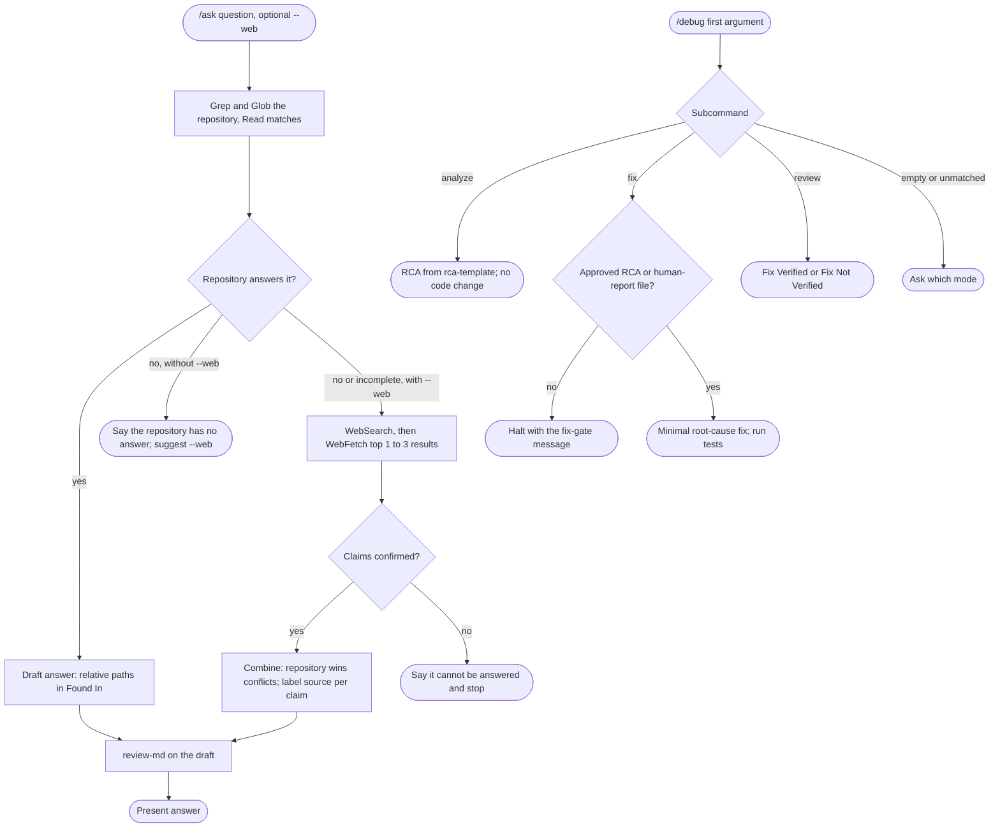

# spec-skills-ask-debug

## Metadata

| Field | Value |
|---|---|
| **Feature** | Question and diagnosis skills: `/ask` and `/debug` |
| **Parent feature** | spec-skills.md |
| **Sub-features** | None |
| **Requirement refs** | BR-010, UR-026, UR-027, FR-131, FR-132, FR-133, FR-134 |
| **Feature type** | Tooling |
| **Status** | Approved |

Status values: Draft, Review, Approved, Implemented.

Paths that start with `skills/` or `agents/` are relative to `plugins/assist-plugin/`. Baseline: assist-plugin 1.11.1 at commit 41034c1; 1.11.1 changed none of the cited `ask` and `debug` files (`CHANGELOG.md:5-23`), and the `debug` frontmatter was re-read on 2026-10-16. This spec received no delta in the 2026-10-16 pass: its behavior is unchanged, and the decided points below only replace pending notes (`spec-skills.md`, Change Log 2026-10-16, Direct edits).

## Description

`/ask` answers a question from the repository, and with `--web` also from the web, and cites every source. `/debug` diagnoses a bug with a root cause analysis (RCA), applies a fix only from an approved RCA or a human-report file, and verifies the fix. `/ask` runs `review-md` on its drafted answer before presenting it (`skills/ask/SKILL.md:40`, `:52`; FR-148, specified in `spec-skills-docs-review.md`). At 1.11.1 `skills/review-md/SKILL.md:31` also lists `debug analyze` and `debug review` as callers, though no `debug` file states the call. OP-3 is decided: FR-148 names only `ask` and `do`, and the `review-md` list drops `debug` in 1.12.0 (`spec-skills-docs-review.md`, Change Log 2026-10-16). FR-193 (PLANNED 1.12.0, `spec-skills-manifests-docs.md`) adds `effort: high` to the `debug` frontmatter to match `skills/debug/metadata.json:4`, a frontmatter change that leaves the behavior of `/debug` as specified here.

## Triggered by

| Trigger type | Source | Condition |
|---|---|---|
| User action | `/ask [--web] <question>` (`skills/ask/SKILL.md:14`) | Any question |
| User action | `/debug [analyze \| fix \| review] [description \| file:line]` (`skills/debug/SKILL.md:12`) | A bug to diagnose, fix, or verify |
| Agent task | `/do` routes a debug task to `developer` with the `debug` skill named in the prompt (`skills/do/references/agent-registry.md:39`, `:66`) | Build or fix work under `/do` (Area A FR-077) |

## Required data

| Data | Source | Type | Notes |
|---|---|---|---|
| Question text | Argument after the optional `--web` | String | Required for `/ask` |
| `--web` flag | First argument | Flag | Off by default |
| Repository files | Grep and Glob over skills, agents, docs, code | Files | Read to confirm each claim |
| Web results | WebSearch, WebFetch | Untrusted text | Only with `--web`; top 1 to 3 results confirmed |
| Subcommand `$0` | First `/debug` argument | Enum | `analyze`, `fix`, `review`; anything else asks |
| Bug input | Description, `file:line`, or an earlier error text | String | `skills/debug/references/analyze.md:29-44` |
| Approved RCA | Output of `/debug analyze` plus user confirmation | Report | Required for `fix` unless a human-report file exists |
| Human-report file | For example `human-report.md` or `.human-report` | File | Alternative input for `fix` (`skills/debug/SKILL.md:39-40`) |
| Dynamic context | `git branch --show-current`, `git log --oneline -5`, `git status --short` | Shell output | Injected when `/debug` loads (`skills/debug/SKILL.md:19-23`) |

## Behavior

### Requirement: Repository answer with cited sources

The `/ask` skill SHALL answer a question from files found with Grep and Glob, cite each source with a relative path, and say so when the repository holds no answer.

**Requirement refs:** FR-131, UR-026 | **Status:** Built | **Source:** `skills/ask/SKILL.md:30-40`, `:58-66`; `skills/ask/references/answer-format.md:7-42`

#### Scenario: Answer found

- **GIVEN** the repository documents how `debug` routes subcommands
- **WHEN** the user runs `/ask how does the debug skill route subcommands?`
- **THEN** the answer SHALL cite `plugins/assist-plugin/skills/debug/SKILL.md` with a relative path and line range under `## Found In`

#### Scenario: Answer layout

- **GIVEN** any answered question
- **WHEN** the skill presents the answer
- **THEN** the reply SHALL hold `## Answer` (2 to 3 sentences, answer first), `## Found In` (one entry per source), and `## Learn More` when related resources exist
- **AND** it SHALL hold `## Code` with the exact snippet and its `path:N-M` only when a snippet applies

#### Scenario: No answer in the repository

- **GIVEN** the repository holds no answer and `--web` is absent
- **WHEN** the user asks
- **THEN** the skill SHALL say the repository has no answer, SHALL NOT guess, and SHALL suggest `--web`

### Requirement: Web research when the repository is incomplete

The `/ask --web` skill SHOULD run the repository search first, add WebSearch results when the repository is incomplete, confirm claims with WebFetch on the top 1 to 3 results, and label which source backs each claim.

**Requirement refs:** FR-132, UR-026 | **Status:** Built | **Source:** `skills/ask/SKILL.md:42-52`, `:60-66`

#### Scenario: External question

- **GIVEN** a question about an external SDK
- **WHEN** the user runs `/ask --web`
- **THEN** each web claim SHALL cite a full URL under `## Found In`

#### Scenario: Repository and web disagree

- **GIVEN** the repository and a fetched page state different values for the same setting
- **WHEN** the skill combines them
- **THEN** the answer SHALL give the repository value priority and label each claim with its source

#### Scenario: Nothing can be confirmed

- **GIVEN** the only results sit behind a login wall or on uncorroborated forums
- **WHEN** the skill tries to confirm a claim
- **THEN** the skill SHALL NOT cite those pages
- **AND** it SHALL say plainly that the question cannot be answered and stop

### Requirement: Debug subcommand routing

The `/debug` skill SHALL route `analyze`, `fix`, and `review` to `references/analyze.md`, `references/fix.md`, and `references/review.md`, and ask which mode when the first argument is empty or unmatched.

**Requirement refs:** FR-133, UR-027 | **Status:** Built | **Source:** `skills/debug/SKILL.md:25-33`

#### Scenario: Analyze routed

- **GIVEN** `/debug analyze src/components/Button.tsx:42`
- **WHEN** the skill parses `$0`
- **THEN** it SHALL follow `references/analyze.md`

#### Scenario: No subcommand

- **GIVEN** `/debug` with no argument, or `/debug investigate`
- **WHEN** the skill parses `$0`
- **THEN** it SHALL ask which mode to run and SHALL NOT start any of the three

### Requirement: Fix gate

The `/debug fix` subcommand SHALL refuse to run unless an approved RCA or a human-report file exists.

**Requirement refs:** FR-133, UR-027 | **Status:** Built | **Source:** `skills/debug/SKILL.md:35-43`; `skills/debug/references/fix.md:5-13`

#### Scenario: Fix without RCA

- **GIVEN** no approved RCA and no human-report file
- **WHEN** the user runs `/debug fix`
- **THEN** the skill SHALL halt with "Fix requires an approved RCA (`/debug analyze` first) or human-report file."
- **AND** it SHALL change no file

#### Scenario: Fix from a human report

- **GIVEN** a `human-report.md` that describes the bug and the expected fix
- **WHEN** the user runs `/debug fix`
- **THEN** the skill SHALL proceed to the fix workflow

### Requirement: Analyze is read-only

The `/debug analyze` subcommand SHALL produce an RCA report from `references/rca-template.md` and change no code.

**Requirement refs:** FR-134, UR-027 | **Status:** Built | **Source:** `skills/debug/SKILL.md:58-64`; `skills/debug/references/analyze.md:5-66`; `skills/debug/references/rca-template.md:7-65`

#### Scenario: RCA written

- **GIVEN** a bug description
- **WHEN** the user runs `/debug analyze`
- **THEN** the report SHALL hold What Happened (root cause, code location, observed and expected behavior, evidence, reproduction steps), Why It Matters (impact, affected components), What To Do Next (suggested fix, risk level), and an Approval checklist
- **AND** `git status --short` SHALL show no change made by the skill

#### Scenario: Root cause in a dependency

- **GIVEN** the root cause is in a third-party dependency
- **WHEN** the skill reports
- **THEN** the RCA SHALL name the dependency as the root cause and the skill SHALL NOT patch it

#### Scenario: Cause cannot be found

- **GIVEN** the bug does not reproduce and the evidence does not isolate a cause
- **WHEN** the skill escalates
- **THEN** it SHALL ask the user for logs or steps, or report "Unable to determine cause; need more context"

### Requirement: Fix scope and validation

The `/debug fix` subcommand SHALL make the minimal change that removes the root cause, with no broad try/catch and no error suppression, and then rerun the reproduction steps and the existing tests.

**Requirement refs:** FR-133, UR-027 | **Status:** Built | **Source:** `skills/debug/references/fix.md:15-53`; `skills/debug/SKILL.md:58-64`

#### Scenario: Targeted fix

- **GIVEN** an approved RCA that locates a missing null check at `src/user.ts:57`
- **WHEN** the skill applies the fix
- **THEN** the change SHALL touch only files involved in the root cause
- **AND** the skill SHALL run the reproduction steps and the existing tests before it returns

#### Scenario: Fix would only hide the error

- **GIVEN** the only change that silences the failure wraps the call in a catch-all
- **WHEN** the skill judges the fix
- **THEN** it SHALL reject that fix and return to `analyze` or ask for a refined human report

### Requirement: Fix review verdict

The `/debug review` subcommand SHALL end with `✓ Fix Verified` and its four checks, or `✗ Fix Not Verified` with a numbered issue list.

**Requirement refs:** FR-133, UR-027 | **Status:** Built | **Source:** `skills/debug/references/review.md:13-65`

#### Scenario: Fix holds

- **GIVEN** the reproduction steps no longer trigger the bug and all tests pass
- **WHEN** the review finishes
- **THEN** the verdict SHALL read `✓ Fix Verified` followed by the bug-fixed, tests-pass, no-side-effects, and code-quality lines

#### Scenario: Regression found

- **GIVEN** an existing test fails after the fix
- **WHEN** the review finishes
- **THEN** the verdict SHALL read `✗ Fix Not Verified` with the failing test listed
- **AND** the work SHALL return to the developer for a new fix and another review

## Algorithmic steps

**`/ask` (repository only):**

1. Search the repository with Grep and Glob for skills, agents, docs, and code that match the question.
2. Read the matches to confirm the answer.
3. Answer from the repository only, in the answer-format layout; if nothing answers it, say so and suggest `--web`.
4. Run `review-md` on the draft (FR-148), then present it.

**`/ask --web`:**

1. Run the repository search first.
2. When the repository is incomplete or the question concerns external tools or general knowledge, run WebSearch.
3. Confirm claims with WebFetch on the top 1 to 3 results.
4. Combine repository and web findings; the repository wins a conflict; label the source of each claim.
5. Run `review-md` on the draft, then present it.

**`/debug analyze`:** gather context and reproduce; trace the code path and bisect, one hypothesis at a time; document the bug, root cause, cause chain, and reproduction; write the RCA from the template for the user to approve.

**`/debug fix`:** check the gate; confirm the RCA; make the minimal change; rerun the reproduction steps and the tests; check side effects.

**`/debug review`:** read the RCA; review the change; run tests; reproduce the original bug; check side effects; return the verdict, and loop through fix and review until verified.

Render source: `specs/spec-skills-ask-debug.mmd`. Rendering skipped: see the note in `spec-skills.md`.

## Output / Outcome

| Output | Type | Description |
|---|---|---|
| `/ask` answer | Chat report | `## Answer`, `## Found In`, optional `## Code`, optional `## Learn More`; relative repo paths, full URLs for web sources |
| RCA report | Chat report | The `rca-template.md` sections; approved by the user before `fix` |
| Fix | Source edits | Minimal change in the files the root cause involves |
| Review verdict | Chat report | `✓ Fix Verified` or `✗ Fix Not Verified` with issues |

## Error handling

| Error condition | Handling strategy | Outcome |
|---|---|---|
| Repository holds no answer | Say so; no guess | The user sees the gap and the `--web` suggestion |
| Web page unverifiable or behind a login | Not cited | Only confirmed sources appear in Found In |
| No source answers the question | Say so plainly and stop | No fabricated answer |
| Empty or unknown `/debug` subcommand | Ask which mode | Nothing runs until the user picks |
| `fix` without approved RCA or human report | Halt with the fixed message | No file changes |
| Bug cannot be reproduced | Ask for logs or steps, or report "Unable to determine cause; need more context" | RCA marked incomplete |
| Root cause in a dependency | Report it | Dependency untouched |
| Fix only hides the error | Reject the fix | Return to `analyze` or refine the human report |
| Fix breaks a test | `✗ Fix Not Verified` | Another fix and review cycle |

## Events emitted (if applicable)

Not applicable: both skills reply in chat and emit no events.

## Dependencies

| Dependency | Type | Required | Notes |
|---|---|---|---|
| `ask` tool grants | Runtime | yes | Read, Grep, Glob, WebSearch, WebFetch (`skills/ask/SKILL.md:8-13`); no write tool |
| `debug` tool grants | Runtime | yes | Read, Grep, Glob, Bash, LSP (`skills/debug/SKILL.md:6-11`). No Write or Edit grant, so Write and Edit calls during `fix` prompt in a direct run; Bash is unscoped, so a Bash command runs without a prompt, including one that writes a file. That Bash grant is an accepted NFR-013 exception (OP-6 decided; `spec-skills.md` Change Log 2026-10-16) |
| `review-md` | Runtime | no | Checks the drafted report (FR-148; `spec-skills-docs-review.md`); `ask` names the step at `skills/ask/SKILL.md:40`, `:52` |
| `developer` agent | Runtime | no | Applies `debug` under `/do` (Area A FR-077) |
| `injection-filter` hook | Runtime | no (fail open) | Filters WebFetch and WebSearch results (Area B FR-099) |

## Sub-feature breakdown (if applicable)

Not applicable: this spec has no sub-features.

## Submodule scope (if applicable)

Not applicable: the repository has no submodules.

## Traceability

| Requirement | Spec section | Verified by |
|---|---|---|
| FR-131 | Requirement: Repository answer with cited sources | Manual run of `/ask` with an answerable and an unanswerable question; layout check against `answer-format.md` |
| FR-132 | Requirement: Web research when the repository is incomplete | Manual run of `/ask --web` on an external SDK question; conflict case with a repository value |
| FR-133 | Requirement: Debug subcommand routing; Requirement: Fix gate; Requirement: Fix scope and validation; Requirement: Fix review verdict | Manual runs of `/debug`, `/debug fix` without and with an RCA, `/debug review` after a fix |
| FR-134 | Requirement: Analyze is read-only | `/debug analyze` run followed by `git status --short` showing no skill change |
| UR-026 | Requirements on `/ask` | As for FR-131, FR-132 |
| UR-027 | Requirements on `/debug` | As for FR-133, FR-134 |
| BR-010 | All requirements | Acceptance of the scenarios above |
