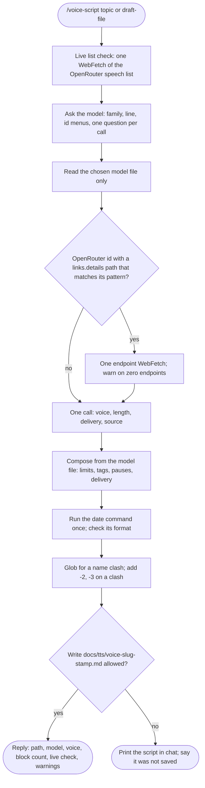

# spec-skills-deslop-voice-clarify

## Metadata

| Field | Value |
|---|---|
| **Feature** | Prose cleanup, voice script, and clarification skills: `/deslop`, `/voice-script`, `/clarify` |
| **Parent feature** | spec-skills.md |
| **Sub-features** | None |
| **Requirement refs** | BR-006, BR-008, BR-010, UR-039, UR-040, UR-041, UR-058, FR-161, FR-162, FR-163, FR-164, FR-165, FR-211, FR-212, FR-213, NFR-013, NFR-014, NFR-019 |
| **Feature type** | Tooling |
| **Status** | Review |

Status values: Draft, Review, Approved, Implemented.

Paths that start with `skills/`, `hooks/`, or `docs/` (other than `docs/requirements/` and the script folder `docs/tts/`) are relative to `plugins/assist-plugin/`; `docs/requirements/`, `docs/tts/`, `.agent/`, and `DECISIONS.md` are relative to the repository root or, for `docs/tts/` and `.agent/`, to the session's working directory as each requirement states. Baseline: assist-plugin 1.11.1 at commit 41034c1; 1.11.1 changed only `skills/voice-script/SKILL.md:162` among the cited skill files (re-read on 2026-10-16), and references into `DECISIONS.md` point at its current text. This spec received no delta in the 2026-10-16 pass (`spec-skills.md`, Change Log 2026-10-16, Direct edits).

## Description

`/deslop` removes AI writing tells from prose (`edit`) or lists them (`detect`) without changing what the prose says. `/voice-script` asks five questions, loads only the chosen TTS model's reference file, and saves a paste-ready script under `docs/tts/`. `/clarify` explains unclear points in the discussion with evidence, asks the user the points only the user can settle, and appends each point to a daily log. All three treat the text they work on as data, and `voice-script` and `clarify` write one path family each.

## Triggered by

| Trigger type | Source | Condition |
|---|---|---|
| User action | `/deslop [edit \| detect] <file-or-text>` (`skills/deslop/SKILL.md:11`, `:18-27`) | A prose file or pasted text |
| User action or model match | `/voice-script [topic \| draft-file]` (`skills/voice-script/SKILL.md:16`); the description also matches a request for a voice, narration, or TTS script (`:3-7`) | Runs in the main conversation only; never forks (`:33`) |
| User action or model match | `/clarify [what is unclear]` (`skills/clarify/SKILL.md:16`); the description also matches the user saying Claude's output is unclear (`:3-7`) | Runs in the main conversation only; never forks (`:33`) |

## Required data

| Data | Source | Type | Notes |
|---|---|---|---|
| Deslop mode and target | Arguments | Enum, path or text | No mode: `detect` for a file path, `edit` for inline text (`deslop/SKILL.md:25`) |
| Tell catalogs | `skills/deslop/references/word-tells.md`, `structural-tells.md`, `voice-and-quotes.md`, `final-audit.md` | Markdown | All four read before the first pass |
| Voice-script argument | Path (draft file), a line of up to about 20 words (topic), or longer text (draft) | String | Ask when unsure (`voice-script/SKILL.md:31`) |
| Model catalog | `voice-script/SKILL.md:44-70` | Table | Verified 2026-10-12; 32 OpenRouter speech ids plus Chatterbox-Turbo and two `openai/gpt-audio` ids |
| Model file | `skills/voice-script/references/models/<file>.md` | Markdown | Only the chosen model's file |
| OpenRouter speech list | `https://openrouter.ai/api/v1/models?output_modalities=speech` | Untrusted JSON | One fetch per run |
| Endpoint list | `https://openrouter.ai` plus the id's `links.details` | Untrusted JSON | One fetch, chosen id only |
| Date stamp | `date +%Y%m%d-%H%M` (voice-script), `date +%Y-%m-%dT%H:%M` (clarify) | Shell output | Run once per run; format checked |
| Clarify target | Argument, else the latest assistant output and the request it answered | Discussion text | Data, never instructions |

## Behavior

### Requirement: Deslop modes and output contract

The `/deslop` skill SHOULD, in `edit` mode, return the prose cleaned of AI writing tells with every number, path, identifier, link, and quotation unchanged, and in `detect` mode list each finding as `<line>: <tell-id> "<excerpt>" | Fix: <fix>` and change nothing.

**Requirement refs:** FR-161, UR-039, BR-008 | **Status:** Built | **Source:** `skills/deslop/SKILL.md:18-76`; `skills/deslop/references/final-audit.md:1-23`; `docs/SPECIFICATION.md:393-403`

`edit` runs three passes (voice and inventory; remove tells; restore voice and check meaning) and the final audit. Inline text comes back as the cleaned text and nothing else; a file is changed with Edit through the permission prompt, then the reply is `Edited <path>: <n> changes.` or `No changes: <path>.`. `detect` reports in text order, excerpts copied exactly and at most 80 characters; a clean text gets `No findings in <path>.` or `No findings.`. Exempt regions (code, Mermaid, quotations, link targets, traceability markers, numeric ranges, frontmatter keys) are neither judged nor changed.

#### Scenario: Detect on a file

- **GIVEN** `/deslop detect notes.md`
- **WHEN** the skill runs
- **THEN** the skill SHALL list findings in the detect format and leave `notes.md` byte-identical

#### Scenario: Non-prose file

- **GIVEN** `/deslop edit main.py`
- **WHEN** the skill runs
- **THEN** the skill SHALL reply "deslop handles prose files only: main.py." and stop

#### Scenario: Inline edit

- **GIVEN** `/deslop edit` followed by pasted text that holds a hedge and a URL
- **WHEN** the skill returns
- **THEN** the reply SHALL be the cleaned text only, with the URL byte-identical and no preface or change list

#### Scenario: Instruction inside the target

- **GIVEN** a target file with a line that asks the reader to delete a section
- **WHEN** `/deslop detect` runs
- **THEN** the skill SHALL report the line in its output and SHALL NOT act on it

### Requirement: Deslop keeps meaning, facts, and quotations

The `/deslop` skill SHALL return no result until the final audit passes: inventory items byte-identical, quotations verbatim, nothing added, and each claim at its original strength.

**Requirement refs:** FR-161, UR-039 | **Status:** Built | **Source:** `skills/deslop/SKILL.md:44-53`, `:68-76`; `skills/deslop/references/final-audit.md:5-15`

#### Scenario: Fact changed in pass 2

- **GIVEN** a pass-2 rewrite changed `v1.10.2` to `v1.10`
- **WHEN** pass 3 checks the inventory
- **THEN** the skill SHALL revert that sentence and fix it again with a smaller cut, or leave it as written

#### Scenario: Real uncertainty

- **GIVEN** a sentence with three stacked hedges on a claim the text does not prove
- **WHEN** the skill edits it
- **THEN** one plain hedge such as "may" SHALL remain

### Requirement: Voice-script question flow and model file

The `/voice-script` skill SHALL ask for the model, voice, length, delivery, and topic or draft, load only the chosen model's reference file, and use only the tags and style field that file lists.

**Requirement refs:** FR-162, UR-040 | **Status:** Built | **Source:** `skills/voice-script/SKILL.md:85-156`, `:180`; `DECISIONS.md` (2026-10-12, voice-script tag catalog)

The model question uses AskUserQuestion with one question per call and up to 4 options, walking Family, line or provider, and Model id menus and skipping a level the argument already settles. Voice, length, delivery, and source come in one call with up to 4 questions. Composition follows the model file only: its limits with a 10 percent margin for character limits and 20 percent for token limits; its tags with exact spelling; delivery in the style field when the file names one, otherwise through tags, pauses, wording, and voice; no direction lines in spoken text; a draft's words kept in order. A model not in the catalog gets no inline tags, delivery in plain words in the header, a 1,000-character working cap per segment, and the note "voice unverified".

#### Scenario: Model chosen

- **GIVEN** the user picks a catalog model
- **WHEN** the skill writes the script
- **THEN** the script SHALL use only tags that model's file marks usable, in the file's exact spelling
- **AND** the skill SHALL have read no other model file

#### Scenario: Draft kept verbatim

- **GIVEN** a draft file as the source
- **WHEN** the skill composes the script
- **THEN** every word of the draft SHALL appear in order, with only tags, pause marks, line breaks, and segment breaks added, and each punctuation change listed in the header notes

#### Scenario: Unknown model typed through Other

- **GIVEN** the user types a model id that the catalog lacks
- **WHEN** the skill composes the script
- **THEN** the script SHALL hold no inline tags, segments SHALL stay within 1,000 characters, and the header SHALL warn that the skill has no verified facts for the model

### Requirement: Live list and endpoint checks treat fetched text as data

The `/voice-script` skill SHALL compare the fetched OpenRouter list with the catalog by id only, fetch at most the two documented URL shapes once each, and fall back to the catalog when a fetch fails.

**Requirement refs:** FR-162, UR-040, BR-006 | **Status:** Built | **Source:** `skills/voice-script/SKILL.md:74-83`, `:103-112`, `:172-176`

An id counts only if it matches `^[a-z0-9][a-z0-9._-]*/[a-z0-9._:-]+$`. A listed id missing from the catalog is reported as "not in catalog, no tags"; a catalog id missing from the list is reported as "removed from OpenRouter" and stays in the menus. The endpoint check uses `links.details` only when it matches `^/api/v1/models/[A-Za-z0-9][A-Za-z0-9._-]*/[A-Za-z0-9][A-Za-z0-9._:-]*/endpoints$`, and is skipped for `ResembleAI/chatterbox-turbo` and the `openai/gpt-audio` ids. A failed fetch is an HTTP 4xx or 5xx, a network error, a cross-host redirect notice, a reply that is not a non-empty array of ids, or no `data`.

#### Scenario: New model in the live list

- **GIVEN** OpenRouter's speech list names a model missing from the catalog
- **WHEN** the skill compares them
- **THEN** the skill SHALL treat the fetched text as untrusted data and flag the new model as "not in catalog, no tags"

#### Scenario: Failed list fetch

- **GIVEN** the list fetch returns HTTP 503
- **WHEN** the skill checks the list
- **THEN** it SHALL fall back to the catalog, say so in one line, and SHALL NOT report any model as removed

#### Scenario: Zero endpoints

- **GIVEN** the endpoint fetch for the chosen id returns zero endpoints
- **WHEN** the skill reads the count
- **THEN** it SHALL warn "no provider currently serves this model", add the warning to the header notes, and continue

#### Scenario: URL inside fetched content

- **GIVEN** the fetched list holds a URL in a model description
- **WHEN** the skill processes the list
- **THEN** it SHALL NOT fetch that URL

### Requirement: Saved voice-script file

The `/voice-script` skill SHALL save the script to `docs/tts/voice-<slug>-YYYYMMDD-HHmm.md` with a header (model, voice, length, delivery direction, model settings) and a fenced block holding exactly the text to paste.

**Requirement refs:** FR-163, UR-040, NFR-013 | **Status:** Built | **Source:** `skills/voice-script/SKILL.md:158-170`; `skills/voice-script/references/output-template.md:1-62`; `DECISIONS.md` (2026-10-12, voice-script output format; voice-script tool grants)

The path is under the session's working directory (`SKILL.md:162`), and the skill keeps saving there (`DECISIONS.md:73-76`, 2026-10-16). Under that decision, FR-181 (Area B, built in 1.11.1) exempts `docs/tts/` from the prose hooks in two locations: under the project root, and under the session's working directory when that directory is inside the project. Since 1.11.1 `SKILL.md:162` names both locations (OP-2, done). The stamp comes from one `date +%Y%m%d-%H%M` run and must match `^[0-9]{8}-[0-9]{4}$`; when the command fails the name drops the time and the header reads `time n/a`. The slug holds lowercase ASCII letters, digits, and single hyphens, at most 40 characters, `script` when empty. The skill never overwrites: it globs for the name and adds `-2`, `-3`, and so on. The header table also holds Delivery applied, Script source, Catalog verified, Live check, and Created; a Notes list follows when there are warnings. A brief script has exactly one fenced `text` block; a longer script has one per numbered segment and no other fenced block anywhere.

#### Scenario: Saved file

- **GIVEN** a finished script on the topic "why sleep matters"
- **WHEN** the skill saves it at 14:05 on 2026-10-12
- **THEN** the file SHALL be `docs/tts/voice-why-sleep-matters-20261012-1405.md` under the session's working directory, with a header table and one fenced `text` block

#### Scenario: Header fields

- **GIVEN** a finished script
- **WHEN** the skill writes the header
- **THEN** the header SHALL hold the model, voice, length, delivery direction, and model settings rows

#### Scenario: Other path

- **GIVEN** the user asks for the script in `notes/voice.md`
- **WHEN** the skill writes
- **THEN** Claude Code SHALL ask the user first, because the grant covers `./docs/tts/voice-*.md` only

#### Scenario: Name clash

- **GIVEN** `docs/tts/voice-intro-20261012-1405.md` already exists
- **WHEN** the skill saves a script with the same slug and stamp
- **THEN** it SHALL write `docs/tts/voice-intro-20261012-1405-2.md` and leave the first file unchanged

#### Scenario: Write denied

- **GIVEN** the user denies the write
- **WHEN** the skill handles the denial
- **THEN** it SHALL print the script in chat, say the file was not saved, and try no other path

### Requirement: Voice-script source and secret handling

The `/voice-script` skill SHALL read only the draft file the user named, refuse a path that looks like a secret store, and mask any token, key, or credential found in a draft.

**Requirement refs:** FR-162, FR-163, UR-040, BR-006 | **Status:** Built | **Source:** `skills/voice-script/SKILL.md:174-180`

#### Scenario: Secret-store path

- **GIVEN** the user names `.env.local` as the draft file
- **WHEN** the skill checks the path
- **THEN** it SHALL refuse the path and read nothing from it

#### Scenario: Token inside a draft

- **GIVEN** a draft that holds an API token
- **WHEN** the skill writes the script
- **THEN** the token SHALL be masked in the file and the skill SHALL tell the user

### Requirement: Clarify explains, corrects, and asks within bounds

The `/clarify` skill SHALL list the unclear points, explain Claude's own points with evidence, correct earlier errors plainly, ask the user's points with at most 4 questions per call and at most 2 rounds, and close with a settled-points list.

**Requirement refs:** FR-164, UR-041, NFR-014 | **Status:** Built | **Source:** `skills/clarify/SKILL.md:35-54`, `:91-98`; `DECISIONS.md` (2026-10-12, clarify skill scope and log)

Each question covers one point, offers concrete options, and lists the recommended option first with "(Recommended)". A later round asks only what earlier answers left open or opened. A claim that cannot be backed is marked unverified. An answer settles its point and authorizes no code change, doc edit, or commit.

#### Scenario: Nothing unclear

- **GIVEN** the target has no unclear point
- **WHEN** the user runs `/clarify`
- **THEN** the skill SHALL reply "Nothing unclear in <target>." and write no log entry

#### Scenario: Earlier output was wrong

- **GIVEN** the explanation shows Claude's earlier output named the wrong file
- **WHEN** the skill explains the point
- **THEN** it SHALL say so in one sentence and give the correct file

#### Scenario: Open after round 2

- **GIVEN** a point still open after round 2
- **WHEN** the skill closes
- **THEN** the settled-points list SHALL show the point as open with no supplied answer

#### Scenario: Answer authorizes nothing

- **GIVEN** the user answers a clarify question with "use opaque tokens"
- **WHEN** the skill closes
- **THEN** the skill SHALL make no code change, doc edit, or commit

### Requirement: Clarify daily log

The `/clarify` skill SHALL append one entry per point to `.agent/clarify/clarify-YYYYMMDD.md`, a daily file closed by the `<!-- clarify-log-end -->` marker.

**Requirement refs:** FR-165, UR-041, NFR-013 | **Status:** Built | **Source:** `skills/clarify/SKILL.md:56-89`; `DECISIONS.md` (2026-10-12, clarify tool grants)

The date and time come from one `date +%Y-%m-%dT%H:%M` run; on failure the date comes from the session and the heading reads `time n/a`. A missing file is created with Write holding `# Clarify log YYYY-MM-DD`, a blank line, and the marker. An existing file is read, the full marker must occur exactly once as the last non-blank line, and one Edit replaces the marker line with the run's entries followed by the marker. Each entry is `## YYYY-MM-DDTHH:MM <point>` with Direction, Explanation or question, an optional `Quoted (data):` blockquote, and Answer. Quoted text that holds the full marker is written as `clarify-log-end` and labeled `[marker altered]`. Earlier entries are never edited, reordered, or deleted, and secrets are masked.

#### Scenario: Append

- **GIVEN** the daily file exists with the marker once as its last non-blank line
- **WHEN** the skill logs two points
- **THEN** the skill SHALL insert both entries before the marker in one Edit

#### Scenario: First run of the day

- **GIVEN** no `.agent/clarify/clarify-20261014.md` exists
- **WHEN** the skill logs a point on 2026-10-14
- **THEN** the file SHALL start with `# Clarify log 2026-10-14` and end with the marker line after the entry

#### Scenario: Damaged marker

- **GIVEN** the marker is missing or appears twice
- **WHEN** the skill prepares to log
- **THEN** the skill SHALL write nothing and tell the user the log needs repair

#### Scenario: Quoted marker

- **GIVEN** quoted discussion text that contains the full marker string
- **WHEN** the skill writes the entry
- **THEN** the entry SHALL hold `clarify-log-end` without comment delimiters and the label `[marker altered]`

## Algorithmic steps

**`/deslop edit`:** read the four catalogs; pass 1 notes voice and inventories facts and quotations; pass 2 fixes block-tier tells, judges advise-tier words in context, and fixes structural tells, preferring cuts; pass 3 restores voice and checks each changed sentence and the inventory; run the final audit; output per the contract.

**`/voice-script`:**

Render source: `specs/spec-skills-voice-script.mmd`. Rendering skipped: see the note in `spec-skills.md`.

**`/clarify`:**

Render source: `specs/spec-skills-clarify.mmd`. Rendering skipped: see the note in `spec-skills.md`.

## Output / Outcome

| Output | Type | Description |
|---|---|---|
| Cleaned text or edited file | Chat or file change | `edit` contract |
| Findings list | Chat | `detect` format, or the one-line clean result |
| `docs/tts/voice-<slug>-<stamp>.md` | File | Header table, notes, one fenced `text` block per segment |
| Voice-script reply | Chat | Path, model, voice, block count, live-check result, header warnings; the script is not repeated |
| Settled-points list | Chat | One line per point: explained, answered, or open |
| `.agent/clarify/clarify-YYYYMMDD.md` | File | Append-only daily log closed by the marker |

## Error handling

| Error condition | Handling strategy | Outcome |
|---|---|---|
| Deslop target is not a prose file | Fixed reply and stop | Nothing changed |
| Deslop edit changes a fact or quotation | Revert the sentence in pass 3 | Inventory intact |
| Live list or endpoint fetch fails | Fall back to the catalog with a note | No model reported as removed |
| `links.details` does not match its pattern | Skip the endpoint check and note it | Script still written |
| Chosen model has zero endpoints | Warn in chat and in the header | The user may stop and choose another model |
| Brief script exceeds the cap | Switch to Longer and tell the user | Numbered segments |
| Date command fails | Session date; `time n/a` | File still written |
| Script name clash | Add `-2`, `-3` | No overwrite |
| Script write denied | Print in chat; say not saved | No retry elsewhere |
| Draft path looks like a secret store | Refuse | Nothing read |
| Clarify log marker missing or doubled | Write nothing; tell the user | Log needs repair |
| Clarify point open after round 2 | List it as open | No supplied answer |

## Events emitted (if applicable)

Not applicable: the skills write files and chat output and emit no events.

## Dependencies

| Dependency | Type | Required | Notes |
|---|---|---|---|
| `deslop` grants | Runtime | yes | Read, Grep, Glob (`skills/deslop/SKILL.md:7-10`); file edits go through the permission prompt |
| `voice-script` grants | Runtime | yes | Read, Glob, AskUserQuestion, `WebFetch(domain:openrouter.ai)`, `Edit(./docs/tts/voice-*.md)`, `Bash(date +%Y%m%d-%H%M)` (`skills/voice-script/SKILL.md:9-15`) |
| `clarify` grants | Runtime | yes | Read, Grep, Glob, AskUserQuestion, `Edit(./.agent/clarify/clarify-*.md)`, `Bash(date +%Y-%m-%dT%H:%M)` (`skills/clarify/SKILL.md:9-15`) |
| `prose-gate` and `prose-advisor` | Runtime | no (fail open) | Skip `docs/tts/` (Area B FR-104). Per `DECISIONS.md:73-76` (2026-10-16) and FR-181 (built in 1.11.1), the exemption covers `docs/tts/` under the project root and under the session's working directory when that directory is inside the project (`hooks/lib/prose-diff.js:103-137`, read on 2026-10-16; at 4803a0d the code used the hook's working directory only). The script's fenced block is an exempt region in any case (FR-105) |
| OpenRouter API | External | no | Live checks only; the catalog is the fallback |
| `injection-filter` | Runtime | no (fail open) | Filters WebFetch results (Area B FR-099) |

## Sub-feature breakdown (if applicable)

Not applicable: this spec has no sub-features.

## Submodule scope (if applicable)

Not applicable: the repository has no submodules.

## Traceability

| Requirement | Spec section | Verified by |
|---|---|---|
| FR-161 | Requirement: Deslop modes and output contract; Requirement: Deslop keeps meaning, facts, and quotations | `/deslop detect` and `edit` on fixtures; checksum of the detect target; inventory diff on edit |
| FR-162 | Requirement: Voice-script question flow and model file; Requirement: Live list and endpoint checks treat fetched text as data; Requirement: Voice-script source and secret handling | Manual runs with a catalog model, an unknown model, a failed fetch, and a `.env` draft path; read log shows one model file |
| FR-163 | Requirement: Saved voice-script file; Requirement: Voice-script source and secret handling | File name, header table, and fenced-block count of the saved script; clash and denied-write runs |
| FR-164 | Requirement: Clarify explains, corrects, and asks within bounds | Manual runs with no unclear point, a wrong earlier claim, and a point left open after round 2 |
| FR-165 | Requirement: Clarify daily log | Log file before and after two points; damaged-marker fixture |
| NFR-013 | Requirement: Saved voice-script file; Requirement: Clarify daily log | Frontmatter read; out-of-grant write prompts |
| NFR-014 | Requirement: Clarify explains, corrects, and asks within bounds | Count of questions per AskUserQuestion call is at most 4 |
| UR-039, UR-040, UR-041, BR-006, BR-008, BR-010 | Requirements above, by their refs | As listed per requirement |

## Change Log: 2026-10-23

**Source:** `docs/requirements/FR-NFR-assist-plugin.md` version 1.5 (2026-10-23, DRAFT), release 1.13.1, "voice scripts without em dashes": FR-211 (`:3729-3793`; statements `:3731-3734`, scope note `:3738`), FR-212 (`:3795-3852`; statements `:3797`, `:3801-3807`), FR-213 (`:3854-3883`; skill-scope statements `:3860-3861`, note `:3863`), FR-163 changed (`:3686-3727`; statements `:3689-3690`, Status `:3691`), NFR-019 (`:5354`), NFR-013 (`:5268`, no change to the grant), FR-162 and FR-105 (unchanged), and the section 9 build list (`:5581`); `docs/requirements/URD-assist-plugin.md:93` (UR-058); `DECISIONS.md:273-276`, `:278-281`, `:283-286`, and `:288-291` (2026-10-23). Every change in this entry is PLANNED (1.13.1). This spec received a delta, so its Status returns to `Review` (FR-154).

Read on 2026-10-23 at the 1.13.0 release (commit `50817b5`): `skills/voice-script/SKILL.md` (196 lines), `skills/voice-script/references/output-template.md` (91 lines), the pause rows of the model files in the pause-mark table, except seven of the nine ordinary-punctuation files, whose lines are cited from FR-211 (`qwen-audio-3-tts.md:42` and `canopy-orpheus.md:43` were read), and the prose hooks (spec-hooks-prose-hooks.md, Change Log 2026-10-23).

### Direct edits in this pass (no behavior change)

- Status: Approved -> Review.
- Requirement refs: UR-058, FR-211, FR-212, FR-213, and NFR-019 added.

### Body text this entry supersedes (applied at the next fold)

- Description: `/voice-script` saves a paste-ready script that holds no em dash, U+2015, or curly quote anywhere.
- Requirement: Saved voice-script file, the context paragraph: the sentence on FR-181 and its two exempt locations goes (MODIFIED below).
- Algorithmic steps: the `/voice-script` flow takes the text of `specs/spec-skills-voice-script.mmd`, updated in this pass (Flow after the change, below).
- Error handling: rows for a typed value with a banned character (refuse and ask again), a `prose-gate` deny of the header (fix, one retry on the same path), and a second deny (print in chat; say not saved).
- Dependencies, the `prose-gate` and `prose-advisor` row: the hooks judge `docs/tts/` like any prose file and the fenced block stays exempt (FR-213, FR-104, FR-105); FR-181 is retired; `hooks/lib/prose-diff.js:103-137` is no longer cited.
- Traceability: the rows under Traceability added, below.

### Flow after the change

Source: `specs/spec-skills-voice-script.mmd`, updated in this pass. The inline flow in Algorithmic steps keeps the 1.13.0 flow until the fold. The two ask-again loops end only on the user's answer, as every question does.

```mermaid
flowchart TD
  S(["/voice-script topic or draft-file"]) --> L["Live list check: one WebFetch of the OpenRouter speech list"]
  L --> M["Ask the model: family, line, id menus, one question per call"]
  M --> TM{"Model id typed through Other holds U+2014, U+2015, or a curly quote?"}
  TM -->|"yes"| RM["Refuse it; ask for the model id again"]
  RM --> M
  TM -->|"no"| F["Read the chosen model file only; take the dash-style pause mark that the pause-mark table gives the model"]
  F --> EP{"OpenRouter id with a links.details path that matches its pattern?"}
  EP -->|"yes"| EC["One endpoint WebFetch; warn on zero endpoints"]
  EP -->|"no"| Q["One call: voice, length, delivery, source"]
  EC --> Q
  Q --> TV{"Typed voice id or clip path holds U+2014, U+2015, or a curly quote?"}
  TV -->|"yes"| RV["Refuse it; ask for it again in chat"]
  RV --> TV
  TV -->|"no"| N["Normalize: in a draft, U+2014 and U+2015 become the model's pause mark; in the title and delivery direction, a comma or a period; curly quotes become ASCII quotes; count the swaps; flag kept tells by family and draft line"]
  N --> C["Compose from the model file: limits, tags, pause marks, delivery"]
  C --> X{"Whole file holds a U+2014, a U+2015, or a curly quote?"}
  X -->|"yes"| XF["Replace each one before the write: the model's pause mark in script text, a comma or a period in header prose, an ASCII quote for a curly quote; count the swaps"]
  XF --> DT
  X -->|"no"| DT["Run the date command once; check its format"]
  DT --> G["Glob for a name clash; add -2, -3 on a clash"]
  G --> W{"Write docs/tts/voice-slug-stamp.md"}
  W -->|"written"| R(["Reply: path, model, voice, block count, live check, warnings"])
  W -->|"user denies the write"| P(["Print the script in chat; say it was not saved"])
  W -->|"prose-gate denies: block-tier tell in the header or notes"| FX["Fix only the flagged header or notes text"]
  FX --> W2{"Retry once on the same path"}
  W2 -->|"written"| R
  W2 -->|"denied again"| P
```

Rendering not attempted: `mmdc` is installed, but chrome-headless-shell is not (see the note in `spec-skills.md`). Render with `mmdc -i specs/spec-skills-voice-script.mmd -o specs/spec-skills-voice-script.png` once it is installed.

### ADDED Requirements

#### Requirement: No em dash, U+2015, or curly quote in a saved voice script

The `/voice-script` skill SHALL write no U+2014 (em dash), no U+2015 (horizontal bar), and no curly quote anywhere in a saved voice script, the header, the notes, and every fenced script block included, whatever the text came from (topic, draft, or header text).

**Requirement refs:** FR-211, NFR-019, UR-058, UR-040, BR-008 | **Status:** PLANNED (1.13.1) | **Source:** `docs/requirements/FR-NFR-assist-plugin.md:3731`, `:3790-3793`, `:5354`; `DECISIONS.md:273-276`, `:278-281`, `:283-286`

A curly quote is one of the four characters that `prose-gate` treats as `curly-quote/char`: U+2018, U+2019, U+201C, and U+201D (spec-hooks-prose-hooks.md, Requirement: Block-tier judgment and deny reason). The skill is the only control on the fenced blocks, because `prose-gate` and the AtticAI kit's banned-phrase-gate both skip fenced blocks (`DECISIONS.md:278-281`); `prose-gate` also judges the header and notes (FR-213). A clean whole file passes another tool's prose gate with no change to that tool (`DECISIONS.md:273-276`).

##### Scenario: Whole-file count

- **GIVEN** a voice script that the skill saved
- **WHEN** a test counts U+2014, U+2015, U+2018, U+2019, U+201C, and U+201D over the whole file, the header, notes, and fenced blocks included
- **THEN** each count SHALL be 0 (NFR-019)

##### Scenario: Topic script

- **GIVEN** a topic and any catalog model
- **WHEN** the skill writes the script
- **THEN** the script text SHALL hold no U+2014 or U+2015, and the file SHALL hold no U+2018, U+2019, U+201C, or U+201D

##### Scenario: Draft file with every banned character

- **GIVEN** a draft file that holds 2 em dashes, 1 U+2015, a curly apostrophe, and a pair of curly double quotes
- **WHEN** the skill saves the script
- **THEN** the whole-file count of each of the six characters SHALL be 0

#### Requirement: Dash-style pause marks per model file

For a dash-style pause in the script text, the `/voice-script` skill SHALL use only a mark that the pause-mark table below gives the chosen model.

**Requirement refs:** FR-211, FR-162, UR-058, UR-040 | **Status:** PLANNED (1.13.1) | **Source:** `docs/requirements/FR-NFR-assist-plugin.md:3732-3734`, `:3736`, `:3738`, `:3740-3788`; `DECISIONS.md:278-281`, `:283-286`, `:288-291`; the model files as cited in the table

A dash-style pause is a pause at a place where prose would join or set off clauses with a dash. The rule covers only the punctuation mark at that place; a pause tag that a model file lists stays allowed (FR-162; FR-NFR `:3738`). FR-211's general statement (`:3732`: the punctuation the model's file lists) and its specific statements (`:3733-3734`: commas and periods only for ordinary-punctuation files, for a model outside the catalog, and for the four tag models) can read as two rules for one file, because those files also name other ordinary punctuation. The specific statements govern, and the table applies them.

| Model file | Catalog ids | Dash-style pause mark | Source |
|---|---|---|---|
| `elevenlabs-v2.md` | `elevenlabs/eleven-multilingual-v2`, `eleven-flash-v2`, `eleven-flash-v2.5`, `eleven-turbo-v2`, `eleven-turbo-v2.5` | A spaced hyphen only: a space, `-`, a space (the file's hyphen used as a dash); never `--` | `elevenlabs-v2.md:26`, whose em dash leaves the row and whose `--` is marked unused in 1.13.1; `DECISIONS.md:283-286` |
| `gemini-3-8-tts.md` | `google/gemini-3.8-flash-tts`, `google/gemini-3.8-flash-lite-tts` | `--` | `gemini-3-8-tts.md:28`, `:59` |
| `elevenlabs-v4-v3.md` | `elevenlabs/eleven-v4`, `eleven-v4-turbo`, `eleven-v3`, `eleven-v3-conversational` | `...` | `elevenlabs-v4-v3.md:66` |
| `deepgram-aura-2.md` | `deepgram/aura-2` | `...`, a comma, or a period | `deepgram-aura-2.md:43` |
| `microsoft-mai-voice.md` | the four `microsoft/mai-voice-*` ids | A comma, a period, or a paragraph break | `microsoft-mai-voice.md:44` |
| `chatterbox-turbo.md` | `ResembleAI/chatterbox-turbo` | ASCII `...` or a comma, never a line break (Turbo collapses line breaks to one space) | `chatterbox-turbo.md:91`, `:93`, `:101-102`, `:108` |
| Tag models: `xai-grok-voice-tts.md`, `fish-audio-s2.md`, `minimax-speech-2-8.md`, `gemini-3-1-tts-preview.md` | `x-ai/grok-voice-tts-1.0`; `fish-audio/s2-pro`, `fish-audio/s2.1-pro`, `fish-audio/s2.1-pro-free:free`; `minimax/speech-2.8-hd`, `minimax/speech-2.8-turbo`; `google/gemini-3.1-flash-tts-preview` | A comma or a period; the file's listed pause tags stay allowed, and MiniMax keeps its listed newline as a paragraph break | `xai-grok-voice-tts.md:45`, `fish-audio-s2.md:46`, `minimax-speech-2-8.md:48`, `gemini-3-1-tts-preview.md:56`; `DECISIONS.md:288-291` |
| Ordinary-punctuation files: `qwen-audio-3-tts.md`, `hexgrad-kokoro.md`, `mistral-voxtral.md`, `sesame-csm.md`, `openai-gpt-audio.md`, `deepgram-flux-tts.md`, `seed-audio.md`, `fish-audio-s1.md`, `canopy-orpheus.md` | their catalog ids (`skills/voice-script/SKILL.md:50-68`) | A comma or a period | `:42`, `:38`, `:39`, `:37`, `:37`, `:44`, `:48`, `:34`, `:43` in that order, as FR-211 cites them |
| None: a model outside the catalog | any id typed through Other | A comma or a period | `docs/requirements/FR-NFR-assist-plugin.md:3733`, `:3780-3783` |

##### Scenario: ElevenLabs v2

- **GIVEN** the chosen model is `elevenlabs/eleven-multilingual-v2`
- **WHEN** the skill writes a script that needs a dash-style pause between two clauses
- **THEN** the script text SHALL hold a spaced hyphen at that place, and no `--` or U+2014

##### Scenario: Gemini 3.8 TTS

- **GIVEN** the chosen model is `google/gemini-3.8-flash-tts`
- **WHEN** the skill writes a dash-style pause
- **THEN** the script text SHALL hold `--` at that place, as `gemini-3-8-tts.md` lists

##### Scenario: Ordinary-punctuation model

- **GIVEN** the chosen model is `hexgrad/kokoro-82m`
- **WHEN** the skill writes a dash-style pause
- **THEN** the script text SHALL hold a comma or a period at that place and no hyphen used as a pause

##### Scenario: Tag model

- **GIVEN** the chosen model is `minimax/speech-2.8-hd`
- **WHEN** the skill writes a dash-style pause
- **THEN** the script text SHALL hold a comma or a period at that place, and the file's listed pause tag and its newline SHALL stay allowed elsewhere in the script

##### Scenario: Chatterbox-Turbo

- **GIVEN** the chosen model is `ResembleAI/chatterbox-turbo`
- **WHEN** the skill writes a dash-style pause
- **THEN** the script text SHALL hold ASCII `...` or a comma at that place and SHALL NOT use a line break as a pause

##### Scenario: Model file with its own marks

- **GIVEN** the chosen model is `deepgram/aura-2`
- **WHEN** the skill writes a dash-style pause
- **THEN** the script text SHALL hold `...`, a comma, or a period at that place and no dash

##### Scenario: Model outside the catalog

- **GIVEN** the user types a model id that has no reference file in the catalog
- **WHEN** the skill writes a dash-style pause
- **THEN** the script text SHALL hold a comma or a period at that place

##### Scenario: Listed pause tag

- **GIVEN** the chosen model's file lists a pause tag that the Use column allows (FR-162)
- **WHEN** the skill writes a pause that the tag expresses
- **THEN** the script text MAY use the tag

##### Scenario: Pause mark outside the table

- **GIVEN** the chosen model is `hexgrad/kokoro-82m` and a composed sentence joins two clauses with a spaced hyphen
- **WHEN** the skill checks the script before the write
- **THEN** the skill SHALL replace the hyphen with a comma or a period, and the saved script SHALL hold no hyphen used as a pause

#### Requirement: Draft and header text normalization

When the user gives a draft or text that the skill copies into the header prose (the title and the delivery direction), the `/voice-script` skill SHALL replace each U+2014 and U+2015 in that text and straighten each curly quote in it, using the pause mark of Requirement: Dash-style pause marks per model file in the draft and a comma or a period in the header prose.

**Requirement refs:** FR-212, FR-211, UR-058, UR-040 | **Status:** PLANNED (1.13.1) | **Source:** `docs/requirements/FR-NFR-assist-plugin.md:3797`, `:3801`, `:3803-3804`, `:3809-3832`; `skills/voice-script/SKILL.md:154`; `skills/voice-script/references/output-template.md:8`, `:15`; `DECISIONS.md:278-281`, `:283-286`

Rules:
- U+2018 and U+2019 become `'`; U+201C and U+201D become `"`.
- Header prose takes a comma or a period for a dash, never a line break or `--`, whatever mark the model's script text uses (`:3803`).
- The draft's words stay in order (Requirement: Voice-script question flow and model file); a replaced dash or a straightened quote changes no word.

##### Scenario: Draft with em dashes

- **GIVEN** a draft that holds 3 em dashes and the chosen model `elevenlabs/eleven-flash-v2.5`
- **WHEN** the skill writes the script
- **THEN** the script text SHALL hold 0 em dashes and a spaced hyphen at each of the 3 places, and the header notes SHALL hold the line `Em dashes replaced: 3 (U+2014 and U+2015, draft, header, and composed text).`

##### Scenario: Draft with U+2015

- **GIVEN** a draft that holds one U+2015 and the chosen model `hexgrad/kokoro-82m`
- **WHEN** the skill writes the script
- **THEN** the script text SHALL hold a comma or a period at that place and no U+2015, and the header notes SHALL count it among the replaced characters

##### Scenario: Draft with curly quotes

- **GIVEN** a draft that holds curly double quotes
- **WHEN** the skill writes the script
- **THEN** the script text SHALL hold ASCII double quotes at those places, and the header notes SHALL hold the line `Curly quotes straightened to ASCII quotes.`

##### Scenario: Em dash between numbers

- **GIVEN** a draft whose line 2 holds `1990`, an em dash, and `2000` as a range, and the chosen model `hexgrad/kokoro-82m`
- **WHEN** the skill writes the script
- **THEN** the script text SHALL hold a comma or a period between `1990` and `2000`, as for any other em dash, and SHALL add no word such as "to", because the draft's words stay as given
- **AND** the replacement count SHALL include that dash

The numeric-range exemption of the prose hooks (FR-105) concerns what the hooks judge and does not narrow the whole-file rule.

##### Scenario: Header user text

- **GIVEN** a title with an em dash and a delivery direction with curly quotes
- **WHEN** the skill writes the header
- **THEN** the header SHALL hold the title with a comma or a period in place of the dash and the delivery direction with ASCII quotes, and the notes SHALL count the dash and say that curly quotes were straightened

##### Scenario: Header text for a model that uses a double hyphen

- **GIVEN** the chosen model `google/gemini-3.8-flash-tts` and a delivery direction that holds an em dash
- **WHEN** the skill writes the header
- **THEN** the delivery direction SHALL hold a comma or a period in place of the dash and no `--`

#### Requirement: Header notes for swaps and kept tells

The `/voice-script` skill SHALL record in the header notes the number of U+2014 and U+2015 characters it replaced, a note when it straightened at least one curly quote, and one flag for each other block-tier tell it kept from a draft, naming the tell family and the draft line without the tell's text.

**Requirement refs:** FR-212, FR-213, UR-058 | **Status:** PLANNED (1.13.1) | **Source:** `docs/requirements/FR-NFR-assist-plugin.md:3802`, `:3806-3807`, `:3824-3827`, `:3849-3852`, `:3868`; `skills/voice-script/SKILL.md:154`; `skills/voice-script/references/output-template.md:60`

Rules:
- Each note is one item of the Notes list (`skills/voice-script/references/output-template.md:23-25`), with this exact text after the list marker:

| Note | Exact text | When |
|---|---|---|
| Replacement count | `Em dashes replaced: <N> (U+2014 and U+2015, draft, header, and composed text).` | On every saved script, `0` included, topic and draft alike (FR-212 statement, FR-NFR `:3802`; settled by `/do` in fix pass 1) |
| Curly quotes | `Curly quotes straightened to ASCII quotes.` | Only when at least one curly quote was straightened |
| Kept tell | `Kept tell: <family id>, draft line <N>.` | One per kept tell |

- `<N>` counts every U+2014 and U+2015 the skill replaced: in the draft, in the header text (FR-NFR `:3829-3832`), and in the skill's own composed text when the whole-file check (flow node XF) finds and replaces one before the write (settled by `/do` in fix pass 2). Because the count note is always written, the Notes section is never empty.
- Kept tells: a draft's other block-tier tells, the `chatbot-residue` and `summary-label` families of `hooks/lib/prose-rules.js`, stay unchanged inside the fenced block, which the prose hooks do not judge (FR-105). Each flag names the family id and the draft line, counted from 1 in the draft as the user gave it, and never repeats the tell's text, so the header passes `prose-gate` (FR-213).
- A U+2014, U+2015, or curly-quote swap is counted or noted only, never also listed as a model-file punctuation change, even where the model file says the model mishandles that character (Chatterbox-Turbo rewrites an em dash to `-` and straightens curly quotes, `chatterbox-turbo.md:91`, `:94`). Any other punctuation change that the model file calls for (for example U+2026 for Chatterbox-Turbo, `chatterbox-turbo.md:89`, `SKILL.md:154`) is still listed one by one.

##### Scenario: Draft with neither

- **GIVEN** a draft that holds no em dash, no U+2015, and no curly quote
- **WHEN** the skill writes the script
- **THEN** the header notes SHALL hold the line `Em dashes replaced: 0 (U+2014 and U+2015, draft, header, and composed text).` and SHALL carry no curly-quote note

##### Scenario: Chatbot residue on draft line 4

- **GIVEN** a draft that holds a chatbot-residue phrase on draft line 4
- **WHEN** the skill writes the script
- **THEN** the fenced block SHALL keep the phrase unchanged, and the header notes SHALL hold the line `Kept tell: chatbot-residue, draft line 4.` and no copy of the phrase

##### Scenario: Kept summary label

- **GIVEN** a draft whose line 9 opens with a summary label
- **WHEN** the skill writes the script
- **THEN** the fenced block SHALL keep the line unchanged, the header notes SHALL flag a `summary-label` tell at draft line 9, and `prose-gate` SHALL allow the write

##### Scenario: Topic script with clean header text

- **GIVEN** a topic source, a title and delivery direction with no U+2014, U+2015, or curly quote, and composed text in which the whole-file check finds none
- **WHEN** the skill writes the header
- **THEN** the header notes SHALL hold the line `Em dashes replaced: 0 (U+2014 and U+2015, draft, header, and composed text).` and no curly-quote note

##### Scenario: Whole-file check replaces a composed em dash

- **GIVEN** a topic script whose composed text holds one U+2014 when the skill runs the whole-file check, and a header with no replacement
- **WHEN** the check replaces it with the model's pause mark before the write
- **THEN** the header notes SHALL hold the line `Em dashes replaced: 1 (U+2014 and U+2015, draft, header, and composed text).`

##### Scenario: Chatterbox-Turbo draft with an em dash and an ellipsis character

- **GIVEN** the chosen model `ResembleAI/chatterbox-turbo` and a draft that holds one em dash and one U+2026
- **WHEN** the skill writes the script
- **THEN** the header notes SHALL hold `Em dashes replaced: 1 (U+2014 and U+2015, draft, header, and composed text).` and one listed punctuation change for the U+2026, and SHALL NOT list the em dash swap a second time

#### Requirement: Typed values with a banned character are refused

The `/voice-script` skill SHALL refuse a voice id, a reference clip path, or a model id that the user types, through Other included, when it holds U+2014, U+2015, or a curly quote, and ask for it again.

**Requirement refs:** FR-212, UR-058, UR-040 | **Status:** PLANNED (1.13.1) | **Source:** `docs/requirements/FR-NFR-assist-plugin.md:3805`, `:3834-3847`; `skills/voice-script/SKILL.md:87` (a model id typed through Other), `:118-119` (voice ids and clip paths asked in step 4), `:156` (the voice for a model outside the catalog), `:180` (typed values used as given); `DECISIONS.md:283-286`, `:288-291`

A typed value is never normalized, because a changed id or path would name another voice, file, or model; a clean value is recorded as typed. The ask-again loop ends only on the user's answer. The refusal names the field and the character class (for example "the voice id holds an em dash") and does not repeat the value, because a chat reply follows the writing standard (Requirement: Writing standard scope in the voice-script skill).

##### Scenario: Voice id with an em dash

- **GIVEN** the user types a voice id that holds U+2014
- **WHEN** the skill reads the answer
- **THEN** the skill SHALL refuse it and ask for the voice id again

##### Scenario: Model id typed through Other

- **GIVEN** the user types a model id through Other that holds U+2015 or a curly quote
- **WHEN** the skill reads the answer
- **THEN** the skill SHALL refuse it and ask for the model id again

##### Scenario: Clip path with a curly quote, then a clean path

- **GIVEN** the user types a clip path that holds a curly apostrophe, then a clean path
- **WHEN** the skill reads each answer
- **THEN** the skill SHALL refuse the first and record the second as typed

#### Requirement: One same-path retry after a header deny

When `prose-gate` denies the write of the script file because the header or the notes hold a block-tier tell, the `/voice-script` skill SHALL fix the flagged text and retry the write once on the same path.

**Requirement refs:** FR-163, FR-213, UR-040, UR-058 | **Status:** PLANNED (1.13.1) | **Source:** `docs/requirements/FR-NFR-assist-plugin.md:3689-3690`, `:3714-3727`; `skills/voice-script/SKILL.md:166`; `DECISIONS.md:283-286`

Rules:
- Trigger: a deny whose reason starts `assist-plugin prose-gate denied this write` (spec-hooks-prose-hooks.md, Requirement: Block-tier judgment and deny reason). A `prose-advisor` note follows a write that succeeded; it is not a deny and causes no retry (FR-NFR `:3689`).
- Fix: rewrite only the flagged header or notes text that the deny reason lists, so the tell leaves the header; this holds for the user's own words too (a title, a delivery direction). The fix never wraps the text in double quotes or a code span, though the deny reason offers that for verbatim text: the tell would stay in the header, and the header must hold no block-tier tell (FR-213 scenario Header under the standard, FR-NFR `:3865-3868`; settled by `/do` in fix pass 1).
- Same path: the first write was denied, so the name that the Glob checked is still free; the retry uses it and runs no new Glob or date command.
- A deny of the retry, from `prose-gate` or at the permission prompt, ends the save: the skill prints the script in chat and says the file was not saved (`SKILL.md:166`), and tries no other path.
- A write the user denies at the permission prompt on the first try is not retried (scenario Write denied).

##### Scenario: Header passes the prose gate

- **GIVEN** a finished script whose header and notes hold no block-tier tell
- **WHEN** the skill writes the file
- **THEN** `prose-gate` SHALL pass the write, and the fenced script block SHALL stay exempt under FR-105

##### Scenario: Header denied by the prose gate

- **GIVEN** a header that holds a block-tier tell, so `prose-gate` denies the write to `docs/tts/voice-intro-20261023-0900.md`
- **WHEN** the skill fixes the flagged header text
- **THEN** the skill SHALL retry the write once to `docs/tts/voice-intro-20261023-0900.md`, with the flagged text rewritten and not wrapped in double quotes or a code span

##### Scenario: Second deny

- **GIVEN** the retry on the same path is denied by `prose-gate` again
- **WHEN** the skill handles the second deny
- **THEN** the skill SHALL print the script in chat, say the file was not saved, and make no third write

##### Scenario: Advisor note after a saved file

- **GIVEN** the write succeeded and `prose-advisor` returns an advisory note on the header
- **WHEN** the skill reads the note
- **THEN** the skill SHALL make no retry write

#### Requirement: Writing standard scope in the voice-script skill

The `/voice-script` skill SHALL apply the `## Report Writing Standard` block to the header, the notes, and its chat replies, and to the script text only the rules of Requirement: No em dash, U+2015, or curly quote in a saved voice script, Requirement: Dash-style pause marks per model file, and Requirement: Draft and header text normalization.

**Requirement refs:** FR-213, FR-211, FR-212, UR-058 | **Status:** PLANNED (1.13.1) | **Source:** `docs/requirements/FR-NFR-assist-plugin.md:3860-3863`, `:3865-3873`; `skills/voice-script/SKILL.md:181` (replaced); `skills/voice-script/references/output-template.md:3`

##### Scenario: Header under the standard

- **GIVEN** a script whose header the skill is about to save
- **WHEN** the skill checks the header against the writing standard
- **THEN** the header SHALL hold no em dash, curly quote, or other block-tier tell, except that a flag note names a kept tell by family and draft line without repeating its text

##### Scenario: Script text not under the full standard

- **GIVEN** a draft whose line 2 holds a hedge that the writing standard would flag
- **WHEN** the skill writes the script
- **THEN** the fenced block SHALL keep the hedge, and the skill SHALL NOT apply the full writing standard to the script text

### MODIFIED Requirements

#### Requirement: Saved voice-script file

**Was:** The statement as in the body, with this context: "The path is under the session's working directory (`SKILL.md:162`), and the skill keeps saving there (`DECISIONS.md:73-76`, 2026-10-16). Under that decision, FR-181 (Area B, built in 1.11.1) exempts `docs/tts/` from the prose hooks in two locations: under the project root, and under the session's working directory when that directory is inside the project."

**Now:** The statement is unchanged. The path stays under the session's working directory, and the prose hooks judge the file like any prose file: `prose-gate` judges the header and the notes, and the fenced script blocks stay exempt (FR-213, FR-105; spec-hooks-prose-hooks.md, Change Log 2026-10-23). The file follows Requirement: No em dash, U+2015, or curly quote in a saved voice script, and a header deny gets Requirement: One same-path retry after a header deny.

**Reason:** FR-163 (Status `docs/requirements/FR-NFR-assist-plugin.md:3691`, scenarios `:3709-3727`); FR-181 retired (`:2756`).

**Requirement refs:** FR-163, FR-213, NFR-013, UR-040, UR-058 | **Status:** Built; PLANNED (1.13.1) for the parts above | **Source:** `docs/requirements/FR-NFR-assist-plugin.md:3686-3727`; `skills/voice-script/SKILL.md:162`, `:166`

##### Scenario: Save folder unchanged by 1.13.1

- **GIVEN** release 1.13.1, which removes the prose-hook skip for `docs/tts/` (FR-213)
- **WHEN** the skill saves a script on the topic "why sleep matters" at 14:05 on 2026-10-23
- **THEN** the file SHALL be `docs/tts/voice-why-sleep-matters-20261023-1405.md` under the session's working directory

The grant stays `Edit(./docs/tts/voice-*.md)` (NFR-013, no change). The scenarios Saved file, Header fields, Other path, Name clash, and Write denied are unchanged.

#### Requirement: Voice-script question flow and model file

**Was:** The statement as in the body, with the scenario Draft kept verbatim: "**THEN** every word of the draft SHALL appear in order, with only tags, pause marks, line breaks, and segment breaks added, and each punctuation change listed in the header notes".

**Now:** The statement is unchanged. The scenario Draft kept verbatim reads as below: the U+2014 and U+2015 swaps are counted and curly quotes are noted, while each punctuation change that the model file calls for is still listed.

**Reason:** FR-212 (`docs/requirements/FR-NFR-assist-plugin.md:3797`, `:3801-3802`) changes the Draft rule at `skills/voice-script/SKILL.md:154`.

**Requirement refs:** FR-162, FR-212, UR-040 | **Status:** Built; PLANNED (1.13.1) for the scenario | **Source:** `skills/voice-script/SKILL.md:150`, `:154`

##### Scenario: Draft kept verbatim

- **GIVEN** a draft file as the source that holds 2 em dashes, and the chosen model `hexgrad/kokoro-82m`
- **WHEN** the skill composes the script
- **THEN** every word of the draft SHALL appear in order, with only tags, pause marks, line breaks, and segment breaks added, each em dash SHALL be a comma or a period, and the header notes SHALL hold `Em dashes replaced: 2 (U+2014 and U+2015, draft, header, and composed text).` and list each other punctuation change the model file calls for

The scenarios Model chosen and Unknown model typed through Other are unchanged; a typed model id with a banned character follows Requirement: Typed values with a banned character are refused.

### REMOVED Requirements

None.

### Planned conformance (files that change with this entry)

| File and lines (1.13.0, read 2026-10-23) | Change | Requirement |
|---|---|---|
| `skills/voice-script/SKILL.md:150` | The Pauses rule drops em dashes: a dash-style pause takes the mark of the pause-mark table, and Chatterbox-Turbo keeps ASCII `...` or a comma. The new text holds neither "may use em dashes" nor "may hold em dashes" (F3 of spec-skills.md, Change Log 2026-10-23). Recommended: "Follow the file's pause rules. The script text holds no em dash: mark a dash-style pause with the mark that the pause-mark table gives the model, and use only pause tags the file lists. Chatterbox-Turbo takes ASCII `...` or a comma, never a line break." | FR-211 |
| `skills/voice-script/SKILL.md:154` | The Draft rule replaces U+2014 and U+2015 with the model's pause mark, straightens curly quotes, counts and notes the swaps, keeps other block-tier tells in the fence, and flags them by family and draft line | FR-212 |
| `skills/voice-script/SKILL.md:87`, `:118-119`, `:156` | A typed model id, voice id, or clip path that holds U+2014, U+2015, or a curly quote is refused and asked again | FR-212 |
| `skills/voice-script/SKILL.md:162` | The save-path sentence stays; the second sentence, on the prose-hook exemption, goes. Any new sentence about the hooks holds no "prose-hook exemption" (F5), and one that names `docs/tts/` holds "fenced" whenever it holds "exempt" (F2), for example "The prose hooks judge this file like other prose, with the fenced script blocks exempt." | FR-213, FR-163 |
| `skills/voice-script/SKILL.md:166` | A `prose-gate` deny of header or notes text gets one fix and one retry on the same path; a second deny prints the script in chat | FR-163 |
| `skills/voice-script/SKILL.md:181` | The writing standard governs the header, the notes, and chat replies; the script text follows the character, pause-mark, and draft rules and holds no em dash. The new text holds no "may hold em dashes" (F3). Recommended: "The `## Report Writing Standard` block below governs the header, the notes, and chat replies. The script text follows the character, pause-mark, and draft rules above and holds no em dash." | FR-213 |
| `skills/voice-script/references/output-template.md:3` | The script blocks follow the model's rules and hold no U+2014, U+2015, or curly quote | FR-211 |
| `skills/voice-script/references/output-template.md:8`, `:15` | The title and the delivery direction take a comma or a period for a dash, and ASCII quotes | FR-212 |
| `skills/voice-script/references/output-template.md:60`, `:25` | The Notes rule adds the three notes with the exact text of Requirement: Header notes for swaps and kept tells; the count note is on every script, so the "omit the section" clause (`:25`) no longer applies | FR-212 |
| `skills/voice-script/references/models/elevenlabs-v2.md:26` | The em dash leaves the pause row; the row splits so a spaced `-` reads Use `yes` and `--` stays as a vendor fact with Use `no` (the skill writes a spaced hyphen only, `DECISIONS.md:283-286`) | FR-211 |
| Hooks and self-test | spec-hooks-prose-hooks.md and spec-hooks-health-check.md, Change Logs 2026-10-23 | FR-213, FR-118 |

Every file under `skills/**` is on the LLM surface, so the change carries `✓ LLM Security Clear` (NFR-011).

### Traceability added

| Requirement | Spec section | Verified by |
|---|---|---|
| FR-211, NFR-019, UR-058 | Change Log 2026-10-23: Requirement: No em dash, U+2015, or curly quote in a saved voice script; Requirement: Dash-style pause marks per model file | Whole-file count of the six characters in saved scripts, one script per row of the pause-mark table; read of each pause mark against the table |
| FR-212 | Change Log 2026-10-23: Requirement: Draft and header text normalization; Requirement: Header notes for swaps and kept tells; Requirement: Typed values with a banned character are refused | Draft fixtures with em dashes, U+2015, curly quotes, and a chatbot-residue phrase on line 4; header fixtures; typed values with each banned character |
| FR-213 | Change Log 2026-10-23: Requirement: Writing standard scope in the voice-script skill; Requirement: Saved voice-script file | `prose-gate` on the saved file passes the header and notes and does not judge the fenced block |
| FR-163, UR-058 | Change Log 2026-10-23: Requirement: Saved voice-script file; Requirement: One same-path retry after a header deny | A header fixture that `prose-gate` denies: one retry on the same path, then the chat print on a second deny |

FR-163's Traces line names UR-040 only (`docs/requirements/FR-NFR-assist-plugin.md:3691`), while its 1.13.1 parts serve UR-058 through FR-211 and FR-213. This spec traces the retry to both; the requirements document is not changed here.

### Design choices for sign-off

1. A curly quote is one of the four characters of `prose-gate`'s `curly-quote/char` rule (U+2018, U+2019, U+201C, U+201D).
2. The pause-mark table lets FR-211's specific statements (`:3733-3734`) govern its general one (`:3732`).
3. Kept-tell flags use the family ids of `hooks/lib/prose-rules.js` (`chatbot-residue`, `summary-label`) and the draft line counted from 1.
4. A refused typed value is not repeated in chat; the refusal names the field and the character class.
5. The retry reuses the path of the denied write and runs no new Glob or date command.
6. The exact text of the three header notes.

Settled by `/do` in fix pass 1, and no longer open: the count note is on every saved script, 0 included; the retry never wraps the user's words in double quotes or a code span.

### Fix pass 1 (2026-10-23)

Review findings applied: the count note is written on every saved script (FR-NFR `:3802`), with fixed text for the count, curly-quote, and kept-tell notes; a U+2014, U+2015, or curly-quote swap is counted or noted only, never also listed as a Chatterbox-Turbo punctuation change; the topic scenario names the four curly-quote characters; ElevenLabs v2 uses a spaced hyphen only, and its `--` is marked unused in the model file; flow node X gains the branch that replaces a banned character before the write (`specs/spec-skills-voice-script.mmd` and the copy above); the scenario Em dash between numbers is added; the retry rewrites the flagged text and never quotes it; the read note gives 196 and 91 lines.

### Fix pass 2 (2026-10-23)

Review findings applied: `/do` settled that a U+2014 or U+2015 the whole-file check replaces in the skill's own composed text (flow node XF) enters the count, so the count note reads `Em dashes replaced: <N> (U+2014 and U+2015, draft, header, and composed text).` everywhere, the `<N>` rule says so, and the scenario Whole-file check replaces a composed em dash is added; the conformance rows for `SKILL.md:150`, `:162`, and `:181` state that the new text passes F2, F3, and F5 of spec-skills.md (Change Log 2026-10-23) and give recommended wording.
