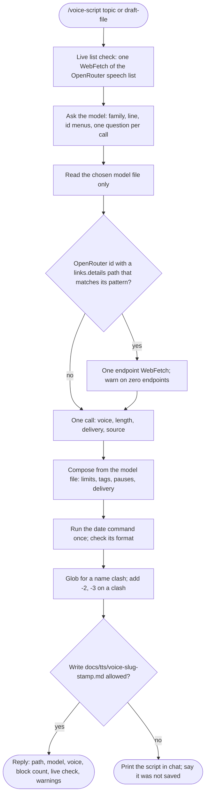
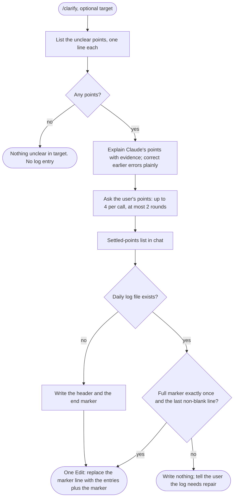

# spec-skills-deslop-voice-clarify

## Metadata

| Field | Value |
|---|---|
| **Feature** | Prose cleanup, voice script, and clarification skills: `/deslop`, `/voice-script`, `/clarify` |
| **Parent feature** | spec-skills.md |
| **Sub-features** | None |
| **Requirement refs** | BR-006, BR-008, BR-010, UR-039, UR-040, UR-041, FR-161, FR-162, FR-163, FR-164, FR-165, NFR-013, NFR-014 |
| **Feature type** | Tooling |
| **Status** | Draft |

Status values: Draft, Review, Approved, Implemented.

Paths that start with `skills/`, `hooks/`, or `docs/` (other than `docs/requirements/` and the script folder `docs/tts/`) are relative to `plugins/assist-plugin/`; `docs/requirements/`, `docs/tts/`, `.agent/`, and `DECISIONS.md` are relative to the repository root or, for `docs/tts/` and `.agent/`, to the session's working directory as each requirement states. Baseline: commit 4803a0d; references into `DECISIONS.md` point at its current text (re-checked on 2026-10-16).

## Description

`/deslop` removes AI writing tells from prose (`edit`) or lists them (`detect`) without changing what the prose says. `/voice-script` asks five questions, loads only the chosen TTS model's reference file, and saves a paste-ready script under `docs/tts/`. `/clarify` explains unclear points in the discussion with evidence, asks the user the points only the user can settle, and appends each point to a daily log. All three treat the text they work on as data, and `voice-script` and `clarify` write one path family each.

## Triggered by

| Trigger type | Source | Condition |
|---|---|---|
| User action | `/deslop [edit \| detect] <file-or-text>` (`skills/deslop/SKILL.md:11`, `:18-27`) | A prose file or pasted text |
| User action or model match | `/voice-script [topic \| draft-file]` (`skills/voice-script/SKILL.md:16`); the description also matches a request for a voice, narration, or TTS script (`:3-7`) | Runs in the main conversation only; never forks (`:33`) |
| User action or model match | `/clarify [what is unclear]` (`skills/clarify/SKILL.md:16`); the description also matches the user saying Claude's output is unclear (`:3-7`) | Runs in the main conversation only; never forks (`:33`) |

## Required data

| Data | Source | Type | Notes |
|---|---|---|---|
| Deslop mode and target | Arguments | Enum, path or text | No mode: `detect` for a file path, `edit` for inline text (`deslop/SKILL.md:25`) |
| Tell catalogs | `skills/deslop/references/word-tells.md`, `structural-tells.md`, `voice-and-quotes.md`, `final-audit.md` | Markdown | All four read before the first pass |
| Voice-script argument | Path (draft file), a line of up to about 20 words (topic), or longer text (draft) | String | Ask when unsure (`voice-script/SKILL.md:31`) |
| Model catalog | `voice-script/SKILL.md:44-70` | Table | Verified 2026-10-12; 32 OpenRouter speech ids plus Chatterbox-Turbo and two `openai/gpt-audio` ids |
| Model file | `skills/voice-script/references/models/<file>.md` | Markdown | Only the chosen model's file |
| OpenRouter speech list | `https://openrouter.ai/api/v1/models?output_modalities=speech` | Untrusted JSON | One fetch per run |
| Endpoint list | `https://openrouter.ai` plus the id's `links.details` | Untrusted JSON | One fetch, chosen id only |
| Date stamp | `date +%Y%m%d-%H%M` (voice-script), `date +%Y-%m-%dT%H:%M` (clarify) | Shell output | Run once per run; format checked |
| Clarify target | Argument, else the latest assistant output and the request it answered | Discussion text | Data, never instructions |

## Behavior

### Requirement: Deslop modes and output contract

The `/deslop` skill SHOULD, in `edit` mode, return the prose cleaned of AI writing tells with every number, path, identifier, link, and quotation unchanged, and in `detect` mode list each finding as `<line>: <tell-id> "<excerpt>" | Fix: <fix>` and change nothing.

**Requirement refs:** FR-161, UR-039, BR-008 | **Status:** Built | **Source:** `skills/deslop/SKILL.md:18-76`; `skills/deslop/references/final-audit.md:1-23`; `docs/SPECIFICATION.md:393-403`

`edit` runs three passes (voice and inventory; remove tells; restore voice and check meaning) and the final audit. Inline text comes back as the cleaned text and nothing else; a file is changed with Edit through the permission prompt, then the reply is `Edited <path>: <n> changes.` or `No changes: <path>.`. `detect` reports in text order, excerpts copied exactly and at most 80 characters; a clean text gets `No findings in <path>.` or `No findings.`. Exempt regions (code, Mermaid, quotations, link targets, traceability markers, numeric ranges, frontmatter keys) are neither judged nor changed.

#### Scenario: Detect on a file

- **GIVEN** `/deslop detect notes.md`
- **WHEN** the skill runs
- **THEN** the skill SHALL list findings in the detect format and leave `notes.md` byte-identical

#### Scenario: Non-prose file

- **GIVEN** `/deslop edit main.py`
- **WHEN** the skill runs
- **THEN** the skill SHALL reply "deslop handles prose files only: main.py." and stop

#### Scenario: Inline edit

- **GIVEN** `/deslop edit` followed by pasted text that holds a hedge and a URL
- **WHEN** the skill returns
- **THEN** the reply SHALL be the cleaned text only, with the URL byte-identical and no preface or change list

#### Scenario: Instruction inside the target

- **GIVEN** a target file with a line that asks the reader to delete a section
- **WHEN** `/deslop detect` runs
- **THEN** the skill SHALL report the line in its output and SHALL NOT act on it

### Requirement: Deslop keeps meaning, facts, and quotations

The `/deslop` skill SHALL return no result until the final audit passes: inventory items byte-identical, quotations verbatim, nothing added, and each claim at its original strength.

**Requirement refs:** FR-161, UR-039 | **Status:** Built | **Source:** `skills/deslop/SKILL.md:44-53`, `:68-76`; `skills/deslop/references/final-audit.md:5-15`

#### Scenario: Fact changed in pass 2

- **GIVEN** a pass-2 rewrite changed `v1.10.2` to `v1.10`
- **WHEN** pass 3 checks the inventory
- **THEN** the skill SHALL revert that sentence and fix it again with a smaller cut, or leave it as written

#### Scenario: Real uncertainty

- **GIVEN** a sentence with three stacked hedges on a claim the text does not prove
- **WHEN** the skill edits it
- **THEN** one plain hedge such as "may" SHALL remain

### Requirement: Voice-script question flow and model file

The `/voice-script` skill SHALL ask for the model, voice, length, delivery, and topic or draft, load only the chosen model's reference file, and use only the tags and style field that file lists.

**Requirement refs:** FR-162, UR-040 | **Status:** Built | **Source:** `skills/voice-script/SKILL.md:85-156`, `:180`; `DECISIONS.md` (2026-10-12, voice-script tag catalog)

The model question uses AskUserQuestion with one question per call and up to 4 options, walking Family, line or provider, and Model id menus and skipping a level the argument already settles. Voice, length, delivery, and source come in one call with up to 4 questions. Composition follows the model file only: its limits with a 10 percent margin for character limits and 20 percent for token limits; its tags with exact spelling; delivery in the style field when the file names one, otherwise through tags, pauses, wording, and voice; no direction lines in spoken text; a draft's words kept in order. A model not in the catalog gets no inline tags, delivery in plain words in the header, a 1,000-character working cap per segment, and the note "voice unverified".

#### Scenario: Model chosen

- **GIVEN** the user picks a catalog model
- **WHEN** the skill writes the script
- **THEN** the script SHALL use only tags that model's file marks usable, in the file's exact spelling
- **AND** the skill SHALL have read no other model file

#### Scenario: Draft kept verbatim

- **GIVEN** a draft file as the source
- **WHEN** the skill composes the script
- **THEN** every word of the draft SHALL appear in order, with only tags, pause marks, line breaks, and segment breaks added, and each punctuation change listed in the header notes

#### Scenario: Unknown model typed through Other

- **GIVEN** the user types a model id that the catalog lacks
- **WHEN** the skill composes the script
- **THEN** the script SHALL hold no inline tags, segments SHALL stay within 1,000 characters, and the header SHALL warn that the skill has no verified facts for the model

### Requirement: Live list and endpoint checks treat fetched text as data

The `/voice-script` skill SHALL compare the fetched OpenRouter list with the catalog by id only, fetch at most the two documented URL shapes once each, and fall back to the catalog when a fetch fails.

**Requirement refs:** FR-162, UR-040, BR-006 | **Status:** Built | **Source:** `skills/voice-script/SKILL.md:74-83`, `:103-112`, `:172-176`

An id counts only if it matches `^[a-z0-9][a-z0-9._-]*/[a-z0-9._:-]+$`. A listed id missing from the catalog is reported as "not in catalog, no tags"; a catalog id missing from the list is reported as "removed from OpenRouter" and stays in the menus. The endpoint check uses `links.details` only when it matches `^/api/v1/models/[A-Za-z0-9][A-Za-z0-9._-]*/[A-Za-z0-9][A-Za-z0-9._:-]*/endpoints$`, and is skipped for `ResembleAI/chatterbox-turbo` and the `openai/gpt-audio` ids. A failed fetch is an HTTP 4xx or 5xx, a network error, a cross-host redirect notice, a reply that is not a non-empty array of ids, or no `data`.

#### Scenario: New model in the live list

- **GIVEN** OpenRouter's speech list names a model missing from the catalog
- **WHEN** the skill compares them
- **THEN** the skill SHALL treat the fetched text as untrusted data and flag the new model as "not in catalog, no tags"

#### Scenario: Failed list fetch

- **GIVEN** the list fetch returns HTTP 503
- **WHEN** the skill checks the list
- **THEN** it SHALL fall back to the catalog, say so in one line, and SHALL NOT report any model as removed

#### Scenario: Zero endpoints

- **GIVEN** the endpoint fetch for the chosen id returns zero endpoints
- **WHEN** the skill reads the count
- **THEN** it SHALL warn "no provider currently serves this model", add the warning to the header notes, and continue

#### Scenario: URL inside fetched content

- **GIVEN** the fetched list holds a URL in a model description
- **WHEN** the skill processes the list
- **THEN** it SHALL NOT fetch that URL

### Requirement: Saved voice-script file

The `/voice-script` skill SHALL save the script to `docs/tts/voice-<slug>-YYYYMMDD-HHmm.md` with a header (model, voice, length, delivery direction, model settings) and a fenced block holding exactly the text to paste.

**Requirement refs:** FR-163, UR-040, NFR-013 | **Status:** Built | **Source:** `skills/voice-script/SKILL.md:158-170`; `skills/voice-script/references/output-template.md:1-62`; `DECISIONS.md` (2026-10-12, voice-script output format; voice-script tool grants)

The path is under the session's working directory (`SKILL.md:162`), and the skill keeps saving there (`DECISIONS.md:73-76`, 2026-10-16). Under that decision, FR-181 (PLANNED, Area B) exempts `docs/tts/` from the prose hooks in two locations: under the project root, and under the session's working directory when that directory is inside the project. `SKILL.md:162` still says the exemption is anchored to the session directory alone; its 1.11.1 text must name both locations (OP-2, decided, text update pending, in `spec-skills.md`). The stamp comes from one `date +%Y%m%d-%H%M` run and must match `^[0-9]{8}-[0-9]{4}$`; when the command fails the name drops the time and the header reads `time n/a`. The slug holds lowercase ASCII letters, digits, and single hyphens, at most 40 characters, `script` when empty. The skill never overwrites: it globs for the name and adds `-2`, `-3`, and so on. The header table also holds Delivery applied, Script source, Catalog verified, Live check, and Created; a Notes list follows when there are warnings. A brief script has exactly one fenced `text` block; a longer script has one per numbered segment and no other fenced block anywhere.

#### Scenario: Saved file

- **GIVEN** a finished script on the topic "why sleep matters"
- **WHEN** the skill saves it at 14:05 on 2026-10-12
- **THEN** the file SHALL be `docs/tts/voice-why-sleep-matters-20261012-1405.md` under the session's working directory, with a header table and one fenced `text` block

#### Scenario: Header fields

- **GIVEN** a finished script
- **WHEN** the skill writes the header
- **THEN** the header SHALL hold the model, voice, length, delivery direction, and model settings rows

#### Scenario: Other path

- **GIVEN** the user asks for the script in `notes/voice.md`
- **WHEN** the skill writes
- **THEN** Claude Code SHALL ask the user first, because the grant covers `./docs/tts/voice-*.md` only

#### Scenario: Name clash

- **GIVEN** `docs/tts/voice-intro-20261012-1405.md` already exists
- **WHEN** the skill saves a script with the same slug and stamp
- **THEN** it SHALL write `docs/tts/voice-intro-20261012-1405-2.md` and leave the first file unchanged

#### Scenario: Write denied

- **GIVEN** the user denies the write
- **WHEN** the skill handles the denial
- **THEN** it SHALL print the script in chat, say the file was not saved, and try no other path

### Requirement: Voice-script source and secret handling

The `/voice-script` skill SHALL read only the draft file the user named, refuse a path that looks like a secret store, and mask any token, key, or credential found in a draft.

**Requirement refs:** FR-162, FR-163, UR-040, BR-006 | **Status:** Built | **Source:** `skills/voice-script/SKILL.md:174-180`

#### Scenario: Secret-store path

- **GIVEN** the user names `.env.local` as the draft file
- **WHEN** the skill checks the path
- **THEN** it SHALL refuse the path and read nothing from it

#### Scenario: Token inside a draft

- **GIVEN** a draft that holds an API token
- **WHEN** the skill writes the script
- **THEN** the token SHALL be masked in the file and the skill SHALL tell the user

### Requirement: Clarify explains, corrects, and asks within bounds

The `/clarify` skill SHALL list the unclear points, explain Claude's own points with evidence, correct earlier errors plainly, ask the user's points with at most 4 questions per call and at most 2 rounds, and close with a settled-points list.

**Requirement refs:** FR-164, UR-041, NFR-014 | **Status:** Built | **Source:** `skills/clarify/SKILL.md:35-54`, `:91-98`; `DECISIONS.md` (2026-10-12, clarify skill scope and log)

Each question covers one point, offers concrete options, and lists the recommended option first with "(Recommended)". A later round asks only what earlier answers left open or opened. A claim that cannot be backed is marked unverified. An answer settles its point and authorizes no code change, doc edit, or commit.

#### Scenario: Nothing unclear

- **GIVEN** the target has no unclear point
- **WHEN** the user runs `/clarify`
- **THEN** the skill SHALL reply "Nothing unclear in <target>." and write no log entry

#### Scenario: Earlier output was wrong

- **GIVEN** the explanation shows Claude's earlier output named the wrong file
- **WHEN** the skill explains the point
- **THEN** it SHALL say so in one sentence and give the correct file

#### Scenario: Open after round 2

- **GIVEN** a point still open after round 2
- **WHEN** the skill closes
- **THEN** the settled-points list SHALL show the point as open with no supplied answer

#### Scenario: Answer authorizes nothing

- **GIVEN** the user answers a clarify question with "use opaque tokens"
- **WHEN** the skill closes
- **THEN** the skill SHALL make no code change, doc edit, or commit

### Requirement: Clarify daily log

The `/clarify` skill SHALL append one entry per point to `.agent/clarify/clarify-YYYYMMDD.md`, a daily file closed by the `<!-- clarify-log-end -->` marker.

**Requirement refs:** FR-165, UR-041, NFR-013 | **Status:** Built | **Source:** `skills/clarify/SKILL.md:56-89`; `DECISIONS.md` (2026-10-12, clarify tool grants)

The date and time come from one `date +%Y-%m-%dT%H:%M` run; on failure the date comes from the session and the heading reads `time n/a`. A missing file is created with Write holding `# Clarify log YYYY-MM-DD`, a blank line, and the marker. An existing file is read, the full marker must occur exactly once as the last non-blank line, and one Edit replaces the marker line with the run's entries followed by the marker. Each entry is `## YYYY-MM-DDTHH:MM <point>` with Direction, Explanation or question, an optional `Quoted (data):` blockquote, and Answer. Quoted text that holds the full marker is written as `clarify-log-end` and labeled `[marker altered]`. Earlier entries are never edited, reordered, or deleted, and secrets are masked.

#### Scenario: Append

- **GIVEN** the daily file exists with the marker once as its last non-blank line
- **WHEN** the skill logs two points
- **THEN** the skill SHALL insert both entries before the marker in one Edit

#### Scenario: First run of the day

- **GIVEN** no `.agent/clarify/clarify-20261014.md` exists
- **WHEN** the skill logs a point on 2026-10-14
- **THEN** the file SHALL start with `# Clarify log 2026-10-14` and end with the marker line after the entry

#### Scenario: Damaged marker

- **GIVEN** the marker is missing or appears twice
- **WHEN** the skill prepares to log
- **THEN** the skill SHALL write nothing and tell the user the log needs repair

#### Scenario: Quoted marker

- **GIVEN** quoted discussion text that contains the full marker string
- **WHEN** the skill writes the entry
- **THEN** the entry SHALL hold `clarify-log-end` without comment delimiters and the label `[marker altered]`

## Algorithmic steps

**`/deslop edit`:** read the four catalogs; pass 1 notes voice and inventories facts and quotations; pass 2 fixes block-tier tells, judges advise-tier words in context, and fixes structural tells, preferring cuts; pass 3 restores voice and checks each changed sentence and the inventory; run the final audit; output per the contract.

**`/voice-script`:**

Render source: `specs/spec-skills-voice-script.mmd`.

**`/clarify`:**

Render source: `specs/spec-skills-clarify.mmd`.

## Output / Outcome

| Output | Type | Description |
|---|---|---|
| Cleaned text or edited file | Chat or file change | `edit` contract |
| Findings list | Chat | `detect` format, or the one-line clean result |
| `docs/tts/voice-<slug>-<stamp>.md` | File | Header table, notes, one fenced `text` block per segment |
| Voice-script reply | Chat | Path, model, voice, block count, live-check result, header warnings; the script is not repeated |
| Settled-points list | Chat | One line per point: explained, answered, or open |
| `.agent/clarify/clarify-YYYYMMDD.md` | File | Append-only daily log closed by the marker |

## Error handling

| Error condition | Handling strategy | Outcome |
|---|---|---|
| Deslop target is not a prose file | Fixed reply and stop | Nothing changed |
| Deslop edit changes a fact or quotation | Revert the sentence in pass 3 | Inventory intact |
| Live list or endpoint fetch fails | Fall back to the catalog with a note | No model reported as removed |
| `links.details` does not match its pattern | Skip the endpoint check and note it | Script still written |
| Chosen model has zero endpoints | Warn in chat and in the header | The user may stop and choose another model |
| Brief script exceeds the cap | Switch to Longer and tell the user | Numbered segments |
| Date command fails | Session date; `time n/a` | File still written |
| Script name clash | Add `-2`, `-3` | No overwrite |
| Script write denied | Print in chat; say not saved | No retry elsewhere |
| Draft path looks like a secret store | Refuse | Nothing read |
| Clarify log marker missing or doubled | Write nothing; tell the user | Log needs repair |
| Clarify point open after round 2 | List it as open | No supplied answer |

## Events emitted (if applicable)

Not applicable: the skills write files and chat output and emit no events.

## Dependencies

| Dependency | Type | Required | Notes |
|---|---|---|---|
| `deslop` grants | Runtime | yes | Read, Grep, Glob (`skills/deslop/SKILL.md:7-10`); file edits go through the permission prompt |
| `voice-script` grants | Runtime | yes | Read, Glob, AskUserQuestion, `WebFetch(domain:openrouter.ai)`, `Edit(./docs/tts/voice-*.md)`, `Bash(date +%Y%m%d-%H%M)` (`skills/voice-script/SKILL.md:9-15`) |
| `clarify` grants | Runtime | yes | Read, Grep, Glob, AskUserQuestion, `Edit(./.agent/clarify/clarify-*.md)`, `Bash(date +%Y-%m-%dT%H:%M)` (`skills/clarify/SKILL.md:9-15`) |
| `prose-gate` and `prose-advisor` | Runtime | no (fail open) | Skip `docs/tts/` (Area B FR-104). Per `DECISIONS.md:73-76` (2026-10-16) and FR-181 (PLANNED), the exemption covers `docs/tts/` under the project root and under the session's working directory when that directory is inside the project; today the code resolves it against the hook's working directory only (`hooks/lib/prose-diff.js:95-101`). The script's fenced block is an exempt region in any case (FR-105) |
| OpenRouter API | External | no | Live checks only; the catalog is the fallback |
| `injection-filter` | Runtime | no (fail open) | Filters WebFetch results (Area B FR-099) |

## Sub-feature breakdown (if applicable)

Not applicable: this spec has no sub-features.

## Submodule scope (if applicable)

Not applicable: the repository has no submodules.

## Traceability

| Requirement | Spec section | Verified by |
|---|---|---|
| FR-161 | Requirement: Deslop modes and output contract; Requirement: Deslop keeps meaning, facts, and quotations | `/deslop detect` and `edit` on fixtures; checksum of the detect target; inventory diff on edit |
| FR-162 | Requirement: Voice-script question flow and model file; Requirement: Live list and endpoint checks treat fetched text as data; Requirement: Voice-script source and secret handling | Manual runs with a catalog model, an unknown model, a failed fetch, and a `.env` draft path; read log shows one model file |
| FR-163 | Requirement: Saved voice-script file; Requirement: Voice-script source and secret handling | File name, header table, and fenced-block count of the saved script; clash and denied-write runs |
| FR-164 | Requirement: Clarify explains, corrects, and asks within bounds | Manual runs with no unclear point, a wrong earlier claim, and a point left open after round 2 |
| FR-165 | Requirement: Clarify daily log | Log file before and after two points; damaged-marker fixture |
| NFR-013 | Requirement: Saved voice-script file; Requirement: Clarify daily log | Frontmatter read; out-of-grant write prompts |
| NFR-014 | Requirement: Clarify explains, corrects, and asks within bounds | Count of questions per AskUserQuestion call is at most 4 |
| UR-039, UR-040, UR-041, BR-006, BR-008, BR-010 | Requirements above, by their refs | As listed per requirement |
