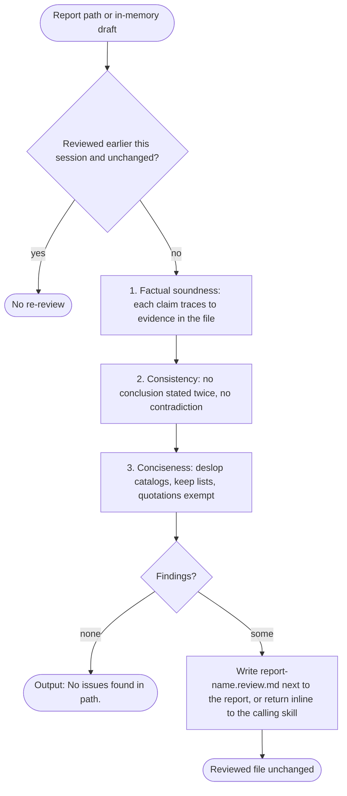

# spec-skills-docs-review

## Metadata

| Field | Value |
|---|---|
| **Feature** | Project mapping, documentation, and report review skills: `/map-project`, `/technical-writing`, `/review-md` |
| **Parent feature** | spec-skills.md |
| **Sub-features** | None |
| **Requirement refs** | BR-005, BR-008, BR-010, UR-013, UR-032, UR-033, UR-034, FR-145, FR-146, FR-147, FR-148, NFR-013 |
| **Feature type** | Tooling |
| **Status** | Draft |

Status values: Draft, Review, Approved, Implemented.

Paths that start with `skills/` are relative to `plugins/assist-plugin/`. Baseline: commit 4803a0d.

## Description

`/map-project` scans a repository and reports its structure, stack, modules, dependencies, and entry points, writing `PROJECT_MAP.md` only after the user approves. `/technical-writing` generates or updates documentation in four forms. `/review-md` checks a markdown report for factual soundness, consistency, and concision and writes its findings to a separate file, never editing the report. Report-producing skills call `review-md` before the user sees their report, and `/do` runs it as the Report Quality Gate.

## Triggered by

| Trigger type | Source | Condition |
|---|---|---|
| User action | `/map-project` with no arguments (`skills/map-project/SKILL.md:11`) | Any repository |
| User action | `/technical-writing [docs \| readme \| guide \| api] [topic \| file]` (`skills/technical-writing/SKILL.md:12`) | A documentation task |
| Agent task | `/do` routes documentation work to `developer` with `technical-writing` named in the prompt (`skills/do/references/agent-registry.md:40`, `:79`) | Under `/do` |
| User action | `/review-md <path-to-report.md>` (`skills/review-md/SKILL.md:12`, `:21-27`) | Any markdown file the user names |
| Skill call | A report-producing skill passes its report path or in-memory draft (`skills/review-md/SKILL.md:29-31`) | Before the report reaches the user |
| Orchestrator | `/do` Report Quality Gate (`skills/do/references/review-protocol.md:195-220`) | A step whose output is a markdown report |

## Required data

| Data | Source | Type | Notes |
|---|---|---|---|
| Repository tree | Glob, Read, Bash listing | Files | `map-project` scans; it judges no technology |
| Manifests | `package.json`, `go.mod`, `Cargo.toml`, and similar | Files | Dependencies and stack |
| Subcommand and topic | `/technical-writing` arguments | Enum, string | `docs`, `readme`, `guide`, `api` |
| Existing docs | Grep, Glob | Files | Updated in place of duplicated |
| Report under review | Path or draft from the caller | Markdown | Read-only |
| Tell catalogs | `rules/writing-standard.md` (Mechanical tiers), `skills/deslop/references/word-tells.md`, `skills/deslop/references/structural-tells.md` | Markdown | Conciseness check (`skills/review-md/SKILL.md:39`) |

## Behavior

### Requirement: Project map with an approved write

The `/map-project` skill SHOULD report key directories, technology stack, module organization, main dependencies, and entry points in `PROJECT_MAP.md` after the user approves the write.

**Requirement refs:** FR-145, UR-032 | **Status:** Built | **Source:** `skills/map-project/SKILL.md:18-76`

The approval is the skill's own rule (`skills/map-project/SKILL.md:74`). Claude Code's permission prompt covers a Write or Edit call on `PROJECT_MAP.md`, because the skill has no Write or Edit grant; its Bash grant is unscoped, so a Bash command that writes the file would not prompt (open point OP-6 in `spec-skills.md`).

#### Scenario: Scan only

- **GIVEN** the user has not approved a write
- **WHEN** the skill runs
- **THEN** the skill SHALL report in chat and create no `PROJECT_MAP.md`

#### Scenario: Approved write

- **GIVEN** the user approves the write
- **WHEN** the skill finishes
- **THEN** `PROJECT_MAP.md` SHALL hold Directory Structure, Technology Stack, Key Dependencies, Entry Points, and Architecture sections
- **AND** the Architecture section SHALL state the organizing pattern and why it matters for someone changing code

#### Scenario: User declines the write

- **GIVEN** the skill calls Write on `PROJECT_MAP.md` and the user denies the permission prompt
- **WHEN** the skill continues
- **THEN** the map SHALL stay in chat and no `PROJECT_MAP.md` SHALL exist

### Requirement: Documentation subcommands that update in place

The `/technical-writing` skill SHOULD generate `docs`, `readme`, `guide`, and `api` output and update existing documentation in place of duplicating it.

**Requirement refs:** FR-146, UR-033, NFR-013 | **Status:** Built | **Source:** `skills/technical-writing/SKILL.md:19-99`

| Subcommand | Output sections |
|---|---|
| `docs` | Conceptual overview, step-by-step guides, examples, diagrams when they apply |
| `readme` | Project overview, installation, quick start, features, contributing, license |
| `guide` | Prerequisites, step-by-step setup, configuration, verification steps, troubleshooting |
| `api` | API overview, endpoints, request and response examples, error codes, authentication |

#### Scenario: Guide

- **GIVEN** the topic "How to set up OAuth"
- **WHEN** the user runs `/technical-writing guide "How to set up OAuth"`
- **THEN** the guide SHALL hold prerequisites, step-by-step setup, configuration, verification steps, and troubleshooting

#### Scenario: Existing document

- **GIVEN** a document that already covers the topic
- **WHEN** the skill writes
- **THEN** the skill SHALL update that document and SHALL NOT create a duplicate

#### Scenario: Write outside the grant

- **GIVEN** the skill needs to write `docs/oauth.md`
- **WHEN** it writes
- **THEN** Claude Code SHALL ask the user first, because the grant covers `./README.md` only

### Requirement: Read-only review of markdown reports

The `/review-md` skill SHOULD check a markdown report for factual soundness, then consistency, then concision, and write findings to `<report-name>.review.md` with what is wrong, why it matters, and what to change, leaving the reviewed file unedited.

**Requirement refs:** FR-147, UR-034, BR-008 | **Status:** Built | **Source:** `skills/review-md/SKILL.md:15-52`; `skills/review-md/references/review-findings-template.md:1-33`

Checks: (1) factual soundness, every claim traces to evidence in the file; (2) consistency, no conclusion stated twice and no section contradicting another; (3) conciseness, the `deslop` catalogs applied as `deslop detect` would, skipping keep lists and quotation wording. `SKILL.md:35` says to stop and report as soon as a category has findings, while the findings template (`review-findings-template.md:3`, `:7-29`) lists all three categories; whether later categories are checked after an earlier one has findings is pending (open point OP-12 in `spec-skills.md`), and no scenario here asserts either reading. Findings go next to the reviewed file, or inline when another skill calls mid-workflow. Each finding cites the exact line or section; each conciseness finding carries its family or tell id.

#### Scenario: Uncited claim

- **GIVEN** a report with a claim that cites no evidence
- **WHEN** the user runs `/review-md report.md`
- **THEN** the skill SHALL write `report.review.md` with a `## Factual Soundness` finding that names the line
- **AND** `report.md` SHALL be byte-identical to its state before the run

#### Scenario: Clean report

- **GIVEN** a report with no issue
- **WHEN** the skill finishes
- **THEN** the skill SHALL output the single line `No issues found in <path>.` and write no findings file

#### Scenario: Conciseness label

- **GIVEN** a consistent, fully cited report whose line 17 joins two clauses with an em dash
- **WHEN** the skill reviews it
- **THEN** the finding SHALL be headed with the `em-dash` family and cite line 17

#### Scenario: Already reviewed and unchanged

- **GIVEN** the same file was reviewed earlier in the session and has not changed
- **WHEN** a caller asks for a review again
- **THEN** the skill SHALL NOT review it again

### Requirement: Automatic report review before presentation

The skills `ask`, `debug`, `pr-review`, `technical-writing`, `bump`, `map-project`, `commit`, `branch`, and `do` SHOULD invoke `review-md` on a report they produce before the report reaches the user.

**Requirement refs:** FR-148, UR-034, UR-013, BR-005 | **Status:** Built | **Source:** `skills/review-md/SKILL.md:29-31`; `skills/ask/SKILL.md:40`, `:52`; `skills/do/references/review-protocol.md:58`, `:95`, `:195-220`

Source difference: the invoking list lives only in `skills/review-md/SKILL.md:31`. Of the nine skills, `ask` (`skills/ask/SKILL.md:40`, `:52`) and `do` (through the Report Quality Gate) state the call in their own files; the SKILL.md files of `debug`, `pr-review`, `technical-writing`, `bump`, `map-project`, `commit`, and `branch` do not mention `review-md`. The scenarios below test only the two sourced callers; whether the seven files should state the call is pending (open point OP-3 in `spec-skills.md`). Under `/do`, `review-md` output "No issues found" reads as `approved` and a findings document as `returned`; the producing agent fixes only flagged items, on Sonnet, for up to 3 rounds; a planning document goes through the Planning Document Review Gate and never also through this gate (Area A FR-054).

#### Scenario: Ask answer

- **GIVEN** `/ask` drafted an answer
- **WHEN** the skill prepares to present it
- **THEN** the skill SHALL run `review-md` on the draft first

#### Scenario: Three rounds with findings left

- **GIVEN** `review-md` still reports findings after 3 iterations in a `/do` report gate
- **WHEN** the gate ends
- **THEN** `/do` SHALL complete the step with the outstanding findings attached, or fail it when a finding names a wrong claim or a path or ID that does not exist

#### Scenario: Report cites a missing path

- **GIVEN** a `/do` report step whose RCA cites `src/missing.ts`, which does not exist
- **WHEN** the third `review-md` round still flags the path
- **THEN** `/do` SHALL set the step `failed` and SHALL NOT rewrite the report itself

## Algorithmic steps

**`/map-project`:** find key folders (`src`, `tests`, `config`, `docs`); detect language, framework, and tools; map packages and modules; list main dependencies; find entry points; summarize the architecture; ask before writing `PROJECT_MAP.md`.

**`/technical-writing`:** research the topic and the existing docs; pick the subcommand's sections; update the existing document when one covers the topic, else draft a new one; use h2 and h3 headings, code blocks for examples, tables for reference data; write `README.md` within the grant and any other path through the permission prompt.

**`/review-md`:**

Render source: `specs/spec-skills-docs-review.mmd`. The diagram shows the order of the checks only; whether a category with findings ends the run early is pending (open point OP-12 in `spec-skills.md`).

## Output / Outcome

| Output | Type | Description |
|---|---|---|
| Project map | Chat report, then `PROJECT_MAP.md` on approval | Directory structure, stack, dependencies, entry points, architecture |
| Documentation | File change | `README.md` within the grant; other docs through the permission prompt |
| `<report-name>.review.md` | File | `# Review: <path>` with Factual Soundness, Consistency, and Conciseness sections; empty categories omitted |
| Clean-review line | Chat | `No issues found in <path>.` |
| Inline findings | Return value | When a calling skill is mid-workflow |

## Error handling

| Error condition | Handling strategy | Outcome |
|---|---|---|
| Write to `PROJECT_MAP.md` not approved | Report in chat only | No file |
| Documentation write outside `./README.md` | Permission prompt | The user decides |
| Existing document covers the topic | Update it | No duplicate file |
| Report already reviewed and unchanged | Skip | No second findings file |
| Findings remain after 3 rounds under `/do` | Attach them to the step; fail the step when one names a wrong claim or a missing path or ID | The main agent never rewrites the report |
| Findings file write denied by `prose-gate` | Rewrite the finding without the block-tier tell (`spec-skills.md`, prose requirement) | Findings file written |

## Events emitted (if applicable)

Not applicable: the skills write files or chat output and emit no events.

## Dependencies

| Dependency | Type | Required | Notes |
|---|---|---|---|
| `map-project` grants | Runtime | yes | Read, Glob, Bash (`skills/map-project/SKILL.md:7-10`). No Write or Edit grant, so a Write or Edit call on the map prompts; Bash is unscoped and runs without a prompt (open point OP-6 in `spec-skills.md`) |
| `technical-writing` grants | Runtime | yes | Read, Grep, Glob, `Edit(./README.md)` (`skills/technical-writing/SKILL.md:7-11`) |
| `review-md` grants | Runtime | yes | Read, Grep, Glob, Write, with Write unscoped (`skills/review-md/SKILL.md:7-11`; open point OP-6 in `spec-skills.md`) |
| `deslop` catalogs | Reference | yes | `word-tells.md`, `structural-tells.md` |
| `/do` Report Quality Gate | Runtime | no | Area A FR-054 selects the gate; this spec owns `review-md`'s side |

## Sub-feature breakdown (if applicable)

Not applicable: this spec has no sub-features.

## Submodule scope (if applicable)

Not applicable: the repository has no submodules.

## Traceability

| Requirement | Spec section | Verified by |
|---|---|---|
| FR-145 | Requirement: Project map with an approved write | Manual `/map-project` runs with the write approved and denied |
| FR-146 | Requirement: Documentation subcommands that update in place | `/technical-writing guide` run; run on a topic an existing doc covers; out-of-grant write prompt |
| FR-147 | Requirement: Read-only review of markdown reports | `/review-md` on fixtures with an uncited claim, an em dash, and no issue; checksum of the reviewed file before and after |
| FR-148 | Requirement: Automatic report review before presentation | `/ask` run trace shows `review-md` before the answer; `/do` plan file Review field after 3 rounds |
| NFR-013 | Requirement: Documentation subcommands that update in place | Frontmatter read; out-of-grant prompt |
| UR-013, UR-032, UR-033, UR-034 | Requirements above, by their refs | As listed per requirement |
| BR-005, BR-008, BR-010 | Requirements above, by their refs | As listed per requirement |
