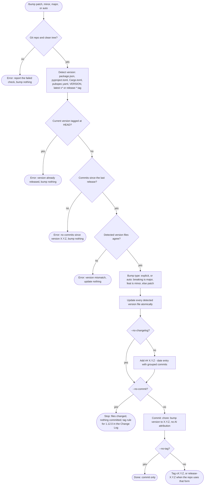
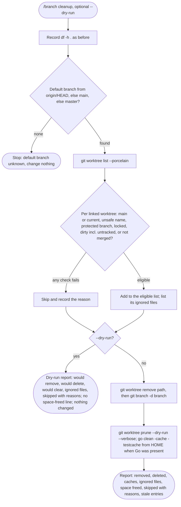
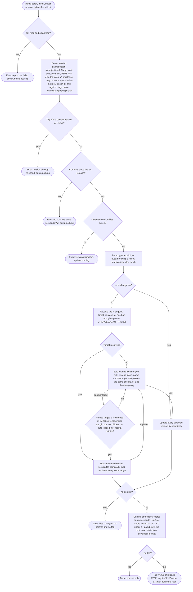
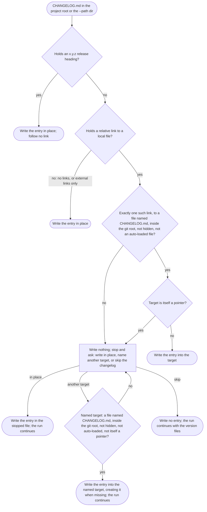

# spec-skills-git

## Metadata

| Field | Value |
|---|---|
| **Feature** | Git workflow skills: `/commit`, `/bump`, `/branch` |
| **Parent feature** | spec-skills.md |
| **Sub-features** | None |
| **Requirement refs** | BR-009, BR-010, UR-015, UR-028, UR-029, UR-030, FR-135, FR-136, FR-137, FR-138, FR-139, FR-140, FR-141, FR-196, FR-200 |
| **Feature type** | Tooling |
| **Status** | Approved |

Status values: Draft, Review, Approved, Implemented.

Paths that start with `skills/` are relative to `plugins/assist-plugin/`. Baseline: assist-plugin 1.11.1 at commit 41034c1; 1.11.1 changed none of the cited `commit`, `bump`, and `branch` files (`CHANGELOG.md:5-23`), and `skills/commit/SKILL.md`, `skills/commit/metadata.json`, `skills/bump/SKILL.md`, `skills/bump/references/bump-strategy.md`, and `skills/branch/SKILL.md:1-80` were re-read on 2026-10-16 with every cite holding. The PLANNED (1.12.0) changes are in the Change Log at the end; the body keeps the built behavior.

## Description

`/commit` writes Conventional Commits with no AI attribution. `/bump` detects the project version, picks the bump type, updates every version file, adds a changelog entry, and commits and tags. `/branch` creates, switches, and lists branches and removes finished worktrees under fixed guards. The `commit-attribution-guard` hook (Area B FR-095 to FR-098) backs the attribution rule; these skills keep the rule even where the hook cannot see the message.

## Triggered by

| Trigger type | Source | Condition |
|---|---|---|
| User action | `/commit [--squash] [--amend] [--scope SCOPE] [TYPE: message]` (`skills/commit/SKILL.md:9`) | Staged changes exist |
| User action | `/bump [patch \| minor \| major \| auto] [--path PATH] [--no-tag] [--no-commit]` (`skills/bump/SKILL.md:15`); the options table adds `--no-changelog` (`:91`), which the argument hint omits at 1.11.1 (OP-7c, decided as a plain fix: the hint gains it, PLANNED (1.12.0); Change Log 2026-10-16) | A release is due |
| User action | `/branch [create \| switch \| list \| cleanup] [branch-name \| --dry-run]` (`skills/branch/SKILL.md:13`) | Branch work or cleanup |
| Orchestrator | `/do` Cleanup runs `references/worktree-cleanup.md` in targeted mode | Area A FR-063 owns that path |

## Required data

| Data | Source | Type | Notes |
|---|---|---|---|
| Staged diff | `git diff --cached` | Text | Basis for type, scope, subject |
| Commit options | `--squash`, `--amend`, `--scope SCOPE`, explicit `TYPE: message` | Flags, string | `skills/commit/SKILL.md:72-76` |
| Git identity | `git config user.name`, `git config user.email` | String | Never an assistant identity |
| Version source | `package.json`, `pyproject.toml`, `Cargo.toml`, `pubspec.yaml`, `VERSION`, latest `v*` or `release-*` tag | File, tag | Checked in that order (`skills/bump/SKILL.md:35-41`) |
| Commits since last release | `git log <tag>..HEAD` | Text | Drives `auto` and the changelog groups |
| Remote URL | `origin` | URL | Compare links only for GitHub or GitLab (`skills/bump/references/bump-strategy.md:160-165`) |
| Bump options | `patch`, `minor`, `major`, `auto`, `--path`, `--no-tag`, `--no-commit`, `--no-changelog` | Enum, flags | `skills/bump/SKILL.md:80-91` |
| Branch name | Argument | String | Naming conventions apply |
| Worktree list | `git worktree list --porcelain` | Text | `skills/branch/references/worktree-cleanup.md:39-47` |
| Default branch | `origin/HEAD`, else `main`, else `master` | Ref | `worktree-cleanup.md:32-37` |

## Behavior

### Requirement: Conventional commit format

The `/commit` skill SHALL compose messages as `<type>(<scope>): <subject>` with an imperative, present-tense subject of at most 50 characters and no trailing period.

**Requirement refs:** FR-135, UR-028 | **Status:** Built | **Source:** `skills/commit/SKILL.md:16-50`, `:86-92`

The type is one of `feat`, `fix`, `refactor`, `docs`, `test`, `chore`, `perf`, `ci`; the scope is optional. The Report Writing Standard applies to the body only (`:91`).

#### Scenario: Valid message

- **GIVEN** staged changes to the auth module
- **WHEN** the user runs `/commit`
- **THEN** the subject SHALL read like `feat(auth): implement JWT-based authentication`

#### Scenario: Explicit message

- **GIVEN** the user passes `fix: handle null user`
- **WHEN** the skill commits
- **THEN** the commit subject SHALL use type `fix` and subject `handle null user`

#### Scenario: Draft breaks the format

- **GIVEN** a drafted subject that ends with a period or runs past 50 characters
- **WHEN** the skill checks the draft
- **THEN** the committed subject SHALL have no trailing period and at most 50 characters

### Requirement: No AI attribution in commit and bump messages

The `/commit` and `/bump` skills SHALL leave every AI attribution line out of the commit message they compose, including when Claude Code's attribution setting asks for one.

**Requirement refs:** FR-136, UR-015, UR-028, UR-029, BR-009 | **Status:** Built; PLANNED (1.12.0): the git-identity scenario (Change Log 2026-10-16) | **Source:** `skills/commit/SKILL.md:52-70`, `:93`, `:100-109`; `skills/bump/SKILL.md:76`, `:108`; `skills/bump/references/bump-strategy.md:252`; `DECISIONS.md` (2026-10-12, No AI attribution in commits or PRs)

Attribution lines are: a `Co-Authored-By` line for an AI tool, a "Generated with" or "Generated by" line, a `Generated-By` or `Assisted-By` line for an LLM, a `*-Session:` trailer such as `Claude-Session:`, and a bare AI session link. Human co-authors and issue links are allowed.

#### Scenario: Setting asks for a trailer

- **GIVEN** `attribution.commit` is unset and Claude Code's instructions ask for a Co-Authored-By trailer
- **WHEN** the skill writes the message
- **THEN** the message SHALL carry no Co-Authored-By trailer for an AI tool
- **AND** the skill SHALL tell the user once that `/assist-plugin:health` reports the setting and that `{"attribution": {"commit": "", "pr": ""}}` turns it off, and SHALL NOT edit a settings file

#### Scenario: Human co-author

- **GIVEN** the user asks to credit a human co-author
- **WHEN** the skill writes the message
- **THEN** the message MAY carry that human's Co-Authored-By trailer

#### Scenario: Guard denies the commit

- **GIVEN** `commit-attribution-guard` denies a `git commit` and lists two lines
- **WHEN** the skill retries
- **THEN** it SHALL remove only the listed lines and retry with the same command form
- **AND** it SHALL NOT move the message into a variable, a pipe, an unreadable file, or a code fence, and SHALL NOT edit `hooks-disabled.json`

#### Scenario: Listed line names a person the user asked to credit

- **GIVEN** the guard lists a line that names a person the user asked to credit
- **WHEN** the skill handles the denial
- **THEN** it SHALL stop and tell the user and SHALL NOT remove the line

#### Scenario: Tag message

- **GIVEN** `/bump` creates an annotated tag
- **WHEN** it writes the tag message
- **THEN** the tag message SHALL carry no attribution line, although the guard does not check `git tag`

### Requirement: Version detection and bump type

The `/bump` skill SHOULD detect the version from `package.json`, `pyproject.toml`, `Cargo.toml`, `pubspec.yaml`, a `VERSION` file, or the latest `v*` or `release-*` tag, in that order, and in `auto` mode choose major for `BREAKING CHANGE:`, minor for `feat:`, and patch otherwise.

**Requirement refs:** FR-137, UR-029 | **Status:** Built; PLANNED (1.12.0): the HEAD-tag refusal rule and the corrected `plugin.json` example (Change Log 2026-10-16) | **Source:** `skills/bump/SKILL.md:33-51`; `skills/bump/references/bump-strategy.md:5-110`

A `!` after the type (for example `feat!:`) also selects major (`bump-strategy.md:76`).

#### Scenario: Auto minor

- **GIVEN** commits since the last tag include `feat:` and no breaking change
- **WHEN** the user runs `/bump auto`
- **THEN** the skill SHALL bump the minor version

#### Scenario: Breaking marker

- **GIVEN** one commit since the last tag reads `feat!: drop v1 API`
- **WHEN** the user runs `/bump auto`
- **THEN** the skill SHALL bump the major version

#### Scenario: Nothing to release

- **GIVEN** no commits since the last release
- **WHEN** the user runs `/bump auto`
- **THEN** the skill SHALL report `error: No commits since version X.Y.Z; nothing to bump` and bump nothing

### Requirement: Bump preconditions

The `/bump` skill SHALL change nothing unless it runs in a git repository with a clean working tree, at least one commit since the last version or tag, and a current version that does not match the tag at HEAD.

**Requirement refs:** FR-137, FR-138, UR-029 | **Status:** Built; PLANNED (1.12.0): `bump-strategy.md:191-196` reworded to the HEAD-tag form (Change Log 2026-10-16) | **Source:** `skills/bump/SKILL.md:101-106`; `skills/bump/references/bump-strategy.md:189-213`

The HEAD-tag form follows `skills/bump/SKILL.md:106`. At 1.11.1 `bump-strategy.md:191-196` words the same check as the current version having a tag anywhere. OP-7a is decided for the HEAD-tag form (FR-137), and the strategy text changes to match. The "Clean repository" scenario follows the HEAD-tag form: its current version 1.2.0 carries the tag `v1.2.0` on an older commit, so the bump proceeds.

#### Scenario: Clean repository (HEAD-tag form, OP-7a decided)

- **GIVEN** a git repository with a clean tree, version files at 1.2.0, and two commits since `v1.2.0`, so HEAD carries no tag
- **WHEN** the user runs `/bump patch`
- **THEN** the skill SHALL proceed to update the version files

#### Scenario: Uncommitted changes

- **GIVEN** the working tree has uncommitted changes
- **WHEN** the user runs `/bump patch`
- **THEN** the skill SHALL report `error: Uncommitted changes detected` and change no file

#### Scenario: Version already released

- **GIVEN** the current version is 1.0.0 and HEAD carries the tag `v1.0.0`
- **WHEN** the user runs `/bump minor`
- **THEN** the skill SHALL report that the version is already released and change no file

### Requirement: Version files and changelog entry

The `/bump` skill SHOULD update every detected version file and add a changelog entry headed `## [X.Y.Z] - date` with commits grouped under Breaking Changes, Features, Bug Fixes, and Other.

**Requirement refs:** FR-138, UR-029 | **Status:** Built; PLANNED (1.12.0): the `--no-changelog` hint, the pointer follow (FR-200), and the `--path` commit and tag (Change Log 2026-10-16) | **Source:** `skills/bump/SKILL.md:53-71`, `:107`; `skills/bump/references/bump-strategy.md:36-38`, `:112-165`, `:254-263`

The update is atomic across files. Compare links are added only when `origin` is GitHub or GitLab. `--no-changelog` skips the entry. With `--path`, detection, commit parsing, version files, and `CHANGELOG.md` are limited to that directory.

#### Scenario: Minor bump

- **GIVEN** `package.json` holds 1.2.0 and a `feat:` commit exists
- **WHEN** the user runs `/bump minor`
- **THEN** `package.json` SHALL read 1.3.0 and `CHANGELOG.md` SHALL gain a dated `## [1.3.0]` entry with the feature under `### Features`

#### Scenario: Path option (commit subject and tag in the Change Log)

- **GIVEN** the user passes `--path ./backend` and `./backend/package.json` holds 1.2.0
- **WHEN** the skill runs `/bump minor --path ./backend`
- **THEN** it SHALL bump only the version files under `./backend` and write `./backend/CHANGELOG.md`
- **AND** it SHALL commit and tag at the repository root (`skills/bump/SKILL.md:119`; `bump-strategy.md:262-263`)

At 1.11.1 the sources disagree on the commit subject and tag name of a `--path` bump: FR-139 gave `chore: bump version to X.Y.Z` and `vX.Y.Z`, `bump-strategy.md:263` gives `subproject-v1.1.0` or `v1.1.0-subproject`, and `bump-strategy.md:275-276` uses `chore: bump services/auth to 1.1.0` and `services-auth-v1.1.0`. OP-7b is decided for the last form (`DECISIONS.md:123-126`); the Change Log carries it, so this scenario asserts no name.

#### Scenario: Version file cannot be written

- **GIVEN** one detected version file is read-only
- **WHEN** the user runs `/bump patch`
- **THEN** the skill SHALL update no version file, because it updates all detected files atomically

#### Scenario: Version files disagree

- **GIVEN** `package.json` reads 1.0.0 and `Cargo.toml` reads 1.1.0
- **WHEN** the user runs `/bump patch`
- **THEN** the skill SHALL report the mismatch and update no file

### Requirement: Bump commit and tag

The `/bump` skill SHOULD commit with the message `chore: bump version to X.Y.Z` and tag `vX.Y.Z` (or `release-X.Y.Z` when the repository uses that form) unless `--no-commit` or `--no-tag` is passed.

**Requirement refs:** FR-139, UR-029 | **Status:** Built for the default commit and tag; PLANNED (1.12.0): the `--path` naming and no tag without a commit (Change Log 2026-10-16) | **Source:** `skills/bump/SKILL.md:73-78`; `skills/bump/references/bump-strategy.md:241-252`

The scenarios below cover a bump at the repository root. The `--path` subject and tag (OP-7b) and the tagging rule for `--no-commit` (OP-7e) are decided and sit in the Change Log.

#### Scenario: Default

- **GIVEN** no flags
- **WHEN** the bump finishes
- **THEN** `git log -1 --format=%s` SHALL read `chore: bump version to X.Y.Z` and `git tag` SHALL list `vX.Y.Z`

#### Scenario: No tag

- **GIVEN** `--no-tag`
- **WHEN** the bump finishes
- **THEN** the skill SHALL commit and create no tag

#### Scenario: No commit

- **GIVEN** `--no-commit`
- **WHEN** the bump finishes
- **THEN** the skill SHALL create no commit and leave the changed files for review

At 1.11.1 no source says whether `--no-commit` without `--no-tag` still creates a tag, so this scenario asserts nothing about a tag. OP-7e is decided: `--no-commit` creates no tag (FR-139, `DECISIONS.md:125`; Change Log 2026-10-16).

### Requirement: Branch create, switch, and list

The `/branch` skill SHOULD create `feature/`, `bugfix/`, `release/`, and `hotfix/` branches, switch branches with a stash of uncommitted changes when needed, and list local and remote branches.

**Requirement refs:** FR-140, UR-030 | **Status:** Built | **Source:** `skills/branch/SKILL.md:20-50`, `:71-76`

#### Scenario: Create

- **GIVEN** a clean repository
- **WHEN** the user runs `/branch create feature/user-auth`
- **THEN** `git branch --show-current` SHALL return `feature/user-auth`

#### Scenario: Switch with changes

- **GIVEN** uncommitted changes
- **WHEN** the user runs `/branch switch main`
- **THEN** the skill SHALL stash the changes before it switches, and `git stash list` SHALL show the new entry

#### Scenario: Name outside the conventions

- **GIVEN** the user asks for a bug-fix branch named `null-pointer`
- **WHEN** the skill creates it
- **THEN** the skill SHALL create `bugfix/null-pointer`

#### Scenario: Protected branch deletion

- **GIVEN** a request to delete `main` or `develop`
- **WHEN** the skill handles it
- **THEN** the skill SHALL refuse and leave the branch in place

### Requirement: Cleanup removes only finished worktrees

The `/branch cleanup` skill SHALL remove only linked worktrees whose branch or detached commit is an ancestor of the default branch, whose status is clean including untracked files, and that are unlocked, leaving the main worktree, the current worktree, and the default, `main`, `master`, and `develop` branches untouched.

**Requirement refs:** FR-141, UR-030 | **Status:** Built | **Source:** `skills/branch/SKILL.md:52-61`, `:76`; `skills/branch/references/worktree-cleanup.md:1-137`; `rules/assist-plugin-rule.md` (Worktree and Cache Cleanup)

Checks run in this order and the first failure skips the worktree with its reason: main or current (`main worktree`, `current directory`); path or branch outside `^[A-Za-z0-9._/-]+$` (`unsafe name`); protected branch (`protected branch`); `locked`; `git -C '<path>' status --porcelain --untracked-files=all` prints anything (`dirty`); `git merge-base --is-ancestor` fails (`not merged`). Removal uses `git worktree remove '<path>'` and `git branch -d '<branch>'` only; `--force`, `-D`, `git clean`, and `rm -rf` are never used.

#### Scenario: Dry run

- **GIVEN** `--dry-run`
- **WHEN** the skill runs
- **THEN** every action line SHALL read "would remove", "would delete", or "would clear", with the ignored-file listing and no space-freed line
- **AND** `git worktree list` SHALL show the same entries before and after

#### Scenario: Squash-merged branch

- **GIVEN** a worktree whose branch was squash-merged and shows as `not merged`
- **WHEN** the skill runs
- **THEN** it SHALL keep the worktree and the branch and list them as skipped with `not merged`

#### Scenario: Untracked file

- **GIVEN** a merged worktree that holds one untracked file
- **WHEN** the skill runs
- **THEN** it SHALL skip the worktree with reason `dirty`

#### Scenario: Default branch unknown

- **GIVEN** no `origin/HEAD`, no `main`, and no `master`
- **WHEN** the skill runs
- **THEN** it SHALL stop with "default branch unknown" and change nothing

#### Scenario: Git refuses a removal

- **GIVEN** `git worktree remove` refuses one eligible worktree
- **WHEN** the skill handles the refusal
- **THEN** it SHALL skip that worktree, keep its branch, record git's message, and continue with the next

### Requirement: Cleanup report and caches

The `/branch cleanup` skill SHALL report removed worktrees, deleted branches, caches cleared, ignored files removed with each worktree, space freed, skipped items with reasons, the stale-entry listing, and report-only commands.

**Requirement refs:** FR-141, UR-030 | **Status:** Built | **Source:** `skills/branch/references/worktree-cleanup.md:91-128`

The Go build and test caches are cleared with `(cd "$HOME" && go clean -cache -testcache)` when a removed worktree had `go.mod`; the module cache stays. Rust (`cargo clean`) and Gradle (`./gradlew clean`) are reported for the user to run, never run. `git worktree prune --dry-run --verbose` output is listed and nothing is pruned.

#### Scenario: Go worktree removed

- **GIVEN** a removed worktree that held `go.mod`
- **WHEN** step 6 runs
- **THEN** the report SHALL list the Go cache as cleared and SHALL NOT list a module-cache removal

#### Scenario: Cache step fails

- **GIVEN** `go clean` exits non-zero
- **WHEN** step 6 runs
- **THEN** the report SHALL record the failure and the removals already done SHALL stand

## Algorithmic steps

**`/commit`:** stage changes; run `/commit`; choose type and scope (asking when unclear); write the message under the format and attribution rules; commit; verify with `git log -1 --format=%B` that no attribution line is present, and amend only that line out if one is. The skill commits with the local developer's git identity and never sets `git config user.name` or `user.email` to an assistant identity (`skills/commit/SKILL.md:94`). At 1.11.1 no FR states this rule; OP-11a is decided, and FR-136 gains the git-identity scenario, PLANNED (1.12.0), in the Change Log below.

**`/bump`:**

Render source: `specs/spec-skills-git-bump.mmd` (1.11.1 flow; the PLANNED (1.12.0) flow is in the Change Log). Rendering skipped: see the note in `spec-skills.md`. The diagram runs the HEAD-tag check before the commits-since check, so a version tagged at HEAD reports "already released" rather than "no commits"; `skills/bump/SKILL.md:103-106` lists the four conditions without an order.

**`/branch cleanup`** (sweep mode; `/do` uses targeted mode, Area A FR-063). Steps 1 to 4 that fail stop the run and change nothing; a step 5 failure skips that worktree; a step 6 failure is reported and never blocks (`worktree-cleanup.md:16-20`).

Render source: `specs/spec-skills-git-branch-cleanup.mmd`.

## Output / Outcome

| Output | Type | Description |
|---|---|---|
| Commit | Git state | Conventional subject, body under the writing standard, no AI attribution, developer identity |
| Version files | File change | Every detected file at the new version |
| `CHANGELOG.md` entry | File change | `## [X.Y.Z] - YYYY-MM-DD` with Breaking Changes, Features, Bug Fixes, Other, and compare links when the remote allows |
| Bump commit and tag | Git state | `chore: bump version to X.Y.Z`; `vX.Y.Z` or `release-X.Y.Z` |
| New or switched branch | Git state | Conventional name; stash entry when changes were present |
| Cleanup report | Chat report | Removed, deleted, caches, ignored files, space freed (not in dry run), skipped with reasons, stale entries, report-only commands |

## Error handling

| Error condition | Handling strategy | Outcome |
|---|---|---|
| Attribution guard denies a commit | Remove only the listed lines; retry the same command form | Commit without the lines; person-named lines go to the user |
| Attribution setting asks for a trailer | Leave the trailer out; tell the user once about the setting | No settings file is edited |
| Not a git repository, dirty tree, no new commits, or current version tagged at HEAD | `/bump` reports the failed check (HEAD-tag form; OP-7a decided) | No file changes |
| No version file found | Error naming the files searched (`bump-strategy.md:207-213`) | No file changes |
| Version files disagree | Error with both values | No file changes |
| Remote is not public GitHub or GitLab | Warn and ask `Continue? (yes/no)`; changelog without links (`bump-strategy.md:223-229`) | Entry written without compare links |
| Branch name outside conventions | Apply the convention prefix | `bugfix/<name>` and similar |
| Delete `main` or `develop` requested | Refuse | Branch kept |
| Cleanup steps 1 to 4 fail | Stop and report the step and message | Nothing changed |
| `git worktree remove` or `git branch -d` refuses | Skip, keep the branch, record the message | Other worktrees continue |
| Cache clear fails | Report and continue | Removals stand |

## Events emitted (if applicable)

Not applicable: the skills change git state and files and emit no events.

## Dependencies

| Dependency | Type | Required | Notes |
|---|---|---|---|
| git | External | yes | All three skills (`README.md:154`) |
| `commit` tool grant | Runtime | yes | Bash only, unscoped (`skills/commit/SKILL.md:7-8`), an accepted NFR-013 exception (OP-6 decided; `spec-skills.md` Change Log). The skill text says it runs on Haiku (`:96-98`) while its frontmatter sets no model at 1.11.1; FR-196 adds `model: haiku`, PLANNED (1.12.0) |
| `bump` tool grants | Runtime | yes | Read, Write, Edit, Grep, Glob, Bash, with Write, Edit, and Bash unscoped (`skills/bump/SKILL.md:8-14`), an accepted NFR-013 exception |
| `branch` tool grants | Runtime | yes | `Bash(git:*)` (`skills/branch/SKILL.md:9`, an accepted NFR-013 exception, `DECISIONS.md:158-161`), `Bash(df:*)` and `Bash(realpath:*)` (read-only fixed programs, scoped, `DECISIONS.md:163-166`), `Bash(go clean:*)` (a program-and-subcommand prefix, scoped) (`skills/branch/SKILL.md:8-12`) |
| `commit-attribution-guard` hook | Runtime | no (fail open) | Area B FR-095 to FR-098; does not cover `git tag` |
| Claude Code `attribution` settings | External | no | Reported by `/health` (Area B FR-120) |
| Go toolchain | External | no | Only for the cache clear |

## Sub-feature breakdown (if applicable)

Not applicable: this spec has no sub-features.

## Submodule scope (if applicable)

Not applicable: the repository has no submodules.

## Traceability

| Requirement | Spec section | Verified by |
|---|---|---|
| FR-135 | Requirement: Conventional commit format | Manual `/commit` runs; `git log -1 --format=%s` length and format check |
| FR-136 | Requirement: No AI attribution in commit and bump messages | `git log -1 --format=%B` after `/commit` and `/bump` with `attribution.commit` unset; guard-denial retry run |
| FR-137 | Requirement: Version detection and bump type; Requirement: Bump preconditions | `/bump auto` in fixture repos with `feat:`, `feat!:`, and no new commits |
| FR-138 | Requirement: Version files and changelog entry; Requirement: Bump preconditions | `/bump minor` fixture with `package.json` 1.2.0; read-only file and mismatch fixtures |
| FR-139 | Requirement: Bump commit and tag | `git log` and `git tag` after runs with no flags, `--no-tag`, `--no-commit` |
| FR-140 | Requirement: Branch create, switch, and list | Manual `/branch` runs with and without uncommitted changes |
| FR-141 | Requirement: Cleanup removes only finished worktrees; Requirement: Cleanup report and caches | Fixture repo with merged, squash-merged, dirty, locked, and detached worktrees; `--dry-run` comparison of `git worktree list` |
| UR-015, BR-009 | Requirement: No AI attribution in commit and bump messages | As above |
| UR-028, UR-029, UR-030, BR-010 | Requirements above, by their refs | As listed per requirement |
| FR-136 (identity), FR-137 to FR-139 (1.12.0 changes) | Change Log 2026-10-16, MODIFIED Requirements | `git log -1 --format='%an <%ae>'` against `git config user.name` and `user.email`; fixture repos with a version tag at and behind HEAD, a `--path` subproject with `<tagdir>-v*` tags, `--path .`, `--path ./`, and `--path` set to the root's own path, a repository whose only version file is `.claude-plugin/plugin.json`, and `--no-commit`, `--no-tag`, and `--no-changelog` runs; frontmatter read of `argument-hint` |
| FR-196 | Change Log 2026-10-16, ADDED Requirement: Commit skill sets its model in frontmatter | Frontmatter read of `skills/commit/SKILL.md`; JSON read of `skills/commit/metadata.json` |
| FR-200 | Change Log 2026-10-16, ADDED Requirement: Pointer changelog definition and bounded follow | Fixture `CHANGELOG.md` files: a one-link pointer to `../../CHANGELOG.md`, a link outside the git root, a link to a hidden path, two links, a link to `docs/HISTORY.md`, release headings plus a link, external links only, and a pointer chain; at each stop, a check that no version file changed, then runs answering in place, another target (passing, failing the checks, and not yet existing), and skip |

## Change Log: 2026-10-16

**Source:** `docs/requirements/FR-NFR-assist-plugin.md` version 1.1 (2026-10-16, final and approved, re-read for fix pass 1; line cites checked against the current file on 2026-10-17): FR-136 (`:2953-2972`, git-identity scenario), FR-137 (`:2974-3008`), FR-138 (`:3010-3044`), and FR-139 (`:3092-3126`) revised; FR-196 (`:4220-4234`) and FR-200 (`:3046-3090`) added; all PLANNED (1.12.0). Decisions: `DECISIONS.md:123-126` (/bump --path naming and pointer changelogs), `DECISIONS.md:143-146` (/commit runs on Haiku through frontmatter), `DECISIONS.md:188-191` (the three answers at a changelog stop, same run); the answers to OP-7a, OP-7b, OP-7d, OP-7e, OP-11a, OP-11b, and the pointer follow-up, and the plain fix OP-7c, under User Decisions in `.agent/main-plan/plan-deferred-decisions-20261016-1059.md`.

Every change in this entry is PLANNED (1.12.0). This spec received a delta, so its Status returns to `Review` (FR-154).

### MODIFIED Requirements

#### Requirement: No AI attribution in commit and bump messages

**Was:** The `/commit` and `/bump` skills SHALL leave every AI attribution line out of the commit message they compose, including when Claude Code's attribution setting asks for one. No scenario covered the git identity; the rule at `skills/commit/SKILL.md:94` had no requirement (OP-11a).
**Now:** The statement is unchanged, and FR-136 gains the git-identity scenario below for both skills.
**Reason:** OP-11a decided: extend FR-136 rather than add an FR.
**Requirement refs:** FR-136, UR-015, UR-028, UR-029, BR-009 | **Status:** Built (1.11.1); PLANNED (1.12.0): the identity scenario | **Source:** `docs/requirements/FR-NFR-assist-plugin.md:2969-2972`; `skills/commit/SKILL.md:94`

##### Scenario: Developer's own git identity

- **GIVEN** the repository's git configuration names the developer as the user
- **WHEN** `/commit` or `/bump` creates a commit
- **THEN** `git log -1 --format='%an <%ae>'` SHALL show the developer's `user.name` and `user.email`
- **AND** the skill SHALL NOT set an AI identity in git config or pass one through `--author` or `-c`

##### Scenario: Instruction to commit as the assistant

- **GIVEN** a drafted command that sets `-c user.name=Claude` or `--author "Claude <noreply@anthropic.com>"`
- **WHEN** the skill checks the command before it runs
- **THEN** the skill SHALL drop the identity override and commit with the developer's own identity

#### Requirement: Version detection and bump type

**Was:** The `/bump` skill SHOULD detect the version from `package.json`, `pyproject.toml`, `Cargo.toml`, `pubspec.yaml`, a `VERSION` file, or the latest `v*` or `release-*` tag, in that order, and in `auto` mode choose major for `BREAKING CHANGE:`, minor for `feat:`, and patch otherwise.
**Now:** The `/bump` skill SHOULD detect the version from `package.json`, `pyproject.toml`, `Cargo.toml`, `pubspec.yaml`, a `VERSION` file, or the latest `v*` or `release-*` tag, in that order and not from `.claude-plugin/plugin.json`, refuse a bump only when the tag of the current version points at HEAD (under `--path`, the tag fallback and this refusal use the `<tagdir>-v*` tags of FR-139), and in `auto` mode choose major for `BREAKING CHANGE:`, minor for `feat:`, and patch otherwise.
**Reason:** OP-7a (refusal form) and OP-7d (the `plugin.json` example) decided.
**Requirement refs:** FR-137, UR-029 | **Status:** PLANNED (1.12.0) for the refusal rule and the corrected example | **Source:** `docs/requirements/FR-NFR-assist-plugin.md:2976`, `:2990-3008`

##### Scenario: Current version tag at HEAD

- **GIVEN** `package.json` holds 1.2.0 and the tag `v1.2.0` points at HEAD
- **WHEN** the user runs `/bump patch`
- **THEN** the skill SHALL refuse with an error that the version is already released and bump nothing

##### Scenario: Current version tag behind HEAD

- **GIVEN** `package.json` holds 1.2.0, the tag `v1.2.0` exists, and HEAD is two commits past it
- **WHEN** the user runs `/bump patch`
- **THEN** the skill SHALL NOT refuse because of that tag and SHALL bump to 1.2.1

##### Scenario: Tag lookups under --path

- **GIVEN** `/bump patch --path ./services/auth`, no version file under that path, and the tags `services-auth-v1.1.0` and `v2.0.0`
- **WHEN** the skill falls back to the latest tag and checks the HEAD tag
- **THEN** the skill SHALL read the version from the latest `services-auth-v*` tag (1.1.0), SHALL ignore `v2.0.0`, and SHALL refuse only when `services-auth-v1.1.0` points at HEAD

##### Scenario: Plugin manifest is not a version source

- **GIVEN** a repository whose only version file is `.claude-plugin/plugin.json`
- **WHEN** the skill detects the version
- **THEN** the skill SHALL NOT read the manifest and SHALL fall back to the latest `v*` or `release-*` tag
- **AND** the example at `skills/bump/references/bump-strategy.md:183` SHALL NOT show `.claude-plugin/plugin.json` as an updated file

#### Requirement: Bump preconditions

**Was:** The `/bump` skill SHALL change nothing unless it runs in a git repository with a clean working tree, at least one commit since the last version or tag, and a current version that does not match the tag at HEAD. (`bump-strategy.md:191-196` worded the last check as any tag of the version; OP-7a.)
**Now:** The `/bump` skill SHALL change nothing unless it runs in a git repository with a clean working tree, at least one commit since the last version or tag, and no tag of the current version at HEAD (`vX.Y.Z` or `release-X.Y.Z`, or `<tagdir>-vX.Y.Z` under a `--path` below the root).
**Reason:** FR-137 fixes the HEAD-tag form and the `--path` tag family; the strategy reference changes to match.
**Requirement refs:** FR-137, FR-139, UR-029 | **Status:** PLANNED (1.12.0) for the strategy wording and the `--path` tag family | **Source:** `skills/bump/SKILL.md:101-106`; `skills/bump/references/bump-strategy.md:191-196`

The skill checks the HEAD tag before the commits-since check, so a version released at HEAD (which also has no commits since its tag) reports "already released".

##### Scenario: Already released wins over no commits

- **GIVEN** `package.json` holds 1.2.0, the tag `v1.2.0` points at HEAD, and so no commit follows the tag
- **WHEN** the user runs `/bump patch`
- **THEN** the skill SHALL report that the version is already released, SHALL NOT report "No commits since version 1.2.0", and SHALL change no file

##### Scenario: Strategy text names the HEAD tag

- **GIVEN** `skills/bump/references/bump-strategy.md` after the change
- **WHEN** a test reads the "Current Version Already Released" case
- **THEN** it SHALL describe a tag of the current version at HEAD and SHALL NOT refuse for a tag on an older commit

##### Scenario: Subproject version released at HEAD

- **GIVEN** `/bump minor --path ./services/auth`, version 1.1.0 under that path, and the tag `services-auth-v1.1.0` at HEAD
- **WHEN** the skill checks the preconditions
- **THEN** it SHALL report that the version is already released and change no file

##### Scenario: Root --path released at HEAD (spec reading)

- **GIVEN** the root `package.json` holds 1.2.0, the tag `v1.2.0` points at HEAD, and so no commit follows it
- **WHEN** the user runs `/bump patch --path .`
- **THEN** the skill SHALL check the root tag `v1.2.0`, report that the version is already released, SHALL NOT report "No commits since version 1.2.0", and SHALL change no file (the root `--path` reading above, open for confirmation at document sign-off)

#### Requirement: Version files and changelog entry

**Was:** The `/bump` skill SHOULD update every detected version file and add a changelog entry headed `## [X.Y.Z] - date` with commits grouped under Breaking Changes, Features, Bug Fixes, and Other.
**Now:** The `/bump` skill SHOULD update every detected version file and, unless `--no-changelog` is passed, add a changelog entry headed `## [X.Y.Z] - date` with commits grouped under Breaking Changes, Features, Bug Fixes, and Other, writing the entry into the file a pointer-only `CHANGELOG.md` points to (FR-200 defines the pointer and bounds the follow).
**Reason:** OP-7c (hint, a plain fix) and the pointer follow-up decided (`DECISIONS.md:125`).
**Requirement refs:** FR-138, FR-200, UR-029 | **Status:** PLANNED (1.12.0) for the hint and the pointer follow | **Source:** `docs/requirements/FR-NFR-assist-plugin.md:3012`, `:3031-3044`

##### Scenario: Argument hint

- **GIVEN** the frontmatter of `skills/bump/SKILL.md` after the change
- **WHEN** a test reads `argument-hint`
- **THEN** it SHALL list `--no-changelog` beside `--path`, `--no-tag`, and `--no-commit`

##### Scenario: No changelog

- **GIVEN** `--no-changelog`
- **WHEN** the bump finishes
- **THEN** the skill SHALL update the version files, SHALL write no changelog entry, and SHALL still commit and tag unless the other flags say otherwise

##### Scenario: Pointer changelog under --path

- **GIVEN** `/bump minor --path ./plugins/assist-plugin`, a `VERSION` file under `./plugins/assist-plugin/` as the version source (a test fixture: the plugin has none today, and `.claude-plugin/plugin.json` is not a version source, FR-137), and `./plugins/assist-plugin/CHANGELOG.md` is a pointer to the root `CHANGELOG.md` (as `plugins/assist-plugin/CHANGELOG.md:3` is at 1.11.1)
- **WHEN** the skill writes the changelog entry
- **THEN** the skill SHALL write the `## [X.Y.Z]` entry into the root `CHANGELOG.md` and SHALL NOT add a release heading to the pointer file

##### Scenario: Path option with the decided names

- **GIVEN** `./backend/package.json` holds 1.2.0 and `./backend/CHANGELOG.md` holds release headings
- **WHEN** the user runs `/bump minor --path ./backend`
- **THEN** the skill SHALL bump only the version files under `./backend`, add the `## [1.3.0]` entry to `./backend/CHANGELOG.md`, commit `chore: bump backend to 1.3.0` at the repository root, and tag `backend-v1.3.0`

#### Requirement: Bump commit and tag

**Was:** The `/bump` skill SHOULD commit with the message `chore: bump version to X.Y.Z` and tag `vX.Y.Z` (or `release-X.Y.Z` when the repository uses that form) unless `--no-commit` or `--no-tag` is passed.
**Now:** The `/bump` skill SHOULD commit with the message `chore: bump version to X.Y.Z` and tag `vX.Y.Z` (or `release-X.Y.Z` when the repository uses that form) unless `--no-commit` or `--no-tag` is passed, with `--path` committing `chore: bump <dir> to X.Y.Z` and tagging `<tagdir>-vX.Y.Z`, and with `--no-commit` creating no tag. `<dir>` is the path relative to the repository root with a leading `./` and a trailing `/` removed and `\` read as `/`, and `<tagdir>` is `<dir>` with every `/` replaced by `-`.
**Reason:** OP-7b and OP-7e decided (`DECISIONS.md:123-126`).
**Requirement refs:** FR-139, UR-029 | **Status:** PLANNED (1.12.0) for the `--path` naming and the no-tag rule | **Source:** `docs/requirements/FR-NFR-assist-plugin.md:3094`, `:3108-3126`; `skills/bump/references/bump-strategy.md:263`, `:275-276`

A `--path` that resolves to the repository root (`.`, `./`, or the root's own path) counts as no `--path` at all: version detection reads the root's version files, the tag fallback and the HEAD check use the root `v*` or `release-*` tags, and the commit and tag take the default names `chore: bump version to X.Y.Z` and `vX.Y.Z` (or `release-X.Y.Z`). FR-137 and FR-139 do not name this case; this is the spec's reading, open for confirmation at document sign-off. "Under a `--path` below the root" in this Change Log means every other `--path`.

##### Scenario: Path commit and tag

- **GIVEN** `/bump minor --path ./services/auth` and a new version 1.1.0
- **WHEN** the bump finishes
- **THEN** `git log -1 --format=%s` SHALL read `chore: bump services/auth to 1.1.0` and `git tag` SHALL list `services-auth-v1.1.0`

##### Scenario: Path spelled with a backslash and trailing separator

- **GIVEN** `/bump patch --path .\services\auth\` and a new version 1.1.1
- **WHEN** the bump finishes
- **THEN** `<dir>` SHALL be `services/auth`, the commit SHALL read `chore: bump services/auth to 1.1.1`, and the tag SHALL be `services-auth-v1.1.1`

##### Scenario: Default naming without --path

- **GIVEN** `/bump minor` at the repository root and a new version 1.3.0
- **WHEN** the bump finishes
- **THEN** the skill SHALL commit `chore: bump version to 1.3.0` and tag `v1.3.0`

##### Scenario: Path that resolves to the repository root (spec reading)

- **GIVEN** `/bump minor --path .`, `/bump minor --path ./`, or `/bump minor --path <absolute path of the repository root>`, and a new version 1.3.0
- **WHEN** the bump finishes
- **THEN** the skill SHALL commit `chore: bump version to 1.3.0` and tag `v1.3.0`, and SHALL NOT produce a commit such as `chore: bump  to 1.3.0` or a tag such as `-v1.3.0`

##### Scenario: No commit means no tag

- **GIVEN** `--no-commit` without `--no-tag`
- **WHEN** the bump finishes
- **THEN** the skill SHALL create no commit and no tag, and `git tag` SHALL list the same tags as before the run

### ADDED Requirements

#### Requirement: Commit skill sets its model in frontmatter

The `/commit` skill SHALL set `model: haiku` in its `SKILL.md` frontmatter when Claude Code skill frontmatter supports the `model` field.

**Requirement refs:** FR-196, UR-028, BR-009 | **Status:** PLANNED (1.12.0) | **Source:** `docs/requirements/FR-NFR-assist-plugin.md:4220-4234`; `skills/commit/SKILL.md:1-10` (no `model` at 1.11.1), `:96-98` (says the skill always runs on Haiku); `DECISIONS.md:143-146`

The condition holds: the main conversation recorded on 2026-10-16 that Claude Code skill frontmatter supports `model` (code.claude.com/docs/en/slash-commands, `.agent/main-plan/plan-apply-deferred-decisions-20261016-1130.md:56`). This spec step could not repeat the lookup, because its Bash tool is limited to `mmdc`. `skills/commit/metadata.json` gains `"model": "haiku"` under FR-193 (`spec-skills-manifests-docs.md`).

##### Scenario: Field supported

- **GIVEN** Claude Code skill frontmatter supports `model`
- **WHEN** a test reads `skills/commit/SKILL.md`
- **THEN** the frontmatter SHALL hold `model: haiku`, and the Model section (`:96-98` at 1.11.1) SHALL agree with it

##### Scenario: Frontmatter without the field

- **GIVEN** a `skills/commit/SKILL.md` whose frontmatter has no `model` key
- **WHEN** the same test runs
- **THEN** the test SHALL fail and name the missing `model: haiku`

##### Scenario: Field not supported

- **GIVEN** a later check finds that Claude Code skill frontmatter does not support `model`
- **WHEN** the step reports
- **THEN** the step SHALL leave the frontmatter unchanged and ask the user to decide again, and SHALL NOT reword the Haiku line without that decision

#### Requirement: Pointer changelog definition and bounded follow

The `/bump` skill SHALL write the changelog entry in place in every `CHANGELOG.md` except one with no `## [x.y.z]` heading that holds a relative link to a local file, and for that exception it follows the link one hop only when the file is a pointer (exactly one such link, to a file named `CHANGELOG.md`, that resolves inside the git root and is neither a hidden path, an auto-loaded file (`CLAUDE.md`, `CLAUDE.local.md`, `AGENTS.md`), nor itself a pointer) and otherwise stops and asks the user to write the entry in place, name another target that passes the same checks, or skip the changelog, and then continues the same run with the answer; only relative links to local files count as links, so external links (such as `https://keepachangelog.com`) never trigger the exception.

**Requirement refs:** FR-200, FR-138, UR-029, BR-010 | **Status:** PLANNED (1.12.0) | **Source:** `docs/requirements/FR-NFR-assist-plugin.md:3046-3090`; `DECISIONS.md:123-126`, `:188-191` (the three answers and the same run); `plugins/assist-plugin/CHANGELOG.md:3` (a pointer to the root `CHANGELOG.md`, FR-178)

The diagram below resolves the target before any version file changes, so at the stop no version file has changed, and the answer decides what the same run writes. FR-200 does not state that order; this spec chooses it, and the choice is open for confirmation at document sign-off. The alternative is to update the version files first and resolve the target afterward, so that a stop leaves the version files already changed while the user answers.

A target the user names passes when it is a file named `CHANGELOG.md` that resolves inside the git root, is not a hidden path, is not an auto-loaded file (`CLAUDE.md`, `CLAUDE.local.md`, `AGENTS.md`), and is not itself a pointer; a named target that fails any of these makes the skill ask again with the same three answers. A named `CHANGELOG.md` that passes and does not exist yet is created holding the release entry; FR-200 does not say this, so it is this spec's reading and is open for confirmation at document sign-off.

##### Scenario: One hop to the root changelog

- **GIVEN** `./plugins/assist-plugin/CHANGELOG.md` holds no `## [x.y.z]` heading and one link to `../../CHANGELOG.md`, which resolves inside the git root
- **WHEN** `/bump` prepares the changelog entry
- **THEN** the skill SHALL follow the link and write the entry into the root `CHANGELOG.md`

##### Scenario: Pointer target not allowed

- **GIVEN** a pointer `CHANGELOG.md` whose one link resolves to `../../../outside/CHANGELOG.md` outside the git root, or to a hidden path such as `.hidden/CHANGELOG.md`
- **WHEN** the skill prepares the changelog entry
- **THEN** the skill SHALL write nothing to the target, stop, and ask the user, and no version file SHALL have changed at that point

##### Scenario: Stop offers three answers and the run continues

- **GIVEN** `/bump minor` stopped on a `CHANGELOG.md` whose pointer chain fails the checks
- **WHEN** the user answers "name another target" with `docs/CHANGELOG.md`, which passes the same checks, or "write in place", or "skip the changelog"
- **THEN** `/bump` SHALL continue the same run: write the entry into `docs/CHANGELOG.md`, or in place in the stopped file, or write no entry and still update the version files, and SHALL NOT restart or end the run

##### Scenario: Named target fails the checks

- **GIVEN** the same stop and the user names `../outside/CHANGELOG.md`, which resolves outside the git root, or `docs/HISTORY.md`, which is not named `CHANGELOG.md`
- **WHEN** `/bump` checks the named target
- **THEN** it SHALL write nothing to that file and ask again with the same three answers

##### Scenario: Named target does not exist yet (spec reading)

- **GIVEN** the same stop and the user names `docs/CHANGELOG.md` inside the git root, and no such file exists
- **WHEN** `/bump` checks the named target
- **THEN** it SHALL create `docs/CHANGELOG.md` holding the `## [X.Y.Z]` entry and continue the same run (this spec's reading, open for confirmation at document sign-off)

##### Scenario: Not a pointer

- **GIVEN** a `CHANGELOG.md` with no `## [x.y.z]` heading and two relative links to local files named `CHANGELOG.md`
- **WHEN** the skill prepares the changelog entry
- **THEN** the skill SHALL NOT treat it as a pointer, SHALL follow no link, and SHALL stop and ask the user

##### Scenario: Changelog with release headings

- **GIVEN** a `CHANGELOG.md` with `## [1.2.0]` and `## [1.1.0]` headings and a relative link to `docs/HISTORY.md`
- **WHEN** the skill prepares the changelog entry
- **THEN** the skill SHALL write the `## [X.Y.Z]` entry in that file and follow no link

##### Scenario: Fresh Keep a Changelog file with external links only

- **GIVEN** a new `CHANGELOG.md` with no `## [x.y.z]` heading whose only links are `https://keepachangelog.com/en/1.1.0/` and `https://semver.org/spec/v2.0.0.html`
- **WHEN** the skill prepares the changelog entry
- **THEN** the skill SHALL write the entry in that file, because external links are not links to local files, and SHALL NOT stop or ask

##### Scenario: Link to another file name

- **GIVEN** a `CHANGELOG.md` with no `## [x.y.z]` heading and one relative link to the local file `docs/HISTORY.md`
- **WHEN** the skill prepares the changelog entry
- **THEN** the skill SHALL NOT treat it as a pointer, SHALL follow no link, and SHALL stop and ask the user

##### Scenario: Pointer chain

- **GIVEN** a pointer whose target is itself a pointer
- **WHEN** the skill follows the first hop
- **THEN** the skill SHALL follow no second hop, and SHALL stop and ask the user

### REMOVED Requirements

None.

### Planned `/bump` flow (1.12.0)

Render source: `specs/spec-skills-git-bump-planned.mmd`. Rendering skipped: see the note in `spec-skills.md`.

### Pointer changelog follow (FR-200)

Render source: `specs/spec-skills-git-changelog-pointer.mmd`. Rendering skipped: see the note in `spec-skills.md`.

### Planned conformance (files that change with this entry)

| File and line at 1.11.1 | Change | Requirement |
|---|---|---|
| `skills/bump/SKILL.md:15` | `argument-hint` gains `--no-changelog` | FR-138 |
| `skills/bump/metadata.json:6` | `argument-hint` gains `--no-changelog` to mirror the frontmatter | FR-138, FR-193 |
| `skills/bump/SKILL.md:41` | "Latest git tag matching `v*` or `release-*`" gains the `--path` case: under a `--path` below the root the tag fallback reads the latest `<tagdir>-v*` tag (for example `services-auth-v*`) and ignores the root `v*` tags | FR-137 |
| `CLAUDE.md:54`, `plugins/assist-plugin/Claude.md:43` | The catalog rows copy the `/bump` hint without `--no-changelog`; they follow the frontmatter | FR-138 (catalog copy) |
| `skills/bump/SKILL.md:88-91`, `:103-107`, `:112-119` | Options and Constraints state the `--path` commit and tag names (a `--path` that resolves to the root counts as no `--path`, spec reading), the `<tagdir>-v*` HEAD check ahead of the commits-since check, no tag without a commit, and the pointer follow with its three stop answers; the `--path` example names its commit and tag | FR-137, FR-138, FR-139, FR-200 |
| `skills/bump/references/bump-strategy.md:183` | Drop `.claude-plugin/plugin.json` from the updated files | FR-137 |
| `skills/bump/references/bump-strategy.md:191-196` | Refuse only when the tag of the current version is at HEAD | FR-137 |
| `skills/bump/references/bump-strategy.md:261-263` | Subproject changelog follows FR-200; tag `<tagdir>-vX.Y.Z` replaces `subproject-v1.1.0` or `v1.1.0-subproject` | FR-138, FR-139, FR-200 |
| `skills/commit/SKILL.md:1-10`, `:96-98` | Frontmatter gains `model: haiku`; the Model section agrees | FR-196 |
| `skills/commit/metadata.json:1-9` | Gains `"model": "haiku"`; its `description` (`:3`) differs from the frontmatter (`SKILL.md:3-5`) and is brought into line | FR-193, FR-196 |

`skills/bump/references/bump-strategy.md:275-276` already match FR-139 and do not change. `skills/bump/SKILL.md:35-41` already omits `.claude-plugin/plugin.json`, so FR-137's manifest point needs no change there; `:41` changes only for the `--path` tag fallback (row above).

### Direct edits in this pass (no behavior change)

Status set to `Review`; Requirement refs gain FR-196 and FR-200; baseline moved to 1.11.1; pending notes on OP-7 and OP-11 replaced by the decided answers with pointers here; the Status lines of the five touched requirements name their PLANNED part; the 1.11.1 diagram and `specs/spec-skills-git-bump.mmd` drop the "pending" label and draw the preconditions as separate checks (fix pass 1); the Dependencies rows mark the NFR-013 exceptions and the scoped `branch` grants; FR-NFR cites set to the final file. Fix pass 3 routed the "another target" answer to the named-target check in the planned `/bump` flow (inline and `specs/spec-skills-git-bump-planned.mmd`), spelled out that check in both diagrams and in one sentence under FR-200, named the alternative resolve order, added the `SKILL.md:41` row, and added the repository-root `--path` reading with its scenario. Fix pass 4 widened that reading to version detection, the tag fallback, and the HEAD check, wrote "under a `--path` below the root" in the Bump preconditions Now line, node V (inline and `.mmd`), and the `SKILL.md:41` row, and added the scenario "Root --path released at HEAD". On 2026-10-17 the FR-NFR cites were checked against the current file; the Area C requirements before FR-195 sit 15 lines lower (FR-136 to FR-139 and FR-200), and FR-196, after the rewritten FR-195 of FR-NFR version 1.2, sits at `:4220-4234`.
