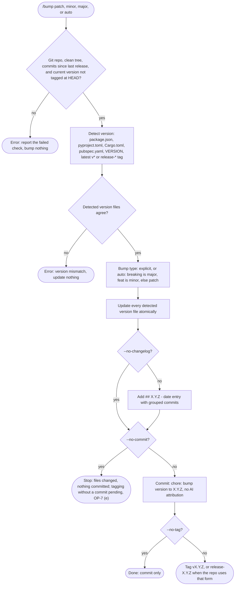

# spec-skills-git

## Metadata

| Field | Value |
|---|---|
| **Feature** | Git workflow skills: `/commit`, `/bump`, `/branch` |
| **Parent feature** | spec-skills.md |
| **Sub-features** | None |
| **Requirement refs** | BR-009, BR-010, UR-015, UR-028, UR-029, UR-030, FR-135, FR-136, FR-137, FR-138, FR-139, FR-140, FR-141 |
| **Feature type** | Tooling |
| **Status** | Draft |

Status values: Draft, Review, Approved, Implemented.

Paths that start with `skills/` are relative to `plugins/assist-plugin/`. Baseline: commit 4803a0d.

## Description

`/commit` writes Conventional Commits with no AI attribution. `/bump` detects the project version, picks the bump type, updates every version file, adds a changelog entry, and commits and tags. `/branch` creates, switches, and lists branches and removes finished worktrees under fixed guards. The `commit-attribution-guard` hook (Area B FR-095 to FR-098) backs the attribution rule; these skills keep the rule even where the hook cannot see the message.

## Triggered by

| Trigger type | Source | Condition |
|---|---|---|
| User action | `/commit [--squash] [--amend] [--scope SCOPE] [TYPE: message]` (`skills/commit/SKILL.md:9`) | Staged changes exist |
| User action | `/bump [patch \| minor \| major \| auto] [--path PATH] [--no-tag] [--no-commit]` (`skills/bump/SKILL.md:15`); the options table adds `--no-changelog` (`:91`), which the argument hint omits (pending: open point OP-7 in `spec-skills.md`) | A release is due |
| User action | `/branch [create \| switch \| list \| cleanup] [branch-name \| --dry-run]` (`skills/branch/SKILL.md:13`) | Branch work or cleanup |
| Orchestrator | `/do` Cleanup runs `references/worktree-cleanup.md` in targeted mode | Area A FR-063 owns that path |

## Required data

| Data | Source | Type | Notes |
|---|---|---|---|
| Staged diff | `git diff --cached` | Text | Basis for type, scope, subject |
| Commit options | `--squash`, `--amend`, `--scope SCOPE`, explicit `TYPE: message` | Flags, string | `skills/commit/SKILL.md:72-76` |
| Git identity | `git config user.name`, `git config user.email` | String | Never an assistant identity |
| Version source | `package.json`, `pyproject.toml`, `Cargo.toml`, `pubspec.yaml`, `VERSION`, latest `v*` or `release-*` tag | File, tag | Checked in that order (`skills/bump/SKILL.md:35-41`) |
| Commits since last release | `git log <tag>..HEAD` | Text | Drives `auto` and the changelog groups |
| Remote URL | `origin` | URL | Compare links only for GitHub or GitLab (`skills/bump/references/bump-strategy.md:160-165`) |
| Bump options | `patch`, `minor`, `major`, `auto`, `--path`, `--no-tag`, `--no-commit`, `--no-changelog` | Enum, flags | `skills/bump/SKILL.md:80-91` |
| Branch name | Argument | String | Naming conventions apply |
| Worktree list | `git worktree list --porcelain` | Text | `skills/branch/references/worktree-cleanup.md:39-47` |
| Default branch | `origin/HEAD`, else `main`, else `master` | Ref | `worktree-cleanup.md:32-37` |

## Behavior

### Requirement: Conventional commit format

The `/commit` skill SHALL compose messages as `<type>(<scope>): <subject>` with an imperative, present-tense subject of at most 50 characters and no trailing period.

**Requirement refs:** FR-135, UR-028 | **Status:** Built | **Source:** `skills/commit/SKILL.md:16-50`, `:86-92`

The type is one of `feat`, `fix`, `refactor`, `docs`, `test`, `chore`, `perf`, `ci`; the scope is optional. The Report Writing Standard applies to the body only (`:91`).

#### Scenario: Valid message

- **GIVEN** staged changes to the auth module
- **WHEN** the user runs `/commit`
- **THEN** the subject SHALL read like `feat(auth): implement JWT-based authentication`

#### Scenario: Explicit message

- **GIVEN** the user passes `fix: handle null user`
- **WHEN** the skill commits
- **THEN** the commit subject SHALL use type `fix` and subject `handle null user`

#### Scenario: Draft breaks the format

- **GIVEN** a drafted subject that ends with a period or runs past 50 characters
- **WHEN** the skill checks the draft
- **THEN** the committed subject SHALL have no trailing period and at most 50 characters

### Requirement: No AI attribution in commit and bump messages

The `/commit` and `/bump` skills SHALL leave every AI attribution line out of the commit message they compose, including when Claude Code's attribution setting asks for one.

**Requirement refs:** FR-136, UR-015, UR-028, UR-029, BR-009 | **Status:** Built | **Source:** `skills/commit/SKILL.md:52-70`, `:93`, `:100-109`; `skills/bump/SKILL.md:76`, `:108`; `skills/bump/references/bump-strategy.md:252`; `DECISIONS.md` (2026-10-12, No AI attribution in commits or PRs)

Attribution lines are: a `Co-Authored-By` line for an AI tool, a "Generated with" or "Generated by" line, a `Generated-By` or `Assisted-By` line for an LLM, a `*-Session:` trailer such as `Claude-Session:`, and a bare AI session link. Human co-authors and issue links are allowed.

#### Scenario: Setting asks for a trailer

- **GIVEN** `attribution.commit` is unset and Claude Code's instructions ask for a Co-Authored-By trailer
- **WHEN** the skill writes the message
- **THEN** the message SHALL carry no Co-Authored-By trailer for an AI tool
- **AND** the skill SHALL tell the user once that `/assist-plugin:health` reports the setting and that `{"attribution": {"commit": "", "pr": ""}}` turns it off, and SHALL NOT edit a settings file

#### Scenario: Human co-author

- **GIVEN** the user asks to credit a human co-author
- **WHEN** the skill writes the message
- **THEN** the message MAY carry that human's Co-Authored-By trailer

#### Scenario: Guard denies the commit

- **GIVEN** `commit-attribution-guard` denies a `git commit` and lists two lines
- **WHEN** the skill retries
- **THEN** it SHALL remove only the listed lines and retry with the same command form
- **AND** it SHALL NOT move the message into a variable, a pipe, an unreadable file, or a code fence, and SHALL NOT edit `hooks-disabled.json`

#### Scenario: Listed line names a person the user asked to credit

- **GIVEN** the guard lists a line that names a person the user asked to credit
- **WHEN** the skill handles the denial
- **THEN** it SHALL stop and tell the user and SHALL NOT remove the line

#### Scenario: Tag message

- **GIVEN** `/bump` creates an annotated tag
- **WHEN** it writes the tag message
- **THEN** the tag message SHALL carry no attribution line, although the guard does not check `git tag`

### Requirement: Version detection and bump type

The `/bump` skill SHOULD detect the version from `package.json`, `pyproject.toml`, `Cargo.toml`, `pubspec.yaml`, a `VERSION` file, or the latest `v*` or `release-*` tag, in that order, and in `auto` mode choose major for `BREAKING CHANGE:`, minor for `feat:`, and patch otherwise.

**Requirement refs:** FR-137, UR-029 | **Status:** Built | **Source:** `skills/bump/SKILL.md:33-51`; `skills/bump/references/bump-strategy.md:5-110`

A `!` after the type (for example `feat!:`) also selects major (`bump-strategy.md:76`).

#### Scenario: Auto minor

- **GIVEN** commits since the last tag include `feat:` and no breaking change
- **WHEN** the user runs `/bump auto`
- **THEN** the skill SHALL bump the minor version

#### Scenario: Breaking marker

- **GIVEN** one commit since the last tag reads `feat!: drop v1 API`
- **WHEN** the user runs `/bump auto`
- **THEN** the skill SHALL bump the major version

#### Scenario: Nothing to release

- **GIVEN** no commits since the last release
- **WHEN** the user runs `/bump auto`
- **THEN** the skill SHALL report `error: No commits since version X.Y.Z; nothing to bump` and bump nothing

### Requirement: Bump preconditions

The `/bump` skill SHALL change nothing unless it runs in a git repository with a clean working tree, at least one commit since the last version or tag, and a current version that does not match the tag at HEAD.

**Requirement refs:** FR-137, FR-138, UR-029 | **Status:** Built | **Source:** `skills/bump/SKILL.md:101-106`; `skills/bump/references/bump-strategy.md:189-213`

The HEAD-tag form follows `skills/bump/SKILL.md:106`. `bump-strategy.md:191-196` words the same check as the current version having a tag anywhere; which form applies is pending (open point OP-7 (a) in `spec-skills.md`). The "Clean repository" scenario follows the HEAD-tag form: its current version 1.2.0 carries the tag `v1.2.0` on an older commit, so under the other reading the skill would refuse the bump and the scenario's outcome would flip.

#### Scenario: Clean repository (follows the HEAD-tag form; pending OP-7 (a))

- **GIVEN** a git repository with a clean tree, version files at 1.2.0, and two commits since `v1.2.0`, so HEAD carries no tag
- **WHEN** the user runs `/bump patch`
- **THEN** the skill SHALL proceed to update the version files

#### Scenario: Uncommitted changes

- **GIVEN** the working tree has uncommitted changes
- **WHEN** the user runs `/bump patch`
- **THEN** the skill SHALL report `error: Uncommitted changes detected` and change no file

#### Scenario: Version already released

- **GIVEN** the current version is 1.0.0 and HEAD carries the tag `v1.0.0`
- **WHEN** the user runs `/bump minor`
- **THEN** the skill SHALL report that the version is already released and change no file

### Requirement: Version files and changelog entry

The `/bump` skill SHOULD update every detected version file and add a changelog entry headed `## [X.Y.Z] - date` with commits grouped under Breaking Changes, Features, Bug Fixes, and Other.

**Requirement refs:** FR-138, UR-029 | **Status:** Built | **Source:** `skills/bump/SKILL.md:53-71`, `:107`; `skills/bump/references/bump-strategy.md:36-38`, `:112-165`, `:254-263`

The update is atomic across files. Compare links are added only when `origin` is GitHub or GitLab. `--no-changelog` skips the entry. With `--path`, detection, commit parsing, version files, and `CHANGELOG.md` are limited to that directory.

#### Scenario: Minor bump

- **GIVEN** `package.json` holds 1.2.0 and a `feat:` commit exists
- **WHEN** the user runs `/bump minor`
- **THEN** `package.json` SHALL read 1.3.0 and `CHANGELOG.md` SHALL gain a dated `## [1.3.0]` entry with the feature under `### Features`

#### Scenario: Path option (commit subject and tag pending)

- **GIVEN** the user passes `--path ./backend` and `./backend/package.json` holds 1.2.0
- **WHEN** the skill runs `/bump minor --path ./backend`
- **THEN** it SHALL bump only the version files under `./backend` and write `./backend/CHANGELOG.md`
- **AND** it SHALL commit and tag at the repository root (`skills/bump/SKILL.md:119`; `bump-strategy.md:262-263`)

The commit subject and tag name for a `--path` bump are pending (open point OP-7 in `spec-skills.md`). FR-139 gives `chore: bump version to X.Y.Z` and `vX.Y.Z`; `bump-strategy.md:263` gives the tag as `subproject-v1.1.0` or `v1.1.0-subproject`; the example at `bump-strategy.md:275-276` uses `chore: bump services/auth to 1.1.0` and `services-auth-v1.1.0`. This scenario asserts none of them.

#### Scenario: Version file cannot be written

- **GIVEN** one detected version file is read-only
- **WHEN** the user runs `/bump patch`
- **THEN** the skill SHALL update no version file, because it updates all detected files atomically

#### Scenario: Version files disagree

- **GIVEN** `package.json` reads 1.0.0 and `Cargo.toml` reads 1.1.0
- **WHEN** the user runs `/bump patch`
- **THEN** the skill SHALL report the mismatch and update no file

### Requirement: Bump commit and tag

The `/bump` skill SHOULD commit with the message `chore: bump version to X.Y.Z` and tag `vX.Y.Z` (or `release-X.Y.Z` when the repository uses that form) unless `--no-commit` or `--no-tag` is passed.

**Requirement refs:** FR-139, UR-029 | **Status:** Built | **Source:** `skills/bump/SKILL.md:73-78`; `skills/bump/references/bump-strategy.md:241-252`

The scenarios below cover a bump at the repository root. For a `--path` bump the subject and tag are pending (open point OP-7 in `spec-skills.md`).

#### Scenario: Default

- **GIVEN** no flags
- **WHEN** the bump finishes
- **THEN** `git log -1 --format=%s` SHALL read `chore: bump version to X.Y.Z` and `git tag` SHALL list `vX.Y.Z`

#### Scenario: No tag

- **GIVEN** `--no-tag`
- **WHEN** the bump finishes
- **THEN** the skill SHALL commit and create no tag

#### Scenario: No commit

- **GIVEN** `--no-commit`
- **WHEN** the bump finishes
- **THEN** the skill SHALL create no commit and leave the changed files for review

Whether `--no-commit` without `--no-tag` still creates a tag is pending (open point OP-7 (e) in `spec-skills.md`); this scenario asserts nothing about a tag.

### Requirement: Branch create, switch, and list

The `/branch` skill SHOULD create `feature/`, `bugfix/`, `release/`, and `hotfix/` branches, switch branches with a stash of uncommitted changes when needed, and list local and remote branches.

**Requirement refs:** FR-140, UR-030 | **Status:** Built | **Source:** `skills/branch/SKILL.md:20-50`, `:71-76`

#### Scenario: Create

- **GIVEN** a clean repository
- **WHEN** the user runs `/branch create feature/user-auth`
- **THEN** `git branch --show-current` SHALL return `feature/user-auth`

#### Scenario: Switch with changes

- **GIVEN** uncommitted changes
- **WHEN** the user runs `/branch switch main`
- **THEN** the skill SHALL stash the changes before it switches, and `git stash list` SHALL show the new entry

#### Scenario: Name outside the conventions

- **GIVEN** the user asks for a bug-fix branch named `null-pointer`
- **WHEN** the skill creates it
- **THEN** the skill SHALL create `bugfix/null-pointer`

#### Scenario: Protected branch deletion

- **GIVEN** a request to delete `main` or `develop`
- **WHEN** the skill handles it
- **THEN** the skill SHALL refuse and leave the branch in place

### Requirement: Cleanup removes only finished worktrees

The `/branch cleanup` skill SHALL remove only linked worktrees whose branch or detached commit is an ancestor of the default branch, whose status is clean including untracked files, and that are unlocked, leaving the main worktree, the current worktree, and the default, `main`, `master`, and `develop` branches untouched.

**Requirement refs:** FR-141, UR-030 | **Status:** Built | **Source:** `skills/branch/SKILL.md:52-61`, `:76`; `skills/branch/references/worktree-cleanup.md:1-137`; `rules/assist-plugin-rule.md` (Worktree and Cache Cleanup)

Checks run in this order and the first failure skips the worktree with its reason: main or current (`main worktree`, `current directory`); path or branch outside `^[A-Za-z0-9._/-]+$` (`unsafe name`); protected branch (`protected branch`); `locked`; `git -C '<path>' status --porcelain --untracked-files=all` prints anything (`dirty`); `git merge-base --is-ancestor` fails (`not merged`). Removal uses `git worktree remove '<path>'` and `git branch -d '<branch>'` only; `--force`, `-D`, `git clean`, and `rm -rf` are never used.

#### Scenario: Dry run

- **GIVEN** `--dry-run`
- **WHEN** the skill runs
- **THEN** every action line SHALL read "would remove", "would delete", or "would clear", with the ignored-file listing and no space-freed line
- **AND** `git worktree list` SHALL show the same entries before and after

#### Scenario: Squash-merged branch

- **GIVEN** a worktree whose branch was squash-merged and shows as `not merged`
- **WHEN** the skill runs
- **THEN** it SHALL keep the worktree and the branch and list them as skipped with `not merged`

#### Scenario: Untracked file

- **GIVEN** a merged worktree that holds one untracked file
- **WHEN** the skill runs
- **THEN** it SHALL skip the worktree with reason `dirty`

#### Scenario: Default branch unknown

- **GIVEN** no `origin/HEAD`, no `main`, and no `master`
- **WHEN** the skill runs
- **THEN** it SHALL stop with "default branch unknown" and change nothing

#### Scenario: Git refuses a removal

- **GIVEN** `git worktree remove` refuses one eligible worktree
- **WHEN** the skill handles the refusal
- **THEN** it SHALL skip that worktree, keep its branch, record git's message, and continue with the next

### Requirement: Cleanup report and caches

The `/branch cleanup` skill SHALL report removed worktrees, deleted branches, caches cleared, ignored files removed with each worktree, space freed, skipped items with reasons, the stale-entry listing, and report-only commands.

**Requirement refs:** FR-141, UR-030 | **Status:** Built | **Source:** `skills/branch/references/worktree-cleanup.md:91-128`

The Go build and test caches are cleared with `(cd "$HOME" && go clean -cache -testcache)` when a removed worktree had `go.mod`; the module cache stays. Rust (`cargo clean`) and Gradle (`./gradlew clean`) are reported for the user to run, never run. `git worktree prune --dry-run --verbose` output is listed and nothing is pruned.

#### Scenario: Go worktree removed

- **GIVEN** a removed worktree that held `go.mod`
- **WHEN** step 6 runs
- **THEN** the report SHALL list the Go cache as cleared and SHALL NOT list a module-cache removal

#### Scenario: Cache step fails

- **GIVEN** `go clean` exits non-zero
- **WHEN** step 6 runs
- **THEN** the report SHALL record the failure and the removals already done SHALL stand

## Algorithmic steps

**`/commit`:** stage changes; run `/commit`; choose type and scope (asking when unclear); write the message under the format and attribution rules; commit; verify with `git log -1 --format=%B` that no attribution line is present, and amend only that line out if one is. The skill commits with the local developer's git identity and never sets `git config user.name` or `user.email` to an assistant identity (`skills/commit/SKILL.md:94`); no FR states this rule, so it carries no Requirement block here (open point OP-11 in `spec-skills.md`).

**`/bump`:**

Render source: `specs/spec-skills-git-bump.mmd`.

**`/branch cleanup`** (sweep mode; `/do` uses targeted mode, Area A FR-063). Steps 1 to 4 that fail stop the run and change nothing; a step 5 failure skips that worktree; a step 6 failure is reported and never blocks (`worktree-cleanup.md:16-20`).

Render source: `specs/spec-skills-git-branch-cleanup.mmd`.

## Output / Outcome

| Output | Type | Description |
|---|---|---|
| Commit | Git state | Conventional subject, body under the writing standard, no AI attribution, developer identity |
| Version files | File change | Every detected file at the new version |
| `CHANGELOG.md` entry | File change | `## [X.Y.Z] - YYYY-MM-DD` with Breaking Changes, Features, Bug Fixes, Other, and compare links when the remote allows |
| Bump commit and tag | Git state | `chore: bump version to X.Y.Z`; `vX.Y.Z` or `release-X.Y.Z` |
| New or switched branch | Git state | Conventional name; stash entry when changes were present |
| Cleanup report | Chat report | Removed, deleted, caches, ignored files, space freed (not in dry run), skipped with reasons, stale entries, report-only commands |

## Error handling

| Error condition | Handling strategy | Outcome |
|---|---|---|
| Attribution guard denies a commit | Remove only the listed lines; retry the same command form | Commit without the lines; person-named lines go to the user |
| Attribution setting asks for a trailer | Leave the trailer out; tell the user once about the setting | No settings file is edited |
| Not a git repository, dirty tree, no new commits, or current version tagged at HEAD | `/bump` reports the failed check (the HEAD-tag form is pending, OP-7 (a)) | No file changes |
| No version file found | Error naming the files searched (`bump-strategy.md:207-213`) | No file changes |
| Version files disagree | Error with both values | No file changes |
| Remote is not public GitHub or GitLab | Warn and ask `Continue? (yes/no)`; changelog without links (`bump-strategy.md:223-229`) | Entry written without compare links |
| Branch name outside conventions | Apply the convention prefix | `bugfix/<name>` and similar |
| Delete `main` or `develop` requested | Refuse | Branch kept |
| Cleanup steps 1 to 4 fail | Stop and report the step and message | Nothing changed |
| `git worktree remove` or `git branch -d` refuses | Skip, keep the branch, record the message | Other worktrees continue |
| Cache clear fails | Report and continue | Removals stand |

## Events emitted (if applicable)

Not applicable: the skills change git state and files and emit no events.

## Dependencies

| Dependency | Type | Required | Notes |
|---|---|---|---|
| git | External | yes | All three skills (`README.md:151`) |
| `commit` tool grant | Runtime | yes | Bash only, unscoped (`skills/commit/SKILL.md:7-8`; OP-6 in `spec-skills.md`); the skill text says it runs on Haiku (`:96-98`) while its frontmatter sets no model (OP-11) |
| `bump` tool grants | Runtime | yes | Read, Write, Edit, Grep, Glob, Bash, with Write, Edit, and Bash unscoped (`skills/bump/SKILL.md:8-14`; OP-6 in `spec-skills.md`) |
| `branch` tool grants | Runtime | yes | `Bash(git:*)`, `Bash(df:*)`, `Bash(go clean:*)`, `Bash(realpath:*)` (`skills/branch/SKILL.md:8-12`) |
| `commit-attribution-guard` hook | Runtime | no (fail open) | Area B FR-095 to FR-098; does not cover `git tag` |
| Claude Code `attribution` settings | External | no | Reported by `/health` (Area B FR-120) |
| Go toolchain | External | no | Only for the cache clear |

## Sub-feature breakdown (if applicable)

Not applicable: this spec has no sub-features.

## Submodule scope (if applicable)

Not applicable: the repository has no submodules.

## Traceability

| Requirement | Spec section | Verified by |
|---|---|---|
| FR-135 | Requirement: Conventional commit format | Manual `/commit` runs; `git log -1 --format=%s` length and format check |
| FR-136 | Requirement: No AI attribution in commit and bump messages | `git log -1 --format=%B` after `/commit` and `/bump` with `attribution.commit` unset; guard-denial retry run |
| FR-137 | Requirement: Version detection and bump type; Requirement: Bump preconditions | `/bump auto` in fixture repos with `feat:`, `feat!:`, and no new commits |
| FR-138 | Requirement: Version files and changelog entry; Requirement: Bump preconditions | `/bump minor` fixture with `package.json` 1.2.0; read-only file and mismatch fixtures |
| FR-139 | Requirement: Bump commit and tag | `git log` and `git tag` after runs with no flags, `--no-tag`, `--no-commit` |
| FR-140 | Requirement: Branch create, switch, and list | Manual `/branch` runs with and without uncommitted changes |
| FR-141 | Requirement: Cleanup removes only finished worktrees; Requirement: Cleanup report and caches | Fixture repo with merged, squash-merged, dirty, locked, and detached worktrees; `--dry-run` comparison of `git worktree list` |
| UR-015, BR-009 | Requirement: No AI attribution in commit and bump messages | As above |
| UR-028, UR-029, UR-030, BR-010 | Requirements above, by their refs | As listed per requirement |
