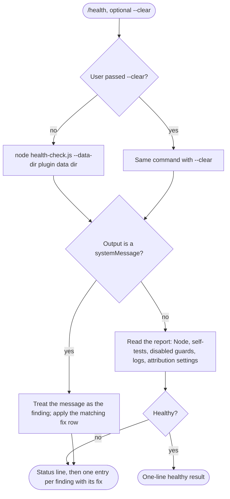

# spec-skills-health

## Metadata

| Field | Value |
|---|---|
| **Feature** | Hook health skill: `/health` |
| **Parent feature** | spec-skills.md |
| **Sub-features** | None |
| **Requirement refs** | BR-007, UR-018, FR-166, FR-118 |
| **Feature type** | Tooling |
| **Status** | Approved |

Status values: Draft, Review, Approved, Implemented.

Paths that start with `skills/` or `hooks/` are relative to `plugins/assist-plugin/`. Baseline: assist-plugin 1.11.1 at commit 41034c1; `skills/health/SKILL.md` was re-read on 2026-10-16 and every cite below holds. The PLANNED (1.12.0) change for a failed `writing-context` self-test is in the Change Log at the end; the body keeps the built behavior.

## Description

`/health` runs the plugin's health-check script, then summarizes the result in a few lines and pairs each finding with its fix. The script itself (self-tests, auto-disable, the report sections, the attribution-settings check, and `--clear`) belongs to Area B (FR-091, FR-118 to FR-120); this spec covers what the skill runs, how it reads the output, and what it tells the user. The 1.12.0 changes to the script (FR-091, FR-118, Area B) add a `writing-context` self-test whose failure is reported and never disables the hook; the skill's summary gains the matching finding and fix row (Change Log 2026-10-16).

Resolved source difference (OP-2, built in 1.11.1): the skill's overview (`skills/health/SKILL.md:17`) now says the prose hooks skip `docs/tts/` under the project root and under the session's working directory when that directory is inside the project, as `DECISIONS.md:73-76` and FR-181 (Area B, built in 1.11.1) state. No requirement in this spec depends on that line.

## Triggered by

| Trigger type | Source | Condition |
|---|---|---|
| User action | `/health [--clear]` (`skills/health/SKILL.md:12`); `README.md:259` uses `/assist-plugin:health` | The user wants hook status, or a hook warning or session-start notice pointed here |
| Fix follow-up | A finding's fix says to run `/assist-plugin:health` again (`skills/health/SKILL.md:40-58`, `:88`) | After the user fixed a cause |

## Required data

| Data | Source | Type | Notes |
|---|---|---|---|
| `--clear` | Argument | Flag | Passed on only when the user typed it |
| `${CLAUDE_PLUGIN_ROOT}` | Claude Code | Path | Locates `hooks/health-check.js` |
| `${CLAUDE_PLUGIN_DATA}` | Claude Code | Path | Data directory holding `hook-health.jsonl`, `fsa-log.jsonl`, `hooks-disabled.json` |
| Script output | `hooks/health-check.js` | Text report, or `{"systemMessage": ...}` | Node version, self-test results, disabled guards, recent health-log entries, recent `fsa-log` problem rows, attribution-settings section |
| Findings and fixes table | `skills/health/SKILL.md:36-66` | Table | One fix per finding kind |
| FSA problem codes | `skills/health/SKILL.md:68-86` | Table | `no-block`, `fsa-mismatch`, `bad-state`, and ten more |

## Behavior

### Requirement: Run the health check with the user's flag

The `/health` skill SHALL run `node "${CLAUDE_PLUGIN_ROOT}/hooks/health-check.js" --data-dir "${CLAUDE_PLUGIN_DATA}"`, adding `--clear` only when the user passed it.

**Requirement refs:** FR-166, UR-018 | **Status:** Built | **Source:** `skills/health/SKILL.md:8-11`, `:19-28`

The skill's grants allow exactly these two command forms plus Read. With `--clear` the script shows the logs first and then truncates `hook-health.jsonl`; it never truncates `fsa-log.jsonl` (Area B FR-119).

#### Scenario: Plain run

- **GIVEN** the user runs `/health`
- **WHEN** the skill runs the check
- **THEN** the command SHALL be the form without `--clear`

#### Scenario: Clear requested

- **GIVEN** the user runs `/health --clear`
- **WHEN** the skill runs the check
- **THEN** the command SHALL be the form with `--clear`

#### Scenario: Long log without the flag

- **GIVEN** the user runs `/health` and the report shows many old log entries
- **WHEN** the skill finishes
- **THEN** it SHALL NOT run the `--clear` form; it MAY suggest `/assist-plugin:health --clear` once the entries are handled

### Requirement: Short summary with a fix per finding

The `/health` skill SHALL summarize the status in a few lines and give each finding its fix from the findings table.

**Requirement refs:** FR-166, UR-018, BR-007 | **Status:** Built | **Source:** `skills/health/SKILL.md:34-66`, `:88`

The summary starts with the overall status (healthy or needs attention), then one entry per finding. A clean report prints `PASS` for every hook and `Disabled guards: none`. For an attribution-settings finding the fix tells the user to set `{"attribution": {"commit": "", "pr": ""}}` in the file the report names; neither the skill nor the script edits a settings file.

#### Scenario: Healthy

- **GIVEN** every self-test passes and no guard is disabled
- **WHEN** the user runs `/health`
- **THEN** the skill SHALL report the healthy result in one line

#### Scenario: Guard disabled by a failed self-test

- **GIVEN** the report lists `doc-cli-guard` under disabled guards after a "known-safe command was DENIED" failure
- **WHEN** the skill summarizes
- **THEN** the entry SHALL say the guard passes commands unchecked and give the fix: report the bug with the report output, and run `/assist-plugin:health` again after a plugin update

#### Scenario: Attribution setting not empty

- **GIVEN** the report says `attribution.commit` is unset in `~/.claude/settings.json`
- **WHEN** the skill summarizes
- **THEN** the entry SHALL name the file and key and show `{"attribution": {"commit": "", "pr": ""}}`
- **AND** no settings file SHALL change

#### Scenario: FSA problem rows

- **GIVEN** the report lists `fsa-log.jsonl` rows with the code `illegal-transition: Intake>Review` for `reviewer`
- **WHEN** the skill summarizes
- **THEN** the entry SHALL explain the code from the problem-code table and point at the agent's `## States` table

### Requirement: System message read as the finding

The `/health` skill SHALL treat a `{"systemMessage": ...}` printed in place of a report as the finding and apply the matching fix row.

**Requirement refs:** FR-166, UR-018 | **Status:** Built | **Source:** `skills/health/SKILL.md:32`, `:40-41`, `:66`

#### Scenario: Unsupported Node

- **GIVEN** the script prints a `systemMessage` naming `unsupported-node`
- **WHEN** the skill reads it
- **THEN** the skill SHALL report that guards pass every command unchecked and give the fix: install or upgrade Node to the minimum shown, then run `/assist-plugin:health` again

#### Scenario: Node missing

- **GIVEN** the command fails with `node: command not found`
- **WHEN** the skill reads the output
- **THEN** the skill SHALL report that guards cannot run and point at the Node row in `README.md`

#### Scenario: Data directory unset

- **GIVEN** `CLAUDE_PLUGIN_DATA` is not set
- **WHEN** the skill reads the output
- **THEN** the skill SHALL report that failures cannot be logged and guards cannot be auto-disabled, and tell the user to run through Claude Code with the plugin installed

## Algorithmic steps

1. Read whether the user passed `--clear`.
2. Run the matching command form.
3. If the output is a `systemMessage`, treat it as the finding and go to step 5.
4. Read the report sections: Node version, self-test results, disabled guards, health-log entries, `fsa-log` problem rows and count since the last report, attribution settings.
5. Report the overall status; when healthy, stop at one line; otherwise list one entry per finding with its fix row.

Render source: `specs/spec-skills-health.mmd`. Rendering skipped: see the note in `spec-skills.md`.

## Output / Outcome

| Output | Type | Description |
|---|---|---|
| Health summary | Chat | One line when healthy; otherwise status plus one entry per finding with its fix |
| Truncated `hook-health.jsonl` | State change | Only with `--clear`, done by the script after it shows the log |

## Error handling

| Error condition | Handling strategy | Outcome |
|---|---|---|
| Script prints a `systemMessage` | Treat it as the finding | Matching fix row |
| `node` missing | Report the Node row fix | User installs Node |
| `CLAUDE_PLUGIN_DATA` unset | Report the fix row | User runs through Claude Code with the plugin installed |
| Guard self-test denied a known-safe case | Report the disabled guard and the bug-report fix | Guard stays disabled until a passing self-test |
| Guard self-test allowed a known-prohibited case | Report weak protection | Guard stays enabled |
| Attribution setting unset or not `""` | Name the file and key; show the setting | No settings file edited |
| Health-log kinds (`exception`, `timeout`, `missing-standard`, `standard-truncated`, `log-write-error`, and others) | Report each with its fix row (`skills/health/SKILL.md:59-65`) | The user acts on the fix |

## Events emitted (if applicable)

Not applicable: the skill reports in chat and emits no events.

## Dependencies

| Dependency | Type | Required | Notes |
|---|---|---|---|
| `hooks/health-check.js` | Runtime | yes | Area B FR-091, FR-118 to FR-120 |
| Node.js 6 or newer | External | yes | Without it the script cannot run (`README.md:155`) |
| `CLAUDE_PLUGIN_ROOT`, `CLAUDE_PLUGIN_DATA` | Runtime | yes | Set by Claude Code (FR-NFR section 7) |
| Health and FSA logs | Runtime | no | Area B FR-090 and FR-115 fix their content and line caps |
| Tool grants | Runtime | yes | The two exact Bash forms and Read (`skills/health/SKILL.md:8-11`) |

## Sub-feature breakdown (if applicable)

Not applicable: this spec has no sub-features.

## Submodule scope (if applicable)

Not applicable: the repository has no submodules.

## Traceability

| Requirement | Spec section | Verified by |
|---|---|---|
| FR-166 | Requirement: Run the health check with the user's flag; Requirement: Short summary with a fix per finding; Requirement: System message read as the finding | Manual `/health` and `/health --clear` runs with a healthy state, a disabled guard, an unset attribution key, and Node below 6; command log shows only the two allowed forms |
| UR-018 | All requirements | As above |
| BR-007 | Requirement: Short summary with a fix per finding | As above |
| FR-166, FR-118 (1.12.0 change) | Change Log 2026-10-16, MODIFIED Requirement: Short summary with a fix per finding | `/health` run with `rules/writing-standard-compact.md` made unreadable: the summary names the failed `writing-context` self-test, says the hook stays enabled, gives the restore fix, and `hooks-disabled.json` holds no `writing-context` entry; read of the findings table for the new row |

## Change Log: 2026-10-16

**Source:** `docs/requirements/FR-NFR-assist-plugin.md` version 1.1 (2026-10-16, final and approved, read for fix pass 1; line cites checked against the current file on 2026-10-17): FR-118 (`:2478-2507`, Area B) adds the `writing-context` self-test, PLANNED (1.12.0), and its scenario "Failed writing-context self-test" (`:2489-2492`) has the health check report the failure and never add `writing-context` to `hooks-disabled.json`; FR-166 (Area C) holds what `/health` tells the user. Decisions: `DECISIONS.md:168-171` ("A failed writing-context self-test is reported and never disables writing-context"); the answers to OP-B5a and OP-B5b under User Decisions in `.agent/main-plan/plan-deferred-decisions-20261016-1059.md`.

Every change in this entry is PLANNED (1.12.0). This spec received a delta in fix pass 1, so its Status moves to `Review` (FR-154).

### MODIFIED Requirements

#### Requirement: Short summary with a fix per finding

**Was:** The `/health` skill SHALL summarize the status in a few lines and give each finding its fix from the findings table. At 1.11.1 `writing-context` has no self-test (`skills/health/SKILL.md:17`), and the findings table (`:36-66`) has no row for one.
**Now:** The statement is unchanged, and the findings table gains a row for a failed `writing-context` self-test: the hook stays enabled, sessions and subagents may start without the writing standard, and the fix is to restore `rules/writing-standard-compact.md` by reinstalling or updating the plugin and to report the bug when the plugin files are unmodified.
**Reason:** FR-118 adds the self-test, and `DECISIONS.md:168-171` makes its failure report-only.
**Requirement refs:** FR-166, FR-118, UR-018, BR-007 | **Status:** PLANNED (1.12.0) | **Source:** `docs/requirements/FR-NFR-assist-plugin.md:2480`, `:2489-2492`; `skills/health/SKILL.md:17`, `:36-66`

##### Scenario: Failed writing-context self-test

- **GIVEN** the report shows the `writing-context` self-test failed because `rules/writing-standard-compact.md` is unreadable
- **WHEN** the skill summarizes
- **THEN** the entry SHALL say `writing-context` stays enabled and sessions may start without the writing standard, and SHALL give the fix: restore the file by reinstalling or updating the plugin, then run `/assist-plugin:health` again
- **AND** the entry SHALL NOT list `writing-context` under disabled guards, and no settings or `hooks-disabled.json` file SHALL change because of the skill

##### Scenario: Passing writing-context self-test

- **GIVEN** every self-test, the `writing-context` one included, passes and no guard is disabled
- **WHEN** the user runs `/health`
- **THEN** the skill SHALL report the healthy result in one line and SHALL NOT mention `writing-context`

##### Scenario: Overview no longer says there is no self-test

- **GIVEN** `skills/health/SKILL.md` after the change
- **WHEN** a test reads the overview (`:17` at 1.11.1)
- **THEN** it SHALL say `writing-context` has a self-test whose failure is reported and never disables the hook, and SHALL NOT say the hook has no self-test

### ADDED Requirements

None.

### REMOVED Requirements

None.

### Planned conformance (files that change with this entry)

| File and line at 1.11.1 | Change | Requirement |
|---|---|---|
| `skills/health/SKILL.md:17` | The `writing-context` sentence "it has no self-test, so its failures show only in the log" becomes a self-test whose failure is reported and never disables the hook | FR-118, FR-166 |
| `skills/health/SKILL.md:36-66` | The findings table gains a row: `writing-context` self-test FAIL, meaning (the hook stays enabled; sessions may start without the standard), fix (restore `rules/writing-standard-compact.md` by reinstalling or updating the plugin; report the bug if the plugin files are unmodified) | FR-166 |

The self-test itself and the notice text live in `hooks/impl/health-check.js` (Area B, FR-118); this spec covers only what `/health` tells the user.

### Direct edits in this pass (no behavior change)

Status set to `Review`; Requirement refs gain FR-118; the baseline note and the Description sentence on the 1.12.0 script changes point here. On 2026-10-17 the FR-118 cites were checked against the current file, in which FR-094 gained scenarios: `:2468-2497` to `:2478-2507`, `:2470` to `:2480`, `:2479-2482` to `:2489-2492`.
