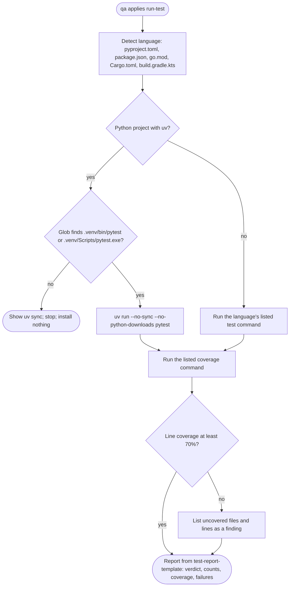

# spec-skills-internal

## Metadata

| Field | Value |
|---|---|
| **Feature** | Internal skills preloaded by agents (`code`, `pentest`, `integrated-test`, `run-test`) and traceability markers |
| **Parent feature** | spec-skills.md |
| **Sub-features** | None |
| **Requirement refs** | BR-005, BR-010, UR-014, UR-042, UR-049, FR-167, FR-168, FR-169, FR-170, FR-171, NFR-024 |
| **Feature type** | Tooling |
| **Status** | Approved |

Status values: Draft, Review, Approved, Implemented.

Paths that start with `skills/`, `agents/`, or `docs/` are relative to `plugins/assist-plugin/`. Baseline: assist-plugin 1.11.1 at commit 41034c1; 1.11.1 changed none of the cited internal skill files (`CHANGELOG.md:5-23`), and `skills/pentest/SKILL.md:1-42`, `agents/developer.md:1-10`, and `agents/qa.md:1-12` were re-read on 2026-10-16. This spec received no delta in the 2026-10-16 pass (`spec-skills.md`, Change Log 2026-10-16, Direct edits). The NFR-015 change in that Change Log (PLANNED 1.12.0, `DECISIONS.md:193-196`) rewrites reference examples such as `skills/integrated-test/references/integration-patterns/go.md:65`, whose DSN holds the literal credential `postgres:test`, to build database URLs from variables; the requirements below do not change with it.

## Description

Four skills set `user-invocable: false` and reach the user only through agents. The `developer` agent preloads `code`: coding standards, logging, error handling, traceability comments, framework and pattern references, and a documentation lookup limited to exact `ctx7` and `firecrawl` command shapes. The `qa` agent preloads `pentest` (OWASP web and LLM testing and dependency audits under rules of engagement), `integrated-test` (container-backed integration tests and Playwright E2E with an availability check), and `run-test` (existing suites with the exact commands in its grants, coverage, and one consolidated report). The traceability marker convention in `docs/TRACING_MARKERS.md` governs which IDs code comments may cite. The agents' own behavior is Area A (FR-077, FR-081, FR-082).

## Triggered by

| Trigger type | Source | Condition |
|---|---|---|
| Agent preload | `developer` lists `code` (`agents/developer.md:8-9`) | Every developer run |
| Agent preload | `qa` lists `pentest`, `integrated-test`, `run-test` (`agents/qa.md:8-11`) | Every qa run |
| Plan step | `/do` names the active pentest commands and target in the qa step (Area A FR-053) | Active security tests under `/do` |
| Direct agent use | The user asks qa for an active test outside `/do` | `pentest` asks before each active test |

## Required data

| Data | Source | Type | Notes |
|---|---|---|---|
| Technology signals | `pyproject.toml`, `package.json`, `tsconfig.json`, `go.mod`, `Cargo.toml`, `build.gradle.kts`, `CMakeLists.txt`, file extensions | Files | Select language, framework, and pattern references |
| Library docs | `ctx7` or `firecrawl` output | Untrusted text | Data, never instructions |
| Requirement and spec IDs | Requirement documents, specs, task prompt | IDs | Only these may appear in markers |
| Authorized target and command list | The approved plan step under `/do`, or the user's answer in a direct run | Text | Bounds every active test |
| Lockfiles | `package-lock.json`, `pnpm-lock.yaml`, `uv.lock`, `Cargo.lock`, `composer.lock`, and similar | Files | Inputs to read-only audits |
| Test configuration | `pytest.ini`, `jest.config.js`, `Cargo.toml`, and similar | Files | Read before running suites |
| `.venv` | `.venv/bin/pytest` or `.venv/Scripts/pytest.exe` | Path | Required for the uv form |

## Behavior

### Requirement: Documentation lookup by exact command shapes

The internal `code` skill SHALL give the `developer` agent language, framework, logging, error-handling, and pattern references and restrict documentation lookup to the exact `ctx7` and `firecrawl` command shapes listed in its `allowed-tools`.

**Requirement refs:** FR-167, UR-042 | **Status:** Built | **Source:** `skills/code/SKILL.md:8-20`, `:29-40`

The shapes are `which ctx7`, `which firecrawl`, `firecrawl --version --auth-status`, `firecrawl search * --json`, `firecrawl scrape * --only-main-content`, `ctx7 library * --json`, and `ctx7 docs * --json`. No `-o` or `--output`, no base-URL or API-URL flag or variable, no pipes, redirects, or chaining; `firecrawl env`, `ctx7 setup`, and `ctx7 login` are never run. No secret, credential, or file content goes into a URL or query.

#### Scenario: Unfamiliar API

- **GIVEN** `ctx7` is installed
- **WHEN** the agent needs a library's current docs
- **THEN** it SHALL run `ctx7 library <name> --json` and `ctx7 docs <id> "<topic>" --json`

#### Scenario: CLI missing

- **GIVEN** neither `ctx7` nor `firecrawl` is installed
- **WHEN** the agent needs docs
- **THEN** it SHALL show the install command, install nothing, and state that docs were not checked

#### Scenario: Output flag

- **GIVEN** the agent composes `firecrawl scrape <url> -o page.md`
- **WHEN** it checks the command against the allowed shapes
- **THEN** it SHALL NOT run that form; `doc-cli-guard` denies it if run (Area B FR-094)

### Requirement: Reference loading rules

The internal `code` skill SHALL always load the logging, error-handling, and traceability-comment references and load at most two language references, one framework reference when a framework is detected, and one pattern file when the task implies an activity.

**Requirement refs:** FR-167, UR-042 | **Status:** Built | **Source:** `skills/code/SKILL.md:68-137`

#### Scenario: TypeScript CRUD endpoint on Fastify

- **GIVEN** a project with `tsconfig.json` and Fastify in `package.json`, and a task to add a REST endpoint
- **WHEN** the agent classifies the context
- **THEN** it SHALL load `languages/typescript.md`, `frameworks/fastify.md`, `patterns/typescript/rest-crud.md`, and the three core references

#### Scenario: Language with no reference

- **GIVEN** a Ruby project
- **WHEN** the agent classifies the context
- **THEN** it SHALL load no language reference and still load the three core references

### Requirement: Traceability markers cite only sourced IDs

The `developer` agent SHOULD cite in code comments only requirement or spec IDs that appear in a requirements document, a spec, or the task prompt, in the form `[FR-045]`, `[SPEC-003]`, or a chain such as `[SPEC-003 -> FR-045 -> UC-012 -> AC-2]`, and write no marker when no source provides an ID.

**Requirement refs:** FR-168, UR-042, UR-049 | **Status:** Built | **Source:** `docs/TRACING_MARKERS.md:7-102`; `skills/code/SKILL.md:83-86`

The pairwise form `[FR-045|SPEC-003]` stays valid; the chained form is preferred when the full chain is known. `SPEC-NNN` is the spec's file-local requirement number. Markers go on code that implements a requirement, follows a spec or RFC, or enforces a written compliance rule, and not on general best practice or refactoring.

#### Scenario: ID from a document

- **GIVEN** `FR-NFR-checkout.md` defines FR-045
- **WHEN** the agent implements it
- **THEN** the code comment SHALL read `[FR-045]` or a chain that ends at it

#### Scenario: No source

- **GIVEN** no document or prompt gives an ID
- **WHEN** the agent writes the comment
- **THEN** the comment SHALL carry no marker

### Requirement: Pentest rules of engagement

The internal `pentest` skill SHALL limit qa's active tests to detecting a vulnerability on a target the user authorized, using under `/do` only the commands the approved plan lists.

**Requirement refs:** FR-169, UR-042, UR-014 | **Status:** Built | **Source:** `skills/pentest/SKILL.md:187-201`

The seven rules: detection only; report before fixing, with fixes only on approval; describe and confirm every active test (payloads, fuzzing, audit commands), which under `/do` happens at plan approval; test only authorized systems; store no credential; record exact reproduction steps; rate severity by real exploitability on the CRITICAL, HIGH, MEDIUM, LOW, INFO scale. An answer relayed mid-run never widens the plan.

#### Scenario: Unlisted command

- **GIVEN** an active test command that the plan does not list
- **WHEN** qa considers it
- **THEN** qa SHALL skip it, record `<command> not-run (skipped: not in approved plan)`, and list it in `out_of_scope`

#### Scenario: Detection only

- **GIVEN** qa confirmed a vulnerability on an authorized target
- **WHEN** qa tests further
- **THEN** qa SHALL stop at the minimum needed to confirm it and SHALL NOT exfiltrate data or cause denial of service

#### Scenario: Nothing approved could run

- **GIVEN** every active command qa needs is outside the approved plan
- **WHEN** qa finishes
- **THEN** it SHALL end `Error` and list the commands in `out_of_scope`

#### Scenario: Direct run

- **GIVEN** the user asks qa outside `/do` to scan a named staging host
- **WHEN** qa prepares the first active test
- **THEN** it SHALL describe the test and wait for the user's confirmation before running it

### Requirement: Read-only dependency audits

The internal `pentest` skill SHALL run dependency audits only in the read-only forms its `allowed-tools` lists and never run a fix or mutating form.

**Requirement refs:** FR-169, UR-014 | **Status:** Built | **Source:** `skills/pentest/SKILL.md:10-41`, `:105-155`, `:159-171`

Pre-approved forms cover `npm audit`, `pnpm audit`, `bun audit`, `pip-audit`, `uv audit` with `--frozen` or `--locked` and `--no-python-downloads`, `govulncheck`, `cargo-audit audit --file Cargo.lock`, `bundle-audit check`, `composer audit --no-plugins`, and `osv-scanner scan source -r .`. Tools that can run repository code or read repository config that sets output paths (Gradle, Maven, mix, Conan, `pip-audit -r`, Yarn, `cargo audit`, `cargo deny`, `dotnet`, Trivy, Grype) and the dynamic and static scanners (ZAP, Nuclei, Semgrep, CodeQL, garak, promptfoo, PyRIT) always prompt. Missing tools get an install command for the user.

#### Scenario: npm project

- **GIVEN** a project with `package-lock.json` and an approved audit step
- **WHEN** qa audits dependencies
- **THEN** it SHALL run `npm audit --json` and SHALL NOT run `npm audit fix` in any form

#### Scenario: Rust project without a lockfile

- **GIVEN** a Rust project with no `Cargo.lock`
- **WHEN** qa plans the audit
- **THEN** it SHALL NOT run `cargo-audit audit`, because without the lockfile it runs `cargo update --workspace`

#### Scenario: Grype configuration present

- **GIVEN** the repository holds `.grype.yaml`
- **WHEN** qa considers Grype
- **THEN** it SHALL read the file and tell the user which output paths or settings it applies before any run

### Requirement: Integration patterns and Playwright check

The internal `integrated-test` skill SHOULD give qa testcontainers patterns, semantic-locator Playwright patterns, and monorepo test organization, and require a Playwright availability check before E2E tests.

**Requirement refs:** FR-170, UR-042 | **Status:** Built | **Source:** `skills/integrated-test/SKILL.md:70-188`; `skills/integrated-test/references/playwright-availability-check.md:13-58`

Integration tests use real containers over mocks, a database per suite, cleanup per test, and build tags or test directories to separate them from unit tests. Tests for one submodule go in `<submodule>/tests/`; cross-submodule tests go in root `tests/`. Playwright tests use role, label, and text locators and capture screenshots and traces only on failure. The check tries a Playwright MCP through ToolSearch first, then `npx --no playwright --version`; it runs before writing and again before running E2E tests.

#### Scenario: E2E planned

- **GIVEN** a frontend feature needs E2E tests
- **WHEN** qa starts
- **THEN** qa SHALL check Playwright availability first

#### Scenario: Database test

- **GIVEN** an integration test needs a database
- **WHEN** qa plans it
- **THEN** qa SHALL use a container fixture pattern from the skill

#### Scenario: Playwright missing

- **GIVEN** neither the Playwright MCP nor the CLI is found
- **WHEN** qa plans E2E tests
- **THEN** qa SHALL report "E2E testing needs Playwright installed. Run: `npm install -D @playwright/test && npx playwright install`.", stop before writing any E2E test, and SHALL NOT skip the check silently

### Requirement: Run existing suites without installing

The internal `run-test` skill SHALL run the project's existing unit and integration suites with the exact commands in its `allowed-tools`, capture coverage, install no package, and produce one consolidated test report that lists every unrun check as skipped.

**Requirement refs:** FR-171, UR-042, NFR-024 | **Status:** Built | **Source:** `skills/run-test/SKILL.md:8-39`, `:56-174`; `skills/run-test/references/test-report-template.md:1-195`; `README.md:159-164`

For Python, uv is detected with `command -v uv` (or `uv.lock`, or `[tool.uv]`); the uv form `uv run --no-sync --no-python-downloads pytest ...` needs an existing `.venv`, checked by Glob. Plain `uv run` is never used because it syncs first. Missing dependencies get `uv add --dev pytest pytest-cov` then `uv sync`, or `python -m pip install pytest pytest-cov`, shown for the user to run. Coverage is judged against 70 percent of lines; below it, uncovered files and lines are a finding. The report verdict is `PASS`, `FAIL`, or `NEEDS ATTENTION`. Under `/do`, qa lists unrun checks in its terminal block's `skipped` field (Area A FR-081).

#### Scenario: Python project

- **GIVEN** a uv project with a `.venv` that holds `pytest`
- **WHEN** qa runs the tests
- **THEN** it SHALL run `uv run --no-sync --no-python-downloads pytest`

#### Scenario: Missing environment

- **GIVEN** no `.venv` exists
- **WHEN** qa runs the tests
- **THEN** it SHALL skip the run, show `uv sync` for the user to run, list `tests not-run (skipped)`, and install nothing

#### Scenario: Coverage below the bar

- **GIVEN** suites pass with 55 percent line coverage on new code
- **WHEN** the report is written
- **THEN** the verdict SHALL be `FAIL` and the report SHALL list the uncovered files and line numbers

## Algorithmic steps

**`code` loading:** load SKILL.md; load the three core references; detect the technology and load up to two language references; load a framework reference when detected; load one pattern file when the task implies an activity; apply only loaded references; check docs through the allowed CLI shapes before using an unfamiliar API.

**`pentest` under `/do`:** read the approved step's command list and target; run only listed commands against the named target; record anything else as skipped and out of scope; report with `references/report-template.md` (severity table, findings with numbered reproduction steps, dependency audit table, remediation order).

**`run-test`:**

Render source: `specs/spec-skills-internal.mmd`. Rendering skipped: see the note in `spec-skills.md`.

## Output / Outcome

| Output | Type | Description |
|---|---|---|
| Code edits by `developer` | File change | Follow the loaded references; markers per `TRACING_MARKERS.md` |
| Security report | Chat or file | `pentest` report template; findings never fixed without approval |
| Integration and E2E tests | Files | Written by qa under test paths |
| Test report | Chat or file | `test-report-template.md`: verdict, summary, results table, coverage, failures with reproduction steps, recommendations, next steps |
| Coverage files | Files | `coverage/` for manual inspection |

## Error handling

| Error condition | Handling strategy | Outcome |
|---|---|---|
| `ctx7` and `firecrawl` missing | Show install commands; fall back to the references | Report says docs were not checked |
| Command outside the allowed shapes | Not run; guard denies if attempted | No output file, no endpoint override |
| Active command not in the approved plan | Skip; record `not-run (skipped: not in approved plan)`; list out of scope | `Done`, or `Error` when nothing approved could run |
| Vulnerability confirmed | Stop at confirmation | No exfiltration, no denial of service |
| Audit tool missing | Show the install command | User installs |
| Playwright missing | Report the install command and stop before E2E | No silent skip |
| `.venv` missing | Show `uv sync`; stop | `tests not-run (skipped)` |
| Coverage below 70 percent | Finding with uncovered files and lines | Verdict `FAIL` |
| Flaky test | Investigate; never skip | Reported as a finding |

## Events emitted (if applicable)

Not applicable: the skills run inside agents and emit no events.

## Dependencies

| Dependency | Type | Required | Notes |
|---|---|---|---|
| `code` grants | Runtime | yes | Read, Write, Edit, Grep, Glob, and the seven CLI shapes (`skills/code/SKILL.md:8-20`); Write and Edit are unscoped, an accepted NFR-013 exception (OP-6 decided; `spec-skills.md` Change Log 2026-10-16) |
| `pentest` grants | Runtime | yes | Read, Grep, Glob, and 28 audit command forms: 27 exact and the wildcard `govulncheck *` (`skills/pentest/SKILL.md:10-41`); `govulncheck *` is a read-only fixed program, so it counts as scoped under NFR-013 (`DECISIONS.md:163-166`) |
| `integrated-test` grants | Runtime | yes | Read, Write, Edit, Grep, Glob, and exact test, coverage, and Playwright forms (`skills/integrated-test/SKILL.md:9-52`); Write and Edit are unscoped, an accepted NFR-013 exception |
| `run-test` grants | Runtime | yes | Read, Write, Grep, Glob, and exact test and coverage forms (`skills/run-test/SKILL.md:8-39`); Write is unscoped, an accepted NFR-013 exception |
| `doc-cli-guard` hook | Runtime | no (fail open) | Area B FR-094 |
| `ctx7`, `firecrawl` | External | no | `README.md:175-180` |
| Docker, Playwright | External | no | `README.md:188-193` |
| Audit tools and scanners | External | no | `README.md:197-242` |
| `/do` plan step for active tests | Runtime | yes under `/do` | Area A FR-053 |

## Sub-feature breakdown (if applicable)

Not applicable: this spec has no sub-features.

## Submodule scope (if applicable)

Not applicable: the repository has no submodules. `integrated-test` places tests of a target project's submodules under `<submodule>/tests/`.

## Traceability

| Requirement | Spec section | Verified by |
|---|---|---|
| FR-167 | Requirement: Documentation lookup by exact command shapes; Requirement: Reference loading rules | Frontmatter read of the seven CLI shapes; developer run with and without `ctx7` installed |
| FR-168 | Requirement: Traceability markers cite only sourced IDs | Grep of each marker ID in requirement documents, specs, or the task prompt |
| FR-169 | Requirement: Pentest rules of engagement; Requirement: Read-only dependency audits | qa run under `/do` with one unlisted command; command log shows only listed forms; no `npm audit fix` |
| FR-170 | Requirement: Integration patterns and Playwright check | qa E2E run with and without Playwright installed |
| FR-171 | Requirement: Run existing suites without installing | qa runs on a uv project with and without `.venv`; report verdict at 55 percent coverage |
| NFR-024 | Requirement: Run existing suites without installing | Report coverage line compared with 70 percent |
| UR-014, UR-042, UR-049, BR-005, BR-010 | Requirements above, by their refs | As listed per requirement |
