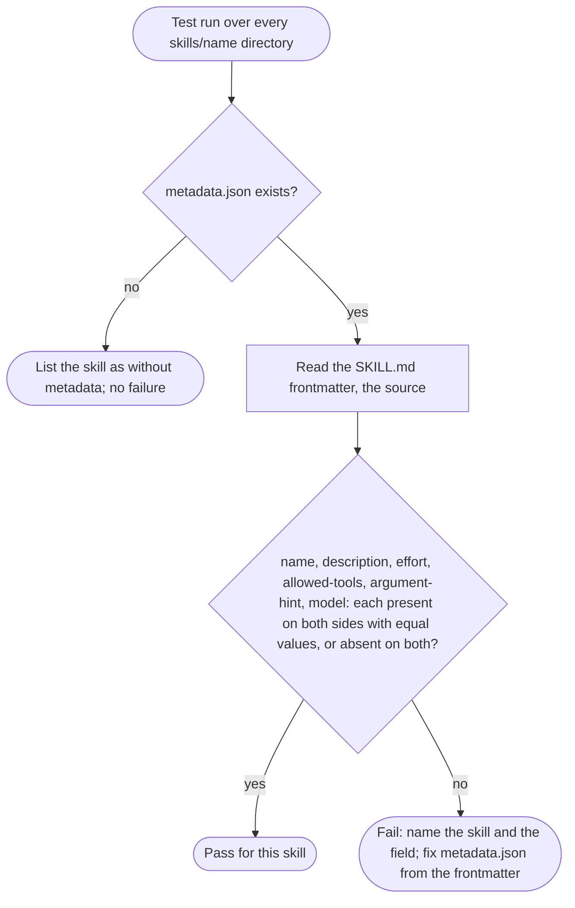
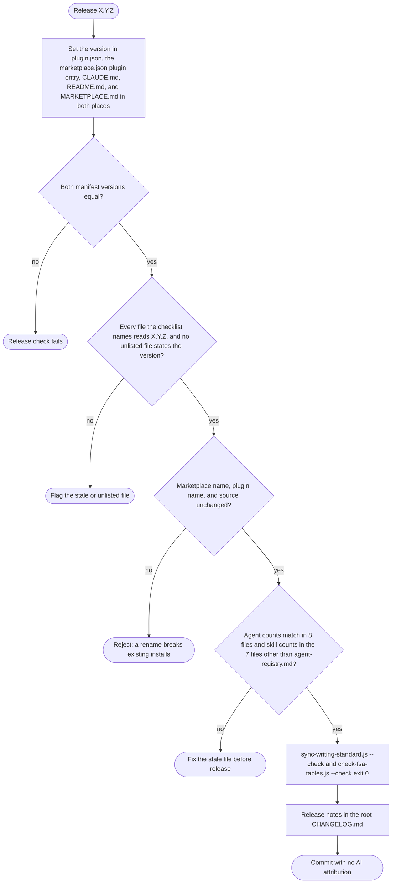

# spec-skills-manifests-docs

## Metadata

| Field | Value |
|---|---|
| **Feature** | Marketplace manifests, release metadata, and repository documents |
| **Parent feature** | spec-skills.md |
| **Sub-features** | None |
| **Requirement refs** | BR-011, BR-014, BR-016, BR-017, UR-045, UR-046, UR-047, UR-048, UR-052, UR-053, FR-172, FR-173, FR-174, FR-178, FR-193, FR-194, FR-201, NFR-020, NFR-022, NFR-023 |
| **Feature type** | Configuration |
| **Status** | Approved |

Status values: Draft, Review, Approved, Implemented.

Paths are relative to the repository root unless they start with `skills/`, or with `docs/` other than `docs/requirements/` and `docs/task-plans/`; those are relative to `plugins/assist-plugin/`. Baseline: assist-plugin 1.11.1 at commit 41034c1 (1.11.0 was commit 4803a0d); the manifests, `CLAUDE.md`, `README.md`, `MARKETPLACE.md`, both changelogs, and `skills/do/references/agent-registry.md` were re-read on 2026-10-16, and references into `docs/requirements/` and `DECISIONS.md` point at their current text. Every requirement in the body is Built (FR-174 and FR-178 since 1.11.1); the Change Log at the end adds the PLANNED (1.12.0) items.

## Description

The repository is the Claude Code marketplace `assist-plugin-marketplace`, holding one plugin, `assist-plugin`. Its identity lives in `.claude-plugin/marketplace.json` and `plugins/assist-plugin/.claude-plugin/plugin.json`; existing installs depend on the names never changing. Eight documents state the agent and skill counts, two document the install commands, and the release process keeps both manifest versions equal. Two 1.11.1 changes complete the picture: the repository keeps its own requirements in `docs/requirements/`, task plans in `docs/task-plans/`, and specs under `specs/`, where `/do` SpecGate looks (FR-174, FR-187), and `plugins/assist-plugin/CHANGELOG.md` is a pointer to the root changelog (FR-178).

## Triggered by

| Trigger type | Source | Condition |
|---|---|---|
| Release | The maintainer releases a version (`CLAUDE.md:133`; UC-005 in `docs/requirements/URD-assist-plugin.md`) | Every release |
| Catalog change | An agent or skill is added or removed (`CLAUDE.md:117-131`) | Counts and lists change |
| Install | A user runs `/plugin marketplace add tjmonsi/assist-marketplace-plugin` and `/plugin install assist-plugin@assist-plugin-marketplace` | Any new install |
| Spec-first build | `/do` SpecGate globs for documents (Area A FR-019, FR-020; the `docs/requirements/` and `docs/task-plans/` patterns built in 1.11.1 as FR-187) | A build request in this repository |

## Required data

| Data | Source | Type | Notes |
|---|---|---|---|
| Marketplace manifest | `.claude-plugin/marketplace.json` | JSON | `$schema` `https://anthropic.com/claude-code/marketplace.schema.json` (`:2`), `name` (`:3`), `owner` (`:5-8`), one entry in `plugins` (`:9-24`) |
| Plugin entry | `.claude-plugin/marketplace.json:10-23` | JSON | `name`, `source`, `description`, `version`, `author`, `homepage`, `license` `AGPL-3.0-or-later`, `category`, `keywords` |
| Plugin manifest | `plugins/assist-plugin/.claude-plugin/plugin.json` | JSON | `name` (`:2`), `version` (`:3`), `description` (`:4`), `repository`, `license` `AGPL-3.0-or-later` (`:11`) |
| Count documents | The eight files in the counts table | Markdown, JSON | 16 agents, 22 skills |
| Release logs | `CHANGELOG.md`, `plugins/assist-plugin/CHANGELOG.md` | Markdown | Latest entry 1.11.1 (`CHANGELOG.md:5`); the plugin file is a pointer with no release entry (`plugins/assist-plugin/CHANGELOG.md:3`) |
| Self-hosted documents | `./docs/requirements/BRD-*.md`, `./docs/requirements/URD-*.md`, `./docs/requirements/FR-NFR-*.md`, `./docs/task-plans/task-plan-*.md`, `./specs/spec-*.md` | Markdown | Globbed by SpecGate since 1.11.1 (FR-187; the built patterns are listed under FR-020, `docs/requirements/FR-NFR-assist-plugin.md:393`); at 4803a0d SpecGate globbed the root patterns only |
| Skill metadata | `skills/<name>/metadata.json` | JSON | Mirror of the `SKILL.md` frontmatter (FR-193, PLANNED 1.12.0, Change Log) |

## Behavior

### Requirement: Marketplace manifest identity

The repository SHALL publish `.claude-plugin/marketplace.json` with `name` `assist-plugin-marketplace` and one plugin entry named `assist-plugin` with source `./plugins/assist-plugin`.

**Requirement refs:** FR-172, UR-047, BR-011 | **Status:** Built | **Source:** `.claude-plugin/marketplace.json:3`, `:11-12`; `CLAUDE.md:5-12`

GitHub URLs and `/plugin marketplace add` use the repository path `tjmonsi/assist-marketplace-plugin`; install ids use the marketplace name (`CLAUDE.md:12`).

#### Scenario: Install id

- **GIVEN** the manifest at commit 41034c1
- **WHEN** a user runs `/plugin install assist-plugin@assist-plugin-marketplace`
- **THEN** the id SHALL resolve to the plugin entry whose source is `./plugins/assist-plugin`

#### Scenario: Source path exists

- **GIVEN** the plugin entry's `source`
- **WHEN** a test resolves it against the repository root
- **THEN** `plugins/assist-plugin/.claude-plugin/plugin.json` SHALL exist

#### Scenario: Rename attempt

- **GIVEN** a change that sets another marketplace `name`
- **WHEN** the change is reviewed
- **THEN** the reviewer SHALL reject it because a rename breaks existing installs

### Requirement: Names stay stable across releases

The marketplace name `assist-plugin-marketplace`, the plugin name `assist-plugin`, and the install id `assist-plugin@assist-plugin-marketplace` SHALL stay unchanged across releases.

**Requirement refs:** NFR-022, BR-011, FR-172 | **Status:** Built | **Source:** `.claude-plugin/marketplace.json:3`, `:11`; `plugins/assist-plugin/.claude-plugin/plugin.json:2`; `docs/requirements/BRD-assist-plugin.md:89-90`

#### Scenario: Release keeps the id

- **GIVEN** a release candidate
- **WHEN** the manifests are compared with the three names
- **THEN** the names SHALL match and the release SHALL proceed

#### Scenario: Plugin renamed in one manifest

- **GIVEN** a change that sets `plugin.json` `name` to `assist`
- **WHEN** the release check compares the names
- **THEN** the check SHALL fail and name the file and field

### Requirement: Manifest versions agree at release

The `version` in `plugins/assist-plugin/.claude-plugin/plugin.json` and the plugin entry's `version` in `.claude-plugin/marketplace.json` SHALL be equal at every release.

**Requirement refs:** FR-173, UR-046, BR-011 | **Status:** Built | **Source:** `plugins/assist-plugin/.claude-plugin/plugin.json:3`; `.claude-plugin/marketplace.json:14`; `CLAUDE.md:133`

Both read `1.11.1` at the baseline (read on 2026-10-16). The version string also appears in `CLAUDE.md:10`, `README.md:28`, and `MARKETPLACE.md:7` and `:76`; the release instruction (`CLAUDE.md:133`) names only the two manifests. OP-14 is decided: FR-194 makes the checklist name every file that carries the version (PLANNED 1.12.0, Change Log 2026-10-16).

#### Scenario: Equal

- **GIVEN** both files read 1.11.0
- **WHEN** a release check compares them
- **THEN** the check SHALL pass

#### Scenario: Different

- **GIVEN** `plugin.json` reads 1.11.1 and `marketplace.json` reads 1.11.0
- **WHEN** a release check compares them
- **THEN** the check SHALL fail

### Requirement: Agent and skill counts agree in eight files

The agent and skill counts and lists SHALL agree in `plugin.json`, `marketplace.json`, `README.md`, `MARKETPLACE.md`, `CLAUDE.md`, `plugins/assist-plugin/Claude.md`, `docs/SPECIFICATION.md`, and `skills/do/references/agent-registry.md`.

**Requirement refs:** NFR-020, UR-045, BR-016, FR-130 | **Status:** Built; PLANNED (1.12.0): the skill-count check leaves out `agent-registry.md` (Change Log 2026-10-16) | **Source:** `CLAUDE.md:117-131`; the counts below

The reference for "agree" is the repository itself: the number of `agents/*.md` files and of `skills/*/SKILL.md` files, the number of skill files with and without `user-invocable: false`, and the names of those files and directories. At the baseline the requirements give 16 agent files (FR-065) and 22 skill files, 18 user-invocable and 4 internal (FR-130), and the table shows what each document states. `agent-registry.md` states no skill total, while the NFR-020 metric at 1.11.1 expected 22 skills in all eight files; OP-10 is decided, and the skill-count check leaves the registry out (Change Log).

| File | Agent count stated | Skill count and lists stated |
|---|---|---|
| `plugins/assist-plugin/.claude-plugin/plugin.json` | 16 (`:4`) | 22 (`:4`) |
| `.claude-plugin/marketplace.json` | 16 (`:13`) | 22 (`:13`) |
| `README.md` | 16, with list (`:56-57`, `:339`) | 18 user-invocable (`:30-48`), 4 internal (`:50-54`), 22 (`:340`) |
| `MARKETPLACE.md` | 16, with list (`:9`, `:14`, `:45`) | 22, 18, 4, with lists (`:9`, `:12-13`, `:46`) |
| `CLAUDE.md` | 16, with table (`:24-43`) | 22, 18, 4, with tables (`:45-77`) |
| `plugins/assist-plugin/Claude.md` | 16, with table (`:15-34`) | 22, with table (`:36-61`) |
| `docs/SPECIFICATION.md` | 16 (`:5`, `:11`) | 22 (`:5`, `:187`) |
| `skills/do/references/agent-registry.md` | 16, with table (`:5-24`) | No skill total; agent-specific skills only (`:28-44`) |

#### Scenario: Stated counts match the directories

- **GIVEN** the eight files and the `agents/` and `skills/` directories at the same commit
- **WHEN** a test counts `agents/*.md`, `skills/*/SKILL.md`, and the skill files with and without `user-invocable: false`, and compares each count stated in the eight files
- **THEN** every stated agent count SHALL equal the `agents/*.md` count, every stated skill total SHALL equal the `skills/*/SKILL.md` count, and every stated user-invocable or internal subtotal SHALL equal its file count

#### Scenario: Stated lists match the directories

- **GIVEN** the files that list agent or skill names (`README.md`, `MARKETPLACE.md`, `CLAUDE.md`, `plugins/assist-plugin/Claude.md`, `skills/do/references/agent-registry.md`)
- **WHEN** a test compares each list with the names of the `agents/*.md` files and the `skills/*/` directories
- **THEN** each agent list SHALL hold every agent name exactly once and no other, and each full skill list SHALL do the same for skill names

#### Scenario: Count drift

- **GIVEN** a new agent file and a `README.md` that still says 16 agents
- **WHEN** a maintainer runs the counts checklist in `CLAUDE.md`
- **THEN** the checklist SHALL flag `README.md` as out of date

### Requirement: Install commands documented exactly

`README.md` and `MARKETPLACE.md` SHALL document installation with `/plugin marketplace add tjmonsi/assist-marketplace-plugin` and `/plugin install assist-plugin@assist-plugin-marketplace`.

**Requirement refs:** NFR-023, UR-047, BR-011 | **Status:** Built | **Source:** `README.md:12-13`, `:129-130`; `MARKETPLACE.md:62-63`

#### Scenario: Both strings in both files

- **GIVEN** `README.md` and `MARKETPLACE.md`
- **WHEN** a test searches each for the two exact strings
- **THEN** each file SHALL contain both

#### Scenario: Wrong name in docs

- **GIVEN** a document that gives the repository path where the install id belongs, such as `/plugin install assist-plugin@tjmonsi/assist-marketplace-plugin`
- **WHEN** a reviewer compares it with the two strings
- **THEN** the reviewer SHALL flag the line

### Requirement: Self-hosted requirements, specs, and plans

The repository SHALL keep its requirements (`BRD-*.md`, `URD-*.md`, `FR-NFR-*.md`) in `docs/requirements/`, its task plans (`task-plan-*.md`) in `docs/task-plans/`, and its specs under `specs/`.

**Requirement refs:** FR-174, UR-048, BR-014 | **Status:** Built (1.11.1) | **Source:** `docs/requirements/FR-NFR-assist-plugin.md:3753-3772`; `DECISIONS.md:63-66` (2026-10-14, assist-plugin follows its own spec-first rule); `DECISIONS.md:78-81` (2026-10-16, which corrects the location part to `docs/requirements/` and `docs/task-plans/`)

The requirements and specs cover the whole plugin; task plans cover only work still to do. SpecGate finds these documents since Area A FR-187 was built in 1.11.1; at 4803a0d it globbed the repository root only. The 2026-10-16 decision moved this repository's requirements to `docs/requirements/` (`DECISIONS.md:80`).

| Document type | Required location and pattern | Repository state, checked on 2026-10-16 in this pass |
|---|---|---|
| Requirements | `docs/requirements/BRD-*.md`, `URD-*.md`, `FR-NFR-*.md` | `docs/requirements/BRD-assist-plugin.md` and `FR-NFR-assist-plugin.md` read successfully; a read of `./BRD-assist-plugin.md` at the root failed with "File does not exist" |
| Task plans | `docs/task-plans/task-plan-*.md` | `docs/task-plans/task-plan-followups-1-11-1-20261016-070112.md` read successfully |
| Specs | `specs/spec-*.md` | The twelve `specs/spec-skills*.md` files of this family exist; the session-start `git status` listed only `DECISIONS.md` and the three `docs/requirements/` files as modified and no untracked file, so the specs were committed before this pass |

#### Scenario: SpecGate search

- **GIVEN** `docs/requirements/BRD-assist-plugin.md` exists and FR-187 is built
- **WHEN** `/do` SpecGate globs `./docs/requirements/BRD-*.md`
- **THEN** the file SHALL appear in the documents found

#### Scenario: Scope of documents

- **GIVEN** the requirements and specs for the plugin
- **WHEN** they are read
- **THEN** they SHALL cover the whole plugin and the task plans SHALL cover only work still to do

#### Scenario: Task plan outside the task-plans folder

- **GIVEN** a task plan saved as `docs/task-plan-auth.md`, whatever `DECISIONS.md` says
- **WHEN** SpecGate globs `./docs/task-plans/task-plan-*.md`
- **THEN** the file SHALL NOT appear in the documents found

#### Scenario: Repository layout after the documents are committed

- **GIVEN** the commit that brings this repository's requirements, specs, and task plans under version control
- **WHEN** a test globs `./docs/requirements/BRD-*.md`, `./docs/requirements/URD-*.md`, `./docs/requirements/FR-NFR-*.md`, `./specs/spec-*.md`, and the root patterns `./BRD-*.md`, `./URD-*.md`, `./FR-NFR-*.md`, `./task-plan-*.md`
- **THEN** each of the three requirement patterns under `docs/requirements/` and the spec pattern SHALL match at least one file
- **AND** none of the four root patterns SHALL match a file, because this repository keeps no legacy root-level documents (`DECISIONS.md:80`)

### Requirement: Plugin changelog is a pointer

The file `plugins/assist-plugin/CHANGELOG.md` SHALL be a short pointer to the root `CHANGELOG.md`, the only release log.

**Requirement refs:** FR-178, UR-052, BR-017 | **Status:** Built (1.11.1) | **Source:** `DECISIONS.md` (2026-10-14, assist-plugin follows its own spec-first rule); `plugins/assist-plugin/CHANGELOG.md:1-3` (a heading and one link to `../../CHANGELOG.md`, no release heading; read on 2026-10-16; its latest entry was 1.3.0 at 4803a0d); `CHANGELOG.md:5` (latest entry 1.11.1)

For illustration only: the pointer is the kind of file that FR-200 (PLANNED 1.12.0, `spec-skills-git.md`) defines. If the plugin directory held a version file (it has none today, and `.claude-plugin/plugin.json` is not a version source under FR-137), `/bump --path ./plugins/assist-plugin` would write its entry into the root `CHANGELOG.md` through this pointer; the releases of this repository set the manifests by hand (FR-173, FR-194).

#### Scenario: Pointer only

- **GIVEN** the file after the change
- **WHEN** a test reads it
- **THEN** it SHALL link to the root `CHANGELOG.md` and hold no `## [x.y.z]` release headings

#### Scenario: New release

- **GIVEN** a maintainer releases 1.11.1
- **WHEN** release notes are written
- **THEN** the notes SHALL go into the root `CHANGELOG.md` only

#### Scenario: Release entry in the plugin file

- **GIVEN** a release entry written into `plugins/assist-plugin/CHANGELOG.md`
- **WHEN** a reviewer reads the file
- **THEN** the reviewer SHALL reject the entry and the entry SHALL move to the root `CHANGELOG.md`

## Algorithmic steps

Release, in order (`CLAUDE.md:117-133`; UC-005):

1. Set the new version in `plugin.json` and in the `marketplace.json` plugin entry.
2. Confirm the marketplace name, plugin name, and source are unchanged.
3. When the catalog changed, update the counts and lists in the eight files.
4. Run `node plugins/assist-plugin/scripts/sync-writing-standard.js --check` and `node plugins/assist-plugin/scripts/check-fsa-tables.js --check`; both exit 0.
5. Write the release notes in the root `CHANGELOG.md` (the only log since 1.11.1, FR-178).
6. Commit with no AI attribution (FR-136, `spec-skills-git.md`).

Render source: `specs/spec-skills-manifests-docs.mmd` (1.11.1 release flow; the PLANNED (1.12.0) flow is in the Change Log). Rendering skipped: see the note in `spec-skills.md`.

## Output / Outcome

| Output | Type | Description |
|---|---|---|
| Released manifests | Configuration | Equal versions; unchanged names |
| Count documents | Documentation | Stated counts and lists equal the agent and skill files in the repository |
| Root `CHANGELOG.md` entry | Documentation | `## [X.Y.Z] - YYYY-MM-DD` |
| `plugins/assist-plugin/CHANGELOG.md` | Documentation | Pointer to the root log (FR-178, built in 1.11.1) |
| Self-hosted documents | Documentation | Requirements in `docs/requirements/`, task plans in `docs/task-plans/`, specs in `specs/` (FR-174, built in 1.11.1) |

## Error handling

| Error condition | Handling strategy | Outcome |
|---|---|---|
| Manifest versions differ | Release check fails | No release until fixed |
| A name changes | Review rejects the change | Existing installs keep working |
| A count document is stale | Counts checklist flags it | Fixed before release |
| Install docs give the wrong id form | Review flags the line | Docs corrected |
| Release entry written to the plugin changelog | Review rejects it; entry moves to the root log | One release log (FR-178) |
| Task plan saved outside `docs/task-plans/` and outside the old root pattern | SpecGate does not find it (FR-187), whatever `DECISIONS.md` says, because SpecGate never takes a path from `DECISIONS.md` (`DECISIONS.md:88-91`) | Save it in `docs/task-plans/` as `task-plan-*.md` |
| A requirements document or task plan reappears at the repository root | The layout scenario fails | Move it back to `docs/requirements/` or `docs/task-plans/` |
| A maintenance script exits 1 | Fix the drift first | No release |

## Events emitted (if applicable)

Not applicable: manifests and documents are static files.

## Dependencies

| Dependency | Type | Required | Notes |
|---|---|---|---|
| Claude Code marketplace schema | External | yes | `.claude-plugin/marketplace.json:2` |
| `sync-writing-standard.js`, `check-fsa-tables.js` | Build-time | yes | Area B FR-121 to FR-124 |
| `/bump` | Build-time | no | Detects version from `package.json`, `pyproject.toml`, `Cargo.toml`, `pubspec.yaml`, `VERSION`, or tags (`skills/bump/SKILL.md:35-41`), so `plugin.json` and `marketplace.json` are set by hand at release. At 1.11.1 the example at `bump-strategy.md:183` shows `.claude-plugin/plugin.json` updated; OP-7d is decided, FR-137 states the manifest is not a version source, and the example drops it (PLANNED 1.12.0, `spec-skills-git.md`) |
| `/do` SpecGate | Runtime | no | Area A FR-019, FR-020; FR-187, FR-188, and FR-191 (built in 1.11.1) add the `docs/requirements/` and `docs/task-plans/` patterns under the session's git root and keep the old root patterns; a kept root location gets a plain `DECISIONS.md` note that SpecGate never parses (`DECISIONS.md:88-96`) |
| License | Legal | yes | AGPL-3.0-or-later in both manifests; releases up to v1.6.1 were MIT (`README.md:375`) |

## Sub-feature breakdown (if applicable)

Not applicable: this spec has no sub-features.

## Submodule scope (if applicable)

Not applicable: the repository has no submodules.

## Traceability

| Requirement | Spec section | Verified by |
|---|---|---|
| FR-172 | Requirement: Marketplace manifest identity | JSON read of `marketplace.json` `name`, plugin `name`, and `source`; install run |
| FR-173 | Requirement: Manifest versions agree at release | JSON read of both `version` fields |
| FR-174 | Requirement: Self-hosted requirements, specs, and plans | After the documents are committed: glob of `./docs/requirements/BRD-*.md`, `./docs/requirements/URD-*.md`, `./docs/requirements/FR-NFR-*.md`, `./docs/task-plans/task-plan-*.md`, and `./specs/spec-*.md`, plus the four root patterns, which must match nothing; SpecGate run after FR-187 |
| FR-178 | Requirement: Plugin changelog is a pointer | Read of `plugins/assist-plugin/CHANGELOG.md` after 1.11.1: a link and no `## [x.y.z]` heading |
| NFR-020 | Requirement: Agent and skill counts agree in eight files | Count of `agents/*.md`, `skills/*/SKILL.md`, and the `user-invocable: false` subset compared with every stated count; agent and skill name lists compared with the directory names |
| NFR-022 | Requirement: Names stay stable across releases | Name comparison at each release |
| NFR-023 | Requirement: Install commands documented exactly | Exact-string search in `README.md` and `MARKETPLACE.md` |
| UR-045, UR-046, UR-047, UR-048, UR-052 | Requirements above, by their refs | As listed per requirement |
| BR-011, BR-014, BR-016, BR-017 | Requirements above, by their refs | As listed per requirement |
| FR-193, UR-053 | Change Log 2026-10-16, ADDED Requirement: Skill metadata mirrors the SKILL.md frontmatter | `node` test under `tests/` that compares each `skills/*/metadata.json` with its frontmatter and lists the skills without one |
| FR-194 | Change Log 2026-10-16, ADDED Requirement: Release checklist names every file that carries the version | Read of the `CLAUDE.md` release checklist; search of the repository for the version string against the checklist |
| NFR-020 (1.12.0 change) | Change Log 2026-10-16, MODIFIED Requirement: Agent and skill counts agree in eight files | Count comparison with the skill total checked in seven files and the agent total in eight |
| FR-201 | Change Log 2026-10-16, ADDED Requirement: Repository documents match the skills, scripts, and tag form | Read of the `technical-writing` entry in `docs/SPECIFICATION.md` against `skills/technical-writing/SKILL.md:12`; read of the `MARKETPLACE.md` scripts line against `plugins/assist-plugin/scripts/`; read of the `MARKETPLACE.md` tag example |

## Change Log: 2026-10-16

**Source:** `docs/requirements/FR-NFR-assist-plugin.md` version 1.1 (2026-10-16, final and approved, re-read for fix pass 1; line cites checked against the current file on 2026-10-17): FR-193 (`:4017-4056`), FR-194 (`:4058-4077`), and FR-201 (`:4252-4271`) added, NFR-020 (`:4449`, `:4457-4460`) revised, all PLANNED (1.12.0). Decisions: `DECISIONS.md:128-131` (skills metadata.json mirrors SKILL.md frontmatter) and `DECISIONS.md:168-171` (SKILL.md frontmatter is the source; `debug` gains `effort: high`); the answers to OP-10, OP-14, and the `metadata.json` question under User Decisions in `.agent/main-plan/plan-deferred-decisions-20261016-1059.md`, of which the OP-14 documentation drift became FR-201 (FR-NFR section 9, open question 8, `:4593`).

Every change in this entry is PLANNED (1.12.0). This spec received a delta, so its Status returns to `Review` (FR-154).

### ADDED Requirements

#### Requirement: Skill metadata mirrors the SKILL.md frontmatter

Each `skills/<name>/metadata.json` SHALL mirror the fields of its `SKILL.md` frontmatter (`name`, `description`, `effort`, `allowed-tools`, `argument-hint`, and `model` where the frontmatter sets it) with equal values, the `SKILL.md` frontmatter being the source, so that a field present on only one side fails the test.

**Requirement refs:** FR-193, UR-053, BR-016 | **Status:** PLANNED (1.12.0) | **Source:** `docs/requirements/FR-NFR-assist-plugin.md:4017-4056`; `DECISIONS.md:128-131`, `:168-171`

At 1.11.1, 14 of the 16 `metadata.json` files differ from their frontmatter and only `deslop` and `review-md` match (FR-193's Source, `:4021`, a comparison verified by the orchestrator). This pass read the 14 pairs on 2026-10-16; the differing fields are listed in the planned conformance table below. The `SKILL.md` frontmatter is the source, so each `metadata.json` changes to the frontmatter value, except that `debug` gains `effort: high` in its frontmatter to match its metadata (`DECISIONS.md:168-171`). The count of 16 skills with a `metadata.json`, and the six without (`task-plan`, `create-test`, `code`, `pentest`, `integrated-test`, `run-test`), comes from FR-193's source (a Glob on 2026-10-16); this pass could not Glob and did not recount. A `metadata.json` file is on the LLM surface, so a change to one runs the OWASP for LLM gate (NFR-011, `spec-skills.md` Change Log; FR-199, Area A).

##### Scenario: Equal fields

- **GIVEN** a skill whose `metadata.json` holds the same `name`, `description`, `effort`, `allowed-tools`, and `argument-hint` values as its `SKILL.md` frontmatter
- **WHEN** a test compares them
- **THEN** the test SHALL pass for that skill

##### Scenario: Field differs

- **GIVEN** `skills/commit/metadata.json` whose `description` differs from the frontmatter `description` of `commit`
- **WHEN** a test compares them
- **THEN** the test SHALL fail and name `commit` and `description`

##### Scenario: Field on one side only

- **GIVEN** a skill whose `metadata.json` holds `effort` and whose `SKILL.md` frontmatter has no `effort`
- **WHEN** a test compares them
- **THEN** the test SHALL fail and name the skill and the field `effort`

##### Scenario: Debug effort

- **GIVEN** the `debug` skill, whose `metadata.json` sets `effort: high`
- **WHEN** `skills/debug/SKILL.md` gains `effort: high` in its frontmatter
- **THEN** the test SHALL pass the `effort` field for `debug`, because the frontmatter is the source and both sides agree

##### Scenario: Skill without metadata

- **GIVEN** the six skills that have no `metadata.json`
- **WHEN** the test runs
- **THEN** it SHALL list them by name and SHALL NOT fail because of them

##### Scenario: Model field

- **GIVEN** the `commit` frontmatter sets `model: haiku` (FR-196, `spec-skills-git.md`)
- **WHEN** the test compares `commit`
- **THEN** `skills/commit/metadata.json` SHALL hold `"model": "haiku"`, and the test SHALL fail while it does not

##### Scenario: Gated change

- **GIVEN** a change to only one `metadata.json`
- **WHEN** `/do` chooses the gates for the step
- **THEN** `/do` SHALL run the OWASP for LLM Gate (FR-199)

Render source: `specs/spec-skills-metadata-mirror.mmd`. Rendering skipped: see the note in `spec-skills.md`.

#### Requirement: Release checklist names every file that carries the version

The release checklist in `CLAUDE.md` SHALL name every file that carries the plugin version: `plugins/assist-plugin/.claude-plugin/plugin.json`, `.claude-plugin/marketplace.json`, `CLAUDE.md`, `README.md`, and `MARKETPLACE.md` (in both places it states the version).

**Requirement refs:** FR-194, UR-046, BR-011 | **Status:** PLANNED (1.12.0) | **Source:** `docs/requirements/FR-NFR-assist-plugin.md:4058-4077`; `CLAUDE.md:10` (`v1.11.1`), `:133` (names the two manifests only); `README.md:28`; `MARKETPLACE.md:7`, `:76` (all read on 2026-10-16)

FR-173 keeps the two manifests equal; this requirement widens the checklist.

##### Scenario: Checklist complete

- **GIVEN** the release checklist after the change
- **WHEN** a maintainer reads it
- **THEN** it SHALL name both manifests, `CLAUDE.md`, `README.md`, and `MARKETPLACE.md` with its two places

##### Scenario: Stale version in a listed file

- **GIVEN** a release to 1.12.0 where `MARKETPLACE.md:76` still reads 1.11.1
- **WHEN** the maintainer works through the checklist
- **THEN** the checklist SHALL flag `MARKETPLACE.md` as out of date

##### Scenario: Unlisted file with the version

- **GIVEN** a new file that states the plugin version and is absent from the checklist
- **WHEN** a reviewer compares the checklist with a search for the version string
- **THEN** the reviewer SHALL flag the file

Render source: `specs/spec-skills-manifests-docs-planned.mmd`. Rendering skipped: see the note in `spec-skills.md`.

#### Requirement: Repository documents match the skills, scripts, and tag form

The repository documents `plugins/assist-plugin/docs/SPECIFICATION.md` and `MARKETPLACE.md` SHOULD state the current `technical-writing` subcommands, the maintenance scripts, and the `vX.Y.Z` tag form that `/bump` creates.

**Requirement refs:** FR-201, UR-045 | **Status:** PLANNED (1.12.0) | **Source:** `docs/requirements/FR-NFR-assist-plugin.md:4252-4271`; `docs/SPECIFICATION.md:292-297` (`docs | readme` only), `skills/technical-writing/SKILL.md:12` (four subcommands); `MARKETPLACE.md:50` (names `sync-writing-standard.js` only), `README.md:357` (names both scripts); `MARKETPLACE.md:78` (`assist-plugin--v1.1.0`); all read on 2026-10-16

The repository's own tags use `vX.Y.Z` (per the step 2b brief; this pass cannot run `git tag` to check). The requirement is a SHOULD, so a deviation needs a documented reason (`skills/gather-requirements/SKILL.md:81`).

##### Scenario: Technical-writing subcommands

- **GIVEN** `plugins/assist-plugin/docs/SPECIFICATION.md` after the change
- **WHEN** a reviewer compares its `technical-writing` entry with `skills/technical-writing/SKILL.md`
- **THEN** the entry SHOULD list all four subcommands (`docs`, `readme`, `guide`, `api`)

##### Scenario: Scripts listed

- **GIVEN** `MARKETPLACE.md` after the change
- **WHEN** a reviewer compares its scripts line with the files in `plugins/assist-plugin/scripts/`
- **THEN** the line SHOULD name both `sync-writing-standard.js` and `check-fsa-tables.js`

##### Scenario: Tag form

- **GIVEN** `MARKETPLACE.md` after the change
- **WHEN** a reviewer reads its version-tag example
- **THEN** the example SHOULD use the `vX.Y.Z` form (for example `v1.1.0`) and SHOULD NOT show `assist-plugin--v1.1.0`

##### Scenario: Drift left without a reason

- **GIVEN** a release candidate whose `MARKETPLACE.md` still shows `assist-plugin--v1.1.0` and records no reason
- **WHEN** a reviewer applies this requirement
- **THEN** the reviewer SHOULD flag the line and ask for the fix or a documented reason

### MODIFIED Requirements

#### Requirement: Agent and skill counts agree in eight files

**Was:** The agent and skill counts and lists SHALL agree in the eight files, with 16 agents and 22 skills expected in all eight (OP-10 pending on `agent-registry.md`, which states no skill total).
**Now:** The statement is unchanged; the agent count is checked in all eight files and the 22-skill total in the seven files other than `skills/do/references/agent-registry.md`, which states no skill total.
**Reason:** OP-10 decided: drop the registry's skill total from the metric.
**Requirement refs:** NFR-020, UR-045, BR-016, FR-130 | **Status:** PLANNED (1.12.0) for the metric | **Source:** `docs/requirements/FR-NFR-assist-plugin.md:4449`, `:4457-4460`; `skills/do/references/agent-registry.md:5-24`, `:28-44` (read on 2026-10-16)

##### Scenario: Registry states no skill total

- **GIVEN** `skills/do/references/agent-registry.md` lists 16 agents and states no skill total
- **WHEN** a maintainer runs the skill-count check of NFR-020
- **THEN** the check SHALL compare the 22-skill total with the seven other files only and SHALL NOT flag the registry for a missing skill total

##### Scenario: Registry agent count drifts

- **GIVEN** a seventeenth agent file and a registry that still lists 16 agents
- **WHEN** a maintainer runs the agent-count check
- **THEN** the check SHALL flag `skills/do/references/agent-registry.md`

### REMOVED Requirements

None.

### Planned conformance (files that change with this entry)

| File and line at 1.11.1 | Change | Requirement |
|---|---|---|
| `CLAUDE.md:133` | The release line names both manifests, `CLAUDE.md`, `README.md`, and `MARKETPLACE.md` (both places) | FR-194 |
| `skills/ask/metadata.json:3` | `description` takes the frontmatter text (`skills/ask/SKILL.md:3-6`) | FR-193 |
| `skills/branch/metadata.json:3` | `description` takes the frontmatter text (`skills/branch/SKILL.md:3-6`) | FR-193 |
| `skills/bump/metadata.json:3` | `description` takes the frontmatter text (`skills/bump/SKILL.md:3-6`) | FR-193 |
| `skills/bump/metadata.json:6` | `argument-hint` gains `--no-changelog` with the frontmatter hint (`skills/bump/SKILL.md:15`) | FR-193, FR-138 |
| `skills/clarify/metadata.json:3` | `description` takes the frontmatter text (`skills/clarify/SKILL.md:3-7`) | FR-193 |
| `skills/commit/metadata.json:3` | `description` takes the frontmatter text (`skills/commit/SKILL.md:3-5`); the file gains `"model": "haiku"` with FR-196 | FR-193, FR-196 |
| `skills/debug/metadata.json:3`; `skills/debug/SKILL.md:1-13` | `description` takes the frontmatter text (`SKILL.md:3-5`); the frontmatter gains `effort: high` to match `metadata.json:4` | FR-193 |
| `skills/do/metadata.json:3`, `:5` | `description` takes the frontmatter text (`skills/do/SKILL.md:3-10`); `allowed-tools` gains the missing `SendMessage` (`SKILL.md:13-22`) | FR-193 |
| `skills/gather-requirements/metadata.json:3` | `description` takes the frontmatter text (`skills/gather-requirements/SKILL.md:3-6`) | FR-193 |
| `skills/health/metadata.json:3` | `description` takes the frontmatter text (`skills/health/SKILL.md:3-6`) | FR-193 |
| `skills/map-project/metadata.json:3` | `description` takes the frontmatter text (`skills/map-project/SKILL.md:3-5`) | FR-193 |
| `skills/pr-review/metadata.json:3` | `description` takes the frontmatter text (`skills/pr-review/SKILL.md:3-6`) | FR-193 |
| `skills/spec-from-requirements/metadata.json:3` | `description` takes the frontmatter text (`skills/spec-from-requirements/SKILL.md:3-7`) | FR-193 |
| `skills/technical-writing/metadata.json:3` | `description` takes the frontmatter text (`skills/technical-writing/SKILL.md:3-5`) | FR-193 |
| `skills/voice-script/metadata.json:3` | `description` takes the frontmatter text (`skills/voice-script/SKILL.md:3-7`) | FR-193 |
| `MARKETPLACE.md:50` | The `scripts/` line names `check-fsa-tables.js` beside `sync-writing-standard.js`, as `README.md:357` does | FR-201 |
| `MARKETPLACE.md:78` | The tag example uses the `vX.Y.Z` form (for example `v1.1.0`) in place of `assist-plugin--v1.1.0` | FR-201 |
| `docs/SPECIFICATION.md:292-297` | The `technical-writing` entry lists `docs`, `readme`, `guide`, and `api` (the same row sits in `spec-skills-docs-review.md`) | FR-201 |

`skills/deslop/metadata.json` and `skills/review-md/metadata.json` already match (per FR-193's Source; this pass did not re-read them). The `description` comparison uses the folded frontmatter value: YAML `>-` joins the lines with single spaces.

### Direct edits in this pass (no behavior change)

Status set to `Review`; Requirement refs gain UR-053, FR-193, FR-194, and FR-201; baseline moved to 1.11.1; FR-174 and FR-178 marked Built with the 2026-10-16 reads; the OP-7, OP-10, and OP-14 notes replaced by the decided answers with pointers here; line cites refreshed (`CLAUDE.md:114-130` to `:117-133`, `:130` to `:133`; `README.md:126-127` to `:129-130`, `:332` to `:339`, `:333` to `:340`; `docs/requirements/BRD-assist-plugin.md:88-89` to `:89-90`; the FR-NFR cite `:368` replaced by FR-020 at `:393`, and every FR-NFR cite set to the final file; `README.md:368` to `:375`); one scenario baseline moved from commit 4803a0d to 41034c1; fix pass 1 reworded the pointer note under FR-178 as an illustration and listed all 14 `metadata.json` differences. On 2026-10-17 the FR-NFR cites were checked against the current file: FR-174 `:3738-3757` to `:3753-3772`, FR-193 `:4002-4041` to `:4017-4056` (Source `:4006` to `:4021`), and FR-194 `:4043-4062` to `:4058-4077`. FR-201, NFR-020, and open question 8, after the rewritten FR-195 of FR-NFR version 1.2, sit at `:4252-4271`, `:4449` (scenario `:4457-4460`), and `:4593`.
