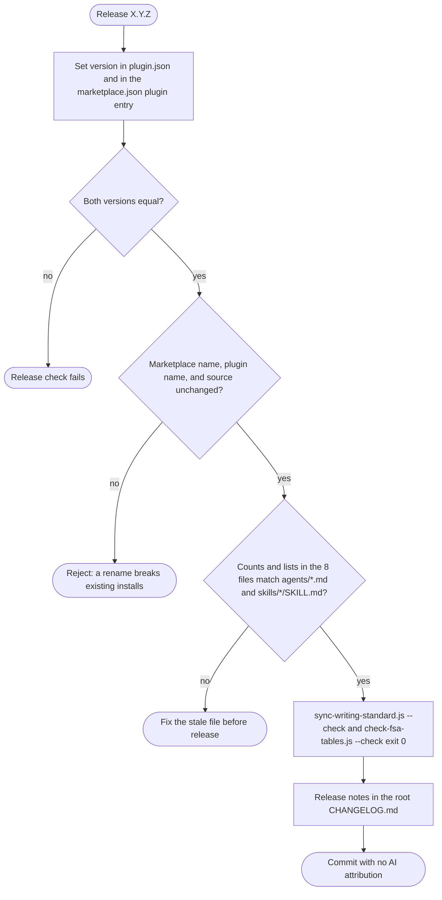

# spec-skills-manifests-docs

## Metadata

| Field | Value |
|---|---|
| **Feature** | Marketplace manifests, release metadata, and repository documents |
| **Parent feature** | spec-skills.md |
| **Sub-features** | None |
| **Requirement refs** | BR-011, BR-014, BR-016, BR-017, UR-045, UR-046, UR-047, UR-048, UR-052, FR-172, FR-173, FR-174, FR-178, NFR-020, NFR-022, NFR-023 |
| **Feature type** | Configuration |
| **Status** | Draft |

Status values: Draft, Review, Approved, Implemented.

Paths are relative to the repository root unless they start with `skills/`, or with `docs/` other than `docs/requirements/` and `docs/task-plans/`; those are relative to `plugins/assist-plugin/`. Baseline: commit 4803a0d; references into `docs/requirements/` and `DECISIONS.md` point at their current text (re-checked on 2026-10-16). FR-174 and FR-178 are PLANNED; every other requirement here is Built.

## Description

The repository is the Claude Code marketplace `assist-plugin-marketplace`, holding one plugin, `assist-plugin`. Its identity lives in `.claude-plugin/marketplace.json` and `plugins/assist-plugin/.claude-plugin/plugin.json`; existing installs depend on the names never changing. Eight documents state the agent and skill counts, two document the install commands, and the release process keeps both manifest versions equal. Two planned changes complete the picture: the repository keeps its own requirements in `docs/requirements/`, task plans in `docs/task-plans/`, and specs under `specs/`, where `/do` SpecGate looks once Area A FR-187 is built (FR-174), and `plugins/assist-plugin/CHANGELOG.md` becomes a pointer to the root changelog (FR-178).

## Triggered by

| Trigger type | Source | Condition |
|---|---|---|
| Release | The maintainer releases a version (`CLAUDE.md:130`; UC-005 in `docs/requirements/URD-assist-plugin.md`) | Every release |
| Catalog change | An agent or skill is added or removed (`CLAUDE.md:114-128`) | Counts and lists change |
| Install | A user runs `/plugin marketplace add tjmonsi/assist-marketplace-plugin` and `/plugin install assist-plugin@assist-plugin-marketplace` | Any new install |
| Spec-first build | `/do` SpecGate globs for documents (Area A FR-019, FR-020; the `docs/requirements/` and `docs/task-plans/` patterns are PLANNED as FR-187) | A build request in this repository |

## Required data

| Data | Source | Type | Notes |
|---|---|---|---|
| Marketplace manifest | `.claude-plugin/marketplace.json` | JSON | `$schema` `https://anthropic.com/claude-code/marketplace.schema.json` (`:2`), `name` (`:3`), `owner` (`:5-8`), one entry in `plugins` (`:9-24`) |
| Plugin entry | `.claude-plugin/marketplace.json:10-23` | JSON | `name`, `source`, `description`, `version`, `author`, `homepage`, `license` `AGPL-3.0-or-later`, `category`, `keywords` |
| Plugin manifest | `plugins/assist-plugin/.claude-plugin/plugin.json` | JSON | `name` (`:2`), `version` (`:3`), `description` (`:4`), `repository`, `license` `AGPL-3.0-or-later` (`:11`) |
| Count documents | The eight files in the counts table | Markdown, JSON | 16 agents, 22 skills |
| Release logs | `CHANGELOG.md`, `plugins/assist-plugin/CHANGELOG.md` | Markdown | Latest entries 1.11.0 (`CHANGELOG.md:5`) and 1.3.0 (`plugins/assist-plugin/CHANGELOG.md:8`) |
| Self-hosted documents | `./docs/requirements/BRD-*.md`, `./docs/requirements/URD-*.md`, `./docs/requirements/FR-NFR-*.md`, `./docs/task-plans/task-plan-*.md`, `./specs/spec-*.md` | Markdown | Globbed by SpecGate after FR-187; at 4803a0d SpecGate globs the root patterns only (`docs/requirements/FR-NFR-assist-plugin.md:368`) |

## Behavior

### Requirement: Marketplace manifest identity

The repository SHALL publish `.claude-plugin/marketplace.json` with `name` `assist-plugin-marketplace` and one plugin entry named `assist-plugin` with source `./plugins/assist-plugin`.

**Requirement refs:** FR-172, UR-047, BR-011 | **Status:** Built | **Source:** `.claude-plugin/marketplace.json:3`, `:11-12`; `CLAUDE.md:5-12`

GitHub URLs and `/plugin marketplace add` use the repository path `tjmonsi/assist-marketplace-plugin`; install ids use the marketplace name (`CLAUDE.md:12`).

#### Scenario: Install id

- **GIVEN** the manifest at commit 4803a0d
- **WHEN** a user runs `/plugin install assist-plugin@assist-plugin-marketplace`
- **THEN** the id SHALL resolve to the plugin entry whose source is `./plugins/assist-plugin`

#### Scenario: Source path exists

- **GIVEN** the plugin entry's `source`
- **WHEN** a test resolves it against the repository root
- **THEN** `plugins/assist-plugin/.claude-plugin/plugin.json` SHALL exist

#### Scenario: Rename attempt

- **GIVEN** a change that sets another marketplace `name`
- **WHEN** the change is reviewed
- **THEN** the reviewer SHALL reject it because a rename breaks existing installs

### Requirement: Names stay stable across releases

The marketplace name `assist-plugin-marketplace`, the plugin name `assist-plugin`, and the install id `assist-plugin@assist-plugin-marketplace` SHALL stay unchanged across releases.

**Requirement refs:** NFR-022, BR-011, FR-172 | **Status:** Built | **Source:** `.claude-plugin/marketplace.json:3`, `:11`; `plugins/assist-plugin/.claude-plugin/plugin.json:2`; `docs/requirements/BRD-assist-plugin.md:88-89`

#### Scenario: Release keeps the id

- **GIVEN** a release candidate
- **WHEN** the manifests are compared with the three names
- **THEN** the names SHALL match and the release SHALL proceed

#### Scenario: Plugin renamed in one manifest

- **GIVEN** a change that sets `plugin.json` `name` to `assist`
- **WHEN** the release check compares the names
- **THEN** the check SHALL fail and name the file and field

### Requirement: Manifest versions agree at release

The `version` in `plugins/assist-plugin/.claude-plugin/plugin.json` and the plugin entry's `version` in `.claude-plugin/marketplace.json` SHALL be equal at every release.

**Requirement refs:** FR-173, UR-046, BR-011 | **Status:** Built | **Source:** `plugins/assist-plugin/.claude-plugin/plugin.json:3`; `.claude-plugin/marketplace.json:14`; `CLAUDE.md:130`

Both read `1.11.0` at the baseline. The version string also appears in `CLAUDE.md:10`, `README.md:28`, and `MARKETPLACE.md:7` and `:76`; the release instruction (`CLAUDE.md:130`) names only the two manifests (open point OP-14 in `spec-skills.md`).

#### Scenario: Equal

- **GIVEN** both files read 1.11.0
- **WHEN** a release check compares them
- **THEN** the check SHALL pass

#### Scenario: Different

- **GIVEN** `plugin.json` reads 1.11.1 and `marketplace.json` reads 1.11.0
- **WHEN** a release check compares them
- **THEN** the check SHALL fail

### Requirement: Agent and skill counts agree in eight files

The agent and skill counts and lists SHALL agree in `plugin.json`, `marketplace.json`, `README.md`, `MARKETPLACE.md`, `CLAUDE.md`, `plugins/assist-plugin/Claude.md`, `docs/SPECIFICATION.md`, and `skills/do/references/agent-registry.md`.

**Requirement refs:** NFR-020, UR-045, BR-016, FR-130 | **Status:** Built | **Source:** `CLAUDE.md:114-128`; the counts below

The reference for "agree" is the repository itself: the number of `agents/*.md` files and of `skills/*/SKILL.md` files, the number of skill files with and without `user-invocable: false`, and the names of those files and directories. At the baseline the requirements give 16 agent files (FR-065) and 22 skill files, 18 user-invocable and 4 internal (FR-130), and the table shows what each document states. `agent-registry.md` states no skill total, while the NFR-020 metric expects 22 skills in all eight files; that difference is pending (open point OP-10 in `spec-skills.md`).

| File | Agent count stated | Skill count and lists stated |
|---|---|---|
| `plugins/assist-plugin/.claude-plugin/plugin.json` | 16 (`:4`) | 22 (`:4`) |
| `.claude-plugin/marketplace.json` | 16 (`:13`) | 22 (`:13`) |
| `README.md` | 16, with list (`:56-57`, `:332`) | 18 user-invocable (`:30-48`), 4 internal (`:50-54`), 22 (`:333`) |
| `MARKETPLACE.md` | 16, with list (`:9`, `:14`, `:45`) | 22, 18, 4, with lists (`:9`, `:12-13`, `:46`) |
| `CLAUDE.md` | 16, with table (`:24-43`) | 22, 18, 4, with tables (`:45-77`) |
| `plugins/assist-plugin/Claude.md` | 16, with table (`:15-34`) | 22, with table (`:36-61`) |
| `docs/SPECIFICATION.md` | 16 (`:5`, `:11`) | 22 (`:5`, `:187`) |
| `skills/do/references/agent-registry.md` | 16, with table (`:5-24`) | No skill total; agent-specific skills only (`:28-44`) |

#### Scenario: Stated counts match the directories

- **GIVEN** the eight files and the `agents/` and `skills/` directories at the same commit
- **WHEN** a test counts `agents/*.md`, `skills/*/SKILL.md`, and the skill files with and without `user-invocable: false`, and compares each count stated in the eight files
- **THEN** every stated agent count SHALL equal the `agents/*.md` count, every stated skill total SHALL equal the `skills/*/SKILL.md` count, and every stated user-invocable or internal subtotal SHALL equal its file count

#### Scenario: Stated lists match the directories

- **GIVEN** the files that list agent or skill names (`README.md`, `MARKETPLACE.md`, `CLAUDE.md`, `plugins/assist-plugin/Claude.md`, `skills/do/references/agent-registry.md`)
- **WHEN** a test compares each list with the names of the `agents/*.md` files and the `skills/*/` directories
- **THEN** each agent list SHALL hold every agent name exactly once and no other, and each full skill list SHALL do the same for skill names

#### Scenario: Count drift

- **GIVEN** a new agent file and a `README.md` that still says 16 agents
- **WHEN** a maintainer runs the counts checklist in `CLAUDE.md`
- **THEN** the checklist SHALL flag `README.md` as out of date

### Requirement: Install commands documented exactly

`README.md` and `MARKETPLACE.md` SHALL document installation with `/plugin marketplace add tjmonsi/assist-marketplace-plugin` and `/plugin install assist-plugin@assist-plugin-marketplace`.

**Requirement refs:** NFR-023, UR-047, BR-011 | **Status:** Built | **Source:** `README.md:12-13`, `:126-127`; `MARKETPLACE.md:62-63`

#### Scenario: Both strings in both files

- **GIVEN** `README.md` and `MARKETPLACE.md`
- **WHEN** a test searches each for the two exact strings
- **THEN** each file SHALL contain both

#### Scenario: Wrong name in docs

- **GIVEN** a document that gives the repository path where the install id belongs, such as `/plugin install assist-plugin@tjmonsi/assist-marketplace-plugin`
- **WHEN** a reviewer compares it with the two strings
- **THEN** the reviewer SHALL flag the line

### Requirement: Self-hosted requirements, specs, and plans

The repository SHALL keep its requirements (`BRD-*.md`, `URD-*.md`, `FR-NFR-*.md`) in `docs/requirements/`, its task plans (`task-plan-*.md`) in `docs/task-plans/`, and its specs under `specs/`.

**Requirement refs:** FR-174, UR-048, BR-014 | **Status:** PLANNED (the requirements exist in draft in `docs/requirements/`; the specs and the task plan do not exist and are not committed) | **Source:** `docs/requirements/FR-NFR-assist-plugin.md:3270-3289`; `DECISIONS.md:63-66` (2026-10-14, assist-plugin follows its own spec-first rule); `DECISIONS.md:78-81` (2026-10-16, which corrects the location part to `docs/requirements/` and `docs/task-plans/`)

The requirements and specs cover the whole plugin; task plans cover only work still to do. At 4803a0d, SpecGate globs the repository root only, so these documents are found only after Area A FR-187 is built. The 2026-10-16 decision says this repository's requirements move to `docs/requirements/` (`DECISIONS.md:80`).

| Document type | Required location and pattern | Repository state, checked on 2026-10-16 |
|---|---|---|
| Requirements | `docs/requirements/BRD-*.md`, `URD-*.md`, `FR-NFR-*.md` | `docs/requirements/BRD-assist-plugin.md`, `URD-assist-plugin.md`, and `FR-NFR-assist-plugin.md` read successfully; reads of `./BRD-assist-plugin.md`, `./URD-assist-plugin.md`, and `./FR-NFR-assist-plugin.md` at the root failed with "File does not exist" |
| Task plans | `docs/task-plans/task-plan-*.md` | Not checked here; per the FR-174 status the task plan does not exist yet |
| Specs | `specs/spec-*.md` | The twelve `specs/spec-skills*.md` files of this family exist, written by this step and not committed; the Area A and Area B spec files were not checked here |

#### Scenario: SpecGate search

- **GIVEN** `docs/requirements/BRD-assist-plugin.md` exists and FR-187 is built
- **WHEN** `/do` SpecGate globs `./docs/requirements/BRD-*.md`
- **THEN** the file SHALL appear in the documents found

#### Scenario: Scope of documents

- **GIVEN** the requirements and specs for the plugin
- **WHEN** they are read
- **THEN** they SHALL cover the whole plugin and the task plans SHALL cover only work still to do

#### Scenario: Task plan outside the task-plans folder

- **GIVEN** a task plan saved as `docs/task-plan-auth.md`, whatever `DECISIONS.md` says
- **WHEN** SpecGate globs `./docs/task-plans/task-plan-*.md`
- **THEN** the file SHALL NOT appear in the documents found

#### Scenario: Repository layout after the documents are committed

- **GIVEN** the commit that brings this repository's requirements, specs, and task plans under version control
- **WHEN** a test globs `./docs/requirements/BRD-*.md`, `./docs/requirements/URD-*.md`, `./docs/requirements/FR-NFR-*.md`, `./specs/spec-*.md`, and the root patterns `./BRD-*.md`, `./URD-*.md`, `./FR-NFR-*.md`, `./task-plan-*.md`
- **THEN** each of the three requirement patterns under `docs/requirements/` and the spec pattern SHALL match at least one file
- **AND** none of the four root patterns SHALL match a file, because this repository keeps no legacy root-level documents (`DECISIONS.md:80`)

### Requirement: Plugin changelog is a pointer

The file `plugins/assist-plugin/CHANGELOG.md` SHALL be a short pointer to the root `CHANGELOG.md`, the only release log.

**Requirement refs:** FR-178, UR-052, BR-017 | **Status:** PLANNED (1.11.1) | **Source:** `DECISIONS.md` (2026-10-14, assist-plugin follows its own spec-first rule); `plugins/assist-plugin/CHANGELOG.md:1-38` (stale: latest entry 1.3.0); `CHANGELOG.md:5` (latest entry 1.11.0)

#### Scenario: Pointer only

- **GIVEN** the file after the change
- **WHEN** a test reads it
- **THEN** it SHALL link to the root `CHANGELOG.md` and hold no `## [x.y.z]` release headings

#### Scenario: New release

- **GIVEN** a maintainer releases 1.11.1
- **WHEN** release notes are written
- **THEN** the notes SHALL go into the root `CHANGELOG.md` only

#### Scenario: Release entry in the plugin file

- **GIVEN** a release entry written into `plugins/assist-plugin/CHANGELOG.md`
- **WHEN** a reviewer reads the file
- **THEN** the reviewer SHALL reject the entry and the entry SHALL move to the root `CHANGELOG.md`

## Algorithmic steps

Release, in order (`CLAUDE.md:114-130`; UC-005):

1. Set the new version in `plugin.json` and in the `marketplace.json` plugin entry.
2. Confirm the marketplace name, plugin name, and source are unchanged.
3. When the catalog changed, update the counts and lists in the eight files.
4. Run `node plugins/assist-plugin/scripts/sync-writing-standard.js --check` and `node plugins/assist-plugin/scripts/check-fsa-tables.js --check`; both exit 0.
5. Write the release notes in the root `CHANGELOG.md` (the only log once FR-178 is built).
6. Commit with no AI attribution (FR-136, `spec-skills-git.md`).

Render source: `specs/spec-skills-manifests-docs.mmd` (see the rendering note in `spec-skills.md`).

## Output / Outcome

| Output | Type | Description |
|---|---|---|
| Released manifests | Configuration | Equal versions; unchanged names |
| Count documents | Documentation | Stated counts and lists equal the agent and skill files in the repository |
| Root `CHANGELOG.md` entry | Documentation | `## [X.Y.Z] - YYYY-MM-DD` |
| `plugins/assist-plugin/CHANGELOG.md` | Documentation | Pointer to the root log (PLANNED, FR-178) |
| Self-hosted documents | Documentation | Requirements in `docs/requirements/`, task plans in `docs/task-plans/`, specs in `specs/` (PLANNED, FR-174) |

## Error handling

| Error condition | Handling strategy | Outcome |
|---|---|---|
| Manifest versions differ | Release check fails | No release until fixed |
| A name changes | Review rejects the change | Existing installs keep working |
| A count document is stale | Counts checklist flags it | Fixed before release |
| Install docs give the wrong id form | Review flags the line | Docs corrected |
| Release entry written to the plugin changelog | Review rejects it; entry moves to the root log | One release log (after FR-178) |
| Task plan saved outside `docs/task-plans/` and outside the old root pattern | SpecGate does not find it (after FR-187), whatever `DECISIONS.md` says, because SpecGate never takes a path from `DECISIONS.md` (`DECISIONS.md:88-91`) | Save it in `docs/task-plans/` as `task-plan-*.md` |
| A requirements document or task plan reappears at the repository root | The layout scenario fails | Move it back to `docs/requirements/` or `docs/task-plans/` |
| A maintenance script exits 1 | Fix the drift first | No release |

## Events emitted (if applicable)

Not applicable: manifests and documents are static files.

## Dependencies

| Dependency | Type | Required | Notes |
|---|---|---|---|
| Claude Code marketplace schema | External | yes | `.claude-plugin/marketplace.json:2` |
| `sync-writing-standard.js`, `check-fsa-tables.js` | Build-time | yes | Area B FR-121 to FR-124 |
| `/bump` | Build-time | no | Detects version from `package.json`, `pyproject.toml`, `Cargo.toml`, `pubspec.yaml`, `VERSION`, or tags (`skills/bump/SKILL.md:35-41`), so `plugin.json` and `marketplace.json` are set by hand at release. The example at `bump-strategy.md:183` shows `.claude-plugin/plugin.json` updated; that difference is part of open point OP-7 in `spec-skills.md` |
| `/do` SpecGate | Runtime | no | Area A FR-019, FR-020; FR-187, FR-188, and FR-191 (PLANNED, 1.11.1) add the `docs/requirements/` and `docs/task-plans/` patterns under the session's git root and keep the old root patterns; a kept root location gets a plain `DECISIONS.md` note that SpecGate never parses (`DECISIONS.md:88-96`) |
| License | Legal | yes | AGPL-3.0-or-later in both manifests; releases up to v1.6.1 were MIT (`README.md:368`) |

## Sub-feature breakdown (if applicable)

Not applicable: this spec has no sub-features.

## Submodule scope (if applicable)

Not applicable: the repository has no submodules.

## Traceability

| Requirement | Spec section | Verified by |
|---|---|---|
| FR-172 | Requirement: Marketplace manifest identity | JSON read of `marketplace.json` `name`, plugin `name`, and `source`; install run |
| FR-173 | Requirement: Manifest versions agree at release | JSON read of both `version` fields |
| FR-174 | Requirement: Self-hosted requirements, specs, and plans | After the documents are committed: glob of `./docs/requirements/BRD-*.md`, `./docs/requirements/URD-*.md`, `./docs/requirements/FR-NFR-*.md`, `./docs/task-plans/task-plan-*.md`, and `./specs/spec-*.md`, plus the four root patterns, which must match nothing; SpecGate run after FR-187 |
| FR-178 | Requirement: Plugin changelog is a pointer | Read of `plugins/assist-plugin/CHANGELOG.md` after 1.11.1: a link and no `## [x.y.z]` heading |
| NFR-020 | Requirement: Agent and skill counts agree in eight files | Count of `agents/*.md`, `skills/*/SKILL.md`, and the `user-invocable: false` subset compared with every stated count; agent and skill name lists compared with the directory names |
| NFR-022 | Requirement: Names stay stable across releases | Name comparison at each release |
| NFR-023 | Requirement: Install commands documented exactly | Exact-string search in `README.md` and `MARKETPLACE.md` |
| UR-045, UR-046, UR-047, UR-048, UR-052 | Requirements above, by their refs | As listed per requirement |
| BR-011, BR-014, BR-016, BR-017 | Requirements above, by their refs | As listed per requirement |
