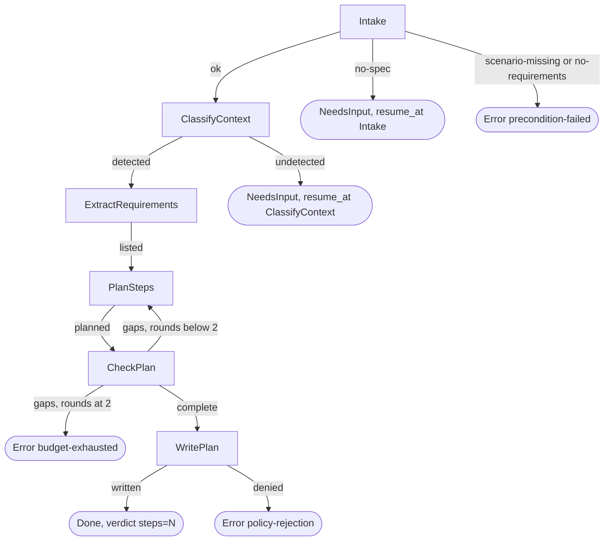
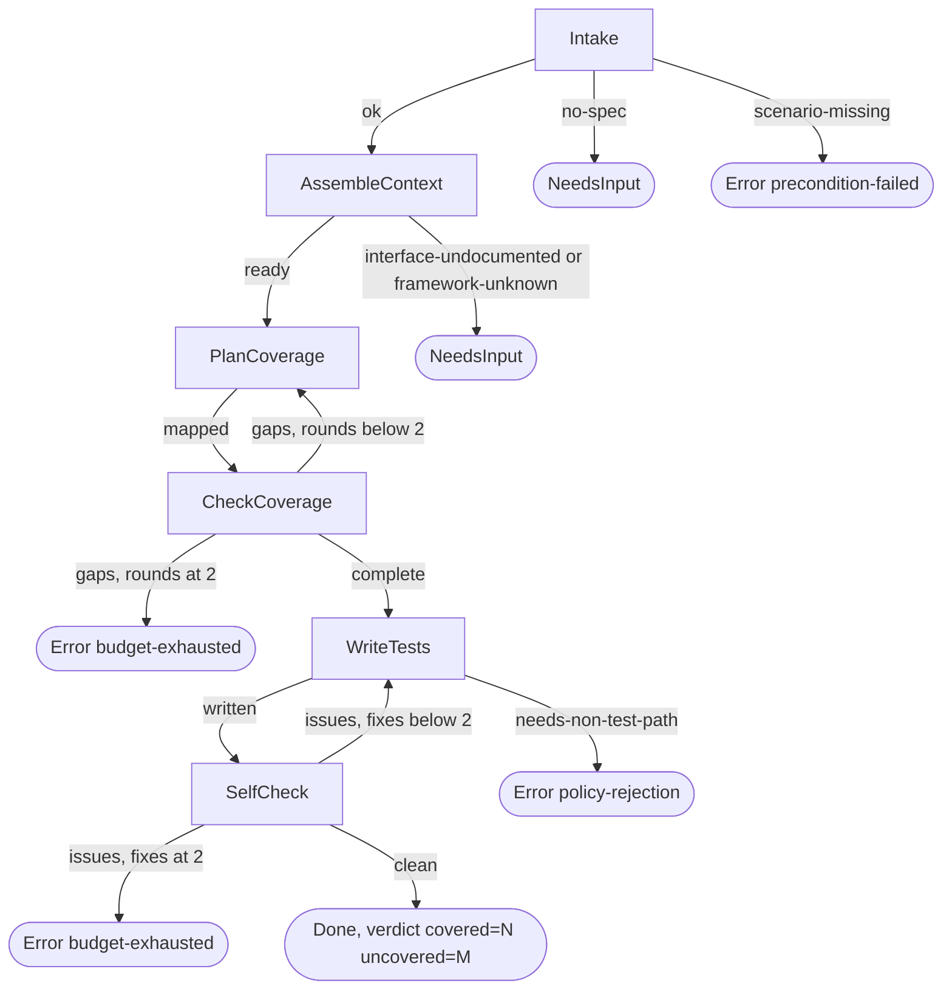

# spec-skills-plan-test

## Metadata

| Field | Value |
|---|---|
| **Feature** | Task planning and black-box test skills: `/task-plan`, `/create-test` |
| **Parent feature** | spec-skills.md |
| **Sub-features** | None |
| **Requirement refs** | BR-006, BR-010, BR-012, BR-013, UR-019, UR-037, UR-038, FR-157, FR-158, FR-159, FR-160, FR-184, FR-185, NFR-010, NFR-013 |
| **Feature type** | Tooling |
| **Status** | Approved |

Status values: Draft, Review, Approved, Implemented.

Citation paths: cited paths that start with `skills/` or `agents/` are relative to `plugins/assist-plugin/`; a citation of this repository's own requirement documents (`docs/requirements/...`) or `DECISIONS.md` is relative to this repository's root. That rule covers citations only: the skill's output folder `docs/task-plans/` resolves against the git root of the session's working directory (`DECISIONS.md:93-96`), as the requirements below state. Baseline: assist-plugin 1.11.1 at commit 41034c1 (1.11.0 was commit 4803a0d); the `task-plan` and `create-test` files cited here were re-read on 2026-10-16, and references into `docs/requirements/` and `DECISIONS.md` point at their current text. The Change Log at the end records the 1.11.1 supersession of the root location and one planned conformance fix.

## Description

`/task-plan` refuses a spec whose requirements lack scenarios, then writes ordered coding steps that name files, the requirement IDs each step satisfies, and the `code` skill references that apply, and checks the plan before it writes it. `/create-test` writes black-box tests from spec Scenarios, requirement documents, and public interface declarations only, covering each Scenario's input space and tracing every test to its IDs. Both run as finite-state automata (rules T1 to T9 in `skills/do/references/fsa-template.md`); under `/do` the `task-planner` agent runs `task-plan` (Area A FR-074 to FR-076) and the `developer-tester` agent runs `create-test` (Area A FR-078). Since 1.11.1 (FR-184, FR-185) `task-plan` writes its plan to `docs/task-plans/` under the session's git root, under a write grant scoped to that folder (`DECISIONS.md:78-86`, `:93-96`, 2026-10-16), and Area B FR-186 holds the `task-planner` write bar to the same folder and root; at 4803a0d the plan went to the working directory root.

## Triggered by

| Trigger type | Source | Condition |
|---|---|---|
| User action | `/task-plan <spec-file-or-prompt> [target-language]` (`skills/task-plan/SKILL.md:13`) | A spec to plan |
| Rework | The prompt names an existing task-plan file | Since FR-184 (built in 1.11.1) WritePlan overwrites only a file in `docs/task-plans/` under the session's git root and writes a new file there for a legacy root-level plan (`skills/task-plan/SKILL.md:22`, `:130`); at 4803a0d it overwrote the named file |
| Agent preload | `task-planner` (`agents/task-planner.md:8-9`) | Task plan step of the `/do` chain |
| User action | `/create-test [spec-file \| feature-name] [language]` (`skills/create-test/SKILL.md:13`) | A spec with Scenarios |
| Agent preload | `developer-tester` (`agents/developer-tester.md:8-9`) | Test steps under `/do` |

## Required data

| Data | Source | Type | Notes |
|---|---|---|---|
| Spec file | Argument | Markdown | Holds `### Requirement:` blocks, each with `#### Scenario:` |
| Requirement documents | `BRD-*.md`, `URD-*.md`, `FR-NFR-*.md` in `docs/requirements/` under the session's git root since FR-182 (built in 1.11.1), or still at the root in an older project (`DECISIONS.md:85`, `:90`); at the root at 4803a0d | Markdown | Grep target for cited IDs |
| Target language | Argument, codebase files, the spec's tech-context field, or the prompt, in that order | Enum | Python, TypeScript, JavaScript, Go, Rust, Kotlin, C++ (`skills/task-plan/SKILL.md:78-94`) |
| `code` skill references | `skills/code/references/` | Files | Glob target for cited references |
| Public interface declarations | Signatures, type definitions, route and schema specs, docstrings | Source fragments | `create-test` never reads a function body |
| Framework reference | `skills/create-test/references/test-frameworks/<lang>.md` | Markdown | One per language |
| Existing task-plan path | Prompt | Path | Rework only; a root-level `./task-plan-*.md` in an older project is read, never overwritten, since FR-184 |

## Behavior

### Requirement: Spec validation gate

The `/task-plan` skill SHALL refuse a spec in which any `### Requirement:` block lacks a `#### Scenario:`, and report the block and its line.

**Requirement refs:** FR-157, UR-037 | **Status:** Built | **Source:** `skills/task-plan/SKILL.md:34`, `:63-76`; `skills/task-plan/references/validation-rules.md:1-77`

A requirement passes when a `#### Scenario:` appears after its `### Requirement:` line and before the next requirement or the end of the file. The refusal reads `Specification incomplete: [Requirement block] has no scenarios.` with `File:` and `Line:` lines, sits in the prose above the terminal block, and ends `Error(precondition-failed)`. A missing GIVEN, WHEN, or THEN inside a present scenario is a warning only.

#### Scenario: Incomplete spec

- **GIVEN** a requirement block with no scenario at line 40 of `specs/spec-auth.md`
- **WHEN** Intake runs
- **THEN** the skill SHALL report the block, `File: specs/spec-auth.md`, and `Line: 40`, and end `Error` with class `precondition-failed`

#### Scenario: No spec path

- **GIVEN** a prompt with no readable spec path
- **WHEN** Intake runs
- **THEN** the skill SHALL end `NeedsInput` with `resume_at: Intake`

#### Scenario: Spec with no requirements

- **GIVEN** a spec file that holds no `### Requirement:` block
- **WHEN** Intake runs
- **THEN** the skill SHALL end `Error` with class `precondition-failed`

### Requirement: Ordered coding steps with sources

The `/task-plan` skill SHALL write ordered coding steps that each name files, the requirement IDs they satisfy, and the `code` skill references that apply.

**Requirement refs:** FR-157, UR-037, BR-013 | **Status:** Built; PLANNED (1.12.0): the example code reference fix (Change Log 2026-10-16) | **Source:** `skills/task-plan/SKILL.md:96-124`, `:136-142`; `skills/task-plan/references/task-plan-template.md:27-41`

Each step carries `**Files:**`, `**Satisfies:**` (`[SPEC-NNN]` or a chain such as `[FR-NNN -> UC-NNN -> AC-N]`), `**Code references:**`, and `**Notes:**`. Order: domain models and types, interface definitions, database setup, services, handlers, then tests. A test step names `developer-tester` as owner and lists test paths only. The plan invents no acceptance criterion or ID, sizes no step, and adds no refactoring step.

#### Scenario: Complete spec

- **GIVEN** a spec where every requirement has a scenario
- **WHEN** the skill plans
- **THEN** each step SHALL carry Files, Satisfies, and Code references fields

#### Scenario: Test step

- **GIVEN** a plan that includes tests for the feature
- **WHEN** the skill writes the test step
- **THEN** the step SHALL name `developer-tester` as owner and list only test paths

#### Scenario: Language not detected

- **GIVEN** no language argument, no recognizable source files, and no tech-context field
- **WHEN** ClassifyContext runs
- **THEN** the skill SHALL end `NeedsInput` with `resume_at: ClassifyContext`

### Requirement: Plan check before writing

The `/task-plan` skill SHALL verify before writing that every Intake requirement appears in some step, and every cited ID and every modified file exists.

**Requirement refs:** FR-158, UR-037, NFR-010 | **Status:** Built | **Source:** `skills/task-plan/SKILL.md:38`, `:42`; `skills/task-plan/references/validation-rules.md:56-68`

CheckPlan greps for each cited ID in the spec and its requirement documents and globs for each cited `code` reference. Accepted ID forms are `SPEC-NNN`, `FR-NNN`, `NFR-NNN`, `UC-NNN`, and `AC-N`; `REQ-NNN`, `SEC-NNN`, `CON-NNN`, and invented numbers are rejected. `rounds` counts PlanSteps passes after a `gaps` outcome; the maximum is 2.

#### Scenario: Uncovered requirement

- **GIVEN** a plan that omits one requirement
- **WHEN** CheckPlan runs
- **THEN** the skill SHALL return to PlanSteps on the first and second `gaps` and end `Error` with class `budget-exhausted` on the third, after two rework passes

#### Scenario: Unknown ID

- **GIVEN** a step cites `FR-999`, which no spec or requirement document holds
- **WHEN** CheckPlan greps for it
- **THEN** the skill SHALL return to PlanSteps and remove or replace the ID

#### Scenario: Modified file missing

- **GIVEN** a step marks `src/api/users.ts` for modification and Glob finds no such file
- **WHEN** CheckPlan runs
- **THEN** the outcome SHALL be `gaps` and the step SHALL change to create the file or name the existing path

### Requirement: Task-plan file output

The `/task-plan` skill SHALL write `task-plan-[feature-slug]-[timestamp].md` at the working directory root from the template on a first run and overwrite the named task-plan file on a rework.

**Requirement refs:** FR-157, NFR-013, UR-037 | **Status:** Built at 4803a0d; superseded in 1.11.1 by the location of FR-184 (Change Log 2026-10-16, MODIFIED) | **Source:** `skills/task-plan/SKILL.md:20-26`, `:39`, `:126-134`; `skills/task-plan/references/task-plan-template.md:1-63`

The template holds Specification Summary, Acceptance Criteria (one row per Scenario), Implementation Steps, Ordering Rationale, and Notes for Developer. The two scenarios marked 4803a0d describe the 1.11.0 location; the Change Log replaces them.

#### Scenario: First run (4803a0d)

- **GIVEN** an approved spec and no task-plan path in the prompt
- **WHEN** WritePlan runs
- **THEN** a new file `task-plan-<feature-slug>-<timestamp>.md` SHALL exist at the root and the outcome SHALL be `written`

#### Scenario: Rework (4803a0d)

- **GIVEN** the prompt names `task-plan-user-api-20261012-101500.md` for rework
- **WHEN** WritePlan runs
- **THEN** the skill SHALL overwrite that file and keep its name

#### Scenario: Write refused

- **GIVEN** the write bar refuses the plan path
- **WHEN** WritePlan runs
- **THEN** the skill SHALL end `Error` with class `policy-rejection`

### Requirement: Task-plan output folder

The `/task-plan` skill SHALL write `task-plan-<feature-slug>-<timestamp>.md` to `docs/task-plans/` under the git root of the session's working directory (a worktree uses its own root; outside a git repository, the working directory), creating the folder when it is missing, on a first run and on a rework, overwriting the file named in the prompt only when that file is already in `docs/task-plans/`.

**Requirement refs:** FR-184, UR-037, BR-013 | **Status:** Built (1.11.1) | **Source:** `docs/requirements/FR-NFR-assist-plugin.md:3961-3990`; `DECISIONS.md:78-86` (2026-10-16, Requirements in docs/requirements/; Legacy root documents and the requirements JSON); `DECISIONS.md:93-96` (2026-10-16, docs/requirements/ and docs/task-plans/ resolve against the session's git root); `skills/task-plan/SKILL.md:22`, `:39`, `:128-132` (1.11.1; the project root at 4803a0d)

A root-level task plan in an older project stays where it is and is still read (`DECISIONS.md:85`). A session started in a subdirectory writes to the repository's `docs/task-plans/` and gets a write prompt, because the grant (FR-185) is relative to the working directory; the user decided that prompt is intended (`DECISIONS.md:95`). Under `/do`, Area B FR-186 lets `task-planner` write only `task-plan-*.md` directly under `docs/task-plans/` of the same git root, and a WritePlan that the bar refuses ends `Error(policy-rejection)` as above.

#### Scenario: First run

- **GIVEN** an approved spec and no `docs/task-plans/` folder
- **WHEN** WritePlan runs
- **THEN** the skill SHALL create the folder and write one timestamped `task-plan-*.md` file in it

#### Scenario: Fix pass on a legacy file

- **GIVEN** the prompt names the root-level `./task-plan-auth-20261012-101500.md` for a rework
- **WHEN** WritePlan runs
- **THEN** the skill SHALL write a new timestamped file in `docs/task-plans/` and leave the root-level file unchanged

#### Scenario: Rework of a plan in the task-plans folder

- **GIVEN** the prompt names `docs/task-plans/task-plan-auth-20261016-1000.md` for a rework
- **WHEN** WritePlan runs
- **THEN** the skill SHALL overwrite that file

#### Scenario: Subdirectory session

- **GIVEN** a session started in `<repo>/src` inside a git repository
- **WHEN** WritePlan runs
- **THEN** the skill SHALL write to `<repo>/docs/task-plans/`, and Claude Code SHALL ask the user first because the skill's `./` grant is relative to the working directory

#### Scenario: Worktree session

- **GIVEN** a session started at the root of the worktree `<repo>/.claude/worktrees/feature-a`
- **WHEN** WritePlan runs
- **THEN** the skill SHALL write to `<repo>/.claude/worktrees/feature-a/docs/task-plans/`, the worktree's own root

### Requirement: Task-plan write grant

The `task-plan` skill SHALL pre-approve edits only to `./docs/task-plans/task-plan-*.md`.

**Requirement refs:** FR-185, UR-037, UR-019, NFR-013, BR-006 | **Status:** Built (1.11.1) | **Source:** `docs/requirements/FR-NFR-assist-plugin.md:3992-4011`, `:4347`, `:4357-4360`; `DECISIONS.md` (2026-10-12, Scoped write grants; 2026-10-16, including `DECISIONS.md:93-96`); `skills/task-plan/SKILL.md:12`, `:26` (`Edit(./docs/task-plans/task-plan-*.md)` at 1.11.1; `Edit(./task-plan-*.md)` at 4803a0d)

The grant is relative to the session's working directory. A write from a session started in a subdirectory prompts, and the user decided that prompt is intended (`DECISIONS.md:95`).

#### Scenario: Granted path

- **GIVEN** the skill writes `docs/task-plans/task-plan-auth-20261016-1000.md`
- **WHEN** Claude Code evaluates the write
- **THEN** the write SHALL run without a permission prompt

#### Scenario: Root-level path

- **GIVEN** the skill writes `./task-plan-auth.md` at the repository root
- **WHEN** Claude Code evaluates the write
- **THEN** Claude Code SHALL ask the user first

#### Scenario: Path outside both folders

- **GIVEN** the skill needs to write `notes/plan.md`
- **WHEN** Claude Code evaluates the write
- **THEN** Claude Code SHALL ask the user first, because the grant covers `./docs/task-plans/task-plan-*.md` only

#### Scenario: Session in a subdirectory

- **GIVEN** a session started in `<repo>/src` and the skill writes `<repo>/docs/task-plans/task-plan-auth.md`
- **WHEN** Claude Code evaluates the write against the `./docs/task-plans/` grant, which is relative to the working directory
- **THEN** Claude Code SHALL ask the user first

### Requirement: Black-box inputs and input-space coverage

The `/create-test` skill SHALL read only spec Scenarios, requirement documents, and public interface declarations and enumerate valid, invalid, boundary, null or empty, type-mismatch, and security-adjacent inputs per Scenario.

**Requirement refs:** FR-159, UR-038 | **Status:** Built | **Source:** `skills/create-test/SKILL.md:20-56`, `:92-95`, `:121-129`

Each category gets 3 to 5 representatives, and each test carries a comment naming its category and reason. Tests check the contract from input to output with no implementation-specific mocking or spy checks. Test names state what they test.

#### Scenario: Scenario to tests

- **GIVEN** a Scenario that validates an email field
- **WHEN** the skill plans coverage
- **THEN** it SHALL map the Scenario to tests for each applicable input category

#### Scenario: Spec without scenarios

- **GIVEN** a spec with no Scenarios
- **WHEN** Intake runs
- **THEN** the skill SHALL end `Error` with class `precondition-failed`

#### Scenario: Undocumented interface

- **GIVEN** a function with no signature, docstring, or spec text
- **WHEN** AssembleContext runs
- **THEN** the skill SHALL end `NeedsInput`, name the interface, and read no function body

### Requirement: Traceability comment and framework reference

The `/create-test` skill SHALL give every test a traceability comment of the form `[AC-N | SPEC-NNN | FR-NNN | ...]` with IDs sourced from existing documents, and load one framework reference for Go, Rust, Python, TypeScript, JavaScript, Kotlin, or C++.

**Requirement refs:** FR-160, UR-038, BR-013 | **Status:** Built | **Source:** `skills/create-test/SKILL.md:32-43`, `:58-78`, `:97`

The chain runs upward (AC, SPEC, FR, UR, BR); `AC-N` is the Scenario's index within its requirement and `SPEC-NNN` is required; other IDs appear when a document provides them. The skill also loads `references/black-box-methodology.md`.

#### Scenario: Comment present

- **GIVEN** a generated test for Scenario 2 of SPEC-003
- **WHEN** SelfCheck re-reads it
- **THEN** the test SHALL carry a comment such as `[AC-2 | SPEC-003 | FR-045]`

#### Scenario: Invented ID

- **GIVEN** a comment cites an ID that no document holds
- **WHEN** SelfCheck greps for it
- **THEN** the skill SHALL fix the comment before it reports `Done`

#### Scenario: Framework unknown

- **GIVEN** a target language with no reference under `test-frameworks/`
- **WHEN** AssembleContext runs
- **THEN** the skill SHALL end `NeedsInput` with outcome `framework-unknown`

### Requirement: Coverage check and self-check loops

The `/create-test` skill SHALL map every Intake ID to tests or list it as uncovered with a reason, re-read every written file before `Done`, and stop after two rework passes in either loop.

**Requirement refs:** FR-159, FR-160, UR-038, NFR-010 | **Status:** Built | **Source:** `skills/create-test/SKILL.md:86-119`, `:126`

CheckCoverage sends `gaps` back to PlanCoverage while `rounds` is below 2 and ends `Error(budget-exhausted)` at 2. SelfCheck checks the test-path rule, the traceability comments, and the cited IDs, sends `issues` back to WriteTests while `fixes` is below 2, and ends `Error(budget-exhausted)` at 2. Compile and run are `not-run (skipped)` because the skill has no Bash. WriteTests writes only test paths; a needed non-test path, a dot-prefixed segment, a file named `CLAUDE.md` or `AGENTS.md`, or a path over 4096 characters or with NUL ends `Error(policy-rejection)`. Under `/do` the verdict is `covered=N uncovered=M` (Area A FR-078; Area B FR-108 enforces the paths for `developer-tester`).

#### Scenario: Gap closed on rework

- **GIVEN** CheckCoverage finds one Intake ID missing from the map on its first pass
- **WHEN** PlanCoverage runs again and maps it
- **THEN** CheckCoverage SHALL return `complete`

#### Scenario: Gaps persist

- **GIVEN** CheckCoverage returns `gaps` with `rounds` at 2
- **WHEN** the loop bound is reached
- **THEN** the skill SHALL end `Error` with class `budget-exhausted`

#### Scenario: Non-test path needed

- **GIVEN** a test that needs a fixture file outside every test glob
- **WHEN** WriteTests runs
- **THEN** the skill SHALL end `Error` with class `policy-rejection` and write nothing at that path

## Algorithmic steps

**`/task-plan` states** (`skills/task-plan/SKILL.md:32-40`): Intake, ClassifyContext, ExtractRequirements, PlanSteps, CheckPlan, WritePlan; terminal Done, NeedsInput, Error. Each `model` state ends with one `Outcome: <value>` line.

Render source: `specs/spec-skills-plan-test-task-plan.mmd`.

**`/create-test` states** (`skills/create-test/SKILL.md:90-98`): Intake, AssembleContext (load the framework and methodology references), PlanCoverage (enumerate the input space and the traceability chain), CheckCoverage, WriteTests, SelfCheck; terminal Done, NeedsInput, Error.

Render source: `specs/spec-skills-plan-test-create-test.mmd`.

## Output / Outcome

| Output | Type | Description |
|---|---|---|
| Validation report | Chat | Success: spec path, requirement count, scenario count. Failure: block, file, line |
| `task-plan-<feature-slug>-<timestamp>.md` | File | Template sections; one step per implementation task. In `docs/task-plans/` under the session's git root, created when missing (FR-184, built in 1.11.1; the working directory root at 4803a0d) |
| Terminal block (agent runs) | Chat | `task-planner/1`, `verdict: steps=N`, `artifact` = plan path (Area A FR-075) |
| Test files | Files | One per public interface or feature; `<name>_test.<ext>` or `<feature>.test.<ext>` by language convention |
| Terminal block (agent runs) | Chat | `developer-tester/1`, `verdict: covered=N uncovered=M`, `skipped: compile not-run (skipped)` |

## Error handling

| Error condition | Handling strategy | Outcome |
|---|---|---|
| No spec path | NeedsInput at Intake | The user names the spec |
| Requirement without scenario | Report block, file, line | `Error(precondition-failed)` |
| Language undetected | NeedsInput at ClassifyContext | The user names the language |
| Plan gaps after two reworks | Stop | `Error(budget-exhausted)` |
| Plan write refused | Stop | `Error(policy-rejection)` |
| `docs/task-plans/` missing (FR-184) | Create the folder | Plan written in it |
| Rework names a legacy root-level plan (FR-184) | Write a new timestamped file in `docs/task-plans/` | Root-level file unchanged |
| Session started in a subdirectory (FR-184, FR-185) | Write to the git root's `docs/task-plans/` | Claude Code asks first; intended per `DECISIONS.md:95` |
| Interface undocumented or framework unknown | NeedsInput at AssembleContext | The user documents the interface or names the framework |
| Coverage gaps after two reworks | Stop | `Error(budget-exhausted)` |
| Self-check issues after two fixes | Stop | `Error(budget-exhausted)` |
| Test needs a non-test path | Stop | `Error(policy-rejection)`; nothing written there |

## Events emitted (if applicable)

Not applicable: both skills write files and a terminal block and emit no events.

## Dependencies

| Dependency | Type | Required | Notes |
|---|---|---|---|
| `task-plan` grants | Runtime | yes | Read, Grep, Glob, `Edit(./docs/task-plans/task-plan-*.md)` (FR-185, built in 1.11.1); no Write entry, and the Edit rule also covers Write on that path (`skills/task-plan/SKILL.md:8-12`) |
| `create-test` grants | Runtime | yes | Read, Write, Grep, Glob, with Write unscoped (`skills/create-test/SKILL.md:8-12`), an accepted NFR-013 exception (OP-6 decided); in a direct run nothing limits writes to test paths except the skill's own rule |
| `code` skill references | Reference | yes | Cited and globbed by CheckPlan |
| `fsa-write-bar` hook | Runtime | no (fail open) | Limits `task-planner` and `developer-tester` paths (Area B FR-108, FR-110; FR-186, built in 1.11.1, holds the `task-planner` limit to `docs/task-plans/` of the session's git root); does not apply to a main-session run (Area B FR-113) |
| `/do` chain Writes and SpecGate | Runtime | no | Area A FR-187, FR-188, FR-191 (built in 1.11.1) and FR-190 (built in 1.11.1 for `docs/task-plans/`; its `specs/` part is PLANNED 1.12.0): the task-plan step's Writes and the document search follow `docs/task-plans/` under the session's git root, plus the old root patterns; the `DECISIONS.md` note about kept root documents is never parsed for paths (`DECISIONS.md:88-91`) |
| `fsa-log` hook and `check-fsa-tables.js` | Runtime, build-time | no | Check the agent terminal blocks and tables (Area B FR-115, FR-121) |

## Sub-feature breakdown (if applicable)

Not applicable: this spec has no sub-features.

## Submodule scope (if applicable)

Not applicable: the repository has no submodules.

## Traceability

| Requirement | Spec section | Verified by |
|---|---|---|
| FR-157 | Requirement: Spec validation gate; Requirement: Ordered coding steps with sources; Requirement: Task-plan file output | `/task-plan` on a spec with a scenario-less requirement, a complete spec, and a rework path |
| FR-158 | Requirement: Plan check before writing | Fixture plan with an omitted requirement, `FR-999`, and a missing file; trace shows two reworks then `Error(budget-exhausted)` |
| FR-159 | Requirement: Black-box inputs and input-space coverage; Requirement: Coverage check and self-check loops | `/create-test` on an email-validation Scenario; read log shows no implementation body opened |
| FR-160 | Requirement: Traceability comment and framework reference; Requirement: Coverage check and self-check loops | Grep of each test comment ID in the spec and requirement documents |
| NFR-010 | Requirement: Plan check before writing; Requirement: Coverage check and self-check loops | `check-fsa-tables.js --check` against the `## States` tables |
| FR-184 | Requirement: Task-plan output folder | After 1.11.1: first run in a project without `docs/task-plans/`; rework naming a root-level plan, with a checksum of that file before and after; rework naming a plan in `docs/task-plans/`; runs from `<repo>/src` and from a worktree root, checking the target folder |
| FR-185 | Requirement: Task-plan write grant | After 1.11.1: frontmatter read of `skills/task-plan/SKILL.md`; a write to `docs/task-plans/` from the repository root runs without a prompt; writes to `./task-plan-auth.md` and `notes/plan.md` prompt; a write from a session started in `<repo>/src` prompts |
| NFR-013 | Requirement: Task-plan file output; Requirement: Task-plan write grant | Frontmatter read; write to `notes/plan.md` prompts |
| UR-019, UR-037, UR-038, BR-006, BR-010, BR-012, BR-013 | Requirements above, by their refs | As listed per requirement |
| FR-157 (example fix), FR-184 (supersession) | Change Log 2026-10-16, MODIFIED Requirements | Glob of each code reference in the `skills/task-plan/SKILL.md` Step 1 example under `skills/code/references/`; first run and rework fixtures checked against `docs/task-plans/` |

## Change Log: 2026-10-16

**Source:** `docs/requirements/FR-NFR-assist-plugin.md` version 1.1 (2026-10-16, final and approved, re-read for fix pass 1; line cites checked against the current file on 2026-10-17): FR-184 (`:3961-3990`, built in 1.11.1) supersedes the root location in this spec's "Task-plan file output" requirement; FR-157 (`:3465-3479`) is unchanged, and its example fix is one of the plain fixes recorded under User Decisions in `.agent/main-plan/plan-deferred-decisions-20261016-1059.md` ("Plain fixes: include all 11 in phase 2").

The location change records behavior built in 1.11.1; the example fix is PLANNED (1.12.0). This spec received a delta, so its Status returns to `Review` (FR-154).

### MODIFIED Requirements

#### Requirement: Task-plan file output

**Was:** The `/task-plan` skill SHALL write `task-plan-[feature-slug]-[timestamp].md` at the working directory root from the template on a first run and overwrite the named task-plan file on a rework.
**Now:** The `/task-plan` skill SHALL write `task-plan-[feature-slug]-[timestamp].md` from the template, with Specification Summary, Acceptance Criteria, Implementation Steps, Ordering Rationale, and Notes for Developer, at the path and under the rework rule of Requirement: Task-plan output folder (FR-184).
**Reason:** 1.11.1 built FR-184, so the root location and the unconditional overwrite no longer hold; the scenarios "First run (4803a0d)" and "Rework (4803a0d)" are replaced by the two below.
**Requirement refs:** FR-157, FR-184, NFR-013, UR-037 | **Status:** Built (1.11.1) | **Source:** `skills/task-plan/SKILL.md:39`, `:126-134`; `skills/task-plan/references/task-plan-template.md:1-63`

##### Scenario: First run

- **GIVEN** an approved spec and no task-plan path in the prompt
- **WHEN** WritePlan runs
- **THEN** a new file `docs/task-plans/task-plan-<feature-slug>-<timestamp>.md` SHALL exist under the session's git root with the five template sections, and the outcome SHALL be `written`

##### Scenario: Rework of a root-level plan

- **GIVEN** the prompt names the root-level `task-plan-user-api-20261012-101500.md` for rework
- **WHEN** WritePlan runs
- **THEN** the skill SHALL write a new timestamped file in `docs/task-plans/` and leave the root-level file byte-identical

The scenario "Write refused" in the body still holds.

#### Requirement: Ordered coding steps with sources

**Was:** The statement as in the body; the Step 1 example in `skills/task-plan/SKILL.md:115` cites `patterns/typescript/rest-crud-endpoint.md`, a file that does not exist (a Read of `skills/code/references/patterns/typescript/rest-crud-endpoint.md` on 2026-10-16 returned "File does not exist"), which breaks the skill's own rule that every cited code reference exists (`:139`).
**Now:** The statement is unchanged, and the example cites `patterns/typescript/rest-crud.md`, which exists (`skills/code/references/patterns/typescript/rest-crud.md:1`, read on 2026-10-16).
**Reason:** Plain fix, planned conformance to FR-157 and the skill's constraint; no requirement text changes.
**Requirement refs:** FR-157, UR-037 | **Status:** PLANNED (1.12.0) for the example | **Source:** `skills/task-plan/SKILL.md:115`, `:139`

##### Scenario: Example code references exist

- **GIVEN** `skills/task-plan/SKILL.md` after the change
- **WHEN** a test globs each path in the "Code references" line of the Step 1 example under `skills/code/references/`
- **THEN** every path SHALL match a file, including `patterns/typescript/rest-crud.md`

##### Scenario: Example cites a missing reference

- **GIVEN** an example that cites `patterns/typescript/rest-crud-endpoint.md`
- **WHEN** the same test runs
- **THEN** the test SHALL fail and name the missing path

### ADDED Requirements

None.

### REMOVED Requirements

None. The two 4803a0d scenarios of "Task-plan file output" leave inside the MODIFIED entry above.

### Planned conformance (files that change with this entry)

| File and line at 1.11.1 | Change | Requirement |
|---|---|---|
| `skills/task-plan/SKILL.md:115` | `patterns/typescript/rest-crud-endpoint.md` becomes `patterns/typescript/rest-crud.md` | FR-157 |

### Direct edits in this pass (no behavior change)

Status set to `Review`; baseline moved to 1.11.1; FR-184 and FR-185 marked Built with their 1.11.1 sources; the Description, Triggered by, Required data, Output, Error handling, and Dependencies rows rewritten from "after FR-184 (PLANNED)" to the built state; the `create-test` grant marked as an accepted NFR-013 exception; line cites refreshed (`skills/task-plan/SKILL.md:61-76` to `:63-76`, `:132-138` to `:136-142`, `:126-130` to `:126-134`; FR-NFR cites to the lines of the final version 1.1). On 2026-10-17 the FR-NFR cites were checked against the current file: FR-157, FR-184, and FR-185 sit 15 lines lower (`:3465-3479`, `:3961-3990`, `:3992-4011`); NFR-013, after the rewritten FR-195 of FR-NFR version 1.2, sits at `:4347` with the "Scoped grant" scenario at `:4357-4360`.
