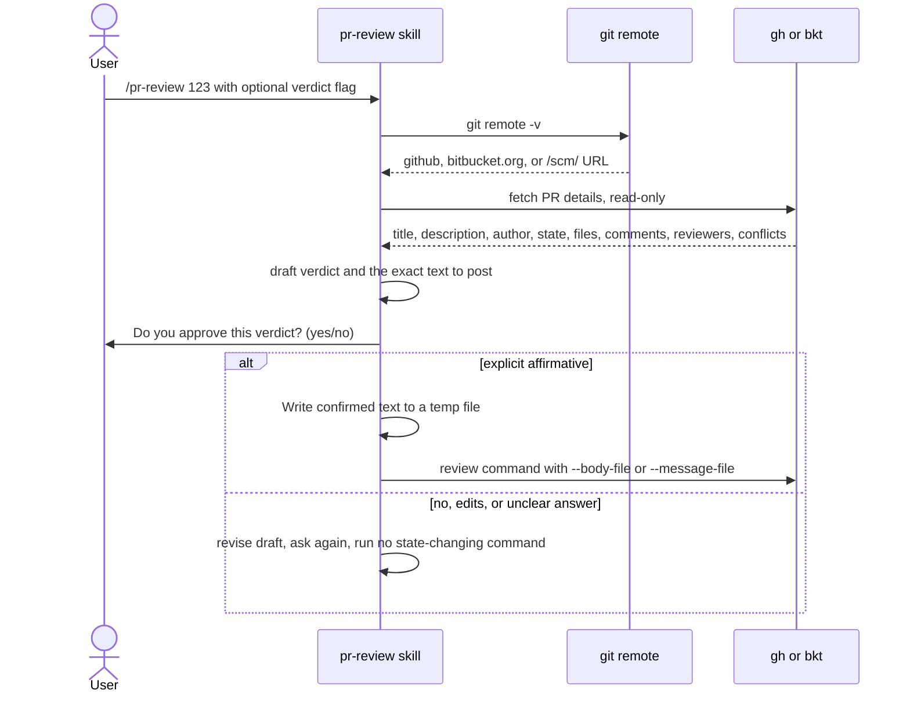

# spec-skills-pr-review

## Metadata

| Field | Value |
|---|---|
| **Feature** | Pull request review skill: `/pr-review` |
| **Parent feature** | spec-skills.md |
| **Sub-features** | None |
| **Requirement refs** | BR-006, BR-010, UR-031, FR-142, FR-143, FR-144 |
| **Feature type** | Integration |
| **Status** | Draft |

Status values: Draft, Review, Approved, Implemented.

Paths that start with `skills/` or `agents/` are relative to `plugins/assist-plugin/`. Baseline: commit 4803a0d.

## Description

`/pr-review` detects GitHub, Bitbucket Cloud, or Bitbucket Server from the git remote, fetches a pull request, drafts a verdict, and posts it only after the user confirms the exact text. Drafted text reaches the platform CLI through a temporary file, never through a shell string, so text copied from a hostile PR cannot run as a command. The gate holds when the verdict flag was passed on the command line. The source also applies it when the `reviewer` agent drafts the verdict under `/do`; that path is unverified (open point OP-4 in `spec-skills.md`).

## Triggered by

| Trigger type | Source | Condition |
|---|---|---|
| User action | `/pr-review [PR#\|branch-name] [--approve\|--changes-requested\|--comment] [--message TEXT]` (`skills/pr-review/SKILL.md:15`); the options table adds `--diff` and `--no-comment` (`:153-154`) | A PR to review |
| Orchestrator (unverified) | The skill text says `/do review PR #123` routes to the `reviewer` agent, which runs the skill (`skills/pr-review/SKILL.md:156-171`; `references/review-workflow.md:226-236`). That agent has no Bash and cannot ask the user directly, so this path is unverified and pending (open point OP-4 in `spec-skills.md`) | Review requests under `/do` (Area A) |

## Required data

| Data | Source | Type | Notes |
|---|---|---|---|
| Remote URL | `git remote -v`; `origin`, else `upstream` when `origin` is local | URL | `skills/pr-review/references/pr-detection.md:66-89`, `:232-244` |
| PR identifier | Number, current branch (`git rev-parse --abbrev-ref HEAD`), or branch name | String | `pr-detection.md:113-140` |
| Platform CLI | `gh` (GitHub) or `bkt` (Bitbucket) | External tool | Installed and authenticated (FR-NFR section 7) |
| PR details | CLI output | Untrusted text | Title, description, author, state, files with line stats, comments, reviews, reviewers, approval status, conflicts |
| Verdict flag | `--approve`, `--changes-requested`, `--comment` | Enum | States intent only; never skips confirmation (`SKILL.md:41`) |
| `--message TEXT` | Argument | String | Treated as a draft to confirm, never posted unseen (`SKILL.md:96`) |
| Draft file | Temp path such as `/tmp/pr-review-body.txt` | File | Written with the Write tool |

## Behavior

### Requirement: Platform detection

The `/pr-review` skill SHALL detect GitHub, Bitbucket Cloud, or Bitbucket Server from `git remote -v` and pick the matching CLI.

**Requirement refs:** FR-142, UR-031 | **Status:** Built | **Source:** `skills/pr-review/SKILL.md:45-62`; `skills/pr-review/references/pr-detection.md:5-89`, `:177-199`

A remote containing `github.com` or `github.` maps to GitHub and `gh`; `bitbucket.org` maps to Bitbucket Cloud and `bkt`; a `/scm/` path or another `bitbucket` host maps to Bitbucket Server, which may need `bkt`, custom scripts, or the REST API.

#### Scenario: GitHub remote

- **GIVEN** the remote is `https://github.com/user/repo.git`
- **WHEN** the user runs `/pr-review 123`
- **THEN** the skill SHALL use the `gh` CLI

#### Scenario: Bitbucket Cloud remote

- **GIVEN** the remote is `git@bitbucket.org:user/repo.git`
- **WHEN** the user runs `/pr-review 456`
- **THEN** the skill SHALL use the `bkt` CLI

#### Scenario: Unknown remote

- **GIVEN** a remote that matches no pattern and neither `GITHUB_SERVER_URL` nor `BITBUCKET_URL` is set
- **WHEN** the skill detects the platform
- **THEN** it SHALL ask the user whether the repository is GitHub or Bitbucket and run no PR command before the answer

### Requirement: PR identification and fetch

The `/pr-review` skill SHALL identify the PR by number, current branch, or branch name and fetch title, description, author, state, changed files, comments, reviewers, and conflicts.

**Requirement refs:** FR-142, UR-031 | **Status:** Built | **Source:** `skills/pr-review/SKILL.md:64-78`, `:201-208`; `skills/pr-review/references/pr-detection.md:113-140`

#### Scenario: Current branch

- **GIVEN** the current branch `feature/auth` has an open PR on GitHub
- **WHEN** the user runs `/pr-review` with no argument
- **THEN** the skill SHALL find that PR with `gh pr view --head feature/auth` and show its details

#### Scenario: Own PR

- **GIVEN** the PR belongs to the current user
- **WHEN** the user runs `/pr-review`
- **THEN** the skill SHALL return an error and post nothing

### Requirement: Verdict confirmation gate

The `/pr-review` skill SHALL run `--approve`, `--changes-requested`, `bkt pr approve`, or `bkt pr decline` only after the user answers yes to "Do you approve this verdict? (yes/no)" for the drafted verdict, even when the flag was passed or the `reviewer` agent chose the verdict.

**Requirement refs:** FR-143, UR-031, BR-006 | **Status:** Built | **Source:** `skills/pr-review/SKILL.md:80-96`, `:171`, `:209`; `skills/pr-review/references/review-workflow.md:23-40`

The scenarios below test a direct `/pr-review` run. The `/do` path in which the `reviewer` agent drafts the verdict is unverified (open point OP-4 in `spec-skills.md`); FR-143 applies to it once that path is settled.

The protocol: analyze read-only; draft the verdict and the exact text; show both and ask the question; accept only a clear affirmative in the current turn; post the confirmed text unmodified; on no or an edit request, revise and ask again. A comment-only post also needs the user to see the exact text first. Each PR and each verdict needs its own confirmation.

#### Scenario: Flag supplied

- **GIVEN** the user runs `/pr-review 123 --approve`
- **WHEN** the skill drafts its verdict
- **THEN** the skill SHALL ask "Do you approve this verdict? (yes/no)" before it runs any state-changing command

#### Scenario: User declines

- **GIVEN** the user answers no
- **WHEN** the skill continues
- **THEN** the skill SHALL revise the draft and ask again, and SHALL NOT run the command

#### Scenario: Unclear answer

- **GIVEN** the user replies with a question or changes the subject
- **WHEN** the skill reads the reply
- **THEN** it SHALL treat the reply as no confirmation and run no state-changing command

#### Scenario: Second verdict in the same session

- **GIVEN** the user confirmed a comment on PR 123 earlier in the session
- **WHEN** the skill drafts an approval for PR 123
- **THEN** it SHALL ask for a fresh confirmation before it approves

### Requirement: Review text posted through a file

The `/pr-review` skill SHALL pass drafted review text to the platform CLI through a temporary file (`--body-file` or `--message-file`) in place of interpolating it into a shell string.

**Requirement refs:** FR-144, UR-031, BR-006 | **Status:** Built | **Source:** `skills/pr-review/SKILL.md:96`, `:210`; `skills/pr-review/references/review-workflow.md:42-51`; `rules/llm-security-checklist.md` (LLM05)

The confirmed text is written with the Write tool, never by shell concatenation. A subcommand without a file flag gets the text as one argument through the tool's native argument array. The temp file is deleted or ignored after use and never reused for another PR or verdict.

#### Scenario: Hostile PR body

- **GIVEN** a PR description with a `$(...)` sequence that the draft repeats
- **WHEN** the skill posts the comment
- **THEN** the command SHALL carry `--body-file <path>` or `--message-file <path>` and the sequence SHALL NOT run

#### Scenario: Stale draft file

- **GIVEN** a temp file left from a verdict on PR 122
- **WHEN** the skill posts a verdict on PR 123
- **THEN** it SHALL write a new draft file from the text confirmed for PR 123

#### Scenario: Missing CLI

- **GIVEN** neither `gh` nor `bkt` is installed
- **WHEN** the skill starts
- **THEN** the skill SHALL report the missing CLI with its install command and use no other command

## Algorithmic steps

1. Detect the platform from the remote; fall back to `GITHUB_SERVER_URL` or `BITBUCKET_URL`, then ask the user.
2. Check authentication (`gh auth status` or `bkt auth status`); when it fails, ask the user to run `gh auth login` or `bkt auth login`.
3. Identify the PR and fetch its details read-only (`gh pr view`, `gh pr diff`, `gh api repos/{owner}/{repo}/pulls/<n>/reviews`; `bkt pr get`, `bkt pr reviewers`).
4. Draft the verdict and the exact text under the Review Output Rules (`skills/do/references/review-protocol.md:99-107`): verdict or first finding first, each finding re-read at its `file:line`, only new or open findings on a re-review.
5. Ask "Do you approve this verdict? (yes/no)".
6. On an explicit yes, write the confirmed text to a temp file and run `gh pr review <n> --approve|--request-changes|--comment --body-file <file>`, or `bkt pr approve`, `bkt pr decline --message-file <file>`, `bkt pr comment --message-file <file>`.
7. On anything else, revise and return to step 5.

Render source: `specs/spec-skills-pr-review.mmd`.

## Output / Outcome

| Output | Type | Description |
|---|---|---|
| PR summary | Chat report | Details, files with stats, comments, reviews, reviewers, conflicts |
| Drafted verdict | Chat report | Verdict plus the exact text that would post |
| Posted review | Platform state change | Approve, request changes, decline, or comment, only after confirmation |
| Temp draft file | File | Holds the confirmed text for one post |

## Error handling

| Error condition | Handling strategy | Outcome |
|---|---|---|
| Platform not detected | Env variables, then ask the user (`--github` or `--bitbucket` also documented) | No PR command until the platform is known |
| `gh` or `bkt` missing | Report it with the install command; use no other command | Nothing fetched or posted |
| Not authenticated | Ask the user to run the login command | Nothing fetched or posted |
| PR is the user's own | Return an error | Nothing posted |
| Already approved or already declined | Refuse the duplicate verdict (`SKILL.md:207-208`). The source mentions an optional override flag without naming it; the flag is pending (open point OP-8 in `spec-skills.md`) | Nothing posted |
| User says no, asks for edits, or answers unclearly | Revise and ask again | No state-changing command |
| CLI subcommand has no file flag | Pass the text as one argument in the native argument array | No shell re-parsing of the text |

## Events emitted (if applicable)

Not applicable: the skill changes PR state on the platform and emits no local events.

## Dependencies

| Dependency | Type | Required | Notes |
|---|---|---|---|
| `gh` or `bkt` | External | yes | Installed and authenticated (`README.md:163-170`) |
| Tool grants | Runtime | yes | Read, Write, Grep, Glob, Bash, AskUserQuestion, with Write and Bash unscoped (`skills/pr-review/SKILL.md:8-14`; open point OP-6 in `spec-skills.md`) |
| Review Output Rules | Reference | yes | `skills/do/references/review-protocol.md:99-107` |
| `reviewer` agent | Runtime | no | Pending: open point OP-4 in `spec-skills.md`. The skill text routes `/do review PR` through this agent (`SKILL.md:156-171`), which declares Read, Grep, Glob, and LSP only (`skills/do/references/agent-registry.md:12`; Area A FR-067); a subagent asks the user only through `NeedsInput` (`docs/requirements/FR-NFR-assist-plugin.md:3718`). No source says how it fetches the PR or asks the confirmation question, so the path is unverified |
| `review-md` | Runtime | no | Listed as a caller in `skills/review-md/SKILL.md:31`; `pr-review`'s own files do not state the call (open point OP-3 in `spec-skills.md`) |
| `injection-filter` hook | Runtime | no (fail open) | Does not filter Bash output from `gh` or `bkt` (Area B FR-099 names `firecrawl`, `curl`, `wget`, `ctx7`) |

## Sub-feature breakdown (if applicable)

Not applicable: this spec has no sub-features.

## Submodule scope (if applicable)

Not applicable: the repository has no submodules.

## Traceability

| Requirement | Spec section | Verified by |
|---|---|---|
| FR-142 | Requirement: Platform detection; Requirement: PR identification and fetch | Fixture remotes for GitHub, Bitbucket Cloud, Bitbucket Server, and an unknown host; own-PR run |
| FR-143 | Requirement: Verdict confirmation gate | Manual runs with `--approve` answered yes, no, and with an unclear reply; command log shows no state change before yes |
| FR-144 | Requirement: Review text posted through a file | Command log shows `--body-file` or `--message-file`; hostile `$(...)` body fixture; missing-CLI run |
| UR-031 | All requirements | As above |
| BR-006, BR-010 | Requirement: Verdict confirmation gate; Requirement: Review text posted through a file | As above |
