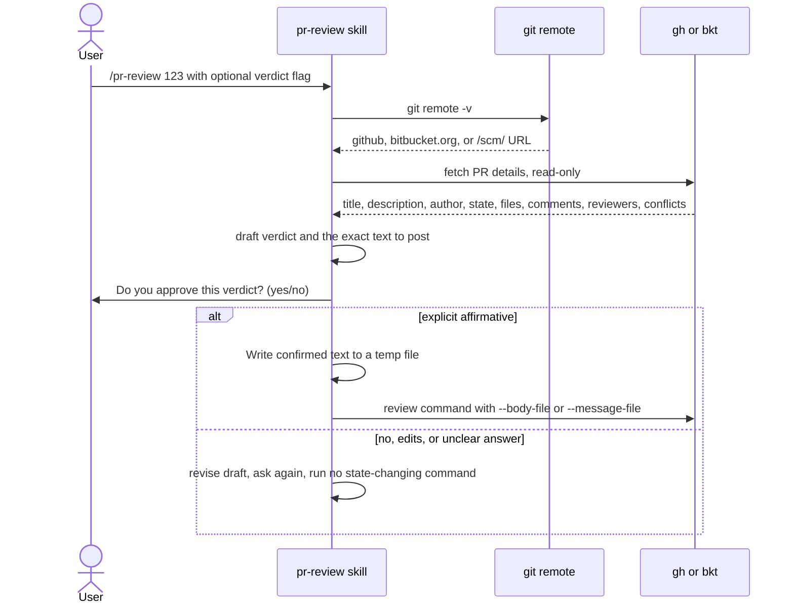
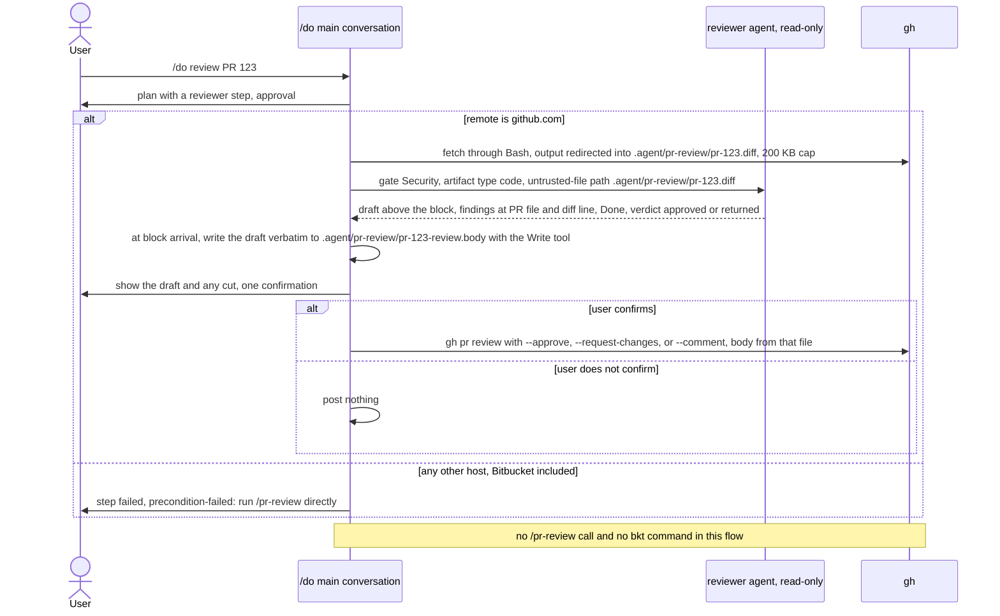

# spec-skills-pr-review

## Metadata

| Field | Value |
|---|---|
| **Feature** | Pull request review skill: `/pr-review` |
| **Parent feature** | spec-skills.md |
| **Sub-features** | None |
| **Requirement refs** | BR-006, BR-010, BR-012, UR-019, UR-031, FR-142, FR-143, FR-144, FR-195 |
| **Feature type** | Integration |
| **Status** | Approved |

Status values: Draft, Review, Approved, Implemented.

Paths that start with `skills/` or `agents/` are relative to `plugins/assist-plugin/`. Baseline: assist-plugin 1.11.1 at commit 41034c1; 1.11.1 changed none of the cited `pr-review` files (`CHANGELOG.md:5-23`), and `SKILL.md`, `references/pr-detection.md`, and `references/review-workflow.md` were re-read on 2026-10-16 with every cite holding. The PLANNED (1.12.0) changes are in the Change Logs at the end (2026-10-16, and 2026-10-17 for the GitHub-only `/do` flow); the body keeps the built behavior.

## Description

`/pr-review` detects GitHub, Bitbucket Cloud, or Bitbucket Server from the git remote, fetches a pull request, drafts a verdict, and posts it only after the user confirms the exact text. Drafted text reaches the platform CLI through a temporary file, never through a shell string, so text copied from a hostile PR cannot run as a command. The gate holds when the verdict flag was passed on the command line. At 1.11.1 the skill text also routes a `/do` review through the `reviewer` agent, a path that agent's tools cannot carry out. OP-4 is decided: under FR-195 (PLANNED 1.12.0) `/do` fetches the PR by redirect and posts the confirmed draft itself with `gh`, without calling `/pr-review`, and the `reviewer` only drafts. In 1.12.0 that flow covers `github.com` remotes only; on any other host, Bitbucket included, `/do` fails the step and tells the user to run `/pr-review` directly (`DECISIONS.md:208-211`). The skill's part of that change is its own text (Change Logs 2026-10-16 and 2026-10-17). The `bkt` command forms in this spec and in the skill's references do not match the bkt CLI; correcting them is a follow-up outside 1.12.0 (`DECISIONS.md:208-211`).

## Triggered by

| Trigger type | Source | Condition |
|---|---|---|
| User action | `/pr-review [PR#\|branch-name] [--approve\|--changes-requested\|--comment] [--message TEXT]` (`skills/pr-review/SKILL.md:15`); the options table adds `--diff` and `--no-comment` (`:153-154`) | A PR to review |
| Orchestrator | At 1.11.1 the skill text says `/do review PR #123` routes to the `reviewer` agent, which runs the skill (`skills/pr-review/SKILL.md:156-171`; `references/review-workflow.md:226-236`); that agent has no Bash and cannot ask the user directly. OP-4 is decided: from 1.12.0 a `/do` PR review calls no `/pr-review` (FR-195, `DECISIONS.md:183-186`) and covers `github.com` remotes only, sending other hosts to a direct `/pr-review` run (`DECISIONS.md:208-211`), and the skill text changes to say so (Change Logs 2026-10-16 and 2026-10-17) | Review requests under `/do` at 1.11.1 only (Area A owns the 1.12.0 flow) |

## Required data

| Data | Source | Type | Notes |
|---|---|---|---|
| Remote URL | `git remote -v`; `origin`, else `upstream` when `origin` is local | URL | `skills/pr-review/references/pr-detection.md:66-89`, `:232-244` |
| PR identifier | Number, current branch (`git rev-parse --abbrev-ref HEAD`), or branch name | String | `pr-detection.md:113-140` |
| Platform CLI | `gh` (GitHub) or `bkt` (Bitbucket) | External tool | Installed and authenticated (FR-NFR section 7) |
| PR details | CLI output | Untrusted text | Title, description, author, state, files with line stats, comments, reviews, reviewers, approval status, conflicts |
| Verdict flag | `--approve`, `--changes-requested`, `--comment` | Enum | States intent only; never skips confirmation (`SKILL.md:41`) |
| `--message TEXT` | Argument | String | Treated as a draft to confirm, never posted unseen (`SKILL.md:96`) |
| Draft file | Temp path such as `/tmp/pr-review-body.txt` | File | Written with the Write tool |

## Behavior

### Requirement: Platform detection

The `/pr-review` skill SHALL detect GitHub, Bitbucket Cloud, or Bitbucket Server from `git remote -v` and pick the matching CLI.

**Requirement refs:** FR-142, UR-031 | **Status:** Built | **Source:** `skills/pr-review/SKILL.md:45-62`; `skills/pr-review/references/pr-detection.md:5-89`, `:177-199`

A remote containing `github.com` or `github.` maps to GitHub and `gh`; `bitbucket.org` maps to Bitbucket Cloud and `bkt`; a `/scm/` path or another `bitbucket` host maps to Bitbucket Server, which may need `bkt`, custom scripts, or the REST API.

#### Scenario: GitHub remote

- **GIVEN** the remote is `https://github.com/user/repo.git`
- **WHEN** the user runs `/pr-review 123`
- **THEN** the skill SHALL use the `gh` CLI

#### Scenario: Bitbucket Cloud remote

- **GIVEN** the remote is `git@bitbucket.org:user/repo.git`
- **WHEN** the user runs `/pr-review 456`
- **THEN** the skill SHALL use the `bkt` CLI

#### Scenario: Unknown remote

- **GIVEN** a remote that matches no pattern and neither `GITHUB_SERVER_URL` nor `BITBUCKET_URL` is set
- **WHEN** the skill detects the platform
- **THEN** it SHALL ask the user whether the repository is GitHub or Bitbucket and run no PR command before the answer

### Requirement: PR identification and fetch

The `/pr-review` skill SHALL identify the PR by number, current branch, or branch name and fetch title, description, author, state, changed files, comments, reviewers, and conflicts.

**Requirement refs:** FR-142, UR-031 | **Status:** Built | **Source:** `skills/pr-review/SKILL.md:64-78`, `:201-208`; `skills/pr-review/references/pr-detection.md:113-140`

#### Scenario: Current branch

- **GIVEN** the current branch `feature/auth` has an open PR on GitHub
- **WHEN** the user runs `/pr-review` with no argument
- **THEN** the skill SHALL find that PR with `gh pr view --head feature/auth` and show its details

#### Scenario: Own PR

- **GIVEN** the PR belongs to the current user
- **WHEN** the user runs `/pr-review`
- **THEN** the skill SHALL return an error and post nothing

### Requirement: Verdict confirmation gate

The `/pr-review` skill SHALL run `--approve`, `--changes-requested`, `bkt pr approve`, or `bkt pr decline` only after the user answers yes to "Do you approve this verdict? (yes/no)" for the drafted verdict, even when the flag was passed or the `reviewer` agent chose the verdict.

**Requirement refs:** FR-143, UR-031, BR-006 | **Status:** Built (1.11.1); PLANNED (1.12.0): no override flag, and a returned verdict on Bitbucket posts a comment (Change Log 2026-10-16) | **Source:** `skills/pr-review/SKILL.md:80-96`, `:171`, `:209`; `skills/pr-review/references/review-workflow.md:23-40`

The scenarios below test a direct `/pr-review` run. From 1.12.0 a `/do` PR review calls no `/pr-review` (FR-195), and the skill always asks on its own, whoever passed the flag (`DECISIONS.md:183-186`). A direct run stays the way to review a Bitbucket PR, because the 1.12.0 `/do` flow covers `github.com` remotes only (`DECISIONS.md:208-211`).

The protocol: analyze read-only; draft the verdict and the exact text; show both and ask the question; accept only a clear affirmative in the current turn; post the confirmed text unmodified; on no or an edit request, revise and ask again. A comment-only post also needs the user to see the exact text first. Each PR and each verdict needs its own confirmation.

#### Scenario: Flag supplied

- **GIVEN** the user runs `/pr-review 123 --approve`
- **WHEN** the skill drafts its verdict
- **THEN** the skill SHALL ask "Do you approve this verdict? (yes/no)" before it runs any state-changing command

#### Scenario: User declines

- **GIVEN** the user answers no
- **WHEN** the skill continues
- **THEN** the skill SHALL revise the draft and ask again, and SHALL NOT run the command

#### Scenario: Unclear answer

- **GIVEN** the user replies with a question or changes the subject
- **WHEN** the skill reads the reply
- **THEN** it SHALL treat the reply as no confirmation and run no state-changing command

#### Scenario: Second verdict in the same session

- **GIVEN** the user confirmed a comment on PR 123 earlier in the session
- **WHEN** the skill drafts an approval for PR 123
- **THEN** it SHALL ask for a fresh confirmation before it approves

### Requirement: Review text posted through a file

The `/pr-review` skill SHALL pass drafted review text to the platform CLI through a temporary file (`--body-file` or `--message-file`) in place of interpolating it into a shell string.

**Requirement refs:** FR-144, UR-031, BR-006 | **Status:** Built | **Source:** `skills/pr-review/SKILL.md:96`, `:210`; `skills/pr-review/references/review-workflow.md:42-51`; `rules/llm-security-checklist.md` (LLM05)

The confirmed text is written with the Write tool, never by shell concatenation. A subcommand without a file flag gets the text as one argument through the tool's native argument array. The temp file is deleted or ignored after use and never reused for another PR or verdict.

#### Scenario: Hostile PR body

- **GIVEN** a PR description with a `$(...)` sequence that the draft repeats
- **WHEN** the skill posts the comment
- **THEN** the command SHALL carry `--body-file <path>` or `--message-file <path>` and the sequence SHALL NOT run

#### Scenario: Stale draft file

- **GIVEN** a temp file left from a verdict on PR 122
- **WHEN** the skill posts a verdict on PR 123
- **THEN** it SHALL write a new draft file from the text confirmed for PR 123

#### Scenario: Missing CLI

- **GIVEN** neither `gh` nor `bkt` is installed
- **WHEN** the skill starts
- **THEN** the skill SHALL report the missing CLI with its install command and use no other command

## Algorithmic steps

1. Detect the platform from the remote; fall back to `GITHUB_SERVER_URL` or `BITBUCKET_URL`, then ask the user.
2. Check authentication (`gh auth status` or `bkt auth status`); when it fails, ask the user to run `gh auth login` or `bkt auth login`.
3. Identify the PR and fetch its details read-only (`gh pr view`, `gh pr diff`, `gh api repos/{owner}/{repo}/pulls/<n>/reviews`; `bkt pr get`, `bkt pr reviewers`).
4. Draft the verdict and the exact text under the Review Output Rules (`skills/do/references/review-protocol.md:99-107`): verdict or first finding first, each finding re-read at its `file:line`, only new or open findings on a re-review.
5. Ask "Do you approve this verdict? (yes/no)".
6. On an explicit yes, write the confirmed text to a temp file and run `gh pr review <n> --approve|--request-changes|--comment --body-file <file>`, or `bkt pr approve`, `bkt pr decline --message-file <file>`, `bkt pr comment --message-file <file>` (the 1.11.1 mapping; in 1.12.0 a Bitbucket `--changes-requested` posts `bkt pr comment` and `bkt pr decline` leaves the mapping, Change Log 2026-10-16).
7. On anything else, revise and return to step 5.

The `bkt pr` command forms in steps 3 and 6 are the 1.11.1 skill text. `DECISIONS.md:208-211` records that they do not match the bkt CLI and makes their correction a follow-up outside 1.12.0 (Change Log 2026-10-17).

Render source: `specs/spec-skills-pr-review.mmd` (direct run; the `/do` flow of FR-195, for context, is in the Change Log). Rendering skipped: see the note in `spec-skills.md`.

## Output / Outcome

| Output | Type | Description |
|---|---|---|
| PR summary | Chat report | Details, files with stats, comments, reviews, reviewers, conflicts |
| Drafted verdict | Chat report | Verdict plus the exact text that would post |
| Posted review | Platform state change | Approve, request changes, decline (Bitbucket at 1.11.1; a comment from 1.12.0), or comment, only after confirmation |
| Temp draft file | File | Holds the confirmed text for one post |

## Error handling

| Error condition | Handling strategy | Outcome |
|---|---|---|
| Platform not detected | Env variables, then ask the user (`--github` or `--bitbucket` also documented) | No PR command until the platform is known |
| `gh` or `bkt` missing | Report it with the install command; use no other command | Nothing fetched or posted |
| Not authenticated | Ask the user to run the login command | Nothing fetched or posted |
| PR is the user's own | Return an error | Nothing posted |
| Already approved or already declined | Refuse the duplicate verdict (`SKILL.md:207-208`). At 1.11.1 the source mentions an optional override flag without naming it; OP-8 is decided: the mention goes and no flag overrides the state (FR-143, Change Log 2026-10-16) | Nothing posted |
| User says no, asks for edits, or answers unclearly | Revise and ask again | No state-changing command |
| CLI subcommand has no file flag | Pass the text as one argument in the native argument array | No shell re-parsing of the text |

## Events emitted (if applicable)

Not applicable: the skill changes PR state on the platform and emits no local events.

## Dependencies

| Dependency | Type | Required | Notes |
|---|---|---|---|
| `gh` or `bkt` | External | yes | Installed and authenticated (`README.md:166-173`) |
| Tool grants | Runtime | yes | Read, Write, Grep, Glob, Bash, AskUserQuestion, with Write and Bash unscoped (`skills/pr-review/SKILL.md:8-14`), an accepted NFR-013 exception (OP-6 decided; `spec-skills.md` Change Log) |
| Review Output Rules | Reference | yes | `skills/do/references/review-protocol.md:99-107` |
| `reviewer` agent | Runtime | no | At 1.11.1 the skill text routes `/do review PR` through this agent (`SKILL.md:156-171`), which declares Read, Grep, Glob, and LSP only (`skills/do/references/agent-registry.md:12`; Area A FR-067); a subagent asks the user only through `NeedsInput` (`docs/requirements/FR-NFR-assist-plugin.md:4532`). OP-4 is decided: under FR-195 the agent drafts from the scratch file `/do` fetched and ends `Done`, and `/do` posts; neither calls `/pr-review` (Area A; Change Log 2026-10-16) |
| `review-md` | Runtime | no | Listed as a caller in `skills/review-md/SKILL.md:31` at 1.11.1, though `pr-review`'s own files do not state the call; OP-3 is decided, and FR-148 drops `pr-review` from that list (PLANNED 1.12.0, `spec-skills-docs-review.md`) |
| `injection-filter` hook | Runtime | no (fail open) | Does not filter Bash output from `gh` or `bkt` (Area B FR-099 names `firecrawl`, `curl`, `wget`, `ctx7`) |

## Sub-feature breakdown (if applicable)

Not applicable: this spec has no sub-features.

## Submodule scope (if applicable)

Not applicable: the repository has no submodules.

## Traceability

| Requirement | Spec section | Verified by |
|---|---|---|
| FR-142 | Requirement: Platform detection; Requirement: PR identification and fetch | Fixture remotes for GitHub, Bitbucket Cloud, Bitbucket Server, and an unknown host; own-PR run |
| FR-143 | Requirement: Verdict confirmation gate | Manual runs with `--approve` answered yes, no, and with an unclear reply; command log shows no state change before yes |
| FR-144 | Requirement: Review text posted through a file | Command log shows `--body-file` or `--message-file`; hostile `$(...)` body fixture; missing-CLI run |
| UR-031 | All requirements | As above |
| BR-006, BR-010 | Requirement: Verdict confirmation gate; Requirement: Review text posted through a file | As above |
| FR-143 (1.12.0 changes) | Change Log 2026-10-16, MODIFIED Requirement: Verdict confirmation gate | Read of `skills/pr-review/SKILL.md` for no override flag and no `bkt pr decline` in the verdict mapping; Bitbucket fixture run with `--changes-requested` answered yes: command log shows a `bkt pr comment` post and no `bkt pr decline`, and the PR stays open (the exact `bkt` form is the follow-up of `DECISIONS.md:208-211`); a run with a flag passed by an agent still asks |
| FR-195, UR-019, BR-012 | Change Log 2026-10-16, ADDED Requirement: Skill text matches the /do PR review flow, as modified by Change Log 2026-10-17 | Read of `skills/pr-review/SKILL.md` Workflow Integration and `references/review-workflow.md` Agent-Assisted Review and Step 4: no line has the `reviewer` call `/pr-review` or submit a review; both name `/do` as the step that fetches and posts with `gh` for a `github.com` remote, send other hosts to a direct `/pr-review` run, and name no `bkt` command for the `/do` flow; a search of every file under `skills/pr-review/` finds no claim that `/do` runs `bkt` |

## Change Log: 2026-10-16

**Source:** `docs/requirements/FR-NFR-assist-plugin.md` version 1.1 (2026-10-16, final and approved, re-read for fix pass 1; line cites checked against the current file on 2026-10-17): FR-143 (`:3183-3212`) revised and FR-195 (`:4079-4218`) added, both PLANNED (1.12.0); this spec holds the skill-text part of FR-195. Decisions: `DECISIONS.md:118-121`, refined by `:148-151`, `:153-156`, `:158-161`, `:163-166` (a returned verdict on Bitbucket posts a comment; declining stays manual), `:183-186` (`/do` fetches by redirect and posts with `gh` or `bkt`, calls no `/pr-review`, and the one-confirmation exception of `:178-181` is withdrawn), and `:193-196` (on Bitbucket an approved `/do` review runs `bkt pr approve` and then `bkt pr comment`; `:208-211` takes this out of the `/do` flow for 1.12.0, Change Log 2026-10-17); the answers to OP-4 and OP-8 under User Decisions in `.agent/main-plan/plan-deferred-decisions-20261016-1059.md`, of which the OP-4 answer was refined by those later entries.

Every change in this entry is PLANNED (1.12.0). This spec received a delta, so its Status returns to `Review` (FR-154).

### MODIFIED Requirements

#### Requirement: Verdict confirmation gate

**Was:** The `/pr-review` skill SHALL run `--approve`, `--changes-requested`, `bkt pr approve`, or `bkt pr decline` only after the user answers yes to "Do you approve this verdict? (yes/no)" for the drafted verdict, even when the flag was passed or the `reviewer` agent chose the verdict. At 1.11.1 `--changes-requested` maps to `bkt pr decline` on Bitbucket (`skills/pr-review/SKILL.md:87`, `:138`), and `:207-208` mention an unnamed override flag.
**Now:** The `/pr-review` skill SHALL run `--approve`, `--changes-requested`, `--comment`, `bkt pr approve`, or the Bitbucket comment submission (`bkt pr comment`) only after the user answers yes to "Do you approve this verdict? (yes/no)" for the drafted verdict, even when the flag was passed or the `reviewer` agent chose the verdict; declining a PR is a manual choice outside the skill's verdict mapping. On Bitbucket a confirmed `--changes-requested` (a `returned` verdict) posts a comment with the findings and leaves the PR open. No flag overrides an already approved or declined PR, and the skill text names none.
**Reason:** OP-8 decided (drop the mention); `DECISIONS.md:163-166` (Bitbucket returned verdicts comment; declining stays manual); `DECISIONS.md:183-186` (`/pr-review` always confirms on its own).
**Requirement refs:** FR-143, UR-031, BR-006 | **Status:** PLANNED (1.12.0) for the command list, the Bitbucket mapping, and the override flag | **Source:** `docs/requirements/FR-NFR-assist-plugin.md:3185-3212`; `skills/pr-review/SKILL.md:141` (`bkt pr comment --message-file` at 1.11.1)

The Bitbucket comment mapping of this direct-run requirement stays as written. Its `bkt` forms (`bkt pr approve`, `bkt pr comment --message-file`) are the 1.11.1 text; `DECISIONS.md:208-211` records that they do not match the bkt CLI and makes their correction a follow-up outside 1.12.0 (Change Log 2026-10-17).

##### Scenario: Pre-supplied flag still asks

- **GIVEN** `/pr-review 123 --approve` or `--changes-requested`, whether typed by the user or passed by an agent
- **WHEN** the skill drafts its verdict
- **THEN** the skill SHALL ask "Do you approve this verdict? (yes/no)" before any state-changing command, with no exception for a `/do` PR review

##### Scenario: No override flag

- **GIVEN** a PR that is already approved or declined
- **WHEN** the user runs `/pr-review` on it
- **THEN** the skill SHALL accept no flag that overrides the state, and `skills/pr-review/SKILL.md` SHALL NOT mention such a flag

##### Scenario: Changes requested on Bitbucket

- **GIVEN** a Bitbucket remote and the user runs `/pr-review 123 --changes-requested` and answers yes to the confirmation
- **WHEN** the skill submits
- **THEN** the skill SHALL post a comment with the findings through `--message-file`, leave the PR open, and run no `bkt pr decline`

##### Scenario: Changes requested on GitHub

- **GIVEN** a GitHub remote and the user runs `/pr-review 123 --changes-requested` and answers yes
- **WHEN** the skill submits
- **THEN** the skill SHALL run `gh pr review 123 --request-changes --body-file <file>`, as at 1.11.1

##### Scenario: Comment-only post

- **GIVEN** the user runs `/pr-review 123 --comment` and answers no to the confirmation
- **WHEN** the skill continues
- **THEN** the skill SHALL revise the draft and ask again, and SHALL NOT run `gh pr review --comment` or `bkt pr comment`

##### Scenario: Decline is not a verdict

- **GIVEN** a Bitbucket PR and a `returned` verdict that the user confirmed
- **WHEN** the skill submits
- **THEN** the skill SHALL NOT run `bkt pr decline`; the user declines the PR by hand when they choose to

### ADDED Requirements

#### Requirement: Skill text matches the /do PR review flow

The `pr-review` skill files SHALL describe a `/do` PR review as FR-195 runs it, with `/do` fetching the PR and posting the user-confirmed draft itself through `gh` or `bkt` and the read-only `reviewer` only drafting, and SHALL NOT say that the `reviewer` calls `/pr-review` or submits a review.

**Requirement refs:** FR-195, UR-031, UR-019, BR-012 | **Status:** PLANNED (1.12.0) | **Source:** `docs/requirements/FR-NFR-assist-plugin.md:4081`, `:4083` (names `skills/pr-review/SKILL.md:156-171` with the `reviewer` calling `/pr-review` at `:163-168`, and `skills/pr-review/references/review-workflow.md:226-236` at `:231-235`, as text that changes with FR-195); `DECISIONS.md:183-186`

Change Log 2026-10-17 modifies this requirement: the `/do` flow covers `github.com` remotes only in 1.12.0, posts with `gh` alone, and runs no `bkt` command (`DECISIONS.md:208-211`). Where this entry says `gh` or `bkt` for the `/do` flow, the 2026-10-17 entry governs.

FR-195 for context, as revised on 2026-10-17: for a `github.com` remote, `/do` runs `gh` through Bash with the output redirected into `.agent/pr-review/pr-<N>.diff` (capped at 200 KB, any cut recorded and shown), sends the `reviewer` gate Security, artifact type `code`, and that path inside an untrusted-file wrapper, shows the draft once for confirmation, and posts with `gh pr review --approve`, `--request-changes`, or `--comment` through a body file with a non-prose extension; on any other host, Bitbucket included, the step fails with `precondition-failed` and the message to run `/pr-review` directly, and `/do` runs no `bkt` command. That flow, its failure handling, and its scenarios are `/do` behavior and sit with the orchestration specs (Area A). This requirement holds only what changes in the `pr-review` skill files.

##### Scenario: Workflow Integration describes the /do flow

- **GIVEN** `skills/pr-review/SKILL.md` after the change
- **WHEN** a test reads its Workflow Integration section (`:156-171` at 1.11.1)
- **THEN** the section SHALL name `/do` as the step that fetches the PR and posts the confirmed draft with `gh` or `bkt`, SHALL say the `reviewer` only drafts, and SHALL hold none of the 1.11.1 lines in which the `reviewer` invokes `/pr-review` or submits (`:163-168`)

##### Scenario: Agent-Assisted Review describes the /do flow

- **GIVEN** `skills/pr-review/references/review-workflow.md` after the change
- **WHEN** a test reads its Agent-Assisted Review section (`:226-236` at 1.11.1)
- **THEN** the section SHALL describe the same flow and SHALL hold none of the 1.11.1 lines in which the `reviewer` fetches through `/pr-review`, asks the user, or submits (`:231-235`)

##### Scenario: Old claim left in place

- **GIVEN** any file of the `pr-review` skill (`skills/pr-review/SKILL.md` or a file under `skills/pr-review/references/`) that still says the `reviewer` invokes, calls, or submits through `/pr-review`, such as "reviewer submits /pr-review 123 --approve" (`review-workflow.md:235` at 1.11.1), "reviewer invokes /pr-review 123 --no-comment" (`SKILL.md:163`), "invoked by the `reviewer` agent" (`SKILL.md:209`), or "the reviewer agent calling the skill internally" (`review-workflow.md:40`)
- **WHEN** a test searches every file of the skill for these claims
- **THEN** the test SHALL fail and name the file and line

##### Scenario: Direct run unchanged

- **GIVEN** a direct `/pr-review 123 --approve` after the change
- **WHEN** the skill drafts its verdict
- **THEN** the skill SHALL still fetch, draft, and ask the FR-143 question before any state-changing command, because FR-195 changes no step of the direct flow

The `/do` flow, for context only (Area A owns it):

Render source: `specs/spec-skills-pr-review-do.mmd`. Rendering skipped: see the note in `spec-skills.md`. The diagram shows the flow as narrowed on 2026-10-17 (Change Log 2026-10-17). On any host other than `github.com`, the step stops before the fetch and starts no `reviewer`.

### REMOVED Requirements

None.

### Planned conformance (files that change with this entry)

| File and line at 1.11.1 | Change | Requirement |
|---|---|---|
| `skills/pr-review/SKILL.md:87`, `:135-138`, `:209` | `--changes-requested` on Bitbucket maps to `bkt pr comment`; the gated commands are `--approve`, `--changes-requested`, `--comment`, `bkt pr approve`, and `bkt pr comment`; `bkt pr decline` leaves the verdict mapping | FR-143 |
| `skills/pr-review/SKILL.md:93` | The Changes Requested row says "Blocks merge, requires changes", which holds on GitHub only; on Bitbucket the verdict posts a comment and leaves the PR open | FR-143 |
| `skills/pr-review/SKILL.md:207-208` | The override-flag mention goes | FR-143 |
| `skills/pr-review/references/review-workflow.md:25`, `:37`, `:340` | The gated command lists drop `bkt pr decline` and add the Bitbucket comment submission | FR-143 |
| `skills/pr-review/references/review-workflow.md:130`, `:339` | A Bitbucket changes-requested verdict leaves the PR open and posts a comment. FR-143 names `:340` only; `:130` ("Bitbucket: Blocks merge until resolved") and `:339` (the "Decline (request changes)" comment above `:340`) describe the same mapping without the literal `bkt pr decline` (re-read on 2026-10-16) | FR-143 |
| `skills/pr-review/SKILL.md:156-171` (`:163-168`) | Workflow Integration describes the FR-195 flow; the `reviewer` no longer calls `/pr-review` or submits | FR-195 |
| `skills/pr-review/references/review-workflow.md:226-236` (`:231-235`) | Agent-Assisted Review describes the same flow | FR-195 |
| `skills/pr-review/SKILL.md:209` | "applies even when invoked by the `reviewer` agent or with the flag pre-supplied on the command line" becomes "applies even when the `reviewer` agent drafted the verdict or the flag was pre-supplied on the command line", because under FR-195 the `reviewer` never invokes the skill (found by this spec; the same line's command list changes under FR-143 above) | FR-195 |
| `skills/pr-review/references/review-workflow.md:40`, `:81-89` | The same claim outside the lines FR-195 names: the gate applies to "the reviewer agent calling the skill internally" (`:40`), and `/do review PR` routes to a `reviewer` that fetches details; the same rewrite applies (found by this spec) | FR-195 |
| `skills/pr-review/references/review-workflow.md:91-106` | Step 4 continues the Step 3 `/do review PR #123` block: "The agent presents the draft verdict and message" (`:93`), then on yes "runs the command below", which is `/pr-review 123 --approve`, `--changes-requested`, or `--comment` (`:96-103`). After the change Step 4 SHALL NOT say the agent submits: under `/do`, `/do` shows the draft once and posts it with `gh` (a `github.com` remote only, Change Log 2026-10-17); the `/pr-review` commands stay only as the direct-run form, which the skill confirms under FR-143 (found by this spec) | FR-195, FR-143 |
| `skills/pr-review/references/review-workflow.md:238` | "The human confirmation in the last two steps is mandatory every time" points at `:233-235`, which change, and cites the `/pr-review` Confirmation Gate, which the `/do` flow does not run. After the change the sentence points at the user's confirmation of the draft `/do` shows before it posts (FR-195); "The reviewer agent's own confidence is never sufficient." stays (found by this spec) | FR-195 |
| `skills/pr-review/SKILL.md:60`; `skills/pr-review/references/pr-detection.md` (12 lines) | Example hosts and the credential become placeholders | NFR-015 (`spec-skills.md` Change Log) |

Two statements need no change for FR-195: `skills/pr-review/SKILL.md:41` (a pre-supplied `--approve` or `--changes-requested` "does not skip confirmation") and `references/review-workflow.md:28` (the gate holds even when "the `reviewer` agent is fully confident in its own analysis"). Only the command lists on `review-workflow.md:25` and `SKILL.md:209` change under FR-143, and `SKILL.md:209` also changes under FR-195 (rows above).

### Direct edits in this pass (no behavior change)

Status set to `Review`; Requirement refs gain FR-195, UR-019, and BR-012; baseline moved to 1.11.1; the OP-4, OP-6, OP-3, and OP-8 notes replaced by the decided answers with pointers here; `README.md:163-170` refreshed to `:166-173`; the FR-NFR constraint cite refreshed from `:3718` to `:4497`; the context diagram `specs/spec-skills-pr-review-do.mmd` added. Fix pass 1 removed the earlier draft's bounded `/do` confirmation exception for FR-143 and its three scenarios (withdrawn by `DECISIONS.md:183-186`), the conformance row that existed only for that exception, and the `/do`-side copy of FR-195's scenarios, which belong to Area A. Fix pass 2 added the conformance rows for `review-workflow.md:91-106` (Step 4) and `:238`. Fix pass 3 added the FR-195 row for `SKILL.md:209`, corrected the note on the statements that keep their text, quoted `review-workflow.md:40` exactly, and widened "Old claim left in place" to every file of the skill.

## Change Log: 2026-10-17

**Source:** `DECISIONS.md:208-211` (2026-10-17, "/do PR review supports GitHub only in 1.12.0"), made after the sign-off at `DECISIONS.md:203-206`; `docs/requirements/FR-NFR-assist-plugin.md` FR-195 as revised for that decision (FR-NFR version 1.2, `:4079-4218`: statement `:4081`, Source `:4083`, scenario "Bitbucket remote" `:4155-4158`) and section 9 open question 6 (`:4591`). The FR-143 statement (`:3185`) is unchanged; its Source (`:3187`) now names the `bkt` follow-up.

The Status stays `Approved`, as directed with this change, which applies the user's decision at `DECISIONS.md:208-211`. Every change in this entry is PLANNED (1.12.0).

### MODIFIED Requirements

#### Requirement: Skill text matches the /do PR review flow

**Was:** The `pr-review` skill files SHALL describe a `/do` PR review as FR-195 runs it, with `/do` fetching the PR and posting the user-confirmed draft itself through `gh` or `bkt` and the read-only `reviewer` only drafting, and SHALL NOT say that the `reviewer` calls `/pr-review` or submits a review.
**Now:** The `pr-review` skill files SHALL describe a `/do` PR review as FR-195 runs it, for `github.com` remotes only, with `/do` fetching the PR and posting the user-confirmed draft itself through `gh` and the read-only `reviewer` only drafting; SHALL say that on any other host, Bitbucket included, `/do` fails the step and the user runs `/pr-review` directly; and SHALL NOT say that the `reviewer` calls `/pr-review` or submits a review, or that `/do` runs a `bkt` command.
**Reason:** `DECISIONS.md:208-211` limits the 1.12.0 `/do` flow to `github.com` remotes, because the `bkt` forms in the specs and references do not match the bkt CLI.
**Requirement refs:** FR-195, UR-031, UR-019, BR-012 | **Status:** PLANNED (1.12.0) | **Source:** `docs/requirements/FR-NFR-assist-plugin.md:4081`, `:4155-4158`; `DECISIONS.md:208-211`

The 2026-10-16 scenarios "Old claim left in place" and "Direct run unchanged" still apply. The two section scenarios below replace "Workflow Integration describes the /do flow" and "Agent-Assisted Review describes the /do flow".

##### Scenario: Workflow Integration describes the GitHub-only /do flow

- **GIVEN** `skills/pr-review/SKILL.md` after the change
- **WHEN** a test reads its Workflow Integration section (`:156-171` at 1.11.1)
- **THEN** the section SHALL name `/do` as the step that fetches the PR with `gh` and posts the confirmed draft with `gh pr review` for a `github.com` remote, SHALL say the `reviewer` only drafts, SHALL tell a user with any other remote to run `/pr-review` directly, and SHALL name no `bkt` command for the `/do` flow

##### Scenario: Agent-Assisted Review and Step 4 describe the GitHub-only /do flow

- **GIVEN** `skills/pr-review/references/review-workflow.md` after the change
- **WHEN** a test reads its Agent-Assisted Review section (`:226-236` at 1.11.1) and Step 4 (`:91-106`)
- **THEN** both SHALL describe the same flow and the same direct-run pointer for other hosts, and SHALL hold none of the 1.11.1 lines in which the `reviewer` fetches through `/pr-review`, asks the user, or submits (`:231-235`, `:93`)

##### Scenario: /do bkt claim in the skill text

- **GIVEN** a file under `skills/pr-review/` that says `/do` posts or fetches with `bkt`, for example "`/do` runs `bkt pr approve` and then `bkt pr comment`"
- **WHEN** a test searches every file of the skill for such a claim
- **THEN** the test SHALL fail and name the file and line

##### Scenario: Bitbucket PR reviewed by a direct run

- **GIVEN** a Bitbucket remote and the user runs `/pr-review 123 --changes-requested` directly and answers yes
- **WHEN** the skill submits
- **THEN** the skill SHALL post a comment and leave the PR open, as FR-143 maps it (Change Log 2026-10-16), because `DECISIONS.md:208-211` leaves the direct flow's mapping in place

### Note on the direct-run `bkt` forms (no change in 1.12.0)

The FR-143 Bitbucket comment mapping (Change Log 2026-10-16, MODIFIED Requirement: Verdict confirmation gate) stays as written. The same holds for the other `bkt` forms that this spec cites from the 1.11.1 skill text: algorithmic steps 3 and 6, `skills/pr-review/SKILL.md:133` (`bkt pr approve`) and `:141` (`bkt pr comment --message-file`), and the planned FR-143 rows for `SKILL.md:87`, `:135-138`, `:209` and `review-workflow.md:25`, `:37`, `:340`. `DECISIONS.md:208-211` records that bkt CLI v0.34.0 takes a numeric id with `--project` and `--repo`, uses `bkt pr view` and `bkt pr comments`, and takes `--text` (not `--message-file`) for `bkt pr comment`. Correcting the forms everywhere, `/pr-review`'s references included, is a follow-up outside 1.12.0.

### ADDED Requirements

None.

### REMOVED Requirements

None.

### Planned conformance (files that change with this entry)

| File and line at 1.11.1 | Change | Requirement |
|---|---|---|
| `skills/pr-review/SKILL.md:156-171` (`:163-168`) | Workflow Integration describes the `/do` flow for `github.com` remotes only, posting with `gh pr review`, and sends any other host to a direct `/pr-review` run; it names no `bkt` command for `/do` | FR-195 |
| `skills/pr-review/references/review-workflow.md:226-236` (`:231-235`), `:91-106`, `:238` | The same flow and pointer as in `SKILL.md`; this replaces "posts it with `gh` or `bkt`" in the 2026-10-16 rows | FR-195 |
| `skills/pr-review/SKILL.md:133`, `:141`; `skills/pr-review/references/review-workflow.md:37`, `:340` | No change to the `bkt` syntax in 1.12.0; the follow-up corrects it | FR-143 (follow-up) |

### Direct edits in this pass (no behavior change)

- The baseline note, Description, Triggered by row, the note above the FR-143 scenarios, and the note after the algorithmic steps name the GitHub-only `/do` flow or the `bkt` follow-up.
- The 2026-10-16 entry gets pointer notes: a Source note on `:193-196`, a note under the FR-143 Source line, a note under the ADDED requirement's Source line, the "FR-195 for context" paragraph restated from the revised FR-195, a note under the context diagram, and "(a `github.com` remote only)" in the Step 4 conformance row.
- Traceability: the FR-143 row keeps the comment check without the `--message-file` form; the FR-195 row names the GitHub-only check.
- FR-NFR cites checked against FR-NFR version 1.2, in which FR-094 and FR-198 gained scenarios and FR-195 was rewritten: FR-143 `:3168-3197` to `:3183-3212` (statement `:3170` to `:3185`), FR-195 `:4064-4183` to `:4079-4218` (statement `:4066` to `:4081`, Source `:4068` to `:4083`, "Bitbucket remote" `:4155-4158`), open question 6 `:4591`, and the constraint on subagent questions `:4497` to `:4532`.
- The inline context diagram and `specs/spec-skills-pr-review-do.mmd` drop the `bkt` branches. They now show the remote check: a `github.com` remote goes through the `gh` flow, and any other host stops with the direct `/pr-review` message. They also write the body file when the reviewer's block arrives, before the confirmation, as the FR-195 scenario "Body file written with the Write tool" (`:4105-4108`) states.
