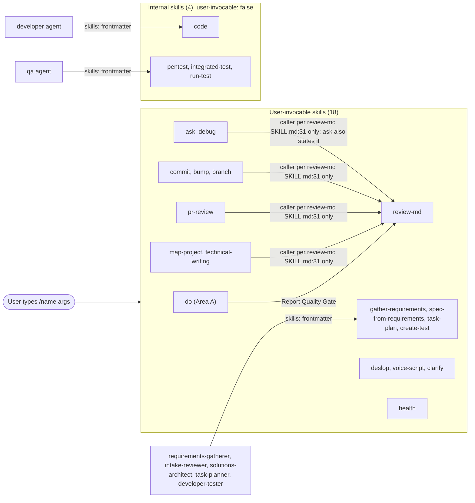

# spec-skills

## Metadata

| Field | Value |
|---|---|
| **Feature** | Area C: skill catalog, shared skill contract, manifests, and repository documents |
| **Parent feature** | None |
| **Sub-features** | spec-skills-ask-debug.md, spec-skills-git.md, spec-skills-pr-review.md, spec-skills-docs-review.md, spec-skills-requirements-specs.md, spec-skills-plan-test.md, spec-skills-deslop-voice-clarify.md, spec-skills-health.md, spec-skills-internal.md, spec-skills-manifests-docs.md, spec-skills-untrusted-input.md |
| **Requirement refs** | BR-003, BR-005, BR-006, BR-008, BR-010, BR-016, UR-019, UR-042, UR-045, FR-130, FR-183, FR-185, NFR-004, NFR-011, NFR-013, NFR-015, NFR-018, NFR-019 |
| **Feature type** | Tooling |
| **Status** | Draft |

Status values: Draft, Review, Approved, Implemented.

Baseline: assist-plugin 1.11.0 at commit 4803a0d. A requirement is Built unless its Status line says PLANNED, copied from `docs/requirements/FR-NFR-assist-plugin.md`. Citation paths: a citation of this repository's own requirement documents (`docs/requirements/...`) or `DECISIONS.md` is relative to this repository's root; other cited paths that start with `skills/`, `agents/`, `hooks/`, `rules/`, `scripts/`, or `docs/` are relative to `plugins/assist-plugin/`. That rule covers citations only. When a requirement names the skills' output folders `docs/requirements/` and `docs/task-plans/`, the folders resolve against the git root of the session's working directory, a worktree using its own root and the working directory serving outside a git repository (`DECISIONS.md:93-96`). A `file:line` reference points at the file as it stands at the baseline, except references into `docs/requirements/` and `DECISIONS.md`, which point at their current text (re-checked on 2026-10-16, after the last requirements update).

## Description

assist-plugin ships 22 skills under `skills/<name>/SKILL.md`: 18 that the user invokes as `/<name>` and 4 internal skills that agents preload. This parent spec fixes the catalog and the contract every skill file keeps: frontmatter, tool grants, write scope, the writing-standard block, prose quality, change control, and token cost. The eleven child specs specify each skill family, the manifests, the repository documents, and the planned untrusted-input rule. The `do` skill's behavior belongs to Area A (`specs/spec-orchestration*.md`, FR-001 to FR-085 and FR-187 to FR-191); this spec covers `do` only as a catalog entry and as an invoker of `review-md`. Hooks belong to Area B (`specs/spec-hooks*.md`, FR-086 to FR-129, FR-180, FR-181, and FR-186). The PLANNED (1.11.1) move of requirements to `docs/requirements/` and task plans to `docs/task-plans/` touches Area C through FR-182 to FR-185 (`spec-skills-requirements-specs.md`, `spec-skills-plan-test.md`) and FR-174 (`spec-skills-manifests-docs.md`), under the five 2026-10-16 entries at `DECISIONS.md:78-101`: the two folders, legacy root documents and the requirements JSON, legacy location records as plain notes, resolution against the session's git root, and the 1.11.1 design points, which keep the `gather-requirements` grant scoped to `docs/requirements/`.

### Open points (pending user decisions)

Each point below is a difference between sources, or a gap in them, that only the user can settle. Until then, every Requirement and Scenario that the point touches states the current source behavior and marks the disputed part as pending, citing the point's ID. OP-2 and OP-15 are decided and are listed separately under "Decided points".

- **OP-1: LLM gate scope.** NFR-011 (`docs/requirements/FR-NFR-assist-plugin.md:3577`) and `rules/llm-security-checklist.md:11` trigger the gate on `skills/**/SKILL.md` and `skills/**/references/*.md`; `rules/llm-security-checklist.md:304` and `CLAUDE.md:111` cover all of `skills/`. Reference files one directory below `references/` fall outside the narrow glob: 87 by count of the files the SKILL.md files link to (19 `voice-script` model files, `skills/voice-script/SKILL.md:48-68`; 7 language, 7 framework, and 35 pattern files in `code`, `skills/code/SKILL.md:94-128`; 7 `create-test` framework files, `skills/create-test/SKILL.md:35-41`; 6 `integrated-test` pattern files, `skills/integrated-test/SKILL.md:74-81`; 6 spec templates, `skills/spec-from-requirements/SKILL.md:42-47`). Question: should NFR-011 and checklist line 11 cover `skills/**`? Pending in: Requirement: LLM security gate on skill changes.
- **OP-3: Callers of `review-md`.** FR-148 names nine callers; the list exists only in `skills/review-md/SKILL.md:31`. `ask` (`skills/ask/SKILL.md:40`, `:52`) and `do` (`skills/do/references/review-protocol.md:195-220`) state the call; the SKILL.md files of `debug`, `pr-review`, `technical-writing`, `bump`, `map-project`, `commit`, and `branch` do not. FR-148 keeps Status Built with this source difference. Question: should those seven skill files state the call, or should FR-148 be reworded? Pending in: `spec-skills-docs-review.md` (Automatic report review), `spec-skills-ask-debug.md`, `spec-skills-pr-review.md`, and the catalog diagram below.
- **OP-4: `/do` PR reviews through a read-only agent.** `skills/pr-review/SKILL.md:156-171` and `skills/pr-review/references/review-workflow.md:226-236` route `/do review PR` through the `reviewer` agent, which has Read, Grep, Glob, and LSP only (`skills/do/references/agent-registry.md:12`; FR-067); a subagent asks the user only through `NeedsInput` (`docs/requirements/FR-NFR-assist-plugin.md:3718`). Question: under `/do`, which agent fetches the PR and asks the confirmation question, and how? Pending in: `spec-skills-pr-review.md` (Description, Triggered by, Verdict confirmation gate, Dependencies).
- **OP-5: NFR-004 counted text and method.** NFR-004 (`docs/requirements/FR-NFR-assist-plugin.md:3530`) caps a new feature at fewer than 50 tokens of always-loaded text and names neither the text nor a method. This spec proposes the new skill's frontmatter `description` plus `argument-hint`, estimated at 4 characters per token and labeled an estimate. Question: confirm that text and method, or name others? Pending in: Requirement: Token budget for a new skill.
- **OP-6: Unscoped grants.** Write and Edit without a path in `bump` (`skills/bump/SKILL.md:10-11`), `code` (`skills/code/SKILL.md:10-11`), and `integrated-test` (`skills/integrated-test/SKILL.md:11-12`); Write without a path in `pr-review` (`skills/pr-review/SKILL.md:10`), `review-md` (`skills/review-md/SKILL.md:11`), `create-test` (`skills/create-test/SKILL.md:10`), and `run-test` (`skills/run-test/SKILL.md:10`); Bash without a pattern in `debug` (`skills/debug/SKILL.md:10`) and `map-project` (`skills/map-project/SKILL.md:10`), as well as in `bump` (`:14`), `pr-review` (`:13`), and `commit` (`skills/commit/SKILL.md:8`). NFR-013 covers none of them, and in a main-session run no hook limits their writes (FR-113). Question: should these grants be scoped, or NFR-013 extended to them? Pending in: the Output table below and the Dependencies of the child specs.
- **OP-7: `/bump` source conflicts.** (a) `skills/bump/SKILL.md:106` refuses when the current version matches the tag at HEAD; `skills/bump/references/bump-strategy.md:191-196` refuses when the version has a tag at all. (b) For `--path`, FR-139 gives `chore: bump version to X.Y.Z` and `vX.Y.Z`; `bump-strategy.md:263` gives `subproject-v1.1.0` or `v1.1.0-subproject`; `bump-strategy.md:275-276` uses `chore: bump services/auth to 1.1.0` and `services-auth-v1.1.0`. (c) `--no-changelog` (`skills/bump/SKILL.md:91`) is missing from the argument hint (`:15`). (d) `bump-strategy.md:183` shows `.claude-plugin/plugin.json` updated, though the detection order (`skills/bump/SKILL.md:35-41`) omits it. (e) No source says whether `--no-commit` alone still creates a tag. Question: which precondition form, `--path` subject and tag, argument hint, and `--no-commit` tagging rule apply? Pending in: `spec-skills-git.md` (Triggered by, Bump preconditions, Path option, Bump commit and tag), `spec-skills-manifests-docs.md` (Dependencies).
- **OP-8: Unnamed override flag.** `skills/pr-review/SKILL.md:207-208` mention an optional override flag for an already approved or declined PR without naming it. Question: name the flag, or drop the mention? Pending in: `spec-skills-pr-review.md` (Error handling).
- **OP-9: Citation numbering.** FR-175 to FR-177 (`docs/requirements/FR-NFR-assist-plugin.md:3295`, `:3326`, `:3347`) cite blocks as "answer N, block M" with no numbering base or scope. Question: are N and M 1-based, and is N counted per run, per relay, or per phase? Pending in: `spec-skills-untrusted-input.md` (Required data).
- **OP-10: Skill total in the agent registry.** The NFR-020 metric (`docs/requirements/FR-NFR-assist-plugin.md:3641`) expects 22 skills in all eight files; `skills/do/references/agent-registry.md` states no skill total. Question: drop the skill total for that file from the metric, or add one to the file? Pending in: `spec-skills-manifests-docs.md` (Agent and skill counts).
- **OP-11: Commit rules without an FR.** No FR covers the commit-identity rule (`skills/commit/SKILL.md:94`); `skills/commit/SKILL.md:96-98` says the skill always runs on Haiku, but its frontmatter (`:1-10`) sets no model. Questions: add an FR under UR-015 for the identity rule? Set the model in frontmatter or reword the line? Pending in: `spec-skills-git.md` (Algorithmic steps, Dependencies).
- **OP-12: `review-md` stop rule.** `skills/review-md/SKILL.md:35` says to stop and report once a category has findings; `skills/review-md/references/review-findings-template.md:3`, `:7-29` list all three categories in one document. Question: does `review-md` still check later categories after an earlier one has findings? Pending in: `spec-skills-docs-review.md` (Read-only review of markdown reports).
- **OP-13: Placeholders in the secret scan.** NFR-015 (`docs/requirements/FR-NFR-assist-plugin.md:3581`) bars internal hostnames; `skills/pr-review/references/pr-detection.md:53` and `:262` use placeholder hosts and `:227` a placeholder credential. Question: what rule separates placeholders from real hosts and credentials for the scan? Pending in: Requirement: No secrets or internal hosts in skill files.
- **OP-14: Documentation drift outside the counts.** `docs/SPECIFICATION.md:292` lists two `technical-writing` subcommands where the skill has four (`skills/technical-writing/SKILL.md:12`); `MARKETPLACE.md:50` omits `check-fsa-tables.js`; `MARKETPLACE.md:78` shows tags like `assist-plugin--v1.1.0` while `/bump` creates `vX.Y.Z`; the version string sits in `CLAUDE.md:10`, `README.md:28`, and `MARKETPLACE.md:7` and `:76`, but `CLAUDE.md:130` names only the two manifests. Question: should these documents be fixed, and should the release checklist name every file that carries the version? Pending in: `spec-skills-manifests-docs.md` (Manifest versions agree at release).

### Decided points

- **OP-15: Legacy in-place updates ask first (decided).** Decided by the user (`DECISIONS.md:98-101`, 2026-10-16, "1.11.1 design points for root notes, change check, and grants"): `gather-requirements` keeps its grant scoped to `docs/requirements/`, so an in-place update of a legacy root-level requirements file asks the user first, and that prompt is intended (`DECISIONS.md:100`). FR-182 (`docs/requirements/FR-NFR-assist-plugin.md:3427-3430`) updates the file in place after the user approves the prompt, and FR-183 (`:3458-3461`) carries the scenario. Nothing is pending in the specs; the skill-file change comes with FR-183. Reflected in: `spec-skills-requirements-specs.md` (Requirements output folder, Requirements write grant).
- **OP-2: Text updates for the two-location `docs/tts/` exemption (decided, text update pending).** Decided by the user (`DECISIONS.md:73-76`, 2026-10-16), with no question left: `prose-gate` and `prose-advisor` exempt `docs/tts/` under the project root and also under the session's working directory when that directory is inside the project, and `/voice-script` keeps saving under the session directory; FR-181 (`docs/requirements/FR-NFR-assist-plugin.md:2419`) states the same. The 1.11.1 text change remains: `skills/voice-script/SKILL.md:162`, `skills/health/SKILL.md:17`, and `docs/SPECIFICATION.md:420` still describe the working-directory rule alone, and their updated text must name both locations (`docs/requirements/FR-NFR-assist-plugin.md:3786` lists them with the other documents that change with FR-181). Noted in: `spec-skills-deslop-voice-clarify.md` (Saved voice-script file, Dependencies), `spec-skills-health.md` (Description).

## Triggered by

| Trigger type | Source | Condition |
|---|---|---|
| User action | The user types `/<name> [arguments]`; the namespaced form `/assist-plugin:<name>` also works (`README.md:256` uses it for `health`) | Any of the 18 user-invocable skills |
| Model invocation | Claude Code matches a skill `description` to the request | No skill sets `disable-model-invocation: true` (all 22 frontmatter blocks read for this spec) |
| Agent preload | An agent's `skills:` frontmatter loads the skill into the subagent | The seven pairs in the preload table under Behavior |
| Maintenance | The maintainer adds, removes, or edits a skill | The checklist in `CLAUDE.md:114-130` |

## Required data

| Data | Source | Type | Notes |
|---|---|---|---|
| Skill frontmatter | `skills/<name>/SKILL.md` | YAML | `name`, `description`, `allowed-tools`, `argument-hint` (user-invocable skills), `effort`, and `user-invocable: false` (internal skills) |
| Catalog lists | `CLAUDE.md:45-77`, `plugins/assist-plugin/Claude.md:36-61`, `README.md:30-54`, `MARKETPLACE.md:12-13`, `docs/SPECIFICATION.md:187` | Markdown | Names, commands, and argument hints shown to users |
| Agent preload lists | `agents/*.md` frontmatter `skills:` | YAML | See the preload table |
| Compact writing standard | `rules/writing-standard-compact.md` | Markdown | The text of every `## Report Writing Standard` block |
| LLM security checklist | `rules/llm-security-checklist.md` | Markdown | Gate for every change to a skill file |

## Behavior

### Requirement: Skill catalog of 22 skills

The plugin SHALL ship 22 skill directories under `skills/`, 18 user-invocable (`do`, `ask`, `debug`, `bump`, `pr-review`, `commit`, `branch`, `map-project`, `technical-writing`, `review-md`, `gather-requirements`, `spec-from-requirements`, `task-plan`, `create-test`, `health`, `deslop`, `voice-script`, `clarify`) and 4 internal (`code`, `pentest`, `integrated-test`, `run-test`) that set `user-invocable: false`.

**Requirement refs:** FR-130, UR-042, UR-045, BR-010 | **Status:** Built | **Source:** `CLAUDE.md:45-77`; `skills/code/SKILL.md:7`; `skills/pentest/SKILL.md:8`; `skills/integrated-test/SKILL.md:7`; `skills/run-test/SKILL.md:6`

#### Scenario: Skill file count

- **GIVEN** the `plugins/assist-plugin/skills/` directory at commit 4803a0d
- **WHEN** a test counts the files that match `*/SKILL.md`
- **THEN** the count SHALL be 22

#### Scenario: Internal skills are hidden from the user

- **GIVEN** the four internal skill files
- **WHEN** a test reads their frontmatter
- **THEN** each SHALL set `user-invocable: false`
- **AND** none of the 18 user-invocable skill files SHALL set `user-invocable: false`

#### Scenario: Catalog table matches the directory

- **GIVEN** the user-invocable and internal tables in `CLAUDE.md`
- **WHEN** a test compares their skill names with the directory names under `skills/`
- **THEN** each of the 22 names SHALL appear exactly once across the two tables

#### Scenario: Unlisted skill directory

- **GIVEN** a 23rd `SKILL.md` that no catalog table lists
- **WHEN** the test compares the count with 22
- **THEN** the test SHALL fail and name the unlisted directory

### Requirement: Agents preload the skills they apply

Each agent that applies a skill SHALL list that skill in its `skills:` frontmatter, with `disable-model-invocation` left unset in the skill.

**Requirement refs:** UR-042, FR-130, FR-167, FR-169, FR-170, FR-171 | **Status:** Built | **Source:** `CLAUDE.md:128`; agent frontmatter as cited in the table

| Agent | Preloaded skill | Evidence |
|---|---|---|
| `developer` | `code` | `agents/developer.md:8-9` |
| `qa` | `pentest`, `integrated-test`, `run-test` | `agents/qa.md:8-11` |
| `developer-tester` | `create-test` | `agents/developer-tester.md:8-9` |
| `task-planner` | `task-plan` | `agents/task-planner.md:8-9` |
| `requirements-gatherer` | `gather-requirements` | `agents/requirements-gatherer.md:8-9` |
| `intake-reviewer` | `gather-requirements` | `agents/intake-reviewer.md:8-9` |
| `solutions-architect` | `spec-from-requirements` | `agents/solutions-architect.md:8-9` |

#### Scenario: qa carries its three skills

- **GIVEN** `agents/qa.md`
- **WHEN** a test reads its `skills:` list
- **THEN** the list SHALL hold `pentest`, `integrated-test`, and `run-test`

#### Scenario: Preload entry missing

- **GIVEN** a change that removes `run-test` from `agents/qa.md`
- **WHEN** a test compares the preload table above with the agent frontmatter
- **THEN** the test SHALL fail and name `qa` and `run-test`

#### Scenario: Preloaded skill blocks model invocation

- **GIVEN** a change that sets `disable-model-invocation: true` in `skills/code/SKILL.md`
- **WHEN** the change is reviewed against `CLAUDE.md:128`
- **THEN** the reviewer SHALL return the change

### Requirement: Writing-standard block equals the compact file

Every `## Report Writing Standard` block in a skill file SHALL equal `rules/writing-standard-compact.md`.

**Requirement refs:** NFR-018, BR-008 | **Status:** Built | **Source:** `CLAUDE.md:126`; `rules/writing-standard.md:13`; Area B FR-123 and FR-124 own the sync script

#### Scenario: Blocks in sync

- **GIVEN** the skill files at commit 4803a0d
- **WHEN** `node plugins/assist-plugin/scripts/sync-writing-standard.js --check` runs
- **THEN** it SHALL exit 0

#### Scenario: Block edited by hand

- **GIVEN** one bullet of the block in `skills/ask/SKILL.md` was reworded by hand
- **WHEN** the same check runs
- **THEN** it SHALL exit 1
- **AND** file-specific guidance SHALL move to another section of that file, because `rules/writing-standard.md:13` forbids hand edits to the block

### Requirement: Prose that skills write meets the block tier

Prose that a skill writes to a prose file SHALL contain no em dash, curly quote, chatbot residue, or summary label outside the exempt regions.

**Requirement refs:** NFR-019, BR-008 | **Status:** Built | **Source:** `rules/writing-standard.md:101-110`; Area B FR-103 and FR-105 own the gate and its exemptions

#### Scenario: Clean findings file

- **GIVEN** `review-md` writes `report.review.md` with no block-tier tell
- **WHEN** `prose-gate` evaluates the write
- **THEN** the write SHALL proceed

#### Scenario: Em dash in a finding

- **GIVEN** a skill drafts a finding that joins two clauses with an em dash
- **WHEN** it writes the finding to a `.md` file
- **THEN** `prose-gate` SHALL deny the write
- **AND** the skill SHALL rewrite the clause with a colon, period, comma, parentheses, or semicolon before it writes again

#### Scenario: Voice script pause marks

- **GIVEN** a `voice-script` file whose fenced `text` block holds em dashes as pause marks
- **WHEN** `prose-gate` evaluates the write
- **THEN** the write SHALL proceed, because a code fence is an exempt region (FR-105)

### Requirement: Scoped write grants for the document and log skills

The skills `gather-requirements`, `spec-from-requirements`, `task-plan`, `technical-writing`, `voice-script`, and `clarify` SHALL pre-approve edits only to their documented output paths.

**Requirement refs:** NFR-013, BR-006, UR-019, FR-146, FR-152, FR-156, FR-158, FR-163, FR-165, FR-183, FR-185 | **Status:** Built for the grants at 4803a0d; the FR-183 and FR-185 grants are PLANNED (1.11.1) | **Source:** as cited in the table; `docs/requirements/FR-NFR-assist-plugin.md:3579`; `DECISIONS.md` (2026-10-12: Scoped write grants for document skills; clarify tool grants; voice-script tool grants; 2026-10-16, `DECISIONS.md:78-86`: requirements in `docs/requirements/`, task plans in `docs/task-plans/`; `DECISIONS.md:93-96`: both folders resolve against the session's git root)

| Skill | `allowed-tools` write grants at 4803a0d | Planned grant, PLANNED (1.11.1) | Evidence |
|---|---|---|---|
| `gather-requirements` | `Edit(./BRD-*.md)`, `Edit(./URD-*.md)`, `Edit(./FR-NFR-*.md)`, `Edit(./requirements-*.json)` | `./docs/requirements/BRD-*.md`, `./docs/requirements/URD-*.md`, `./docs/requirements/FR-NFR-*.md`, `./docs/requirements/requirements-*.json` (FR-183) | `skills/gather-requirements/SKILL.md:13-16`, `:113`; `docs/requirements/FR-NFR-assist-plugin.md:3434` |
| `spec-from-requirements` | `Edit(./specs/spec-*.md)`, `Edit(./specs/spec-*.json)`, `Edit(./specs/openapi/*.json)`, `Edit(./specs/openapi/*.yaml)`, `Edit(./*/specs/spec-*.md)`, `Edit(./*/specs/spec-*.json)` | No change | `skills/spec-from-requirements/SKILL.md:13-18`, `:68` |
| `task-plan` | `Edit(./task-plan-*.md)` | `./docs/task-plans/task-plan-*.md` (FR-185) | `skills/task-plan/SKILL.md:12`, `:26`; `docs/requirements/FR-NFR-assist-plugin.md:3496` |
| `technical-writing` | `Edit(./README.md)` | No change | `skills/technical-writing/SKILL.md:11`, `:83` |
| `voice-script` | `Edit(./docs/tts/voice-*.md)` | No change | `skills/voice-script/SKILL.md:14`, `:166` |
| `clarify` | `Edit(./.agent/clarify/clarify-*.md)` | No change | `skills/clarify/SKILL.md:14`, `:60` |

An `Edit(path)` rule covers both Edit and Write calls on that path (`skills/clarify/SKILL.md:60`, `skills/voice-script/SKILL.md:166`). A write to any other path goes through Claude Code's permission prompt. Until FR-183 and FR-185 are built, the 4803a0d grants apply; after they are built, a root-level `BRD-*.md` or `task-plan-*.md` write prompts. Every `./` grant is relative to the session's working directory, while the planned output folders resolve against the session's git root, so a session started in a subdirectory gets a write prompt for those folders; the user decided that this prompt is intended (`DECISIONS.md:95`). An in-place update of a legacy root-level requirements file also asks first, because the grant stays scoped to `docs/requirements/`; that prompt is intended too (`DECISIONS.md:100`). The scenarios for the planned grants are in `spec-skills-requirements-specs.md` and `spec-skills-plan-test.md`.

#### Scenario: Write inside the grant

- **GIVEN** `/spec-from-requirements create` in a session whose working directory is the repository root
- **WHEN** the skill writes `specs/spec-auth.md`
- **THEN** Claude Code SHALL perform the write without a permission prompt

#### Scenario: Write outside the grant

- **GIVEN** `task-plan` needs to write `notes/plan.md`
- **WHEN** the skill writes
- **THEN** Claude Code SHALL ask the user first, because the grant covers only the documented task-plan path (`./task-plan-*.md` at 4803a0d, `./docs/task-plans/task-plan-*.md` after FR-185)

#### Scenario: Clarify stays in its log

- **GIVEN** the `clarify` skill finishes a run
- **WHEN** the files it wrote are listed
- **THEN** the list SHALL hold only `.agent/clarify/clarify-YYYYMMDD.md`
- **AND** it SHALL hold no `/do` plan file and no `DECISIONS.md`

### Requirement: LLM security gate on skill changes

A change to `skills/**/SKILL.md` or `skills/**/references/*.md` SHALL carry the signature `✓ LLM Security Clear` before merge, with no fast-track path.

**Requirement refs:** NFR-011, BR-005 | **Status:** Built | **Source:** `rules/llm-security-checklist.md:11-15`, `:304-306`; `CLAUDE.md:111`; Area A FR-061 owns the gate

This requirement keeps NFR-011's wording. Whether the gate also covers reference files nested below `references/` is pending (OP-1); the scenarios use files that every source covers.

#### Scenario: Wording-only change

- **GIVEN** a change that edits only wording in `skills/commit/SKILL.md`
- **WHEN** the plan chooses a review path
- **THEN** the change SHALL receive the LLM gate and SHALL NOT be fast-tracked

#### Scenario: Signature missing

- **GIVEN** a change to `skills/voice-script/SKILL.md` without `✓ LLM Security Clear`
- **WHEN** the merge policy is checked
- **THEN** the merge SHALL be blocked

### Requirement: No secrets or internal hosts in skill files

No skill file SHALL contain a hardcoded token, API key, or internal hostname.

**Requirement refs:** NFR-015, BR-006 | **Status:** Built | **Source:** `rules/llm-security-checklist.md` (LLM02, LLM07)

How the scan treats placeholder hosts and credentials, such as those in `skills/pr-review/references/pr-detection.md:53`, `:227`, and `:262`, is pending (OP-13); the scenarios assert nothing about placeholders.

#### Scenario: Clean scan

- **GIVEN** every file under `skills/`
- **WHEN** a reviewer scans for real tokens, API keys, and internal hostnames
- **THEN** the scan SHALL report 0 occurrences

#### Scenario: Key pasted into a reference

- **GIVEN** a change that adds a literal API key to `skills/debug/references/analyze.md`
- **WHEN** the LLM gate reviews it
- **THEN** the reviewer SHALL return the change and name the line

### Requirement: Token budget for a new skill

A new skill SHOULD add fewer than 50 tokens to the always-loaded plugin text.

**Requirement refs:** NFR-004, BR-003 | **Status:** Built | **Source:** `docs/TOKEN_OPTIMIZATION.md` (Future Extensions); `docs/requirements/FR-NFR-assist-plugin.md:3530`

NFR-004 names no counted text and no method. Proposed here, and pending until the user confirms it (OP-5): the counted text is the new skill's frontmatter `description` plus its `argument-hint`, and the token figure is that text's character count divided by 4, reported as an estimate. The scenarios use this proposal.

#### Scenario: Small description

- **GIVEN** a proposed skill whose `description` and `argument-hint` total 160 characters (an estimated 40 tokens at 4 characters per token)
- **WHEN** the reviewer checks the change
- **THEN** the change SHALL pass this check

#### Scenario: Over the budget

- **GIVEN** a proposed skill whose `description` and `argument-hint` total 320 characters (an estimated 80 tokens at 4 characters per token)
- **WHEN** the reviewer checks the change
- **THEN** the reviewer SHALL require a documented reason for the deviation, as `SHOULD` demands (`skills/gather-requirements/SKILL.md:81`), before approving it

## Algorithmic steps

Adding or removing a skill, in this order (`CLAUDE.md:114-130`):

1. Create or delete `skills/<name>/SKILL.md`. A new file carries `name`, `description`, `allowed-tools`, and `effort`, plus `argument-hint` for a user-invocable skill or `user-invocable: false` for an internal one.
2. Grant writes by path (`Edit(./<glob>)`) when the skill writes a known output, as the six skills under the scoped-grant requirement do.
3. When an agent applies the skill, add it to that agent's `skills:` frontmatter and leave `disable-model-invocation` unset.
4. Run `node plugins/assist-plugin/scripts/sync-writing-standard.js` to write the `## Report Writing Standard` block; never type it by hand.
5. Update the counts and lists in the eight files that `spec-skills-manifests-docs.md` names.
6. Run `sync-writing-standard.js --check`, and `check-fsa-tables.js --check` when a `## States` table changed.
7. Pass the LLM security gate; then release with equal versions in both manifests.



The four edges into `review-md` from `ask, debug`, the git skills, `pr-review`, and `map-project, technical-writing` come from the caller list in `skills/review-md/SKILL.md:31`; of those skills only `ask` states the call in its own file (OP-3).

**Note:** PNG rendering requires mermaid-cli and its headless browser. `mmdc` is installed in this environment, but `mmdc -i specs/spec-skills-catalog.mmd -o specs/spec-skills-catalog.png` failed on 2026-10-14 and again on 2026-10-16 with "Could not find chrome-headless-shell". The `.mmd` source for each diagram in this spec family sits next to the spec under `specs/` and matches the inline block. To render, install the browser yourself (the error names `npx puppeteer browsers install chrome-headless-shell`; the agent does not run it), then run, for example:

```bash
mmdc -i specs/spec-skills-catalog.mmd -o specs/spec-skills-catalog.png
```

Or use [Mermaid Live Editor](https://mermaid.live) to render online.

## Output / Outcome

| Output | Type | Description |
|---|---|---|
| 22 skill directories | Artifact | `skills/<name>/SKILL.md` plus `references/` |
| Catalog lists | Documentation | Counts and lists in eight files equal to the agent and skill files in the repository (`spec-skills-manifests-docs.md`) |
| Files each skill writes | State change | Summarized below; each child spec gives paths and conditions |

| Skill | Writes | Write-related grants in `allowed-tools` |
|---|---|---|
| `ask` | Nothing | Read, Grep, Glob, WebSearch, WebFetch (`skills/ask/SKILL.md:8-13`) |
| `debug` | Source edits during `fix` | Read, Grep, Glob, Bash, LSP (`skills/debug/SKILL.md:6-11`). No Write or Edit grant, so Write and Edit calls prompt; Bash is unscoped and runs without a prompt (OP-6) |
| `commit` | A git commit | Bash, unscoped (`skills/commit/SKILL.md:7-8`; OP-6) |
| `bump` | Version files, `CHANGELOG.md`, commit, tag | Write, Edit, and Bash, all unscoped (`skills/bump/SKILL.md:8-14`; OP-6) |
| `branch` | Worktree removals, branch deletions, Go build cache | `Bash(git:*)`, `Bash(df:*)`, `Bash(go clean:*)`, `Bash(realpath:*)` (`skills/branch/SKILL.md:8-12`) |
| `pr-review` | A temp file and the posted review | Write and Bash, unscoped (`skills/pr-review/SKILL.md:8-14`; OP-6) |
| `map-project` | `PROJECT_MAP.md` after approval | Read, Glob, Bash (`skills/map-project/SKILL.md:7-10`). No Write or Edit grant, so Write and Edit calls prompt; Bash is unscoped and runs without a prompt (OP-6) |
| `technical-writing` | `README.md`; other docs prompt | `Edit(./README.md)` |
| `review-md` | `<report-name>.review.md` | Write, unscoped (`skills/review-md/SKILL.md:7-11`; OP-6) |
| `gather-requirements` | `BRD-*.md`, `URD-*.md`, `FR-NFR-*.md`, `requirements-*.json` in the working directory at 4803a0d; in `docs/requirements/` after FR-182 (PLANNED, 1.11.1) | Scoped (table above) |
| `spec-from-requirements` | `specs/spec-*` files | Scoped (table above) |
| `task-plan` | `task-plan-*.md` at the working directory root at 4803a0d; in `docs/task-plans/` after FR-184 (PLANNED, 1.11.1) | Scoped (table above) |
| `create-test` | Test files | Write, unscoped (`skills/create-test/SKILL.md:8-12`; OP-6); the test-path bar applies only when `developer-tester` runs it (Area B FR-108) |
| `health` | Truncates `hook-health.jsonl` only with `--clear`, through the script | Two exact Bash forms and Read (`skills/health/SKILL.md:8-11`) |
| `deslop` | The named prose file in `edit` mode | No Edit grant, so each change prompts (`skills/deslop/SKILL.md:7-10`, `:27`) |
| `voice-script` | `docs/tts/voice-*.md` | Scoped (table above) |
| `clarify` | `.agent/clarify/clarify-*.md` | Scoped (table above) |
| `code` | Source files the developer edits | Write and Edit, unscoped (`skills/code/SKILL.md:8-13`; OP-6) |
| `pentest` | Nothing; reports in the reply | Read-only audit commands (`skills/pentest/SKILL.md:10-41`) |
| `integrated-test` | Test files | Write and Edit, unscoped (`skills/integrated-test/SKILL.md:9-14`; OP-6) |
| `run-test` | Test report, `coverage/` | Write, unscoped (`skills/run-test/SKILL.md:8-12`; OP-6) |
| `do` | Plan files, `DECISIONS.md` | Area A |

## Error handling

| Error condition | Handling strategy | Outcome |
|---|---|---|
| Skill count or list drift | The counts checklist and a directory comparison test catch it | The test names the stale file or directory; the release waits |
| Writing-standard block drift | `sync-writing-standard.js --check` exits 1 | The maintainer runs the script without `--check` |
| Preload entry missing | Comparison of agent frontmatter with the preload table | The test names the agent and skill |
| Write outside a scoped grant | Claude Code's permission prompt | The user allows or denies the write; nothing is written silently |
| Block-tier tell in skill prose | `prose-gate` denies the write (FR-103) | The skill rewrites and writes again |
| Skill change without the LLM signature | Merge policy (FR-061) | The merge stays blocked |
| Secret or internal host in a skill file | LLM gate review | The change is returned with the line |

## Events emitted (if applicable)

Not applicable: skills emit no events. Files and commands each skill produces are listed under Output and in the child specs.

## Dependencies

| Dependency | Type | Required | Notes |
|---|---|---|---|
| Claude Code skill loader | Runtime | yes | Reads frontmatter, applies `allowed-tools` as permission rules, hides `user-invocable: false` skills |
| `scripts/sync-writing-standard.js` | Build-time | yes | Area B FR-123, FR-124 |
| `prose-gate`, `prose-advisor`, `writing-context` hooks | Runtime | no (fail open) | Area B FR-103 to FR-107 |
| `/do` Report Quality Gate and gate selection | Runtime | no | Area A FR-054; applies when skills run under `/do` |
| LLM security gate | Process | yes | Area A FR-061; `rules/llm-security-checklist.md` |

## Sub-feature breakdown (if applicable)

| Sub-feature | Spec file | Description |
|---|---|---|
| Question and diagnosis skills | spec-skills-ask-debug.md | `/ask` and `/debug` (FR-131 to FR-134) |
| Git workflow skills | spec-skills-git.md | `/commit`, `/bump`, `/branch` (FR-135 to FR-141) |
| Pull request review | spec-skills-pr-review.md | `/pr-review` (FR-142 to FR-144) |
| Mapping, documentation, and report review | spec-skills-docs-review.md | `/map-project`, `/technical-writing`, `/review-md` (FR-145 to FR-148) |
| Requirements and specs | spec-skills-requirements-specs.md | `/gather-requirements`, `/spec-from-requirements` (FR-149 to FR-156, FR-179; PLANNED FR-182, FR-183) |
| Task plans and black-box tests | spec-skills-plan-test.md | `/task-plan`, `/create-test` (FR-157 to FR-160; PLANNED FR-184, FR-185) |
| Prose cleanup, voice scripts, clarification | spec-skills-deslop-voice-clarify.md | `/deslop`, `/voice-script`, `/clarify` (FR-161 to FR-165) |
| Hook health | spec-skills-health.md | `/health` (FR-166) |
| Internal skills | spec-skills-internal.md | `code`, `pentest`, `integrated-test`, `run-test`, traceability markers (FR-167 to FR-171) |
| Manifests and repository documents | spec-skills-manifests-docs.md | Marketplace identity, versions, counts, install docs, self-hosted documents, changelog pointer (FR-172 to FR-174, FR-178) |
| Untrusted-input rule (PLANNED) | spec-skills-untrusted-input.md | `requirements-gatherer`, `gather-requirements`, `spec-from-requirements` (FR-175 to FR-177) |

## Submodule scope (if applicable)

Not applicable: the repository has no submodules; every skill lives under `plugins/assist-plugin/skills/`.

## Traceability

| Requirement | Spec section | Verified by |
|---|---|---|
| FR-130 | Requirement: Skill catalog of 22 skills; Requirement: Agents preload the skills they apply | File count of `skills/*/SKILL.md`; frontmatter read of the four internal skills; comparison with `CLAUDE.md:45-77` |
| UR-042 | Requirement: Agents preload the skills they apply | Agent frontmatter read against the preload table |
| UR-045 | Requirement: Skill catalog of 22 skills | Catalog table comparison test |
| NFR-018 | Requirement: Writing-standard block equals the compact file | `sync-writing-standard.js --check` exit code |
| NFR-019 | Requirement: Prose that skills write meets the block tier | `prose-gate` on skill-written files |
| NFR-013 | Requirement: Scoped write grants for the document and log skills | Frontmatter read of six skills; out-of-grant write prompts in a manual run |
| FR-183, FR-185, UR-019 | Requirement: Scoped write grants for the document and log skills (planned grant column) | Frontmatter read of `gather-requirements` and `task-plan` after 1.11.1; scenarios in `spec-skills-requirements-specs.md` and `spec-skills-plan-test.md` |
| NFR-011 | Requirement: LLM security gate on skill changes | Merge record shows `✓ LLM Security Clear` |
| NFR-015 | Requirement: No secrets or internal hosts in skill files | Secret and hostname scan of `skills/` |
| NFR-004 | Requirement: Token budget for a new skill | Character count of the new skill's `description` plus `argument-hint`, divided by 4 and reported as an estimate (method pending, OP-5) |
| BR-003, BR-005, BR-006, BR-008, BR-010, BR-016 | Requirements above, by their refs | As listed per requirement |
